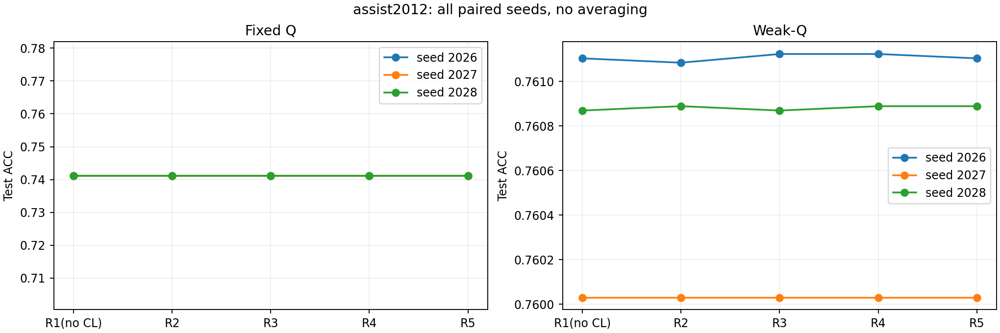

# assist2012：R0/R1/R2受控对比学习实验

主表不是均值：每个Q/条件内按最高验证ACC选择种子，并列选较小种子；两个test指标来自同一checkpoint。严禁把不同种子的单次结果直接相减解释模块收益，收益看全部配对种子。A0=固定参考Q，A1=Weak-Q。

| Q设置 | 条件 | CL系数 | 验证选优种子 | 最佳轮 | valid ACC | test ACC | test AUC |
| --- | --- | --- | --- | --- | --- | --- | --- |
| A0 | R0 | 0 | 2026 | 1 | 0.73588017 | 0.741151436 | 0.574343216 |
| A0 | R1 | 0 | 2026 | 1 | 0.73588017 | 0.741151436 | 0.574343216 |
| A0 | R2 | 0.1 | 2026 | 1 | 0.73588017 | 0.741151436 | 0.574343207 |
| A1 | R0 | 0 | 2028 | 21 | 0.758371124 | 0.760869141 | 0.706488021 |
| A1 | R1 | 0 | 2028 | 21 | 0.758371124 | 0.760869141 | 0.706488021 |
| A1 | R2 | 0.1 | 2028 | 21 | 0.758371124 | 0.760888663 | 0.706487842 |

## 数据与固定协议

数据集：assist2012；学生=4672，题目=984，概念=98；train/valid/test交互=[163385, 21831, 51223]。

使用data目录现有训练/验证/测试文件；没有重新划分。Q-F1表示与参考Q一致性，不能自动解释为认知诊断真实性。

R0参考原循环（统一验证ACC选模），R1新增入口λ=0并完全跳过CL训练分支，R2 λ=0.1。R2同时用于受控与敏感性实验，没有重复训练一份R2。模型、原始损失、α=0.8、Adam及学习率、128学生batch、30轮上限、patience=8均不变。验证ACC严格提升才更新checkpoint，平分保留最早轮。种子2026/2027/2028；每个数据集36次训练。

| 条件 | 正比例 | 正幅度 | 负比例 | 负幅度 |
| --- | --- | --- | --- | --- |
| R2 | 0.1 | 0.01 | 0.5 | 0.1 |
| R3 | 0.01 | 0.001 | 0.5 | 0.1 |
| R4 | 0.1 | 0.01 | 0.7 | 0.5 |
| R5 | 0.01 | 0.001 | 0.7 | 0.5 |

两输入不拼接。只对学生support的非零±1位置施加均匀连续噪声并裁剪到[-1,1]；0缺失、ID、标签、query和原数组不变。负噪声不翻转正误，只降低输入证据绝对值；因此极端响应不能直接当成诊断能力改善。验证/测试不增强。

损失沿用同学生一正一负InfoNCE，温度0.2，无margin。L=−正logit+logsumexp(正logit,负logit)。联合归一化项并不是独立负样本损失；负约束非零比例指负视图梯度范数>1e−12，不是margin激活率。

## 配置、代码和核验依据

以下完整配置/哈希和核验结果作为最终文档保留；用户要求清理新实验的checkpoint、原始日志及JSON/CSV副本。实际清理状态：自动审批以blocked by policy拒绝递归删除，原始产物仍暂存在Git忽略的scratch/student_cl_all_20261123。最终报告目录只包含Markdown和配图。若后续手工清理，便不能直接重放checkpoint，需按记录重跑。

<details><summary>完整配置、版本及数据/源码哈希</summary>

```json
{
  "experiment_id": "student_cl_all_assist2012_20261123",
  "dataset": "assist2012",
  "args": {
    "experiment_id": "student_cl_control_math1_20261123",
    "seeds": [
      2026,
      2027,
      2028
    ],
    "lambda_cl": 0.1,
    "positive_noise_ratio": 0.1,
    "positive_noise_scale": 0.01,
    "negative_noise_ratio": 0.5,
    "negative_noise_scale": 0.1,
    "noise_distribution": "uniform",
    "contrastive_seed": 1123,
    "temperature": 0.2,
    "dataset": "assist2012",
    "data_dir": "E:\\Desktop\\Gen-CD\\Q_GNCDM\\data\\assist2012",
    "alpha": 0.8,
    "embedding_dim": 32,
    "epochs": 30,
    "patience": 8,
    "batch_students": 128,
    "query_fraction": 0.25,
    "lr": 0.001,
    "q_lr": 0.005,
    "lambda_q": 0.01,
    "lambda_coverage": 0.01,
    "q_init_high": 0.55,
    "q_init_low": 0.45,
    "device": "cpu"
  },
  "noise_configs": {
    "R2": [
      0.1,
      0.01,
      0.5,
      0.1
    ],
    "R3": [
      0.01,
      0.001,
      0.5,
      0.1
    ],
    "R4": [
      0.1,
      0.01,
      0.7,
      0.5
    ],
    "R5": [
      0.01,
      0.001,
      0.7,
      0.5
    ]
  },
  "source_sha256": {
    "Q_GNCDM\\experiments\\run_controlled_student_cl.py": "9447f3fc2e79391b043148ae28717bee2f9f6a53dbe44352e5dddca3b6212a46",
    "Q_GNCDM\\experiments\\reference_student_cl_acc.py": "a974a5dbb0e36daf5ed49031be1838d69200e070f935d8f8f9dc31c0d9fa3dfc",
    "Q_GNCDM\\experiments\\controlled_student_cl.py": "4329530390f079ae00f6fa0d00af659e7e7be0f09134f8bc642b5a8caa0cb041",
    "Q_GNCDM\\experiments\\run_simple_contrastive.py": "196cbac42d9e7664eb4c24a4328bc852dca9265d7a88149adda0be924564a023",
    "Q_GNCDM\\models\\weak_q_gncdm.py": "5970f43820db2736bcf5f4e48039af50bf4203a5f391baa2046b8046c21517f5",
    "Q_GNCDM\\simple_contrastive.py": "30f0126846ab0e0d8802306ee183374a17730ed63f5bdd3ff6d76949b5252d97",
    "Q_GNCDM\\experiments\\run_weak_q_synthetic.py": "266d36d84cf1095189700a0b1f524f678accfd79feb94402ef6562f004f6b9b6",
    "Q_GNCDM\\experiments\\run_student_cl_all_datasets.py": "5c04daaf9a3ba1478c9d763e66348251162132ed385935c67e6d806635ec76bf",
    "Q_GNCDM\\experiments\\run_student_cl_noise_sensitivity.py": "b4c2c3850c4f49b26f60099c8d593128393ec8de80dcb3205d04fb27507f440f",
    "Q_GNCDM\\experiments\\run_prepared_dataset.py": "02b0fe433fcf75bea693b745149ac1654d866f044c81d9b2fc637b6f35d40c4d"
  },
  "data_sha256": {
    "train.csv": "78b6d630f0c4aa69f0ef01e221d69f8c2850c50af5412c023c6b56df3a790330",
    "valid.csv": "6930d91e3a135189d8141266bf9618fea2885739a9d81ed330e1c246d1185ff1",
    "test.csv": "ca86d57fc665826a39bac6773f9fa2895ffd31947e3cb7e8444aed3131fefa56",
    "Q_matrix.npy": "8483a4800cc53173f3bf114282fcc6d7ca351fff2d9338e39473707adefe2b4d",
    "Q_true.npy": "8483a4800cc53173f3bf114282fcc6d7ca351fff2d9338e39473707adefe2b4d",
    "manifest.json": "1132dab448a7e34219dadff1b62c54a70b4da5ae59026d433926d416cae522cb"
  },
  "train_shape": [
    4672,
    984
  ],
  "concepts": 98,
  "split_lengths": [
    163385,
    21831,
    51223
  ],
  "seeds": [
    2026,
    2027,
    2028
  ],
  "selection": "highest validation ACC, earliest epoch; display seed chosen by validation ACC, lowest seed tie",
  "retention": "user requests final Markdown reports and figures only; temporary originals removed after verification",
  "command": "E:\\Desktop\\Gen-CD\\.venv-contrastive\\Scripts\\python.exe -m Q_GNCDM.experiments.run_student_cl_all_datasets --dataset assist2012",
  "python": "3.13.9 (tags/v3.13.9:8183fa5, Oct 14 2025, 14:09:13) [MSC v.1944 64 bit (AMD64)]",
  "torch": "2.14.0+cpu",
  "numpy": "2.4.3",
  "git_head": "89290e14293fe00b1e4eb55ba87ed068c5eccfdc",
  "protocol": "R0 reference ACC selector; R1 CL off; R2 shared by control and noise studies; R3-R5 change noise only",
  "scheduling_records": [
    {
      "mode": "A0",
      "seed": 2028,
      "source_sha256": "f768bea86bd13315b1a465ba1a441eee5f55b2ce675818a872c80356c46ce63f",
      "source": "Q_GNCDM\\experiments\\run_student_cl_seed2028.py",
      "changes": "seed scheduling only, same frozen worker logic",
      "status": "published_complete_verified_group"
    },
    {
      "mode": "A1",
      "seed": 2028,
      "source_sha256": "f768bea86bd13315b1a465ba1a441eee5f55b2ce675818a872c80356c46ce63f",
      "source": "Q_GNCDM\\experiments\\run_student_cl_seed2028.py",
      "changes": "seed scheduling only, same frozen worker logic",
      "status": "primary_already_started; no overwrite"
    },
    [
      {
        "mode": "A1",
        "seed": 2028,
        "condition": "R4",
        "status": "copied_verified_run_without_overwrite",
        "publisher_sha256": "914af8c17a09a5d1c8aaf63dbac86aee993bb5b9a63770e0c64c71efdf41cace"
      },
      {
        "mode": "A1",
        "seed": 2028,
        "condition": "R5",
        "status": "copied_verified_run_without_overwrite",
        "publisher_sha256": "914af8c17a09a5d1c8aaf63dbac86aee993bb5b9a63770e0c64c71efdf41cace"
      }
    ]
  ],
  "scheduling_duplicate_state_checks": [
    {
      "mode": "A1",
      "seed": 2028,
      "condition": "R0",
      "checkpoint_exact": true
    },
    {
      "mode": "A1",
      "seed": 2028,
      "condition": "R1",
      "checkpoint_exact": true
    },
    {
      "mode": "A1",
      "seed": 2028,
      "condition": "R2",
      "checkpoint_exact": true
    },
    {
      "mode": "A1",
      "seed": 2028,
      "condition": "R3",
      "checkpoint_exact": true
    },
    {
      "mode": "A1",
      "seed": 2028,
      "condition": "R4",
      "checkpoint_exact": true
    },
    {
      "mode": "A1",
      "seed": 2028,
      "condition": "R5",
      "checkpoint_exact": true
    }
  ]
}
```
</details>

8种Q/噪声设置预检全部通过；同初始化固定batch的CL梯度、一步更新测试通过；新诊断的损失/梯度与原实现精确一致。6组R0/R1的逐轮日志与checkpoint精确一致；36个checkpoint的全部测试指标已重放核验。

```json
{
  "runs": 36,
  "preflight_settings": 8,
  "baseline_exact_pairs": 6,
  "checkpoint_replays": 36,
  "protected_code_and_data_unchanged": true,
  "status": "passed"
}
```

<details><summary>全部预检真实输出（含逐层梯度和单步参数更新差异）</summary>

```json
{
  "A0_R2": {
    "positive": {
      "selected_fraction": 0.1007375,
      "changed_fraction": 0.050225,
      "clipped_fraction_selected": 0.5014269760516193,
      "input_mae_observed": 0.00025183867546729743,
      "input_mae_all": 0.00020147094619460404,
      "input_max_change": 0.009997665882110596
    },
    "negative": {
      "selected_fraction": 0.5008875,
      "changed_fraction": 0.2517625,
      "clipped_fraction_selected": 0.4973671732674503,
      "input_mae_observed": 0.012591703794896603,
      "input_mae_all": 0.010073362849652767,
      "input_max_change": 0.09999817609786987
    },
    "gradient": {
      "original_shared_grad_norm": 5.301577653964478e-06,
      "cl_shared_grad_norm": 9.81928129048189e-09,
      "cl_to_original_grad_ratio": 0.001852143254591227,
      "weighted_cl_to_original_grad_ratio": 0.0001852143254591227
    },
    "per_layer": {
      "f_nn.f_layer_1.weight": {
        "original_grad_norm": 4.799548491973837e-07,
        "cl_grad_norm": 7.418108349810382e-10,
        "cl_finite": true
      },
      "f_nn.f_layer_1.bias": {
        "original_grad_norm": 2.773632274966076e-07,
        "cl_grad_norm": 3.4693867223545283e-10,
        "cl_finite": true
      },
      "f_nn.f_layer_2.weight": {
        "original_grad_norm": 5.208500624576118e-06,
        "cl_grad_norm": 9.604823603126533e-09,
        "cl_finite": true
      },
      "f_nn.f_layer_2.bias": {
        "original_grad_norm": 8.191222491404915e-07,
        "cl_grad_norm": 1.869495891426709e-09,
        "cl_finite": true
      }
    },
    "batch_diagnostics": {
      "ap_mse": 2.1631450797254814e-10,
      "an_mse": 1.262094997400709e-07,
      "ap_cos_distance": 1.5832483768463135e-08,
      "an_cos_distance": 1.6624107956886292e-07,
      "negative_softmax_probability": 0.4999998211860657,
      "negative_not_farther_fraction": 0.2265625,
      "positive_selected_fraction": 0.10382916053019146,
      "positive_changed_fraction": 0.047128129602356406,
      "positive_clipped_fraction_selected": 0.5460992907801419,
      "positive_input_mae_observed": 0.00024192487762775272,
      "positive_input_mae_all": 7.825218744983431e-06,
      "positive_input_max_change": 0.009984791278839111,
      "negative_selected_fraction": 0.49729995090819834,
      "negative_changed_fraction": 0.24496809032891506,
      "negative_clipped_fraction_selected": 0.5074037512339585,
      "negative_input_mae_observed": 0.01254056952893734,
      "negative_input_mae_all": 0.00040563291986472905,
      "negative_input_max_change": 0.09999865293502808
    },
    "loss_original": 1.0196532011032104,
    "loss_cl": 0.693146824836731,
    "loss_total": 1.0889679193496704,
    "single_step_parameter_changes": {
      "f_nn.f_layer_1.weight": {
        "gradient_difference_l2": 7.473898715251508e-11,
        "update_difference_l2": 5.749992658877524e-06,
        "baseline_update_l2": 0.034975875799373134,
        "cl_update_l2": 0.034974981990927564
      },
      "f_nn.f_layer_1.bias": {
        "gradient_difference_l2": 3.521865431219189e-11,
        "update_difference_l2": 4.509124182005731e-07,
        "baseline_update_l2": 0.006965061405148184,
        "cl_update_l2": 0.006965023782054002
      },
      "f_nn.f_layer_2.weight": {
        "gradient_difference_l2": 9.615203859697187e-10,
        "update_difference_l2": 3.198747574482662e-05,
        "baseline_update_l2": 0.03477665551841698,
        "cl_update_l2": 0.03477704682995602
      },
      "f_nn.f_layer_2.bias": {
        "gradient_difference_l2": 1.8709731116548644e-10,
        "update_difference_l2": 5.785522744615076e-06,
        "baseline_update_l2": 0.003923771797651179,
        "cl_update_l2": 0.0039238176855757425
      }
    },
    "zero_single_step_exact_parity": true,
    "status": "passed",
    "observed_branch_loss_and_gradient_exact": true,
    "observation_state_and_rng_unchanged": true,
    "extra_diagnostics": {
      "ap_mse": 2.1887594514602426e-10,
      "an_mse": 1.2712827412997285e-07,
      "ap_cos_distance": 1.0710209608078003e-08,
      "an_cos_distance": 1.6391277313232422e-07,
      "negative_softmax_probability": 0.4999998211860657,
      "negative_not_farther_fraction": 0.234375,
      "positive_energy": -5.0,
      "joint_log_partition": 5.693146228790283,
      "negative_relative_penalty": 0.693146824836731,
      "positive_view_grad_norm_mean": 5.999011963299805e-08,
      "negative_view_grad_norm_mean": 1.7552511408819023e-06,
      "negative_view_grad_nonzero_fraction": 1.0,
      "negative_view_grad_above_1e_12_fraction": 1.0,
      "positive_shared_partial_grad_norm": 1.1665028246689602e-10,
      "negative_shared_partial_grad_norm": 9.797256864458315e-09,
      "positive_selected_fraction": 0.10407461953853707,
      "positive_changed_fraction": 0.047619047619047616,
      "positive_clipped_fraction_selected": 0.5424528301886793,
      "positive_input_mae_observed": 0.00024857031530700624,
      "positive_input_mae_all": 8.040170541789848e-06,
      "positive_input_max_change": 0.009961724281311035,
      "positive_input_mse_observed": 1.7269575209866161e-06,
      "positive_clipped_fraction_observed": 0.05645557191948945,
      "positive_input_mae_changed": 0.005219976883381605,
      "positive_unchanged_student_fraction": 0.2734375,
      "negative_selected_fraction": 0.49680903289150713,
      "negative_changed_fraction": 0.25184094256259204,
      "negative_clipped_fraction_selected": 0.49308300395256915,
      "negative_input_mae_observed": 0.01303467433899641,
      "negative_input_mae_all": 0.00042161508463323116,
      "negative_input_max_change": 0.09999865293502808,
      "negative_input_mse_observed": 0.0008885901770554483,
      "negative_clipped_fraction_observed": 0.24496809032891506,
      "negative_input_mae_changed": 0.0517575666308403,
      "negative_unchanged_student_fraction": 0.0078125
    }
  },
  "A0_R3": {
    "positive": {
      "selected_fraction": 0.01045,
      "changed_fraction": 0.005025,
      "clipped_fraction_selected": 0.5179425837320574,
      "input_mae_observed": 2.512869286874775e-06,
      "input_mae_all": 2.010295474974555e-06,
      "input_max_change": 0.0009962916374206543
    },
    "negative": {
      "selected_fraction": 0.5008875,
      "changed_fraction": 0.2517625,
      "clipped_fraction_selected": 0.4973671732674503,
      "input_mae_observed": 0.012591703794896603,
      "input_mae_all": 0.010073362849652767,
      "input_max_change": 0.09999817609786987
    },
    "gradient": {
      "original_shared_grad_norm": 5.301577653964478e-06,
      "cl_shared_grad_norm": 9.831432093159982e-09,
      "cl_to_original_grad_ratio": 0.0018544351766323962,
      "weighted_cl_to_original_grad_ratio": 0.00018544351766323962
    },
    "per_layer": {
      "f_nn.f_layer_1.weight": {
        "original_grad_norm": 4.799548491973837e-07,
        "cl_grad_norm": 7.398888723919583e-10,
        "cl_finite": true
      },
      "f_nn.f_layer_1.bias": {
        "original_grad_norm": 2.773632274966076e-07,
        "cl_grad_norm": 3.4626920775160386e-10,
        "cl_finite": true
      },
      "f_nn.f_layer_2.weight": {
        "original_grad_norm": 5.208500624576118e-06,
        "cl_grad_norm": 9.616952567625958e-09,
        "cl_finite": true
      },
      "f_nn.f_layer_2.bias": {
        "original_grad_norm": 8.191222491404915e-07,
        "cl_grad_norm": 1.871886201598727e-09,
        "cl_finite": true
      }
    },
    "batch_diagnostics": {
      "ap_mse": 2.3752484354377934e-13,
      "an_mse": 1.262094997400709e-07,
      "ap_cos_distance": 7.450580596923828e-09,
      "an_cos_distance": 1.6624107956886292e-07,
      "negative_softmax_probability": 0.4999998211860657,
      "negative_not_farther_fraction": 0.1875,
      "positive_selected_fraction": 0.013500245459008346,
      "positive_changed_fraction": 0.0066273932253313695,
      "positive_clipped_fraction_selected": 0.509090909090909,
      "positive_input_mae_observed": 3.038095883312053e-06,
      "positive_input_mae_all": 9.826920432942643e-08,
      "positive_input_max_change": 0.0009961128234863281,
      "negative_selected_fraction": 0.49729995090819834,
      "negative_changed_fraction": 0.24496809032891506,
      "negative_clipped_fraction_selected": 0.5074037512339585,
      "negative_input_mae_observed": 0.01254056952893734,
      "negative_input_mae_all": 0.00040563291986472905,
      "negative_input_max_change": 0.09999865293502808
    },
    "loss_original": 1.0196532011032104,
    "loss_cl": 0.6931467056274414,
    "loss_total": 1.0889679193496704,
    "single_step_parameter_changes": {
      "f_nn.f_layer_1.weight": {
        "gradient_difference_l2": 7.422279758635784e-11,
        "update_difference_l2": 5.728306541238612e-06,
        "baseline_update_l2": 0.034975875799373134,
        "cl_update_l2": 0.034975055818241306
      },
      "f_nn.f_layer_1.bias": {
        "gradient_difference_l2": 3.5016198930346244e-11,
        "update_difference_l2": 4.5809996049902916e-07,
        "baseline_update_l2": 0.006965061405148184,
        "cl_update_l2": 0.006965030647770948
      },
      "f_nn.f_layer_2.weight": {
        "gradient_difference_l2": 9.626564790541524e-10,
        "update_difference_l2": 3.2091255178761586e-05,
        "baseline_update_l2": 0.03477665551841698,
        "cl_update_l2": 0.03477704970533208
      },
      "f_nn.f_layer_2.bias": {
        "gradient_difference_l2": 1.8739261184414686e-10,
        "update_difference_l2": 5.8100354822549646e-06,
        "baseline_update_l2": 0.003923771797651179,
        "cl_update_l2": 0.003923817661235999
      }
    },
    "zero_single_step_exact_parity": true,
    "status": "passed",
    "observed_branch_loss_and_gradient_exact": true,
    "observation_state_and_rng_unchanged": true,
    "extra_diagnostics": {
      "ap_mse": 2.3129569548703544e-13,
      "an_mse": 1.2712827412997285e-07,
      "ap_cos_distance": 7.450580596923828e-09,
      "an_cos_distance": 1.6391277313232422e-07,
      "negative_softmax_probability": 0.4999998211860657,
      "negative_not_farther_fraction": 0.21875,
      "positive_energy": -5.0,
      "joint_log_partition": 5.693146228790283,
      "negative_relative_penalty": 0.693146824836731,
      "positive_view_grad_norm_mean": 1.1340655364682279e-09,
      "negative_view_grad_norm_mean": 1.755251507352828e-06,
      "negative_view_grad_nonzero_fraction": 1.0,
      "negative_view_grad_above_1e_12_fraction": 1.0,
      "positive_shared_partial_grad_norm": 1.2872882307723693e-10,
      "negative_shared_partial_grad_norm": 9.795925298861106e-09,
      "positive_selected_fraction": 0.013009327442317134,
      "positive_changed_fraction": 0.006136475208640157,
      "positive_clipped_fraction_selected": 0.5283018867924528,
      "positive_input_mae_observed": 2.8150684556749184e-06,
      "positive_input_mae_all": 9.105523446351071e-08,
      "positive_input_max_change": 0.0009961128234863281,
      "positive_input_mse_observed": 1.8523240719048317e-09,
      "positive_clipped_fraction_observed": 0.006872852233676976,
      "positive_input_mae_changed": 0.00045874356874264777,
      "positive_unchanged_student_fraction": 0.8203125,
      "negative_selected_fraction": 0.49680903289150713,
      "negative_changed_fraction": 0.25184094256259204,
      "negative_clipped_fraction_selected": 0.49308300395256915,
      "negative_input_mae_observed": 0.01303467433899641,
      "negative_input_mae_all": 0.00042161508463323116,
      "negative_input_max_change": 0.09999865293502808,
      "negative_input_mse_observed": 0.0008885901770554483,
      "negative_clipped_fraction_observed": 0.24496809032891506,
      "negative_input_mae_changed": 0.0517575666308403,
      "negative_unchanged_student_fraction": 0.0078125
    }
  },
  "A0_R4": {
    "positive": {
      "selected_fraction": 0.1007375,
      "changed_fraction": 0.050225,
      "clipped_fraction_selected": 0.5014269760516193,
      "input_mae_observed": 0.00025183867546729743,
      "input_mae_all": 0.00020147094619460404,
      "input_max_change": 0.009997665882110596
    },
    "negative": {
      "selected_fraction": 0.7017125,
      "changed_fraction": 0.3529375,
      "clipped_fraction_selected": 0.4970340417193651,
      "input_mae_observed": 0.08849677443504333,
      "input_mae_all": 0.07079741358757019,
      "input_max_change": 0.4999908208847046
    },
    "gradient": {
      "original_shared_grad_norm": 5.301577653964478e-06,
      "cl_shared_grad_norm": 4.082016361093704e-07,
      "cl_to_original_grad_ratio": 0.07699625710549018,
      "weighted_cl_to_original_grad_ratio": 0.00769962571054902
    },
    "per_layer": {
      "f_nn.f_layer_1.weight": {
        "original_grad_norm": 4.799548491973837e-07,
        "cl_grad_norm": 2.4961471112305844e-08,
        "cl_finite": true
      },
      "f_nn.f_layer_1.bias": {
        "original_grad_norm": 2.773632274966076e-07,
        "cl_grad_norm": 1.421640494214671e-08,
        "cl_finite": true
      },
      "f_nn.f_layer_2.weight": {
        "original_grad_norm": 5.208500624576118e-06,
        "cl_grad_norm": 3.99650218696479e-07,
        "cl_finite": true
      },
      "f_nn.f_layer_2.bias": {
        "original_grad_norm": 8.191222491404915e-07,
        "cl_grad_norm": 7.799443579870058e-08,
        "cl_finite": true
      }
    },
    "batch_diagnostics": {
      "ap_mse": 2.1631450797254814e-10,
      "an_mse": 4.594968231685925e-06,
      "ap_cos_distance": 1.5832483768463135e-08,
      "an_cos_distance": 5.964189767837524e-06,
      "negative_softmax_probability": 0.4999925196170807,
      "negative_not_farther_fraction": 0.0,
      "positive_selected_fraction": 0.10382916053019146,
      "positive_changed_fraction": 0.047128129602356406,
      "positive_clipped_fraction_selected": 0.5460992907801419,
      "positive_input_mae_observed": 0.00024192487762775272,
      "positive_input_mae_all": 7.825218744983431e-06,
      "positive_input_max_change": 0.009984791278839111,
      "negative_selected_fraction": 0.6966126656848306,
      "negative_changed_fraction": 0.3443789887088856,
      "negative_clipped_fraction_selected": 0.5056377730796335,
      "negative_input_mae_observed": 0.08600010722875595,
      "negative_input_mae_all": 0.0027817299123853445,
      "negative_input_max_change": 0.49999338388442993
    },
    "loss_original": 1.0196532011032104,
    "loss_cl": 0.6931322813034058,
    "loss_total": 1.0889663696289062,
    "single_step_parameter_changes": {
      "f_nn.f_layer_1.weight": {
        "gradient_difference_l2": 2.4964381853876472e-09,
        "update_difference_l2": 0.00019332551445264013,
        "baseline_update_l2": 0.034975875799373134,
        "cl_update_l2": 0.034951331255941
      },
      "f_nn.f_layer_1.bias": {
        "gradient_difference_l2": 1.4217262866968927e-09,
        "update_difference_l2": 2.0078700126651895e-05,
        "baseline_update_l2": 0.006965061405148184,
        "cl_update_l2": 0.006965579271194721
      },
      "f_nn.f_layer_2.weight": {
        "gradient_difference_l2": 3.99650732855913e-08,
        "update_difference_l2": 0.0012529203254452185,
        "baseline_update_l2": 0.03477665551841698,
        "cl_update_l2": 0.034808918143257185
      },
      "f_nn.f_layer_2.bias": {
        "gradient_difference_l2": 7.799474321190602e-09,
        "update_difference_l2": 0.00021955303377319295,
        "baseline_update_l2": 0.003923771797651179,
        "cl_update_l2": 0.0039295385878561975
      }
    },
    "zero_single_step_exact_parity": true,
    "status": "passed",
    "observed_branch_loss_and_gradient_exact": true,
    "observation_state_and_rng_unchanged": true,
    "extra_diagnostics": {
      "ap_mse": 2.1887594514602426e-10,
      "an_mse": 4.6200843826227356e-06,
      "ap_cos_distance": 1.0710209608078003e-08,
      "an_cos_distance": 5.968380719423294e-06,
      "negative_softmax_probability": 0.4999925494194031,
      "negative_not_farther_fraction": 0.0078125,
      "positive_energy": -5.0,
      "joint_log_partition": 5.693132400512695,
      "negative_relative_penalty": 0.6931322813034058,
      "positive_view_grad_norm_mean": 6.000088488035684e-08,
      "negative_view_grad_norm_mean": 1.0632598809477751e-05,
      "negative_view_grad_nonzero_fraction": 1.0,
      "negative_view_grad_above_1e_12_fraction": 1.0,
      "positive_shared_partial_grad_norm": 1.1312558932418332e-10,
      "negative_shared_partial_grad_norm": 4.33344615324075e-07,
      "positive_selected_fraction": 0.10407461953853707,
      "positive_changed_fraction": 0.047619047619047616,
      "positive_clipped_fraction_selected": 0.5424528301886793,
      "positive_input_mae_observed": 0.00024857031530700624,
      "positive_input_mae_all": 8.040170541789848e-06,
      "positive_input_max_change": 0.009961724281311035,
      "positive_input_mse_observed": 1.7269575209866161e-06,
      "positive_clipped_fraction_observed": 0.05645557191948945,
      "positive_input_mae_changed": 0.005219976883381605,
      "positive_unchanged_student_fraction": 0.2734375,
      "negative_selected_fraction": 0.6978399607265586,
      "negative_changed_fraction": 0.35247913598429065,
      "negative_clipped_fraction_selected": 0.49489975378121703,
      "negative_input_mae_observed": 0.0888771191239357,
      "negative_input_mae_all": 0.0028747888281941414,
      "negative_input_max_change": 0.49999338388442993,
      "negative_input_mse_observed": 0.02998390607535839,
      "negative_clipped_fraction_observed": 0.34536082474226804,
      "negative_input_mae_changed": 0.2521485984325409,
      "negative_unchanged_student_fraction": 0.0078125
    }
  },
  "A0_R5": {
    "positive": {
      "selected_fraction": 0.01045,
      "changed_fraction": 0.005025,
      "clipped_fraction_selected": 0.5179425837320574,
      "input_mae_observed": 2.512869286874775e-06,
      "input_mae_all": 2.010295474974555e-06,
      "input_max_change": 0.0009962916374206543
    },
    "negative": {
      "selected_fraction": 0.7017125,
      "changed_fraction": 0.3529375,
      "clipped_fraction_selected": 0.4970340417193651,
      "input_mae_observed": 0.08849677443504333,
      "input_mae_all": 0.07079741358757019,
      "input_max_change": 0.4999908208847046
    },
    "gradient": {
      "original_shared_grad_norm": 5.301577653964478e-06,
      "cl_shared_grad_norm": 4.082199226220587e-07,
      "cl_to_original_grad_ratio": 0.07699970636416031,
      "weighted_cl_to_original_grad_ratio": 0.007699970636416031
    },
    "per_layer": {
      "f_nn.f_layer_1.weight": {
        "original_grad_norm": 4.799548491973837e-07,
        "cl_grad_norm": 2.495926310075447e-08,
        "cl_finite": true
      },
      "f_nn.f_layer_1.bias": {
        "original_grad_norm": 2.773632274966076e-07,
        "cl_grad_norm": 1.4215502552872294e-08,
        "cl_finite": true
      },
      "f_nn.f_layer_2.weight": {
        "original_grad_norm": 5.208500624576118e-06,
        "cl_grad_norm": 3.99668380168805e-07,
        "cl_finite": true
      },
      "f_nn.f_layer_2.bias": {
        "original_grad_norm": 8.191222491404915e-07,
        "cl_grad_norm": 7.799784640383223e-08,
        "cl_finite": true
      }
    },
    "batch_diagnostics": {
      "ap_mse": 2.3752484354377934e-13,
      "an_mse": 4.594968231685925e-06,
      "ap_cos_distance": 7.450580596923828e-09,
      "an_cos_distance": 5.964189767837524e-06,
      "negative_softmax_probability": 0.4999925196170807,
      "negative_not_farther_fraction": 0.0,
      "positive_selected_fraction": 0.013500245459008346,
      "positive_changed_fraction": 0.0066273932253313695,
      "positive_clipped_fraction_selected": 0.509090909090909,
      "positive_input_mae_observed": 3.038095883312053e-06,
      "positive_input_mae_all": 9.826920432942643e-08,
      "positive_input_max_change": 0.0009961128234863281,
      "negative_selected_fraction": 0.6966126656848306,
      "negative_changed_fraction": 0.3443789887088856,
      "negative_clipped_fraction_selected": 0.5056377730796335,
      "negative_input_mae_observed": 0.08600010722875595,
      "negative_input_mae_all": 0.0027817299123853445,
      "negative_input_max_change": 0.49999338388442993
    },
    "loss_original": 1.0196532011032104,
    "loss_cl": 0.6931322813034058,
    "loss_total": 1.0889663696289062,
    "single_step_parameter_changes": {
      "f_nn.f_layer_1.weight": {
        "gradient_difference_l2": 2.4961512925991256e-09,
        "update_difference_l2": 0.00019331268299148128,
        "baseline_update_l2": 0.034975875799373134,
        "cl_update_l2": 0.034951391624486405
      },
      "f_nn.f_layer_1.bias": {
        "gradient_difference_l2": 1.421612767263911e-09,
        "update_difference_l2": 2.0088538541932804e-05,
        "baseline_update_l2": 0.006965061405148184,
        "cl_update_l2": 0.006965586264190409
      },
      "f_nn.f_layer_2.weight": {
        "gradient_difference_l2": 3.996665330016075e-08,
        "update_difference_l2": 0.0012530855319531013,
        "baseline_update_l2": 0.03477665551841698,
        "cl_update_l2": 0.03480892341478168
      },
      "f_nn.f_layer_2.bias": {
        "gradient_difference_l2": 7.799760816735121e-09,
        "update_difference_l2": 0.000219585488568609,
        "baseline_update_l2": 0.003923771797651179,
        "cl_update_l2": 0.003929540689780462
      }
    },
    "zero_single_step_exact_parity": true,
    "status": "passed",
    "observed_branch_loss_and_gradient_exact": true,
    "observation_state_and_rng_unchanged": true,
    "extra_diagnostics": {
      "ap_mse": 2.3129569548703544e-13,
      "an_mse": 4.6200843826227356e-06,
      "ap_cos_distance": 7.450580596923828e-09,
      "an_cos_distance": 5.968380719423294e-06,
      "negative_softmax_probability": 0.4999925494194031,
      "negative_not_farther_fraction": 0.0078125,
      "positive_energy": -5.0,
      "joint_log_partition": 5.693132400512695,
      "negative_relative_penalty": 0.6931322813034058,
      "positive_view_grad_norm_mean": 1.1434862011295802e-09,
      "negative_view_grad_norm_mean": 1.0632598079820592e-05,
      "negative_view_grad_nonzero_fraction": 1.0,
      "negative_view_grad_above_1e_12_fraction": 1.0,
      "positive_shared_partial_grad_norm": 1.0995653144293309e-10,
      "negative_shared_partial_grad_norm": 4.3334529402116193e-07,
      "positive_selected_fraction": 0.013009327442317134,
      "positive_changed_fraction": 0.006136475208640157,
      "positive_clipped_fraction_selected": 0.5283018867924528,
      "positive_input_mae_observed": 2.8150684556749184e-06,
      "positive_input_mae_all": 9.105523446351071e-08,
      "positive_input_max_change": 0.0009961128234863281,
      "positive_input_mse_observed": 1.8523240719048317e-09,
      "positive_clipped_fraction_observed": 0.006872852233676976,
      "positive_input_mae_changed": 0.00045874356874264777,
      "positive_unchanged_student_fraction": 0.8203125,
      "negative_selected_fraction": 0.6978399607265586,
      "negative_changed_fraction": 0.35247913598429065,
      "negative_clipped_fraction_selected": 0.49489975378121703,
      "negative_input_mae_observed": 0.0888771191239357,
      "negative_input_mae_all": 0.0028747888281941414,
      "negative_input_max_change": 0.49999338388442993,
      "negative_input_mse_observed": 0.02998390607535839,
      "negative_clipped_fraction_observed": 0.34536082474226804,
      "negative_input_mae_changed": 0.2521485984325409,
      "negative_unchanged_student_fraction": 0.0078125
    }
  },
  "A1_R2": {
    "positive": {
      "selected_fraction": 0.1007375,
      "changed_fraction": 0.050225,
      "clipped_fraction_selected": 0.5014269760516193,
      "input_mae_observed": 0.00025183867546729743,
      "input_mae_all": 0.00020147094619460404,
      "input_max_change": 0.009997665882110596
    },
    "negative": {
      "selected_fraction": 0.5008875,
      "changed_fraction": 0.2517625,
      "clipped_fraction_selected": 0.4973671732674503,
      "input_mae_observed": 0.012591703794896603,
      "input_mae_all": 0.010073362849652767,
      "input_max_change": 0.09999817609786987
    },
    "gradient": {
      "original_shared_grad_norm": 0.00039919070339998014,
      "cl_shared_grad_norm": 1.0131162720443978e-09,
      "cl_to_original_grad_ratio": 2.537925516339688e-06,
      "weighted_cl_to_original_grad_ratio": 2.537925516339688e-07
    },
    "per_layer": {
      "q_logits": {
        "original_grad_norm": 0.00039303043740801513,
        "cl_grad_norm": 7.895121778567216e-10,
        "cl_finite": true
      },
      "f_nn.f_layer_1.weight": {
        "original_grad_norm": 3.695297891681548e-06,
        "cl_grad_norm": 8.922404481914725e-11,
        "cl_finite": true
      },
      "f_nn.f_layer_1.bias": {
        "original_grad_norm": 2.073367568300455e-06,
        "cl_grad_norm": 3.7490135995632556e-11,
        "cl_finite": true
      },
      "f_nn.f_layer_2.weight": {
        "original_grad_norm": 6.88848813297227e-05,
        "cl_grad_norm": 6.14745088167723e-10,
        "cl_finite": true
      },
      "f_nn.f_layer_2.bias": {
        "original_grad_norm": 1.079643152479548e-05,
        "cl_grad_norm": 1.2567623330905775e-10,
        "cl_finite": true
      }
    },
    "batch_diagnostics": {
      "ap_mse": 5.019071824818866e-09,
      "an_mse": 3.842042588075856e-06,
      "ap_cos_distance": 6.984919309616089e-09,
      "an_cos_distance": 1.30385160446167e-08,
      "negative_softmax_probability": 0.5,
      "negative_not_farther_fraction": 0.65625,
      "positive_selected_fraction": 0.10382916053019146,
      "positive_changed_fraction": 0.047128129602356406,
      "positive_clipped_fraction_selected": 0.5460992907801419,
      "positive_input_mae_observed": 0.00024192487762775272,
      "positive_input_mae_all": 7.825218744983431e-06,
      "positive_input_max_change": 0.009984791278839111,
      "negative_selected_fraction": 0.49729995090819834,
      "negative_changed_fraction": 0.24496809032891506,
      "negative_clipped_fraction_selected": 0.5074037512339585,
      "negative_input_mae_observed": 0.01254056952893734,
      "negative_input_mae_all": 0.00040563291986472905,
      "negative_input_max_change": 0.09999865293502808
    },
    "loss_original": 1.0124588012695312,
    "loss_cl": 0.6931472420692444,
    "loss_total": 1.0817735195159912,
    "single_step_parameter_changes": {
      "q_logits": {
        "gradient_difference_l2": 8.079548793159542e-11,
        "update_difference_l2": 3.8340314207433045e-06,
        "baseline_update_l2": 1.2929037996694732,
        "cl_update_l2": 1.2929038050671222
      },
      "f_nn.f_layer_1.weight": {
        "gradient_difference_l2": 8.769291782300522e-12,
        "update_difference_l2": 4.523916096604316e-07,
        "baseline_update_l2": 0.115273284293707,
        "cl_update_l2": 0.11527329558738826
      },
      "f_nn.f_layer_1.bias": {
        "gradient_difference_l2": 2.321341194398594e-12,
        "update_difference_l2": 2.9490841176850015e-08,
        "baseline_update_l2": 0.008883907842887697,
        "cl_update_l2": 0.008883906456893687
      },
      "f_nn.f_layer_2.weight": {
        "gradient_difference_l2": 6.093564144201517e-11,
        "update_difference_l2": 1.2014110564863983e-07,
        "baseline_update_l2": 0.09345214889875723,
        "cl_update_l2": 0.0934521434537628
      },
      "f_nn.f_layer_2.bias": {
        "gradient_difference_l2": 1.2402124770952793e-11,
        "update_difference_l2": 1.1200702829899959e-08,
        "baseline_update_l2": 0.009577433202129842,
        "cl_update_l2": 0.00957743295781233
      }
    },
    "zero_single_step_exact_parity": true,
    "status": "passed",
    "observed_branch_loss_and_gradient_exact": true,
    "observation_state_and_rng_unchanged": true,
    "extra_diagnostics": {
      "ap_mse": 5.056778551448815e-09,
      "an_mse": 4.088797595613869e-06,
      "ap_cos_distance": 4.6566128730773926e-09,
      "an_cos_distance": 9.313225746154785e-09,
      "negative_softmax_probability": 0.5,
      "negative_not_farther_fraction": 0.671875,
      "positive_energy": -5.0,
      "joint_log_partition": 5.693146705627441,
      "negative_relative_penalty": 0.6931471824645996,
      "positive_view_grad_norm_mean": 3.0762708414051203e-09,
      "negative_view_grad_norm_mean": 8.377935236440455e-08,
      "negative_view_grad_nonzero_fraction": 1.0,
      "negative_view_grad_above_1e_12_fraction": 1.0,
      "positive_shared_partial_grad_norm": 1.2882831120203294e-10,
      "negative_shared_partial_grad_norm": 1.0284846932929183e-09,
      "positive_selected_fraction": 0.10407461953853707,
      "positive_changed_fraction": 0.047619047619047616,
      "positive_clipped_fraction_selected": 0.5424528301886793,
      "positive_input_mae_observed": 0.00024857031530700624,
      "positive_input_mae_all": 8.040170541789848e-06,
      "positive_input_max_change": 0.009961724281311035,
      "positive_input_mse_observed": 1.7269575209866161e-06,
      "positive_clipped_fraction_observed": 0.05645557191948945,
      "positive_input_mae_changed": 0.005219976883381605,
      "positive_unchanged_student_fraction": 0.2734375,
      "negative_selected_fraction": 0.49680903289150713,
      "negative_changed_fraction": 0.25184094256259204,
      "negative_clipped_fraction_selected": 0.49308300395256915,
      "negative_input_mae_observed": 0.01303467433899641,
      "negative_input_mae_all": 0.00042161508463323116,
      "negative_input_max_change": 0.09999865293502808,
      "negative_input_mse_observed": 0.0008885901770554483,
      "negative_clipped_fraction_observed": 0.24496809032891506,
      "negative_input_mae_changed": 0.0517575666308403,
      "negative_unchanged_student_fraction": 0.0078125
    }
  },
  "A1_R3": {
    "positive": {
      "selected_fraction": 0.01045,
      "changed_fraction": 0.005025,
      "clipped_fraction_selected": 0.5179425837320574,
      "input_mae_observed": 2.512869286874775e-06,
      "input_mae_all": 2.010295474974555e-06,
      "input_max_change": 0.0009962916374206543
    },
    "negative": {
      "selected_fraction": 0.5008875,
      "changed_fraction": 0.2517625,
      "clipped_fraction_selected": 0.4973671732674503,
      "input_mae_observed": 0.012591703794896603,
      "input_mae_all": 0.010073362849652767,
      "input_max_change": 0.09999817609786987
    },
    "gradient": {
      "original_shared_grad_norm": 0.00039919070339998014,
      "cl_shared_grad_norm": 1.0189300194777204e-09,
      "cl_to_original_grad_ratio": 2.5524893510778365e-06,
      "weighted_cl_to_original_grad_ratio": 2.552489351077837e-07
    },
    "per_layer": {
      "q_logits": {
        "original_grad_norm": 0.00039303043740801513,
        "cl_grad_norm": 7.891016173822152e-10,
        "cl_finite": true
      },
      "f_nn.f_layer_1.weight": {
        "original_grad_norm": 3.695297891681548e-06,
        "cl_grad_norm": 8.759878239450458e-11,
        "cl_finite": true
      },
      "f_nn.f_layer_1.bias": {
        "original_grad_norm": 2.073367568300455e-06,
        "cl_grad_norm": 4.010313262026166e-11,
        "cl_finite": true
      },
      "f_nn.f_layer_2.weight": {
        "original_grad_norm": 6.88848813297227e-05,
        "cl_grad_norm": 6.24519769232279e-10,
        "cl_finite": true
      },
      "f_nn.f_layer_2.bias": {
        "original_grad_norm": 1.079643152479548e-05,
        "cl_grad_norm": 1.2738499144404614e-10,
        "cl_finite": true
      }
    },
    "batch_diagnostics": {
      "ap_mse": 3.916895887495775e-12,
      "an_mse": 3.842042588075856e-06,
      "ap_cos_distance": 1.4435499906539917e-08,
      "an_cos_distance": 1.30385160446167e-08,
      "negative_softmax_probability": 0.5,
      "negative_not_farther_fraction": 0.6953125,
      "positive_selected_fraction": 0.013500245459008346,
      "positive_changed_fraction": 0.0066273932253313695,
      "positive_clipped_fraction_selected": 0.509090909090909,
      "positive_input_mae_observed": 3.038095883312053e-06,
      "positive_input_mae_all": 9.826920432942643e-08,
      "positive_input_max_change": 0.0009961128234863281,
      "negative_selected_fraction": 0.49729995090819834,
      "negative_changed_fraction": 0.24496809032891506,
      "negative_clipped_fraction_selected": 0.5074037512339585,
      "negative_input_mae_observed": 0.01254056952893734,
      "negative_input_mae_all": 0.00040563291986472905,
      "negative_input_max_change": 0.09999865293502808
    },
    "loss_original": 1.0124588012695312,
    "loss_cl": 0.6931471228599548,
    "loss_total": 1.0817735195159912,
    "single_step_parameter_changes": {
      "q_logits": {
        "gradient_difference_l2": 8.085096657006316e-11,
        "update_difference_l2": 3.849405754797361e-06,
        "baseline_update_l2": 1.2929037996694732,
        "cl_update_l2": 1.2929038045792494
      },
      "f_nn.f_layer_1.weight": {
        "gradient_difference_l2": 8.767466983239016e-12,
        "update_difference_l2": 4.813481218325868e-07,
        "baseline_update_l2": 0.115273284293707,
        "cl_update_l2": 0.11527329198557787
      },
      "f_nn.f_layer_1.bias": {
        "gradient_difference_l2": 3.2203158084332196e-12,
        "update_difference_l2": 4.126960102813034e-08,
        "baseline_update_l2": 0.008883907842887697,
        "cl_update_l2": 0.008883905947804612
      },
      "f_nn.f_layer_2.weight": {
        "gradient_difference_l2": 6.261613434689381e-11,
        "update_difference_l2": 1.175100808328446e-07,
        "baseline_update_l2": 0.09345214889875723,
        "cl_update_l2": 0.09345214369427755
      },
      "f_nn.f_layer_2.bias": {
        "gradient_difference_l2": 1.2646926306338158e-11,
        "update_difference_l2": 8.229336437336599e-09,
        "baseline_update_l2": 0.009577433202129842,
        "cl_update_l2": 0.00957743354299494
      }
    },
    "zero_single_step_exact_parity": true,
    "status": "passed",
    "observed_branch_loss_and_gradient_exact": true,
    "observation_state_and_rng_unchanged": true,
    "extra_diagnostics": {
      "ap_mse": 3.6359402901670057e-12,
      "an_mse": 4.088797595613869e-06,
      "ap_cos_distance": 5.587935447692871e-09,
      "an_cos_distance": 9.313225746154785e-09,
      "negative_softmax_probability": 0.5,
      "negative_not_farther_fraction": 0.7109375,
      "positive_energy": -5.0,
      "joint_log_partition": 5.693146705627441,
      "negative_relative_penalty": 0.6931471824645996,
      "positive_view_grad_norm_mean": 2.8149025925081843e-10,
      "negative_view_grad_norm_mean": 8.377815283815532e-08,
      "negative_view_grad_nonzero_fraction": 1.0,
      "negative_view_grad_above_1e_12_fraction": 1.0,
      "positive_shared_partial_grad_norm": 1.5906188926571648e-10,
      "negative_shared_partial_grad_norm": 1.0275648817458426e-09,
      "positive_selected_fraction": 0.013009327442317134,
      "positive_changed_fraction": 0.006136475208640157,
      "positive_clipped_fraction_selected": 0.5283018867924528,
      "positive_input_mae_observed": 2.8150684556749184e-06,
      "positive_input_mae_all": 9.105523446351071e-08,
      "positive_input_max_change": 0.0009961128234863281,
      "positive_input_mse_observed": 1.8523240719048317e-09,
      "positive_clipped_fraction_observed": 0.006872852233676976,
      "positive_input_mae_changed": 0.00045874356874264777,
      "positive_unchanged_student_fraction": 0.8203125,
      "negative_selected_fraction": 0.49680903289150713,
      "negative_changed_fraction": 0.25184094256259204,
      "negative_clipped_fraction_selected": 0.49308300395256915,
      "negative_input_mae_observed": 0.01303467433899641,
      "negative_input_mae_all": 0.00042161508463323116,
      "negative_input_max_change": 0.09999865293502808,
      "negative_input_mse_observed": 0.0008885901770554483,
      "negative_clipped_fraction_observed": 0.24496809032891506,
      "negative_input_mae_changed": 0.0517575666308403,
      "negative_unchanged_student_fraction": 0.0078125
    }
  },
  "A1_R4": {
    "positive": {
      "selected_fraction": 0.1007375,
      "changed_fraction": 0.050225,
      "clipped_fraction_selected": 0.5014269760516193,
      "input_mae_observed": 0.00025183867546729743,
      "input_mae_all": 0.00020147094619460404,
      "input_max_change": 0.009997665882110596
    },
    "negative": {
      "selected_fraction": 0.7017125,
      "changed_fraction": 0.3529375,
      "clipped_fraction_selected": 0.4970340417193651,
      "input_mae_observed": 0.08849677443504333,
      "input_mae_all": 0.07079741358757019,
      "input_max_change": 0.4999908208847046
    },
    "gradient": {
      "original_shared_grad_norm": 0.00039919070339998014,
      "cl_shared_grad_norm": 3.782289152888194e-08,
      "cl_to_original_grad_ratio": 9.474892878701199e-05,
      "weighted_cl_to_original_grad_ratio": 9.4748928787012e-06
    },
    "per_layer": {
      "q_logits": {
        "original_grad_norm": 0.00039303043740801513,
        "cl_grad_norm": 2.6585803780676542e-08,
        "cl_finite": true
      },
      "f_nn.f_layer_1.weight": {
        "original_grad_norm": 3.695297891681548e-06,
        "cl_grad_norm": 2.1659054549871826e-09,
        "cl_finite": true
      },
      "f_nn.f_layer_1.bias": {
        "original_grad_norm": 2.073367568300455e-06,
        "cl_grad_norm": 1.8149823866053794e-09,
        "cl_finite": true
      },
      "f_nn.f_layer_2.weight": {
        "original_grad_norm": 6.88848813297227e-05,
        "cl_grad_norm": 2.623092143494432e-08,
        "cl_finite": true
      },
      "f_nn.f_layer_2.bias": {
        "original_grad_norm": 1.079643152479548e-05,
        "cl_grad_norm": 5.264462199505715e-09,
        "cl_finite": true
      }
    },
    "batch_diagnostics": {
      "ap_mse": 5.019071824818866e-09,
      "an_mse": 0.00016500246420037001,
      "ap_cos_distance": 6.984919309616089e-09,
      "an_cos_distance": 3.632158041000366e-08,
      "negative_softmax_probability": 0.5,
      "negative_not_farther_fraction": 0.546875,
      "positive_selected_fraction": 0.10382916053019146,
      "positive_changed_fraction": 0.047128129602356406,
      "positive_clipped_fraction_selected": 0.5460992907801419,
      "positive_input_mae_observed": 0.00024192487762775272,
      "positive_input_mae_all": 7.825218744983431e-06,
      "positive_input_max_change": 0.009984791278839111,
      "negative_selected_fraction": 0.6966126656848306,
      "negative_changed_fraction": 0.3443789887088856,
      "negative_clipped_fraction_selected": 0.5056377730796335,
      "negative_input_mae_observed": 0.08600010722875595,
      "negative_input_mae_all": 0.0027817299123853445,
      "negative_input_max_change": 0.49999338388442993
    },
    "loss_original": 1.0124588012695312,
    "loss_cl": 0.6931471824645996,
    "loss_total": 1.0817735195159912,
    "single_step_parameter_changes": {
      "q_logits": {
        "gradient_difference_l2": 2.658622334356837e-09,
        "update_difference_l2": 0.00011257348087489669,
        "baseline_update_l2": 1.2929037996694732,
        "cl_update_l2": 1.2929039334820673
      },
      "f_nn.f_layer_1.weight": {
        "gradient_difference_l2": 2.166628062329225e-10,
        "update_difference_l2": 9.018859360709528e-06,
        "baseline_update_l2": 0.115273284293707,
        "cl_update_l2": 0.115273011413495
      },
      "f_nn.f_layer_1.bias": {
        "gradient_difference_l2": 1.8040549732886365e-10,
        "update_difference_l2": 2.372533531947913e-06,
        "baseline_update_l2": 0.008883907842887697,
        "cl_update_l2": 0.008883809013087218
      },
      "f_nn.f_layer_2.weight": {
        "gradient_difference_l2": 2.6208075952913867e-09,
        "update_difference_l2": 2.2315275844947594e-06,
        "baseline_update_l2": 0.09345214889875723,
        "cl_update_l2": 0.09345193647733045
      },
      "f_nn.f_layer_2.bias": {
        "gradient_difference_l2": 5.262804684257839e-10,
        "update_difference_l2": 2.847921627976335e-07,
        "baseline_update_l2": 0.009577433202129842,
        "cl_update_l2": 0.009577402216180546
      }
    },
    "zero_single_step_exact_parity": true,
    "status": "passed",
    "observed_branch_loss_and_gradient_exact": true,
    "observation_state_and_rng_unchanged": true,
    "extra_diagnostics": {
      "ap_mse": 5.056778551448815e-09,
      "an_mse": 0.00018024109886027873,
      "ap_cos_distance": 4.6566128730773926e-09,
      "an_cos_distance": 2.1420419216156006e-08,
      "negative_softmax_probability": 0.5,
      "negative_not_farther_fraction": 0.6171875,
      "positive_energy": -5.0,
      "joint_log_partition": 5.693146705627441,
      "negative_relative_penalty": 0.6931471824645996,
      "positive_view_grad_norm_mean": 3.0730238425565774e-09,
      "negative_view_grad_norm_mean": 5.193156581984571e-07,
      "negative_view_grad_nonzero_fraction": 1.0,
      "negative_view_grad_above_1e_12_fraction": 1.0,
      "positive_shared_partial_grad_norm": 1.2229543020799127e-10,
      "negative_shared_partial_grad_norm": 3.890458652636136e-08,
      "positive_selected_fraction": 0.10407461953853707,
      "positive_changed_fraction": 0.047619047619047616,
      "positive_clipped_fraction_selected": 0.5424528301886793,
      "positive_input_mae_observed": 0.00024857031530700624,
      "positive_input_mae_all": 8.040170541789848e-06,
      "positive_input_max_change": 0.009961724281311035,
      "positive_input_mse_observed": 1.7269575209866161e-06,
      "positive_clipped_fraction_observed": 0.05645557191948945,
      "positive_input_mae_changed": 0.005219976883381605,
      "positive_unchanged_student_fraction": 0.2734375,
      "negative_selected_fraction": 0.6978399607265586,
      "negative_changed_fraction": 0.35247913598429065,
      "negative_clipped_fraction_selected": 0.49489975378121703,
      "negative_input_mae_observed": 0.0888771191239357,
      "negative_input_mae_all": 0.0028747888281941414,
      "negative_input_max_change": 0.49999338388442993,
      "negative_input_mse_observed": 0.02998390607535839,
      "negative_clipped_fraction_observed": 0.34536082474226804,
      "negative_input_mae_changed": 0.2521485984325409,
      "negative_unchanged_student_fraction": 0.0078125
    }
  },
  "A1_R5": {
    "positive": {
      "selected_fraction": 0.01045,
      "changed_fraction": 0.005025,
      "clipped_fraction_selected": 0.5179425837320574,
      "input_mae_observed": 2.512869286874775e-06,
      "input_mae_all": 2.010295474974555e-06,
      "input_max_change": 0.0009962916374206543
    },
    "negative": {
      "selected_fraction": 0.7017125,
      "changed_fraction": 0.3529375,
      "clipped_fraction_selected": 0.4970340417193651,
      "input_mae_observed": 0.08849677443504333,
      "input_mae_all": 0.07079741358757019,
      "input_max_change": 0.4999908208847046
    },
    "gradient": {
      "original_shared_grad_norm": 0.00039919070339998014,
      "cl_shared_grad_norm": 3.7827219299992824e-08,
      "cl_to_original_grad_ratio": 9.475977014948366e-05,
      "weighted_cl_to_original_grad_ratio": 9.475977014948367e-06
    },
    "per_layer": {
      "q_logits": {
        "original_grad_norm": 0.00039303043740801513,
        "cl_grad_norm": 2.6586533863337536e-08,
        "cl_finite": true
      },
      "f_nn.f_layer_1.weight": {
        "original_grad_norm": 3.695297891681548e-06,
        "cl_grad_norm": 2.1663890681367093e-09,
        "cl_finite": true
      },
      "f_nn.f_layer_1.bias": {
        "original_grad_norm": 2.073367568300455e-06,
        "cl_grad_norm": 1.8140410285027997e-09,
        "cl_finite": true
      },
      "f_nn.f_layer_2.weight": {
        "original_grad_norm": 6.88848813297227e-05,
        "cl_grad_norm": 2.6236335770590813e-08,
        "cl_finite": true
      },
      "f_nn.f_layer_2.bias": {
        "original_grad_norm": 1.079643152479548e-05,
        "cl_grad_norm": 5.2650297455159034e-09,
        "cl_finite": true
      }
    },
    "batch_diagnostics": {
      "ap_mse": 3.916895887495775e-12,
      "an_mse": 0.00016500246420037001,
      "ap_cos_distance": 1.4435499906539917e-08,
      "an_cos_distance": 3.632158041000366e-08,
      "negative_softmax_probability": 0.5,
      "negative_not_farther_fraction": 0.578125,
      "positive_selected_fraction": 0.013500245459008346,
      "positive_changed_fraction": 0.0066273932253313695,
      "positive_clipped_fraction_selected": 0.509090909090909,
      "positive_input_mae_observed": 3.038095883312053e-06,
      "positive_input_mae_all": 9.826920432942643e-08,
      "positive_input_max_change": 0.0009961128234863281,
      "negative_selected_fraction": 0.6966126656848306,
      "negative_changed_fraction": 0.3443789887088856,
      "negative_clipped_fraction_selected": 0.5056377730796335,
      "negative_input_mae_observed": 0.08600010722875595,
      "negative_input_mae_all": 0.0027817299123853445,
      "negative_input_max_change": 0.49999338388442993
    },
    "loss_original": 1.0124588012695312,
    "loss_cl": 0.6931471824645996,
    "loss_total": 1.0817735195159912,
    "single_step_parameter_changes": {
      "q_logits": {
        "gradient_difference_l2": 2.6586109241722036e-09,
        "update_difference_l2": 0.00011258375386768836,
        "baseline_update_l2": 1.2929037996694732,
        "cl_update_l2": 1.2929039332729848
      },
      "f_nn.f_layer_1.weight": {
        "gradient_difference_l2": 2.1688762008853496e-10,
        "update_difference_l2": 9.023216012595238e-06,
        "baseline_update_l2": 0.115273284293707,
        "cl_update_l2": 0.11527301046141863
      },
      "f_nn.f_layer_1.bias": {
        "gradient_difference_l2": 1.811486709789803e-10,
        "update_difference_l2": 2.3815368151684823e-06,
        "baseline_update_l2": 0.008883907842887697,
        "cl_update_l2": 0.008883809005498814
      },
      "f_nn.f_layer_2.weight": {
        "gradient_difference_l2": 2.6229633764171573e-09,
        "update_difference_l2": 2.2300147264233476e-06,
        "baseline_update_l2": 0.09345214889875723,
        "cl_update_l2": 0.09345193621641615
      },
      "f_nn.f_layer_2.bias": {
        "gradient_difference_l2": 5.263248584909634e-10,
        "update_difference_l2": 2.846678372930291e-07,
        "baseline_update_l2": 0.009577433202129842,
        "cl_update_l2": 0.00957740327657285
      }
    },
    "zero_single_step_exact_parity": true,
    "status": "passed",
    "observed_branch_loss_and_gradient_exact": true,
    "observation_state_and_rng_unchanged": true,
    "extra_diagnostics": {
      "ap_mse": 3.6359402901670057e-12,
      "an_mse": 0.00018024109886027873,
      "ap_cos_distance": 5.587935447692871e-09,
      "an_cos_distance": 2.1420419216156006e-08,
      "negative_softmax_probability": 0.5,
      "negative_not_farther_fraction": 0.6328125,
      "positive_energy": -5.0,
      "joint_log_partition": 5.693146705627441,
      "negative_relative_penalty": 0.6931471824645996,
      "positive_view_grad_norm_mean": 2.857914730278926e-10,
      "negative_view_grad_norm_mean": 5.193144402964803e-07,
      "negative_view_grad_nonzero_fraction": 1.0,
      "negative_view_grad_above_1e_12_fraction": 1.0,
      "positive_shared_partial_grad_norm": 1.674525655446898e-10,
      "negative_shared_partial_grad_norm": 3.889573417517657e-08,
      "positive_selected_fraction": 0.013009327442317134,
      "positive_changed_fraction": 0.006136475208640157,
      "positive_clipped_fraction_selected": 0.5283018867924528,
      "positive_input_mae_observed": 2.8150684556749184e-06,
      "positive_input_mae_all": 9.105523446351071e-08,
      "positive_input_max_change": 0.0009961128234863281,
      "positive_input_mse_observed": 1.8523240719048317e-09,
      "positive_clipped_fraction_observed": 0.006872852233676976,
      "positive_input_mae_changed": 0.00045874356874264777,
      "positive_unchanged_student_fraction": 0.8203125,
      "negative_selected_fraction": 0.6978399607265586,
      "negative_changed_fraction": 0.35247913598429065,
      "negative_clipped_fraction_selected": 0.49489975378121703,
      "negative_input_mae_observed": 0.0888771191239357,
      "negative_input_mae_all": 0.0028747888281941414,
      "negative_input_max_change": 0.49999338388442993,
      "negative_input_mse_observed": 0.02998390607535839,
      "negative_clipped_fraction_observed": 0.34536082474226804,
      "negative_input_mae_changed": 0.2521485984325409,
      "negative_unchanged_student_fraction": 0.0078125
    }
  }
}
```
</details>

## 全部条件的初始固定batch敏感性

| Q | 条件 | CL损失 | 正MSE | 负MSE | CL共享梯度 | 加权CL/原梯度 |
| --- | --- | --- | --- | --- | --- | --- |
| A0 | R2 | 0.693146825 | 2.16314508e-10 | 1.262095e-07 | 9.81928129e-09 | 0.000185214325 |
| A0 | R3 | 0.693146706 | 2.37524844e-13 | 1.262095e-07 | 9.83143209e-09 | 0.000185443518 |
| A0 | R4 | 0.693132281 | 2.16314508e-10 | 4.59496823e-06 | 4.08201636e-07 | 0.00769962571 |
| A0 | R5 | 0.693132281 | 2.37524844e-13 | 4.59496823e-06 | 4.08219923e-07 | 0.00769997064 |
| A1 | R2 | 0.693147242 | 5.01907182e-09 | 3.84204259e-06 | 1.01311627e-09 | 2.53792552e-07 |
| A1 | R3 | 0.693147123 | 3.91689589e-12 | 3.84204259e-06 | 1.01893002e-09 | 2.55248935e-07 |
| A1 | R4 | 0.693147182 | 5.01907182e-09 | 0.000165002464 | 3.78228915e-08 | 9.47489288e-06 |
| A1 | R5 | 0.693147182 | 3.91689589e-12 | 0.000165002464 | 3.78272193e-08 | 9.47597701e-06 |

## 全部逐种子结果（相对R1配对差值）

| Q | seed | 条件 | 最佳轮 | 训练轮 | valid ACC | test ACC | test AUC | ΔACC | ΔAUC | RMSE | Brier | NLL | Q-F1 |
| --- | --- | --- | --- | --- | --- | --- | --- | --- | --- | --- | --- | --- | --- |
| A0 | 2026 | R0 | 1 | 9 | 0.73588017 | 0.741151436 | 0.574343216 | 0 | 0 | 0.437716412 | 0.191595657 | 0.57118707 | 1 |
| A0 | 2026 | R1 | 1 | 9 | 0.73588017 | 0.741151436 | 0.574343216 | 0 | 0 | 0.437716412 | 0.191595657 | 0.57118707 | 1 |
| A0 | 2026 | R2 | 1 | 9 | 0.73588017 | 0.741151436 | 0.574343207 | 0 | -8.93984065e-09 | 0.437716412 | 0.191595657 | 0.57118707 | 1 |
| A0 | 2027 | R0 | 1 | 9 | 0.73588017 | 0.741151436 | 0.584813982 | 0 | 0 | 0.43961506 | 0.193261401 | 0.575798973 | 1 |
| A0 | 2027 | R1 | 1 | 9 | 0.73588017 | 0.741151436 | 0.584813982 | 0 | 0 | 0.43961506 | 0.193261401 | 0.575798973 | 1 |
| A0 | 2027 | R2 | 1 | 9 | 0.73588017 | 0.741151436 | 0.584814103 | 0 | 1.21184507e-07 | 0.43961506 | 0.193261401 | 0.575798973 | 1 |
| A0 | 2028 | R0 | 1 | 9 | 0.73588017 | 0.741151436 | 0.597887671 | 0 | 0 | 0.440657507 | 0.194179038 | 0.578515773 | 1 |
| A0 | 2028 | R1 | 1 | 9 | 0.73588017 | 0.741151436 | 0.597887671 | 0 | 0 | 0.440657507 | 0.194179038 | 0.578515773 | 1 |
| A0 | 2028 | R2 | 1 | 9 | 0.73588017 | 0.741151436 | 0.597887717 | 0 | 4.5692519e-08 | 0.440657506 | 0.194179038 | 0.578515771 | 1 |
| A1 | 2026 | R0 | 21 | 29 | 0.757546608 | 0.761103411 | 0.70534212 | 0 | 0 | 0.412336009 | 0.170020985 | 0.517247028 | 0.0527545696 |
| A1 | 2026 | R1 | 21 | 29 | 0.757546608 | 0.761103411 | 0.70534212 | 0 | 0 | 0.412336009 | 0.170020985 | 0.517247028 | 0.0527545696 |
| A1 | 2026 | R2 | 21 | 29 | 0.757546608 | 0.761083888 | 0.705342747 | -1.95224801e-05 | 6.27775478e-07 | 0.412335971 | 0.170020953 | 0.517246923 | 0.0527579473 |
| A1 | 2027 | R0 | 12 | 20 | 0.756401447 | 0.760029674 | 0.703263851 | 0 | 0 | 0.413301576 | 0.170818193 | 0.519306272 | 0.0810186234 |
| A1 | 2027 | R1 | 12 | 20 | 0.756401447 | 0.760029674 | 0.703263851 | 0 | 0 | 0.413301576 | 0.170818193 | 0.519306272 | 0.0810186234 |
| A1 | 2027 | R2 | 12 | 20 | 0.756401447 | 0.760029674 | 0.703263923 | 0 | 7.15187254e-08 | 0.413301567 | 0.170818185 | 0.519306245 | 0.0810149524 |
| A1 | 2028 | R0 | 21 | 29 | 0.758371124 | 0.760869141 | 0.706488021 | 0 | 0 | 0.412151587 | 0.169868931 | 0.516466934 | 0.06541632 |
| A1 | 2028 | R1 | 21 | 29 | 0.758371124 | 0.760869141 | 0.706488021 | 0 | 0 | 0.412151587 | 0.169868931 | 0.516466934 | 0.06541632 |
| A1 | 2028 | R2 | 21 | 29 | 0.758371124 | 0.760888663 | 0.706487842 | 1.95224801e-05 | -1.79790129e-07 | 0.412151577 | 0.169868922 | 0.516466924 | 0.0654187937 |

## 补充统计：不替代主表

| Q | 条件 | ACC均值 | ACC样本SD | AUC均值 | AUC样本SD | 配对ΔACC均值 | 配对ΔAUC均值 | 配对ΔACC SD | 配对ΔAUC SD |
| --- | --- | --- | --- | --- | --- | --- | --- | --- | --- |
| A0 | R0 | 0.741151436 | 0 | 0.585681623 | 0.0117961834 | 0 | 0 | 0 | 0 |
| A0 | R1 | 0.741151436 | 0 | 0.585681623 | 0.0117961834 | 0 | 0 | 0 | 0 |
| A0 | R2 | 0.741151436 | 0 | 0.585681676 | 0.0117962069 | 0 | 5.26457284e-08 | 0 | 6.53402387e-08 |
| A1 | R0 | 0.760667409 | 0.000564578965 | 0.705031331 | 0.00163439929 | 0 | 0 | 0 | 0 |
| A1 | R1 | 0.760667409 | 0.000564578965 | 0.705031331 | 0.00163439929 | 0 | 0 | 0 | 0 |
| A1 | R2 | 0.760667409 | 0.00056085382 | 0.705031504 | 0.00163434024 | 0 | 1.73168025e-07 | 1.95224801e-05 | 4.13267453e-07 |

## 训练损失与诊断

| Q | seed | 条件 | 原损失(含Q) | CL损失 | 加权CL | 总损失 |
| --- | --- | --- | --- | --- | --- | --- |
| A0 | 2026 | R0 | 0.607324524 | 0 | 0 | 0.607324524 |
| A0 | 2026 | R1 | 0.607324524 | 0 | 0 | 0.607324524 |
| A0 | 2026 | R2 | 0.607324515 | 0.69314681 | 0.069314681 | 0.676639179 |
| A0 | 2027 | R0 | 0.587674604 | 0 | 0 | 0.587674604 |
| A0 | 2027 | R1 | 0.587674604 | 0 | 0 | 0.587674604 |
| A0 | 2027 | R2 | 0.587674596 | 0.693146806 | 0.0693146806 | 0.656989259 |
| A0 | 2028 | R0 | 0.598584907 | 0 | 0 | 0.598584907 |
| A0 | 2028 | R1 | 0.598584907 | 0 | 0 | 0.598584907 |
| A0 | 2028 | R2 | 0.598584898 | 0.6931468 | 0.06931468 | 0.667899559 |
| A1 | 2026 | R0 | 0.544042867 | 0 | 0 | 0.544042867 |
| A1 | 2026 | R1 | 0.544042867 | 0 | 0 | 0.544042867 |
| A1 | 2026 | R2 | 0.544042863 | 0.693147104 | 0.0693147104 | 0.613357579 |
| A1 | 2027 | R0 | 0.540630967 | 0 | 0 | 0.540630967 |
| A1 | 2027 | R1 | 0.540630967 | 0 | 0 | 0.540630967 |
| A1 | 2027 | R2 | 0.540630965 | 0.693147152 | 0.0693147152 | 0.609945682 |
| A1 | 2028 | R0 | 0.538944118 | 0 | 0 | 0.538944118 |
| A1 | 2028 | R1 | 0.538944118 | 0 | 0 | 0.538944118 |
| A1 | 2028 | R2 | 0.538944093 | 0.693147121 | 0.0693147121 | 0.608258811 |

## W参数差异

以下比较每个运行按验证ACC选出的最终参数；可能含不同最佳轮的影响。CL参与更新的因果证据来自上述同batch单步测试。有效PosLinear权重为|W|。

| Q | seed | 参数 | 形状 | 原W均值 | CL W均值 | 差L2 | 最大差 | \|W\|差L2 |
| --- | --- | --- | --- | --- | --- | --- | --- | --- |
| A0 | 2026 | q_logits | [984, 98] | -13.5336924 | -13.5336924 | 0 | 0 | 0 |
| A0 | 2026 | f_nn.f_layer_1.weight | [98, 984] | -5.30554826e-05 | -5.30572142e-05 | 9.73005356e-05 | 6.34230673e-06 | 9.73005356e-05 |
| A0 | 2026 | f_nn.f_layer_1.bias | [98] | 0.0173129179 | 0.0173131283 | 4.23950077e-06 | 1.32969581e-06 | 4.23950077e-06 |
| A0 | 2026 | f_nn.f_layer_2.weight | [98, 98] | -1.36118415e-05 | -1.36030412e-05 | 0.000230470346 | 5.28991222e-06 | 0.000230470346 |
| A0 | 2026 | f_nn.f_layer_2.bias | [98] | -0.000926834007 | -0.000923983578 | 4.54636728e-05 | 1.10641122e-05 | 4.54636728e-05 |
| A0 | 2026 | g_nn.g_layer_1.weight | [98, 4672] | 0.00243428606 | 0.00243428606 | 1.22478558e-06 | 2.23517418e-08 | 1.22478558e-06 |
| A0 | 2026 | g_nn.g_layer_1.bias | [98] | 0.00940371212 | 0.00940371118 | 1.96608936e-08 | 5.58793545e-09 | 1.96608936e-08 |
| A0 | 2026 | g_nn.g_layer_2.weight | [98, 98] | 0.00368695729 | 0.00368695823 | 3.77553973e-07 | 5.96046448e-08 | 3.77553973e-07 |
| A0 | 2026 | g_nn.g_layer_2.bias | [98] | 0.00446300115 | 0.00446300115 | 1.99285384e-08 | 7.4505806e-09 | 1.99285384e-08 |
| A0 | 2026 | g_nn.g_layer_3.weight | [98, 98] | 0.00406054361 | 0.00406054361 | 2.97076147e-07 | 2.98023224e-08 | 2.97076147e-07 |
| A0 | 2026 | g_nn.g_layer_3.bias | [98] | 0.0140649723 | 0.0140649714 | 2.17967289e-08 | 7.4505806e-09 | 2.17967289e-08 |
| A0 | 2026 | theta_agg_mat.weight | [32, 98] | 0.000359049707 | 0.000359049707 | 2.2979938e-07 | 4.47034836e-08 | 2.2979938e-07 |
| A0 | 2026 | theta_agg_mat.bias | [32] | 0.0123774223 | 0.0123774195 | 2.62107746e-08 | 2.23517418e-08 | 2.62107746e-08 |
| A0 | 2026 | psi_agg_mat.weight | [32, 98] | -0.00151485903 | -0.00151485868 | 1.71620728e-07 | 2.98023224e-08 | 1.71620728e-07 |
| A0 | 2026 | psi_agg_mat.bias | [32] | 0.0117294025 | 0.0117294034 | 2.20587836e-08 | 1.49011612e-08 | 2.20587836e-08 |
| A0 | 2026 | ncd.pred_layer_1.weight | [64, 32] | 0.00270705856 | 0.0027070581 | 2.62604554e-07 | 7.4505806e-08 | 2.62604554e-07 |
| A0 | 2026 | ncd.pred_layer_1.bias | [64] | 0.0118537601 | 0.0118537592 | 2.2983109e-08 | 1.49011612e-08 | 2.2983109e-08 |
| A0 | 2026 | ncd.pred_layer_2.weight | [32, 64] | 0.00158436783 | 0.00158436783 | 1.27027645e-07 | 5.96046448e-08 | 1.27027645e-07 |
| A0 | 2026 | ncd.pred_layer_2.bias | [32] | -0.00582924485 | -0.00582924485 | 1.13300281e-08 | 7.4505806e-09 | 1.13300281e-08 |
| A0 | 2026 | ncd.pred_layer_3.weight | [1, 32] | -0.0104984473 | -0.0104984473 | 5.01532555e-09 | 4.65661287e-09 | 5.01532555e-09 |
| A0 | 2026 | ncd.pred_layer_3.bias | [1] | 0.174429178 | 0.174429178 | 0 | 0 | 0 |
| A1 | 2026 | q_logits | [984, 98] | -0.130969077 | -0.13096872 | 0.00547053739 | 0.000270843506 | 0.00547052313 |
| A1 | 2026 | f_nn.f_layer_1.weight | [98, 984] | -8.45531467e-05 | -9.27325236e-05 | 1.06949838 | 0.0997541249 | 0.303621523 |
| A1 | 2026 | f_nn.f_layer_1.bias | [98] | -0.536448002 | -0.536439836 | 0.00203113033 | 0.000766426325 | 0.00203113033 |
| A1 | 2026 | f_nn.f_layer_2.weight | [98, 98] | 0.000348523434 | 0.000378793833 | 0.747097187 | 0.145387411 | 0.0868265447 |
| A1 | 2026 | f_nn.f_layer_2.bias | [98] | -0.628360927 | -0.62836206 | 0.000379530562 | 0.000179111958 | 0.000379530562 |
| A1 | 2026 | g_nn.g_layer_1.weight | [98, 4672] | 0.0011415988 | 0.00114156317 | 0.000989811861 | 1.68830156e-05 | 0.000989806113 |
| A1 | 2026 | g_nn.g_layer_1.bias | [98] | 0.000479731796 | 0.00047955825 | 7.5746122e-06 | 2.14297324e-06 | 7.5746122e-06 |
| A1 | 2026 | g_nn.g_layer_2.weight | [98, 98] | 0.00568243861 | 0.00568230683 | 8.56398789e-05 | 4.29153442e-06 | 8.56398789e-05 |
| A1 | 2026 | g_nn.g_layer_2.bias | [98] | 0.00920814741 | 0.00920795184 | 7.03745844e-06 | 1.93715096e-06 | 7.03745844e-06 |
| A1 | 2026 | g_nn.g_layer_3.weight | [98, 98] | 0.0197861698 | 0.0197859555 | 9.049743e-05 | 4.11272049e-06 | 9.049743e-05 |
| A1 | 2026 | g_nn.g_layer_3.bias | [98] | 0.0267696828 | 0.026769558 | 7.8028459e-06 | 1.88499689e-06 | 7.8028459e-06 |
| A1 | 2026 | theta_agg_mat.weight | [32, 98] | 9.04882472e-06 | 8.52329322e-06 | 0.00165827077 | 0.00165441027 | 0.00165827077 |
| A1 | 2026 | theta_agg_mat.bias | [32] | -0.035106536 | -0.0351058505 | 5.25766132e-06 | 2.20537186e-06 | 5.25766132e-06 |
| A1 | 2026 | psi_agg_mat.weight | [32, 98] | 0.0305108484 | 0.0305103213 | 6.07262252e-05 | 4.35113907e-06 | 6.07262252e-05 |
| A1 | 2026 | psi_agg_mat.bias | [32] | 0.0592133626 | 0.0592126809 | 5.22655518e-06 | 2.16066837e-06 | 5.22655518e-06 |
| A1 | 2026 | ncd.pred_layer_1.weight | [64, 32] | 0.00225155405 | 0.00225152401 | 5.31918658e-05 | 1.94460154e-05 | 5.31918658e-05 |
| A1 | 2026 | ncd.pred_layer_1.bias | [64] | -0.0161313303 | -0.0161313117 | 6.93306163e-06 | 2.65240669e-06 | 6.93306163e-06 |
| A1 | 2026 | ncd.pred_layer_2.weight | [32, 64] | -0.0475096181 | -0.0475094393 | 4.51299427e-05 | 5.81145287e-06 | 4.51299427e-05 |
| A1 | 2026 | ncd.pred_layer_2.bias | [32] | -0.0438223146 | -0.0438220873 | 2.9653787e-06 | 1.4025718e-06 | 2.9653787e-06 |
| A1 | 2026 | ncd.pred_layer_3.weight | [1, 32] | 0.0228006542 | 0.0228008144 | 1.55169074e-06 | 5.81145287e-07 | 1.55169074e-06 |
| A1 | 2026 | ncd.pred_layer_3.bias | [1] | 0.312815368 | 0.312815696 | 3.27825546e-07 | 3.27825546e-07 | 3.27825546e-07 |
| A0 | 2027 | q_logits | [984, 98] | -13.5336924 | -13.5336924 | 0 | 0 | 0 |
| A0 | 2027 | f_nn.f_layer_1.weight | [98, 984] | 9.90656263e-05 | 9.90548797e-05 | 0.00125839646 | 0.00125340465 | 0.000307448356 |
| A0 | 2027 | f_nn.f_layer_1.bias | [98] | -0.0083541153 | -0.00835563987 | 1.90040636e-05 | 4.25358303e-06 | 1.90040636e-05 |
| A0 | 2027 | f_nn.f_layer_2.weight | [98, 98] | -0.00136377825 | -0.00136382575 | 0.00027791284 | 9.01892781e-06 | 0.00027791284 |
| A0 | 2027 | f_nn.f_layer_2.bias | [98] | 0.00236521289 | 0.00236811675 | 4.7193677e-05 | 1.29714608e-05 | 4.7193677e-05 |
| A0 | 2027 | g_nn.g_layer_1.weight | [98, 4672] | 0.000619010127 | 0.000619010127 | 1.29993146e-06 | 1.86264515e-08 | 1.29993146e-06 |
| A0 | 2027 | g_nn.g_layer_1.bias | [98] | 0.00132949185 | 0.00132949115 | 1.98941021e-08 | 6.51925802e-09 | 1.98941021e-08 |
| A0 | 2027 | g_nn.g_layer_2.weight | [98, 98] | 0.00431737117 | 0.00431737117 | 3.84072211e-07 | 4.47034836e-08 | 3.84072211e-07 |
| A0 | 2027 | g_nn.g_layer_2.bias | [98] | 0.00690442091 | 0.00690442091 | 2.51096407e-08 | 7.4505806e-09 | 2.51096407e-08 |
| A0 | 2027 | g_nn.g_layer_3.weight | [98, 98] | 0.000951290305 | 0.000951290538 | 3.27811651e-07 | 2.98023224e-08 | 3.27811651e-07 |
| A0 | 2027 | g_nn.g_layer_3.bias | [98] | 0.000942501181 | 0.000942501472 | 1.85772739e-08 | 7.4505806e-09 | 1.85772739e-08 |
| A0 | 2027 | theta_agg_mat.weight | [32, 98] | 0.000784773845 | 0.000784774369 | 2.54627726e-07 | 5.96046448e-08 | 2.54627726e-07 |
| A0 | 2027 | theta_agg_mat.bias | [32] | -0.00338203809 | -0.00338203856 | 1.48135924e-08 | 7.4505806e-09 | 1.48135924e-08 |
| A0 | 2027 | psi_agg_mat.weight | [32, 98] | -0.000299879495 | -0.000299879321 | 1.56332471e-07 | 2.98023224e-08 | 1.56332471e-07 |
| A0 | 2027 | psi_agg_mat.bias | [32] | 0.00143397646 | 0.00143397739 | 1.56828334e-08 | 7.4505806e-09 | 1.56828334e-08 |
| A0 | 2027 | ncd.pred_layer_1.weight | [64, 32] | -0.00454845512 | -0.00454845373 | 3.73849003e-07 | 5.96046448e-08 | 3.73849003e-07 |
| A0 | 2027 | ncd.pred_layer_1.bias | [64] | 0.0139364535 | 0.0139364526 | 2.37535758e-08 | 1.49011612e-08 | 2.37535758e-08 |
| A0 | 2027 | ncd.pred_layer_2.weight | [32, 64] | 0.0014055795 | 0.00140557962 | 1.51424913e-07 | 2.98023224e-08 | 1.51424913e-07 |
| A0 | 2027 | ncd.pred_layer_2.bias | [32] | -0.00369187468 | -0.00369187514 | 1.71979752e-08 | 1.49011612e-08 | 1.71979752e-08 |
| A0 | 2027 | ncd.pred_layer_3.weight | [1, 32] | 0.0114650726 | 0.0114650726 | 1.05777911e-08 | 7.4505806e-09 | 1.05777911e-08 |
| A0 | 2027 | ncd.pred_layer_3.bias | [1] | 0.191877708 | 0.191877708 | 0 | 0 | 0 |
| A1 | 2027 | q_logits | [984, 98] | -0.143713564 | -0.143713564 | 0.000429075971 | 2.43932009e-05 | 0.000429068201 |
| A1 | 2027 | f_nn.f_layer_1.weight | [98, 984] | 0.000185205819 | 0.000186133257 | 0.155628534 | 0.0377497599 | 0.0589401392 |
| A1 | 2027 | f_nn.f_layer_1.bias | [98] | -0.298318982 | -0.29831782 | 7.6438774e-05 | 3.66866589e-05 | 7.6438774e-05 |
| A1 | 2027 | f_nn.f_layer_2.weight | [98, 98] | 0.000218114204 | 0.000214595391 | 0.0712340126 | 0.0552864149 | 0.0136611764 |
| A1 | 2027 | f_nn.f_layer_2.bias | [98] | -0.311259717 | -0.311257839 | 0.000115876964 | 0.000114306808 | 0.000115876964 |
| A1 | 2027 | g_nn.g_layer_1.weight | [98, 4672] | -0.00120343443 | -0.00120343675 | 5.64833065e-05 | 8.84756446e-07 | 5.64833065e-05 |
| A1 | 2027 | g_nn.g_layer_1.bias | [98] | -0.00218564202 | -0.00218566949 | 7.31306338e-07 | 2.90572643e-07 | 7.31306338e-07 |
| A1 | 2027 | g_nn.g_layer_2.weight | [98, 98] | -0.00230895029 | -0.00230893865 | 9.18887178e-06 | 5.36441803e-07 | 9.18887178e-06 |
| A1 | 2027 | g_nn.g_layer_2.bias | [98] | -0.00316779525 | -0.00316778058 | 7.27049699e-07 | 1.93715096e-07 | 7.27049699e-07 |
| A1 | 2027 | g_nn.g_layer_3.weight | [98, 98] | 0.0159556679 | 0.0159556828 | 8.85656038e-06 | 4.76837158e-07 | 8.85656038e-06 |
| A1 | 2027 | g_nn.g_layer_3.bias | [98] | 0.0122610675 | 0.0122610973 | 8.1665603e-07 | 2.5331974e-07 | 8.1665603e-07 |
| A1 | 2027 | theta_agg_mat.weight | [32, 98] | 0.000754173903 | 0.000754178618 | 1.33927244e-05 | 3.9562583e-06 | 1.33927244e-05 |
| A1 | 2027 | theta_agg_mat.bias | [32] | -0.0420381203 | -0.0420381278 | 3.08539962e-07 | 1.00582838e-07 | 3.08539962e-07 |
| A1 | 2027 | psi_agg_mat.weight | [32, 98] | 0.032810159 | 0.0328101665 | 5.15252794e-06 | 4.17232513e-07 | 5.15252794e-06 |
| A1 | 2027 | psi_agg_mat.bias | [32] | 0.040090058 | 0.0400900617 | 3.70549073e-07 | 1.93715096e-07 | 3.70549073e-07 |
| A1 | 2027 | ncd.pred_layer_1.weight | [64, 32] | -0.00540191215 | -0.00540190702 | 3.42092115e-06 | 4.76837158e-07 | 3.42092115e-06 |
| A1 | 2027 | ncd.pred_layer_1.bias | [64] | 0.0135285202 | 0.0135285147 | 5.8401983e-07 | 2.5331974e-07 | 5.8401983e-07 |
| A1 | 2027 | ncd.pred_layer_2.weight | [32, 64] | -0.0446282253 | -0.0446282215 | 3.82190935e-06 | 7.00354576e-07 | 3.82190935e-06 |
| A1 | 2027 | ncd.pred_layer_2.bias | [32] | -0.0432012789 | -0.0432012603 | 2.40846181e-07 | 1.04308128e-07 | 2.40846181e-07 |
| A1 | 2027 | ncd.pred_layer_3.weight | [1, 32] | 0.0351265743 | 0.0351265855 | 3.00139404e-07 | 1.34110451e-07 | 3.00139404e-07 |
| A1 | 2027 | ncd.pred_layer_3.bias | [1] | 0.300515145 | 0.300515175 | 2.98023224e-08 | 2.98023224e-08 | 2.98023224e-08 |
| A0 | 2028 | q_logits | [984, 98] | -13.5336924 | -13.5336924 | 0 | 0 | 0 |
| A0 | 2028 | f_nn.f_layer_1.weight | [98, 984] | 1.9334344e-05 | 1.93313535e-05 | 0.000801313575 | 0.00065969635 | 0.000456912218 |
| A0 | 2028 | f_nn.f_layer_1.bias | [98] | -0.0201579612 | -0.0201591719 | 1.74495667e-05 | 7.36862421e-06 | 1.74495667e-05 |
| A0 | 2028 | f_nn.f_layer_2.weight | [98, 98] | -0.000341638923 | -0.000341420237 | 0.0015411155 | 0.00130526908 | 0.000918973168 |
| A0 | 2028 | f_nn.f_layer_2.bias | [98] | -0.00579957757 | -0.00579704437 | 4.30788716e-05 | 1.26734376e-05 | 4.30788716e-05 |
| A0 | 2028 | g_nn.g_layer_1.weight | [98, 4672] | 0.000599701016 | 0.000599701016 | 1.32154631e-06 | 2.98023224e-08 | 1.32154631e-06 |
| A0 | 2028 | g_nn.g_layer_1.bias | [98] | 0.00346023147 | 0.00346023077 | 2.07725519e-08 | 5.58793545e-09 | 2.07725519e-08 |
| A0 | 2028 | g_nn.g_layer_2.weight | [98, 98] | 0.00248342217 | 0.0024834217 | 4.11552192e-07 | 2.98023224e-08 | 4.11552192e-07 |
| A0 | 2028 | g_nn.g_layer_2.bias | [98] | 0.00580778392 | 0.00580778392 | 2.91633742e-08 | 1.49011612e-08 | 2.91633742e-08 |
| A0 | 2028 | g_nn.g_layer_3.weight | [98, 98] | 0.0024725257 | 0.0024725257 | 3.30088316e-07 | 2.98023224e-08 | 3.30088316e-07 |
| A0 | 2028 | g_nn.g_layer_3.bias | [98] | -0.00302769756 | -0.00302769803 | 3.4280112e-08 | 1.49011612e-08 | 3.4280112e-08 |
| A0 | 2028 | theta_agg_mat.weight | [32, 98] | 0.00136378908 | 0.00136378873 | 2.40349614e-07 | 2.98023224e-08 | 2.40349614e-07 |
| A0 | 2028 | theta_agg_mat.bias | [32] | 4.55244444e-05 | 4.55230474e-05 | 2.09198042e-08 | 1.49011612e-08 | 2.09198042e-08 |
| A0 | 2028 | psi_agg_mat.weight | [32, 98] | 0.000329263363 | 0.000329263974 | 1.74025728e-07 | 2.98023224e-08 | 1.74025728e-07 |
| A0 | 2028 | psi_agg_mat.bias | [32] | 0.0126997465 | 0.0126997456 | 1.37350347e-08 | 7.4505806e-09 | 1.37350347e-08 |
| A0 | 2028 | ncd.pred_layer_1.weight | [64, 32] | 0.00254399562 | 0.00254399609 | 3.64305336e-07 | 5.96046448e-08 | 3.64305336e-07 |
| A0 | 2028 | ncd.pred_layer_1.bias | [64] | 0.0107434001 | 0.0107434001 | 2.25884726e-08 | 1.49011612e-08 | 2.25884726e-08 |
| A0 | 2028 | ncd.pred_layer_2.weight | [32, 64] | -0.00631356146 | -0.00631356146 | 1.26361003e-07 | 2.98023224e-08 | 1.26361003e-07 |
| A0 | 2028 | ncd.pred_layer_2.bias | [32] | 0.0107859271 | 0.0107859261 | 1.00306511e-08 | 7.4505806e-09 | 1.00306511e-08 |
| A0 | 2028 | ncd.pred_layer_3.weight | [1, 32] | 0.0161039047 | 0.0161039047 | 4.65661287e-10 | 4.65661287e-10 | 4.65661287e-10 |
| A0 | 2028 | ncd.pred_layer_3.bias | [1] | 0.081728287 | 0.081728287 | 0 | 0 | 0 |
| A1 | 2028 | q_logits | [984, 98] | -0.146157369 | -0.146157458 | 0.00155570423 | 4.92334366e-05 | 0.00155568818 |
| A1 | 2028 | f_nn.f_layer_1.weight | [98, 984] | -4.34472804e-06 | -4.72016245e-06 | 0.646690352 | 0.0778139159 | 0.193296059 |
| A1 | 2028 | f_nn.f_layer_1.bias | [98] | -0.481885612 | -0.481888622 | 0.000531395226 | 0.000440657139 | 0.000531395226 |
| A1 | 2028 | f_nn.f_layer_2.weight | [98, 98] | -0.000628360896 | -0.000629343558 | 0.143503963 | 0.0601309016 | 0.0189045948 |
| A1 | 2028 | f_nn.f_layer_2.bias | [98] | -0.542812467 | -0.542815924 | 0.00021196744 | 0.00019711256 | 0.00021196744 |
| A1 | 2028 | g_nn.g_layer_1.weight | [98, 4672] | -0.00166249904 | -0.00166249403 | 0.000255105586 | 5.98281622e-06 | 0.000255105452 |
| A1 | 2028 | g_nn.g_layer_1.bias | [98] | 0.00422539143 | 0.00422542309 | 1.71947628e-06 | 6.23986125e-07 | 1.71947628e-06 |
| A1 | 2028 | g_nn.g_layer_2.weight | [98, 98] | 0.00184093288 | 0.00184089912 | 2.19351058e-05 | 1.1920929e-06 | 2.19351058e-05 |
| A1 | 2028 | g_nn.g_layer_2.bias | [98] | 0.00104113412 | 0.00104112469 | 1.35502998e-06 | 3.29688191e-07 | 1.35502998e-06 |
| A1 | 2028 | g_nn.g_layer_3.weight | [98, 98] | 0.0207588766 | 0.02075883 | 1.82700062e-05 | 1.16549199e-06 | 1.82700062e-05 |
| A1 | 2028 | g_nn.g_layer_3.bias | [98] | 0.00948078278 | 0.00948071852 | 1.81818602e-06 | 7.71135092e-07 | 1.81818602e-06 |
| A1 | 2028 | theta_agg_mat.weight | [32, 98] | 0.000214672415 | 0.000214677872 | 2.50990471e-05 | 5.05894423e-06 | 2.50990471e-05 |
| A1 | 2028 | theta_agg_mat.bias | [32] | -0.0374967307 | -0.0374966078 | 1.05645834e-06 | 4.991889e-07 | 1.05645834e-06 |
| A1 | 2028 | psi_agg_mat.weight | [32, 98] | 0.0378833413 | 0.0378832519 | 1.31327334e-05 | 1.16229057e-06 | 1.31327334e-05 |
| A1 | 2028 | psi_agg_mat.bias | [32] | 0.0502420329 | 0.0502419062 | 1.11902331e-06 | 5.36441803e-07 | 1.11902331e-06 |
| A1 | 2028 | ncd.pred_layer_1.weight | [64, 32] | 0.00153111119 | 0.00153108721 | 1.28842192e-05 | 1.60932541e-06 | 1.28842192e-05 |
| A1 | 2028 | ncd.pred_layer_1.bias | [64] | 0.00525107328 | 0.00525110215 | 2.16200874e-06 | 7.5250864e-07 | 2.16200874e-06 |
| A1 | 2028 | ncd.pred_layer_2.weight | [32, 64] | -0.0492470972 | -0.0492471047 | 1.34181616e-05 | 1.43051147e-06 | 1.34181616e-05 |
| A1 | 2028 | ncd.pred_layer_2.bias | [32] | -0.0337940007 | -0.0337940156 | 6.69858982e-07 | 3.94880772e-07 | 6.69858982e-07 |
| A1 | 2028 | ncd.pred_layer_3.weight | [1, 32] | 0.0427518412 | 0.0427518785 | 8.67458864e-07 | 5.14090061e-07 | 8.67458864e-07 |
| A1 | 2028 | ncd.pred_layer_3.bias | [1] | 0.25094521 | 0.250944972 | 2.38418579e-07 | 2.38418579e-07 | 2.38418579e-07 |

### 学生网络W数值示例

为避免大数据集数十万权重淹没报告，只展示seed2026各学生层左上最多8×8子矩阵，明确不是完整矩阵。全部层、全部种子的变化范数已列在上表；用户要求清理完整checkpoint，但当前清理被自动审批拒绝，实际仍暂存scratch。

A0 f_nn.f_layer_1.weight R1：

```text
[[-0.020545458421111107  -0.007760545238852501   0.014083192683756351  -0.03638984635472298   -0.027428530156612396  -0.011661858297884464   0.0336003340780735     0.06770224124193192  ]
 [ 0.0066192117519676685  0.0381779670715332    -0.04802197217941284   -0.02764049731194973    0.019009310752153397   0.0011392808519303799  0.08500004559755325   -0.017765691503882408 ]
 [ 0.06656895577907562   -0.03266352787613869    0.018208365887403488  -0.021237948909401894   0.03778589516878128    0.054437488317489624  -0.02120020240545273   -0.01533549651503563  ]
 [ 0.07576117664575577    0.03715188801288605    0.03368448093533516    0.013897057622671127  -0.022417038679122925   0.001598500064574182  -0.029058055952191353  -0.005039560608565807 ]
 [-0.09551430493593216    0.024165937677025795   0.029587477445602417  -0.08424260467290878   -0.020243292674422264   0.02192119136452675    0.027717819437384605  -0.03138146921992302  ]
 [-0.0098794000223279     0.07006467133760452   -0.06875618547201157   -0.05045406147837639    0.05752024054527283   -0.048973433673381805   0.009383228607475758   0.0022976011969149113]
 [ 0.09662091732025146    0.019216375425457954  -0.022789372131228447   0.0050877355970442295  0.03447414189577103   -0.009940088726580143   0.045834656804800034   0.027612458914518356 ]
 [-0.012415622361004353   0.034434664994478226  -0.06394597142934799   -0.0681929886341095     0.0830700471997261    -0.006218574941158295  -0.03447612002491951   -0.02309728041291237  ]]
```

R2：

```text
[[-0.020545179024338722  -0.007759870961308479   0.014083066955208778  -0.036390189081430435  -0.02742873691022396   -0.011661802418529987   0.033600274473428726   0.06770216673612595  ]
 [ 0.006619105581194162   0.038181569427251816  -0.048022445291280746  -0.02764025889337063    0.019009213894605637   0.0011395108886063099  0.08499984443187714   -0.017765682190656662 ]
 [ 0.06656891107559204   -0.03266417607665062    0.01820850558578968   -0.021237382665276527   0.037785571068525314   0.05443757772445679   -0.021200155839323997  -0.01533548440784216  ]
 [ 0.0757610946893692     0.037152573466300964   0.03368436545133591    0.013897194527089596  -0.022416865453124046   0.0015985611826181412 -0.029058009386062622  -0.005039513576775789 ]
 [-0.09551418572664261    0.024165814742445946   0.029587266966700554  -0.08424248546361923   -0.02024298720061779    0.021921126171946526   0.027717653661966324  -0.03138146549463272  ]
 [-0.009879215620458126   0.07006562501192093   -0.06875616312026978   -0.05045381188392639    0.057520218193531036  -0.04897337034344673    0.009383086115121841   0.0022975595202296972]
 [ 0.09662098437547684    0.019214220345020294  -0.022789059206843376   0.005087193101644516   0.03447398915886879   -0.009940016083419323   0.0458344891667366     0.027612391859292984 ]
 [-0.012415499426424503   0.034434761852025986  -0.06394582986831665   -0.0681929960846901     0.08306985348463058   -0.006218539085239172  -0.03447605296969414   -0.023097243160009384 ]]
```

A0 f_nn.f_layer_2.weight R1：

```text
[[-0.10996933281421661    0.26026779413223267   -0.12783309817314148    0.08461909741163254   -0.040286023169755936  -0.08557247370481491   -0.032591696828603745  -0.06637992709875107  ]
 [-0.0863376259803772     0.059628166258335114   0.1788683831691742    -0.01365632750093937    0.04292374476790428    0.12773410975933075    0.18895623087882996    0.07700320333242416  ]
 [ 0.12092528492212296    0.050402604043483734  -0.037505000829696655   0.10052412003278732    0.1624305099248886     0.0031558582559227943 -0.1727510243654251    -0.07322575896978378  ]
 [ 0.08047126233577728   -0.04075891897082329   -0.02458404377102852   -0.004990441724658012   0.0011225566267967224  0.16430462896823883    0.1252596229314804     0.052268851548433304 ]
 [-0.08294451236724854    0.2490837723016739    -0.03768789768218994   -0.05643675848841667    0.06165992468595505    0.1892174631357193     0.08532728999853134   -0.06698183715343475  ]
 [-0.047039881348609924  -0.19137096405029297    0.22483617067337036    0.0176402498036623    -0.09033980965614319   -0.015334183350205421   0.1266072392463684     0.03792986273765564  ]
 [ 0.03331152722239494   -0.1377972662448883     0.06772266328334808   -0.07845617830753326    0.23099321126937866   -0.17287307977676392   -0.09736800938844681   -0.05541427060961723  ]
 [-0.03380579128861427   -0.08091290295124054   -0.032036229968070984  -0.00865769200026989   -0.058868423104286194  -0.06363707780838013    0.07645061612129211   -0.16820946335792542  ]]
```

R2：

```text
[[-0.10997124761343002    0.26026982069015503   -0.12783505022525787    0.08462101966142654   -0.04028791934251785   -0.08557447791099548   -0.03259357437491417   -0.06638183444738388  ]
 [-0.08634183555841446    0.059632521122694016   0.17887282371520996   -0.01366059947758913    0.04292798042297363    0.1277383267879486     0.18896058201789856    0.07700744271278381  ]
 [ 0.12092845141887665    0.05040578171610832   -0.037508293986320496   0.10052727162837982    0.1624336540699005     0.0031589651480317116 -0.1727541983127594    -0.07322895526885986  ]
 [ 0.08047489821910858   -0.0407625287771225    -0.02458777464926243   -0.004994014278054237   0.0011191703379154205  0.16430814564228058    0.12526318430900574    0.052272357046604156 ]
 [-0.08294948935508728    0.2490888237953186    -0.03769293054938316   -0.05644168332219124    0.06166477128863335    0.18922246992588043    0.08533231914043427   -0.06698665767908096  ]
 [-0.047043368220329285  -0.19137446582317352    0.22483976185321808    0.01764373481273651   -0.09034331142902374   -0.015337646938860416   0.12661074101924896    0.03793330863118172  ]
 [ 0.03331350162625313   -0.1377992480993271     0.06772473454475403   -0.07845821231603622    0.23099519312381744   -0.17287501692771912   -0.09737004339694977   -0.05541623383760452  ]
 [-0.033806394785642624  -0.08091354370117188   -0.03203688934445381   -0.008658173494040966  -0.05886901915073395   -0.06363768130540848    0.07645116001367569   -0.16821002960205078  ]]
```

A1 f_nn.f_layer_1.weight R1：

```text
[[-0.20203350484371185  -0.21564458310604095   0.2921628952026367   -0.19731907546520233  -0.4023128151893616   -0.3656766414642334   -0.011191694997251034  0.13907034695148468 ]
 [ 0.17370112240314484   0.2238539606332779   -0.31173163652420044  -0.16506938636302948   0.35061711072921753  -0.32831498980522156   0.04453855752944946  -0.07289446145296097 ]
 [ 0.22510628402233124  -0.2163141667842865    0.27506229281425476  -0.16116923093795776   0.3634764552116394    0.3623298704624176   -0.009519810788333416 -0.06469325721263885 ]
 [ 0.2473316788673401    0.2392207682132721    0.30835023522377014   0.17628315091133118  -0.38898903131484985  -0.3439028561115265    0.014788196422159672 -0.07069862633943558 ]
 [-0.2757278382778168    0.23414194583892822   0.3109794855117798   -0.24500815570354462  -0.3964913785457611    0.3636500835418701   -0.01036894228309393  -0.09741710126399994 ]
 [-0.18425646424293518   0.2702780067920685   -0.33477479219436646  -0.20460005104541779   0.41660794615745544  -0.378116250038147    -0.009756379760801792  0.0614008903503418  ]
 [ 0.2584303319454193    0.1996215432882309   -0.2859175205230713    0.1460951715707779    0.35670891404151917  -0.3282325863838196    0.019657274708151817  0.0830138772726059  ]
 [-0.19380971789360046   0.24776923656463623  -0.34051191806793213  -0.23279795050621033   0.4650503098964691   -0.3521120846271515    0.015866288915276527 -0.09373778849840164 ]]
```

R2：

```text
[[-0.202041894197464    -0.21562962234020233   0.292167603969574    -0.19728699326515198  -0.4023244380950928   -0.3657020032405853   -0.011083904653787613  0.13905920088291168 ]
 [ 0.17369462549686432   0.22378365695476532  -0.31162863969802856  -0.16498196125030518   0.3505232036113739   -0.3281964957714081    0.0445350781083107   -0.0728435292840004  ]
 [ 0.225001260638237    -0.21587729454040527   0.27486467361450195  -0.16085083782672882   0.3628484010696411    0.3618415296077728   -0.00934592355042696  -0.06443791091442108 ]
 [ 0.24734507501125336   0.2392379194498062    0.3083513677120209    0.17630453407764435  -0.3890078663825989   -0.3439047038555145    0.014753760769963264 -0.07070766389369965 ]
 [-0.2757223844528198    0.234178364276886     0.31099027395248413  -0.24498368799686432  -0.39651113748550415   0.36362224817276     -0.010406004264950752 -0.09740088135004044 ]
 [-0.184274360537529     0.27033743262290955  -0.33483612537384033  -0.20462268590927124   0.41674718260765076  -0.37824776768684387  -0.009649408981204033  0.06149729713797569 ]
 [ 0.25841599702835083   0.19965128600597382  -0.2860446274280548    0.14617672562599182   0.356696218252182    -0.32838454842567444   0.01967555284500122   0.08303260803222656 ]
 [-0.19380097091197968   0.24774062633514404  -0.3404783308506012   -0.23279377818107605   0.4650489389896393   -0.35207399725914      0.015910325571894646 -0.0937332957983017  ]]
```

A1 f_nn.f_layer_2.weight R1：

```text
[[ 0.06510722637176514    0.14193107187747955    0.009236590936779976   0.035731565207242966   0.052082955837249756   0.02955390140414238   -0.003646232420578599   0.056103020906448364 ]
 [ 0.06516359001398087    0.005126014817506075   0.04465897008776665    0.034303512424230576  -0.05400940775871277    0.02846180461347103    0.0625544935464859    -0.06116302311420441  ]
 [ 0.07582855224609375   -0.01092433463782072    0.006786520127207041   0.031349342316389084   0.10562074929475784    0.035193946212530136  -0.06797399371862411   -0.05273580178618431  ]
 [ 0.059036802500486374   0.0033315226901322603  0.0005971521604806185 -0.03441355377435684   -0.05333765223622322    0.10561578720808029    0.03576021268963814   -0.05993397906422615  ]
 [ 0.06185200437903404    0.1354033499956131     0.000551463570445776   0.027322476729750633  -0.043306123465299606   0.09823182225227356   -0.0018990114331245422 -0.06599840521812439  ]
 [ 0.060960132628679276  -0.0747544914484024     0.09746681898832321    0.03334170579910278   -0.04496079310774803   -0.02737097628414631    0.007255805656313896   0.06024549901485443  ]
 [-0.05988916754722595   -0.03763271123170853    0.0023150816559791565 -0.03714023903012276    0.17874546349048615   -0.09604571759700775    0.0015476875705644488  0.06471730023622513  ]
 [ 0.05958327278494835    0.006705147679895163  -0.001423369045369327  -0.034623049199581146  -0.04821915179491043    0.028032904490828514   0.0023656876292079687 -0.13281436264514923  ]]
```

R2：

```text
[[ 6.5002471208572388e-02  1.4169912040233612e-01  8.7860394269227982e-03  3.5627309232950211e-02  5.1967456936836243e-02  2.9600532725453377e-02 -3.6375352647155523e-03  5.5985942482948303e-02]
 [ 6.5067298710346222e-02  4.9240156076848507e-03  4.4230367988348007e-02  3.4215930849313736e-02 -5.3927738219499588e-02  2.8541244566440582e-02  6.2571421265602112e-02 -6.1061143875122070e-02]
 [ 7.5837291777133942e-02 -1.0787837207317352e-02  6.3993944786489010e-03  3.1375557184219360e-02  1.0561388731002808e-01  3.5374902188777924e-02 -6.8061709403991699e-02 -5.2715249359607697e-02]
 [ 5.9075135737657547e-02  3.3702675718814135e-03 -2.8780025895684958e-03 -3.4459929913282394e-02 -5.3374178707599640e-02  1.0581631958484650e-01  3.5895764827728271e-02 -5.9959616512060165e-02]
 [ 6.1775729060173035e-02  1.3519352674484253e-01  1.2981495819985867e-04  2.7218952775001526e-02 -4.3186169117689133e-02  9.8288208246231079e-02 -2.1838690154254436e-03 -6.5899766981601715e-02]
 [ 6.0965292155742645e-02 -7.4628226459026337e-02  9.7091518342494965e-02  3.3369325101375580e-02 -4.4947557151317596e-02 -2.7549548074603081e-02  7.3344786651432514e-03  6.0212962329387665e-02]
 [-5.9862602502107620e-02 -3.7470743060112000e-02  1.8803837010636926e-03 -3.7129342555999756e-02  1.7871591448783875e-01 -9.6212401986122131e-02  1.5583464410156012e-03  6.4670637249946594e-02]
 [ 5.9631656855344772e-02  6.6412873566150665e-03 -1.1263986816629767e-03 -3.4680575132369995e-02 -4.8268768936395645e-02  2.8234379366040230e-02  3.3966593910008669e-03 -1.3285458087921143e-01]]
```

## 逐种子方向与结论

A0，R2−R1（2026/2027/2028）ACC：+0.000000000, +0.000000000, +0.000000000；AUC：-0.000000009, +0.000000121, +0.000000046。

A1，R2−R1（2026/2027/2028）ACC：-0.000019522, +0.000000000, +0.000019522；AUC：+0.000000628, +0.000000072, -0.000000180。

实现和更新生效已核验；性能结论以配对方向和幅度为准。三种子不足以宣称统计显著，不能因权重不同就声称预测提高。



## 运行、文件用途及保留策略

运行脚本experiments/run_student_cl_all_datasets.py复用原训练；报告脚本report_student_cl_all_datasets.py生成本文及配图。全部独立进程使用CPU单线程以保留原数值协议，进程间不共享模型或RNG。run_student_cl_seed2028.py及run_student_cl_seed2027.py只拆分既定种子任务；完成六个条件及核验后才接入，未覆盖已开始的主进程任务。若主进程已开始其中部分条件，仅合并尚不存在的已核验条件；调度重复不算新增实验条件，也不根据指标挑选重复结果。接入状态及该调度脚本哈希在上面的scheduling_records中记录。

```powershell
E:\Desktop\Gen-CD\.venv-contrastive\Scripts\python.exe -m Q_GNCDM.experiments.run_student_cl_all_datasets --dataset assist2012
```

本目录仅放最终Markdown和assets配图。原始checkpoint、逐轮日志的清理被自动审批拒绝（blocked by policy），仍暂存于scratch/student_cl_all_20261123，未绕过拒绝执行删除。已有Math1正式结果不删除。本文保存配置、哈希、逐种子指标、梯度/参数核验和结论。未提交Git。
