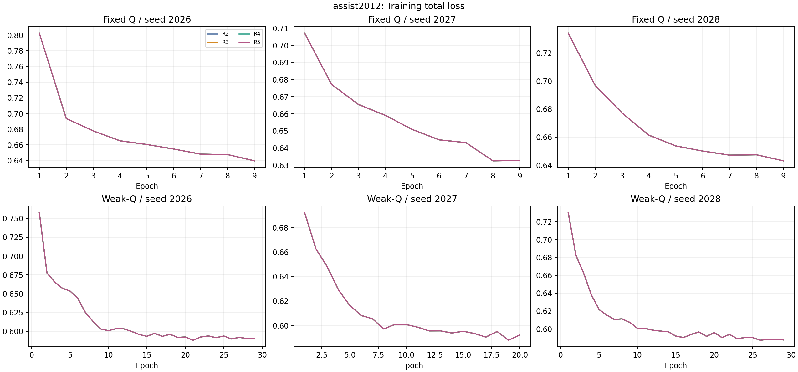
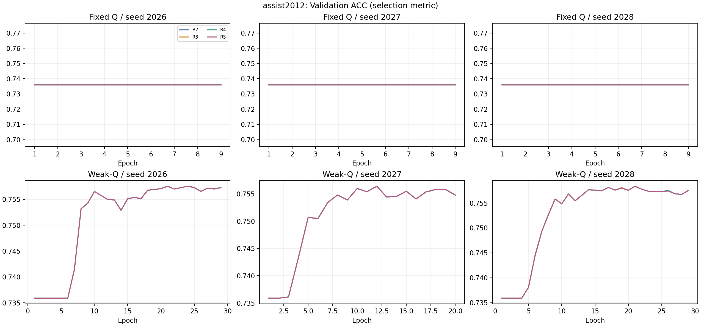
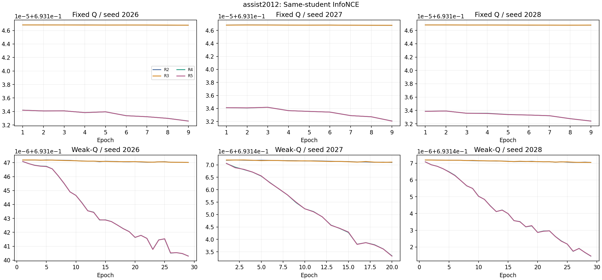
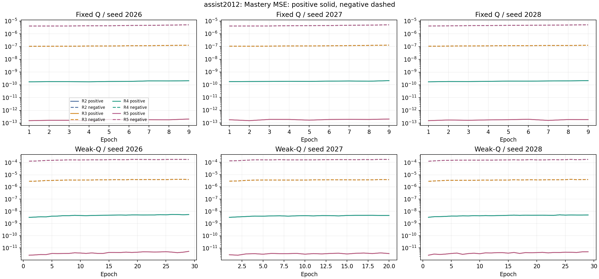
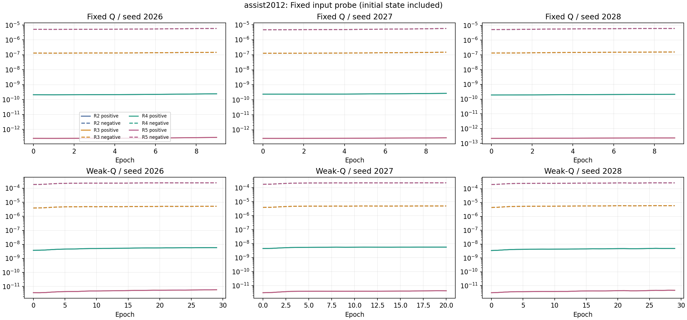
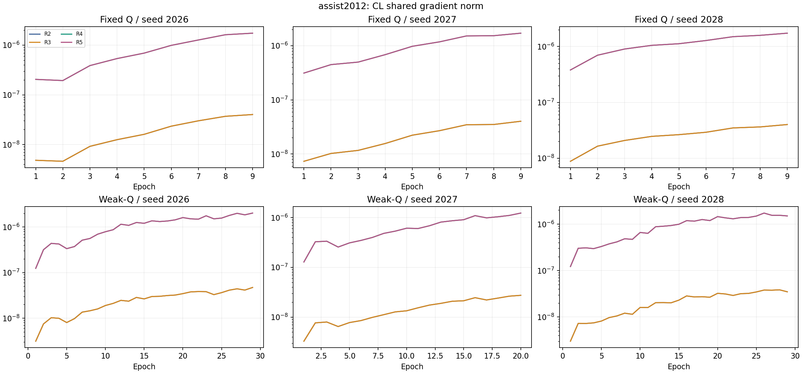
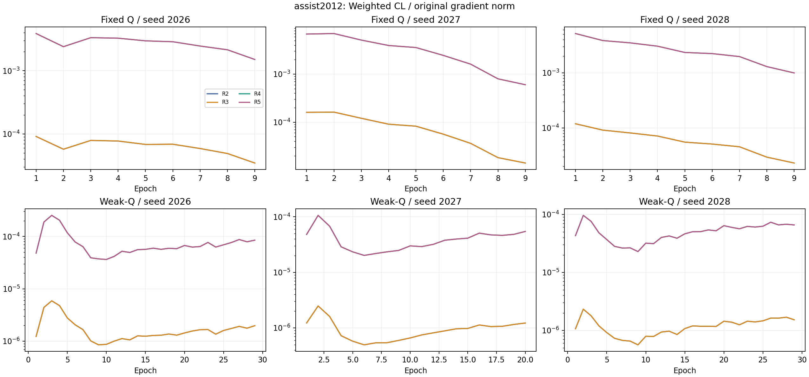
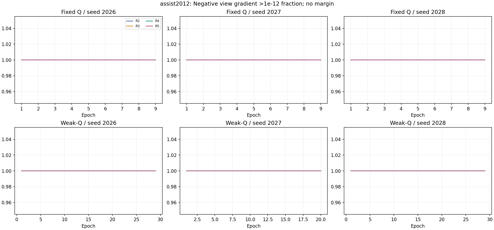
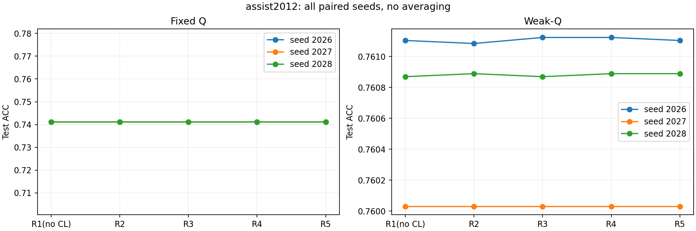

# assist2012：R2–R5噪声敏感性实验

主表不是均值：每个Q/条件内按最高验证ACC选择种子，并列选较小种子；两个test指标来自同一checkpoint。严禁把不同种子的单次结果直接相减解释模块收益，收益看全部配对种子。A0=固定参考Q，A1=Weak-Q。

| Q设置 | 条件 | CL系数 | 验证选优种子 | 最佳轮 | valid ACC | test ACC | test AUC |
| --- | --- | --- | --- | --- | --- | --- | --- |
| A0 | R1 | 0 | 2026 | 1 | 0.73588017 | 0.741151436 | 0.574343216 |
| A0 | R2 | 0.1 | 2026 | 1 | 0.73588017 | 0.741151436 | 0.574343207 |
| A0 | R3 | 0.1 | 2026 | 1 | 0.73588017 | 0.741151436 | 0.574343277 |
| A0 | R4 | 0.1 | 2026 | 1 | 0.73588017 | 0.741151436 | 0.574343746 |
| A0 | R5 | 0.1 | 2026 | 1 | 0.73588017 | 0.741151436 | 0.574343663 |
| A1 | R1 | 0 | 2028 | 21 | 0.758371124 | 0.760869141 | 0.706488021 |
| A1 | R2 | 0.1 | 2028 | 21 | 0.758371124 | 0.760888663 | 0.706487842 |
| A1 | R3 | 0.1 | 2028 | 21 | 0.758371124 | 0.760869141 | 0.706487893 |
| A1 | R4 | 0.1 | 2028 | 21 | 0.758371124 | 0.760888663 | 0.706487148 |
| A1 | R5 | 0.1 | 2028 | 21 | 0.758371124 | 0.760888663 | 0.706487331 |

## 数据与固定协议

数据集：assist2012；学生=4672，题目=984，概念=98；train/valid/test交互=[163385, 21831, 51223]。

使用data目录现有训练/验证/测试文件；没有重新划分。Q-F1表示与参考Q一致性，不能自动解释为认知诊断真实性。

R0参考原循环（统一验证ACC选模），R1新增入口λ=0并完全跳过CL训练分支，R2 λ=0.1。R2同时用于受控与敏感性实验，没有重复训练一份R2。模型、原始损失、α=0.8、Adam及学习率、128学生batch、30轮上限、patience=8均不变。验证ACC严格提升才更新checkpoint，平分保留最早轮。种子2026/2027/2028；每个数据集36次训练。

| 条件 | 正比例 | 正幅度 | 负比例 | 负幅度 |
| --- | --- | --- | --- | --- |
| R2 | 0.1 | 0.01 | 0.5 | 0.1 |
| R3 | 0.01 | 0.001 | 0.5 | 0.1 |
| R4 | 0.1 | 0.01 | 0.7 | 0.5 |
| R5 | 0.01 | 0.001 | 0.7 | 0.5 |

两输入不拼接。只对学生support的非零±1位置施加均匀连续噪声并裁剪到[-1,1]；0缺失、ID、标签、query和原数组不变。负噪声不翻转正误，只降低输入证据绝对值；因此极端响应不能直接当成诊断能力改善。验证/测试不增强。

损失沿用同学生一正一负InfoNCE，温度0.2，无margin。L=−正logit+logsumexp(正logit,负logit)。联合归一化项并不是独立负样本损失；负约束非零比例指负视图梯度范数>1e−12，不是margin激活率。

## 配置、代码和核验依据

以下完整配置/哈希和核验结果作为最终文档保留；用户要求清理新实验的checkpoint、原始日志及JSON/CSV副本。实际清理状态：自动审批以blocked by policy拒绝递归删除，原始产物仍暂存在Git忽略的scratch/student_cl_all_20261123。最终报告目录只包含Markdown和配图。若后续手工清理，便不能直接重放checkpoint，需按记录重跑。

<details><summary>完整配置、版本及数据/源码哈希</summary>

```json
{
  "experiment_id": "student_cl_all_assist2012_20261123",
  "dataset": "assist2012",
  "args": {
    "experiment_id": "student_cl_control_math1_20261123",
    "seeds": [
      2026,
      2027,
      2028
    ],
    "lambda_cl": 0.1,
    "positive_noise_ratio": 0.1,
    "positive_noise_scale": 0.01,
    "negative_noise_ratio": 0.5,
    "negative_noise_scale": 0.1,
    "noise_distribution": "uniform",
    "contrastive_seed": 1123,
    "temperature": 0.2,
    "dataset": "assist2012",
    "data_dir": "E:\\Desktop\\Gen-CD\\Q_GNCDM\\data\\assist2012",
    "alpha": 0.8,
    "embedding_dim": 32,
    "epochs": 30,
    "patience": 8,
    "batch_students": 128,
    "query_fraction": 0.25,
    "lr": 0.001,
    "q_lr": 0.005,
    "lambda_q": 0.01,
    "lambda_coverage": 0.01,
    "q_init_high": 0.55,
    "q_init_low": 0.45,
    "device": "cpu"
  },
  "noise_configs": {
    "R2": [
      0.1,
      0.01,
      0.5,
      0.1
    ],
    "R3": [
      0.01,
      0.001,
      0.5,
      0.1
    ],
    "R4": [
      0.1,
      0.01,
      0.7,
      0.5
    ],
    "R5": [
      0.01,
      0.001,
      0.7,
      0.5
    ]
  },
  "source_sha256": {
    "Q_GNCDM\\experiments\\run_controlled_student_cl.py": "9447f3fc2e79391b043148ae28717bee2f9f6a53dbe44352e5dddca3b6212a46",
    "Q_GNCDM\\experiments\\reference_student_cl_acc.py": "a974a5dbb0e36daf5ed49031be1838d69200e070f935d8f8f9dc31c0d9fa3dfc",
    "Q_GNCDM\\experiments\\controlled_student_cl.py": "4329530390f079ae00f6fa0d00af659e7e7be0f09134f8bc642b5a8caa0cb041",
    "Q_GNCDM\\experiments\\run_simple_contrastive.py": "196cbac42d9e7664eb4c24a4328bc852dca9265d7a88149adda0be924564a023",
    "Q_GNCDM\\models\\weak_q_gncdm.py": "5970f43820db2736bcf5f4e48039af50bf4203a5f391baa2046b8046c21517f5",
    "Q_GNCDM\\simple_contrastive.py": "30f0126846ab0e0d8802306ee183374a17730ed63f5bdd3ff6d76949b5252d97",
    "Q_GNCDM\\experiments\\run_weak_q_synthetic.py": "266d36d84cf1095189700a0b1f524f678accfd79feb94402ef6562f004f6b9b6",
    "Q_GNCDM\\experiments\\run_student_cl_all_datasets.py": "5c04daaf9a3ba1478c9d763e66348251162132ed385935c67e6d806635ec76bf",
    "Q_GNCDM\\experiments\\run_student_cl_noise_sensitivity.py": "b4c2c3850c4f49b26f60099c8d593128393ec8de80dcb3205d04fb27507f440f",
    "Q_GNCDM\\experiments\\run_prepared_dataset.py": "02b0fe433fcf75bea693b745149ac1654d866f044c81d9b2fc637b6f35d40c4d"
  },
  "data_sha256": {
    "train.csv": "78b6d630f0c4aa69f0ef01e221d69f8c2850c50af5412c023c6b56df3a790330",
    "valid.csv": "6930d91e3a135189d8141266bf9618fea2885739a9d81ed330e1c246d1185ff1",
    "test.csv": "ca86d57fc665826a39bac6773f9fa2895ffd31947e3cb7e8444aed3131fefa56",
    "Q_matrix.npy": "8483a4800cc53173f3bf114282fcc6d7ca351fff2d9338e39473707adefe2b4d",
    "Q_true.npy": "8483a4800cc53173f3bf114282fcc6d7ca351fff2d9338e39473707adefe2b4d",
    "manifest.json": "1132dab448a7e34219dadff1b62c54a70b4da5ae59026d433926d416cae522cb"
  },
  "train_shape": [
    4672,
    984
  ],
  "concepts": 98,
  "split_lengths": [
    163385,
    21831,
    51223
  ],
  "seeds": [
    2026,
    2027,
    2028
  ],
  "selection": "highest validation ACC, earliest epoch; display seed chosen by validation ACC, lowest seed tie",
  "retention": "user requests final Markdown reports and figures only; temporary originals removed after verification",
  "command": "E:\\Desktop\\Gen-CD\\.venv-contrastive\\Scripts\\python.exe -m Q_GNCDM.experiments.run_student_cl_all_datasets --dataset assist2012",
  "python": "3.13.9 (tags/v3.13.9:8183fa5, Oct 14 2025, 14:09:13) [MSC v.1944 64 bit (AMD64)]",
  "torch": "2.14.0+cpu",
  "numpy": "2.4.3",
  "git_head": "89290e14293fe00b1e4eb55ba87ed068c5eccfdc",
  "protocol": "R0 reference ACC selector; R1 CL off; R2 shared by control and noise studies; R3-R5 change noise only",
  "scheduling_records": [
    {
      "mode": "A0",
      "seed": 2028,
      "source_sha256": "f768bea86bd13315b1a465ba1a441eee5f55b2ce675818a872c80356c46ce63f",
      "source": "Q_GNCDM\\experiments\\run_student_cl_seed2028.py",
      "changes": "seed scheduling only, same frozen worker logic",
      "status": "published_complete_verified_group"
    },
    {
      "mode": "A1",
      "seed": 2028,
      "source_sha256": "f768bea86bd13315b1a465ba1a441eee5f55b2ce675818a872c80356c46ce63f",
      "source": "Q_GNCDM\\experiments\\run_student_cl_seed2028.py",
      "changes": "seed scheduling only, same frozen worker logic",
      "status": "primary_already_started; no overwrite"
    },
    [
      {
        "mode": "A1",
        "seed": 2028,
        "condition": "R4",
        "status": "copied_verified_run_without_overwrite",
        "publisher_sha256": "914af8c17a09a5d1c8aaf63dbac86aee993bb5b9a63770e0c64c71efdf41cace"
      },
      {
        "mode": "A1",
        "seed": 2028,
        "condition": "R5",
        "status": "copied_verified_run_without_overwrite",
        "publisher_sha256": "914af8c17a09a5d1c8aaf63dbac86aee993bb5b9a63770e0c64c71efdf41cace"
      }
    ]
  ],
  "scheduling_duplicate_state_checks": [
    {
      "mode": "A1",
      "seed": 2028,
      "condition": "R0",
      "checkpoint_exact": true
    },
    {
      "mode": "A1",
      "seed": 2028,
      "condition": "R1",
      "checkpoint_exact": true
    },
    {
      "mode": "A1",
      "seed": 2028,
      "condition": "R2",
      "checkpoint_exact": true
    },
    {
      "mode": "A1",
      "seed": 2028,
      "condition": "R3",
      "checkpoint_exact": true
    },
    {
      "mode": "A1",
      "seed": 2028,
      "condition": "R4",
      "checkpoint_exact": true
    },
    {
      "mode": "A1",
      "seed": 2028,
      "condition": "R5",
      "checkpoint_exact": true
    }
  ]
}
```
</details>

8种Q/噪声设置预检全部通过；同初始化固定batch的CL梯度、一步更新测试通过；新诊断的损失/梯度与原实现精确一致。6组R0/R1的逐轮日志与checkpoint精确一致；36个checkpoint的全部测试指标已重放核验。

```json
{
  "runs": 36,
  "preflight_settings": 8,
  "baseline_exact_pairs": 6,
  "checkpoint_replays": 36,
  "protected_code_and_data_unchanged": true,
  "status": "passed"
}
```

<details><summary>全部预检真实输出（含逐层梯度和单步参数更新差异）</summary>

```json
{
  "A0_R2": {
    "positive": {
      "selected_fraction": 0.1007375,
      "changed_fraction": 0.050225,
      "clipped_fraction_selected": 0.5014269760516193,
      "input_mae_observed": 0.00025183867546729743,
      "input_mae_all": 0.00020147094619460404,
      "input_max_change": 0.009997665882110596
    },
    "negative": {
      "selected_fraction": 0.5008875,
      "changed_fraction": 0.2517625,
      "clipped_fraction_selected": 0.4973671732674503,
      "input_mae_observed": 0.012591703794896603,
      "input_mae_all": 0.010073362849652767,
      "input_max_change": 0.09999817609786987
    },
    "gradient": {
      "original_shared_grad_norm": 5.301577653964478e-06,
      "cl_shared_grad_norm": 9.81928129048189e-09,
      "cl_to_original_grad_ratio": 0.001852143254591227,
      "weighted_cl_to_original_grad_ratio": 0.0001852143254591227
    },
    "per_layer": {
      "f_nn.f_layer_1.weight": {
        "original_grad_norm": 4.799548491973837e-07,
        "cl_grad_norm": 7.418108349810382e-10,
        "cl_finite": true
      },
      "f_nn.f_layer_1.bias": {
        "original_grad_norm": 2.773632274966076e-07,
        "cl_grad_norm": 3.4693867223545283e-10,
        "cl_finite": true
      },
      "f_nn.f_layer_2.weight": {
        "original_grad_norm": 5.208500624576118e-06,
        "cl_grad_norm": 9.604823603126533e-09,
        "cl_finite": true
      },
      "f_nn.f_layer_2.bias": {
        "original_grad_norm": 8.191222491404915e-07,
        "cl_grad_norm": 1.869495891426709e-09,
        "cl_finite": true
      }
    },
    "batch_diagnostics": {
      "ap_mse": 2.1631450797254814e-10,
      "an_mse": 1.262094997400709e-07,
      "ap_cos_distance": 1.5832483768463135e-08,
      "an_cos_distance": 1.6624107956886292e-07,
      "negative_softmax_probability": 0.4999998211860657,
      "negative_not_farther_fraction": 0.2265625,
      "positive_selected_fraction": 0.10382916053019146,
      "positive_changed_fraction": 0.047128129602356406,
      "positive_clipped_fraction_selected": 0.5460992907801419,
      "positive_input_mae_observed": 0.00024192487762775272,
      "positive_input_mae_all": 7.825218744983431e-06,
      "positive_input_max_change": 0.009984791278839111,
      "negative_selected_fraction": 0.49729995090819834,
      "negative_changed_fraction": 0.24496809032891506,
      "negative_clipped_fraction_selected": 0.5074037512339585,
      "negative_input_mae_observed": 0.01254056952893734,
      "negative_input_mae_all": 0.00040563291986472905,
      "negative_input_max_change": 0.09999865293502808
    },
    "loss_original": 1.0196532011032104,
    "loss_cl": 0.693146824836731,
    "loss_total": 1.0889679193496704,
    "single_step_parameter_changes": {
      "f_nn.f_layer_1.weight": {
        "gradient_difference_l2": 7.473898715251508e-11,
        "update_difference_l2": 5.749992658877524e-06,
        "baseline_update_l2": 0.034975875799373134,
        "cl_update_l2": 0.034974981990927564
      },
      "f_nn.f_layer_1.bias": {
        "gradient_difference_l2": 3.521865431219189e-11,
        "update_difference_l2": 4.509124182005731e-07,
        "baseline_update_l2": 0.006965061405148184,
        "cl_update_l2": 0.006965023782054002
      },
      "f_nn.f_layer_2.weight": {
        "gradient_difference_l2": 9.615203859697187e-10,
        "update_difference_l2": 3.198747574482662e-05,
        "baseline_update_l2": 0.03477665551841698,
        "cl_update_l2": 0.03477704682995602
      },
      "f_nn.f_layer_2.bias": {
        "gradient_difference_l2": 1.8709731116548644e-10,
        "update_difference_l2": 5.785522744615076e-06,
        "baseline_update_l2": 0.003923771797651179,
        "cl_update_l2": 0.0039238176855757425
      }
    },
    "zero_single_step_exact_parity": true,
    "status": "passed",
    "observed_branch_loss_and_gradient_exact": true,
    "observation_state_and_rng_unchanged": true,
    "extra_diagnostics": {
      "ap_mse": 2.1887594514602426e-10,
      "an_mse": 1.2712827412997285e-07,
      "ap_cos_distance": 1.0710209608078003e-08,
      "an_cos_distance": 1.6391277313232422e-07,
      "negative_softmax_probability": 0.4999998211860657,
      "negative_not_farther_fraction": 0.234375,
      "positive_energy": -5.0,
      "joint_log_partition": 5.693146228790283,
      "negative_relative_penalty": 0.693146824836731,
      "positive_view_grad_norm_mean": 5.999011963299805e-08,
      "negative_view_grad_norm_mean": 1.7552511408819023e-06,
      "negative_view_grad_nonzero_fraction": 1.0,
      "negative_view_grad_above_1e_12_fraction": 1.0,
      "positive_shared_partial_grad_norm": 1.1665028246689602e-10,
      "negative_shared_partial_grad_norm": 9.797256864458315e-09,
      "positive_selected_fraction": 0.10407461953853707,
      "positive_changed_fraction": 0.047619047619047616,
      "positive_clipped_fraction_selected": 0.5424528301886793,
      "positive_input_mae_observed": 0.00024857031530700624,
      "positive_input_mae_all": 8.040170541789848e-06,
      "positive_input_max_change": 0.009961724281311035,
      "positive_input_mse_observed": 1.7269575209866161e-06,
      "positive_clipped_fraction_observed": 0.05645557191948945,
      "positive_input_mae_changed": 0.005219976883381605,
      "positive_unchanged_student_fraction": 0.2734375,
      "negative_selected_fraction": 0.49680903289150713,
      "negative_changed_fraction": 0.25184094256259204,
      "negative_clipped_fraction_selected": 0.49308300395256915,
      "negative_input_mae_observed": 0.01303467433899641,
      "negative_input_mae_all": 0.00042161508463323116,
      "negative_input_max_change": 0.09999865293502808,
      "negative_input_mse_observed": 0.0008885901770554483,
      "negative_clipped_fraction_observed": 0.24496809032891506,
      "negative_input_mae_changed": 0.0517575666308403,
      "negative_unchanged_student_fraction": 0.0078125
    }
  },
  "A0_R3": {
    "positive": {
      "selected_fraction": 0.01045,
      "changed_fraction": 0.005025,
      "clipped_fraction_selected": 0.5179425837320574,
      "input_mae_observed": 2.512869286874775e-06,
      "input_mae_all": 2.010295474974555e-06,
      "input_max_change": 0.0009962916374206543
    },
    "negative": {
      "selected_fraction": 0.5008875,
      "changed_fraction": 0.2517625,
      "clipped_fraction_selected": 0.4973671732674503,
      "input_mae_observed": 0.012591703794896603,
      "input_mae_all": 0.010073362849652767,
      "input_max_change": 0.09999817609786987
    },
    "gradient": {
      "original_shared_grad_norm": 5.301577653964478e-06,
      "cl_shared_grad_norm": 9.831432093159982e-09,
      "cl_to_original_grad_ratio": 0.0018544351766323962,
      "weighted_cl_to_original_grad_ratio": 0.00018544351766323962
    },
    "per_layer": {
      "f_nn.f_layer_1.weight": {
        "original_grad_norm": 4.799548491973837e-07,
        "cl_grad_norm": 7.398888723919583e-10,
        "cl_finite": true
      },
      "f_nn.f_layer_1.bias": {
        "original_grad_norm": 2.773632274966076e-07,
        "cl_grad_norm": 3.4626920775160386e-10,
        "cl_finite": true
      },
      "f_nn.f_layer_2.weight": {
        "original_grad_norm": 5.208500624576118e-06,
        "cl_grad_norm": 9.616952567625958e-09,
        "cl_finite": true
      },
      "f_nn.f_layer_2.bias": {
        "original_grad_norm": 8.191222491404915e-07,
        "cl_grad_norm": 1.871886201598727e-09,
        "cl_finite": true
      }
    },
    "batch_diagnostics": {
      "ap_mse": 2.3752484354377934e-13,
      "an_mse": 1.262094997400709e-07,
      "ap_cos_distance": 7.450580596923828e-09,
      "an_cos_distance": 1.6624107956886292e-07,
      "negative_softmax_probability": 0.4999998211860657,
      "negative_not_farther_fraction": 0.1875,
      "positive_selected_fraction": 0.013500245459008346,
      "positive_changed_fraction": 0.0066273932253313695,
      "positive_clipped_fraction_selected": 0.509090909090909,
      "positive_input_mae_observed": 3.038095883312053e-06,
      "positive_input_mae_all": 9.826920432942643e-08,
      "positive_input_max_change": 0.0009961128234863281,
      "negative_selected_fraction": 0.49729995090819834,
      "negative_changed_fraction": 0.24496809032891506,
      "negative_clipped_fraction_selected": 0.5074037512339585,
      "negative_input_mae_observed": 0.01254056952893734,
      "negative_input_mae_all": 0.00040563291986472905,
      "negative_input_max_change": 0.09999865293502808
    },
    "loss_original": 1.0196532011032104,
    "loss_cl": 0.6931467056274414,
    "loss_total": 1.0889679193496704,
    "single_step_parameter_changes": {
      "f_nn.f_layer_1.weight": {
        "gradient_difference_l2": 7.422279758635784e-11,
        "update_difference_l2": 5.728306541238612e-06,
        "baseline_update_l2": 0.034975875799373134,
        "cl_update_l2": 0.034975055818241306
      },
      "f_nn.f_layer_1.bias": {
        "gradient_difference_l2": 3.5016198930346244e-11,
        "update_difference_l2": 4.5809996049902916e-07,
        "baseline_update_l2": 0.006965061405148184,
        "cl_update_l2": 0.006965030647770948
      },
      "f_nn.f_layer_2.weight": {
        "gradient_difference_l2": 9.626564790541524e-10,
        "update_difference_l2": 3.2091255178761586e-05,
        "baseline_update_l2": 0.03477665551841698,
        "cl_update_l2": 0.03477704970533208
      },
      "f_nn.f_layer_2.bias": {
        "gradient_difference_l2": 1.8739261184414686e-10,
        "update_difference_l2": 5.8100354822549646e-06,
        "baseline_update_l2": 0.003923771797651179,
        "cl_update_l2": 0.003923817661235999
      }
    },
    "zero_single_step_exact_parity": true,
    "status": "passed",
    "observed_branch_loss_and_gradient_exact": true,
    "observation_state_and_rng_unchanged": true,
    "extra_diagnostics": {
      "ap_mse": 2.3129569548703544e-13,
      "an_mse": 1.2712827412997285e-07,
      "ap_cos_distance": 7.450580596923828e-09,
      "an_cos_distance": 1.6391277313232422e-07,
      "negative_softmax_probability": 0.4999998211860657,
      "negative_not_farther_fraction": 0.21875,
      "positive_energy": -5.0,
      "joint_log_partition": 5.693146228790283,
      "negative_relative_penalty": 0.693146824836731,
      "positive_view_grad_norm_mean": 1.1340655364682279e-09,
      "negative_view_grad_norm_mean": 1.755251507352828e-06,
      "negative_view_grad_nonzero_fraction": 1.0,
      "negative_view_grad_above_1e_12_fraction": 1.0,
      "positive_shared_partial_grad_norm": 1.2872882307723693e-10,
      "negative_shared_partial_grad_norm": 9.795925298861106e-09,
      "positive_selected_fraction": 0.013009327442317134,
      "positive_changed_fraction": 0.006136475208640157,
      "positive_clipped_fraction_selected": 0.5283018867924528,
      "positive_input_mae_observed": 2.8150684556749184e-06,
      "positive_input_mae_all": 9.105523446351071e-08,
      "positive_input_max_change": 0.0009961128234863281,
      "positive_input_mse_observed": 1.8523240719048317e-09,
      "positive_clipped_fraction_observed": 0.006872852233676976,
      "positive_input_mae_changed": 0.00045874356874264777,
      "positive_unchanged_student_fraction": 0.8203125,
      "negative_selected_fraction": 0.49680903289150713,
      "negative_changed_fraction": 0.25184094256259204,
      "negative_clipped_fraction_selected": 0.49308300395256915,
      "negative_input_mae_observed": 0.01303467433899641,
      "negative_input_mae_all": 0.00042161508463323116,
      "negative_input_max_change": 0.09999865293502808,
      "negative_input_mse_observed": 0.0008885901770554483,
      "negative_clipped_fraction_observed": 0.24496809032891506,
      "negative_input_mae_changed": 0.0517575666308403,
      "negative_unchanged_student_fraction": 0.0078125
    }
  },
  "A0_R4": {
    "positive": {
      "selected_fraction": 0.1007375,
      "changed_fraction": 0.050225,
      "clipped_fraction_selected": 0.5014269760516193,
      "input_mae_observed": 0.00025183867546729743,
      "input_mae_all": 0.00020147094619460404,
      "input_max_change": 0.009997665882110596
    },
    "negative": {
      "selected_fraction": 0.7017125,
      "changed_fraction": 0.3529375,
      "clipped_fraction_selected": 0.4970340417193651,
      "input_mae_observed": 0.08849677443504333,
      "input_mae_all": 0.07079741358757019,
      "input_max_change": 0.4999908208847046
    },
    "gradient": {
      "original_shared_grad_norm": 5.301577653964478e-06,
      "cl_shared_grad_norm": 4.082016361093704e-07,
      "cl_to_original_grad_ratio": 0.07699625710549018,
      "weighted_cl_to_original_grad_ratio": 0.00769962571054902
    },
    "per_layer": {
      "f_nn.f_layer_1.weight": {
        "original_grad_norm": 4.799548491973837e-07,
        "cl_grad_norm": 2.4961471112305844e-08,
        "cl_finite": true
      },
      "f_nn.f_layer_1.bias": {
        "original_grad_norm": 2.773632274966076e-07,
        "cl_grad_norm": 1.421640494214671e-08,
        "cl_finite": true
      },
      "f_nn.f_layer_2.weight": {
        "original_grad_norm": 5.208500624576118e-06,
        "cl_grad_norm": 3.99650218696479e-07,
        "cl_finite": true
      },
      "f_nn.f_layer_2.bias": {
        "original_grad_norm": 8.191222491404915e-07,
        "cl_grad_norm": 7.799443579870058e-08,
        "cl_finite": true
      }
    },
    "batch_diagnostics": {
      "ap_mse": 2.1631450797254814e-10,
      "an_mse": 4.594968231685925e-06,
      "ap_cos_distance": 1.5832483768463135e-08,
      "an_cos_distance": 5.964189767837524e-06,
      "negative_softmax_probability": 0.4999925196170807,
      "negative_not_farther_fraction": 0.0,
      "positive_selected_fraction": 0.10382916053019146,
      "positive_changed_fraction": 0.047128129602356406,
      "positive_clipped_fraction_selected": 0.5460992907801419,
      "positive_input_mae_observed": 0.00024192487762775272,
      "positive_input_mae_all": 7.825218744983431e-06,
      "positive_input_max_change": 0.009984791278839111,
      "negative_selected_fraction": 0.6966126656848306,
      "negative_changed_fraction": 0.3443789887088856,
      "negative_clipped_fraction_selected": 0.5056377730796335,
      "negative_input_mae_observed": 0.08600010722875595,
      "negative_input_mae_all": 0.0027817299123853445,
      "negative_input_max_change": 0.49999338388442993
    },
    "loss_original": 1.0196532011032104,
    "loss_cl": 0.6931322813034058,
    "loss_total": 1.0889663696289062,
    "single_step_parameter_changes": {
      "f_nn.f_layer_1.weight": {
        "gradient_difference_l2": 2.4964381853876472e-09,
        "update_difference_l2": 0.00019332551445264013,
        "baseline_update_l2": 0.034975875799373134,
        "cl_update_l2": 0.034951331255941
      },
      "f_nn.f_layer_1.bias": {
        "gradient_difference_l2": 1.4217262866968927e-09,
        "update_difference_l2": 2.0078700126651895e-05,
        "baseline_update_l2": 0.006965061405148184,
        "cl_update_l2": 0.006965579271194721
      },
      "f_nn.f_layer_2.weight": {
        "gradient_difference_l2": 3.99650732855913e-08,
        "update_difference_l2": 0.0012529203254452185,
        "baseline_update_l2": 0.03477665551841698,
        "cl_update_l2": 0.034808918143257185
      },
      "f_nn.f_layer_2.bias": {
        "gradient_difference_l2": 7.799474321190602e-09,
        "update_difference_l2": 0.00021955303377319295,
        "baseline_update_l2": 0.003923771797651179,
        "cl_update_l2": 0.0039295385878561975
      }
    },
    "zero_single_step_exact_parity": true,
    "status": "passed",
    "observed_branch_loss_and_gradient_exact": true,
    "observation_state_and_rng_unchanged": true,
    "extra_diagnostics": {
      "ap_mse": 2.1887594514602426e-10,
      "an_mse": 4.6200843826227356e-06,
      "ap_cos_distance": 1.0710209608078003e-08,
      "an_cos_distance": 5.968380719423294e-06,
      "negative_softmax_probability": 0.4999925494194031,
      "negative_not_farther_fraction": 0.0078125,
      "positive_energy": -5.0,
      "joint_log_partition": 5.693132400512695,
      "negative_relative_penalty": 0.6931322813034058,
      "positive_view_grad_norm_mean": 6.000088488035684e-08,
      "negative_view_grad_norm_mean": 1.0632598809477751e-05,
      "negative_view_grad_nonzero_fraction": 1.0,
      "negative_view_grad_above_1e_12_fraction": 1.0,
      "positive_shared_partial_grad_norm": 1.1312558932418332e-10,
      "negative_shared_partial_grad_norm": 4.33344615324075e-07,
      "positive_selected_fraction": 0.10407461953853707,
      "positive_changed_fraction": 0.047619047619047616,
      "positive_clipped_fraction_selected": 0.5424528301886793,
      "positive_input_mae_observed": 0.00024857031530700624,
      "positive_input_mae_all": 8.040170541789848e-06,
      "positive_input_max_change": 0.009961724281311035,
      "positive_input_mse_observed": 1.7269575209866161e-06,
      "positive_clipped_fraction_observed": 0.05645557191948945,
      "positive_input_mae_changed": 0.005219976883381605,
      "positive_unchanged_student_fraction": 0.2734375,
      "negative_selected_fraction": 0.6978399607265586,
      "negative_changed_fraction": 0.35247913598429065,
      "negative_clipped_fraction_selected": 0.49489975378121703,
      "negative_input_mae_observed": 0.0888771191239357,
      "negative_input_mae_all": 0.0028747888281941414,
      "negative_input_max_change": 0.49999338388442993,
      "negative_input_mse_observed": 0.02998390607535839,
      "negative_clipped_fraction_observed": 0.34536082474226804,
      "negative_input_mae_changed": 0.2521485984325409,
      "negative_unchanged_student_fraction": 0.0078125
    }
  },
  "A0_R5": {
    "positive": {
      "selected_fraction": 0.01045,
      "changed_fraction": 0.005025,
      "clipped_fraction_selected": 0.5179425837320574,
      "input_mae_observed": 2.512869286874775e-06,
      "input_mae_all": 2.010295474974555e-06,
      "input_max_change": 0.0009962916374206543
    },
    "negative": {
      "selected_fraction": 0.7017125,
      "changed_fraction": 0.3529375,
      "clipped_fraction_selected": 0.4970340417193651,
      "input_mae_observed": 0.08849677443504333,
      "input_mae_all": 0.07079741358757019,
      "input_max_change": 0.4999908208847046
    },
    "gradient": {
      "original_shared_grad_norm": 5.301577653964478e-06,
      "cl_shared_grad_norm": 4.082199226220587e-07,
      "cl_to_original_grad_ratio": 0.07699970636416031,
      "weighted_cl_to_original_grad_ratio": 0.007699970636416031
    },
    "per_layer": {
      "f_nn.f_layer_1.weight": {
        "original_grad_norm": 4.799548491973837e-07,
        "cl_grad_norm": 2.495926310075447e-08,
        "cl_finite": true
      },
      "f_nn.f_layer_1.bias": {
        "original_grad_norm": 2.773632274966076e-07,
        "cl_grad_norm": 1.4215502552872294e-08,
        "cl_finite": true
      },
      "f_nn.f_layer_2.weight": {
        "original_grad_norm": 5.208500624576118e-06,
        "cl_grad_norm": 3.99668380168805e-07,
        "cl_finite": true
      },
      "f_nn.f_layer_2.bias": {
        "original_grad_norm": 8.191222491404915e-07,
        "cl_grad_norm": 7.799784640383223e-08,
        "cl_finite": true
      }
    },
    "batch_diagnostics": {
      "ap_mse": 2.3752484354377934e-13,
      "an_mse": 4.594968231685925e-06,
      "ap_cos_distance": 7.450580596923828e-09,
      "an_cos_distance": 5.964189767837524e-06,
      "negative_softmax_probability": 0.4999925196170807,
      "negative_not_farther_fraction": 0.0,
      "positive_selected_fraction": 0.013500245459008346,
      "positive_changed_fraction": 0.0066273932253313695,
      "positive_clipped_fraction_selected": 0.509090909090909,
      "positive_input_mae_observed": 3.038095883312053e-06,
      "positive_input_mae_all": 9.826920432942643e-08,
      "positive_input_max_change": 0.0009961128234863281,
      "negative_selected_fraction": 0.6966126656848306,
      "negative_changed_fraction": 0.3443789887088856,
      "negative_clipped_fraction_selected": 0.5056377730796335,
      "negative_input_mae_observed": 0.08600010722875595,
      "negative_input_mae_all": 0.0027817299123853445,
      "negative_input_max_change": 0.49999338388442993
    },
    "loss_original": 1.0196532011032104,
    "loss_cl": 0.6931322813034058,
    "loss_total": 1.0889663696289062,
    "single_step_parameter_changes": {
      "f_nn.f_layer_1.weight": {
        "gradient_difference_l2": 2.4961512925991256e-09,
        "update_difference_l2": 0.00019331268299148128,
        "baseline_update_l2": 0.034975875799373134,
        "cl_update_l2": 0.034951391624486405
      },
      "f_nn.f_layer_1.bias": {
        "gradient_difference_l2": 1.421612767263911e-09,
        "update_difference_l2": 2.0088538541932804e-05,
        "baseline_update_l2": 0.006965061405148184,
        "cl_update_l2": 0.006965586264190409
      },
      "f_nn.f_layer_2.weight": {
        "gradient_difference_l2": 3.996665330016075e-08,
        "update_difference_l2": 0.0012530855319531013,
        "baseline_update_l2": 0.03477665551841698,
        "cl_update_l2": 0.03480892341478168
      },
      "f_nn.f_layer_2.bias": {
        "gradient_difference_l2": 7.799760816735121e-09,
        "update_difference_l2": 0.000219585488568609,
        "baseline_update_l2": 0.003923771797651179,
        "cl_update_l2": 0.003929540689780462
      }
    },
    "zero_single_step_exact_parity": true,
    "status": "passed",
    "observed_branch_loss_and_gradient_exact": true,
    "observation_state_and_rng_unchanged": true,
    "extra_diagnostics": {
      "ap_mse": 2.3129569548703544e-13,
      "an_mse": 4.6200843826227356e-06,
      "ap_cos_distance": 7.450580596923828e-09,
      "an_cos_distance": 5.968380719423294e-06,
      "negative_softmax_probability": 0.4999925494194031,
      "negative_not_farther_fraction": 0.0078125,
      "positive_energy": -5.0,
      "joint_log_partition": 5.693132400512695,
      "negative_relative_penalty": 0.6931322813034058,
      "positive_view_grad_norm_mean": 1.1434862011295802e-09,
      "negative_view_grad_norm_mean": 1.0632598079820592e-05,
      "negative_view_grad_nonzero_fraction": 1.0,
      "negative_view_grad_above_1e_12_fraction": 1.0,
      "positive_shared_partial_grad_norm": 1.0995653144293309e-10,
      "negative_shared_partial_grad_norm": 4.3334529402116193e-07,
      "positive_selected_fraction": 0.013009327442317134,
      "positive_changed_fraction": 0.006136475208640157,
      "positive_clipped_fraction_selected": 0.5283018867924528,
      "positive_input_mae_observed": 2.8150684556749184e-06,
      "positive_input_mae_all": 9.105523446351071e-08,
      "positive_input_max_change": 0.0009961128234863281,
      "positive_input_mse_observed": 1.8523240719048317e-09,
      "positive_clipped_fraction_observed": 0.006872852233676976,
      "positive_input_mae_changed": 0.00045874356874264777,
      "positive_unchanged_student_fraction": 0.8203125,
      "negative_selected_fraction": 0.6978399607265586,
      "negative_changed_fraction": 0.35247913598429065,
      "negative_clipped_fraction_selected": 0.49489975378121703,
      "negative_input_mae_observed": 0.0888771191239357,
      "negative_input_mae_all": 0.0028747888281941414,
      "negative_input_max_change": 0.49999338388442993,
      "negative_input_mse_observed": 0.02998390607535839,
      "negative_clipped_fraction_observed": 0.34536082474226804,
      "negative_input_mae_changed": 0.2521485984325409,
      "negative_unchanged_student_fraction": 0.0078125
    }
  },
  "A1_R2": {
    "positive": {
      "selected_fraction": 0.1007375,
      "changed_fraction": 0.050225,
      "clipped_fraction_selected": 0.5014269760516193,
      "input_mae_observed": 0.00025183867546729743,
      "input_mae_all": 0.00020147094619460404,
      "input_max_change": 0.009997665882110596
    },
    "negative": {
      "selected_fraction": 0.5008875,
      "changed_fraction": 0.2517625,
      "clipped_fraction_selected": 0.4973671732674503,
      "input_mae_observed": 0.012591703794896603,
      "input_mae_all": 0.010073362849652767,
      "input_max_change": 0.09999817609786987
    },
    "gradient": {
      "original_shared_grad_norm": 0.00039919070339998014,
      "cl_shared_grad_norm": 1.0131162720443978e-09,
      "cl_to_original_grad_ratio": 2.537925516339688e-06,
      "weighted_cl_to_original_grad_ratio": 2.537925516339688e-07
    },
    "per_layer": {
      "q_logits": {
        "original_grad_norm": 0.00039303043740801513,
        "cl_grad_norm": 7.895121778567216e-10,
        "cl_finite": true
      },
      "f_nn.f_layer_1.weight": {
        "original_grad_norm": 3.695297891681548e-06,
        "cl_grad_norm": 8.922404481914725e-11,
        "cl_finite": true
      },
      "f_nn.f_layer_1.bias": {
        "original_grad_norm": 2.073367568300455e-06,
        "cl_grad_norm": 3.7490135995632556e-11,
        "cl_finite": true
      },
      "f_nn.f_layer_2.weight": {
        "original_grad_norm": 6.88848813297227e-05,
        "cl_grad_norm": 6.14745088167723e-10,
        "cl_finite": true
      },
      "f_nn.f_layer_2.bias": {
        "original_grad_norm": 1.079643152479548e-05,
        "cl_grad_norm": 1.2567623330905775e-10,
        "cl_finite": true
      }
    },
    "batch_diagnostics": {
      "ap_mse": 5.019071824818866e-09,
      "an_mse": 3.842042588075856e-06,
      "ap_cos_distance": 6.984919309616089e-09,
      "an_cos_distance": 1.30385160446167e-08,
      "negative_softmax_probability": 0.5,
      "negative_not_farther_fraction": 0.65625,
      "positive_selected_fraction": 0.10382916053019146,
      "positive_changed_fraction": 0.047128129602356406,
      "positive_clipped_fraction_selected": 0.5460992907801419,
      "positive_input_mae_observed": 0.00024192487762775272,
      "positive_input_mae_all": 7.825218744983431e-06,
      "positive_input_max_change": 0.009984791278839111,
      "negative_selected_fraction": 0.49729995090819834,
      "negative_changed_fraction": 0.24496809032891506,
      "negative_clipped_fraction_selected": 0.5074037512339585,
      "negative_input_mae_observed": 0.01254056952893734,
      "negative_input_mae_all": 0.00040563291986472905,
      "negative_input_max_change": 0.09999865293502808
    },
    "loss_original": 1.0124588012695312,
    "loss_cl": 0.6931472420692444,
    "loss_total": 1.0817735195159912,
    "single_step_parameter_changes": {
      "q_logits": {
        "gradient_difference_l2": 8.079548793159542e-11,
        "update_difference_l2": 3.8340314207433045e-06,
        "baseline_update_l2": 1.2929037996694732,
        "cl_update_l2": 1.2929038050671222
      },
      "f_nn.f_layer_1.weight": {
        "gradient_difference_l2": 8.769291782300522e-12,
        "update_difference_l2": 4.523916096604316e-07,
        "baseline_update_l2": 0.115273284293707,
        "cl_update_l2": 0.11527329558738826
      },
      "f_nn.f_layer_1.bias": {
        "gradient_difference_l2": 2.321341194398594e-12,
        "update_difference_l2": 2.9490841176850015e-08,
        "baseline_update_l2": 0.008883907842887697,
        "cl_update_l2": 0.008883906456893687
      },
      "f_nn.f_layer_2.weight": {
        "gradient_difference_l2": 6.093564144201517e-11,
        "update_difference_l2": 1.2014110564863983e-07,
        "baseline_update_l2": 0.09345214889875723,
        "cl_update_l2": 0.0934521434537628
      },
      "f_nn.f_layer_2.bias": {
        "gradient_difference_l2": 1.2402124770952793e-11,
        "update_difference_l2": 1.1200702829899959e-08,
        "baseline_update_l2": 0.009577433202129842,
        "cl_update_l2": 0.00957743295781233
      }
    },
    "zero_single_step_exact_parity": true,
    "status": "passed",
    "observed_branch_loss_and_gradient_exact": true,
    "observation_state_and_rng_unchanged": true,
    "extra_diagnostics": {
      "ap_mse": 5.056778551448815e-09,
      "an_mse": 4.088797595613869e-06,
      "ap_cos_distance": 4.6566128730773926e-09,
      "an_cos_distance": 9.313225746154785e-09,
      "negative_softmax_probability": 0.5,
      "negative_not_farther_fraction": 0.671875,
      "positive_energy": -5.0,
      "joint_log_partition": 5.693146705627441,
      "negative_relative_penalty": 0.6931471824645996,
      "positive_view_grad_norm_mean": 3.0762708414051203e-09,
      "negative_view_grad_norm_mean": 8.377935236440455e-08,
      "negative_view_grad_nonzero_fraction": 1.0,
      "negative_view_grad_above_1e_12_fraction": 1.0,
      "positive_shared_partial_grad_norm": 1.2882831120203294e-10,
      "negative_shared_partial_grad_norm": 1.0284846932929183e-09,
      "positive_selected_fraction": 0.10407461953853707,
      "positive_changed_fraction": 0.047619047619047616,
      "positive_clipped_fraction_selected": 0.5424528301886793,
      "positive_input_mae_observed": 0.00024857031530700624,
      "positive_input_mae_all": 8.040170541789848e-06,
      "positive_input_max_change": 0.009961724281311035,
      "positive_input_mse_observed": 1.7269575209866161e-06,
      "positive_clipped_fraction_observed": 0.05645557191948945,
      "positive_input_mae_changed": 0.005219976883381605,
      "positive_unchanged_student_fraction": 0.2734375,
      "negative_selected_fraction": 0.49680903289150713,
      "negative_changed_fraction": 0.25184094256259204,
      "negative_clipped_fraction_selected": 0.49308300395256915,
      "negative_input_mae_observed": 0.01303467433899641,
      "negative_input_mae_all": 0.00042161508463323116,
      "negative_input_max_change": 0.09999865293502808,
      "negative_input_mse_observed": 0.0008885901770554483,
      "negative_clipped_fraction_observed": 0.24496809032891506,
      "negative_input_mae_changed": 0.0517575666308403,
      "negative_unchanged_student_fraction": 0.0078125
    }
  },
  "A1_R3": {
    "positive": {
      "selected_fraction": 0.01045,
      "changed_fraction": 0.005025,
      "clipped_fraction_selected": 0.5179425837320574,
      "input_mae_observed": 2.512869286874775e-06,
      "input_mae_all": 2.010295474974555e-06,
      "input_max_change": 0.0009962916374206543
    },
    "negative": {
      "selected_fraction": 0.5008875,
      "changed_fraction": 0.2517625,
      "clipped_fraction_selected": 0.4973671732674503,
      "input_mae_observed": 0.012591703794896603,
      "input_mae_all": 0.010073362849652767,
      "input_max_change": 0.09999817609786987
    },
    "gradient": {
      "original_shared_grad_norm": 0.00039919070339998014,
      "cl_shared_grad_norm": 1.0189300194777204e-09,
      "cl_to_original_grad_ratio": 2.5524893510778365e-06,
      "weighted_cl_to_original_grad_ratio": 2.552489351077837e-07
    },
    "per_layer": {
      "q_logits": {
        "original_grad_norm": 0.00039303043740801513,
        "cl_grad_norm": 7.891016173822152e-10,
        "cl_finite": true
      },
      "f_nn.f_layer_1.weight": {
        "original_grad_norm": 3.695297891681548e-06,
        "cl_grad_norm": 8.759878239450458e-11,
        "cl_finite": true
      },
      "f_nn.f_layer_1.bias": {
        "original_grad_norm": 2.073367568300455e-06,
        "cl_grad_norm": 4.010313262026166e-11,
        "cl_finite": true
      },
      "f_nn.f_layer_2.weight": {
        "original_grad_norm": 6.88848813297227e-05,
        "cl_grad_norm": 6.24519769232279e-10,
        "cl_finite": true
      },
      "f_nn.f_layer_2.bias": {
        "original_grad_norm": 1.079643152479548e-05,
        "cl_grad_norm": 1.2738499144404614e-10,
        "cl_finite": true
      }
    },
    "batch_diagnostics": {
      "ap_mse": 3.916895887495775e-12,
      "an_mse": 3.842042588075856e-06,
      "ap_cos_distance": 1.4435499906539917e-08,
      "an_cos_distance": 1.30385160446167e-08,
      "negative_softmax_probability": 0.5,
      "negative_not_farther_fraction": 0.6953125,
      "positive_selected_fraction": 0.013500245459008346,
      "positive_changed_fraction": 0.0066273932253313695,
      "positive_clipped_fraction_selected": 0.509090909090909,
      "positive_input_mae_observed": 3.038095883312053e-06,
      "positive_input_mae_all": 9.826920432942643e-08,
      "positive_input_max_change": 0.0009961128234863281,
      "negative_selected_fraction": 0.49729995090819834,
      "negative_changed_fraction": 0.24496809032891506,
      "negative_clipped_fraction_selected": 0.5074037512339585,
      "negative_input_mae_observed": 0.01254056952893734,
      "negative_input_mae_all": 0.00040563291986472905,
      "negative_input_max_change": 0.09999865293502808
    },
    "loss_original": 1.0124588012695312,
    "loss_cl": 0.6931471228599548,
    "loss_total": 1.0817735195159912,
    "single_step_parameter_changes": {
      "q_logits": {
        "gradient_difference_l2": 8.085096657006316e-11,
        "update_difference_l2": 3.849405754797361e-06,
        "baseline_update_l2": 1.2929037996694732,
        "cl_update_l2": 1.2929038045792494
      },
      "f_nn.f_layer_1.weight": {
        "gradient_difference_l2": 8.767466983239016e-12,
        "update_difference_l2": 4.813481218325868e-07,
        "baseline_update_l2": 0.115273284293707,
        "cl_update_l2": 0.11527329198557787
      },
      "f_nn.f_layer_1.bias": {
        "gradient_difference_l2": 3.2203158084332196e-12,
        "update_difference_l2": 4.126960102813034e-08,
        "baseline_update_l2": 0.008883907842887697,
        "cl_update_l2": 0.008883905947804612
      },
      "f_nn.f_layer_2.weight": {
        "gradient_difference_l2": 6.261613434689381e-11,
        "update_difference_l2": 1.175100808328446e-07,
        "baseline_update_l2": 0.09345214889875723,
        "cl_update_l2": 0.09345214369427755
      },
      "f_nn.f_layer_2.bias": {
        "gradient_difference_l2": 1.2646926306338158e-11,
        "update_difference_l2": 8.229336437336599e-09,
        "baseline_update_l2": 0.009577433202129842,
        "cl_update_l2": 0.00957743354299494
      }
    },
    "zero_single_step_exact_parity": true,
    "status": "passed",
    "observed_branch_loss_and_gradient_exact": true,
    "observation_state_and_rng_unchanged": true,
    "extra_diagnostics": {
      "ap_mse": 3.6359402901670057e-12,
      "an_mse": 4.088797595613869e-06,
      "ap_cos_distance": 5.587935447692871e-09,
      "an_cos_distance": 9.313225746154785e-09,
      "negative_softmax_probability": 0.5,
      "negative_not_farther_fraction": 0.7109375,
      "positive_energy": -5.0,
      "joint_log_partition": 5.693146705627441,
      "negative_relative_penalty": 0.6931471824645996,
      "positive_view_grad_norm_mean": 2.8149025925081843e-10,
      "negative_view_grad_norm_mean": 8.377815283815532e-08,
      "negative_view_grad_nonzero_fraction": 1.0,
      "negative_view_grad_above_1e_12_fraction": 1.0,
      "positive_shared_partial_grad_norm": 1.5906188926571648e-10,
      "negative_shared_partial_grad_norm": 1.0275648817458426e-09,
      "positive_selected_fraction": 0.013009327442317134,
      "positive_changed_fraction": 0.006136475208640157,
      "positive_clipped_fraction_selected": 0.5283018867924528,
      "positive_input_mae_observed": 2.8150684556749184e-06,
      "positive_input_mae_all": 9.105523446351071e-08,
      "positive_input_max_change": 0.0009961128234863281,
      "positive_input_mse_observed": 1.8523240719048317e-09,
      "positive_clipped_fraction_observed": 0.006872852233676976,
      "positive_input_mae_changed": 0.00045874356874264777,
      "positive_unchanged_student_fraction": 0.8203125,
      "negative_selected_fraction": 0.49680903289150713,
      "negative_changed_fraction": 0.25184094256259204,
      "negative_clipped_fraction_selected": 0.49308300395256915,
      "negative_input_mae_observed": 0.01303467433899641,
      "negative_input_mae_all": 0.00042161508463323116,
      "negative_input_max_change": 0.09999865293502808,
      "negative_input_mse_observed": 0.0008885901770554483,
      "negative_clipped_fraction_observed": 0.24496809032891506,
      "negative_input_mae_changed": 0.0517575666308403,
      "negative_unchanged_student_fraction": 0.0078125
    }
  },
  "A1_R4": {
    "positive": {
      "selected_fraction": 0.1007375,
      "changed_fraction": 0.050225,
      "clipped_fraction_selected": 0.5014269760516193,
      "input_mae_observed": 0.00025183867546729743,
      "input_mae_all": 0.00020147094619460404,
      "input_max_change": 0.009997665882110596
    },
    "negative": {
      "selected_fraction": 0.7017125,
      "changed_fraction": 0.3529375,
      "clipped_fraction_selected": 0.4970340417193651,
      "input_mae_observed": 0.08849677443504333,
      "input_mae_all": 0.07079741358757019,
      "input_max_change": 0.4999908208847046
    },
    "gradient": {
      "original_shared_grad_norm": 0.00039919070339998014,
      "cl_shared_grad_norm": 3.782289152888194e-08,
      "cl_to_original_grad_ratio": 9.474892878701199e-05,
      "weighted_cl_to_original_grad_ratio": 9.4748928787012e-06
    },
    "per_layer": {
      "q_logits": {
        "original_grad_norm": 0.00039303043740801513,
        "cl_grad_norm": 2.6585803780676542e-08,
        "cl_finite": true
      },
      "f_nn.f_layer_1.weight": {
        "original_grad_norm": 3.695297891681548e-06,
        "cl_grad_norm": 2.1659054549871826e-09,
        "cl_finite": true
      },
      "f_nn.f_layer_1.bias": {
        "original_grad_norm": 2.073367568300455e-06,
        "cl_grad_norm": 1.8149823866053794e-09,
        "cl_finite": true
      },
      "f_nn.f_layer_2.weight": {
        "original_grad_norm": 6.88848813297227e-05,
        "cl_grad_norm": 2.623092143494432e-08,
        "cl_finite": true
      },
      "f_nn.f_layer_2.bias": {
        "original_grad_norm": 1.079643152479548e-05,
        "cl_grad_norm": 5.264462199505715e-09,
        "cl_finite": true
      }
    },
    "batch_diagnostics": {
      "ap_mse": 5.019071824818866e-09,
      "an_mse": 0.00016500246420037001,
      "ap_cos_distance": 6.984919309616089e-09,
      "an_cos_distance": 3.632158041000366e-08,
      "negative_softmax_probability": 0.5,
      "negative_not_farther_fraction": 0.546875,
      "positive_selected_fraction": 0.10382916053019146,
      "positive_changed_fraction": 0.047128129602356406,
      "positive_clipped_fraction_selected": 0.5460992907801419,
      "positive_input_mae_observed": 0.00024192487762775272,
      "positive_input_mae_all": 7.825218744983431e-06,
      "positive_input_max_change": 0.009984791278839111,
      "negative_selected_fraction": 0.6966126656848306,
      "negative_changed_fraction": 0.3443789887088856,
      "negative_clipped_fraction_selected": 0.5056377730796335,
      "negative_input_mae_observed": 0.08600010722875595,
      "negative_input_mae_all": 0.0027817299123853445,
      "negative_input_max_change": 0.49999338388442993
    },
    "loss_original": 1.0124588012695312,
    "loss_cl": 0.6931471824645996,
    "loss_total": 1.0817735195159912,
    "single_step_parameter_changes": {
      "q_logits": {
        "gradient_difference_l2": 2.658622334356837e-09,
        "update_difference_l2": 0.00011257348087489669,
        "baseline_update_l2": 1.2929037996694732,
        "cl_update_l2": 1.2929039334820673
      },
      "f_nn.f_layer_1.weight": {
        "gradient_difference_l2": 2.166628062329225e-10,
        "update_difference_l2": 9.018859360709528e-06,
        "baseline_update_l2": 0.115273284293707,
        "cl_update_l2": 0.115273011413495
      },
      "f_nn.f_layer_1.bias": {
        "gradient_difference_l2": 1.8040549732886365e-10,
        "update_difference_l2": 2.372533531947913e-06,
        "baseline_update_l2": 0.008883907842887697,
        "cl_update_l2": 0.008883809013087218
      },
      "f_nn.f_layer_2.weight": {
        "gradient_difference_l2": 2.6208075952913867e-09,
        "update_difference_l2": 2.2315275844947594e-06,
        "baseline_update_l2": 0.09345214889875723,
        "cl_update_l2": 0.09345193647733045
      },
      "f_nn.f_layer_2.bias": {
        "gradient_difference_l2": 5.262804684257839e-10,
        "update_difference_l2": 2.847921627976335e-07,
        "baseline_update_l2": 0.009577433202129842,
        "cl_update_l2": 0.009577402216180546
      }
    },
    "zero_single_step_exact_parity": true,
    "status": "passed",
    "observed_branch_loss_and_gradient_exact": true,
    "observation_state_and_rng_unchanged": true,
    "extra_diagnostics": {
      "ap_mse": 5.056778551448815e-09,
      "an_mse": 0.00018024109886027873,
      "ap_cos_distance": 4.6566128730773926e-09,
      "an_cos_distance": 2.1420419216156006e-08,
      "negative_softmax_probability": 0.5,
      "negative_not_farther_fraction": 0.6171875,
      "positive_energy": -5.0,
      "joint_log_partition": 5.693146705627441,
      "negative_relative_penalty": 0.6931471824645996,
      "positive_view_grad_norm_mean": 3.0730238425565774e-09,
      "negative_view_grad_norm_mean": 5.193156581984571e-07,
      "negative_view_grad_nonzero_fraction": 1.0,
      "negative_view_grad_above_1e_12_fraction": 1.0,
      "positive_shared_partial_grad_norm": 1.2229543020799127e-10,
      "negative_shared_partial_grad_norm": 3.890458652636136e-08,
      "positive_selected_fraction": 0.10407461953853707,
      "positive_changed_fraction": 0.047619047619047616,
      "positive_clipped_fraction_selected": 0.5424528301886793,
      "positive_input_mae_observed": 0.00024857031530700624,
      "positive_input_mae_all": 8.040170541789848e-06,
      "positive_input_max_change": 0.009961724281311035,
      "positive_input_mse_observed": 1.7269575209866161e-06,
      "positive_clipped_fraction_observed": 0.05645557191948945,
      "positive_input_mae_changed": 0.005219976883381605,
      "positive_unchanged_student_fraction": 0.2734375,
      "negative_selected_fraction": 0.6978399607265586,
      "negative_changed_fraction": 0.35247913598429065,
      "negative_clipped_fraction_selected": 0.49489975378121703,
      "negative_input_mae_observed": 0.0888771191239357,
      "negative_input_mae_all": 0.0028747888281941414,
      "negative_input_max_change": 0.49999338388442993,
      "negative_input_mse_observed": 0.02998390607535839,
      "negative_clipped_fraction_observed": 0.34536082474226804,
      "negative_input_mae_changed": 0.2521485984325409,
      "negative_unchanged_student_fraction": 0.0078125
    }
  },
  "A1_R5": {
    "positive": {
      "selected_fraction": 0.01045,
      "changed_fraction": 0.005025,
      "clipped_fraction_selected": 0.5179425837320574,
      "input_mae_observed": 2.512869286874775e-06,
      "input_mae_all": 2.010295474974555e-06,
      "input_max_change": 0.0009962916374206543
    },
    "negative": {
      "selected_fraction": 0.7017125,
      "changed_fraction": 0.3529375,
      "clipped_fraction_selected": 0.4970340417193651,
      "input_mae_observed": 0.08849677443504333,
      "input_mae_all": 0.07079741358757019,
      "input_max_change": 0.4999908208847046
    },
    "gradient": {
      "original_shared_grad_norm": 0.00039919070339998014,
      "cl_shared_grad_norm": 3.7827219299992824e-08,
      "cl_to_original_grad_ratio": 9.475977014948366e-05,
      "weighted_cl_to_original_grad_ratio": 9.475977014948367e-06
    },
    "per_layer": {
      "q_logits": {
        "original_grad_norm": 0.00039303043740801513,
        "cl_grad_norm": 2.6586533863337536e-08,
        "cl_finite": true
      },
      "f_nn.f_layer_1.weight": {
        "original_grad_norm": 3.695297891681548e-06,
        "cl_grad_norm": 2.1663890681367093e-09,
        "cl_finite": true
      },
      "f_nn.f_layer_1.bias": {
        "original_grad_norm": 2.073367568300455e-06,
        "cl_grad_norm": 1.8140410285027997e-09,
        "cl_finite": true
      },
      "f_nn.f_layer_2.weight": {
        "original_grad_norm": 6.88848813297227e-05,
        "cl_grad_norm": 2.6236335770590813e-08,
        "cl_finite": true
      },
      "f_nn.f_layer_2.bias": {
        "original_grad_norm": 1.079643152479548e-05,
        "cl_grad_norm": 5.2650297455159034e-09,
        "cl_finite": true
      }
    },
    "batch_diagnostics": {
      "ap_mse": 3.916895887495775e-12,
      "an_mse": 0.00016500246420037001,
      "ap_cos_distance": 1.4435499906539917e-08,
      "an_cos_distance": 3.632158041000366e-08,
      "negative_softmax_probability": 0.5,
      "negative_not_farther_fraction": 0.578125,
      "positive_selected_fraction": 0.013500245459008346,
      "positive_changed_fraction": 0.0066273932253313695,
      "positive_clipped_fraction_selected": 0.509090909090909,
      "positive_input_mae_observed": 3.038095883312053e-06,
      "positive_input_mae_all": 9.826920432942643e-08,
      "positive_input_max_change": 0.0009961128234863281,
      "negative_selected_fraction": 0.6966126656848306,
      "negative_changed_fraction": 0.3443789887088856,
      "negative_clipped_fraction_selected": 0.5056377730796335,
      "negative_input_mae_observed": 0.08600010722875595,
      "negative_input_mae_all": 0.0027817299123853445,
      "negative_input_max_change": 0.49999338388442993
    },
    "loss_original": 1.0124588012695312,
    "loss_cl": 0.6931471824645996,
    "loss_total": 1.0817735195159912,
    "single_step_parameter_changes": {
      "q_logits": {
        "gradient_difference_l2": 2.6586109241722036e-09,
        "update_difference_l2": 0.00011258375386768836,
        "baseline_update_l2": 1.2929037996694732,
        "cl_update_l2": 1.2929039332729848
      },
      "f_nn.f_layer_1.weight": {
        "gradient_difference_l2": 2.1688762008853496e-10,
        "update_difference_l2": 9.023216012595238e-06,
        "baseline_update_l2": 0.115273284293707,
        "cl_update_l2": 0.11527301046141863
      },
      "f_nn.f_layer_1.bias": {
        "gradient_difference_l2": 1.811486709789803e-10,
        "update_difference_l2": 2.3815368151684823e-06,
        "baseline_update_l2": 0.008883907842887697,
        "cl_update_l2": 0.008883809005498814
      },
      "f_nn.f_layer_2.weight": {
        "gradient_difference_l2": 2.6229633764171573e-09,
        "update_difference_l2": 2.2300147264233476e-06,
        "baseline_update_l2": 0.09345214889875723,
        "cl_update_l2": 0.09345193621641615
      },
      "f_nn.f_layer_2.bias": {
        "gradient_difference_l2": 5.263248584909634e-10,
        "update_difference_l2": 2.846678372930291e-07,
        "baseline_update_l2": 0.009577433202129842,
        "cl_update_l2": 0.00957740327657285
      }
    },
    "zero_single_step_exact_parity": true,
    "status": "passed",
    "observed_branch_loss_and_gradient_exact": true,
    "observation_state_and_rng_unchanged": true,
    "extra_diagnostics": {
      "ap_mse": 3.6359402901670057e-12,
      "an_mse": 0.00018024109886027873,
      "ap_cos_distance": 5.587935447692871e-09,
      "an_cos_distance": 2.1420419216156006e-08,
      "negative_softmax_probability": 0.5,
      "negative_not_farther_fraction": 0.6328125,
      "positive_energy": -5.0,
      "joint_log_partition": 5.693146705627441,
      "negative_relative_penalty": 0.6931471824645996,
      "positive_view_grad_norm_mean": 2.857914730278926e-10,
      "negative_view_grad_norm_mean": 5.193144402964803e-07,
      "negative_view_grad_nonzero_fraction": 1.0,
      "negative_view_grad_above_1e_12_fraction": 1.0,
      "positive_shared_partial_grad_norm": 1.674525655446898e-10,
      "negative_shared_partial_grad_norm": 3.889573417517657e-08,
      "positive_selected_fraction": 0.013009327442317134,
      "positive_changed_fraction": 0.006136475208640157,
      "positive_clipped_fraction_selected": 0.5283018867924528,
      "positive_input_mae_observed": 2.8150684556749184e-06,
      "positive_input_mae_all": 9.105523446351071e-08,
      "positive_input_max_change": 0.0009961128234863281,
      "positive_input_mse_observed": 1.8523240719048317e-09,
      "positive_clipped_fraction_observed": 0.006872852233676976,
      "positive_input_mae_changed": 0.00045874356874264777,
      "positive_unchanged_student_fraction": 0.8203125,
      "negative_selected_fraction": 0.6978399607265586,
      "negative_changed_fraction": 0.35247913598429065,
      "negative_clipped_fraction_selected": 0.49489975378121703,
      "negative_input_mae_observed": 0.0888771191239357,
      "negative_input_mae_all": 0.0028747888281941414,
      "negative_input_max_change": 0.49999338388442993,
      "negative_input_mse_observed": 0.02998390607535839,
      "negative_clipped_fraction_observed": 0.34536082474226804,
      "negative_input_mae_changed": 0.2521485984325409,
      "negative_unchanged_student_fraction": 0.0078125
    }
  }
}
```
</details>

## 全部条件的初始固定batch敏感性

| Q | 条件 | CL损失 | 正MSE | 负MSE | CL共享梯度 | 加权CL/原梯度 |
| --- | --- | --- | --- | --- | --- | --- |
| A0 | R2 | 0.693146825 | 2.16314508e-10 | 1.262095e-07 | 9.81928129e-09 | 0.000185214325 |
| A0 | R3 | 0.693146706 | 2.37524844e-13 | 1.262095e-07 | 9.83143209e-09 | 0.000185443518 |
| A0 | R4 | 0.693132281 | 2.16314508e-10 | 4.59496823e-06 | 4.08201636e-07 | 0.00769962571 |
| A0 | R5 | 0.693132281 | 2.37524844e-13 | 4.59496823e-06 | 4.08219923e-07 | 0.00769997064 |
| A1 | R2 | 0.693147242 | 5.01907182e-09 | 3.84204259e-06 | 1.01311627e-09 | 2.53792552e-07 |
| A1 | R3 | 0.693147123 | 3.91689589e-12 | 3.84204259e-06 | 1.01893002e-09 | 2.55248935e-07 |
| A1 | R4 | 0.693147182 | 5.01907182e-09 | 0.000165002464 | 3.78228915e-08 | 9.47489288e-06 |
| A1 | R5 | 0.693147182 | 3.91689589e-12 | 0.000165002464 | 3.78272193e-08 | 9.47597701e-06 |

## 全部种子结果（相对R2配对差值）

| Q | seed | 条件 | 最佳轮 | 训练轮 | valid ACC | test ACC | test AUC | ΔACC | ΔAUC | RMSE | Brier | NLL | Q-F1 |
| --- | --- | --- | --- | --- | --- | --- | --- | --- | --- | --- | --- | --- | --- |
| A0 | 2026 | R2 | 1 | 9 | 0.73588017 | 0.741151436 | 0.574343207 | 0 | 0 | 0.437716412 | 0.191595657 | 0.57118707 | 1 |
| A0 | 2026 | R3 | 1 | 9 | 0.73588017 | 0.741151436 | 0.574343277 | 0 | 6.95320941e-08 | 0.437716412 | 0.191595657 | 0.57118707 | 1 |
| A0 | 2026 | R4 | 1 | 9 | 0.73588017 | 0.741151436 | 0.574343746 | 0 | 5.38377071e-07 | 0.437716411 | 0.191595657 | 0.571187068 | 1 |
| A0 | 2026 | R5 | 1 | 9 | 0.73588017 | 0.741151436 | 0.574343663 | 0 | 4.55931874e-07 | 0.437716411 | 0.191595657 | 0.571187068 | 1 |
| A0 | 2027 | R2 | 1 | 9 | 0.73588017 | 0.741151436 | 0.584814103 | 0 | 0 | 0.43961506 | 0.193261401 | 0.575798973 | 1 |
| A0 | 2027 | R3 | 1 | 9 | 0.73588017 | 0.741151436 | 0.584814121 | 0 | 1.78796813e-08 | 0.43961506 | 0.193261401 | 0.575798973 | 1 |
| A0 | 2027 | R4 | 1 | 9 | 0.73588017 | 0.741151436 | 0.584816563 | 0 | 2.46044281e-06 | 0.439615056 | 0.193261398 | 0.575798963 | 1 |
| A0 | 2027 | R5 | 1 | 9 | 0.73588017 | 0.741151436 | 0.584816746 | 0 | 2.64321289e-06 | 0.439615056 | 0.193261398 | 0.575798963 | 1 |
| A0 | 2028 | R2 | 1 | 9 | 0.73588017 | 0.741151436 | 0.597887717 | 0 | 0 | 0.440657506 | 0.194179038 | 0.578515771 | 1 |
| A0 | 2028 | R3 | 1 | 9 | 0.73588017 | 0.741151436 | 0.597887677 | 0 | -3.97326252e-08 | 0.440657507 | 0.194179038 | 0.578515771 | 1 |
| A0 | 2028 | R4 | 1 | 9 | 0.73588017 | 0.741151436 | 0.59788987 | 0 | 2.15251497e-06 | 0.440657494 | 0.194179027 | 0.578515738 | 1 |
| A0 | 2028 | R5 | 1 | 9 | 0.73588017 | 0.741151436 | 0.597890071 | 0 | 2.35415804e-06 | 0.440657494 | 0.194179027 | 0.578515737 | 1 |
| A1 | 2026 | R2 | 21 | 29 | 0.757546608 | 0.761083888 | 0.705342747 | 0 | 0 | 0.412335971 | 0.170020953 | 0.517246923 | 0.0527579473 |
| A1 | 2026 | R3 | 21 | 29 | 0.757546608 | 0.761122933 | 0.705342404 | 3.90449603e-05 | -3.43687208e-07 | 0.412336068 | 0.170021033 | 0.517247095 | 0.0527579473 |
| A1 | 2026 | R4 | 21 | 29 | 0.757546608 | 0.761122933 | 0.705342355 | 3.90449603e-05 | -3.92359674e-07 | 0.412335921 | 0.170020911 | 0.51724686 | 0.0527596363 |
| A1 | 2026 | R5 | 21 | 29 | 0.757546608 | 0.761103411 | 0.705342754 | 1.95224801e-05 | 6.95320945e-09 | 0.412335954 | 0.170020939 | 0.517246918 | 0.0527596363 |
| A1 | 2027 | R2 | 12 | 20 | 0.756401447 | 0.760029674 | 0.703263923 | 0 | 0 | 0.413301567 | 0.170818185 | 0.519306245 | 0.0810149524 |
| A1 | 2027 | R3 | 12 | 20 | 0.756401447 | 0.760029674 | 0.703263957 | 0 | 3.4766047e-08 | 0.413301558 | 0.170818178 | 0.51930623 | 0.0810149524 |
| A1 | 2027 | R4 | 12 | 20 | 0.756401447 | 0.760029674 | 0.703263591 | 0 | -3.3176742e-07 | 0.413301647 | 0.170818252 | 0.519306409 | 0.0810149524 |
| A1 | 2027 | R5 | 12 | 20 | 0.756401447 | 0.760029674 | 0.703263532 | 0 | -3.90373042e-07 | 0.413301656 | 0.170818259 | 0.519306429 | 0.0810149524 |
| A1 | 2028 | R2 | 21 | 29 | 0.758371124 | 0.760888663 | 0.706487842 | 0 | 0 | 0.412151577 | 0.169868922 | 0.516466924 | 0.0654187937 |
| A1 | 2028 | R3 | 21 | 29 | 0.758371124 | 0.760869141 | 0.706487893 | -1.95224801e-05 | 5.16524128e-08 | 0.412151564 | 0.169868911 | 0.516466919 | 0.06541632 |
| A1 | 2028 | R4 | 21 | 29 | 0.758371124 | 0.760888663 | 0.706487148 | 0 | -6.93334309e-07 | 0.412151678 | 0.169869006 | 0.516467171 | 0.0654089001 |
| A1 | 2028 | R5 | 21 | 29 | 0.758371124 | 0.760888663 | 0.706487331 | 0 | -5.10564234e-07 | 0.41215165 | 0.169868983 | 0.516467105 | 0.0654089001 |

## 补充统计：不替代主表

| Q | 条件 | ACC均值 | ACC样本SD | AUC均值 | AUC样本SD | 配对ΔACC均值 | 配对ΔAUC均值 | 配对ΔACC SD | 配对ΔAUC SD |
| --- | --- | --- | --- | --- | --- | --- | --- | --- | --- |
| A0 | R2 | 0.741151436 | 0 | 0.585681676 | 0.0117962069 | 0 | 0 | 0 | 0 |
| A0 | R3 | 0.741151436 | 0 | 0.585681692 | 0.0117961522 | 0 | 1.58930501e-08 | 0 | 5.46594433e-08 |
| A0 | R4 | 0.741151436 | 0 | 0.585683393 | 0.0117969713 | 0 | 1.71711162e-06 | 0 | 1.03235955e-06 |
| A0 | R5 | 0.741151436 | 0 | 0.585683494 | 0.0117971085 | 0 | 1.8177676e-06 | 0 | 1.18820688e-06 |
| A1 | R2 | 0.760667409 | 0.00056085382 | 0.705031504 | 0.00163434024 | 0 | 0 | 0 | 0 |
| A1 | R3 | 0.760673916 | 0.000572178548 | 0.705031418 | 0.00163431174 | 6.50749338e-06 | -8.57562493e-08 | 2.9821081e-05 | 2.23534274e-07 |
| A1 | R4 | 0.760680424 | 0.000575609769 | 0.705031031 | 0.00163417338 | 1.30149868e-05 | -4.72487134e-07 | 2.25426183e-05 | 1.93643903e-07 |
| A1 | R5 | 0.760673916 | 0.000568167902 | 0.705031206 | 0.00163432454 | 6.50749338e-06 | -2.97994689e-07 | 1.12713092e-05 | 2.70843859e-07 |

## 实际输入变化（有效位置加权；最大值为全程最大）

| Q | seed | 条件 | 视图 | 选中比例 | 实际变化比例 | MAE | MSE | 全程最大变化 | 裁剪/选中 |
| --- | --- | --- | --- | --- | --- | --- | --- | --- | --- |
| A0 | 2026 | R2 | positive | 0.100116757 | 0.0504230726 | 0.000251996183 | 1.67720897e-06 | 0.00999981165 | 0.49635731 |
| A0 | 2026 | R2 | negative | 0.499993196 | 0.24994897 | 0.0125268431 | 0.000836420914 | 0.099999845 | 0.500095257 |
| A0 | 2026 | R3 | positive | 0.0100798971 | 0.00506671094 | 2.51163754e-06 | 1.66754226e-09 | 0.000999748707 | 0.497344973 |
| A0 | 2026 | R3 | negative | 0.499993196 | 0.24994897 | 0.0125268431 | 0.000836420914 | 0.099999845 | 0.500095257 |
| A0 | 2026 | R4 | positive | 0.100116757 | 0.0504230726 | 0.000251996183 | 1.67720897e-06 | 0.00999981165 | 0.49635731 |
| A0 | 2026 | R4 | negative | 0.700056156 | 0.350405019 | 0.087729773 | 0.0292813428 | 0.499999166 | 0.499461555 |
| A0 | 2026 | R5 | positive | 0.0100798971 | 0.00506671094 | 2.51163754e-06 | 1.66754226e-09 | 0.000999748707 | 0.497344973 |
| A0 | 2026 | R5 | negative | 0.700056156 | 0.350405019 | 0.087729773 | 0.0292813428 | 0.499999166 | 0.499461555 |
| A0 | 2027 | R2 | positive | 0.0999462031 | 0.0499531431 | 0.000250472152 | 1.67268404e-06 | 0.00999933481 | 0.500190615 |
| A0 | 2027 | R2 | negative | 0.499529617 | 0.249586997 | 0.0124651764 | 0.000830502329 | 0.0999999046 | 0.500355957 |
| A0 | 2027 | R3 | positive | 0.0102059979 | 0.00502770135 | 2.53215532e-06 | 1.70094208e-09 | 0.000999867916 | 0.507111111 |
| A0 | 2027 | R3 | negative | 0.499529617 | 0.249586997 | 0.0124651764 | 0.000830502329 | 0.0999999046 | 0.500355957 |
| A0 | 2027 | R4 | positive | 0.0999462031 | 0.0499531431 | 0.000250472152 | 1.67268404e-06 | 0.00999933481 | 0.500190615 |
| A0 | 2027 | R4 | negative | 0.69971142 | 0.349660208 | 0.0874000383 | 0.0291219486 | 0.499999642 | 0.500279403 |
| A0 | 2027 | R5 | positive | 0.0102059979 | 0.00502770135 | 2.53215532e-06 | 1.70094208e-09 | 0.000999867916 | 0.507111111 |
| A0 | 2027 | R5 | negative | 0.69971142 | 0.349660208 | 0.0874000383 | 0.0291219486 | 0.499999642 | 0.500279403 |
| A0 | 2028 | R2 | positive | 0.0999389455 | 0.0500148327 | 0.000251348802 | 1.67709089e-06 | 0.00999975204 | 0.499546123 |
| A0 | 2028 | R2 | negative | 0.499835343 | 0.249933548 | 0.0124814654 | 0.000832032634 | 0.0999997854 | 0.499968238 |
| A0 | 2028 | R3 | positive | 0.0100272795 | 0.00503586614 | 2.49580913e-06 | 1.64942507e-09 | 0.000999867916 | 0.497783407 |
| A0 | 2028 | R3 | negative | 0.499835343 | 0.249933548 | 0.0124814654 | 0.000832032634 | 0.0999997854 | 0.499968238 |
| A0 | 2028 | R4 | positive | 0.0999389455 | 0.0500148327 | 0.000251348802 | 1.67709089e-06 | 0.00999975204 | 0.499546123 |
| A0 | 2028 | R4 | negative | 0.70014234 | 0.350102922 | 0.0873821404 | 0.0291128416 | 0.499999046 | 0.499954649 |
| A0 | 2028 | R5 | positive | 0.0100272795 | 0.00503586614 | 2.49580913e-06 | 1.64942507e-09 | 0.000999867916 | 0.497783407 |
| A0 | 2028 | R5 | negative | 0.70014234 | 0.350102922 | 0.0873821404 | 0.0291128416 | 0.499999046 | 0.499954649 |
| A1 | 2026 | R2 | positive | 0.100147445 | 0.0501318615 | 0.000250831228 | 1.6709708e-06 | 0.00999999046 | 0.499416655 |
| A1 | 2026 | R2 | negative | 0.499517291 | 0.249678969 | 0.0124879537 | 0.000832776221 | 0.099999845 | 0.500159508 |
| A1 | 2026 | R3 | positive | 0.0100032856 | 0.00502304022 | 2.51194645e-06 | 1.66902826e-09 | 0.000999987125 | 0.497832817 |
| A1 | 2026 | R3 | negative | 0.499517291 | 0.249678969 | 0.0124879537 | 0.000832776221 | 0.099999845 | 0.500159508 |
| A1 | 2026 | R4 | positive | 0.100147445 | 0.0501318615 | 0.000250831228 | 1.6709708e-06 | 0.00999999046 | 0.499416655 |
| A1 | 2026 | R4 | negative | 0.699804298 | 0.350024903 | 0.0875340549 | 0.0291938734 | 0.499999881 | 0.499824589 |
| A1 | 2026 | R5 | positive | 0.0100032856 | 0.00502304022 | 2.51194645e-06 | 1.66902826e-09 | 0.000999987125 | 0.497832817 |
| A1 | 2026 | R5 | negative | 0.699804298 | 0.350024903 | 0.0875340549 | 0.0291938734 | 0.499999881 | 0.499824589 |
| A1 | 2027 | R2 | positive | 0.100049397 | 0.0500934869 | 0.000251008851 | 1.67689183e-06 | 0.00999993086 | 0.499308375 |
| A1 | 2027 | R2 | negative | 0.499937948 | 0.250060011 | 0.0124982375 | 0.000833340381 | 0.0999999046 | 0.499817086 |
| A1 | 2027 | R3 | positive | 0.00997330111 | 0.0049462348 | 2.47077178e-06 | 1.64888682e-09 | 0.000999927521 | 0.503929595 |
| A1 | 2027 | R3 | negative | 0.499937948 | 0.250060011 | 0.0124982375 | 0.000833340381 | 0.0999999046 | 0.499817086 |
| A1 | 2027 | R4 | positive | 0.100049397 | 0.0500934869 | 0.000251008851 | 1.67689183e-06 | 0.00999993086 | 0.499308375 |
| A1 | 2027 | R4 | negative | 0.699859157 | 0.35000939 | 0.0875205857 | 0.0291853209 | 0.499999642 | 0.499885961 |
| A1 | 2027 | R5 | positive | 0.00997330111 | 0.0049462348 | 2.47077178e-06 | 1.64888682e-09 | 0.000999927521 | 0.503929595 |
| A1 | 2027 | R5 | negative | 0.699859157 | 0.35000939 | 0.0875205857 | 0.0291853209 | 0.499999642 | 0.499885961 |
| A1 | 2028 | R2 | positive | 0.100128581 | 0.0500212144 | 0.000249824996 | 1.66198009e-06 | 0.00999993086 | 0.500424587 |
| A1 | 2028 | R2 | negative | 0.500434283 | 0.250115645 | 0.0124982027 | 0.000832952189 | 0.0999997854 | 0.500202818 |
| A1 | 2028 | R3 | positive | 0.0100736718 | 0.00501994322 | 2.48727511e-06 | 1.65136317e-09 | 0.000999927521 | 0.501621017 |
| A1 | 2028 | R3 | negative | 0.500434283 | 0.250115645 | 0.0124982027 | 0.000832952189 | 0.0999997854 | 0.500202818 |
| A1 | 2028 | R4 | positive | 0.100128581 | 0.0500212144 | 0.000249824996 | 1.66198009e-06 | 0.00999993086 | 0.500424587 |
| A1 | 2028 | R4 | negative | 0.70014722 | 0.350035601 | 0.0874384219 | 0.0291359772 | 0.499999046 | 0.500054287 |
| A1 | 2028 | R5 | positive | 0.0100736718 | 0.00501994322 | 2.48727511e-06 | 1.65136317e-09 | 0.000999927521 | 0.501621017 |
| A1 | 2028 | R5 | negative | 0.70014722 | 0.350035601 | 0.0874384219 | 0.0291359772 | 0.499999046 | 0.500054287 |

## 训练平均诊断（先batch均值，再epoch均值）

| Q | seed | 条件 | 正MSE | 负MSE | CL损失 | CL梯度 | 加权CL/原梯度 | 负视图梯度非零比例 | 正输入未变学生比例 |
| --- | --- | --- | --- | --- | --- | --- | --- | --- | --- |
| A0 | 2026 | R2 | 1.86867183e-10 | 1.13235296e-07 | 0.69314681 | 1.97480549e-08 | 6.47887558e-05 | 1 | 0.362682995 |
| A0 | 2026 | R3 | 1.76501991e-13 | 1.132353e-07 | 0.69314681 | 1.97722404e-08 | 6.48665734e-05 | 1 | 0.878612988 |
| A0 | 2026 | R4 | 1.86852297e-10 | 4.41377786e-06 | 0.693133588 | 8.48091462e-07 | 0.00275212321 | 1 | 0.362682995 |
| A0 | 2026 | R5 | 1.76491234e-13 | 4.41377768e-06 | 0.693133586 | 8.48119462e-07 | 0.00275218211 | 1 | 0.878612988 |
| A0 | 2027 | R2 | 1.86418391e-10 | 1.13087168e-07 | 0.693146806 | 2.26348028e-08 | 8.23469014e-05 | 1 | 0.366084835 |
| A0 | 2027 | R3 | 1.80172813e-13 | 1.13087173e-07 | 0.693146802 | 2.26666426e-08 | 8.24718118e-05 | 1 | 0.880208333 |
| A0 | 2027 | R4 | 1.86433344e-10 | 4.41248792e-06 | 0.693133411 | 9.82597881e-07 | 0.00353882675 | 1 | 0.366084835 |
| A0 | 2027 | R5 | 1.80184763e-13 | 4.41248452e-06 | 0.693133411 | 9.82604556e-07 | 0.00353891758 | 1 | 0.880208333 |
| A0 | 2028 | R2 | 1.93735783e-10 | 1.16829251e-07 | 0.6931468 | 2.64083399e-08 | 6.29213341e-05 | 1 | 0.365826764 |
| A0 | 2028 | R3 | 1.79025196e-13 | 1.16829245e-07 | 0.693146801 | 2.64207372e-08 | 6.29479268e-05 | 1 | 0.8793872 |
| A0 | 2028 | R4 | 1.93684316e-10 | 4.58646906e-06 | 0.693133334 | 1.13807797e-06 | 0.00270706041 | 1 | 0.365826764 |
| A0 | 2028 | R5 | 1.78947262e-13 | 4.58646579e-06 | 0.693133329 | 1.1380997e-06 | 0.0027071263 | 1 | 0.8793872 |
| A1 | 2026 | R2 | 4.68390654e-09 | 3.80453924e-06 | 0.693147104 | 2.59017535e-08 | 1.83521766e-06 | 1 | 0.365185228 |
| A1 | 2026 | R3 | 3.96065328e-12 | 3.80454926e-06 | 0.693147103 | 2.59122136e-08 | 1.83494099e-06 | 1 | 0.879943791 |
| A1 | 2026 | R4 | 4.68395988e-09 | 0.000168568718 | 0.693143418 | 1.1315977e-06 | 7.87863346e-05 | 1 | 0.365185228 |
| A1 | 2026 | R5 | 3.96071992e-12 | 0.000168568897 | 0.693143415 | 1.13158952e-06 | 7.87858915e-05 | 1 | 0.879943791 |
| A1 | 2027 | R2 | 4.26849184e-09 | 3.59063109e-06 | 0.693147152 | 1.53394842e-08 | 9.70924807e-07 | 1 | 0.365572213 |
| A1 | 2027 | R3 | 3.48308842e-12 | 3.59063065e-06 | 0.693147151 | 1.53452464e-08 | 9.71294616e-07 | 1 | 0.881936233 |
| A1 | 2027 | R4 | 4.26851976e-09 | 0.000159834792 | 0.69314523 | 6.53121117e-07 | 4.10110391e-05 | 1 | 0.365572213 |
| A1 | 2027 | R5 | 3.48318178e-12 | 0.000159834799 | 0.69314523 | 6.5312194e-07 | 4.10117634e-05 | 1 | 0.881936233 |
| A1 | 2028 | R2 | 4.48518627e-09 | 3.72025183e-06 | 0.693147121 | 2.21381743e-08 | 1.19799489e-06 | 1 | 0.363983865 |
| A1 | 2028 | R3 | 3.77745896e-12 | 3.72024786e-06 | 0.693147122 | 2.21548606e-08 | 1.1991485e-06 | 1 | 0.880125815 |
| A1 | 2028 | R4 | 4.48519368e-09 | 0.000164980999 | 0.693144148 | 9.52082547e-07 | 5.10489328e-05 | 1 | 0.363983865 |
| A1 | 2028 | R5 | 3.77763322e-12 | 0.000164981218 | 0.693144146 | 9.52100868e-07 | 5.10497471e-05 | 1 | 0.880125815 |

正能量、联合归一化项及正负梯度通路：

| Q | seed | 条件 | 正能量 | 联合归一化项 | 正视图梯度 | 负视图梯度 | 正共享偏梯度 | 负共享偏梯度 |
| --- | --- | --- | --- | --- | --- | --- | --- | --- |
| A0 | 2026 | R2 | -5 | 5.6931464 | 5.18471797e-08 | 1.55527246e-06 | 3.00494673e-10 | 1.97871144e-08 |
| A0 | 2026 | R3 | -5 | 5.69314641 | 9.70928913e-10 | 1.5552723e-06 | 3.48276898e-10 | 1.97878773e-08 |
| A0 | 2026 | R4 | -5 | 5.69313352 | 5.18547073e-08 | 9.78506128e-06 | 2.9306733e-10 | 8.48116881e-07 |
| A0 | 2026 | R5 | -5 | 5.69313351 | 9.70212993e-10 | 9.78506126e-06 | 3.59645249e-10 | 8.48119823e-07 |
| A0 | 2027 | R2 | -5 | 5.69314638 | 5.17067738e-08 | 1.5604161e-06 | 3.00728033e-10 | 2.26784361e-08 |
| A0 | 2027 | R3 | -5 | 5.69314639 | 9.7991481e-10 | 1.56041605e-06 | 3.62367564e-10 | 2.26696489e-08 |
| A0 | 2027 | R4 | -5 | 5.69313335 | 5.17157717e-08 | 9.83430985e-06 | 2.86903075e-10 | 9.82629587e-07 |
| A0 | 2027 | R5 | -5 | 5.69313334 | 9.80309561e-10 | 9.8342962e-06 | 3.40086455e-10 | 9.82622446e-07 |
| A0 | 2028 | R2 | -5 | 5.6931464 | 5.24772922e-08 | 1.57648971e-06 | 4.24842277e-10 | 2.64344099e-08 |
| A0 | 2028 | R3 | -5 | 5.69314638 | 9.77074404e-10 | 1.57648927e-06 | 4.92596241e-10 | 2.64314053e-08 |
| A0 | 2028 | R4 | -5 | 5.69313328 | 5.24901956e-08 | 9.93327118e-06 | 4.08009134e-10 | 1.13809328e-06 |
| A0 | 2028 | R5 | -5 | 5.69313329 | 9.77594671e-10 | 9.93326534e-06 | 4.9117382e-10 | 1.13810734e-06 |
| A1 | 2026 | R2 | -5 | 5.69314661 | 1.89774333e-08 | 5.8697411e-07 | 9.9313824e-10 | 2.59276783e-08 |
| A1 | 2026 | R3 | -5 | 5.69314662 | 5.07603005e-10 | 5.86972919e-07 | 1.14668647e-09 | 2.59214181e-08 |
| A1 | 2026 | R4 | -5 | 5.69314329 | 1.89815703e-08 | 3.75342182e-06 | 9.75693438e-10 | 1.13161699e-06 |
| A1 | 2026 | R5 | -5 | 5.6931433 | 5.0798717e-10 | 3.75341189e-06 | 1.13034135e-09 | 1.13158985e-06 |
| A1 | 2027 | R2 | -5 | 5.69314665 | 1.4127363e-08 | 4.32830023e-07 | 9.16226421e-10 | 1.53477152e-08 |
| A1 | 2027 | R3 | -5 | 5.69314665 | 4.44702738e-10 | 4.3283011e-07 | 1.08656152e-09 | 1.53461961e-08 |
| A1 | 2027 | R4 | -5 | 5.69314506 | 1.4128029e-08 | 2.75073991e-06 | 9.11049948e-10 | 6.5313178e-07 |
| A1 | 2027 | R5 | -5 | 5.69314507 | 4.44070582e-10 | 2.75073698e-06 | 1.06911705e-09 | 6.53124303e-07 |
| A1 | 2028 | R2 | -5 | 5.69314662 | 1.75617598e-08 | 5.44463894e-07 | 9.72593135e-10 | 2.21669399e-08 |
| A1 | 2028 | R3 | -5 | 5.69314663 | 4.9127145e-10 | 5.44463701e-07 | 1.14408198e-09 | 2.21655139e-08 |
| A1 | 2028 | R4 | -5 | 5.69314403 | 1.7563241e-08 | 3.4682324e-06 | 9.68771963e-10 | 9.52096013e-07 |
| A1 | 2028 | R5 | -5 | 5.69314403 | 4.89952624e-10 | 3.46824155e-06 | 1.13074298e-09 | 9.52101404e-07 |

## 固定视图轨迹

固定最多128名学生、support和噪声；从初始化到同Q同seed四配置共同末轮。不把较小输入噪声造成的初始距离小误判成学习收益。轨迹也包含原损失影响，本轮没有λ=0同probe训练轨迹。

| Q | seed | 条件 | 共同轮 | 初始正MSE | 末正MSE | 初始负MSE | 末负MSE | 正下降 | 负上升 |
| --- | --- | --- | --- | --- | --- | --- | --- | --- | --- |
| A0 | 2026 | R2 | 9 | 2.09474285e-10 | 2.42914411e-10 | 1.30945708e-07 | 1.47095406e-07 | False | True |
| A0 | 2026 | R3 | 9 | 2.48870938e-13 | 2.87958703e-13 | 1.30945708e-07 | 1.47095562e-07 | False | True |
| A0 | 2026 | R4 | 9 | 2.09474285e-10 | 2.42917825e-10 | 5.12342649e-06 | 5.87108298e-06 | False | True |
| A0 | 2026 | R5 | 9 | 2.48870938e-13 | 2.87972879e-13 | 5.12342649e-06 | 5.87108298e-06 | False | True |
| A0 | 2027 | R2 | 9 | 2.37902531e-10 | 2.69969991e-10 | 1.26921904e-07 | 1.48900469e-07 | False | True |
| A0 | 2027 | R3 | 9 | 2.71812629e-13 | 2.97054888e-13 | 1.26921904e-07 | 1.48901037e-07 | False | True |
| A0 | 2027 | R4 | 9 | 2.37902531e-10 | 2.69985728e-10 | 4.65659195e-06 | 5.66866402e-06 | False | True |
| A0 | 2027 | R5 | 9 | 2.71812629e-13 | 2.96787903e-13 | 4.65659195e-06 | 5.6688832e-06 | False | True |
| A0 | 2028 | R2 | 9 | 1.90720023e-10 | 2.13378745e-10 | 1.34178066e-07 | 1.5783418e-07 | False | True |
| A0 | 2028 | R3 | 9 | 2.17436041e-13 | 2.33013451e-13 | 1.34178066e-07 | 1.57833909e-07 | False | True |
| A0 | 2028 | R4 | 9 | 1.90720023e-10 | 2.1321464e-10 | 5.28568262e-06 | 6.2502686e-06 | False | True |
| A0 | 2028 | R5 | 9 | 2.17436041e-13 | 2.32773843e-13 | 5.28568262e-06 | 6.2502163e-06 | False | True |
| A1 | 2026 | R2 | 29 | 3.78240506e-09 | 5.83303494e-09 | 3.89802699e-06 | 5.16648424e-06 | False | True |
| A1 | 2026 | R3 | 29 | 3.59833582e-12 | 5.82552366e-12 | 3.89802699e-06 | 5.16644059e-06 | False | True |
| A1 | 2026 | R4 | 29 | 3.78240506e-09 | 5.8324412e-09 | 0.000184155127 | 0.000243900897 | False | True |
| A1 | 2026 | R5 | 29 | 3.59833582e-12 | 5.81977435e-12 | 0.000184155127 | 0.000243914168 | False | True |
| A1 | 2027 | R2 | 20 | 4.49268978e-09 | 5.67021674e-09 | 3.89888737e-06 | 4.96127177e-06 | False | True |
| A1 | 2027 | R3 | 20 | 3.12616035e-12 | 4.28626362e-12 | 3.89888737e-06 | 4.96122266e-06 | False | True |
| A1 | 2027 | R4 | 20 | 4.49268978e-09 | 5.67013148e-09 | 0.000175022768 | 0.000224518197 | False | True |
| A1 | 2027 | R5 | 20 | 3.12616035e-12 | 4.2875304e-12 | 0.000175022768 | 0.000224518779 | False | True |
| A1 | 2028 | R2 | 29 | 3.43532758e-09 | 4.84149965e-09 | 4.42972805e-06 | 5.99033865e-06 | False | True |
| A1 | 2028 | R3 | 29 | 3.05776324e-12 | 4.56265234e-12 | 4.42972805e-06 | 5.99029636e-06 | False | True |
| A1 | 2028 | R4 | 29 | 3.43532758e-09 | 4.84078866e-09 | 0.000201981835 | 0.000264921022 | False | True |
| A1 | 2028 | R5 | 29 | 3.05776324e-12 | 4.56100218e-12 | 0.000201981835 | 0.0002649292 | False | True |

## A–I分析与分层结论

### A0

A：负/正输入MAE比值范围49.66–3.501e+04，应结合实际未变化比例判断。

B：掌握度绝对距离见上表；输入分离不保证表征或认知语义分离。

C/D：共同末轮正距离下降0/12，负距离上升12/12；InfoNCE没有margin下界。

E：固定初始batch R4/R2 CL共享梯度范数比=41.5714；无margin饱和机制。

E：固定初始batch R5/R3 CL共享梯度范数比=41.5219；无margin饱和机制。

F：R3/R2正视图梯度范数比：0.018727, 0.018951, 0.018619。

F：R5/R4正视图梯度范数比：0.01871, 0.018956, 0.018624。

G/H/I：R3相对R2逐seed ΔACC：+0.000000000, +0.000000000, +0.000000000；ΔAUC：+0.000000070, +0.000000018, -0.000000040；ACC正/零/负=0/3/0。

G/H/I：R4相对R2逐seed ΔACC：+0.000000000, +0.000000000, +0.000000000；ΔAUC：+0.000000538, +0.000002460, +0.000002153；ACC正/零/负=0/3/0。

G/H/I：R5相对R2逐seed ΔACC：+0.000000000, +0.000000000, +0.000000000；ΔAUC：+0.000000456, +0.000002643, +0.000002354；ACC正/零/负=0/3/0。

### A1

A：负/正输入MAE比值范围49.79–3.542e+04，应结合实际未变化比例判断。

B：掌握度绝对距离见上表；输入分离不保证表征或认知语义分离。

C/D：共同末轮正距离下降0/12，负距离上升12/12；InfoNCE没有margin下界。

E：固定初始batch R4/R2 CL共享梯度范数比=37.3332；无margin饱和机制。

E：固定初始batch R5/R3 CL共享梯度范数比=37.1245；无margin饱和机制。

F：R3/R2正视图梯度范数比：0.026748, 0.031478, 0.027974。

F：R5/R4正视图梯度范数比：0.026762, 0.031432, 0.027896。

G/H/I：R3相对R2逐seed ΔACC：+0.000039045, +0.000000000, -0.000019522；ΔAUC：-0.000000344, +0.000000035, +0.000000052；ACC正/零/负=1/1/1。

G/H/I：R4相对R2逐seed ΔACC：+0.000039045, +0.000000000, +0.000000000；ΔAUC：-0.000000392, -0.000000332, -0.000000693；ACC正/零/负=1/2/0。

G/H/I：R5相对R2逐seed ΔACC：+0.000019522, +0.000000000, +0.000000000；ΔAUC：+0.000000007, -0.000000390, -0.000000511；ACC正/零/负=1/2/0。

实现核验通过、共享梯度生效，与预期拉近/推远是否同时出现、ACC是否可重复提高，是不同层次的结论。三种子不足以作强统计推断；不以单个最优运行代替全部结果。不支持仅凭强噪声的数值响应宣称诊断真实性提高。

## 图表

### Training total loss



### Validation ACC (selection metric)



### Same-student InfoNCE



### Mastery MSE: positive solid, negative dashed



### Fixed input probe (initial state included)



### CL shared gradient norm



### Weighted CL / original gradient norm



### Negative view gradient >1e-12 fraction; no margin





## 运行、文件用途及保留策略

运行脚本experiments/run_student_cl_all_datasets.py复用原训练；报告脚本report_student_cl_all_datasets.py生成本文及配图。全部独立进程使用CPU单线程以保留原数值协议，进程间不共享模型或RNG。run_student_cl_seed2028.py及run_student_cl_seed2027.py只拆分既定种子任务；完成六个条件及核验后才接入，未覆盖已开始的主进程任务。若主进程已开始其中部分条件，仅合并尚不存在的已核验条件；调度重复不算新增实验条件，也不根据指标挑选重复结果。接入状态及该调度脚本哈希在上面的scheduling_records中记录。

```powershell
E:\Desktop\Gen-CD\.venv-contrastive\Scripts\python.exe -m Q_GNCDM.experiments.run_student_cl_all_datasets --dataset assist2012
```

本目录仅放最终Markdown和assets配图。原始checkpoint、逐轮日志的清理被自动审批拒绝（blocked by policy），仍暂存于scratch/student_cl_all_20261123，未绕过拒绝执行删除。已有Math1正式结果不删除。本文保存配置、哈希、逐种子指标、梯度/参数核验和结论。未提交Git。
