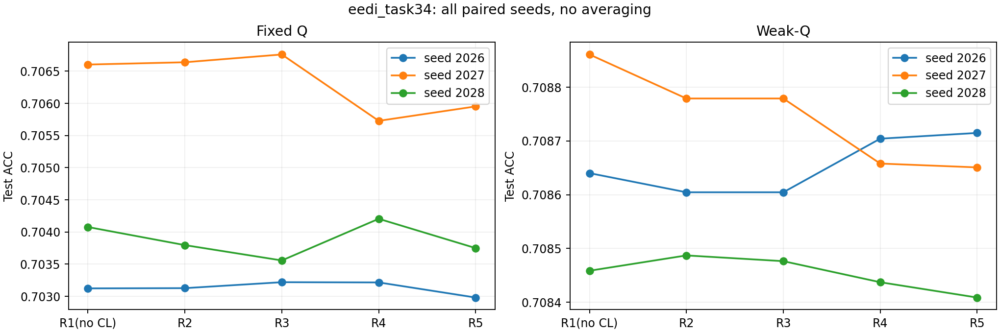

# eedi_task34：R0/R1/R2受控对比学习实验

主表不是均值：每个Q/条件内按最高验证ACC选择种子，并列选较小种子；两个test指标来自同一checkpoint。严禁把不同种子的单次结果直接相减解释模块收益，收益看全部配对种子。A0=固定参考Q，A1=Weak-Q。

| Q设置 | 条件 | CL系数 | 验证选优种子 | 最佳轮 | valid ACC | test ACC | test AUC |
| --- | --- | --- | --- | --- | --- | --- | --- |
| A0 | R0 | 0 | 2027 | 28 | 0.707047924 | 0.70660426 | 0.7680549 |
| A0 | R1 | 0 | 2027 | 28 | 0.707047924 | 0.70660426 | 0.7680549 |
| A0 | R2 | 0.1 | 2027 | 30 | 0.706695271 | 0.706639853 | 0.768366433 |
| A1 | R0 | 0 | 2028 | 30 | 0.705960576 | 0.70845865 | 0.773697676 |
| A1 | R1 | 0 | 2028 | 30 | 0.705960576 | 0.70845865 | 0.773697676 |
| A1 | R2 | 0.1 | 2028 | 30 | 0.705916495 | 0.708487124 | 0.773695165 |

## 数据与固定协议

数据集：eedi_task34；学生=4918，题目=948，概念=25；train/valid/test交互=[965661, 136111, 280955]。

使用data目录现有训练/验证/测试文件；没有重新划分。Q-F1表示与参考Q一致性，不能自动解释为认知诊断真实性。

R0参考原循环（统一验证ACC选模），R1新增入口λ=0并完全跳过CL训练分支，R2 λ=0.1。R2同时用于受控与敏感性实验，没有重复训练一份R2。模型、原始损失、α=0.8、Adam及学习率、128学生batch、30轮上限、patience=8均不变。验证ACC严格提升才更新checkpoint，平分保留最早轮。种子2026/2027/2028；每个数据集36次训练。

| 条件 | 正比例 | 正幅度 | 负比例 | 负幅度 |
| --- | --- | --- | --- | --- |
| R2 | 0.1 | 0.01 | 0.5 | 0.1 |
| R3 | 0.01 | 0.001 | 0.5 | 0.1 |
| R4 | 0.1 | 0.01 | 0.7 | 0.5 |
| R5 | 0.01 | 0.001 | 0.7 | 0.5 |

两输入不拼接。只对学生support的非零±1位置施加均匀连续噪声并裁剪到[-1,1]；0缺失、ID、标签、query和原数组不变。负噪声不翻转正误，只降低输入证据绝对值；因此极端响应不能直接当成诊断能力改善。验证/测试不增强。

损失沿用同学生一正一负InfoNCE，温度0.2，无margin。L=−正logit+logsumexp(正logit,负logit)。联合归一化项并不是独立负样本损失；负约束非零比例指负视图梯度范数>1e−12，不是margin激活率。

## 配置、代码和核验依据

以下完整配置/哈希和核验结果作为最终文档保留；用户要求清理新实验的checkpoint、原始日志及JSON/CSV副本。实际清理状态：自动审批以blocked by policy拒绝递归删除，原始产物仍暂存在Git忽略的scratch/student_cl_all_20261123。最终报告目录只包含Markdown和配图。若后续手工清理，便不能直接重放checkpoint，需按记录重跑。

<details><summary>完整配置、版本及数据/源码哈希</summary>

```json
{
  "experiment_id": "student_cl_all_eedi_task34_20261123",
  "dataset": "eedi_task34",
  "args": {
    "experiment_id": "student_cl_control_math1_20261123",
    "seeds": [
      2026,
      2027,
      2028
    ],
    "lambda_cl": 0.1,
    "positive_noise_ratio": 0.1,
    "positive_noise_scale": 0.01,
    "negative_noise_ratio": 0.5,
    "negative_noise_scale": 0.1,
    "noise_distribution": "uniform",
    "contrastive_seed": 1123,
    "temperature": 0.2,
    "dataset": "eedi_task34",
    "data_dir": "E:\\Desktop\\Gen-CD\\Q_GNCDM\\data\\eedi_task34",
    "alpha": 0.8,
    "embedding_dim": 32,
    "epochs": 30,
    "patience": 8,
    "batch_students": 128,
    "query_fraction": 0.25,
    "lr": 0.001,
    "q_lr": 0.005,
    "lambda_q": 0.01,
    "lambda_coverage": 0.01,
    "q_init_high": 0.55,
    "q_init_low": 0.45,
    "device": "cpu"
  },
  "noise_configs": {
    "R2": [
      0.1,
      0.01,
      0.5,
      0.1
    ],
    "R3": [
      0.01,
      0.001,
      0.5,
      0.1
    ],
    "R4": [
      0.1,
      0.01,
      0.7,
      0.5
    ],
    "R5": [
      0.01,
      0.001,
      0.7,
      0.5
    ]
  },
  "source_sha256": {
    "Q_GNCDM\\experiments\\run_controlled_student_cl.py": "9447f3fc2e79391b043148ae28717bee2f9f6a53dbe44352e5dddca3b6212a46",
    "Q_GNCDM\\experiments\\reference_student_cl_acc.py": "a974a5dbb0e36daf5ed49031be1838d69200e070f935d8f8f9dc31c0d9fa3dfc",
    "Q_GNCDM\\experiments\\controlled_student_cl.py": "4329530390f079ae00f6fa0d00af659e7e7be0f09134f8bc642b5a8caa0cb041",
    "Q_GNCDM\\experiments\\run_simple_contrastive.py": "196cbac42d9e7664eb4c24a4328bc852dca9265d7a88149adda0be924564a023",
    "Q_GNCDM\\models\\weak_q_gncdm.py": "5970f43820db2736bcf5f4e48039af50bf4203a5f391baa2046b8046c21517f5",
    "Q_GNCDM\\simple_contrastive.py": "30f0126846ab0e0d8802306ee183374a17730ed63f5bdd3ff6d76949b5252d97",
    "Q_GNCDM\\experiments\\run_weak_q_synthetic.py": "266d36d84cf1095189700a0b1f524f678accfd79feb94402ef6562f004f6b9b6",
    "Q_GNCDM\\experiments\\run_student_cl_all_datasets.py": "5c04daaf9a3ba1478c9d763e66348251162132ed385935c67e6d806635ec76bf",
    "Q_GNCDM\\experiments\\run_student_cl_noise_sensitivity.py": "b4c2c3850c4f49b26f60099c8d593128393ec8de80dcb3205d04fb27507f440f",
    "Q_GNCDM\\experiments\\run_prepared_dataset.py": "02b0fe433fcf75bea693b745149ac1654d866f044c81d9b2fc637b6f35d40c4d"
  },
  "data_sha256": {
    "train.csv": "1a5679aebc7de5e83fb786e29551518fdca44f81f2224a46095cf4b3f20e0ac5",
    "valid.csv": "be9b60ce1b3ac2f95738284b322b9b9878f54fe7d7a1aa3aaab281d02e75624c",
    "test.csv": "f24679ea9e11624d2d845c3d4804c8894be1389d4038b0f7af3326dcc675bcec",
    "Q_matrix.npy": "a76227d35376799959304a6a253458882537f007c96e913845241d57c5c656fb",
    "Q_true.npy": "a76227d35376799959304a6a253458882537f007c96e913845241d57c5c656fb",
    "manifest.json": "3f9fc5e6f7e25a615ca09df9a8e1bd017eee43299d2876021d7376c3d71c1e01"
  },
  "train_shape": [
    4918,
    948
  ],
  "concepts": 25,
  "split_lengths": [
    965661,
    136111,
    280955
  ],
  "seeds": [
    2026,
    2027,
    2028
  ],
  "selection": "highest validation ACC, earliest epoch; display seed chosen by validation ACC, lowest seed tie",
  "retention": "user requests final Markdown reports and figures only; temporary originals removed after verification",
  "command": "E:\\Desktop\\Gen-CD\\.venv-contrastive\\Scripts\\python.exe -m Q_GNCDM.experiments.run_student_cl_all_datasets --dataset eedi_task34",
  "python": "3.13.9 (tags/v3.13.9:8183fa5, Oct 14 2025, 14:09:13) [MSC v.1944 64 bit (AMD64)]",
  "torch": "2.14.0+cpu",
  "numpy": "2.4.3",
  "git_head": "89290e14293fe00b1e4eb55ba87ed068c5eccfdc",
  "protocol": "R0 reference ACC selector; R1 CL off; R2 shared by control and noise studies; R3-R5 change noise only",
  "scheduling_records": [
    {
      "mode": "A0",
      "seed": 2027,
      "source_sha256": "e364a26b7531d64559463606cda3108ea6c056d7e223908b664b8ce64cb9dbd1",
      "source": "Q_GNCDM\\experiments\\run_student_cl_seed2027.py",
      "changes": "seed scheduling only, same frozen worker logic",
      "status": "primary_already_started; no overwrite"
    },
    {
      "mode": "A1",
      "seed": 2027,
      "source_sha256": "e364a26b7531d64559463606cda3108ea6c056d7e223908b664b8ce64cb9dbd1",
      "source": "Q_GNCDM\\experiments\\run_student_cl_seed2027.py",
      "changes": "seed scheduling only, same frozen worker logic",
      "status": "primary_already_started; no overwrite"
    },
    [
      {
        "mode": "A0",
        "seed": 2027,
        "condition": "R5",
        "status": "copied_verified_run_without_overwrite",
        "publisher_sha256": "914af8c17a09a5d1c8aaf63dbac86aee993bb5b9a63770e0c64c71efdf41cace"
      },
      {
        "mode": "A1",
        "seed": 2027,
        "condition": "R5",
        "status": "copied_verified_run_without_overwrite",
        "publisher_sha256": "914af8c17a09a5d1c8aaf63dbac86aee993bb5b9a63770e0c64c71efdf41cace"
      }
    ],
    {
      "mode": "A0",
      "seed": 2028,
      "source_sha256": "f768bea86bd13315b1a465ba1a441eee5f55b2ce675818a872c80356c46ce63f",
      "source": "Q_GNCDM\\experiments\\run_student_cl_seed2028.py",
      "changes": "seed scheduling only, same frozen worker logic",
      "status": "published_complete_verified_group"
    },
    {
      "mode": "A1",
      "seed": 2028,
      "source_sha256": "f768bea86bd13315b1a465ba1a441eee5f55b2ce675818a872c80356c46ce63f",
      "source": "Q_GNCDM\\experiments\\run_student_cl_seed2028.py",
      "changes": "seed scheduling only, same frozen worker logic",
      "status": "published_complete_verified_group"
    }
  ],
  "scheduling_duplicate_state_checks": [
    {
      "mode": "A0",
      "seed": 2027,
      "condition": "R0",
      "checkpoint_exact": true
    },
    {
      "mode": "A0",
      "seed": 2027,
      "condition": "R1",
      "checkpoint_exact": true
    },
    {
      "mode": "A0",
      "seed": 2027,
      "condition": "R2",
      "checkpoint_exact": true
    },
    {
      "mode": "A0",
      "seed": 2027,
      "condition": "R3",
      "checkpoint_exact": true
    },
    {
      "mode": "A0",
      "seed": 2027,
      "condition": "R4",
      "checkpoint_exact": true
    },
    {
      "mode": "A0",
      "seed": 2027,
      "condition": "R5",
      "checkpoint_exact": true
    },
    {
      "mode": "A1",
      "seed": 2027,
      "condition": "R0",
      "checkpoint_exact": true
    },
    {
      "mode": "A1",
      "seed": 2027,
      "condition": "R1",
      "checkpoint_exact": true
    },
    {
      "mode": "A1",
      "seed": 2027,
      "condition": "R2",
      "checkpoint_exact": true
    },
    {
      "mode": "A1",
      "seed": 2027,
      "condition": "R3",
      "checkpoint_exact": true
    },
    {
      "mode": "A1",
      "seed": 2027,
      "condition": "R4",
      "checkpoint_exact": true
    },
    {
      "mode": "A1",
      "seed": 2027,
      "condition": "R5",
      "checkpoint_exact": true
    }
  ]
}
```
</details>

8种Q/噪声设置预检全部通过；同初始化固定batch的CL梯度、一步更新测试通过；新诊断的损失/梯度与原实现精确一致。6组R0/R1的逐轮日志与checkpoint精确一致；36个checkpoint的全部测试指标已重放核验。

```json
{
  "runs": 36,
  "preflight_settings": 8,
  "baseline_exact_pairs": 6,
  "checkpoint_replays": 36,
  "protected_code_and_data_unchanged": true,
  "status": "passed"
}
```

<details><summary>全部预检真实输出（含逐层梯度和单步参数更新差异）</summary>

```json
{
  "A0_R2": {
    "positive": {
      "selected_fraction": 0.1007375,
      "changed_fraction": 0.050225,
      "clipped_fraction_selected": 0.5014269760516193,
      "input_mae_observed": 0.00025183867546729743,
      "input_mae_all": 0.00020147094619460404,
      "input_max_change": 0.009997665882110596
    },
    "negative": {
      "selected_fraction": 0.5008875,
      "changed_fraction": 0.2517625,
      "clipped_fraction_selected": 0.4973671732674503,
      "input_mae_observed": 0.012591703794896603,
      "input_mae_all": 0.010073362849652767,
      "input_max_change": 0.09999817609786987
    },
    "gradient": {
      "original_shared_grad_norm": 1.9056160186814532e-05,
      "cl_shared_grad_norm": 6.36151464858123e-07,
      "cl_to_original_grad_ratio": 0.033382982648219615,
      "weighted_cl_to_original_grad_ratio": 0.003338298264821961
    },
    "per_layer": {
      "f_nn.f_layer_1.weight": {
        "original_grad_norm": 1.0765438673843164e-05,
        "cl_grad_norm": 4.6915894813537307e-07,
        "cl_finite": true
      },
      "f_nn.f_layer_1.bias": {
        "original_grad_norm": 1.5971002085279906e-06,
        "cl_grad_norm": 1.0058068511398233e-07,
        "cl_finite": true
      },
      "f_nn.f_layer_2.weight": {
        "original_grad_norm": 1.1584541425690986e-05,
        "cl_grad_norm": 2.986304536989337e-07,
        "cl_finite": true
      },
      "f_nn.f_layer_2.bias": {
        "original_grad_norm": 1.0511432265047915e-05,
        "cl_grad_norm": 2.920305632869713e-07,
        "cl_finite": true
      }
    },
    "batch_diagnostics": {
      "ap_mse": 8.724139632931838e-09,
      "an_mse": 3.9103624658309855e-06,
      "ap_cos_distance": 1.955777406692505e-08,
      "an_cos_distance": 5.169771611690521e-06,
      "negative_softmax_probability": 0.49999356269836426,
      "negative_not_farther_fraction": 0.0,
      "positive_selected_fraction": 0.09897025171624714,
      "positive_changed_fraction": 0.04909506969003537,
      "positive_clipped_fraction_selected": 0.5039411455596426,
      "positive_input_mae_observed": 0.00024694690364412963,
      "positive_input_mae_all": 3.913085674867034e-05,
      "positive_input_max_change": 0.009999871253967285,
      "negative_selected_fraction": 0.5057728312877054,
      "negative_changed_fraction": 0.2563449136675681,
      "negative_clipped_fraction_selected": 0.49316195372750643,
      "negative_input_mae_observed": 0.012868591584265232,
      "negative_input_mae_all": 0.002039138926193118,
      "negative_input_max_change": 0.09999102354049683
    },
    "loss_original": 0.824325442314148,
    "loss_cl": 0.6931342482566833,
    "loss_total": 0.8936388492584229,
    "single_step_parameter_changes": {
      "f_nn.f_layer_1.weight": {
        "gradient_difference_l2": 4.688850079382897e-08,
        "update_difference_l2": 0.0008094356755093997,
        "baseline_update_l2": 0.10724621161039648,
        "cl_update_l2": 0.10728008810191564
      },
      "f_nn.f_layer_1.bias": {
        "gradient_difference_l2": 1.0038411997479148e-08,
        "update_difference_l2": 2.105445032701866e-05,
        "baseline_update_l2": 0.004694630595536098,
        "cl_update_l2": 0.004693949014583604
      },
      "f_nn.f_layer_2.weight": {
        "gradient_difference_l2": 2.980944379440682e-08,
        "update_difference_l2": 0.00034395642635986253,
        "baseline_update_l2": 0.02251350852443816,
        "cl_update_l2": 0.02251461724871268
      },
      "f_nn.f_layer_2.bias": {
        "gradient_difference_l2": 2.918105996817213e-08,
        "update_difference_l2": 2.217757315343383e-05,
        "baseline_update_l2": 0.004860208748169849,
        "cl_update_l2": 0.004857557955097834
      }
    },
    "zero_single_step_exact_parity": true,
    "status": "passed",
    "observed_branch_loss_and_gradient_exact": true,
    "observation_state_and_rng_unchanged": true,
    "extra_diagnostics": {
      "ap_mse": 7.496858245303883e-09,
      "an_mse": 4.012628323835088e-06,
      "ap_cos_distance": 2.7939677238464355e-08,
      "an_cos_distance": 5.234498530626297e-06,
      "negative_softmax_probability": 0.4999935030937195,
      "negative_not_farther_fraction": 0.0078125,
      "positive_energy": -5.0,
      "joint_log_partition": 5.69313383102417,
      "negative_relative_penalty": 0.6931341290473938,
      "positive_view_grad_norm_mean": 8.864268438207299e-07,
      "negative_view_grad_norm_mean": 2.045555755359263e-05,
      "negative_view_grad_nonzero_fraction": 1.0,
      "negative_view_grad_above_1e_12_fraction": 1.0,
      "positive_shared_partial_grad_norm": 2.653856841405214e-09,
      "negative_shared_partial_grad_norm": 6.842863114676895e-07,
      "positive_selected_fraction": 0.09969835656334512,
      "positive_changed_fraction": 0.048731017266486376,
      "positive_clipped_fraction_selected": 0.5112154407929056,
      "positive_input_mae_observed": 0.0002518027613405138,
      "positive_input_mae_all": 3.990031109424308e-05,
      "positive_input_max_change": 0.009999871253967285,
      "positive_input_mse_observed": 1.7106689256252139e-06,
      "positive_clipped_fraction_observed": 0.050967339296858746,
      "positive_input_mae_changed": 0.005167196970432997,
      "positive_unchanged_student_fraction": 0.0390625,
      "negative_selected_fraction": 0.5019242770959018,
      "negative_changed_fraction": 0.2543166215935095,
      "negative_clipped_fraction_selected": 0.4933167547404414,
      "negative_input_mae_observed": 0.012737708166241646,
      "negative_input_mae_all": 0.002018399303779006,
      "negative_input_max_change": 0.09999102354049683,
      "negative_input_mse_observed": 0.0008551647188141942,
      "negative_clipped_fraction_observed": 0.24760765550239233,
      "negative_input_mae_changed": 0.05008602514863014,
      "negative_unchanged_student_fraction": 0.0
    }
  },
  "A0_R3": {
    "positive": {
      "selected_fraction": 0.01045,
      "changed_fraction": 0.005025,
      "clipped_fraction_selected": 0.5179425837320574,
      "input_mae_observed": 2.512869286874775e-06,
      "input_mae_all": 2.010295474974555e-06,
      "input_max_change": 0.0009962916374206543
    },
    "negative": {
      "selected_fraction": 0.5008875,
      "changed_fraction": 0.2517625,
      "clipped_fraction_selected": 0.4973671732674503,
      "input_mae_observed": 0.012591703794896603,
      "input_mae_all": 0.010073362849652767,
      "input_max_change": 0.09999817609786987
    },
    "gradient": {
      "original_shared_grad_norm": 1.9056160186814532e-05,
      "cl_shared_grad_norm": 6.367035807518053e-07,
      "cl_to_original_grad_ratio": 0.03341195574081905,
      "weighted_cl_to_original_grad_ratio": 0.003341195574081905
    },
    "per_layer": {
      "f_nn.f_layer_1.weight": {
        "original_grad_norm": 1.0765438673843164e-05,
        "cl_grad_norm": 4.694508959346422e-07,
        "cl_finite": true
      },
      "f_nn.f_layer_1.bias": {
        "original_grad_norm": 1.5971002085279906e-06,
        "cl_grad_norm": 1.0065283362337141e-07,
        "cl_finite": true
      },
      "f_nn.f_layer_2.weight": {
        "original_grad_norm": 1.1584541425690986e-05,
        "cl_grad_norm": 2.989983727275103e-07,
        "cl_finite": true
      },
      "f_nn.f_layer_2.bias": {
        "original_grad_norm": 1.0511432265047915e-05,
        "cl_grad_norm": 2.923633530826919e-07,
        "cl_finite": true
      }
    },
    "batch_diagnostics": {
      "ap_mse": 6.4557825231459365e-12,
      "an_mse": 3.9103624658309855e-06,
      "ap_cos_distance": 1.1175870895385742e-08,
      "an_cos_distance": 5.169771611690521e-06,
      "negative_softmax_probability": 0.49999356269836426,
      "negative_not_farther_fraction": 0.0078125,
      "positive_selected_fraction": 0.00982941543582276,
      "positive_changed_fraction": 0.00499271895152902,
      "positive_clipped_fraction_selected": 0.49206349206349204,
      "positive_input_mae_observed": 2.3512586722063133e-06,
      "positive_input_mae_all": 3.725771762219665e-07,
      "positive_input_max_change": 0.000997304916381836,
      "negative_selected_fraction": 0.5057728312877054,
      "negative_changed_fraction": 0.2563449136675681,
      "negative_clipped_fraction_selected": 0.49316195372750643,
      "negative_input_mae_observed": 0.012868591584265232,
      "negative_input_mae_all": 0.002039138926193118,
      "negative_input_max_change": 0.09999102354049683
    },
    "loss_original": 0.824325442314148,
    "loss_cl": 0.6931341886520386,
    "loss_total": 0.8936388492584229,
    "single_step_parameter_changes": {
      "f_nn.f_layer_1.weight": {
        "gradient_difference_l2": 4.6959937569886065e-08,
        "update_difference_l2": 0.000810826274112154,
        "baseline_update_l2": 0.10724621161039648,
        "cl_update_l2": 0.10728016540257877
      },
      "f_nn.f_layer_1.bias": {
        "gradient_difference_l2": 1.007503633885632e-08,
        "update_difference_l2": 2.116487964464379e-05,
        "baseline_update_l2": 0.004694630595536098,
        "cl_update_l2": 0.004693944031870008
      },
      "f_nn.f_layer_2.weight": {
        "gradient_difference_l2": 2.989242634007077e-08,
        "update_difference_l2": 0.00034456787626920753,
        "baseline_update_l2": 0.02251350852443816,
        "cl_update_l2": 0.02251458568820772
      },
      "f_nn.f_layer_2.bias": {
        "gradient_difference_l2": 2.9249164489014182e-08,
        "update_difference_l2": 2.224868942899199e-05,
        "baseline_update_l2": 0.004860208748169849,
        "cl_update_l2": 0.004857547205669708
      }
    },
    "zero_single_step_exact_parity": true,
    "status": "passed",
    "observed_branch_loss_and_gradient_exact": true,
    "observation_state_and_rng_unchanged": true,
    "extra_diagnostics": {
      "ap_mse": 5.7325056160295595e-12,
      "an_mse": 4.012628323835088e-06,
      "ap_cos_distance": 8.847564458847046e-09,
      "an_cos_distance": 5.234498530626297e-06,
      "negative_softmax_probability": 0.4999934434890747,
      "negative_not_farther_fraction": 0.0078125,
      "positive_energy": -5.0,
      "joint_log_partition": 5.69313383102417,
      "negative_relative_penalty": 0.6931341290473938,
      "positive_view_grad_norm_mean": 1.5501017270725484e-08,
      "negative_view_grad_norm_mean": 2.0455547762673696e-05,
      "negative_view_grad_nonzero_fraction": 1.0,
      "negative_view_grad_above_1e_12_fraction": 1.0,
      "positive_shared_partial_grad_norm": 2.04843318820118e-09,
      "negative_shared_partial_grad_norm": 6.841824913935775e-07,
      "positive_selected_fraction": 0.010505512793842313,
      "positive_changed_fraction": 0.00499271895152902,
      "positive_clipped_fraction_selected": 0.5247524752475248,
      "positive_input_mae_observed": 2.3936311208672123e-06,
      "positive_input_mae_all": 3.7929143559267686e-07,
      "positive_input_max_change": 0.0009937882423400879,
      "positive_input_mse_observed": 1.5729132440966964e-09,
      "positive_clipped_fraction_observed": 0.005512793842313293,
      "positive_input_mae_changed": 0.0004794243723154068,
      "positive_unchanged_student_fraction": 0.5234375,
      "negative_selected_fraction": 0.5019242770959018,
      "negative_changed_fraction": 0.2543166215935095,
      "negative_clipped_fraction_selected": 0.4933167547404414,
      "negative_input_mae_observed": 0.012737708166241646,
      "negative_input_mae_all": 0.002018399303779006,
      "negative_input_max_change": 0.09999102354049683,
      "negative_input_mse_observed": 0.0008551647188141942,
      "negative_clipped_fraction_observed": 0.24760765550239233,
      "negative_input_mae_changed": 0.05008602514863014,
      "negative_unchanged_student_fraction": 0.0
    }
  },
  "A0_R4": {
    "positive": {
      "selected_fraction": 0.1007375,
      "changed_fraction": 0.050225,
      "clipped_fraction_selected": 0.5014269760516193,
      "input_mae_observed": 0.00025183867546729743,
      "input_mae_all": 0.00020147094619460404,
      "input_max_change": 0.009997665882110596
    },
    "negative": {
      "selected_fraction": 0.7017125,
      "changed_fraction": 0.3529375,
      "clipped_fraction_selected": 0.4970340417193651,
      "input_mae_observed": 0.08849677443504333,
      "input_mae_all": 0.07079741358757019,
      "input_max_change": 0.4999908208847046
    },
    "gradient": {
      "original_shared_grad_norm": 1.9056160186814532e-05,
      "cl_shared_grad_norm": 2.6694463572188678e-05,
      "cl_to_original_grad_ratio": 1.4008311910947984,
      "weighted_cl_to_original_grad_ratio": 0.14008311910947985
    },
    "per_layer": {
      "f_nn.f_layer_1.weight": {
        "original_grad_norm": 1.0765438673843164e-05,
        "cl_grad_norm": 1.98112684302032e-05,
        "cl_finite": true
      },
      "f_nn.f_layer_1.bias": {
        "original_grad_norm": 1.5971002085279906e-06,
        "cl_grad_norm": 4.080549842910841e-06,
        "cl_finite": true
      },
      "f_nn.f_layer_2.weight": {
        "original_grad_norm": 1.1584541425690986e-05,
        "cl_grad_norm": 1.2467877240851521e-05,
        "cl_finite": true
      },
      "f_nn.f_layer_2.bias": {
        "original_grad_norm": 1.0511432265047915e-05,
        "cl_grad_norm": 1.2165905900474172e-05,
        "cl_finite": true
      }
    },
    "batch_diagnostics": {
      "ap_mse": 8.724139632931838e-09,
      "an_mse": 0.00016008927195798606,
      "ap_cos_distance": 1.955777406692505e-08,
      "an_cos_distance": 0.00020925048738718033,
      "negative_softmax_probability": 0.4997384548187256,
      "negative_not_farther_fraction": 0.0,
      "positive_selected_fraction": 0.09897025171624714,
      "positive_changed_fraction": 0.04909506969003537,
      "positive_clipped_fraction_selected": 0.5039411455596426,
      "positive_input_mae_observed": 0.00024694690364412963,
      "positive_input_mae_all": 3.913085674867034e-05,
      "positive_input_max_change": 0.009999871253967285,
      "negative_selected_fraction": 0.7028812148949448,
      "negative_changed_fraction": 0.35625130018722695,
      "negative_clipped_fraction_selected": 0.4931557528671846,
      "negative_input_mae_observed": 0.08948713541030884,
      "negative_input_mae_all": 0.01418000552803278,
      "negative_input_max_change": 0.49996405839920044
    },
    "loss_original": 0.824325442314148,
    "loss_cl": 0.6926243305206299,
    "loss_total": 0.8935878872871399,
    "single_step_parameter_changes": {
      "f_nn.f_layer_1.weight": {
        "gradient_difference_l2": 1.9811259210968475e-06,
        "update_difference_l2": 0.028676170259127793,
        "baseline_update_l2": 0.10724621161039648,
        "cl_update_l2": 0.10888725844001593
      },
      "f_nn.f_layer_1.bias": {
        "gradient_difference_l2": 4.0807148650542373e-07,
        "update_difference_l2": 0.0019810039638484037,
        "baseline_update_l2": 0.004694630595536098,
        "cl_update_l2": 0.004732472593301875
      },
      "f_nn.f_layer_2.weight": {
        "gradient_difference_l2": 1.246803375598634e-06,
        "update_difference_l2": 0.008772741267791935,
        "baseline_update_l2": 0.02251350852443816,
        "cl_update_l2": 0.0227620403187764
      },
      "f_nn.f_layer_2.bias": {
        "gradient_difference_l2": 1.2166173774028713e-06,
        "update_difference_l2": 0.0023667338567243366,
        "baseline_update_l2": 0.004860208748169849,
        "cl_update_l2": 0.004828383406578182
      }
    },
    "zero_single_step_exact_parity": true,
    "status": "passed",
    "observed_branch_loss_and_gradient_exact": true,
    "observation_state_and_rng_unchanged": true,
    "extra_diagnostics": {
      "ap_mse": 7.496858245303883e-09,
      "an_mse": 0.000161061980179511,
      "ap_cos_distance": 2.7939677238464355e-08,
      "an_cos_distance": 0.00020597968250513077,
      "negative_softmax_probability": 0.4997425377368927,
      "negative_not_farther_fraction": 0.0,
      "positive_energy": -5.0,
      "joint_log_partition": 5.692631721496582,
      "negative_relative_penalty": 0.6926324963569641,
      "positive_view_grad_norm_mean": 8.85794269165612e-07,
      "negative_view_grad_norm_mean": 0.00012757348184314136,
      "negative_view_grad_nonzero_fraction": 1.0,
      "negative_view_grad_above_1e_12_fraction": 1.0,
      "positive_shared_partial_grad_norm": 2.569659285440845e-09,
      "negative_shared_partial_grad_norm": 2.7986877961087985e-05,
      "positive_selected_fraction": 0.09969835656334512,
      "positive_changed_fraction": 0.048731017266486376,
      "positive_clipped_fraction_selected": 0.5112154407929056,
      "positive_input_mae_observed": 0.0002518027613405138,
      "positive_input_mae_all": 3.990031109424308e-05,
      "positive_input_max_change": 0.009999871253967285,
      "positive_input_mse_observed": 1.7106689256252139e-06,
      "positive_clipped_fraction_observed": 0.050967339296858746,
      "positive_input_mae_changed": 0.005167196970432997,
      "positive_unchanged_student_fraction": 0.0390625,
      "negative_selected_fraction": 0.6994487206157687,
      "negative_changed_fraction": 0.3544830455585604,
      "negative_clipped_fraction_selected": 0.49319652018737453,
      "negative_input_mae_observed": 0.08903255313634872,
      "negative_input_mae_all": 0.01410797331482172,
      "negative_input_max_change": 0.49996405839920044,
      "negative_input_mse_observed": 0.029898198321461678,
      "negative_clipped_fraction_observed": 0.34496567505720827,
      "negative_input_mae_changed": 0.25116166472435,
      "negative_unchanged_student_fraction": 0.0
    }
  },
  "A0_R5": {
    "positive": {
      "selected_fraction": 0.01045,
      "changed_fraction": 0.005025,
      "clipped_fraction_selected": 0.5179425837320574,
      "input_mae_observed": 2.512869286874775e-06,
      "input_mae_all": 2.010295474974555e-06,
      "input_max_change": 0.0009962916374206543
    },
    "negative": {
      "selected_fraction": 0.7017125,
      "changed_fraction": 0.3529375,
      "clipped_fraction_selected": 0.4970340417193651,
      "input_mae_observed": 0.08849677443504333,
      "input_mae_all": 0.07079741358757019,
      "input_max_change": 0.4999908208847046
    },
    "gradient": {
      "original_shared_grad_norm": 1.9056160186814532e-05,
      "cl_shared_grad_norm": 2.6695007359956565e-05,
      "cl_to_original_grad_ratio": 1.4008597271567624,
      "weighted_cl_to_original_grad_ratio": 0.14008597271567624
    },
    "per_layer": {
      "f_nn.f_layer_1.weight": {
        "original_grad_norm": 1.0765438673843164e-05,
        "cl_grad_norm": 1.981164859898854e-05,
        "cl_finite": true
      },
      "f_nn.f_layer_1.bias": {
        "original_grad_norm": 1.5971002085279906e-06,
        "cl_grad_norm": 4.080655799043598e-06,
        "cl_finite": true
      },
      "f_nn.f_layer_2.weight": {
        "original_grad_norm": 1.1584541425690986e-05,
        "cl_grad_norm": 1.246811279997928e-05,
        "cl_finite": true
      },
      "f_nn.f_layer_2.bias": {
        "original_grad_norm": 1.0511432265047915e-05,
        "cl_grad_norm": 1.2166194210294634e-05,
        "cl_finite": true
      }
    },
    "batch_diagnostics": {
      "ap_mse": 6.4557825231459365e-12,
      "an_mse": 0.00016008927195798606,
      "ap_cos_distance": 1.1175870895385742e-08,
      "an_cos_distance": 0.00020925048738718033,
      "negative_softmax_probability": 0.4997384548187256,
      "negative_not_farther_fraction": 0.0,
      "positive_selected_fraction": 0.00982941543582276,
      "positive_changed_fraction": 0.00499271895152902,
      "positive_clipped_fraction_selected": 0.49206349206349204,
      "positive_input_mae_observed": 2.3512586722063133e-06,
      "positive_input_mae_all": 3.725771762219665e-07,
      "positive_input_max_change": 0.000997304916381836,
      "negative_selected_fraction": 0.7028812148949448,
      "negative_changed_fraction": 0.35625130018722695,
      "negative_clipped_fraction_selected": 0.4931557528671846,
      "negative_input_mae_observed": 0.08948713541030884,
      "negative_input_mae_all": 0.01418000552803278,
      "negative_input_max_change": 0.49996405839920044
    },
    "loss_original": 0.824325442314148,
    "loss_cl": 0.6926242113113403,
    "loss_total": 0.8935878872871399,
    "single_step_parameter_changes": {
      "f_nn.f_layer_1.weight": {
        "gradient_difference_l2": 1.9811599781630077e-06,
        "update_difference_l2": 0.02867679127977256,
        "baseline_update_l2": 0.10724621161039648,
        "cl_update_l2": 0.10888735400162025
      },
      "f_nn.f_layer_1.bias": {
        "gradient_difference_l2": 4.080800572870507e-07,
        "update_difference_l2": 0.00198102788202486,
        "baseline_update_l2": 0.004694630595536098,
        "cl_update_l2": 0.0047324772723880675
      },
      "f_nn.f_layer_2.weight": {
        "gradient_difference_l2": 1.2468513972821842e-06,
        "update_difference_l2": 0.008773063692611638,
        "baseline_update_l2": 0.02251350852443816,
        "cl_update_l2": 0.022762037817115634
      },
      "f_nn.f_layer_2.bias": {
        "gradient_difference_l2": 1.2166512593105592e-06,
        "update_difference_l2": 0.0023668037539909498,
        "baseline_update_l2": 0.004860208748169849,
        "cl_update_l2": 0.004828386196273894
      }
    },
    "zero_single_step_exact_parity": true,
    "status": "passed",
    "observed_branch_loss_and_gradient_exact": true,
    "observation_state_and_rng_unchanged": true,
    "extra_diagnostics": {
      "ap_mse": 5.7325056160295595e-12,
      "an_mse": 0.000161061980179511,
      "ap_cos_distance": 8.847564458847046e-09,
      "an_cos_distance": 0.00020597968250513077,
      "negative_softmax_probability": 0.4997425079345703,
      "negative_not_farther_fraction": 0.0,
      "positive_energy": -5.0,
      "joint_log_partition": 5.692631721496582,
      "negative_relative_penalty": 0.6926324367523193,
      "positive_view_grad_norm_mean": 1.5472599769813285e-08,
      "negative_view_grad_norm_mean": 0.00012757347705352366,
      "negative_view_grad_nonzero_fraction": 1.0,
      "negative_view_grad_above_1e_12_fraction": 1.0,
      "positive_shared_partial_grad_norm": 2.1135577570203327e-09,
      "negative_shared_partial_grad_norm": 2.798705707991432e-05,
      "positive_selected_fraction": 0.010505512793842313,
      "positive_changed_fraction": 0.00499271895152902,
      "positive_clipped_fraction_selected": 0.5247524752475248,
      "positive_input_mae_observed": 2.3936311208672123e-06,
      "positive_input_mae_all": 3.7929143559267686e-07,
      "positive_input_max_change": 0.0009937882423400879,
      "positive_input_mse_observed": 1.5729132440966964e-09,
      "positive_clipped_fraction_observed": 0.005512793842313293,
      "positive_input_mae_changed": 0.0004794243723154068,
      "positive_unchanged_student_fraction": 0.5234375,
      "negative_selected_fraction": 0.6994487206157687,
      "negative_changed_fraction": 0.3544830455585604,
      "negative_clipped_fraction_selected": 0.49319652018737453,
      "negative_input_mae_observed": 0.08903255313634872,
      "negative_input_mae_all": 0.01410797331482172,
      "negative_input_max_change": 0.49996405839920044,
      "negative_input_mse_observed": 0.029898198321461678,
      "negative_clipped_fraction_observed": 0.34496567505720827,
      "negative_input_mae_changed": 0.25116166472435,
      "negative_unchanged_student_fraction": 0.0
    }
  },
  "A1_R2": {
    "positive": {
      "selected_fraction": 0.1007375,
      "changed_fraction": 0.050225,
      "clipped_fraction_selected": 0.5014269760516193,
      "input_mae_observed": 0.00025183867546729743,
      "input_mae_all": 0.00020147094619460404,
      "input_max_change": 0.009997665882110596
    },
    "negative": {
      "selected_fraction": 0.5008875,
      "changed_fraction": 0.2517625,
      "clipped_fraction_selected": 0.4973671732674503,
      "input_mae_observed": 0.012591703794896603,
      "input_mae_all": 0.010073362849652767,
      "input_max_change": 0.09999817609786987
    },
    "gradient": {
      "original_shared_grad_norm": 0.0001812871054251377,
      "cl_shared_grad_norm": 2.0298544854750592e-07,
      "cl_to_original_grad_ratio": 0.0011196904935488008,
      "weighted_cl_to_original_grad_ratio": 0.0001119690493548801
    },
    "per_layer": {
      "q_logits": {
        "original_grad_norm": 0.00012923358008265495,
        "cl_grad_norm": 7.373739663307788e-08,
        "cl_finite": true
      },
      "f_nn.f_layer_1.weight": {
        "original_grad_norm": 6.790197221562266e-05,
        "cl_grad_norm": 1.3291933953496482e-07,
        "cl_finite": true
      },
      "f_nn.f_layer_1.bias": {
        "original_grad_norm": 1.725947186059784e-05,
        "cl_grad_norm": 9.374506504400415e-09,
        "cl_finite": true
      },
      "f_nn.f_layer_2.weight": {
        "original_grad_norm": 6.176414171932265e-05,
        "cl_grad_norm": 9.118934229945808e-08,
        "cl_finite": true
      },
      "f_nn.f_layer_2.bias": {
        "original_grad_norm": 8.625727059552446e-05,
        "cl_grad_norm": 9.846289827919463e-08,
        "cl_finite": true
      }
    },
    "batch_diagnostics": {
      "ap_mse": 2.1848084230668974e-08,
      "an_mse": 8.69241739565041e-06,
      "ap_cos_distance": 4.656612873077393e-10,
      "an_cos_distance": 5.541369318962097e-08,
      "negative_softmax_probability": 0.4999999403953552,
      "negative_not_farther_fraction": 0.4765625,
      "positive_selected_fraction": 0.09897025171624714,
      "positive_changed_fraction": 0.04909506969003537,
      "positive_clipped_fraction_selected": 0.5039411455596426,
      "positive_input_mae_observed": 0.00024694690364412963,
      "positive_input_mae_all": 3.913085674867034e-05,
      "positive_input_max_change": 0.009999871253967285,
      "negative_selected_fraction": 0.5057728312877054,
      "negative_changed_fraction": 0.2563449136675681,
      "negative_clipped_fraction_selected": 0.49316195372750643,
      "negative_input_mae_observed": 0.012868591584265232,
      "negative_input_mae_all": 0.002039138926193118,
      "negative_input_max_change": 0.09999102354049683
    },
    "loss_original": 0.8292962908744812,
    "loss_cl": 0.6931471228599548,
    "loss_total": 0.8986110091209412,
    "single_step_parameter_changes": {
      "q_logits": {
        "gradient_difference_l2": 7.374445509300714e-09,
        "update_difference_l2": 0.00020624320073479974,
        "baseline_update_l2": 0.6828663745208201,
        "cl_update_l2": 0.6828659471638581
      },
      "f_nn.f_layer_1.weight": {
        "gradient_difference_l2": 1.3294130589177384e-08,
        "update_difference_l2": 8.378354714038062e-05,
        "baseline_update_l2": 0.13201651574986492,
        "cl_update_l2": 0.13201666026846523
      },
      "f_nn.f_layer_1.bias": {
        "gradient_difference_l2": 9.32043392462354e-10,
        "update_difference_l2": 2.5637815177376893e-09,
        "baseline_update_l2": 0.004983901013047135,
        "cl_update_l2": 0.004983900384377806
      },
      "f_nn.f_layer_2.weight": {
        "gradient_difference_l2": 9.113319525706113e-09,
        "update_difference_l2": 8.26242416525136e-07,
        "baseline_update_l2": 0.024772376799632106,
        "cl_update_l2": 0.02477249349912811
      },
      "f_nn.f_layer_2.bias": {
        "gradient_difference_l2": 9.843995367463488e-09,
        "update_difference_l2": 1.201406685281557e-07,
        "baseline_update_l2": 0.004991899440972997,
        "cl_update_l2": 0.004991873224571297
      }
    },
    "zero_single_step_exact_parity": true,
    "status": "passed",
    "observed_branch_loss_and_gradient_exact": true,
    "observation_state_and_rng_unchanged": true,
    "extra_diagnostics": {
      "ap_mse": 1.5869712655103285e-08,
      "an_mse": 8.969927876023576e-06,
      "ap_cos_distance": 3.259629011154175e-09,
      "an_cos_distance": 4.516914486885071e-08,
      "negative_softmax_probability": 0.4999999403953552,
      "negative_not_farther_fraction": 0.53125,
      "positive_energy": -5.0,
      "joint_log_partition": 5.693146705627441,
      "negative_relative_penalty": 0.6931471228599548,
      "positive_view_grad_norm_mean": 1.1099051393459627e-07,
      "negative_view_grad_norm_mean": 3.19736851033471e-06,
      "negative_view_grad_nonzero_fraction": 1.0,
      "negative_view_grad_above_1e_12_fraction": 1.0,
      "positive_shared_partial_grad_norm": 4.4738942611749465e-09,
      "negative_shared_partial_grad_norm": 2.167359163429752e-07,
      "positive_selected_fraction": 0.09969835656334512,
      "positive_changed_fraction": 0.048731017266486376,
      "positive_clipped_fraction_selected": 0.5112154407929056,
      "positive_input_mae_observed": 0.0002518027613405138,
      "positive_input_mae_all": 3.990031109424308e-05,
      "positive_input_max_change": 0.009999871253967285,
      "positive_input_mse_observed": 1.7106689256252139e-06,
      "positive_clipped_fraction_observed": 0.050967339296858746,
      "positive_input_mae_changed": 0.005167196970432997,
      "positive_unchanged_student_fraction": 0.0390625,
      "negative_selected_fraction": 0.5019242770959018,
      "negative_changed_fraction": 0.2543166215935095,
      "negative_clipped_fraction_selected": 0.4933167547404414,
      "negative_input_mae_observed": 0.012737708166241646,
      "negative_input_mae_all": 0.002018399303779006,
      "negative_input_max_change": 0.09999102354049683,
      "negative_input_mse_observed": 0.0008551647188141942,
      "negative_clipped_fraction_observed": 0.24760765550239233,
      "negative_input_mae_changed": 0.05008602514863014,
      "negative_unchanged_student_fraction": 0.0
    }
  },
  "A1_R3": {
    "positive": {
      "selected_fraction": 0.01045,
      "changed_fraction": 0.005025,
      "clipped_fraction_selected": 0.5179425837320574,
      "input_mae_observed": 2.512869286874775e-06,
      "input_mae_all": 2.010295474974555e-06,
      "input_max_change": 0.0009962916374206543
    },
    "negative": {
      "selected_fraction": 0.5008875,
      "changed_fraction": 0.2517625,
      "clipped_fraction_selected": 0.4973671732674503,
      "input_mae_observed": 0.012591703794896603,
      "input_mae_all": 0.010073362849652767,
      "input_max_change": 0.09999817609786987
    },
    "gradient": {
      "original_shared_grad_norm": 0.0001812871054251377,
      "cl_shared_grad_norm": 2.0310988010177232e-07,
      "cl_to_original_grad_ratio": 0.0011203768719537878,
      "weighted_cl_to_original_grad_ratio": 0.00011203768719537878
    },
    "per_layer": {
      "q_logits": {
        "original_grad_norm": 0.00012923358008265495,
        "cl_grad_norm": 7.37577536824574e-08,
        "cl_finite": true
      },
      "f_nn.f_layer_1.weight": {
        "original_grad_norm": 6.790197221562266e-05,
        "cl_grad_norm": 1.3287001365824835e-07,
        "cl_finite": true
      },
      "f_nn.f_layer_1.bias": {
        "original_grad_norm": 1.725947186059784e-05,
        "cl_grad_norm": 9.313854576475933e-09,
        "cl_finite": true
      },
      "f_nn.f_layer_2.weight": {
        "original_grad_norm": 6.176414171932265e-05,
        "cl_grad_norm": 9.135732881304648e-08,
        "cl_finite": true
      },
      "f_nn.f_layer_2.bias": {
        "original_grad_norm": 8.625727059552446e-05,
        "cl_grad_norm": 9.86207524533711e-08,
        "cl_finite": true
      }
    },
    "batch_diagnostics": {
      "ap_mse": 1.3929537211188059e-11,
      "an_mse": 8.69241739565041e-06,
      "ap_cos_distance": 5.122274160385132e-09,
      "an_cos_distance": 5.541369318962097e-08,
      "negative_softmax_probability": 0.4999999403953552,
      "negative_not_farther_fraction": 0.4765625,
      "positive_selected_fraction": 0.00982941543582276,
      "positive_changed_fraction": 0.00499271895152902,
      "positive_clipped_fraction_selected": 0.49206349206349204,
      "positive_input_mae_observed": 2.3512586722063133e-06,
      "positive_input_mae_all": 3.725771762219665e-07,
      "positive_input_max_change": 0.000997304916381836,
      "negative_selected_fraction": 0.5057728312877054,
      "negative_changed_fraction": 0.2563449136675681,
      "negative_clipped_fraction_selected": 0.49316195372750643,
      "negative_input_mae_observed": 0.012868591584265232,
      "negative_input_mae_all": 0.002039138926193118,
      "negative_input_max_change": 0.09999102354049683
    },
    "loss_original": 0.8292962908744812,
    "loss_cl": 0.6931470632553101,
    "loss_total": 0.8986110091209412,
    "single_step_parameter_changes": {
      "q_logits": {
        "gradient_difference_l2": 7.376959996300286e-09,
        "update_difference_l2": 0.00020610146514025998,
        "baseline_update_l2": 0.6828663745208201,
        "cl_update_l2": 0.6828659412392838
      },
      "f_nn.f_layer_1.weight": {
        "gradient_difference_l2": 1.3289606124425949e-08,
        "update_difference_l2": 8.429735947942006e-05,
        "baseline_update_l2": 0.13201651574986492,
        "cl_update_l2": 0.1320166872323246
      },
      "f_nn.f_layer_1.bias": {
        "gradient_difference_l2": 9.328598321540607e-10,
        "update_difference_l2": 2.5398824630853985e-09,
        "baseline_update_l2": 0.004983901013047135,
        "cl_update_l2": 0.004983900407659273
      },
      "f_nn.f_layer_2.weight": {
        "gradient_difference_l2": 9.116470250681323e-09,
        "update_difference_l2": 8.273040491305611e-07,
        "baseline_update_l2": 0.024772376799632106,
        "cl_update_l2": 0.024772492744224703
      },
      "f_nn.f_layer_2.bias": {
        "gradient_difference_l2": 9.8666748443711e-09,
        "update_difference_l2": 1.201408377362737e-07,
        "baseline_update_l2": 0.004991899440972997,
        "cl_update_l2": 0.004991873201259198
      }
    },
    "zero_single_step_exact_parity": true,
    "status": "passed",
    "observed_branch_loss_and_gradient_exact": true,
    "observation_state_and_rng_unchanged": true,
    "extra_diagnostics": {
      "ap_mse": 1.0853291355916728e-11,
      "an_mse": 8.969927876023576e-06,
      "ap_cos_distance": -6.984919309616089e-09,
      "an_cos_distance": 4.516914486885071e-08,
      "negative_softmax_probability": 0.4999999403953552,
      "negative_not_farther_fraction": 0.515625,
      "positive_energy": -5.0,
      "joint_log_partition": 5.693146705627441,
      "negative_relative_penalty": 0.6931471228599548,
      "positive_view_grad_norm_mean": 2.9174231204978216e-09,
      "negative_view_grad_norm_mean": 3.1973575803943285e-06,
      "negative_view_grad_nonzero_fraction": 1.0,
      "negative_view_grad_above_1e_12_fraction": 1.0,
      "positive_shared_partial_grad_norm": 6.176943857165074e-09,
      "negative_shared_partial_grad_norm": 2.1686088025294557e-07,
      "positive_selected_fraction": 0.010505512793842313,
      "positive_changed_fraction": 0.00499271895152902,
      "positive_clipped_fraction_selected": 0.5247524752475248,
      "positive_input_mae_observed": 2.3936311208672123e-06,
      "positive_input_mae_all": 3.7929143559267686e-07,
      "positive_input_max_change": 0.0009937882423400879,
      "positive_input_mse_observed": 1.5729132440966964e-09,
      "positive_clipped_fraction_observed": 0.005512793842313293,
      "positive_input_mae_changed": 0.0004794243723154068,
      "positive_unchanged_student_fraction": 0.5234375,
      "negative_selected_fraction": 0.5019242770959018,
      "negative_changed_fraction": 0.2543166215935095,
      "negative_clipped_fraction_selected": 0.4933167547404414,
      "negative_input_mae_observed": 0.012737708166241646,
      "negative_input_mae_all": 0.002018399303779006,
      "negative_input_max_change": 0.09999102354049683,
      "negative_input_mse_observed": 0.0008551647188141942,
      "negative_clipped_fraction_observed": 0.24760765550239233,
      "negative_input_mae_changed": 0.05008602514863014,
      "negative_unchanged_student_fraction": 0.0
    }
  },
  "A1_R4": {
    "positive": {
      "selected_fraction": 0.1007375,
      "changed_fraction": 0.050225,
      "clipped_fraction_selected": 0.5014269760516193,
      "input_mae_observed": 0.00025183867546729743,
      "input_mae_all": 0.00020147094619460404,
      "input_max_change": 0.009997665882110596
    },
    "negative": {
      "selected_fraction": 0.7017125,
      "changed_fraction": 0.3529375,
      "clipped_fraction_selected": 0.4970340417193651,
      "input_mae_observed": 0.08849677443504333,
      "input_mae_all": 0.07079741358757019,
      "input_max_change": 0.4999908208847046
    },
    "gradient": {
      "original_shared_grad_norm": 0.0001812871054251377,
      "cl_shared_grad_norm": 8.77949679990812e-06,
      "cl_to_original_grad_ratio": 0.04842868873282112,
      "weighted_cl_to_original_grad_ratio": 0.004842868873282113
    },
    "per_layer": {
      "q_logits": {
        "original_grad_norm": 0.00012923358008265495,
        "cl_grad_norm": 3.6040848954144167e-06,
        "cl_finite": true
      },
      "f_nn.f_layer_1.weight": {
        "original_grad_norm": 6.790197221562266e-05,
        "cl_grad_norm": 5.154176960786572e-06,
        "cl_finite": true
      },
      "f_nn.f_layer_1.bias": {
        "original_grad_norm": 1.725947186059784e-05,
        "cl_grad_norm": 4.0017721403273754e-07,
        "cl_finite": true
      },
      "f_nn.f_layer_2.weight": {
        "original_grad_norm": 6.176414171932265e-05,
        "cl_grad_norm": 3.947779077861924e-06,
        "cl_finite": true
      },
      "f_nn.f_layer_2.bias": {
        "original_grad_norm": 8.625727059552446e-05,
        "cl_grad_norm": 4.666847871703794e-06,
        "cl_finite": true
      }
    },
    "batch_diagnostics": {
      "ap_mse": 2.1848084230668974e-08,
      "an_mse": 0.00036535036633722484,
      "ap_cos_distance": 4.656612873077393e-10,
      "an_cos_distance": 2.439599484205246e-06,
      "negative_softmax_probability": 0.49999698996543884,
      "negative_not_farther_fraction": 0.1953125,
      "positive_selected_fraction": 0.09897025171624714,
      "positive_changed_fraction": 0.04909506969003537,
      "positive_clipped_fraction_selected": 0.5039411455596426,
      "positive_input_mae_observed": 0.00024694690364412963,
      "positive_input_mae_all": 3.913085674867034e-05,
      "positive_input_max_change": 0.009999871253967285,
      "negative_selected_fraction": 0.7028812148949448,
      "negative_changed_fraction": 0.35625130018722695,
      "negative_clipped_fraction_selected": 0.4931557528671846,
      "negative_input_mae_observed": 0.08948713541030884,
      "negative_input_mae_all": 0.01418000552803278,
      "negative_input_max_change": 0.49996405839920044
    },
    "loss_original": 0.8292962908744812,
    "loss_cl": 0.6931410431861877,
    "loss_total": 0.8986104130744934,
    "single_step_parameter_changes": {
      "q_logits": {
        "gradient_difference_l2": 3.6040639343636837e-07,
        "update_difference_l2": 0.011421726488915162,
        "baseline_update_l2": 0.6828663745208201,
        "cl_update_l2": 0.6828444067696608
      },
      "f_nn.f_layer_1.weight": {
        "gradient_difference_l2": 5.15407490619261e-07,
        "update_difference_l2": 0.0030200019264809167,
        "baseline_update_l2": 0.13201651574986492,
        "cl_update_l2": 0.13202085950750114
      },
      "f_nn.f_layer_1.bias": {
        "gradient_difference_l2": 4.003267760102081e-08,
        "update_difference_l2": 4.5140932346129954e-08,
        "baseline_update_l2": 0.004983901013047135,
        "cl_update_l2": 0.004983894246327421
      },
      "f_nn.f_layer_2.weight": {
        "gradient_difference_l2": 3.9475687575096894e-07,
        "update_difference_l2": 3.25062371167642e-05,
        "baseline_update_l2": 0.024772376799632106,
        "cl_update_l2": 0.024777418106552825
      },
      "f_nn.f_layer_2.bias": {
        "gradient_difference_l2": 4.6668571556751533e-07,
        "update_difference_l2": 7.659737637082826e-06,
        "baseline_update_l2": 0.004991899440972997,
        "cl_update_l2": 0.004990391535090289
      }
    },
    "zero_single_step_exact_parity": true,
    "status": "passed",
    "observed_branch_loss_and_gradient_exact": true,
    "observation_state_and_rng_unchanged": true,
    "extra_diagnostics": {
      "ap_mse": 1.5869712655103285e-08,
      "an_mse": 0.00038052781019359827,
      "ap_cos_distance": 3.259629011154175e-09,
      "an_cos_distance": 2.207234501838684e-06,
      "negative_softmax_probability": 0.49999719858169556,
      "negative_not_farther_fraction": 0.1953125,
      "positive_energy": -5.0,
      "joint_log_partition": 5.693140983581543,
      "negative_relative_penalty": 0.6931416392326355,
      "positive_view_grad_norm_mean": 1.1101273316927685e-07,
      "negative_view_grad_norm_mean": 2.1068240325261745e-05,
      "negative_view_grad_nonzero_fraction": 1.0,
      "negative_view_grad_above_1e_12_fraction": 1.0,
      "positive_shared_partial_grad_norm": 6.022136453131694e-09,
      "negative_shared_partial_grad_norm": 9.352363146908392e-06,
      "positive_selected_fraction": 0.09969835656334512,
      "positive_changed_fraction": 0.048731017266486376,
      "positive_clipped_fraction_selected": 0.5112154407929056,
      "positive_input_mae_observed": 0.0002518027613405138,
      "positive_input_mae_all": 3.990031109424308e-05,
      "positive_input_max_change": 0.009999871253967285,
      "positive_input_mse_observed": 1.7106689256252139e-06,
      "positive_clipped_fraction_observed": 0.050967339296858746,
      "positive_input_mae_changed": 0.005167196970432997,
      "positive_unchanged_student_fraction": 0.0390625,
      "negative_selected_fraction": 0.6994487206157687,
      "negative_changed_fraction": 0.3544830455585604,
      "negative_clipped_fraction_selected": 0.49319652018737453,
      "negative_input_mae_observed": 0.08903255313634872,
      "negative_input_mae_all": 0.01410797331482172,
      "negative_input_max_change": 0.49996405839920044,
      "negative_input_mse_observed": 0.029898198321461678,
      "negative_clipped_fraction_observed": 0.34496567505720827,
      "negative_input_mae_changed": 0.25116166472435,
      "negative_unchanged_student_fraction": 0.0
    }
  },
  "A1_R5": {
    "positive": {
      "selected_fraction": 0.01045,
      "changed_fraction": 0.005025,
      "clipped_fraction_selected": 0.5179425837320574,
      "input_mae_observed": 2.512869286874775e-06,
      "input_mae_all": 2.010295474974555e-06,
      "input_max_change": 0.0009962916374206543
    },
    "negative": {
      "selected_fraction": 0.7017125,
      "changed_fraction": 0.3529375,
      "clipped_fraction_selected": 0.4970340417193651,
      "input_mae_observed": 0.08849677443504333,
      "input_mae_all": 0.07079741358757019,
      "input_max_change": 0.4999908208847046
    },
    "gradient": {
      "original_shared_grad_norm": 0.0001812871054251377,
      "cl_shared_grad_norm": 8.779562676425957e-06,
      "cl_to_original_grad_ratio": 0.048429052115079786,
      "weighted_cl_to_original_grad_ratio": 0.004842905211507979
    },
    "per_layer": {
      "q_logits": {
        "original_grad_norm": 0.00012923358008265495,
        "cl_grad_norm": 3.6041503790329443e-06,
        "cl_finite": true
      },
      "f_nn.f_layer_1.weight": {
        "original_grad_norm": 6.790197221562266e-05,
        "cl_grad_norm": 5.154182417754782e-06,
        "cl_finite": true
      },
      "f_nn.f_layer_1.bias": {
        "original_grad_norm": 1.725947186059784e-05,
        "cl_grad_norm": 4.0018068148128805e-07,
        "cl_finite": true
      },
      "f_nn.f_layer_2.weight": {
        "original_grad_norm": 6.176414171932265e-05,
        "cl_grad_norm": 3.947729055653326e-06,
        "cl_finite": true
      },
      "f_nn.f_layer_2.bias": {
        "original_grad_norm": 8.625727059552446e-05,
        "cl_grad_norm": 4.666957011068007e-06,
        "cl_finite": true
      }
    },
    "batch_diagnostics": {
      "ap_mse": 1.3929537211188059e-11,
      "an_mse": 0.00036535036633722484,
      "ap_cos_distance": 5.122274160385132e-09,
      "an_cos_distance": 2.439599484205246e-06,
      "negative_softmax_probability": 0.49999696016311646,
      "negative_not_farther_fraction": 0.2265625,
      "positive_selected_fraction": 0.00982941543582276,
      "positive_changed_fraction": 0.00499271895152902,
      "positive_clipped_fraction_selected": 0.49206349206349204,
      "positive_input_mae_observed": 2.3512586722063133e-06,
      "positive_input_mae_all": 3.725771762219665e-07,
      "positive_input_max_change": 0.000997304916381836,
      "negative_selected_fraction": 0.7028812148949448,
      "negative_changed_fraction": 0.35625130018722695,
      "negative_clipped_fraction_selected": 0.4931557528671846,
      "negative_input_mae_observed": 0.08948713541030884,
      "negative_input_mae_all": 0.01418000552803278,
      "negative_input_max_change": 0.49996405839920044
    },
    "loss_original": 0.8292962908744812,
    "loss_cl": 0.6931410431861877,
    "loss_total": 0.8986104130744934,
    "single_step_parameter_changes": {
      "q_logits": {
        "gradient_difference_l2": 3.604152328962715e-07,
        "update_difference_l2": 0.011421936008844195,
        "baseline_update_l2": 0.6828663745208201,
        "cl_update_l2": 0.6828443957520115
      },
      "f_nn.f_layer_1.weight": {
        "gradient_difference_l2": 5.154116702391174e-07,
        "update_difference_l2": 0.0030200898545944457,
        "baseline_update_l2": 0.13201651574986492,
        "cl_update_l2": 0.13202087650768296
      },
      "f_nn.f_layer_1.bias": {
        "gradient_difference_l2": 4.0022021388371266e-08,
        "update_difference_l2": 4.5047765829629314e-08,
        "baseline_update_l2": 0.004983901013047135,
        "cl_update_l2": 0.004983894292901729
      },
      "f_nn.f_layer_2.weight": {
        "gradient_difference_l2": 3.947726517321087e-07,
        "update_difference_l2": 3.2506354446410675e-05,
        "baseline_update_l2": 0.024772376799632106,
        "cl_update_l2": 0.02477741660400877
      },
      "f_nn.f_layer_2.bias": {
        "gradient_difference_l2": 4.666999724656786e-07,
        "update_difference_l2": 7.659737648583407e-06,
        "baseline_update_l2": 0.004991899440972997,
        "cl_update_l2": 0.004990391511771281
      }
    },
    "zero_single_step_exact_parity": true,
    "status": "passed",
    "observed_branch_loss_and_gradient_exact": true,
    "observation_state_and_rng_unchanged": true,
    "extra_diagnostics": {
      "ap_mse": 1.0853291355916728e-11,
      "an_mse": 0.00038052781019359827,
      "ap_cos_distance": -6.984919309616089e-09,
      "an_cos_distance": 2.207234501838684e-06,
      "negative_softmax_probability": 0.49999725818634033,
      "negative_not_farther_fraction": 0.1796875,
      "positive_energy": -5.0,
      "joint_log_partition": 5.693140983581543,
      "negative_relative_penalty": 0.6931416392326355,
      "positive_view_grad_norm_mean": 2.8521151982904513e-09,
      "negative_view_grad_norm_mean": 2.1068236509633766e-05,
      "negative_view_grad_nonzero_fraction": 1.0,
      "negative_view_grad_above_1e_12_fraction": 1.0,
      "positive_shared_partial_grad_norm": 5.807106819474856e-09,
      "negative_shared_partial_grad_norm": 9.352460902969022e-06,
      "positive_selected_fraction": 0.010505512793842313,
      "positive_changed_fraction": 0.00499271895152902,
      "positive_clipped_fraction_selected": 0.5247524752475248,
      "positive_input_mae_observed": 2.3936311208672123e-06,
      "positive_input_mae_all": 3.7929143559267686e-07,
      "positive_input_max_change": 0.0009937882423400879,
      "positive_input_mse_observed": 1.5729132440966964e-09,
      "positive_clipped_fraction_observed": 0.005512793842313293,
      "positive_input_mae_changed": 0.0004794243723154068,
      "positive_unchanged_student_fraction": 0.5234375,
      "negative_selected_fraction": 0.6994487206157687,
      "negative_changed_fraction": 0.3544830455585604,
      "negative_clipped_fraction_selected": 0.49319652018737453,
      "negative_input_mae_observed": 0.08903255313634872,
      "negative_input_mae_all": 0.01410797331482172,
      "negative_input_max_change": 0.49996405839920044,
      "negative_input_mse_observed": 0.029898198321461678,
      "negative_clipped_fraction_observed": 0.34496567505720827,
      "negative_input_mae_changed": 0.25116166472435,
      "negative_unchanged_student_fraction": 0.0
    }
  }
}
```
</details>

## 全部条件的初始固定batch敏感性

| Q | 条件 | CL损失 | 正MSE | 负MSE | CL共享梯度 | 加权CL/原梯度 |
| --- | --- | --- | --- | --- | --- | --- |
| A0 | R2 | 0.693134248 | 8.72413963e-09 | 3.91036247e-06 | 6.36151465e-07 | 0.00333829826 |
| A0 | R3 | 0.693134189 | 6.45578252e-12 | 3.91036247e-06 | 6.36703581e-07 | 0.00334119557 |
| A0 | R4 | 0.692624331 | 8.72413963e-09 | 0.000160089272 | 2.66944636e-05 | 0.140083119 |
| A0 | R5 | 0.692624211 | 6.45578252e-12 | 0.000160089272 | 2.66950074e-05 | 0.140085973 |
| A1 | R2 | 0.693147123 | 2.18480842e-08 | 8.6924174e-06 | 2.02985449e-07 | 0.000111969049 |
| A1 | R3 | 0.693147063 | 1.39295372e-11 | 8.6924174e-06 | 2.0310988e-07 | 0.000112037687 |
| A1 | R4 | 0.693141043 | 2.18480842e-08 | 0.000365350366 | 8.7794968e-06 | 0.00484286887 |
| A1 | R5 | 0.693141043 | 1.39295372e-11 | 0.000365350366 | 8.77956268e-06 | 0.00484290521 |

## 全部逐种子结果（相对R1配对差值）

| Q | seed | 条件 | 最佳轮 | 训练轮 | valid ACC | test ACC | test AUC | ΔACC | ΔAUC | RMSE | Brier | NLL | Q-F1 |
| --- | --- | --- | --- | --- | --- | --- | --- | --- | --- | --- | --- | --- | --- |
| A0 | 2026 | R0 | 26 | 30 | 0.703550778 | 0.703123276 | 0.762800707 | 0 | 0 | 0.441775196 | 0.195165324 | 0.571932558 | 1 |
| A0 | 2026 | R1 | 26 | 30 | 0.703550778 | 0.703123276 | 0.762800707 | 0 | 0 | 0.441775196 | 0.195165324 | 0.571932558 | 1 |
| A0 | 2026 | R2 | 26 | 30 | 0.703874044 | 0.703126835 | 0.762768221 | 3.55928885e-06 | -3.24861386e-05 | 0.441764902 | 0.195156229 | 0.571884881 | 1 |
| A0 | 2027 | R0 | 28 | 30 | 0.707047924 | 0.70660426 | 0.7680549 | 0 | 0 | 0.439870605 | 0.193486149 | 0.568220027 | 1 |
| A0 | 2027 | R1 | 28 | 30 | 0.707047924 | 0.70660426 | 0.7680549 | 0 | 0 | 0.439870605 | 0.193486149 | 0.568220027 | 1 |
| A0 | 2027 | R2 | 30 | 30 | 0.706695271 | 0.706639853 | 0.768366433 | 3.55928885e-05 | 0.000311533104 | 0.439685611 | 0.193323436 | 0.56779466 | 1 |
| A0 | 2028 | R0 | 28 | 30 | 0.704674861 | 0.704077165 | 0.76357351 | 0 | 0 | 0.441261214 | 0.194711459 | 0.570794313 | 1 |
| A0 | 2028 | R1 | 28 | 30 | 0.704674861 | 0.704077165 | 0.76357351 | 0 | 0 | 0.441261214 | 0.194711459 | 0.570794313 | 1 |
| A0 | 2028 | R2 | 29 | 30 | 0.70455731 | 0.703795982 | 0.763562191 | -0.000281183819 | -1.13196087e-05 | 0.441300223 | 0.194745887 | 0.570793689 | 1 |
| A1 | 2026 | R0 | 30 | 30 | 0.705211188 | 0.708640174 | 0.773453676 | 0 | 0 | 0.438244406 | 0.192058159 | 0.564921107 | 0.133076181 |
| A1 | 2026 | R1 | 30 | 30 | 0.705211188 | 0.708640174 | 0.773453676 | 0 | 0 | 0.438244406 | 0.192058159 | 0.564921107 | 0.133076181 |
| A1 | 2026 | R2 | 30 | 30 | 0.705240576 | 0.708604581 | 0.773451979 | -3.55928885e-05 | -1.69657561e-06 | 0.43824644 | 0.192059943 | 0.564924389 | 0.132976445 |
| A1 | 2027 | R0 | 29 | 30 | 0.705835678 | 0.70886085 | 0.773467926 | 0 | 0 | 0.438500528 | 0.192282713 | 0.565420019 | 0.134429508 |
| A1 | 2027 | R1 | 29 | 30 | 0.705835678 | 0.70886085 | 0.773467926 | 0 | 0 | 0.438500528 | 0.192282713 | 0.565420019 | 0.134429508 |
| A1 | 2027 | R2 | 29 | 30 | 0.70578425 | 0.708778986 | 0.773475617 | -8.18636436e-05 | 7.69148588e-06 | 0.43849457 | 0.192277488 | 0.565402113 | 0.13469433 |
| A1 | 2028 | R0 | 30 | 30 | 0.705960576 | 0.70845865 | 0.773697676 | 0 | 0 | 0.438090487 | 0.191923275 | 0.564482219 | 0.131172504 |
| A1 | 2028 | R1 | 30 | 30 | 0.705960576 | 0.70845865 | 0.773697676 | 0 | 0 | 0.438090487 | 0.191923275 | 0.564482219 | 0.131172504 |
| A1 | 2028 | R2 | 30 | 30 | 0.705916495 | 0.708487124 | 0.773695165 | 2.84743108e-05 | -2.51087381e-06 | 0.438091324 | 0.191924008 | 0.564483243 | 0.13111546 |

## 补充统计：不替代主表

| Q | 条件 | ACC均值 | ACC样本SD | AUC均值 | AUC样本SD | 配对ΔACC均值 | 配对ΔAUC均值 | 配对ΔACC SD | 配对ΔAUC SD |
| --- | --- | --- | --- | --- | --- | --- | --- | --- | --- |
| A0 | R0 | 0.704601567 | 0.0017987666 | 0.764809706 | 0.00283685907 | 0 | 0 | 0 | 0 |
| A0 | R1 | 0.704601567 | 0.0017987666 | 0.764809706 | 0.00283685907 | 0 | 0 | 0 | 0 |
| A0 | R2 | 0.70452089 | 0.00186532659 | 0.764898948 | 0.00302905669 | -8.0677214e-05 | 8.92424521e-05 | 0.000174380939 | 0.000192800041 |
| A1 | R0 | 0.708653224 | 0.000201417176 | 0.773539759 | 0.000136945743 | 0 | 0 | 0 | 0 |
| A1 | R1 | 0.708653224 | 0.000201417176 | 0.773539759 | 0.000136945743 | 0 | 0 | 0 | 0 |
| A1 | R2 | 0.708623564 | 0.000146853917 | 0.773540921 | 0.000134101879 | -2.96607405e-05 | 1.16134549e-06 | 5.54076604e-05 | 5.66990481e-06 |

## 训练损失与诊断

| Q | seed | 条件 | 原损失(含Q) | CL损失 | 加权CL | 总损失 |
| --- | --- | --- | --- | --- | --- | --- |
| A0 | 2026 | R0 | 0.613934826 | 0 | 0 | 0.613934826 |
| A0 | 2026 | R1 | 0.613934826 | 0 | 0 | 0.613934826 |
| A0 | 2026 | R2 | 0.613947863 | 0.693129838 | 0.0693129838 | 0.683260846 |
| A0 | 2027 | R0 | 0.607146176 | 0 | 0 | 0.607146176 |
| A0 | 2027 | R1 | 0.607146176 | 0 | 0 | 0.607146176 |
| A0 | 2027 | R2 | 0.607119701 | 0.693129844 | 0.0693129844 | 0.676432685 |
| A0 | 2028 | R0 | 0.614003642 | 0 | 0 | 0.614003642 |
| A0 | 2028 | R1 | 0.614003642 | 0 | 0 | 0.614003642 |
| A0 | 2028 | R2 | 0.614008639 | 0.693129815 | 0.0693129815 | 0.683321621 |
| A1 | 2026 | R0 | 0.593720189 | 0 | 0 | 0.593720189 |
| A1 | 2026 | R1 | 0.593720189 | 0 | 0 | 0.593720189 |
| A1 | 2026 | R2 | 0.593720716 | 0.693137522 | 0.0693137522 | 0.663034468 |
| A1 | 2027 | R0 | 0.591288837 | 0 | 0 | 0.591288837 |
| A1 | 2027 | R1 | 0.591288837 | 0 | 0 | 0.591288837 |
| A1 | 2027 | R2 | 0.591287998 | 0.693138893 | 0.0693138893 | 0.660601888 |
| A1 | 2028 | R0 | 0.592654156 | 0 | 0 | 0.592654156 |
| A1 | 2028 | R1 | 0.592654156 | 0 | 0 | 0.592654156 |
| A1 | 2028 | R2 | 0.592653522 | 0.693137456 | 0.0693137456 | 0.661967267 |

## W参数差异

以下比较每个运行按验证ACC选出的最终参数；可能含不同最佳轮的影响。CL参与更新的因果证据来自上述同batch单步测试。有效PosLinear权重为|W|。

| Q | seed | 参数 | 形状 | 原W均值 | CL W均值 | 差L2 | 最大差 | \|W\|差L2 |
| --- | --- | --- | --- | --- | --- | --- | --- | --- |
| A0 | 2026 | q_logits | [948, 25] | -12.7084656 | -12.7084656 | 0 | 0 | 0 |
| A0 | 2026 | f_nn.f_layer_1.weight | [25, 948] | -0.000229296988 | -0.00035804318 | 2.90196346 | 0.675463915 | 0.33875005 |
| A0 | 2026 | f_nn.f_layer_1.bias | [25] | -0.729747176 | -0.73037827 | 0.0125914028 | 0.00671225786 | 0.0125914028 |
| A0 | 2026 | f_nn.f_layer_2.weight | [25, 25] | 0.0155303227 | 0.0150409071 | 0.620666273 | 0.337383419 | 0.0504213205 |
| A0 | 2026 | f_nn.f_layer_2.bias | [25] | -0.743919671 | -0.745163977 | 0.0149602571 | 0.00958960876 | 0.0149602571 |
| A0 | 2026 | g_nn.g_layer_1.weight | [25, 4918] | 0.0015110909 | 0.00147701951 | 10.1480782 | 0.182714939 | 8.93682468 |
| A0 | 2026 | g_nn.g_layer_1.bias | [25] | -0.00473983865 | -0.00690928102 | 0.0703084325 | 0.0435249172 | 0.0695349637 |
| A0 | 2026 | g_nn.g_layer_2.weight | [25, 25] | -0.00600543153 | -0.00538442284 | 0.732459322 | 0.142200172 | 0.72830256 |
| A0 | 2026 | g_nn.g_layer_2.bias | [25] | 0.0187425762 | 0.0212634653 | 0.0462509261 | 0.0291702151 | 0.0462509261 |
| A0 | 2026 | g_nn.g_layer_3.weight | [25, 25] | -0.0205533653 | -0.0195564963 | 0.351123258 | 0.067399025 | 0.347053499 |
| A0 | 2026 | g_nn.g_layer_3.bias | [25] | -0.0422364771 | -0.0409717858 | 0.0296592132 | 0.0207925588 | 0.0296592132 |
| A0 | 2026 | theta_agg_mat.weight | [32, 25] | -0.00924126711 | -0.00969097577 | 0.977691381 | 0.886849999 | 0.0276566979 |
| A0 | 2026 | theta_agg_mat.bias | [32] | -0.0729866475 | -0.0728947744 | 0.00077775537 | 0.000579349697 | 0.00077775537 |
| A0 | 2026 | psi_agg_mat.weight | [32, 25] | 0.041738309 | 0.0413246788 | 0.0476233605 | 0.00751331449 | 0.0475354546 |
| A0 | 2026 | psi_agg_mat.bias | [32] | 0.0523310229 | 0.0522391349 | 0.000778010575 | 0.000579684973 | 0.000778010575 |
| A0 | 2026 | ncd.pred_layer_1.weight | [64, 32] | -0.115809977 | -0.115772404 | 0.0336493417 | 0.0032762289 | 0.0336493417 |
| A0 | 2026 | ncd.pred_layer_1.bias | [64] | -0.0531933717 | -0.0531894639 | 0.0029096534 | 0.000822120579 | 0.00279113806 |
| A0 | 2026 | ncd.pred_layer_2.weight | [32, 64] | -0.0890868232 | -0.0891482159 | 0.027437477 | 0.00448461622 | 0.027406149 |
| A0 | 2026 | ncd.pred_layer_2.bias | [32] | -0.0845590085 | -0.0846376494 | 0.00157053899 | 0.000756189227 | 0.00157053899 |
| A0 | 2026 | ncd.pred_layer_3.weight | [1, 32] | 0.0891499668 | 0.089208886 | 0.00106165086 | 0.000421822071 | 0.00106165086 |
| A0 | 2026 | ncd.pred_layer_3.bias | [1] | -0.0643368214 | -0.0642809272 | 5.58942556e-05 | 5.58942556e-05 | 5.58942556e-05 |
| A1 | 2026 | q_logits | [948, 25] | -0.233896524 | -0.233894706 | 1.0067954 | 0.16637513 | 1.00348662 |
| A1 | 2026 | f_nn.f_layer_1.weight | [25, 948] | -0.000111788839 | -0.000107814449 | 0.869755013 | 0.156608805 | 0.212104756 |
| A1 | 2026 | f_nn.f_layer_1.bias | [25] | -1.06401861 | -1.06421483 | 0.00217430389 | 0.00100457668 | 0.00217430389 |
| A1 | 2026 | f_nn.f_layer_2.weight | [25, 25] | 0.0124964043 | 0.0125642503 | 0.139028067 | 0.12618722 | 0.0161301216 |
| A1 | 2026 | f_nn.f_layer_2.bias | [25] | -0.843890309 | -0.844045341 | 0.00115381928 | 0.00041270256 | 0.00115381928 |
| A1 | 2026 | g_nn.g_layer_1.weight | [25, 4918] | -0.0021189726 | -0.0020917654 | 0.886844288 | 0.0473949648 | 0.839542433 |
| A1 | 2026 | g_nn.g_layer_1.bias | [25] | 0.000944796659 | 0.00100828777 | 0.00316619314 | 0.00297820568 | 0.00316619314 |
| A1 | 2026 | g_nn.g_layer_2.weight | [25, 25] | -0.00395183126 | -0.00400110567 | 0.0222849623 | 0.00469996594 | 0.0222849623 |
| A1 | 2026 | g_nn.g_layer_2.bias | [25] | 0.0121493135 | 0.0121742561 | 0.0010210853 | 0.000392064452 | 0.0010210853 |
| A1 | 2026 | g_nn.g_layer_3.weight | [25, 25] | 0.0781821012 | 0.0783002079 | 0.00998542883 | 0.00196810439 | 0.00998542883 |
| A1 | 2026 | g_nn.g_layer_3.bias | [25] | 0.0808404982 | 0.0809334815 | 0.00144825793 | 0.000786244869 | 0.00144825793 |
| A1 | 2026 | theta_agg_mat.weight | [32, 25] | -0.00084947556 | -0.000791220693 | 0.0356335746 | 0.0156803671 | 0.0158571885 |
| A1 | 2026 | theta_agg_mat.bias | [32] | 0.000282007735 | 0.000260196859 | 0.000743613706 | 0.00045889616 | 0.000743613706 |
| A1 | 2026 | psi_agg_mat.weight | [32, 25] | 0.0372364521 | 0.0372557677 | 0.00501264246 | 0.000974103808 | 0.00501264246 |
| A1 | 2026 | psi_agg_mat.bias | [32] | -0.0209376514 | -0.0209157541 | 0.000744226553 | 0.000459700823 | 0.000744226553 |
| A1 | 2026 | ncd.pred_layer_1.weight | [64, 32] | -0.0391323827 | -0.0391446948 | 0.00357625324 | 0.000659823418 | 0.00357625324 |
| A1 | 2026 | ncd.pred_layer_1.bias | [64] | 0.00245378492 | 0.00241779815 | 0.000643050673 | 0.00019865483 | 0.000643050673 |
| A1 | 2026 | ncd.pred_layer_2.weight | [32, 64] | -0.086154975 | -0.0861307904 | 0.00348208361 | 0.000521287322 | 0.00348208361 |
| A1 | 2026 | ncd.pred_layer_2.bias | [32] | -0.0840171948 | -0.0839918032 | 0.000208957682 | 7.81249255e-05 | 0.000208957682 |
| A1 | 2026 | ncd.pred_layer_3.weight | [1, 32] | 0.103338115 | 0.103363067 | 0.000203044585 | 8.01086426e-05 | 0.000203044585 |
| A1 | 2026 | ncd.pred_layer_3.bias | [1] | -0.0615174249 | -0.0614935942 | 2.3830682e-05 | 2.3830682e-05 | 2.3830682e-05 |
| A0 | 2027 | q_logits | [948, 25] | -12.7084656 | -12.7084656 | 0 | 0 | 0 |
| A0 | 2027 | f_nn.f_layer_1.weight | [25, 948] | -0.000189977611 | -0.000366965425 | 2.66054878 | 0.524535298 | 1.41458576 |
| A0 | 2027 | f_nn.f_layer_1.bias | [25] | -0.80864197 | -0.829505622 | 0.136602126 | 0.0457060337 | 0.136602126 |
| A0 | 2027 | f_nn.f_layer_2.weight | [25, 25] | -0.00912511814 | -0.00829457585 | 1.29673737 | 0.70760417 | 0.275591887 |
| A0 | 2027 | f_nn.f_layer_2.bias | [25] | -0.729343057 | -0.759290695 | 0.16655932 | 0.050244689 | 0.16655932 |
| A0 | 2027 | g_nn.g_layer_1.weight | [25, 4918] | -0.00201730919 | -0.00246734871 | 8.76098656 | 0.174382687 | 7.79330834 |
| A0 | 2027 | g_nn.g_layer_1.bias | [25] | 0.0268028695 | 0.0272075795 | 0.0359445772 | 0.0203240588 | 0.0359445772 |
| A0 | 2027 | g_nn.g_layer_2.weight | [25, 25] | -0.0147389937 | -0.0161092598 | 0.64465121 | 0.121496737 | 0.638275165 |
| A0 | 2027 | g_nn.g_layer_2.bias | [25] | 0.0261098258 | 0.0242633726 | 0.0414777603 | 0.0151702221 | 0.0393323639 |
| A0 | 2027 | g_nn.g_layer_3.weight | [25, 25] | -0.0241128411 | -0.0250682123 | 0.314610114 | 0.0550683811 | 0.310476996 |
| A0 | 2027 | g_nn.g_layer_3.bias | [25] | -0.0537078939 | -0.0539531671 | 0.0341948219 | 0.018537879 | 0.0341948219 |
| A0 | 2027 | theta_agg_mat.weight | [32, 25] | 0.018307535 | 0.0181979276 | 0.877097734 | 0.837705851 | 0.214575379 |
| A0 | 2027 | theta_agg_mat.bias | [32] | -0.0945808887 | -0.0950206816 | 0.00496836766 | 0.0023060739 | 0.00496836766 |
| A0 | 2027 | psi_agg_mat.weight | [32, 25] | -0.0235523302 | -0.0227005929 | 0.191105877 | 0.0240863487 | 0.189685819 |
| A0 | 2027 | psi_agg_mat.bias | [32] | 0.0831184909 | 0.0835582465 | 0.00496787847 | 0.00230556726 | 0.00496787847 |
| A0 | 2027 | ncd.pred_layer_1.weight | [64, 32] | -0.0904120505 | -0.0920454338 | 0.439620602 | 0.0354183912 | 0.439194632 |
| A0 | 2027 | ncd.pred_layer_1.bias | [64] | -0.0733438656 | -0.0744718686 | 0.0302179321 | 0.0120918378 | 0.0302179321 |
| A0 | 2027 | ncd.pred_layer_2.weight | [32, 64] | -0.0908290595 | -0.0948196873 | 0.286221156 | 0.023042649 | 0.285333084 |
| A0 | 2027 | ncd.pred_layer_2.bias | [32] | -0.106562972 | -0.111421384 | 0.0330976813 | 0.0133134872 | 0.0330976813 |
| A0 | 2027 | ncd.pred_layer_3.weight | [1, 32] | 0.0618645512 | 0.0631578863 | 0.0179944096 | 0.00671361387 | 0.0179944096 |
| A0 | 2027 | ncd.pred_layer_3.bias | [1] | 0.0705250651 | 0.0683876127 | 0.00213745236 | 0.00213745236 | 0.00213745236 |
| A1 | 2027 | q_logits | [948, 25] | -0.236111999 | -0.236013398 | 1.54482303 | 0.16988796 | 1.54020126 |
| A1 | 2027 | f_nn.f_layer_1.weight | [25, 948] | 0.000197795351 | 0.000171587482 | 0.859782013 | 0.148013651 | 0.195426977 |
| A1 | 2027 | f_nn.f_layer_1.bias | [25] | -1.02815962 | -1.02821827 | 0.00220244564 | 0.00106602907 | 0.00220244564 |
| A1 | 2027 | f_nn.f_layer_2.weight | [25, 25] | -0.0018779533 | -0.00165373937 | 0.334388864 | 0.236661151 | 0.0156017434 |
| A1 | 2027 | f_nn.f_layer_2.bias | [25] | -0.809069455 | -0.809344232 | 0.00223537421 | 0.000821232796 | 0.00223537421 |
| A1 | 2027 | g_nn.g_layer_1.weight | [25, 4918] | -0.00501930481 | -0.00489945291 | 1.34455546 | 0.0681644529 | 1.24343023 |
| A1 | 2027 | g_nn.g_layer_1.bias | [25] | 0.00567122083 | 0.00545741385 | 0.00464390561 | 0.00186048448 | 0.00464390561 |
| A1 | 2027 | g_nn.g_layer_2.weight | [25, 25] | 0.0146415299 | 0.0148469023 | 0.123948577 | 0.0304717869 | 0.123947819 |
| A1 | 2027 | g_nn.g_layer_2.bias | [25] | 0.033794947 | 0.0339291394 | 0.0031050274 | 0.00154933333 | 0.0031050274 |
| A1 | 2027 | g_nn.g_layer_3.weight | [25, 25] | 0.0597581305 | 0.0600364245 | 0.0208933565 | 0.00390162319 | 0.0208933565 |
| A1 | 2027 | g_nn.g_layer_3.bias | [25] | 0.0288747028 | 0.0291955527 | 0.00328482611 | 0.00215134025 | 0.00328482611 |
| A1 | 2027 | theta_agg_mat.weight | [32, 25] | 0.00668898365 | 0.0067114979 | 0.0543664055 | 0.0233273916 | 0.0225155022 |
| A1 | 2027 | theta_agg_mat.bias | [32] | -0.0505236685 | -0.0505386814 | 0.00081313076 | 0.000452920794 | 0.00081313076 |
| A1 | 2027 | psi_agg_mat.weight | [32, 25] | 0.0406222194 | 0.040767923 | 0.0135606615 | 0.00207677484 | 0.0135603605 |
| A1 | 2027 | psi_agg_mat.bias | [32] | 0.0390613303 | 0.0390763469 | 0.000813248161 | 0.000452965498 | 0.000813248161 |
| A1 | 2027 | ncd.pred_layer_1.weight | [64, 32] | -0.0269638617 | -0.0270018764 | 0.0110449845 | 0.00319276005 | 0.0110449845 |
| A1 | 2027 | ncd.pred_layer_1.bias | [64] | 0.027148433 | 0.0271039549 | 0.00141950668 | 0.00065548718 | 0.00141950668 |
| A1 | 2027 | ncd.pred_layer_2.weight | [32, 64] | -0.0864038095 | -0.0863684714 | 0.00624809118 | 0.000973597169 | 0.00624809118 |
| A1 | 2027 | ncd.pred_layer_2.bias | [32] | -0.0908699036 | -0.0908144191 | 0.000380362727 | 0.000158831477 | 0.000380362727 |
| A1 | 2027 | ncd.pred_layer_3.weight | [1, 32] | 0.0641111359 | 0.0641280711 | 0.000250957527 | 0.000128746033 | 0.000250957527 |
| A1 | 2027 | ncd.pred_layer_3.bias | [1] | 0.0961464942 | 0.0960138291 | 0.000132665038 | 0.000132665038 | 0.000132665038 |
| A0 | 2028 | q_logits | [948, 25] | -12.7084656 | -12.7084656 | 0 | 0 | 0 |
| A0 | 2028 | f_nn.f_layer_1.weight | [25, 948] | -0.000339730148 | -0.00030353773 | 3.26956954 | 0.615832984 | 1.01909873 |
| A0 | 2028 | f_nn.f_layer_1.bias | [25] | -0.78081727 | -0.787888169 | 0.0510937136 | 0.0186786652 | 0.0510937136 |
| A0 | 2028 | f_nn.f_layer_2.weight | [25, 25] | -0.00260328595 | -0.00248138257 | 1.21732969 | 0.629074275 | 0.186097992 |
| A0 | 2028 | f_nn.f_layer_2.bias | [25] | -0.762757778 | -0.779933631 | 0.0972139473 | 0.0331389904 | 0.0972139473 |
| A0 | 2028 | g_nn.g_layer_1.weight | [25, 4918] | -0.00229704962 | -0.00190590345 | 8.98438639 | 0.160294101 | 8.13992273 |
| A0 | 2028 | g_nn.g_layer_1.bias | [25] | -0.00649883924 | -0.0056245015 | 0.045486931 | 0.0237550065 | 0.045486931 |
| A0 | 2028 | g_nn.g_layer_2.weight | [25, 25] | -0.0181919038 | -0.0208919961 | 0.694647785 | 0.11421594 | 0.689684968 |
| A0 | 2028 | g_nn.g_layer_2.bias | [25] | -0.107504934 | -0.109821089 | 0.0419965248 | 0.0201251134 | 0.0419965248 |
| A0 | 2028 | g_nn.g_layer_3.weight | [25, 25] | -0.0296948124 | -0.0305083077 | 0.288040482 | 0.0642515123 | 0.284754205 |
| A0 | 2028 | g_nn.g_layer_3.bias | [25] | -0.103929482 | -0.103856131 | 0.0374942947 | 0.0179394744 | 0.0374942947 |
| A0 | 2028 | theta_agg_mat.weight | [32, 25] | -0.00703519769 | -0.00648920797 | 1.45477387 | 1.11502683 | 0.154510431 |
| A0 | 2028 | theta_agg_mat.bias | [32] | -0.0682243034 | -0.0683224499 | 0.00529300721 | 0.00216272473 | 0.00529300721 |
| A0 | 2028 | psi_agg_mat.weight | [32, 25] | 0.042915985 | 0.044534117 | 0.126404739 | 0.0198117234 | 0.125368802 |
| A0 | 2028 | psi_agg_mat.bias | [32] | 0.074288547 | 0.0743866935 | 0.0052932236 | 0.00216242671 | 0.0052932236 |
| A0 | 2028 | ncd.pred_layer_1.weight | [64, 32] | -0.0903276354 | -0.0911392197 | 0.303163263 | 0.0291577876 | 0.301687198 |
| A0 | 2028 | ncd.pred_layer_1.bias | [64] | -0.0502805673 | -0.0511525795 | 0.0245062644 | 0.00786197186 | 0.0245062644 |
| A0 | 2028 | ncd.pred_layer_2.weight | [32, 64] | -0.0854381844 | -0.0876111388 | 0.156219998 | 0.0144035295 | 0.155730116 |
| A0 | 2028 | ncd.pred_layer_2.bias | [32] | -0.0984636843 | -0.101968989 | 0.0234395505 | 0.00759616494 | 0.0234395505 |
| A0 | 2028 | ncd.pred_layer_3.weight | [1, 32] | 0.096357733 | 0.0973741412 | 0.0152454966 | 0.00816969573 | 0.0152454966 |
| A0 | 2028 | ncd.pred_layer_3.bias | [1] | -0.119696043 | -0.12013986 | 0.000443816185 | 0.000443816185 | 0.000443816185 |
| A1 | 2028 | q_logits | [948, 25] | -0.225885451 | -0.225851029 | 0.744973497 | 0.145680159 | 0.730051408 |
| A1 | 2028 | f_nn.f_layer_1.weight | [25, 948] | -5.86965616e-05 | -3.02537683e-05 | 0.903418594 | 0.146633431 | 0.18745116 |
| A1 | 2028 | f_nn.f_layer_1.bias | [25] | -1.02929425 | -1.02940512 | 0.00315750093 | 0.00193440914 | 0.00315750093 |
| A1 | 2028 | f_nn.f_layer_2.weight | [25, 25] | -0.00100389391 | -0.000684286526 | 0.157208799 | 0.111072578 | 0.0161363133 |
| A1 | 2028 | f_nn.f_layer_2.bias | [25] | -0.846385121 | -0.846547365 | 0.00162017013 | 0.000619351864 | 0.00162017013 |
| A1 | 2028 | g_nn.g_layer_1.weight | [25, 4918] | -0.00918000191 | -0.00912970584 | 0.68953171 | 0.0381870344 | 0.665818331 |
| A1 | 2028 | g_nn.g_layer_1.bias | [25] | 0.0229380578 | 0.0230113938 | 0.00163790687 | 0.00143647939 | 0.00163790687 |
| A1 | 2028 | g_nn.g_layer_2.weight | [25, 25] | 0.0277099069 | 0.0277180355 | 0.0101090432 | 0.00238760281 | 0.0101090432 |
| A1 | 2028 | g_nn.g_layer_2.bias | [25] | -0.00435659289 | -0.00440936908 | 0.000758007551 | 0.000385079533 | 0.000758007551 |
| A1 | 2028 | g_nn.g_layer_3.weight | [25, 25] | 0.0640148595 | 0.0640046895 | 0.00325136766 | 0.000629434362 | 0.00325136766 |
| A1 | 2028 | g_nn.g_layer_3.bias | [25] | 0.027083002 | 0.0270542912 | 0.000514461926 | 0.0003892635 | 0.000514461926 |
| A1 | 2028 | theta_agg_mat.weight | [32, 25] | -0.00449184934 | -0.00451528141 | 0.0555470991 | 0.0348014981 | 0.0144168578 |
| A1 | 2028 | theta_agg_mat.bias | [32] | -0.0196429435 | -0.0196494143 | 0.000169072171 | 7.89985061e-05 | 0.000169072171 |
| A1 | 2028 | psi_agg_mat.weight | [32, 25] | 0.0503445193 | 0.050347425 | 0.00249225851 | 0.000459045172 | 0.00249225851 |
| A1 | 2028 | psi_agg_mat.bias | [32] | 0.0257072151 | 0.0257136356 | 0.000169381109 | 7.88867474e-05 | 0.000169381109 |
| A1 | 2028 | ncd.pred_layer_1.weight | [64, 32] | -0.025571825 | -0.0255617909 | 0.00289038773 | 0.000350236893 | 0.00289038773 |
| A1 | 2028 | ncd.pred_layer_1.bias | [64] | 0.0372621082 | 0.0372760557 | 0.000352466209 | 0.000125095248 | 0.000352466209 |
| A1 | 2028 | ncd.pred_layer_2.weight | [32, 64] | -0.0841491446 | -0.0841540396 | 0.00219331511 | 0.000434845686 | 0.00219331511 |
| A1 | 2028 | ncd.pred_layer_2.bias | [32] | -0.10242258 | -0.102426395 | 5.69817924e-05 | 2.51028687e-05 | 5.69817924e-05 |
| A1 | 2028 | ncd.pred_layer_3.weight | [1, 32] | 0.0974622369 | 0.09746667 | 0.00013275478 | 7.04675913e-05 | 0.00013275478 |
| A1 | 2028 | ncd.pred_layer_3.bias | [1] | -0.0538158901 | -0.053777121 | 3.87690961e-05 | 3.87690961e-05 | 3.87690961e-05 |

### 学生网络W数值示例

为避免大数据集数十万权重淹没报告，只展示seed2026各学生层左上最多8×8子矩阵，明确不是完整矩阵。全部层、全部种子的变化范数已列在上表；用户要求清理完整checkpoint，但当前清理被自动审批拒绝，实际仍暂存scratch。

A0 f_nn.f_layer_1.weight R1：

```text
[[-6.5537862479686737e-02  4.2467087507247925e-02  4.0875999256968498e-03 -4.9018627032637596e-04  4.7789798118174076e-03  1.9698613323271275e-03 -1.9063179194927216e-01 -9.3235164880752563e-02]
 [-2.5130161643028259e-01  1.1603988707065582e-01  1.0979731380939484e-01  4.9554822035133839e-03  2.0146094262599945e-01  1.4451086521148682e-02  1.3674700260162354e-01  1.2284164875745773e-01]
 [ 1.7920894920825958e-01 -6.4653567969799042e-02 -1.2248060666024685e-02 -4.2955067008733749e-02  1.0894072800874710e-01  9.9478820338845253e-03 -1.7134883999824524e-01  6.2670134007930756e-02]
 [ 3.4173759818077087e-01 -1.0418492555618286e-01  8.5009470582008362e-02 -2.2967637050896883e-04 -1.5863803029060364e-01 -2.0388290286064148e-01 -2.3764083161950111e-02 -9.7907006740570068e-02]
 [-1.0495449602603912e-01  6.3592076301574707e-02 -8.1007808446884155e-02  5.1721118390560150e-02  1.4948599040508270e-01 -5.8527160435914993e-03  2.0946390926837921e-01  9.0624891221523285e-02]
 [-2.5839760899543762e-01 -2.1579723060131073e-01  4.7766484320163727e-02 -1.0819046292454004e-03  1.5007939934730530e-01  1.3130709528923035e-01 -9.1203232295811176e-04 -6.0473684221506119e-02]
 [ 3.0025416612625122e-01 -1.9360086321830750e-01 -1.1117977648973465e-01 -3.0046745669096708e-03  2.2665487229824066e-01  1.0526923090219498e-01  1.0084138810634613e-01 -2.1484766900539398e-01]
 [-3.1039988994598389e-01  7.6252125203609467e-02 -1.6445288201794028e-03  8.2863559946417809e-03 -1.2688949704170227e-01 -1.1531449854373932e-02  8.4247864782810211e-02  7.8366257250308990e-02]]
```

R2：

```text
[[-0.06243760138750076    0.044241808354854584   0.0011435553897172213 -0.0007346951751969755  0.005369631107896566   0.0012901721056550741 -0.18907175958156586   -0.09420888870954514  ]
 [-0.250254362821579      0.11657365411520004    0.10706251859664917   -0.005521800369024277   0.20061160624027252    0.014864826574921608   0.1385386884212494     0.122452013194561    ]
 [ 0.17796924710273743   -0.06470058858394623    0.014073791913688183  -0.04470989108085632    0.1067027822136879    -0.01517479121685028   -0.17036794126033783    0.06780193746089935  ]
 [ 0.3414449989795685    -0.106600821018219      0.08476286381483078    0.005166407208889723  -0.15985141694545746   -0.20413410663604736   -0.023922307416796684  -0.09748762100934982  ]
 [-0.1032012328505516     0.06515690684318542   -0.08088982850313187   -0.04952891170978546    0.152397021651268      0.0048199365846812725  0.21568405628204346    0.09307746589183807  ]
 [-0.25662755966186523   -0.21785692870616913    0.04916525259613991   -0.0004917689366266131  0.14787138998508453    0.1330849677324295    -0.001447315327823162  -0.05923023447394371  ]
 [ 0.2997761070728302    -0.19393335282802582   -0.10991708934307098    0.003451113821938634   0.22564378380775452    0.10953614860773087    0.09917356073856354   -0.2161846160888672   ]
 [-0.30861347913742065    0.07735635340213776   -0.0026306938380002975  0.008119928650557995  -0.12946061789989471    0.017279768362641335   0.08596134185791016    0.08097449690103531  ]]
```

A0 f_nn.f_layer_2.weight R1：

```text
[[ 1.8413802981376648e-01 -2.2677184641361237e-01 -1.6418698430061340e-01 -1.4961913228034973e-01  2.5338992476463318e-01 -2.3435030877590179e-01 -4.2064967751502991e-01 -2.1367856860160828e-01]
 [-1.6906055680010468e-04  9.8023384809494019e-02  1.3462079223245382e-03  5.3738015890121460e-01  1.6574249602854252e-03 -3.8206082582473755e-01  7.5235478579998016e-02  1.7635286785662174e-03]
 [ 1.5899407863616943e-01 -6.8996685743331909e-01  1.8721321225166321e-01  3.9286780357360840e-01 -3.0974578857421875e-01 -1.6941106319427490e-01  2.1808724105358124e-01  9.1006144881248474e-02]
 [-3.7958133220672607e-01 -1.8555669486522675e-01  2.5358712673187256e-01  3.1324657797813416e-01  1.9167448580265045e-01  3.9437890052795410e-01  2.2825376689434052e-01 -3.6709651350975037e-01]
 [-2.1475526690483093e-01 -2.1072894334793091e-01  4.5355033874511719e-01 -2.7908810973167419e-01 -1.7960524559020996e-01  9.0381100773811340e-02  5.6420587003231049e-02 -3.1908833980560303e-01]
 [ 2.5095307826995850e-01 -1.2324149720370770e-03 -1.0358956642448902e-03 -2.0589162409305573e-01 -1.6059528570622206e-03  2.4221855401992798e-01 -6.1174854636192322e-04 -1.4174740063026547e-03]
 [-2.1681138314306736e-03 -2.7972084283828735e-01 -2.3820868134498596e-01  1.6851849853992462e-01  1.9347466528415680e-01 -5.0433909893035889e-01 -3.8081938028335571e-01 -2.7324944734573364e-01]
 [ 9.0490013360977173e-02 -3.9607033133506775e-01 -1.9356711208820343e-01 -1.9343809783458710e-01 -1.9916793704032898e-01  2.2892665863037109e-01 -5.0107443332672119e-01 -2.6725885272026062e-01]]
```

R2：

```text
[[ 1.7835909128189087e-01 -2.2338831424713135e-01 -1.6277837753295898e-01  1.5294575691223145e-01  2.4845661222934723e-01 -2.3048008978366852e-01 -4.1674265265464783e-01 -2.0732668042182922e-01]
 [-1.3389970408752561e-03  9.9092803895473480e-02 -1.3045575469732285e-03  5.3898149728775024e-01  1.4119538245722651e-03 -3.8545063138008118e-01  7.7215537428855896e-02  4.6166952233761549e-04]
 [ 1.5738604962825775e-01 -6.9069486856460571e-01  1.8704587221145630e-01  3.9262908697128296e-01 -3.1042367219924927e-01 -1.6930487751960754e-01  2.1811473369598389e-01  9.1086879372596741e-02]
 [-3.7992590665817261e-01 -1.8534962832927704e-01  2.5281184911727905e-01  3.1160745024681091e-01  1.9195868074893951e-01  3.9351141452789307e-01  2.2894576191902161e-01 -3.6562243103981018e-01]
 [-2.1344292163848877e-01 -2.0604878664016724e-01  4.4571080803871155e-01 -2.7791294455528259e-01 -1.7631213366985321e-01  8.8836014270782471e-02  5.5046942085027695e-02 -3.1258678436279297e-01]
 [ 2.5065681338310242e-01 -7.1302347350865602e-04  7.8650255454704165e-04 -2.0562736690044403e-01 -1.4389886055141687e-03  2.4335302412509918e-01  9.8244298715144396e-04  1.6739352140575647e-03]
 [ 2.8594683390110731e-03 -2.8044557571411133e-01 -2.4279220402240753e-01 -1.6886492073535919e-01  1.9096645712852478e-01 -5.0302684307098389e-01 -3.8164895772933960e-01 -2.7391868829727173e-01]
 [ 9.1415546834468842e-02 -3.9678528904914856e-01 -1.9652800261974335e-01 -1.9392305612564087e-01 -1.9989345967769623e-01  2.2848041355609894e-01 -5.0042146444320679e-01 -2.6872754096984863e-01]]
```

A1 f_nn.f_layer_1.weight R1：

```text
[[-4.9682990647852421e-03  1.8501153588294983e-01 -9.9057212471961975e-02 -2.4834339274093509e-04  4.9581922590732574e-02 -3.0334532260894775e-01  2.9409994021989405e-04  1.3885500840842724e-02]
 [-3.9629172533750534e-03  1.3758522272109985e-01  1.1308815330266953e-01 -4.4747878564521670e-04  4.4448580592870712e-02  2.5762984156608582e-01  8.2957634003832936e-04  1.4994574710726738e-02]
 [-5.7002971880137920e-03 -1.6721670329570770e-01 -9.8513990640640259e-02  3.1497428426519036e-04  6.1662949621677399e-02 -2.8907704353332520e-01  1.8576891161501408e-03  6.0087307356297970e-03]
 [ 5.4313712753355503e-03 -1.6014242172241211e-01  8.2614324986934662e-02  2.6423749513924122e-03 -6.6984385251998901e-02 -3.0111047625541687e-01  3.6081013968214393e-04 -1.3249548152089119e-02]
 [ 5.7314084842801094e-03  1.6474062204360962e-01 -1.2598325312137604e-01 -9.3028575065545738e-06  6.5981432795524597e-02 -3.1864532828330994e-01  1.3757264241576195e-04  2.0471820607781410e-02]
 [-7.4797836132347584e-03 -1.7976523935794830e-01  9.0699069201946259e-02 -2.3787142708897591e-05  5.5196654051542282e-02  2.9309663176536560e-01  2.2468485985882580e-04 -3.1872661784291267e-03]
 [-7.5031784363090992e-03 -1.8864722549915314e-01 -1.2866753339767456e-01  1.1594601674005389e-03  4.2426794767379761e-02  3.1620121002197266e-01 -1.0031898273155093e-03 -7.4029542505741119e-02]
 [-6.7322854883968830e-03  1.7801319062709808e-01  1.1534062772989273e-01 -1.8920208094641566e-04 -7.8872986137866974e-02 -2.7772048115730286e-01 -3.5135266371071339e-03  3.7222359329462051e-02]]
```

R2：

```text
[[ 6.9945263676345348e-03  1.8491739034652710e-01 -9.8749168217182159e-02  2.3554230574518442e-04  4.9753181636333466e-02 -3.0279588699340820e-01 -7.3760619852691889e-04  1.4141594991087914e-02]
 [ 5.6090583093464375e-03  1.3733643293380737e-01  1.1306659877300262e-01  1.6861985204741359e-03  4.4320300221443176e-02  2.5698941946029663e-01  7.1749108610674739e-04  1.4764044433832169e-02]
 [ 7.9678399488329887e-03 -1.6697145998477936e-01 -9.8306253552436829e-02 -2.3306470829993486e-03  6.1946313828229904e-02 -2.8921869397163391e-01 -2.2095920576248318e-04  6.1644865199923515e-03]
 [ 5.9845261275768280e-03 -1.5998815000057220e-01  8.2476630806922913e-02 -1.6177740180864930e-03 -6.7055590450763702e-02 -3.0155885219573975e-01 -4.4426301610656083e-04 -1.3390414416790009e-02]
 [-4.9863355234265327e-03  1.6461160778999329e-01 -1.2609773874282837e-01  5.1570292562246323e-03  6.5478578209877014e-02 -3.1903663277626038e-01  7.1489694528281689e-04  2.0303456112742424e-02]
 [-6.4713349565863609e-03 -1.7944492399692535e-01  9.0533278882503510e-02 -6.0339726042002439e-04  5.5289179086685181e-02  2.9310867190361023e-01  1.2389561161398888e-03  3.2842205837368965e-03]
 [ 7.2284894995391369e-03 -1.8848372995853424e-01 -1.2917403876781464e-01 -2.4647873942740262e-04  4.2068943381309509e-02  3.1592717766761780e-01 -1.0424080537632108e-03 -7.3705576360225677e-02]
 [-7.3337880894541740e-03  1.7805990576744080e-01  1.1547198146581650e-01 -1.9828651566058397e-03 -7.8659094870090485e-02 -2.7809560298919678e-01  1.3736154651269317e-03  3.7088055163621902e-02]]
```

A1 f_nn.f_layer_2.weight R1：

```text
[[ 0.13597969710826874  -0.11764414608478546  -0.12018842995166779  -0.17477254569530487   0.19331112504005432  -0.20014157891273499  -0.3798317015171051   -0.0887303575873375  ]
 [ 0.21229593455791473   0.05939038097858429  -0.09566249698400497   0.39072760939598083   0.18002454936504364  -0.17990513145923615  -0.12039206922054291  -0.0737316757440567  ]
 [ 0.0909213200211525   -0.5059351325035095    0.05187709257006645   0.2858871519565582   -0.23200803995132446   0.0808657631278038    0.13246138393878937  -0.0366445928812027  ]
 [-0.37166228890419006  -0.0536930114030838    0.11214207112789154   0.26998862624168396   0.14558476209640503   0.32784703373908997  -0.14070825278759003  -0.24160751700401306 ]
 [ 0.08654049783945084  -0.1364963799715042    0.29047685861587524  -0.14370796084403992  -0.19065620005130768   0.14049772918224335  -0.11269127577543259   0.060175877064466476]
 [ 0.3676151931285858    0.04579651728272438  -0.14923174679279327  -0.23024418950080872   0.196939155459404     0.12824532389640808   0.12238453328609467  -0.1268921196460724  ]
 [ 0.18613438308238983  -0.07750190049409866  -0.2710990309715271   -0.12815971672534943   0.27999651432037354  -0.19883716106414795  -0.15188460052013397  -0.2651129364967346  ]
 [ 0.19271570444107056  -0.1455760896205902   -0.13964097201824188  -0.13981173932552338  -0.0915999785065651   -0.08228212594985962  -0.15898539125919342  -0.18455055356025696 ]]
```

R2：

```text
[[ 0.13538283109664917  -0.1167360469698906   -0.11982442438602448  -0.17409475147724152   0.19268575310707092  -0.19926854968070984  -0.37948325276374817  -0.08978269249200821 ]
 [ 0.21189214289188385   0.05859757959842682  -0.09526803344488144   0.3901332914829254    0.179522305727005    -0.1792239099740982   -0.12014491856098175  -0.07454396784305573 ]
 [ 0.09070493280887604  -0.5051838159561157    0.05134739354252815   0.285318523645401    -0.23160244524478912   0.08031163364648819   0.1323663592338562   -0.03710238263010979 ]
 [-0.37094783782958984  -0.05270754545927048   0.11176959425210953   0.26924651861190796   0.14483876526355743   0.32681894302368164  -0.14027811586856842  -0.24289336800575256 ]
 [ 0.08618555963039398  -0.13573265075683594   0.2900727689266205   -0.14309944212436676  -0.19020487368106842   0.1398272067308426   -0.11250270903110504   0.060924023389816284]
 [ 0.36720535159111023   0.04503878206014633  -0.14889799058437347  -0.229646697640419     0.19645348191261292   0.12748786807060242   0.12216125428676605  -0.1279059201478958  ]
 [ 0.18600332736968994  -0.07678411900997162  -0.2706652283668518   -0.12763774394989014   0.27968844771385193  -0.19836558401584625  -0.15184246003627777  -0.26566237211227417 ]
 [ 0.19251789152622223  -0.14482301473617554  -0.1391119360923767   -0.13924093544483185  -0.09119796752929688  -0.08174373209476471  -0.15890167653560638  -0.1849873811006546  ]]
```

## 逐种子方向与结论

A0，R2−R1（2026/2027/2028）ACC：+0.000003559, +0.000035593, -0.000281184；AUC：-0.000032486, +0.000311533, -0.000011320。

A1，R2−R1（2026/2027/2028）ACC：-0.000035593, -0.000081864, +0.000028474；AUC：-0.000001697, +0.000007691, -0.000002511。

实现和更新生效已核验；性能结论以配对方向和幅度为准。三种子不足以宣称统计显著，不能因权重不同就声称预测提高。



## 运行、文件用途及保留策略

运行脚本experiments/run_student_cl_all_datasets.py复用原训练；报告脚本report_student_cl_all_datasets.py生成本文及配图。全部独立进程使用CPU单线程以保留原数值协议，进程间不共享模型或RNG。run_student_cl_seed2028.py及run_student_cl_seed2027.py只拆分既定种子任务；完成六个条件及核验后才接入，未覆盖已开始的主进程任务。若主进程已开始其中部分条件，仅合并尚不存在的已核验条件；调度重复不算新增实验条件，也不根据指标挑选重复结果。接入状态及该调度脚本哈希在上面的scheduling_records中记录。

```powershell
E:\Desktop\Gen-CD\.venv-contrastive\Scripts\python.exe -m Q_GNCDM.experiments.run_student_cl_all_datasets --dataset eedi_task34
```

本目录仅放最终Markdown和assets配图。原始checkpoint、逐轮日志的清理被自动审批拒绝（blocked by policy），仍暂存于scratch/student_cl_all_20261123，未绕过拒绝执行删除。已有Math1正式结果不删除。本文保存配置、哈希、逐种子指标、梯度/参数核验和结论。未提交Git。
