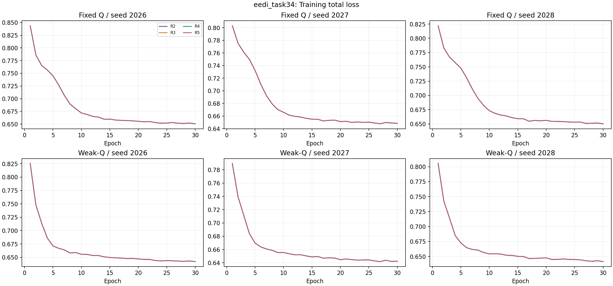
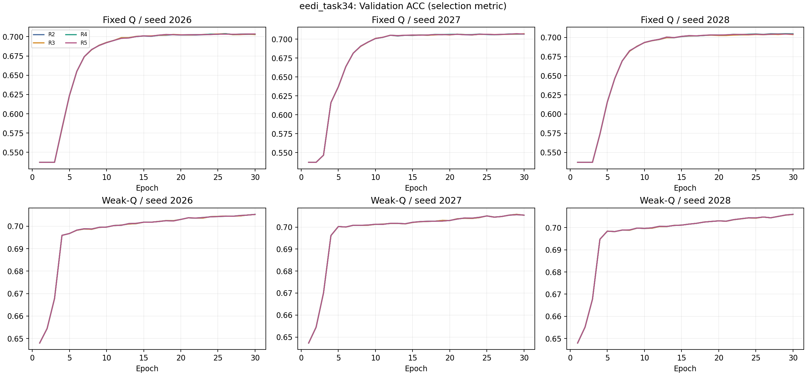
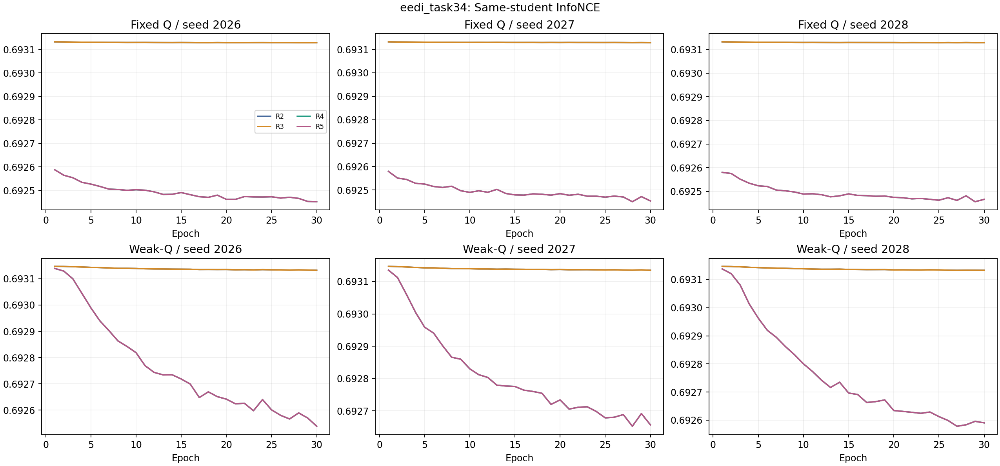
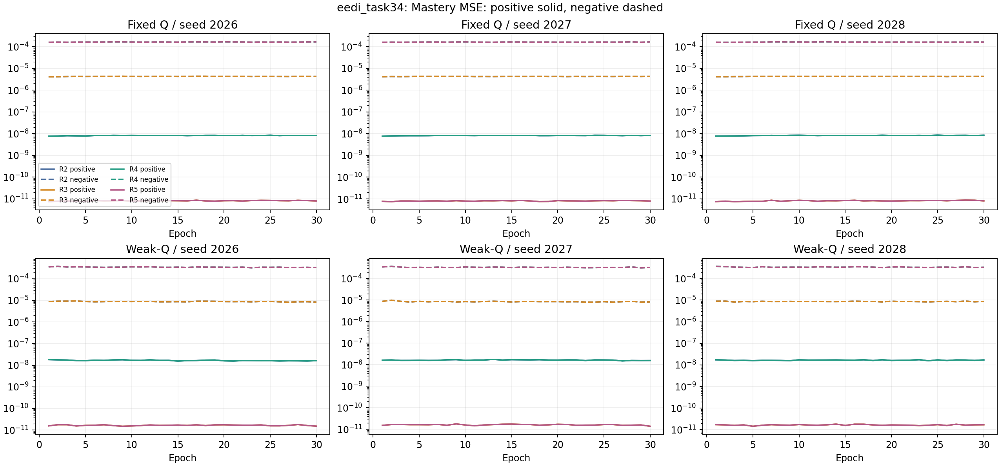
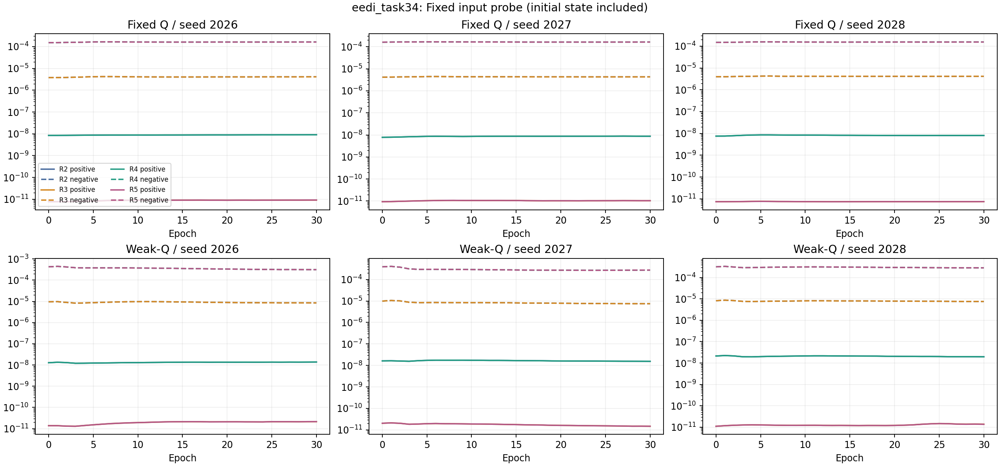
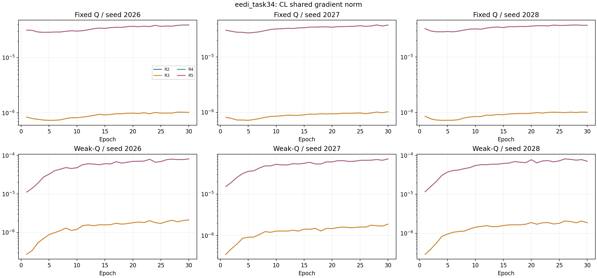
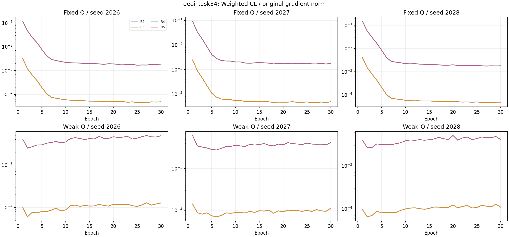
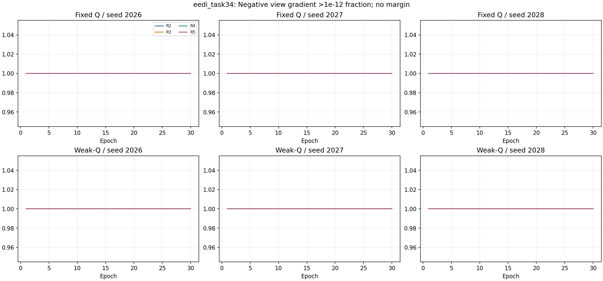
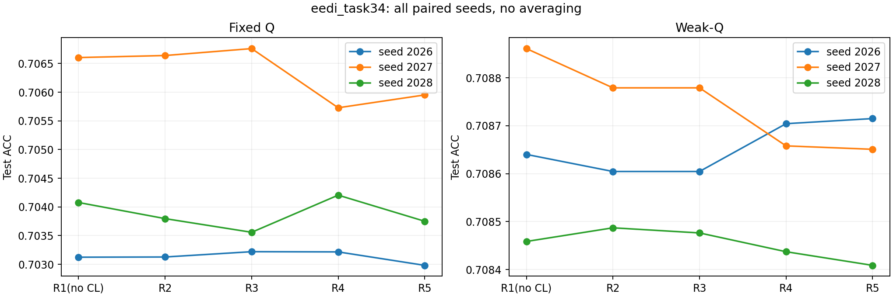

# eedi_task34：R2–R5噪声敏感性实验

主表不是均值：每个Q/条件内按最高验证ACC选择种子，并列选较小种子；两个test指标来自同一checkpoint。严禁把不同种子的单次结果直接相减解释模块收益，收益看全部配对种子。A0=固定参考Q，A1=Weak-Q。

| Q设置 | 条件 | CL系数 | 验证选优种子 | 最佳轮 | valid ACC | test ACC | test AUC |
| --- | --- | --- | --- | --- | --- | --- | --- |
| A0 | R1 | 0 | 2027 | 28 | 0.707047924 | 0.70660426 | 0.7680549 |
| A0 | R2 | 0.1 | 2027 | 30 | 0.706695271 | 0.706639853 | 0.768366433 |
| A0 | R3 | 0.1 | 2027 | 30 | 0.707092006 | 0.706760869 | 0.768310424 |
| A0 | R4 | 0.1 | 2027 | 29 | 0.706900985 | 0.705728675 | 0.768097413 |
| A0 | R5 | 0.1 | 2027 | 29 | 0.70720221 | 0.705952911 | 0.768135882 |
| A1 | R1 | 0 | 2028 | 30 | 0.705960576 | 0.70845865 | 0.773697676 |
| A1 | R2 | 0.1 | 2028 | 30 | 0.705916495 | 0.708487124 | 0.773695165 |
| A1 | R3 | 0.1 | 2028 | 30 | 0.705931189 | 0.708476446 | 0.773697533 |
| A1 | R4 | 0.1 | 2028 | 30 | 0.705953229 | 0.708437294 | 0.773713728 |
| A1 | R5 | 0.1 | 2028 | 30 | 0.705953229 | 0.70840882 | 0.773714016 |

## 数据与固定协议

数据集：eedi_task34；学生=4918，题目=948，概念=25；train/valid/test交互=[965661, 136111, 280955]。

使用data目录现有训练/验证/测试文件；没有重新划分。Q-F1表示与参考Q一致性，不能自动解释为认知诊断真实性。

R0参考原循环（统一验证ACC选模），R1新增入口λ=0并完全跳过CL训练分支，R2 λ=0.1。R2同时用于受控与敏感性实验，没有重复训练一份R2。模型、原始损失、α=0.8、Adam及学习率、128学生batch、30轮上限、patience=8均不变。验证ACC严格提升才更新checkpoint，平分保留最早轮。种子2026/2027/2028；每个数据集36次训练。

| 条件 | 正比例 | 正幅度 | 负比例 | 负幅度 |
| --- | --- | --- | --- | --- |
| R2 | 0.1 | 0.01 | 0.5 | 0.1 |
| R3 | 0.01 | 0.001 | 0.5 | 0.1 |
| R4 | 0.1 | 0.01 | 0.7 | 0.5 |
| R5 | 0.01 | 0.001 | 0.7 | 0.5 |

两输入不拼接。只对学生support的非零±1位置施加均匀连续噪声并裁剪到[-1,1]；0缺失、ID、标签、query和原数组不变。负噪声不翻转正误，只降低输入证据绝对值；因此极端响应不能直接当成诊断能力改善。验证/测试不增强。

损失沿用同学生一正一负InfoNCE，温度0.2，无margin。L=−正logit+logsumexp(正logit,负logit)。联合归一化项并不是独立负样本损失；负约束非零比例指负视图梯度范数>1e−12，不是margin激活率。

## 配置、代码和核验依据

以下完整配置/哈希和核验结果作为最终文档保留；用户要求清理新实验的checkpoint、原始日志及JSON/CSV副本。实际清理状态：自动审批以blocked by policy拒绝递归删除，原始产物仍暂存在Git忽略的scratch/student_cl_all_20261123。最终报告目录只包含Markdown和配图。若后续手工清理，便不能直接重放checkpoint，需按记录重跑。

<details><summary>完整配置、版本及数据/源码哈希</summary>

```json
{
  "experiment_id": "student_cl_all_eedi_task34_20261123",
  "dataset": "eedi_task34",
  "args": {
    "experiment_id": "student_cl_control_math1_20261123",
    "seeds": [
      2026,
      2027,
      2028
    ],
    "lambda_cl": 0.1,
    "positive_noise_ratio": 0.1,
    "positive_noise_scale": 0.01,
    "negative_noise_ratio": 0.5,
    "negative_noise_scale": 0.1,
    "noise_distribution": "uniform",
    "contrastive_seed": 1123,
    "temperature": 0.2,
    "dataset": "eedi_task34",
    "data_dir": "E:\\Desktop\\Gen-CD\\Q_GNCDM\\data\\eedi_task34",
    "alpha": 0.8,
    "embedding_dim": 32,
    "epochs": 30,
    "patience": 8,
    "batch_students": 128,
    "query_fraction": 0.25,
    "lr": 0.001,
    "q_lr": 0.005,
    "lambda_q": 0.01,
    "lambda_coverage": 0.01,
    "q_init_high": 0.55,
    "q_init_low": 0.45,
    "device": "cpu"
  },
  "noise_configs": {
    "R2": [
      0.1,
      0.01,
      0.5,
      0.1
    ],
    "R3": [
      0.01,
      0.001,
      0.5,
      0.1
    ],
    "R4": [
      0.1,
      0.01,
      0.7,
      0.5
    ],
    "R5": [
      0.01,
      0.001,
      0.7,
      0.5
    ]
  },
  "source_sha256": {
    "Q_GNCDM\\experiments\\run_controlled_student_cl.py": "9447f3fc2e79391b043148ae28717bee2f9f6a53dbe44352e5dddca3b6212a46",
    "Q_GNCDM\\experiments\\reference_student_cl_acc.py": "a974a5dbb0e36daf5ed49031be1838d69200e070f935d8f8f9dc31c0d9fa3dfc",
    "Q_GNCDM\\experiments\\controlled_student_cl.py": "4329530390f079ae00f6fa0d00af659e7e7be0f09134f8bc642b5a8caa0cb041",
    "Q_GNCDM\\experiments\\run_simple_contrastive.py": "196cbac42d9e7664eb4c24a4328bc852dca9265d7a88149adda0be924564a023",
    "Q_GNCDM\\models\\weak_q_gncdm.py": "5970f43820db2736bcf5f4e48039af50bf4203a5f391baa2046b8046c21517f5",
    "Q_GNCDM\\simple_contrastive.py": "30f0126846ab0e0d8802306ee183374a17730ed63f5bdd3ff6d76949b5252d97",
    "Q_GNCDM\\experiments\\run_weak_q_synthetic.py": "266d36d84cf1095189700a0b1f524f678accfd79feb94402ef6562f004f6b9b6",
    "Q_GNCDM\\experiments\\run_student_cl_all_datasets.py": "5c04daaf9a3ba1478c9d763e66348251162132ed385935c67e6d806635ec76bf",
    "Q_GNCDM\\experiments\\run_student_cl_noise_sensitivity.py": "b4c2c3850c4f49b26f60099c8d593128393ec8de80dcb3205d04fb27507f440f",
    "Q_GNCDM\\experiments\\run_prepared_dataset.py": "02b0fe433fcf75bea693b745149ac1654d866f044c81d9b2fc637b6f35d40c4d"
  },
  "data_sha256": {
    "train.csv": "1a5679aebc7de5e83fb786e29551518fdca44f81f2224a46095cf4b3f20e0ac5",
    "valid.csv": "be9b60ce1b3ac2f95738284b322b9b9878f54fe7d7a1aa3aaab281d02e75624c",
    "test.csv": "f24679ea9e11624d2d845c3d4804c8894be1389d4038b0f7af3326dcc675bcec",
    "Q_matrix.npy": "a76227d35376799959304a6a253458882537f007c96e913845241d57c5c656fb",
    "Q_true.npy": "a76227d35376799959304a6a253458882537f007c96e913845241d57c5c656fb",
    "manifest.json": "3f9fc5e6f7e25a615ca09df9a8e1bd017eee43299d2876021d7376c3d71c1e01"
  },
  "train_shape": [
    4918,
    948
  ],
  "concepts": 25,
  "split_lengths": [
    965661,
    136111,
    280955
  ],
  "seeds": [
    2026,
    2027,
    2028
  ],
  "selection": "highest validation ACC, earliest epoch; display seed chosen by validation ACC, lowest seed tie",
  "retention": "user requests final Markdown reports and figures only; temporary originals removed after verification",
  "command": "E:\\Desktop\\Gen-CD\\.venv-contrastive\\Scripts\\python.exe -m Q_GNCDM.experiments.run_student_cl_all_datasets --dataset eedi_task34",
  "python": "3.13.9 (tags/v3.13.9:8183fa5, Oct 14 2025, 14:09:13) [MSC v.1944 64 bit (AMD64)]",
  "torch": "2.14.0+cpu",
  "numpy": "2.4.3",
  "git_head": "89290e14293fe00b1e4eb55ba87ed068c5eccfdc",
  "protocol": "R0 reference ACC selector; R1 CL off; R2 shared by control and noise studies; R3-R5 change noise only",
  "scheduling_records": [
    {
      "mode": "A0",
      "seed": 2027,
      "source_sha256": "e364a26b7531d64559463606cda3108ea6c056d7e223908b664b8ce64cb9dbd1",
      "source": "Q_GNCDM\\experiments\\run_student_cl_seed2027.py",
      "changes": "seed scheduling only, same frozen worker logic",
      "status": "primary_already_started; no overwrite"
    },
    {
      "mode": "A1",
      "seed": 2027,
      "source_sha256": "e364a26b7531d64559463606cda3108ea6c056d7e223908b664b8ce64cb9dbd1",
      "source": "Q_GNCDM\\experiments\\run_student_cl_seed2027.py",
      "changes": "seed scheduling only, same frozen worker logic",
      "status": "primary_already_started; no overwrite"
    },
    [
      {
        "mode": "A0",
        "seed": 2027,
        "condition": "R5",
        "status": "copied_verified_run_without_overwrite",
        "publisher_sha256": "914af8c17a09a5d1c8aaf63dbac86aee993bb5b9a63770e0c64c71efdf41cace"
      },
      {
        "mode": "A1",
        "seed": 2027,
        "condition": "R5",
        "status": "copied_verified_run_without_overwrite",
        "publisher_sha256": "914af8c17a09a5d1c8aaf63dbac86aee993bb5b9a63770e0c64c71efdf41cace"
      }
    ],
    {
      "mode": "A0",
      "seed": 2028,
      "source_sha256": "f768bea86bd13315b1a465ba1a441eee5f55b2ce675818a872c80356c46ce63f",
      "source": "Q_GNCDM\\experiments\\run_student_cl_seed2028.py",
      "changes": "seed scheduling only, same frozen worker logic",
      "status": "published_complete_verified_group"
    },
    {
      "mode": "A1",
      "seed": 2028,
      "source_sha256": "f768bea86bd13315b1a465ba1a441eee5f55b2ce675818a872c80356c46ce63f",
      "source": "Q_GNCDM\\experiments\\run_student_cl_seed2028.py",
      "changes": "seed scheduling only, same frozen worker logic",
      "status": "published_complete_verified_group"
    }
  ],
  "scheduling_duplicate_state_checks": [
    {
      "mode": "A0",
      "seed": 2027,
      "condition": "R0",
      "checkpoint_exact": true
    },
    {
      "mode": "A0",
      "seed": 2027,
      "condition": "R1",
      "checkpoint_exact": true
    },
    {
      "mode": "A0",
      "seed": 2027,
      "condition": "R2",
      "checkpoint_exact": true
    },
    {
      "mode": "A0",
      "seed": 2027,
      "condition": "R3",
      "checkpoint_exact": true
    },
    {
      "mode": "A0",
      "seed": 2027,
      "condition": "R4",
      "checkpoint_exact": true
    },
    {
      "mode": "A0",
      "seed": 2027,
      "condition": "R5",
      "checkpoint_exact": true
    },
    {
      "mode": "A1",
      "seed": 2027,
      "condition": "R0",
      "checkpoint_exact": true
    },
    {
      "mode": "A1",
      "seed": 2027,
      "condition": "R1",
      "checkpoint_exact": true
    },
    {
      "mode": "A1",
      "seed": 2027,
      "condition": "R2",
      "checkpoint_exact": true
    },
    {
      "mode": "A1",
      "seed": 2027,
      "condition": "R3",
      "checkpoint_exact": true
    },
    {
      "mode": "A1",
      "seed": 2027,
      "condition": "R4",
      "checkpoint_exact": true
    },
    {
      "mode": "A1",
      "seed": 2027,
      "condition": "R5",
      "checkpoint_exact": true
    }
  ]
}
```
</details>

8种Q/噪声设置预检全部通过；同初始化固定batch的CL梯度、一步更新测试通过；新诊断的损失/梯度与原实现精确一致。6组R0/R1的逐轮日志与checkpoint精确一致；36个checkpoint的全部测试指标已重放核验。

```json
{
  "runs": 36,
  "preflight_settings": 8,
  "baseline_exact_pairs": 6,
  "checkpoint_replays": 36,
  "protected_code_and_data_unchanged": true,
  "status": "passed"
}
```

<details><summary>全部预检真实输出（含逐层梯度和单步参数更新差异）</summary>

```json
{
  "A0_R2": {
    "positive": {
      "selected_fraction": 0.1007375,
      "changed_fraction": 0.050225,
      "clipped_fraction_selected": 0.5014269760516193,
      "input_mae_observed": 0.00025183867546729743,
      "input_mae_all": 0.00020147094619460404,
      "input_max_change": 0.009997665882110596
    },
    "negative": {
      "selected_fraction": 0.5008875,
      "changed_fraction": 0.2517625,
      "clipped_fraction_selected": 0.4973671732674503,
      "input_mae_observed": 0.012591703794896603,
      "input_mae_all": 0.010073362849652767,
      "input_max_change": 0.09999817609786987
    },
    "gradient": {
      "original_shared_grad_norm": 1.9056160186814532e-05,
      "cl_shared_grad_norm": 6.36151464858123e-07,
      "cl_to_original_grad_ratio": 0.033382982648219615,
      "weighted_cl_to_original_grad_ratio": 0.003338298264821961
    },
    "per_layer": {
      "f_nn.f_layer_1.weight": {
        "original_grad_norm": 1.0765438673843164e-05,
        "cl_grad_norm": 4.6915894813537307e-07,
        "cl_finite": true
      },
      "f_nn.f_layer_1.bias": {
        "original_grad_norm": 1.5971002085279906e-06,
        "cl_grad_norm": 1.0058068511398233e-07,
        "cl_finite": true
      },
      "f_nn.f_layer_2.weight": {
        "original_grad_norm": 1.1584541425690986e-05,
        "cl_grad_norm": 2.986304536989337e-07,
        "cl_finite": true
      },
      "f_nn.f_layer_2.bias": {
        "original_grad_norm": 1.0511432265047915e-05,
        "cl_grad_norm": 2.920305632869713e-07,
        "cl_finite": true
      }
    },
    "batch_diagnostics": {
      "ap_mse": 8.724139632931838e-09,
      "an_mse": 3.9103624658309855e-06,
      "ap_cos_distance": 1.955777406692505e-08,
      "an_cos_distance": 5.169771611690521e-06,
      "negative_softmax_probability": 0.49999356269836426,
      "negative_not_farther_fraction": 0.0,
      "positive_selected_fraction": 0.09897025171624714,
      "positive_changed_fraction": 0.04909506969003537,
      "positive_clipped_fraction_selected": 0.5039411455596426,
      "positive_input_mae_observed": 0.00024694690364412963,
      "positive_input_mae_all": 3.913085674867034e-05,
      "positive_input_max_change": 0.009999871253967285,
      "negative_selected_fraction": 0.5057728312877054,
      "negative_changed_fraction": 0.2563449136675681,
      "negative_clipped_fraction_selected": 0.49316195372750643,
      "negative_input_mae_observed": 0.012868591584265232,
      "negative_input_mae_all": 0.002039138926193118,
      "negative_input_max_change": 0.09999102354049683
    },
    "loss_original": 0.824325442314148,
    "loss_cl": 0.6931342482566833,
    "loss_total": 0.8936388492584229,
    "single_step_parameter_changes": {
      "f_nn.f_layer_1.weight": {
        "gradient_difference_l2": 4.688850079382897e-08,
        "update_difference_l2": 0.0008094356755093997,
        "baseline_update_l2": 0.10724621161039648,
        "cl_update_l2": 0.10728008810191564
      },
      "f_nn.f_layer_1.bias": {
        "gradient_difference_l2": 1.0038411997479148e-08,
        "update_difference_l2": 2.105445032701866e-05,
        "baseline_update_l2": 0.004694630595536098,
        "cl_update_l2": 0.004693949014583604
      },
      "f_nn.f_layer_2.weight": {
        "gradient_difference_l2": 2.980944379440682e-08,
        "update_difference_l2": 0.00034395642635986253,
        "baseline_update_l2": 0.02251350852443816,
        "cl_update_l2": 0.02251461724871268
      },
      "f_nn.f_layer_2.bias": {
        "gradient_difference_l2": 2.918105996817213e-08,
        "update_difference_l2": 2.217757315343383e-05,
        "baseline_update_l2": 0.004860208748169849,
        "cl_update_l2": 0.004857557955097834
      }
    },
    "zero_single_step_exact_parity": true,
    "status": "passed",
    "observed_branch_loss_and_gradient_exact": true,
    "observation_state_and_rng_unchanged": true,
    "extra_diagnostics": {
      "ap_mse": 7.496858245303883e-09,
      "an_mse": 4.012628323835088e-06,
      "ap_cos_distance": 2.7939677238464355e-08,
      "an_cos_distance": 5.234498530626297e-06,
      "negative_softmax_probability": 0.4999935030937195,
      "negative_not_farther_fraction": 0.0078125,
      "positive_energy": -5.0,
      "joint_log_partition": 5.69313383102417,
      "negative_relative_penalty": 0.6931341290473938,
      "positive_view_grad_norm_mean": 8.864268438207299e-07,
      "negative_view_grad_norm_mean": 2.045555755359263e-05,
      "negative_view_grad_nonzero_fraction": 1.0,
      "negative_view_grad_above_1e_12_fraction": 1.0,
      "positive_shared_partial_grad_norm": 2.653856841405214e-09,
      "negative_shared_partial_grad_norm": 6.842863114676895e-07,
      "positive_selected_fraction": 0.09969835656334512,
      "positive_changed_fraction": 0.048731017266486376,
      "positive_clipped_fraction_selected": 0.5112154407929056,
      "positive_input_mae_observed": 0.0002518027613405138,
      "positive_input_mae_all": 3.990031109424308e-05,
      "positive_input_max_change": 0.009999871253967285,
      "positive_input_mse_observed": 1.7106689256252139e-06,
      "positive_clipped_fraction_observed": 0.050967339296858746,
      "positive_input_mae_changed": 0.005167196970432997,
      "positive_unchanged_student_fraction": 0.0390625,
      "negative_selected_fraction": 0.5019242770959018,
      "negative_changed_fraction": 0.2543166215935095,
      "negative_clipped_fraction_selected": 0.4933167547404414,
      "negative_input_mae_observed": 0.012737708166241646,
      "negative_input_mae_all": 0.002018399303779006,
      "negative_input_max_change": 0.09999102354049683,
      "negative_input_mse_observed": 0.0008551647188141942,
      "negative_clipped_fraction_observed": 0.24760765550239233,
      "negative_input_mae_changed": 0.05008602514863014,
      "negative_unchanged_student_fraction": 0.0
    }
  },
  "A0_R3": {
    "positive": {
      "selected_fraction": 0.01045,
      "changed_fraction": 0.005025,
      "clipped_fraction_selected": 0.5179425837320574,
      "input_mae_observed": 2.512869286874775e-06,
      "input_mae_all": 2.010295474974555e-06,
      "input_max_change": 0.0009962916374206543
    },
    "negative": {
      "selected_fraction": 0.5008875,
      "changed_fraction": 0.2517625,
      "clipped_fraction_selected": 0.4973671732674503,
      "input_mae_observed": 0.012591703794896603,
      "input_mae_all": 0.010073362849652767,
      "input_max_change": 0.09999817609786987
    },
    "gradient": {
      "original_shared_grad_norm": 1.9056160186814532e-05,
      "cl_shared_grad_norm": 6.367035807518053e-07,
      "cl_to_original_grad_ratio": 0.03341195574081905,
      "weighted_cl_to_original_grad_ratio": 0.003341195574081905
    },
    "per_layer": {
      "f_nn.f_layer_1.weight": {
        "original_grad_norm": 1.0765438673843164e-05,
        "cl_grad_norm": 4.694508959346422e-07,
        "cl_finite": true
      },
      "f_nn.f_layer_1.bias": {
        "original_grad_norm": 1.5971002085279906e-06,
        "cl_grad_norm": 1.0065283362337141e-07,
        "cl_finite": true
      },
      "f_nn.f_layer_2.weight": {
        "original_grad_norm": 1.1584541425690986e-05,
        "cl_grad_norm": 2.989983727275103e-07,
        "cl_finite": true
      },
      "f_nn.f_layer_2.bias": {
        "original_grad_norm": 1.0511432265047915e-05,
        "cl_grad_norm": 2.923633530826919e-07,
        "cl_finite": true
      }
    },
    "batch_diagnostics": {
      "ap_mse": 6.4557825231459365e-12,
      "an_mse": 3.9103624658309855e-06,
      "ap_cos_distance": 1.1175870895385742e-08,
      "an_cos_distance": 5.169771611690521e-06,
      "negative_softmax_probability": 0.49999356269836426,
      "negative_not_farther_fraction": 0.0078125,
      "positive_selected_fraction": 0.00982941543582276,
      "positive_changed_fraction": 0.00499271895152902,
      "positive_clipped_fraction_selected": 0.49206349206349204,
      "positive_input_mae_observed": 2.3512586722063133e-06,
      "positive_input_mae_all": 3.725771762219665e-07,
      "positive_input_max_change": 0.000997304916381836,
      "negative_selected_fraction": 0.5057728312877054,
      "negative_changed_fraction": 0.2563449136675681,
      "negative_clipped_fraction_selected": 0.49316195372750643,
      "negative_input_mae_observed": 0.012868591584265232,
      "negative_input_mae_all": 0.002039138926193118,
      "negative_input_max_change": 0.09999102354049683
    },
    "loss_original": 0.824325442314148,
    "loss_cl": 0.6931341886520386,
    "loss_total": 0.8936388492584229,
    "single_step_parameter_changes": {
      "f_nn.f_layer_1.weight": {
        "gradient_difference_l2": 4.6959937569886065e-08,
        "update_difference_l2": 0.000810826274112154,
        "baseline_update_l2": 0.10724621161039648,
        "cl_update_l2": 0.10728016540257877
      },
      "f_nn.f_layer_1.bias": {
        "gradient_difference_l2": 1.007503633885632e-08,
        "update_difference_l2": 2.116487964464379e-05,
        "baseline_update_l2": 0.004694630595536098,
        "cl_update_l2": 0.004693944031870008
      },
      "f_nn.f_layer_2.weight": {
        "gradient_difference_l2": 2.989242634007077e-08,
        "update_difference_l2": 0.00034456787626920753,
        "baseline_update_l2": 0.02251350852443816,
        "cl_update_l2": 0.02251458568820772
      },
      "f_nn.f_layer_2.bias": {
        "gradient_difference_l2": 2.9249164489014182e-08,
        "update_difference_l2": 2.224868942899199e-05,
        "baseline_update_l2": 0.004860208748169849,
        "cl_update_l2": 0.004857547205669708
      }
    },
    "zero_single_step_exact_parity": true,
    "status": "passed",
    "observed_branch_loss_and_gradient_exact": true,
    "observation_state_and_rng_unchanged": true,
    "extra_diagnostics": {
      "ap_mse": 5.7325056160295595e-12,
      "an_mse": 4.012628323835088e-06,
      "ap_cos_distance": 8.847564458847046e-09,
      "an_cos_distance": 5.234498530626297e-06,
      "negative_softmax_probability": 0.4999934434890747,
      "negative_not_farther_fraction": 0.0078125,
      "positive_energy": -5.0,
      "joint_log_partition": 5.69313383102417,
      "negative_relative_penalty": 0.6931341290473938,
      "positive_view_grad_norm_mean": 1.5501017270725484e-08,
      "negative_view_grad_norm_mean": 2.0455547762673696e-05,
      "negative_view_grad_nonzero_fraction": 1.0,
      "negative_view_grad_above_1e_12_fraction": 1.0,
      "positive_shared_partial_grad_norm": 2.04843318820118e-09,
      "negative_shared_partial_grad_norm": 6.841824913935775e-07,
      "positive_selected_fraction": 0.010505512793842313,
      "positive_changed_fraction": 0.00499271895152902,
      "positive_clipped_fraction_selected": 0.5247524752475248,
      "positive_input_mae_observed": 2.3936311208672123e-06,
      "positive_input_mae_all": 3.7929143559267686e-07,
      "positive_input_max_change": 0.0009937882423400879,
      "positive_input_mse_observed": 1.5729132440966964e-09,
      "positive_clipped_fraction_observed": 0.005512793842313293,
      "positive_input_mae_changed": 0.0004794243723154068,
      "positive_unchanged_student_fraction": 0.5234375,
      "negative_selected_fraction": 0.5019242770959018,
      "negative_changed_fraction": 0.2543166215935095,
      "negative_clipped_fraction_selected": 0.4933167547404414,
      "negative_input_mae_observed": 0.012737708166241646,
      "negative_input_mae_all": 0.002018399303779006,
      "negative_input_max_change": 0.09999102354049683,
      "negative_input_mse_observed": 0.0008551647188141942,
      "negative_clipped_fraction_observed": 0.24760765550239233,
      "negative_input_mae_changed": 0.05008602514863014,
      "negative_unchanged_student_fraction": 0.0
    }
  },
  "A0_R4": {
    "positive": {
      "selected_fraction": 0.1007375,
      "changed_fraction": 0.050225,
      "clipped_fraction_selected": 0.5014269760516193,
      "input_mae_observed": 0.00025183867546729743,
      "input_mae_all": 0.00020147094619460404,
      "input_max_change": 0.009997665882110596
    },
    "negative": {
      "selected_fraction": 0.7017125,
      "changed_fraction": 0.3529375,
      "clipped_fraction_selected": 0.4970340417193651,
      "input_mae_observed": 0.08849677443504333,
      "input_mae_all": 0.07079741358757019,
      "input_max_change": 0.4999908208847046
    },
    "gradient": {
      "original_shared_grad_norm": 1.9056160186814532e-05,
      "cl_shared_grad_norm": 2.6694463572188678e-05,
      "cl_to_original_grad_ratio": 1.4008311910947984,
      "weighted_cl_to_original_grad_ratio": 0.14008311910947985
    },
    "per_layer": {
      "f_nn.f_layer_1.weight": {
        "original_grad_norm": 1.0765438673843164e-05,
        "cl_grad_norm": 1.98112684302032e-05,
        "cl_finite": true
      },
      "f_nn.f_layer_1.bias": {
        "original_grad_norm": 1.5971002085279906e-06,
        "cl_grad_norm": 4.080549842910841e-06,
        "cl_finite": true
      },
      "f_nn.f_layer_2.weight": {
        "original_grad_norm": 1.1584541425690986e-05,
        "cl_grad_norm": 1.2467877240851521e-05,
        "cl_finite": true
      },
      "f_nn.f_layer_2.bias": {
        "original_grad_norm": 1.0511432265047915e-05,
        "cl_grad_norm": 1.2165905900474172e-05,
        "cl_finite": true
      }
    },
    "batch_diagnostics": {
      "ap_mse": 8.724139632931838e-09,
      "an_mse": 0.00016008927195798606,
      "ap_cos_distance": 1.955777406692505e-08,
      "an_cos_distance": 0.00020925048738718033,
      "negative_softmax_probability": 0.4997384548187256,
      "negative_not_farther_fraction": 0.0,
      "positive_selected_fraction": 0.09897025171624714,
      "positive_changed_fraction": 0.04909506969003537,
      "positive_clipped_fraction_selected": 0.5039411455596426,
      "positive_input_mae_observed": 0.00024694690364412963,
      "positive_input_mae_all": 3.913085674867034e-05,
      "positive_input_max_change": 0.009999871253967285,
      "negative_selected_fraction": 0.7028812148949448,
      "negative_changed_fraction": 0.35625130018722695,
      "negative_clipped_fraction_selected": 0.4931557528671846,
      "negative_input_mae_observed": 0.08948713541030884,
      "negative_input_mae_all": 0.01418000552803278,
      "negative_input_max_change": 0.49996405839920044
    },
    "loss_original": 0.824325442314148,
    "loss_cl": 0.6926243305206299,
    "loss_total": 0.8935878872871399,
    "single_step_parameter_changes": {
      "f_nn.f_layer_1.weight": {
        "gradient_difference_l2": 1.9811259210968475e-06,
        "update_difference_l2": 0.028676170259127793,
        "baseline_update_l2": 0.10724621161039648,
        "cl_update_l2": 0.10888725844001593
      },
      "f_nn.f_layer_1.bias": {
        "gradient_difference_l2": 4.0807148650542373e-07,
        "update_difference_l2": 0.0019810039638484037,
        "baseline_update_l2": 0.004694630595536098,
        "cl_update_l2": 0.004732472593301875
      },
      "f_nn.f_layer_2.weight": {
        "gradient_difference_l2": 1.246803375598634e-06,
        "update_difference_l2": 0.008772741267791935,
        "baseline_update_l2": 0.02251350852443816,
        "cl_update_l2": 0.0227620403187764
      },
      "f_nn.f_layer_2.bias": {
        "gradient_difference_l2": 1.2166173774028713e-06,
        "update_difference_l2": 0.0023667338567243366,
        "baseline_update_l2": 0.004860208748169849,
        "cl_update_l2": 0.004828383406578182
      }
    },
    "zero_single_step_exact_parity": true,
    "status": "passed",
    "observed_branch_loss_and_gradient_exact": true,
    "observation_state_and_rng_unchanged": true,
    "extra_diagnostics": {
      "ap_mse": 7.496858245303883e-09,
      "an_mse": 0.000161061980179511,
      "ap_cos_distance": 2.7939677238464355e-08,
      "an_cos_distance": 0.00020597968250513077,
      "negative_softmax_probability": 0.4997425377368927,
      "negative_not_farther_fraction": 0.0,
      "positive_energy": -5.0,
      "joint_log_partition": 5.692631721496582,
      "negative_relative_penalty": 0.6926324963569641,
      "positive_view_grad_norm_mean": 8.85794269165612e-07,
      "negative_view_grad_norm_mean": 0.00012757348184314136,
      "negative_view_grad_nonzero_fraction": 1.0,
      "negative_view_grad_above_1e_12_fraction": 1.0,
      "positive_shared_partial_grad_norm": 2.569659285440845e-09,
      "negative_shared_partial_grad_norm": 2.7986877961087985e-05,
      "positive_selected_fraction": 0.09969835656334512,
      "positive_changed_fraction": 0.048731017266486376,
      "positive_clipped_fraction_selected": 0.5112154407929056,
      "positive_input_mae_observed": 0.0002518027613405138,
      "positive_input_mae_all": 3.990031109424308e-05,
      "positive_input_max_change": 0.009999871253967285,
      "positive_input_mse_observed": 1.7106689256252139e-06,
      "positive_clipped_fraction_observed": 0.050967339296858746,
      "positive_input_mae_changed": 0.005167196970432997,
      "positive_unchanged_student_fraction": 0.0390625,
      "negative_selected_fraction": 0.6994487206157687,
      "negative_changed_fraction": 0.3544830455585604,
      "negative_clipped_fraction_selected": 0.49319652018737453,
      "negative_input_mae_observed": 0.08903255313634872,
      "negative_input_mae_all": 0.01410797331482172,
      "negative_input_max_change": 0.49996405839920044,
      "negative_input_mse_observed": 0.029898198321461678,
      "negative_clipped_fraction_observed": 0.34496567505720827,
      "negative_input_mae_changed": 0.25116166472435,
      "negative_unchanged_student_fraction": 0.0
    }
  },
  "A0_R5": {
    "positive": {
      "selected_fraction": 0.01045,
      "changed_fraction": 0.005025,
      "clipped_fraction_selected": 0.5179425837320574,
      "input_mae_observed": 2.512869286874775e-06,
      "input_mae_all": 2.010295474974555e-06,
      "input_max_change": 0.0009962916374206543
    },
    "negative": {
      "selected_fraction": 0.7017125,
      "changed_fraction": 0.3529375,
      "clipped_fraction_selected": 0.4970340417193651,
      "input_mae_observed": 0.08849677443504333,
      "input_mae_all": 0.07079741358757019,
      "input_max_change": 0.4999908208847046
    },
    "gradient": {
      "original_shared_grad_norm": 1.9056160186814532e-05,
      "cl_shared_grad_norm": 2.6695007359956565e-05,
      "cl_to_original_grad_ratio": 1.4008597271567624,
      "weighted_cl_to_original_grad_ratio": 0.14008597271567624
    },
    "per_layer": {
      "f_nn.f_layer_1.weight": {
        "original_grad_norm": 1.0765438673843164e-05,
        "cl_grad_norm": 1.981164859898854e-05,
        "cl_finite": true
      },
      "f_nn.f_layer_1.bias": {
        "original_grad_norm": 1.5971002085279906e-06,
        "cl_grad_norm": 4.080655799043598e-06,
        "cl_finite": true
      },
      "f_nn.f_layer_2.weight": {
        "original_grad_norm": 1.1584541425690986e-05,
        "cl_grad_norm": 1.246811279997928e-05,
        "cl_finite": true
      },
      "f_nn.f_layer_2.bias": {
        "original_grad_norm": 1.0511432265047915e-05,
        "cl_grad_norm": 1.2166194210294634e-05,
        "cl_finite": true
      }
    },
    "batch_diagnostics": {
      "ap_mse": 6.4557825231459365e-12,
      "an_mse": 0.00016008927195798606,
      "ap_cos_distance": 1.1175870895385742e-08,
      "an_cos_distance": 0.00020925048738718033,
      "negative_softmax_probability": 0.4997384548187256,
      "negative_not_farther_fraction": 0.0,
      "positive_selected_fraction": 0.00982941543582276,
      "positive_changed_fraction": 0.00499271895152902,
      "positive_clipped_fraction_selected": 0.49206349206349204,
      "positive_input_mae_observed": 2.3512586722063133e-06,
      "positive_input_mae_all": 3.725771762219665e-07,
      "positive_input_max_change": 0.000997304916381836,
      "negative_selected_fraction": 0.7028812148949448,
      "negative_changed_fraction": 0.35625130018722695,
      "negative_clipped_fraction_selected": 0.4931557528671846,
      "negative_input_mae_observed": 0.08948713541030884,
      "negative_input_mae_all": 0.01418000552803278,
      "negative_input_max_change": 0.49996405839920044
    },
    "loss_original": 0.824325442314148,
    "loss_cl": 0.6926242113113403,
    "loss_total": 0.8935878872871399,
    "single_step_parameter_changes": {
      "f_nn.f_layer_1.weight": {
        "gradient_difference_l2": 1.9811599781630077e-06,
        "update_difference_l2": 0.02867679127977256,
        "baseline_update_l2": 0.10724621161039648,
        "cl_update_l2": 0.10888735400162025
      },
      "f_nn.f_layer_1.bias": {
        "gradient_difference_l2": 4.080800572870507e-07,
        "update_difference_l2": 0.00198102788202486,
        "baseline_update_l2": 0.004694630595536098,
        "cl_update_l2": 0.0047324772723880675
      },
      "f_nn.f_layer_2.weight": {
        "gradient_difference_l2": 1.2468513972821842e-06,
        "update_difference_l2": 0.008773063692611638,
        "baseline_update_l2": 0.02251350852443816,
        "cl_update_l2": 0.022762037817115634
      },
      "f_nn.f_layer_2.bias": {
        "gradient_difference_l2": 1.2166512593105592e-06,
        "update_difference_l2": 0.0023668037539909498,
        "baseline_update_l2": 0.004860208748169849,
        "cl_update_l2": 0.004828386196273894
      }
    },
    "zero_single_step_exact_parity": true,
    "status": "passed",
    "observed_branch_loss_and_gradient_exact": true,
    "observation_state_and_rng_unchanged": true,
    "extra_diagnostics": {
      "ap_mse": 5.7325056160295595e-12,
      "an_mse": 0.000161061980179511,
      "ap_cos_distance": 8.847564458847046e-09,
      "an_cos_distance": 0.00020597968250513077,
      "negative_softmax_probability": 0.4997425079345703,
      "negative_not_farther_fraction": 0.0,
      "positive_energy": -5.0,
      "joint_log_partition": 5.692631721496582,
      "negative_relative_penalty": 0.6926324367523193,
      "positive_view_grad_norm_mean": 1.5472599769813285e-08,
      "negative_view_grad_norm_mean": 0.00012757347705352366,
      "negative_view_grad_nonzero_fraction": 1.0,
      "negative_view_grad_above_1e_12_fraction": 1.0,
      "positive_shared_partial_grad_norm": 2.1135577570203327e-09,
      "negative_shared_partial_grad_norm": 2.798705707991432e-05,
      "positive_selected_fraction": 0.010505512793842313,
      "positive_changed_fraction": 0.00499271895152902,
      "positive_clipped_fraction_selected": 0.5247524752475248,
      "positive_input_mae_observed": 2.3936311208672123e-06,
      "positive_input_mae_all": 3.7929143559267686e-07,
      "positive_input_max_change": 0.0009937882423400879,
      "positive_input_mse_observed": 1.5729132440966964e-09,
      "positive_clipped_fraction_observed": 0.005512793842313293,
      "positive_input_mae_changed": 0.0004794243723154068,
      "positive_unchanged_student_fraction": 0.5234375,
      "negative_selected_fraction": 0.6994487206157687,
      "negative_changed_fraction": 0.3544830455585604,
      "negative_clipped_fraction_selected": 0.49319652018737453,
      "negative_input_mae_observed": 0.08903255313634872,
      "negative_input_mae_all": 0.01410797331482172,
      "negative_input_max_change": 0.49996405839920044,
      "negative_input_mse_observed": 0.029898198321461678,
      "negative_clipped_fraction_observed": 0.34496567505720827,
      "negative_input_mae_changed": 0.25116166472435,
      "negative_unchanged_student_fraction": 0.0
    }
  },
  "A1_R2": {
    "positive": {
      "selected_fraction": 0.1007375,
      "changed_fraction": 0.050225,
      "clipped_fraction_selected": 0.5014269760516193,
      "input_mae_observed": 0.00025183867546729743,
      "input_mae_all": 0.00020147094619460404,
      "input_max_change": 0.009997665882110596
    },
    "negative": {
      "selected_fraction": 0.5008875,
      "changed_fraction": 0.2517625,
      "clipped_fraction_selected": 0.4973671732674503,
      "input_mae_observed": 0.012591703794896603,
      "input_mae_all": 0.010073362849652767,
      "input_max_change": 0.09999817609786987
    },
    "gradient": {
      "original_shared_grad_norm": 0.0001812871054251377,
      "cl_shared_grad_norm": 2.0298544854750592e-07,
      "cl_to_original_grad_ratio": 0.0011196904935488008,
      "weighted_cl_to_original_grad_ratio": 0.0001119690493548801
    },
    "per_layer": {
      "q_logits": {
        "original_grad_norm": 0.00012923358008265495,
        "cl_grad_norm": 7.373739663307788e-08,
        "cl_finite": true
      },
      "f_nn.f_layer_1.weight": {
        "original_grad_norm": 6.790197221562266e-05,
        "cl_grad_norm": 1.3291933953496482e-07,
        "cl_finite": true
      },
      "f_nn.f_layer_1.bias": {
        "original_grad_norm": 1.725947186059784e-05,
        "cl_grad_norm": 9.374506504400415e-09,
        "cl_finite": true
      },
      "f_nn.f_layer_2.weight": {
        "original_grad_norm": 6.176414171932265e-05,
        "cl_grad_norm": 9.118934229945808e-08,
        "cl_finite": true
      },
      "f_nn.f_layer_2.bias": {
        "original_grad_norm": 8.625727059552446e-05,
        "cl_grad_norm": 9.846289827919463e-08,
        "cl_finite": true
      }
    },
    "batch_diagnostics": {
      "ap_mse": 2.1848084230668974e-08,
      "an_mse": 8.69241739565041e-06,
      "ap_cos_distance": 4.656612873077393e-10,
      "an_cos_distance": 5.541369318962097e-08,
      "negative_softmax_probability": 0.4999999403953552,
      "negative_not_farther_fraction": 0.4765625,
      "positive_selected_fraction": 0.09897025171624714,
      "positive_changed_fraction": 0.04909506969003537,
      "positive_clipped_fraction_selected": 0.5039411455596426,
      "positive_input_mae_observed": 0.00024694690364412963,
      "positive_input_mae_all": 3.913085674867034e-05,
      "positive_input_max_change": 0.009999871253967285,
      "negative_selected_fraction": 0.5057728312877054,
      "negative_changed_fraction": 0.2563449136675681,
      "negative_clipped_fraction_selected": 0.49316195372750643,
      "negative_input_mae_observed": 0.012868591584265232,
      "negative_input_mae_all": 0.002039138926193118,
      "negative_input_max_change": 0.09999102354049683
    },
    "loss_original": 0.8292962908744812,
    "loss_cl": 0.6931471228599548,
    "loss_total": 0.8986110091209412,
    "single_step_parameter_changes": {
      "q_logits": {
        "gradient_difference_l2": 7.374445509300714e-09,
        "update_difference_l2": 0.00020624320073479974,
        "baseline_update_l2": 0.6828663745208201,
        "cl_update_l2": 0.6828659471638581
      },
      "f_nn.f_layer_1.weight": {
        "gradient_difference_l2": 1.3294130589177384e-08,
        "update_difference_l2": 8.378354714038062e-05,
        "baseline_update_l2": 0.13201651574986492,
        "cl_update_l2": 0.13201666026846523
      },
      "f_nn.f_layer_1.bias": {
        "gradient_difference_l2": 9.32043392462354e-10,
        "update_difference_l2": 2.5637815177376893e-09,
        "baseline_update_l2": 0.004983901013047135,
        "cl_update_l2": 0.004983900384377806
      },
      "f_nn.f_layer_2.weight": {
        "gradient_difference_l2": 9.113319525706113e-09,
        "update_difference_l2": 8.26242416525136e-07,
        "baseline_update_l2": 0.024772376799632106,
        "cl_update_l2": 0.02477249349912811
      },
      "f_nn.f_layer_2.bias": {
        "gradient_difference_l2": 9.843995367463488e-09,
        "update_difference_l2": 1.201406685281557e-07,
        "baseline_update_l2": 0.004991899440972997,
        "cl_update_l2": 0.004991873224571297
      }
    },
    "zero_single_step_exact_parity": true,
    "status": "passed",
    "observed_branch_loss_and_gradient_exact": true,
    "observation_state_and_rng_unchanged": true,
    "extra_diagnostics": {
      "ap_mse": 1.5869712655103285e-08,
      "an_mse": 8.969927876023576e-06,
      "ap_cos_distance": 3.259629011154175e-09,
      "an_cos_distance": 4.516914486885071e-08,
      "negative_softmax_probability": 0.4999999403953552,
      "negative_not_farther_fraction": 0.53125,
      "positive_energy": -5.0,
      "joint_log_partition": 5.693146705627441,
      "negative_relative_penalty": 0.6931471228599548,
      "positive_view_grad_norm_mean": 1.1099051393459627e-07,
      "negative_view_grad_norm_mean": 3.19736851033471e-06,
      "negative_view_grad_nonzero_fraction": 1.0,
      "negative_view_grad_above_1e_12_fraction": 1.0,
      "positive_shared_partial_grad_norm": 4.4738942611749465e-09,
      "negative_shared_partial_grad_norm": 2.167359163429752e-07,
      "positive_selected_fraction": 0.09969835656334512,
      "positive_changed_fraction": 0.048731017266486376,
      "positive_clipped_fraction_selected": 0.5112154407929056,
      "positive_input_mae_observed": 0.0002518027613405138,
      "positive_input_mae_all": 3.990031109424308e-05,
      "positive_input_max_change": 0.009999871253967285,
      "positive_input_mse_observed": 1.7106689256252139e-06,
      "positive_clipped_fraction_observed": 0.050967339296858746,
      "positive_input_mae_changed": 0.005167196970432997,
      "positive_unchanged_student_fraction": 0.0390625,
      "negative_selected_fraction": 0.5019242770959018,
      "negative_changed_fraction": 0.2543166215935095,
      "negative_clipped_fraction_selected": 0.4933167547404414,
      "negative_input_mae_observed": 0.012737708166241646,
      "negative_input_mae_all": 0.002018399303779006,
      "negative_input_max_change": 0.09999102354049683,
      "negative_input_mse_observed": 0.0008551647188141942,
      "negative_clipped_fraction_observed": 0.24760765550239233,
      "negative_input_mae_changed": 0.05008602514863014,
      "negative_unchanged_student_fraction": 0.0
    }
  },
  "A1_R3": {
    "positive": {
      "selected_fraction": 0.01045,
      "changed_fraction": 0.005025,
      "clipped_fraction_selected": 0.5179425837320574,
      "input_mae_observed": 2.512869286874775e-06,
      "input_mae_all": 2.010295474974555e-06,
      "input_max_change": 0.0009962916374206543
    },
    "negative": {
      "selected_fraction": 0.5008875,
      "changed_fraction": 0.2517625,
      "clipped_fraction_selected": 0.4973671732674503,
      "input_mae_observed": 0.012591703794896603,
      "input_mae_all": 0.010073362849652767,
      "input_max_change": 0.09999817609786987
    },
    "gradient": {
      "original_shared_grad_norm": 0.0001812871054251377,
      "cl_shared_grad_norm": 2.0310988010177232e-07,
      "cl_to_original_grad_ratio": 0.0011203768719537878,
      "weighted_cl_to_original_grad_ratio": 0.00011203768719537878
    },
    "per_layer": {
      "q_logits": {
        "original_grad_norm": 0.00012923358008265495,
        "cl_grad_norm": 7.37577536824574e-08,
        "cl_finite": true
      },
      "f_nn.f_layer_1.weight": {
        "original_grad_norm": 6.790197221562266e-05,
        "cl_grad_norm": 1.3287001365824835e-07,
        "cl_finite": true
      },
      "f_nn.f_layer_1.bias": {
        "original_grad_norm": 1.725947186059784e-05,
        "cl_grad_norm": 9.313854576475933e-09,
        "cl_finite": true
      },
      "f_nn.f_layer_2.weight": {
        "original_grad_norm": 6.176414171932265e-05,
        "cl_grad_norm": 9.135732881304648e-08,
        "cl_finite": true
      },
      "f_nn.f_layer_2.bias": {
        "original_grad_norm": 8.625727059552446e-05,
        "cl_grad_norm": 9.86207524533711e-08,
        "cl_finite": true
      }
    },
    "batch_diagnostics": {
      "ap_mse": 1.3929537211188059e-11,
      "an_mse": 8.69241739565041e-06,
      "ap_cos_distance": 5.122274160385132e-09,
      "an_cos_distance": 5.541369318962097e-08,
      "negative_softmax_probability": 0.4999999403953552,
      "negative_not_farther_fraction": 0.4765625,
      "positive_selected_fraction": 0.00982941543582276,
      "positive_changed_fraction": 0.00499271895152902,
      "positive_clipped_fraction_selected": 0.49206349206349204,
      "positive_input_mae_observed": 2.3512586722063133e-06,
      "positive_input_mae_all": 3.725771762219665e-07,
      "positive_input_max_change": 0.000997304916381836,
      "negative_selected_fraction": 0.5057728312877054,
      "negative_changed_fraction": 0.2563449136675681,
      "negative_clipped_fraction_selected": 0.49316195372750643,
      "negative_input_mae_observed": 0.012868591584265232,
      "negative_input_mae_all": 0.002039138926193118,
      "negative_input_max_change": 0.09999102354049683
    },
    "loss_original": 0.8292962908744812,
    "loss_cl": 0.6931470632553101,
    "loss_total": 0.8986110091209412,
    "single_step_parameter_changes": {
      "q_logits": {
        "gradient_difference_l2": 7.376959996300286e-09,
        "update_difference_l2": 0.00020610146514025998,
        "baseline_update_l2": 0.6828663745208201,
        "cl_update_l2": 0.6828659412392838
      },
      "f_nn.f_layer_1.weight": {
        "gradient_difference_l2": 1.3289606124425949e-08,
        "update_difference_l2": 8.429735947942006e-05,
        "baseline_update_l2": 0.13201651574986492,
        "cl_update_l2": 0.1320166872323246
      },
      "f_nn.f_layer_1.bias": {
        "gradient_difference_l2": 9.328598321540607e-10,
        "update_difference_l2": 2.5398824630853985e-09,
        "baseline_update_l2": 0.004983901013047135,
        "cl_update_l2": 0.004983900407659273
      },
      "f_nn.f_layer_2.weight": {
        "gradient_difference_l2": 9.116470250681323e-09,
        "update_difference_l2": 8.273040491305611e-07,
        "baseline_update_l2": 0.024772376799632106,
        "cl_update_l2": 0.024772492744224703
      },
      "f_nn.f_layer_2.bias": {
        "gradient_difference_l2": 9.8666748443711e-09,
        "update_difference_l2": 1.201408377362737e-07,
        "baseline_update_l2": 0.004991899440972997,
        "cl_update_l2": 0.004991873201259198
      }
    },
    "zero_single_step_exact_parity": true,
    "status": "passed",
    "observed_branch_loss_and_gradient_exact": true,
    "observation_state_and_rng_unchanged": true,
    "extra_diagnostics": {
      "ap_mse": 1.0853291355916728e-11,
      "an_mse": 8.969927876023576e-06,
      "ap_cos_distance": -6.984919309616089e-09,
      "an_cos_distance": 4.516914486885071e-08,
      "negative_softmax_probability": 0.4999999403953552,
      "negative_not_farther_fraction": 0.515625,
      "positive_energy": -5.0,
      "joint_log_partition": 5.693146705627441,
      "negative_relative_penalty": 0.6931471228599548,
      "positive_view_grad_norm_mean": 2.9174231204978216e-09,
      "negative_view_grad_norm_mean": 3.1973575803943285e-06,
      "negative_view_grad_nonzero_fraction": 1.0,
      "negative_view_grad_above_1e_12_fraction": 1.0,
      "positive_shared_partial_grad_norm": 6.176943857165074e-09,
      "negative_shared_partial_grad_norm": 2.1686088025294557e-07,
      "positive_selected_fraction": 0.010505512793842313,
      "positive_changed_fraction": 0.00499271895152902,
      "positive_clipped_fraction_selected": 0.5247524752475248,
      "positive_input_mae_observed": 2.3936311208672123e-06,
      "positive_input_mae_all": 3.7929143559267686e-07,
      "positive_input_max_change": 0.0009937882423400879,
      "positive_input_mse_observed": 1.5729132440966964e-09,
      "positive_clipped_fraction_observed": 0.005512793842313293,
      "positive_input_mae_changed": 0.0004794243723154068,
      "positive_unchanged_student_fraction": 0.5234375,
      "negative_selected_fraction": 0.5019242770959018,
      "negative_changed_fraction": 0.2543166215935095,
      "negative_clipped_fraction_selected": 0.4933167547404414,
      "negative_input_mae_observed": 0.012737708166241646,
      "negative_input_mae_all": 0.002018399303779006,
      "negative_input_max_change": 0.09999102354049683,
      "negative_input_mse_observed": 0.0008551647188141942,
      "negative_clipped_fraction_observed": 0.24760765550239233,
      "negative_input_mae_changed": 0.05008602514863014,
      "negative_unchanged_student_fraction": 0.0
    }
  },
  "A1_R4": {
    "positive": {
      "selected_fraction": 0.1007375,
      "changed_fraction": 0.050225,
      "clipped_fraction_selected": 0.5014269760516193,
      "input_mae_observed": 0.00025183867546729743,
      "input_mae_all": 0.00020147094619460404,
      "input_max_change": 0.009997665882110596
    },
    "negative": {
      "selected_fraction": 0.7017125,
      "changed_fraction": 0.3529375,
      "clipped_fraction_selected": 0.4970340417193651,
      "input_mae_observed": 0.08849677443504333,
      "input_mae_all": 0.07079741358757019,
      "input_max_change": 0.4999908208847046
    },
    "gradient": {
      "original_shared_grad_norm": 0.0001812871054251377,
      "cl_shared_grad_norm": 8.77949679990812e-06,
      "cl_to_original_grad_ratio": 0.04842868873282112,
      "weighted_cl_to_original_grad_ratio": 0.004842868873282113
    },
    "per_layer": {
      "q_logits": {
        "original_grad_norm": 0.00012923358008265495,
        "cl_grad_norm": 3.6040848954144167e-06,
        "cl_finite": true
      },
      "f_nn.f_layer_1.weight": {
        "original_grad_norm": 6.790197221562266e-05,
        "cl_grad_norm": 5.154176960786572e-06,
        "cl_finite": true
      },
      "f_nn.f_layer_1.bias": {
        "original_grad_norm": 1.725947186059784e-05,
        "cl_grad_norm": 4.0017721403273754e-07,
        "cl_finite": true
      },
      "f_nn.f_layer_2.weight": {
        "original_grad_norm": 6.176414171932265e-05,
        "cl_grad_norm": 3.947779077861924e-06,
        "cl_finite": true
      },
      "f_nn.f_layer_2.bias": {
        "original_grad_norm": 8.625727059552446e-05,
        "cl_grad_norm": 4.666847871703794e-06,
        "cl_finite": true
      }
    },
    "batch_diagnostics": {
      "ap_mse": 2.1848084230668974e-08,
      "an_mse": 0.00036535036633722484,
      "ap_cos_distance": 4.656612873077393e-10,
      "an_cos_distance": 2.439599484205246e-06,
      "negative_softmax_probability": 0.49999698996543884,
      "negative_not_farther_fraction": 0.1953125,
      "positive_selected_fraction": 0.09897025171624714,
      "positive_changed_fraction": 0.04909506969003537,
      "positive_clipped_fraction_selected": 0.5039411455596426,
      "positive_input_mae_observed": 0.00024694690364412963,
      "positive_input_mae_all": 3.913085674867034e-05,
      "positive_input_max_change": 0.009999871253967285,
      "negative_selected_fraction": 0.7028812148949448,
      "negative_changed_fraction": 0.35625130018722695,
      "negative_clipped_fraction_selected": 0.4931557528671846,
      "negative_input_mae_observed": 0.08948713541030884,
      "negative_input_mae_all": 0.01418000552803278,
      "negative_input_max_change": 0.49996405839920044
    },
    "loss_original": 0.8292962908744812,
    "loss_cl": 0.6931410431861877,
    "loss_total": 0.8986104130744934,
    "single_step_parameter_changes": {
      "q_logits": {
        "gradient_difference_l2": 3.6040639343636837e-07,
        "update_difference_l2": 0.011421726488915162,
        "baseline_update_l2": 0.6828663745208201,
        "cl_update_l2": 0.6828444067696608
      },
      "f_nn.f_layer_1.weight": {
        "gradient_difference_l2": 5.15407490619261e-07,
        "update_difference_l2": 0.0030200019264809167,
        "baseline_update_l2": 0.13201651574986492,
        "cl_update_l2": 0.13202085950750114
      },
      "f_nn.f_layer_1.bias": {
        "gradient_difference_l2": 4.003267760102081e-08,
        "update_difference_l2": 4.5140932346129954e-08,
        "baseline_update_l2": 0.004983901013047135,
        "cl_update_l2": 0.004983894246327421
      },
      "f_nn.f_layer_2.weight": {
        "gradient_difference_l2": 3.9475687575096894e-07,
        "update_difference_l2": 3.25062371167642e-05,
        "baseline_update_l2": 0.024772376799632106,
        "cl_update_l2": 0.024777418106552825
      },
      "f_nn.f_layer_2.bias": {
        "gradient_difference_l2": 4.6668571556751533e-07,
        "update_difference_l2": 7.659737637082826e-06,
        "baseline_update_l2": 0.004991899440972997,
        "cl_update_l2": 0.004990391535090289
      }
    },
    "zero_single_step_exact_parity": true,
    "status": "passed",
    "observed_branch_loss_and_gradient_exact": true,
    "observation_state_and_rng_unchanged": true,
    "extra_diagnostics": {
      "ap_mse": 1.5869712655103285e-08,
      "an_mse": 0.00038052781019359827,
      "ap_cos_distance": 3.259629011154175e-09,
      "an_cos_distance": 2.207234501838684e-06,
      "negative_softmax_probability": 0.49999719858169556,
      "negative_not_farther_fraction": 0.1953125,
      "positive_energy": -5.0,
      "joint_log_partition": 5.693140983581543,
      "negative_relative_penalty": 0.6931416392326355,
      "positive_view_grad_norm_mean": 1.1101273316927685e-07,
      "negative_view_grad_norm_mean": 2.1068240325261745e-05,
      "negative_view_grad_nonzero_fraction": 1.0,
      "negative_view_grad_above_1e_12_fraction": 1.0,
      "positive_shared_partial_grad_norm": 6.022136453131694e-09,
      "negative_shared_partial_grad_norm": 9.352363146908392e-06,
      "positive_selected_fraction": 0.09969835656334512,
      "positive_changed_fraction": 0.048731017266486376,
      "positive_clipped_fraction_selected": 0.5112154407929056,
      "positive_input_mae_observed": 0.0002518027613405138,
      "positive_input_mae_all": 3.990031109424308e-05,
      "positive_input_max_change": 0.009999871253967285,
      "positive_input_mse_observed": 1.7106689256252139e-06,
      "positive_clipped_fraction_observed": 0.050967339296858746,
      "positive_input_mae_changed": 0.005167196970432997,
      "positive_unchanged_student_fraction": 0.0390625,
      "negative_selected_fraction": 0.6994487206157687,
      "negative_changed_fraction": 0.3544830455585604,
      "negative_clipped_fraction_selected": 0.49319652018737453,
      "negative_input_mae_observed": 0.08903255313634872,
      "negative_input_mae_all": 0.01410797331482172,
      "negative_input_max_change": 0.49996405839920044,
      "negative_input_mse_observed": 0.029898198321461678,
      "negative_clipped_fraction_observed": 0.34496567505720827,
      "negative_input_mae_changed": 0.25116166472435,
      "negative_unchanged_student_fraction": 0.0
    }
  },
  "A1_R5": {
    "positive": {
      "selected_fraction": 0.01045,
      "changed_fraction": 0.005025,
      "clipped_fraction_selected": 0.5179425837320574,
      "input_mae_observed": 2.512869286874775e-06,
      "input_mae_all": 2.010295474974555e-06,
      "input_max_change": 0.0009962916374206543
    },
    "negative": {
      "selected_fraction": 0.7017125,
      "changed_fraction": 0.3529375,
      "clipped_fraction_selected": 0.4970340417193651,
      "input_mae_observed": 0.08849677443504333,
      "input_mae_all": 0.07079741358757019,
      "input_max_change": 0.4999908208847046
    },
    "gradient": {
      "original_shared_grad_norm": 0.0001812871054251377,
      "cl_shared_grad_norm": 8.779562676425957e-06,
      "cl_to_original_grad_ratio": 0.048429052115079786,
      "weighted_cl_to_original_grad_ratio": 0.004842905211507979
    },
    "per_layer": {
      "q_logits": {
        "original_grad_norm": 0.00012923358008265495,
        "cl_grad_norm": 3.6041503790329443e-06,
        "cl_finite": true
      },
      "f_nn.f_layer_1.weight": {
        "original_grad_norm": 6.790197221562266e-05,
        "cl_grad_norm": 5.154182417754782e-06,
        "cl_finite": true
      },
      "f_nn.f_layer_1.bias": {
        "original_grad_norm": 1.725947186059784e-05,
        "cl_grad_norm": 4.0018068148128805e-07,
        "cl_finite": true
      },
      "f_nn.f_layer_2.weight": {
        "original_grad_norm": 6.176414171932265e-05,
        "cl_grad_norm": 3.947729055653326e-06,
        "cl_finite": true
      },
      "f_nn.f_layer_2.bias": {
        "original_grad_norm": 8.625727059552446e-05,
        "cl_grad_norm": 4.666957011068007e-06,
        "cl_finite": true
      }
    },
    "batch_diagnostics": {
      "ap_mse": 1.3929537211188059e-11,
      "an_mse": 0.00036535036633722484,
      "ap_cos_distance": 5.122274160385132e-09,
      "an_cos_distance": 2.439599484205246e-06,
      "negative_softmax_probability": 0.49999696016311646,
      "negative_not_farther_fraction": 0.2265625,
      "positive_selected_fraction": 0.00982941543582276,
      "positive_changed_fraction": 0.00499271895152902,
      "positive_clipped_fraction_selected": 0.49206349206349204,
      "positive_input_mae_observed": 2.3512586722063133e-06,
      "positive_input_mae_all": 3.725771762219665e-07,
      "positive_input_max_change": 0.000997304916381836,
      "negative_selected_fraction": 0.7028812148949448,
      "negative_changed_fraction": 0.35625130018722695,
      "negative_clipped_fraction_selected": 0.4931557528671846,
      "negative_input_mae_observed": 0.08948713541030884,
      "negative_input_mae_all": 0.01418000552803278,
      "negative_input_max_change": 0.49996405839920044
    },
    "loss_original": 0.8292962908744812,
    "loss_cl": 0.6931410431861877,
    "loss_total": 0.8986104130744934,
    "single_step_parameter_changes": {
      "q_logits": {
        "gradient_difference_l2": 3.604152328962715e-07,
        "update_difference_l2": 0.011421936008844195,
        "baseline_update_l2": 0.6828663745208201,
        "cl_update_l2": 0.6828443957520115
      },
      "f_nn.f_layer_1.weight": {
        "gradient_difference_l2": 5.154116702391174e-07,
        "update_difference_l2": 0.0030200898545944457,
        "baseline_update_l2": 0.13201651574986492,
        "cl_update_l2": 0.13202087650768296
      },
      "f_nn.f_layer_1.bias": {
        "gradient_difference_l2": 4.0022021388371266e-08,
        "update_difference_l2": 4.5047765829629314e-08,
        "baseline_update_l2": 0.004983901013047135,
        "cl_update_l2": 0.004983894292901729
      },
      "f_nn.f_layer_2.weight": {
        "gradient_difference_l2": 3.947726517321087e-07,
        "update_difference_l2": 3.2506354446410675e-05,
        "baseline_update_l2": 0.024772376799632106,
        "cl_update_l2": 0.02477741660400877
      },
      "f_nn.f_layer_2.bias": {
        "gradient_difference_l2": 4.666999724656786e-07,
        "update_difference_l2": 7.659737648583407e-06,
        "baseline_update_l2": 0.004991899440972997,
        "cl_update_l2": 0.004990391511771281
      }
    },
    "zero_single_step_exact_parity": true,
    "status": "passed",
    "observed_branch_loss_and_gradient_exact": true,
    "observation_state_and_rng_unchanged": true,
    "extra_diagnostics": {
      "ap_mse": 1.0853291355916728e-11,
      "an_mse": 0.00038052781019359827,
      "ap_cos_distance": -6.984919309616089e-09,
      "an_cos_distance": 2.207234501838684e-06,
      "negative_softmax_probability": 0.49999725818634033,
      "negative_not_farther_fraction": 0.1796875,
      "positive_energy": -5.0,
      "joint_log_partition": 5.693140983581543,
      "negative_relative_penalty": 0.6931416392326355,
      "positive_view_grad_norm_mean": 2.8521151982904513e-09,
      "negative_view_grad_norm_mean": 2.1068236509633766e-05,
      "negative_view_grad_nonzero_fraction": 1.0,
      "negative_view_grad_above_1e_12_fraction": 1.0,
      "positive_shared_partial_grad_norm": 5.807106819474856e-09,
      "negative_shared_partial_grad_norm": 9.352460902969022e-06,
      "positive_selected_fraction": 0.010505512793842313,
      "positive_changed_fraction": 0.00499271895152902,
      "positive_clipped_fraction_selected": 0.5247524752475248,
      "positive_input_mae_observed": 2.3936311208672123e-06,
      "positive_input_mae_all": 3.7929143559267686e-07,
      "positive_input_max_change": 0.0009937882423400879,
      "positive_input_mse_observed": 1.5729132440966964e-09,
      "positive_clipped_fraction_observed": 0.005512793842313293,
      "positive_input_mae_changed": 0.0004794243723154068,
      "positive_unchanged_student_fraction": 0.5234375,
      "negative_selected_fraction": 0.6994487206157687,
      "negative_changed_fraction": 0.3544830455585604,
      "negative_clipped_fraction_selected": 0.49319652018737453,
      "negative_input_mae_observed": 0.08903255313634872,
      "negative_input_mae_all": 0.01410797331482172,
      "negative_input_max_change": 0.49996405839920044,
      "negative_input_mse_observed": 0.029898198321461678,
      "negative_clipped_fraction_observed": 0.34496567505720827,
      "negative_input_mae_changed": 0.25116166472435,
      "negative_unchanged_student_fraction": 0.0
    }
  }
}
```
</details>

## 全部条件的初始固定batch敏感性

| Q | 条件 | CL损失 | 正MSE | 负MSE | CL共享梯度 | 加权CL/原梯度 |
| --- | --- | --- | --- | --- | --- | --- |
| A0 | R2 | 0.693134248 | 8.72413963e-09 | 3.91036247e-06 | 6.36151465e-07 | 0.00333829826 |
| A0 | R3 | 0.693134189 | 6.45578252e-12 | 3.91036247e-06 | 6.36703581e-07 | 0.00334119557 |
| A0 | R4 | 0.692624331 | 8.72413963e-09 | 0.000160089272 | 2.66944636e-05 | 0.140083119 |
| A0 | R5 | 0.692624211 | 6.45578252e-12 | 0.000160089272 | 2.66950074e-05 | 0.140085973 |
| A1 | R2 | 0.693147123 | 2.18480842e-08 | 8.6924174e-06 | 2.02985449e-07 | 0.000111969049 |
| A1 | R3 | 0.693147063 | 1.39295372e-11 | 8.6924174e-06 | 2.0310988e-07 | 0.000112037687 |
| A1 | R4 | 0.693141043 | 2.18480842e-08 | 0.000365350366 | 8.7794968e-06 | 0.00484286887 |
| A1 | R5 | 0.693141043 | 1.39295372e-11 | 0.000365350366 | 8.77956268e-06 | 0.00484290521 |

## 全部种子结果（相对R2配对差值）

| Q | seed | 条件 | 最佳轮 | 训练轮 | valid ACC | test ACC | test AUC | ΔACC | ΔAUC | RMSE | Brier | NLL | Q-F1 |
| --- | --- | --- | --- | --- | --- | --- | --- | --- | --- | --- | --- | --- | --- |
| A0 | 2026 | R2 | 26 | 30 | 0.703874044 | 0.703126835 | 0.762768221 | 0 | 0 | 0.441764902 | 0.195156229 | 0.571884881 | 1 |
| A0 | 2026 | R3 | 26 | 30 | 0.703940166 | 0.703219377 | 0.762779089 | 9.25415102e-05 | 1.08680871e-05 | 0.441781729 | 0.195171096 | 0.571923808 | 1 |
| A0 | 2026 | R4 | 26 | 30 | 0.70385935 | 0.703215817 | 0.762761821 | 8.89822214e-05 | -6.39980444e-06 | 0.441754606 | 0.195147132 | 0.571876912 | 1 |
| A0 | 2026 | R5 | 30 | 30 | 0.703558125 | 0.702980904 | 0.763398429 | -0.000145930843 | 0.000630208076 | 0.441368407 | 0.19480607 | 0.57102235 | 1 |
| A0 | 2027 | R2 | 30 | 30 | 0.706695271 | 0.706639853 | 0.768366433 | 0 | 0 | 0.439685611 | 0.193323436 | 0.56779466 | 1 |
| A0 | 2027 | R3 | 30 | 30 | 0.707092006 | 0.706760869 | 0.768310424 | 0.000121015821 | -5.60082959e-05 | 0.439720429 | 0.193354056 | 0.567887414 | 1 |
| A0 | 2027 | R4 | 29 | 30 | 0.706900985 | 0.705728675 | 0.768097413 | -0.000911177947 | -0.000269019216 | 0.439962269 | 0.193566798 | 0.568509994 | 1 |
| A0 | 2027 | R5 | 29 | 30 | 0.70720221 | 0.705952911 | 0.768135882 | -0.000686942749 | -0.00023055106 | 0.439932576 | 0.193540672 | 0.568450489 | 1 |
| A0 | 2028 | R2 | 29 | 30 | 0.70455731 | 0.703795982 | 0.763562191 | 0 | 0 | 0.441300223 | 0.194745887 | 0.570793689 | 1 |
| A0 | 2028 | R3 | 29 | 30 | 0.704366289 | 0.703557509 | 0.763575382 | -0.000238472353 | 1.31909734e-05 | 0.441309646 | 0.194754204 | 0.570800871 | 1 |
| A0 | 2028 | R4 | 29 | 30 | 0.704895269 | 0.7042053 | 0.76363773 | 0.000409318218 | 7.55396047e-05 | 0.441304734 | 0.194749868 | 0.570829021 | 1 |
| A0 | 2028 | R5 | 27 | 30 | 0.704344248 | 0.703749711 | 0.763255862 | -4.62707551e-05 | -0.000306328515 | 0.441386301 | 0.194821867 | 0.571021832 | 1 |
| A1 | 2026 | R2 | 30 | 30 | 0.705240576 | 0.708604581 | 0.773451979 | 0 | 0 | 0.43824644 | 0.192059943 | 0.564924389 | 0.132976445 |
| A1 | 2026 | R3 | 30 | 30 | 0.705233229 | 0.708604581 | 0.77345228 | 0 | 3.00683158e-07 | 0.438245934 | 0.192059499 | 0.564923311 | 0.132990684 |
| A1 | 2026 | R4 | 30 | 30 | 0.70527731 | 0.708704241 | 0.77348164 | 9.96600879e-05 | 2.96611285e-05 | 0.438230659 | 0.192046111 | 0.564889155 | 0.132835024 |
| A1 | 2026 | R5 | 30 | 30 | 0.70525527 | 0.708714919 | 0.773481354 | 0.000110337954 | 2.93750196e-05 | 0.438231809 | 0.192047118 | 0.564891043 | 0.132835024 |
| A1 | 2027 | R2 | 29 | 30 | 0.70578425 | 0.708778986 | 0.773475617 | 0 | 0 | 0.43849457 | 0.192277488 | 0.565402113 | 0.13469433 |
| A1 | 2027 | R3 | 29 | 30 | 0.705776903 | 0.708778986 | 0.773475099 | 0 | -5.18073947e-07 | 0.438494933 | 0.192277807 | 0.565402631 | 0.13469433 |
| A1 | 2027 | R4 | 29 | 30 | 0.705622617 | 0.70865797 | 0.773473332 | -0.000121015821 | -2.28553342e-06 | 0.438496627 | 0.192279292 | 0.565412471 | 0.134587714 |
| A1 | 2027 | R5 | 29 | 30 | 0.705629964 | 0.708650852 | 0.773474475 | -0.000128134399 | -1.14229534e-06 | 0.438495645 | 0.192278431 | 0.565410271 | 0.134602612 |
| A1 | 2028 | R2 | 30 | 30 | 0.705916495 | 0.708487124 | 0.773695165 | 0 | 0 | 0.438091324 | 0.191924008 | 0.564483243 | 0.13111546 |
| A1 | 2028 | R3 | 30 | 30 | 0.705931189 | 0.708476446 | 0.773697533 | -1.06778666e-05 | 2.36775566e-06 | 0.438090414 | 0.191923211 | 0.564482 | 0.13111546 |
| A1 | 2028 | R4 | 30 | 30 | 0.705953229 | 0.708437294 | 0.773713728 | -4.9830044e-05 | 1.85624777e-05 | 0.438082005 | 0.191915843 | 0.564462933 | 0.131062168 |
| A1 | 2028 | R5 | 30 | 30 | 0.705953229 | 0.70840882 | 0.773714016 | -7.83043548e-05 | 1.88504975e-05 | 0.438081719 | 0.191915593 | 0.564462281 | 0.131062168 |

## 补充统计：不替代主表

| Q | 条件 | ACC均值 | ACC样本SD | AUC均值 | AUC样本SD | 配对ΔACC均值 | 配对ΔAUC均值 | 配对ΔACC SD | 配对ΔAUC SD |
| --- | --- | --- | --- | --- | --- | --- | --- | --- | --- |
| A0 | R2 | 0.70452089 | 0.00186532659 | 0.764898948 | 0.00302905669 | 0 | 0 | 0 | 0 |
| A0 | R3 | 0.704512585 | 0.00195439748 | 0.764888298 | 0.00299027271 | -8.30500733e-06 | -1.06497451e-05 | 0.000199838565 | 3.92988237e-05 |
| A0 | R4 | 0.704383264 | 0.00126584646 | 0.764832322 | 0.00286136736 | -0.000137625836 | -6.66264719e-05 | 0.000688796733 | 0.000180001761 |
| A0 | R5 | 0.704227842 | 0.00154261539 | 0.764930058 | 0.00277724006 | -0.000293048116 | 3.11095001e-05 | 0.000344743049 | 0.000520216189 |
| A1 | R2 | 0.708623564 | 0.000146853917 | 0.773540921 | 0.000134101879 | 0 | 0 | 0 | 0 |
| A1 | R3 | 0.708620004 | 0.000151858357 | 0.773541637 | 0.000135491066 | -3.55928885e-06 | 7.16788289e-07 | 6.16486913e-06 | 1.48723258e-06 |
| A1 | R4 | 0.708599835 | 0.000142653053 | 0.773556233 | 0.000136457687 | -2.37285924e-05 | 1.53126909e-05 | 0.000112629608 | 1.62193754e-05 |
| A1 | R5 | 0.70859153 | 0.000161441642 | 0.773556615 | 0.000136356681 | -3.20335997e-05 | 1.56944073e-05 | 0.000125789518 | 1.55015259e-05 |

## 实际输入变化（有效位置加权；最大值为全程最大）

| Q | seed | 条件 | 视图 | 选中比例 | 实际变化比例 | MAE | MSE | 全程最大变化 | 裁剪/选中 |
| --- | --- | --- | --- | --- | --- | --- | --- | --- | --- |
| A0 | 2026 | R2 | positive | 0.100024394 | 0.0500077094 | 0.00024994316 | 1.66641569e-06 | 0.00999999046 | 0.500042564 |
| A0 | 2026 | R2 | negative | 0.500053483 | 0.250049455 | 0.0124989208 | 0.000833079335 | 0.100000024 | 0.499954209 |
| A0 | 2026 | R3 | positive | 0.010017062 | 0.00501559607 | 2.50546703e-06 | 1.66977287e-09 | 0.000999987125 | 0.499267128 |
| A0 | 2026 | R3 | negative | 0.500053483 | 0.250049455 | 0.0124989208 | 0.000833079335 | 0.100000024 | 0.499954209 |
| A0 | 2026 | R4 | positive | 0.100024394 | 0.0500077094 | 0.00024994316 | 1.66641569e-06 | 0.00999999046 | 0.500042564 |
| A0 | 2026 | R4 | negative | 0.700045244 | 0.350008262 | 0.0874776982 | 0.0291554065 | 0.5 | 0.500020513 |
| A0 | 2026 | R5 | positive | 0.010017062 | 0.00501559607 | 2.50546703e-06 | 1.66977287e-09 | 0.000999987125 | 0.499267128 |
| A0 | 2026 | R5 | negative | 0.700045244 | 0.350008262 | 0.0874776982 | 0.0291554065 | 0.5 | 0.500020513 |
| A0 | 2027 | R2 | positive | 0.100042851 | 0.0500177432 | 0.000250046858 | 1.66658436e-06 | 0.00999999046 | 0.500033585 |
| A0 | 2027 | R2 | negative | 0.499837388 | 0.249905024 | 0.0125006279 | 0.000833462269 | 0.0999999642 | 0.500026704 |
| A0 | 2027 | R3 | positive | 0.0100167398 | 0.00501996858 | 2.50764111e-06 | 1.6694988e-09 | 0.000999987125 | 0.498796122 |
| A0 | 2027 | R3 | negative | 0.499837388 | 0.249905024 | 0.0125006279 | 0.000833462269 | 0.0999999642 | 0.500026704 |
| A0 | 2027 | R4 | positive | 0.100042851 | 0.0500177432 | 0.000250046858 | 1.66658436e-06 | 0.00999999046 | 0.500033585 |
| A0 | 2027 | R4 | negative | 0.699868088 | 0.349988608 | 0.087534673 | 0.0291848798 | 0.49999994 | 0.499921905 |
| A0 | 2027 | R5 | positive | 0.0100167398 | 0.00501996858 | 2.50764111e-06 | 1.6694988e-09 | 0.000999987125 | 0.498796122 |
| A0 | 2027 | R5 | negative | 0.699868088 | 0.349988608 | 0.087534673 | 0.0291848798 | 0.49999994 | 0.499921905 |
| A0 | 2028 | R2 | positive | 0.100124271 | 0.0500632634 | 0.000250260826 | 1.66810372e-06 | 0.00999999046 | 0.499985979 |
| A0 | 2028 | R2 | negative | 0.500157272 | 0.249975077 | 0.012503391 | 0.000833756696 | 0.0999999642 | 0.500206594 |
| A0 | 2028 | R3 | positive | 0.0100123673 | 0.0049907878 | 2.49592691e-06 | 1.66471403e-09 | 0.000999987125 | 0.501514699 |
| A0 | 2028 | R3 | negative | 0.500157272 | 0.249975077 | 0.012503391 | 0.000833756696 | 0.0999999642 | 0.500206594 |
| A0 | 2028 | R4 | positive | 0.100124271 | 0.0500632634 | 0.000250260826 | 1.66810372e-06 | 0.00999999046 | 0.499985979 |
| A0 | 2028 | R4 | negative | 0.70014885 | 0.34999183 | 0.087514856 | 0.029176521 | 0.49999994 | 0.500117967 |
| A0 | 2028 | R5 | positive | 0.0100123673 | 0.0049907878 | 2.49592691e-06 | 1.66471403e-09 | 0.000999987125 | 0.501514699 |
| A0 | 2028 | R5 | negative | 0.70014885 | 0.34999183 | 0.087514856 | 0.029176521 | 0.49999994 | 0.500117967 |
| A1 | 2026 | R2 | positive | 0.100024394 | 0.0500077094 | 0.00024994316 | 1.66641569e-06 | 0.00999999046 | 0.500042564 |
| A1 | 2026 | R2 | negative | 0.500053483 | 0.250049455 | 0.0124989208 | 0.000833079335 | 0.100000024 | 0.499954209 |
| A1 | 2026 | R3 | positive | 0.010017062 | 0.00501559607 | 2.50546703e-06 | 1.66977287e-09 | 0.000999987125 | 0.499267128 |
| A1 | 2026 | R3 | negative | 0.500053483 | 0.250049455 | 0.0124989208 | 0.000833079335 | 0.100000024 | 0.499954209 |
| A1 | 2026 | R4 | positive | 0.100024394 | 0.0500077094 | 0.00024994316 | 1.66641569e-06 | 0.00999999046 | 0.500042564 |
| A1 | 2026 | R4 | negative | 0.700045244 | 0.350008262 | 0.0874776982 | 0.0291554065 | 0.5 | 0.500020513 |
| A1 | 2026 | R5 | positive | 0.010017062 | 0.00501559607 | 2.50546703e-06 | 1.66977287e-09 | 0.000999987125 | 0.499267128 |
| A1 | 2026 | R5 | negative | 0.700045244 | 0.350008262 | 0.0874776982 | 0.0291554065 | 0.5 | 0.500020513 |
| A1 | 2027 | R2 | positive | 0.100042851 | 0.0500177432 | 0.000250046858 | 1.66658436e-06 | 0.00999999046 | 0.500033585 |
| A1 | 2027 | R2 | negative | 0.499837388 | 0.249905024 | 0.0125006279 | 0.000833462269 | 0.0999999642 | 0.500026704 |
| A1 | 2027 | R3 | positive | 0.0100167398 | 0.00501996858 | 2.50764111e-06 | 1.6694988e-09 | 0.000999987125 | 0.498796122 |
| A1 | 2027 | R3 | negative | 0.499837388 | 0.249905024 | 0.0125006279 | 0.000833462269 | 0.0999999642 | 0.500026704 |
| A1 | 2027 | R4 | positive | 0.100042851 | 0.0500177432 | 0.000250046858 | 1.66658436e-06 | 0.00999999046 | 0.500033585 |
| A1 | 2027 | R4 | negative | 0.699868088 | 0.349988608 | 0.087534673 | 0.0291848798 | 0.49999994 | 0.499921905 |
| A1 | 2027 | R5 | positive | 0.0100167398 | 0.00501996858 | 2.50764111e-06 | 1.6694988e-09 | 0.000999987125 | 0.498796122 |
| A1 | 2027 | R5 | negative | 0.699868088 | 0.349988608 | 0.087534673 | 0.0291848798 | 0.49999994 | 0.499921905 |
| A1 | 2028 | R2 | positive | 0.100124271 | 0.0500632634 | 0.000250260826 | 1.66810372e-06 | 0.00999999046 | 0.499985979 |
| A1 | 2028 | R2 | negative | 0.500157272 | 0.249975077 | 0.012503391 | 0.000833756696 | 0.0999999642 | 0.500206594 |
| A1 | 2028 | R3 | positive | 0.0100123673 | 0.0049907878 | 2.49592691e-06 | 1.66471403e-09 | 0.000999987125 | 0.501514699 |
| A1 | 2028 | R3 | negative | 0.500157272 | 0.249975077 | 0.012503391 | 0.000833756696 | 0.0999999642 | 0.500206594 |
| A1 | 2028 | R4 | positive | 0.100124271 | 0.0500632634 | 0.000250260826 | 1.66810372e-06 | 0.00999999046 | 0.499985979 |
| A1 | 2028 | R4 | negative | 0.70014885 | 0.34999183 | 0.087514856 | 0.029176521 | 0.49999994 | 0.500117967 |
| A1 | 2028 | R5 | positive | 0.0100123673 | 0.0049907878 | 2.49592691e-06 | 1.66471403e-09 | 0.000999987125 | 0.501514699 |
| A1 | 2028 | R5 | negative | 0.70014885 | 0.34999183 | 0.087514856 | 0.029176521 | 0.49999994 | 0.500117967 |

## 训练平均诊断（先batch均值，再epoch均值）

| Q | seed | 条件 | 正MSE | 负MSE | CL损失 | CL梯度 | 加权CL/原梯度 | 负视图梯度非零比例 | 正输入未变学生比例 |
| --- | --- | --- | --- | --- | --- | --- | --- | --- | --- |
| A0 | 2026 | R2 | 8.17552203e-09 | 4.26849725e-06 | 0.693129838 | 9.01317369e-07 | 0.00023048276 | 1 | 0.0357703189 |
| A0 | 2026 | R3 | 8.19667509e-12 | 4.26855665e-06 | 0.693129807 | 9.02716265e-07 | 0.000230844387 | 1 | 0.528273386 |
| A0 | 2026 | R4 | 8.18100418e-09 | 0.000163037857 | 0.692492918 | 3.40431857e-05 | 0.00874349097 | 1 | 0.0357703189 |
| A0 | 2026 | R5 | 8.20291662e-12 | 0.000163038177 | 0.692492892 | 3.40439449e-05 | 0.00874412456 | 1 | 0.528273386 |
| A0 | 2027 | R2 | 8.17620214e-09 | 4.26795347e-06 | 0.693129844 | 8.867686e-07 | 0.000180849981 | 1 | 0.0357233302 |
| A0 | 2027 | R3 | 8.09805877e-12 | 4.26813823e-06 | 0.693129806 | 8.8798491e-07 | 0.000181155491 | 1 | 0.527772584 |
| A0 | 2027 | R4 | 8.18200812e-09 | 0.000162944788 | 0.692493885 | 3.33004169e-05 | 0.00681369092 | 1 | 0.0357233302 |
| A0 | 2027 | R5 | 8.10480503e-12 | 0.000162943075 | 0.692493907 | 3.33047669e-05 | 0.00681324239 | 1 | 0.527772584 |
| A0 | 2028 | R2 | 8.1937504e-09 | 4.27953261e-06 | 0.693129815 | 9.0195752e-07 | 0.000276979488 | 1 | 0.0364741611 |
| A0 | 2028 | R3 | 8.12912531e-12 | 4.27944817e-06 | 0.693129785 | 9.0323126e-07 | 0.000277323865 | 1 | 0.529888068 |
| A0 | 2028 | R4 | 8.20085023e-09 | 0.000162970471 | 0.692492944 | 3.40289596e-05 | 0.010527306 | 1 | 0.0364741611 |
| A0 | 2028 | R5 | 8.13937119e-12 | 0.000162969224 | 0.692492904 | 3.40305898e-05 | 0.0105272455 | 1 | 0.529888068 |
| A1 | 2026 | R2 | 1.65711918e-08 | 8.71892422e-06 | 0.693137522 | 1.46093427e-06 | 0.000103524829 | 1 | 0.0357703189 |
| A1 | 2026 | R3 | 1.65386073e-11 | 8.71891937e-06 | 0.693137506 | 1.46242387e-06 | 0.000103626206 | 1 | 0.528273386 |
| A1 | 2026 | R4 | 1.65809172e-08 | 0.000341999482 | 0.692757222 | 5.6822956e-05 | 0.00402194779 | 1 | 0.0357703189 |
| A1 | 2026 | R5 | 1.65478938e-11 | 0.000341998729 | 0.69275721 | 5.68237749e-05 | 0.0040216918 | 1 | 0.528273386 |
| A1 | 2027 | R2 | 1.63317862e-08 | 8.50448828e-06 | 0.693138893 | 1.30706815e-06 | 9.30275815e-05 | 1 | 0.0357233302 |
| A1 | 2027 | R3 | 1.60907772e-11 | 8.50448405e-06 | 0.693138879 | 1.30848322e-06 | 9.31251378e-05 | 1 | 0.527772584 |
| A1 | 2027 | R4 | 1.63394235e-08 | 0.000335107912 | 0.692807581 | 5.18449586e-05 | 0.00370665647 | 1 | 0.0357233302 |
| A1 | 2027 | R5 | 1.60998759e-11 | 0.000335107263 | 0.692807567 | 5.18469373e-05 | 0.00370674772 | 1 | 0.527772584 |
| A1 | 2028 | R2 | 1.65937177e-08 | 8.60995805e-06 | 0.693137456 | 1.46834145e-06 | 0.000101526925 | 1 | 0.0364741611 |
| A1 | 2028 | R3 | 1.66511979e-11 | 8.60995252e-06 | 0.693137439 | 1.46995738e-06 | 0.000101638072 | 1 | 0.529888068 |
| A1 | 2028 | R4 | 1.6605356e-08 | 0.000337639466 | 0.692756109 | 5.73473717e-05 | 0.00397639798 | 1 | 0.0364741611 |
| A1 | 2028 | R5 | 1.66630466e-11 | 0.000337639692 | 0.692756096 | 5.73495361e-05 | 0.00397637861 | 1 | 0.529888068 |

正能量、联合归一化项及正负梯度通路：

| Q | seed | 条件 | 正能量 | 联合归一化项 | 正视图梯度 | 负视图梯度 | 正共享偏梯度 | 负共享偏梯度 |
| --- | --- | --- | --- | --- | --- | --- | --- | --- |
| A0 | 2026 | R2 | -5 | 5.69312971 | 1.09480232e-06 | 2.63301403e-05 | 2.62671558e-09 | 9.02561652e-07 |
| A0 | 2026 | R3 | -5 | 5.69312975 | 2.23124222e-08 | 2.6327613e-05 | 2.31730782e-09 | 9.02670099e-07 |
| A0 | 2026 | R4 | -5 | 5.6924928 | 1.10210765e-06 | 0.000162663158 | 2.62844438e-09 | 3.40444675e-05 |
| A0 | 2026 | R5 | -5 | 5.69249283 | 2.24603178e-08 | 0.000162661391 | 2.29412825e-09 | 3.40439484e-05 |
| A0 | 2027 | R2 | -5 | 5.69312972 | 1.09778072e-06 | 2.63554724e-05 | 2.6053671e-09 | 8.88024613e-07 |
| A0 | 2027 | R3 | -5 | 5.69312976 | 2.23231569e-08 | 2.63601159e-05 | 2.3086995e-09 | 8.87959889e-07 |
| A0 | 2027 | R4 | -5 | 5.69249376 | 1.10361381e-06 | 0.000162541132 | 2.60206437e-09 | 3.33016798e-05 |
| A0 | 2027 | R5 | -5 | 5.69249385 | 2.24347517e-08 | 0.000162526576 | 2.31541874e-09 | 3.33047696e-05 |
| A0 | 2028 | R2 | -5 | 5.6931297 | 1.09528677e-06 | 2.63057944e-05 | 2.604137e-09 | 9.03191986e-07 |
| A0 | 2028 | R3 | -5 | 5.69312973 | 2.20893723e-08 | 2.63051162e-05 | 2.31059494e-09 | 9.03243697e-07 |
| A0 | 2028 | R4 | -5 | 5.69249282 | 1.10358222e-06 | 0.000162472314 | 2.63620884e-09 | 3.40302508e-05 |
| A0 | 2028 | R5 | -5 | 5.69249284 | 2.22567349e-08 | 0.000162474799 | 2.30788659e-09 | 3.40305914e-05 |
| A1 | 2026 | R2 | -5 | 5.69313738 | 9.69872094e-07 | 2.6199069e-05 | 3.75502737e-09 | 1.46243224e-06 |
| A1 | 2026 | R3 | -5 | 5.6931374 | 2.11067074e-08 | 2.61991067e-05 | 3.14863598e-09 | 1.46242982e-06 |
| A1 | 2026 | R4 | -5 | 5.69275712 | 9.7633544e-07 | 0.00016721431 | 3.79207306e-09 | 5.68244719e-05 |
| A1 | 2026 | R5 | -5 | 5.69275716 | 2.12413116e-08 | 0.000167211833 | 3.17347516e-09 | 5.68237525e-05 |
| A1 | 2027 | R2 | -5 | 5.69313878 | 9.05963445e-07 | 2.43879552e-05 | 3.66469296e-09 | 1.30847196e-06 |
| A1 | 2027 | R3 | -5 | 5.6931388 | 1.98106379e-08 | 2.43878527e-05 | 3.14795722e-09 | 1.30847619e-06 |
| A1 | 2027 | R4 | -5 | 5.69280749 | 9.12916158e-07 | 0.000157098218 | 3.70377133e-09 | 5.18463686e-05 |
| A1 | 2027 | R5 | -5 | 5.6928075 | 1.99592884e-08 | 0.000157098962 | 3.16450781e-09 | 5.18469416e-05 |
| A1 | 2028 | R2 | -5 | 5.69313732 | 9.8044026e-07 | 2.63408116e-05 | 3.8670227e-09 | 1.46997333e-06 |
| A1 | 2028 | R3 | -5 | 5.69313733 | 2.16163879e-08 | 2.63408665e-05 | 3.17972645e-09 | 1.46996746e-06 |
| A1 | 2028 | R4 | -5 | 5.69275602 | 9.87737354e-07 | 0.000169005231 | 3.88514088e-09 | 5.73490114e-05 |
| A1 | 2028 | R5 | -5 | 5.69275602 | 2.17654503e-08 | 0.000169005847 | 3.21086852e-09 | 5.73495672e-05 |

## 固定视图轨迹

固定最多128名学生、support和噪声；从初始化到同Q同seed四配置共同末轮。不把较小输入噪声造成的初始距离小误判成学习收益。轨迹也包含原损失影响，本轮没有λ=0同probe训练轨迹。

| Q | seed | 条件 | 共同轮 | 初始正MSE | 末正MSE | 初始负MSE | 末负MSE | 正下降 | 负上升 |
| --- | --- | --- | --- | --- | --- | --- | --- | --- | --- |
| A0 | 2026 | R2 | 30 | 8.47792059e-09 | 9.02844288e-09 | 3.76915159e-06 | 4.10285384e-06 | False | True |
| A0 | 2026 | R3 | 30 | 7.71857665e-12 | 9.13814337e-12 | 3.76915159e-06 | 4.10374878e-06 | False | True |
| A0 | 2026 | R4 | 30 | 8.47792059e-09 | 9.04531205e-09 | 0.000151974353 | 0.000162178898 | False | True |
| A0 | 2026 | R5 | 30 | 7.71857665e-12 | 9.17592304e-12 | 0.000151974353 | 0.000162184369 | False | True |
| A0 | 2027 | R2 | 30 | 7.8049025e-09 | 8.73256756e-09 | 4.14340411e-06 | 4.29715328e-06 | False | True |
| A0 | 2027 | R3 | 30 | 9.35968317e-12 | 1.03992856e-11 | 4.14340411e-06 | 4.29648753e-06 | False | True |
| A0 | 2027 | R4 | 30 | 7.8049025e-09 | 8.73827943e-09 | 0.000160919488 | 0.000163373203 | False | True |
| A0 | 2027 | R5 | 30 | 9.35968317e-12 | 1.04246065e-11 | 0.000160919488 | 0.000163367746 | False | True |
| A0 | 2028 | R2 | 30 | 7.51434914e-09 | 8.03181255e-09 | 3.9831848e-06 | 4.16728562e-06 | False | True |
| A0 | 2028 | R3 | 30 | 7.38399532e-12 | 7.45954427e-12 | 3.9831848e-06 | 4.16849161e-06 | False | True |
| A0 | 2028 | R4 | 30 | 7.51434914e-09 | 8.06006284e-09 | 0.000148819483 | 0.000154962894 | False | True |
| A0 | 2028 | R5 | 30 | 7.38399532e-12 | 7.47755417e-12 | 0.000148819483 | 0.000154974783 | False | True |
| A1 | 2026 | R2 | 30 | 1.27663373e-08 | 1.37640006e-08 | 9.56855365e-06 | 8.45872455e-06 | False | False |
| A1 | 2026 | R3 | 30 | 1.37566339e-11 | 2.13136574e-11 | 9.56855365e-06 | 8.45986688e-06 | False | False |
| A1 | 2026 | R4 | 30 | 1.27663373e-08 | 1.38196121e-08 | 0.000425457722 | 0.000312825927 | False | False |
| A1 | 2026 | R5 | 30 | 1.37566339e-11 | 2.14018959e-11 | 0.000425457722 | 0.000312829245 | False | False |
| A1 | 2027 | R2 | 30 | 1.63000067e-08 | 1.55651634e-08 | 9.8806122e-06 | 7.472363e-06 | True | False |
| A1 | 2027 | R3 | 30 | 2.0447366e-11 | 1.47941798e-11 | 9.8806122e-06 | 7.47249123e-06 | True | False |
| A1 | 2027 | R4 | 30 | 1.63000067e-08 | 1.55776476e-08 | 0.000388363027 | 0.000274155813 | True | False |
| A1 | 2027 | R5 | 30 | 2.0447366e-11 | 1.48123059e-11 | 0.000388363027 | 0.000274168473 | True | False |
| A1 | 2028 | R2 | 30 | 2.13650377e-08 | 1.9585066e-08 | 8.21788672e-06 | 7.58787519e-06 | True | False |
| A1 | 2028 | R3 | 30 | 1.10298567e-11 | 1.3748361e-11 | 8.21788672e-06 | 7.58643728e-06 | False | False |
| A1 | 2028 | R4 | 30 | 2.13650377e-08 | 1.96062917e-08 | 0.000316469086 | 0.000284166192 | True | False |
| A1 | 2028 | R5 | 30 | 1.10298567e-11 | 1.3622924e-11 | 0.000316469086 | 0.00028415845 | False | False |

## A–I分析与分层结论

### A0

A：负/正输入MAE比值范围49.96–3.506e+04，应结合实际未变化比例判断。

B：掌握度绝对距离见上表；输入分离不保证表征或认知语义分离。

C/D：共同末轮正距离下降0/12，负距离上升12/12；InfoNCE没有margin下界。

E：固定初始batch R4/R2 CL共享梯度范数比=41.9624；无margin饱和机制。

E：固定初始batch R5/R3 CL共享梯度范数比=41.9269；无margin饱和机制。

F：R3/R2正视图梯度范数比：0.02038, 0.020335, 0.020168。

F：R5/R4正视图梯度范数比：0.020379, 0.020328, 0.020168。

G/H/I：R3相对R2逐seed ΔACC：+0.000092542, +0.000121016, -0.000238472；ΔAUC：+0.000010868, -0.000056008, +0.000013191；ACC正/零/负=2/0/1。

G/H/I：R4相对R2逐seed ΔACC：+0.000088982, -0.000911178, +0.000409318；ΔAUC：-0.000006400, -0.000269019, +0.000075540；ACC正/零/负=2/0/1。

G/H/I：R5相对R2逐seed ΔACC：-0.000145931, -0.000686943, -0.000046271；ΔAUC：+0.000630208, -0.000230551, -0.000306329；ACC正/零/负=0/0/3。

### A1

A：负/正输入MAE比值范围49.96–3.506e+04，应结合实际未变化比例判断。

B：掌握度绝对距离见上表；输入分离不保证表征或认知语义分离。

C/D：共同末轮正距离下降6/12，负距离上升0/12；InfoNCE没有margin下界。

E：固定初始batch R4/R2 CL共享梯度范数比=43.2519；无margin饱和机制。

E：固定初始batch R5/R3 CL共享梯度范数比=43.2257；无margin饱和机制。

F：R3/R2正视图梯度范数比：0.021762, 0.021867, 0.022048。

F：R5/R4正视图梯度范数比：0.021756, 0.021863, 0.022036。

G/H/I：R3相对R2逐seed ΔACC：+0.000000000, +0.000000000, -0.000010678；ΔAUC：+0.000000301, -0.000000518, +0.000002368；ACC正/零/负=0/2/1。

G/H/I：R4相对R2逐seed ΔACC：+0.000099660, -0.000121016, -0.000049830；ΔAUC：+0.000029661, -0.000002286, +0.000018562；ACC正/零/负=1/0/2。

G/H/I：R5相对R2逐seed ΔACC：+0.000110338, -0.000128134, -0.000078304；ΔAUC：+0.000029375, -0.000001142, +0.000018850；ACC正/零/负=1/0/2。

实现核验通过、共享梯度生效，与预期拉近/推远是否同时出现、ACC是否可重复提高，是不同层次的结论。三种子不足以作强统计推断；不以单个最优运行代替全部结果。不支持仅凭强噪声的数值响应宣称诊断真实性提高。

## 图表

### Training total loss



### Validation ACC (selection metric)



### Same-student InfoNCE



### Mastery MSE: positive solid, negative dashed



### Fixed input probe (initial state included)



### CL shared gradient norm



### Weighted CL / original gradient norm



### Negative view gradient >1e-12 fraction; no margin





## 运行、文件用途及保留策略

运行脚本experiments/run_student_cl_all_datasets.py复用原训练；报告脚本report_student_cl_all_datasets.py生成本文及配图。全部独立进程使用CPU单线程以保留原数值协议，进程间不共享模型或RNG。run_student_cl_seed2028.py及run_student_cl_seed2027.py只拆分既定种子任务；完成六个条件及核验后才接入，未覆盖已开始的主进程任务。若主进程已开始其中部分条件，仅合并尚不存在的已核验条件；调度重复不算新增实验条件，也不根据指标挑选重复结果。接入状态及该调度脚本哈希在上面的scheduling_records中记录。

```powershell
E:\Desktop\Gen-CD\.venv-contrastive\Scripts\python.exe -m Q_GNCDM.experiments.run_student_cl_all_datasets --dataset eedi_task34
```

本目录仅放最终Markdown和assets配图。原始checkpoint、逐轮日志的清理被自动审批拒绝（blocked by policy），仍暂存于scratch/student_cl_all_20261123，未绕过拒绝执行删除。已有Math1正式结果不删除。本文保存配置、哈希、逐种子指标、梯度/参数核验和结论。未提交Git。
