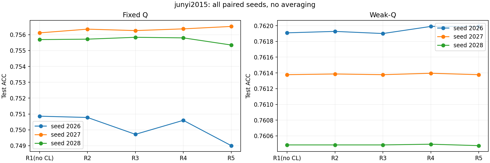

# junyi2015：R0/R1/R2受控对比学习实验

主表不是均值：每个Q/条件内按最高验证ACC选择种子，并列选较小种子；两个test指标来自同一checkpoint。严禁把不同种子的单次结果直接相减解释模块收益，收益看全部配对种子。A0=固定参考Q，A1=Weak-Q。

| Q设置 | 条件 | CL系数 | 验证选优种子 | 最佳轮 | valid ACC | test ACC | test AUC |
| --- | --- | --- | --- | --- | --- | --- | --- |
| A0 | R0 | 0 | 2028 | 30 | 0.755624043 | 0.755692108 | 0.800400878 |
| A0 | R1 | 0 | 2028 | 30 | 0.755624043 | 0.755692108 | 0.800400878 |
| A0 | R2 | 0.1 | 2028 | 30 | 0.756154058 | 0.755719138 | 0.800371685 |
| A1 | R0 | 0 | 2027 | 25 | 0.762200149 | 0.761377459 | 0.807338721 |
| A1 | R1 | 0 | 2027 | 25 | 0.762200149 | 0.761377459 | 0.807338721 |
| A1 | R2 | 0.1 | 2027 | 25 | 0.76225904 | 0.761386469 | 0.807333294 |

## 数据与固定协议

数据集：junyi2015；学生=5000，题目=500，概念=39；train/valid/test交互=[370038, 50942, 110987]。

使用data目录现有训练/验证/测试文件；没有重新划分。Q-F1表示与参考Q一致性，不能自动解释为认知诊断真实性。

R0参考原循环（统一验证ACC选模），R1新增入口λ=0并完全跳过CL训练分支，R2 λ=0.1。R2同时用于受控与敏感性实验，没有重复训练一份R2。模型、原始损失、α=0.8、Adam及学习率、128学生batch、30轮上限、patience=8均不变。验证ACC严格提升才更新checkpoint，平分保留最早轮。种子2026/2027/2028；每个数据集36次训练。

| 条件 | 正比例 | 正幅度 | 负比例 | 负幅度 |
| --- | --- | --- | --- | --- |
| R2 | 0.1 | 0.01 | 0.5 | 0.1 |
| R3 | 0.01 | 0.001 | 0.5 | 0.1 |
| R4 | 0.1 | 0.01 | 0.7 | 0.5 |
| R5 | 0.01 | 0.001 | 0.7 | 0.5 |

两输入不拼接。只对学生support的非零±1位置施加均匀连续噪声并裁剪到[-1,1]；0缺失、ID、标签、query和原数组不变。负噪声不翻转正误，只降低输入证据绝对值；因此极端响应不能直接当成诊断能力改善。验证/测试不增强。

损失沿用同学生一正一负InfoNCE，温度0.2，无margin。L=−正logit+logsumexp(正logit,负logit)。联合归一化项并不是独立负样本损失；负约束非零比例指负视图梯度范数>1e−12，不是margin激活率。

## 配置、代码和核验依据

以下完整配置/哈希和核验结果作为最终文档保留；用户要求清理新实验的checkpoint、原始日志及JSON/CSV副本。实际清理状态：自动审批以blocked by policy拒绝递归删除，原始产物仍暂存在Git忽略的scratch/student_cl_all_20261123。最终报告目录只包含Markdown和配图。若后续手工清理，便不能直接重放checkpoint，需按记录重跑。

<details><summary>完整配置、版本及数据/源码哈希</summary>

```json
{
  "experiment_id": "student_cl_all_junyi2015_20261123",
  "dataset": "junyi2015",
  "args": {
    "experiment_id": "student_cl_control_math1_20261123",
    "seeds": [
      2026,
      2027,
      2028
    ],
    "lambda_cl": 0.1,
    "positive_noise_ratio": 0.1,
    "positive_noise_scale": 0.01,
    "negative_noise_ratio": 0.5,
    "negative_noise_scale": 0.1,
    "noise_distribution": "uniform",
    "contrastive_seed": 1123,
    "temperature": 0.2,
    "dataset": "junyi2015",
    "data_dir": "E:\\Desktop\\Gen-CD\\Q_GNCDM\\data\\junyi2015",
    "alpha": 0.8,
    "embedding_dim": 32,
    "epochs": 30,
    "patience": 8,
    "batch_students": 128,
    "query_fraction": 0.25,
    "lr": 0.001,
    "q_lr": 0.005,
    "lambda_q": 0.01,
    "lambda_coverage": 0.01,
    "q_init_high": 0.55,
    "q_init_low": 0.45,
    "device": "cpu"
  },
  "noise_configs": {
    "R2": [
      0.1,
      0.01,
      0.5,
      0.1
    ],
    "R3": [
      0.01,
      0.001,
      0.5,
      0.1
    ],
    "R4": [
      0.1,
      0.01,
      0.7,
      0.5
    ],
    "R5": [
      0.01,
      0.001,
      0.7,
      0.5
    ]
  },
  "source_sha256": {
    "Q_GNCDM\\experiments\\run_controlled_student_cl.py": "9447f3fc2e79391b043148ae28717bee2f9f6a53dbe44352e5dddca3b6212a46",
    "Q_GNCDM\\experiments\\reference_student_cl_acc.py": "a974a5dbb0e36daf5ed49031be1838d69200e070f935d8f8f9dc31c0d9fa3dfc",
    "Q_GNCDM\\experiments\\controlled_student_cl.py": "4329530390f079ae00f6fa0d00af659e7e7be0f09134f8bc642b5a8caa0cb041",
    "Q_GNCDM\\experiments\\run_simple_contrastive.py": "196cbac42d9e7664eb4c24a4328bc852dca9265d7a88149adda0be924564a023",
    "Q_GNCDM\\models\\weak_q_gncdm.py": "5970f43820db2736bcf5f4e48039af50bf4203a5f391baa2046b8046c21517f5",
    "Q_GNCDM\\simple_contrastive.py": "30f0126846ab0e0d8802306ee183374a17730ed63f5bdd3ff6d76949b5252d97",
    "Q_GNCDM\\experiments\\run_weak_q_synthetic.py": "266d36d84cf1095189700a0b1f524f678accfd79feb94402ef6562f004f6b9b6",
    "Q_GNCDM\\experiments\\run_student_cl_all_datasets.py": "5c04daaf9a3ba1478c9d763e66348251162132ed385935c67e6d806635ec76bf",
    "Q_GNCDM\\experiments\\run_student_cl_noise_sensitivity.py": "b4c2c3850c4f49b26f60099c8d593128393ec8de80dcb3205d04fb27507f440f",
    "Q_GNCDM\\experiments\\run_prepared_dataset.py": "02b0fe433fcf75bea693b745149ac1654d866f044c81d9b2fc637b6f35d40c4d"
  },
  "data_sha256": {
    "train.csv": "47c6181d16a51c8bfdfd0a0495db01c7046f7ad3e1e699093f695681ee4a69a1",
    "valid.csv": "c1e6c126a694e37666b95a456e34f78abdfc5f3790d5bdd26e4d3da38f89d8ed",
    "test.csv": "9079ca054af3a73d993758a8fc3b0911d295f286a4acba9595d7fef8f3ff22bd",
    "Q_matrix.npy": "ebb26f466e6db2cf5262d1c6084396ab1ec7932ed00685f5313aec0c9af82104",
    "Q_true.npy": "ebb26f466e6db2cf5262d1c6084396ab1ec7932ed00685f5313aec0c9af82104",
    "manifest.json": "f9472b4f6524421051af04bcf50266e55e47002f48dde0cb5fb6cefbe9500865"
  },
  "train_shape": [
    5000,
    500
  ],
  "concepts": 39,
  "split_lengths": [
    370038,
    50942,
    110987
  ],
  "seeds": [
    2026,
    2027,
    2028
  ],
  "selection": "highest validation ACC, earliest epoch; display seed chosen by validation ACC, lowest seed tie",
  "retention": "user requests final Markdown reports and figures only; temporary originals removed after verification",
  "command": "E:\\Desktop\\Gen-CD\\.venv-contrastive\\Scripts\\python.exe -m Q_GNCDM.experiments.run_student_cl_all_datasets --dataset junyi2015",
  "python": "3.13.9 (tags/v3.13.9:8183fa5, Oct 14 2025, 14:09:13) [MSC v.1944 64 bit (AMD64)]",
  "torch": "2.14.0+cpu",
  "numpy": "2.4.3",
  "git_head": "89290e14293fe00b1e4eb55ba87ed068c5eccfdc",
  "protocol": "R0 reference ACC selector; R1 CL off; R2 shared by control and noise studies; R3-R5 change noise only",
  "scheduling_records": [
    {
      "mode": "A0",
      "seed": 2028,
      "source_sha256": "f768bea86bd13315b1a465ba1a441eee5f55b2ce675818a872c80356c46ce63f",
      "source": "Q_GNCDM\\experiments\\run_student_cl_seed2028.py",
      "changes": "seed scheduling only, same frozen worker logic",
      "status": "published_complete_verified_group"
    },
    {
      "mode": "A1",
      "seed": 2028,
      "source_sha256": "f768bea86bd13315b1a465ba1a441eee5f55b2ce675818a872c80356c46ce63f",
      "source": "Q_GNCDM\\experiments\\run_student_cl_seed2028.py",
      "changes": "seed scheduling only, same frozen worker logic",
      "status": "primary_already_started; no overwrite"
    },
    [
      {
        "mode": "A1",
        "seed": 2028,
        "condition": "R3",
        "status": "copied_verified_run_without_overwrite",
        "publisher_sha256": "6def6caa12c7e04d041cc9fbb3f8b92a0c5032c05e2078e61336759667d77b22"
      },
      {
        "mode": "A1",
        "seed": 2028,
        "condition": "R4",
        "status": "copied_verified_run_without_overwrite",
        "publisher_sha256": "6def6caa12c7e04d041cc9fbb3f8b92a0c5032c05e2078e61336759667d77b22"
      },
      {
        "mode": "A1",
        "seed": 2028,
        "condition": "R5",
        "status": "copied_verified_run_without_overwrite",
        "publisher_sha256": "6def6caa12c7e04d041cc9fbb3f8b92a0c5032c05e2078e61336759667d77b22"
      }
    ]
  ],
  "scheduling_duplicate_state_checks": [
    {
      "mode": "A1",
      "seed": 2028,
      "condition": "R0",
      "checkpoint_exact": true
    },
    {
      "mode": "A1",
      "seed": 2028,
      "condition": "R1",
      "checkpoint_exact": true
    },
    {
      "mode": "A1",
      "seed": 2028,
      "condition": "R2",
      "checkpoint_exact": true
    },
    {
      "mode": "A1",
      "seed": 2028,
      "condition": "R3",
      "checkpoint_exact": true
    },
    {
      "mode": "A1",
      "seed": 2028,
      "condition": "R4",
      "checkpoint_exact": true
    },
    {
      "mode": "A1",
      "seed": 2028,
      "condition": "R5",
      "checkpoint_exact": true
    }
  ]
}
```
</details>

8种Q/噪声设置预检全部通过；同初始化固定batch的CL梯度、一步更新测试通过；新诊断的损失/梯度与原实现精确一致。6组R0/R1的逐轮日志与checkpoint精确一致；36个checkpoint的全部测试指标已重放核验。

```json
{
  "runs": 36,
  "preflight_settings": 8,
  "baseline_exact_pairs": 6,
  "checkpoint_replays": 36,
  "protected_code_and_data_unchanged": true,
  "status": "passed"
}
```

<details><summary>全部预检真实输出（含逐层梯度和单步参数更新差异）</summary>

```json
{
  "A0_R2": {
    "positive": {
      "selected_fraction": 0.1007375,
      "changed_fraction": 0.050225,
      "clipped_fraction_selected": 0.5014269760516193,
      "input_mae_observed": 0.00025183867546729743,
      "input_mae_all": 0.00020147094619460404,
      "input_max_change": 0.009997665882110596
    },
    "negative": {
      "selected_fraction": 0.5008875,
      "changed_fraction": 0.2517625,
      "clipped_fraction_selected": 0.4973671732674503,
      "input_mae_observed": 0.012591703794896603,
      "input_mae_all": 0.010073362849652767,
      "input_max_change": 0.09999817609786987
    },
    "gradient": {
      "original_shared_grad_norm": 0.00011485157357545692,
      "cl_shared_grad_norm": 1.4130236274417993e-07,
      "cl_to_original_grad_ratio": 0.0012303041076868221,
      "weighted_cl_to_original_grad_ratio": 0.00012303041076868222
    },
    "per_layer": {
      "f_nn.f_layer_1.weight": {
        "original_grad_norm": 2.4457627660012804e-05,
        "cl_grad_norm": 6.273534580714113e-08,
        "cl_finite": true
      },
      "f_nn.f_layer_1.bias": {
        "original_grad_norm": 1.1079643627454061e-05,
        "cl_grad_norm": 1.5538692110794727e-08,
        "cl_finite": true
      },
      "f_nn.f_layer_2.weight": {
        "original_grad_norm": 0.00010801650932990015,
        "cl_grad_norm": 1.1889486728478005e-07,
        "cl_finite": true
      },
      "f_nn.f_layer_2.bias": {
        "original_grad_norm": 2.8326339815976098e-05,
        "cl_grad_norm": 4.065948644438322e-08,
        "cl_finite": true
      }
    },
    "batch_diagnostics": {
      "ap_mse": 2.1945463224426476e-09,
      "an_mse": 1.244132363353856e-06,
      "ap_cos_distance": -2.3283064365386963e-09,
      "an_cos_distance": 1.4640390872955322e-06,
      "negative_softmax_probability": 0.49999815225601196,
      "negative_not_farther_fraction": 0.0,
      "positive_selected_fraction": 0.10733277357962497,
      "positive_changed_fraction": 0.05289672544080604,
      "positive_clipped_fraction_selected": 0.5071707953063885,
      "positive_input_mae_observed": 0.00026339993928559124,
      "positive_input_mae_all": 2.9410250135697424e-05,
      "positive_input_max_change": 0.009946465492248535,
      "negative_selected_fraction": 0.5071368597816961,
      "negative_changed_fraction": 0.24853064651553317,
      "negative_clipped_fraction_selected": 0.5099337748344371,
      "negative_input_mae_observed": 0.012384336441755295,
      "negative_input_mae_all": 0.0013827885268256068,
      "negative_input_max_change": 0.0999498963356018
    },
    "loss_original": 1.1139953136444092,
    "loss_cl": 0.6931434869766235,
    "loss_total": 1.1833096742630005,
    "single_step_parameter_changes": {
      "f_nn.f_layer_1.weight": {
        "gradient_difference_l2": 6.270163770487706e-09,
        "update_difference_l2": 6.781528912598131e-05,
        "baseline_update_l2": 0.11070765878329303,
        "cl_update_l2": 0.11071088824669788
      },
      "f_nn.f_layer_1.bias": {
        "gradient_difference_l2": 1.5494713146415605e-09,
        "update_difference_l2": 7.812847260182033e-09,
        "baseline_update_l2": 0.006207025923413136,
        "cl_update_l2": 0.00620703017022452
      },
      "f_nn.f_layer_2.weight": {
        "gradient_difference_l2": 1.1878110662711965e-08,
        "update_difference_l2": 2.6290495088887863e-05,
        "baseline_update_l2": 0.03421791835832143,
        "cl_update_l2": 0.034217504480030074
      },
      "f_nn.f_layer_2.bias": {
        "gradient_difference_l2": 4.062939100993039e-09,
        "update_difference_l2": 1.918752528143338e-05,
        "baseline_update_l2": 0.005673346227865588,
        "cl_update_l2": 0.005673704861099694
      }
    },
    "zero_single_step_exact_parity": true,
    "status": "passed",
    "observed_branch_loss_and_gradient_exact": true,
    "observation_state_and_rng_unchanged": true,
    "extra_diagnostics": {
      "ap_mse": 2.0521497834380398e-09,
      "an_mse": 1.2404506151142414e-06,
      "ap_cos_distance": 9.313225746154785e-09,
      "an_cos_distance": 1.469627022743225e-06,
      "negative_softmax_probability": 0.49999815225601196,
      "negative_not_farther_fraction": 0.0,
      "positive_energy": -5.0,
      "joint_log_partition": 5.693142890930176,
      "negative_relative_penalty": 0.6931434869766235,
      "positive_view_grad_norm_mean": 3.131973473749269e-07,
      "negative_view_grad_norm_mean": 8.30525617148852e-06,
      "negative_view_grad_nonzero_fraction": 1.0,
      "negative_view_grad_above_1e_12_fraction": 1.0,
      "positive_shared_partial_grad_norm": 7.115777898804468e-10,
      "negative_shared_partial_grad_norm": 1.3784978178336906e-07,
      "positive_selected_fraction": 0.10425412818359922,
      "positive_changed_fraction": 0.052616848586621884,
      "positive_clipped_fraction_selected": 0.49530201342281877,
      "positive_input_mae_observed": 0.00025681493571028113,
      "positive_input_mae_all": 2.8674992790911347e-05,
      "positive_input_max_change": 0.00995028018951416,
      "positive_input_mse_observed": 1.7183225509143085e-06,
      "positive_clipped_fraction_observed": 0.05163727959697733,
      "positive_input_mae_changed": 0.004880850203335285,
      "positive_unchanged_student_fraction": 0.1015625,
      "negative_selected_fraction": 0.5027987685418416,
      "negative_changed_fraction": 0.2462916316820599,
      "negative_clipped_fraction_selected": 0.5101586418035068,
      "negative_input_mae_observed": 0.012363877147436142,
      "negative_input_mae_all": 0.0013805041089653969,
      "negative_input_max_change": 0.0999498963356018,
      "negative_input_mse_observed": 0.0008244988275691867,
      "negative_clipped_fraction_observed": 0.25650713685978166,
      "negative_input_mae_changed": 0.05020014941692352,
      "negative_unchanged_student_fraction": 0.0
    }
  },
  "A0_R3": {
    "positive": {
      "selected_fraction": 0.01045,
      "changed_fraction": 0.005025,
      "clipped_fraction_selected": 0.5179425837320574,
      "input_mae_observed": 2.512869286874775e-06,
      "input_mae_all": 2.010295474974555e-06,
      "input_max_change": 0.0009962916374206543
    },
    "negative": {
      "selected_fraction": 0.5008875,
      "changed_fraction": 0.2517625,
      "clipped_fraction_selected": 0.4973671732674503,
      "input_mae_observed": 0.012591703794896603,
      "input_mae_all": 0.010073362849652767,
      "input_max_change": 0.09999817609786987
    },
    "gradient": {
      "original_shared_grad_norm": 0.00011485157357545692,
      "cl_shared_grad_norm": 1.4139607640391342e-07,
      "cl_to_original_grad_ratio": 0.001231120062199382,
      "weighted_cl_to_original_grad_ratio": 0.0001231120062199382
    },
    "per_layer": {
      "f_nn.f_layer_1.weight": {
        "original_grad_norm": 2.4457627660012804e-05,
        "cl_grad_norm": 6.264606611239287e-08,
        "cl_finite": true
      },
      "f_nn.f_layer_1.bias": {
        "original_grad_norm": 1.1079643627454061e-05,
        "cl_grad_norm": 1.5581145262899554e-08,
        "cl_finite": true
      },
      "f_nn.f_layer_2.weight": {
        "original_grad_norm": 0.00010801650932990015,
        "cl_grad_norm": 1.190291101238472e-07,
        "cl_finite": true
      },
      "f_nn.f_layer_2.bias": {
        "original_grad_norm": 2.8326339815976098e-05,
        "cl_grad_norm": 4.071388559623301e-08,
        "cl_finite": true
      }
    },
    "batch_diagnostics": {
      "ap_mse": 1.898314838655324e-12,
      "an_mse": 1.244132363353856e-06,
      "ap_cos_distance": 1.862645149230957e-09,
      "an_cos_distance": 1.4640390872955322e-06,
      "negative_softmax_probability": 0.49999815225601196,
      "negative_not_farther_fraction": 0.0,
      "positive_selected_fraction": 0.010215505177721802,
      "positive_changed_fraction": 0.0054575986565911,
      "positive_clipped_fraction_selected": 0.4657534246575342,
      "positive_input_mae_observed": 2.479990371284657e-06,
      "positive_input_mae_all": 2.769064053609327e-07,
      "positive_input_max_change": 0.0009744167327880859,
      "negative_selected_fraction": 0.5071368597816961,
      "negative_changed_fraction": 0.24853064651553317,
      "negative_clipped_fraction_selected": 0.5099337748344371,
      "negative_input_mae_observed": 0.012384336441755295,
      "negative_input_mae_all": 0.0013827885268256068,
      "negative_input_max_change": 0.0999498963356018
    },
    "loss_original": 1.1139953136444092,
    "loss_cl": 0.6931434869766235,
    "loss_total": 1.1833096742630005,
    "single_step_parameter_changes": {
      "f_nn.f_layer_1.weight": {
        "gradient_difference_l2": 6.246007762979587e-09,
        "update_difference_l2": 6.75001076206742e-05,
        "baseline_update_l2": 0.11070765878329303,
        "cl_update_l2": 0.11071085375229255
      },
      "f_nn.f_layer_1.bias": {
        "gradient_difference_l2": 1.550390309963233e-09,
        "update_difference_l2": 6.9303792277989984e-09,
        "baseline_update_l2": 0.006207025923413136,
        "cl_update_l2": 0.006207029725041972
      },
      "f_nn.f_layer_2.weight": {
        "gradient_difference_l2": 1.1881468825156451e-08,
        "update_difference_l2": 2.633355966269258e-05,
        "baseline_update_l2": 0.03421791835832143,
        "cl_update_l2": 0.03421750305609709
      },
      "f_nn.f_layer_2.bias": {
        "gradient_difference_l2": 4.065800782097404e-09,
        "update_difference_l2": 1.922639833505e-05,
        "baseline_update_l2": 0.005673346227865588,
        "cl_update_l2": 0.005673707300830473
      }
    },
    "zero_single_step_exact_parity": true,
    "status": "passed",
    "observed_branch_loss_and_gradient_exact": true,
    "observation_state_and_rng_unchanged": true,
    "extra_diagnostics": {
      "ap_mse": 1.598867089072642e-12,
      "an_mse": 1.2404506151142414e-06,
      "ap_cos_distance": 1.5832483768463135e-08,
      "an_cos_distance": 1.469627022743225e-06,
      "negative_softmax_probability": 0.49999818205833435,
      "negative_not_farther_fraction": 0.0,
      "positive_energy": -5.0,
      "joint_log_partition": 5.693142890930176,
      "negative_relative_penalty": 0.6931435465812683,
      "positive_view_grad_norm_mean": 4.483833652638436e-09,
      "negative_view_grad_norm_mean": 8.305256835699417e-06,
      "negative_view_grad_nonzero_fraction": 1.0,
      "negative_view_grad_above_1e_12_fraction": 1.0,
      "positive_shared_partial_grad_norm": 1.0229434785611745e-09,
      "negative_shared_partial_grad_norm": 1.3793287237370647e-07,
      "positive_selected_fraction": 0.009655751469353484,
      "positive_changed_fraction": 0.004897844948222782,
      "positive_clipped_fraction_selected": 0.4927536231884058,
      "positive_input_mae_observed": 2.325665491298423e-06,
      "positive_input_mae_all": 2.5967509031943337e-07,
      "positive_input_max_change": 0.0009754300117492676,
      "positive_input_mse_observed": 1.5605052805511832e-09,
      "positive_clipped_fraction_observed": 0.004757906521130702,
      "positive_input_mae_changed": 0.0004748344363179058,
      "positive_unchanged_student_fraction": 0.7578125,
      "negative_selected_fraction": 0.5027987685418416,
      "negative_changed_fraction": 0.2462916316820599,
      "negative_clipped_fraction_selected": 0.5101586418035068,
      "negative_input_mae_observed": 0.012363877147436142,
      "negative_input_mae_all": 0.0013805041089653969,
      "negative_input_max_change": 0.0999498963356018,
      "negative_input_mse_observed": 0.0008244988275691867,
      "negative_clipped_fraction_observed": 0.25650713685978166,
      "negative_input_mae_changed": 0.05020014941692352,
      "negative_unchanged_student_fraction": 0.0
    }
  },
  "A0_R4": {
    "positive": {
      "selected_fraction": 0.1007375,
      "changed_fraction": 0.050225,
      "clipped_fraction_selected": 0.5014269760516193,
      "input_mae_observed": 0.00025183867546729743,
      "input_mae_all": 0.00020147094619460404,
      "input_max_change": 0.009997665882110596
    },
    "negative": {
      "selected_fraction": 0.7017125,
      "changed_fraction": 0.3529375,
      "clipped_fraction_selected": 0.4970340417193651,
      "input_mae_observed": 0.08849677443504333,
      "input_mae_all": 0.07079741358757019,
      "input_max_change": 0.4999908208847046
    },
    "gradient": {
      "original_shared_grad_norm": 0.00011485157357545692,
      "cl_shared_grad_norm": 6.187753373567721e-06,
      "cl_to_original_grad_ratio": 0.05387608703073099,
      "weighted_cl_to_original_grad_ratio": 0.005387608703073099
    },
    "per_layer": {
      "f_nn.f_layer_1.weight": {
        "original_grad_norm": 2.4457627660012804e-05,
        "cl_grad_norm": 2.7880385005119024e-06,
        "cl_finite": true
      },
      "f_nn.f_layer_1.bias": {
        "original_grad_norm": 1.1079643627454061e-05,
        "cl_grad_norm": 6.374879717441218e-07,
        "cl_finite": true
      },
      "f_nn.f_layer_2.weight": {
        "original_grad_norm": 0.00010801650932990015,
        "cl_grad_norm": 5.216798399487743e-06,
        "cl_finite": true
      },
      "f_nn.f_layer_2.bias": {
        "original_grad_norm": 2.8326339815976098e-05,
        "cl_grad_norm": 1.7011049067150452e-06,
        "cl_finite": true
      }
    },
    "batch_diagnostics": {
      "ap_mse": 2.1945463224426476e-09,
      "an_mse": 4.890005220659077e-05,
      "ap_cos_distance": -2.3283064365386963e-09,
      "an_cos_distance": 5.692150443792343e-05,
      "negative_softmax_probability": 0.4999288320541382,
      "negative_not_farther_fraction": 0.0,
      "positive_selected_fraction": 0.10733277357962497,
      "positive_changed_fraction": 0.05289672544080604,
      "positive_clipped_fraction_selected": 0.5071707953063885,
      "positive_input_mae_observed": 0.00026339993928559124,
      "positive_input_mae_all": 2.9410250135697424e-05,
      "positive_input_max_change": 0.009946465492248535,
      "negative_selected_fraction": 0.7073887489504618,
      "negative_changed_fraction": 0.34830674503218584,
      "negative_clipped_fraction_selected": 0.5076162215628091,
      "negative_input_mae_observed": 0.08643096685409546,
      "negative_input_mae_all": 0.009650557301938534,
      "negative_input_max_change": 0.49974942207336426
    },
    "loss_original": 1.1139953136444092,
    "loss_cl": 0.693004846572876,
    "loss_total": 1.1832958459854126,
    "single_step_parameter_changes": {
      "f_nn.f_layer_1.weight": {
        "gradient_difference_l2": 2.7879049594009796e-07,
        "update_difference_l2": 0.002620636741255065,
        "baseline_update_l2": 0.11070765878329303,
        "cl_update_l2": 0.11086023220984781
      },
      "f_nn.f_layer_1.bias": {
        "gradient_difference_l2": 6.374209303353868e-08,
        "update_difference_l2": 1.983293461823599e-07,
        "baseline_update_l2": 0.006207025923413136,
        "cl_update_l2": 0.006207219834920522
      },
      "f_nn.f_layer_2.weight": {
        "gradient_difference_l2": 5.216776158679028e-07,
        "update_difference_l2": 0.0010056635414586314,
        "baseline_update_l2": 0.03421791835832143,
        "cl_update_l2": 0.03418225559596679
      },
      "f_nn.f_layer_2.bias": {
        "gradient_difference_l2": 1.7010881454557034e-07,
        "update_difference_l2": 0.0005657145723600231,
        "baseline_update_l2": 0.005673346227865588,
        "cl_update_l2": 0.0056963011404587115
      }
    },
    "zero_single_step_exact_parity": true,
    "status": "passed",
    "observed_branch_loss_and_gradient_exact": true,
    "observation_state_and_rng_unchanged": true,
    "extra_diagnostics": {
      "ap_mse": 2.0521497834380398e-09,
      "an_mse": 4.8071051423903555e-05,
      "ap_cos_distance": 9.313225746154785e-09,
      "an_cos_distance": 5.533359944820404e-05,
      "negative_softmax_probability": 0.49993079900741577,
      "negative_not_farther_fraction": 0.0,
      "positive_energy": -5.0,
      "joint_log_partition": 5.6930084228515625,
      "negative_relative_penalty": 0.6930088996887207,
      "positive_view_grad_norm_mean": 3.1313219564862196e-07,
      "negative_view_grad_norm_mean": 5.145787068011631e-05,
      "negative_view_grad_nonzero_fraction": 1.0,
      "negative_view_grad_above_1e_12_fraction": 1.0,
      "positive_shared_partial_grad_norm": 6.107931043638636e-10,
      "negative_shared_partial_grad_norm": 5.986333477501843e-06,
      "positive_selected_fraction": 0.10425412818359922,
      "positive_changed_fraction": 0.052616848586621884,
      "positive_clipped_fraction_selected": 0.49530201342281877,
      "positive_input_mae_observed": 0.00025681493571028113,
      "positive_input_mae_all": 2.8674992790911347e-05,
      "positive_input_max_change": 0.00995028018951416,
      "positive_input_mse_observed": 1.7183225509143085e-06,
      "positive_clipped_fraction_observed": 0.05163727959697733,
      "positive_input_mae_changed": 0.004880850203335285,
      "positive_unchanged_student_fraction": 0.1015625,
      "negative_selected_fraction": 0.7038902882731598,
      "negative_changed_fraction": 0.34662748390708087,
      "negative_clipped_fraction_selected": 0.5075546719681908,
      "negative_input_mae_observed": 0.0866774395108223,
      "negative_input_mae_all": 0.009678077884018421,
      "negative_input_max_change": 0.49974942207336426,
      "negative_input_mse_observed": 0.028813324868679047,
      "negative_clipped_fraction_observed": 0.3572628043660789,
      "negative_input_mae_changed": 0.2500593364238739,
      "negative_unchanged_student_fraction": 0.0
    }
  },
  "A0_R5": {
    "positive": {
      "selected_fraction": 0.01045,
      "changed_fraction": 0.005025,
      "clipped_fraction_selected": 0.5179425837320574,
      "input_mae_observed": 2.512869286874775e-06,
      "input_mae_all": 2.010295474974555e-06,
      "input_max_change": 0.0009962916374206543
    },
    "negative": {
      "selected_fraction": 0.7017125,
      "changed_fraction": 0.3529375,
      "clipped_fraction_selected": 0.4970340417193651,
      "input_mae_observed": 0.08849677443504333,
      "input_mae_all": 0.07079741358757019,
      "input_max_change": 0.4999908208847046
    },
    "gradient": {
      "original_shared_grad_norm": 0.00011485157357545692,
      "cl_shared_grad_norm": 6.187847916703942e-06,
      "cl_to_original_grad_ratio": 0.05387691020740396,
      "weighted_cl_to_original_grad_ratio": 0.005387691020740396
    },
    "per_layer": {
      "f_nn.f_layer_1.weight": {
        "original_grad_norm": 2.4457627660012804e-05,
        "cl_grad_norm": 2.7877742923010373e-06,
        "cl_finite": true
      },
      "f_nn.f_layer_1.bias": {
        "original_grad_norm": 1.1079643627454061e-05,
        "cl_grad_norm": 6.375284442583506e-07,
        "cl_finite": true
      },
      "f_nn.f_layer_2.weight": {
        "original_grad_norm": 0.00010801650932990015,
        "cl_grad_norm": 5.217023954173783e-06,
        "cl_finite": true
      },
      "f_nn.f_layer_2.bias": {
        "original_grad_norm": 2.8326339815976098e-05,
        "cl_grad_norm": 1.7011733461913536e-06,
        "cl_finite": true
      }
    },
    "batch_diagnostics": {
      "ap_mse": 1.898314838655324e-12,
      "an_mse": 4.890005220659077e-05,
      "ap_cos_distance": 1.862645149230957e-09,
      "an_cos_distance": 5.692150443792343e-05,
      "negative_softmax_probability": 0.4999288320541382,
      "negative_not_farther_fraction": 0.0,
      "positive_selected_fraction": 0.010215505177721802,
      "positive_changed_fraction": 0.0054575986565911,
      "positive_clipped_fraction_selected": 0.4657534246575342,
      "positive_input_mae_observed": 2.479990371284657e-06,
      "positive_input_mae_all": 2.769064053609327e-07,
      "positive_input_max_change": 0.0009744167327880859,
      "negative_selected_fraction": 0.7073887489504618,
      "negative_changed_fraction": 0.34830674503218584,
      "negative_clipped_fraction_selected": 0.5076162215628091,
      "negative_input_mae_observed": 0.08643096685409546,
      "negative_input_mae_all": 0.009650557301938534,
      "negative_input_max_change": 0.49974942207336426
    },
    "loss_original": 1.1139953136444092,
    "loss_cl": 0.6930049061775208,
    "loss_total": 1.1832958459854126,
    "single_step_parameter_changes": {
      "f_nn.f_layer_1.weight": {
        "gradient_difference_l2": 2.78814187941404e-07,
        "update_difference_l2": 0.0026206422069911515,
        "baseline_update_l2": 0.11070765878329303,
        "cl_update_l2": 0.11086024747588297
      },
      "f_nn.f_layer_1.bias": {
        "gradient_difference_l2": 6.374874462227785e-08,
        "update_difference_l2": 1.983489227477245e-07,
        "baseline_update_l2": 0.006207025923413136,
        "cl_update_l2": 0.0062072198535766945
      },
      "f_nn.f_layer_2.weight": {
        "gradient_difference_l2": 5.216914990301711e-07,
        "update_difference_l2": 0.0010055246960235583,
        "baseline_update_l2": 0.03421791835832143,
        "cl_update_l2": 0.034182271316704364
      },
      "f_nn.f_layer_2.bias": {
        "gradient_difference_l2": 1.7011712342495885e-07,
        "update_difference_l2": 0.0005657436587122623,
        "baseline_update_l2": 0.005673346227865588,
        "cl_update_l2": 0.005696298731601018
      }
    },
    "zero_single_step_exact_parity": true,
    "status": "passed",
    "observed_branch_loss_and_gradient_exact": true,
    "observation_state_and_rng_unchanged": true,
    "extra_diagnostics": {
      "ap_mse": 1.598867089072642e-12,
      "an_mse": 4.8071051423903555e-05,
      "ap_cos_distance": 1.5832483768463135e-08,
      "an_cos_distance": 5.533359944820404e-05,
      "negative_softmax_probability": 0.49993082880973816,
      "negative_not_farther_fraction": 0.0,
      "positive_energy": -5.0,
      "joint_log_partition": 5.6930084228515625,
      "negative_relative_penalty": 0.6930088400840759,
      "positive_view_grad_norm_mean": 4.473655045835088e-09,
      "negative_view_grad_norm_mean": 5.145786960183386e-05,
      "negative_view_grad_nonzero_fraction": 1.0,
      "negative_view_grad_above_1e_12_fraction": 1.0,
      "positive_shared_partial_grad_norm": 9.463811997545019e-10,
      "negative_shared_partial_grad_norm": 5.986394345323985e-06,
      "positive_selected_fraction": 0.009655751469353484,
      "positive_changed_fraction": 0.004897844948222782,
      "positive_clipped_fraction_selected": 0.4927536231884058,
      "positive_input_mae_observed": 2.325665491298423e-06,
      "positive_input_mae_all": 2.5967509031943337e-07,
      "positive_input_max_change": 0.0009754300117492676,
      "positive_input_mse_observed": 1.5605052805511832e-09,
      "positive_clipped_fraction_observed": 0.004757906521130702,
      "positive_input_mae_changed": 0.0004748344363179058,
      "positive_unchanged_student_fraction": 0.7578125,
      "negative_selected_fraction": 0.7038902882731598,
      "negative_changed_fraction": 0.34662748390708087,
      "negative_clipped_fraction_selected": 0.5075546719681908,
      "negative_input_mae_observed": 0.0866774395108223,
      "negative_input_mae_all": 0.009678077884018421,
      "negative_input_max_change": 0.49974942207336426,
      "negative_input_mse_observed": 0.028813324868679047,
      "negative_clipped_fraction_observed": 0.3572628043660789,
      "negative_input_mae_changed": 0.2500593364238739,
      "negative_unchanged_student_fraction": 0.0
    }
  },
  "A1_R2": {
    "positive": {
      "selected_fraction": 0.1007375,
      "changed_fraction": 0.050225,
      "clipped_fraction_selected": 0.5014269760516193,
      "input_mae_observed": 0.00025183867546729743,
      "input_mae_all": 0.00020147094619460404,
      "input_max_change": 0.009997665882110596
    },
    "negative": {
      "selected_fraction": 0.5008875,
      "changed_fraction": 0.2517625,
      "clipped_fraction_selected": 0.4973671732674503,
      "input_mae_observed": 0.012591703794896603,
      "input_mae_all": 0.010073362849652767,
      "input_max_change": 0.09999817609786987
    },
    "gradient": {
      "original_shared_grad_norm": 0.0007183028533791733,
      "cl_shared_grad_norm": 2.6485427092412048e-08,
      "cl_to_original_grad_ratio": 3.687222870940077e-05,
      "weighted_cl_to_original_grad_ratio": 3.687222870940077e-06
    },
    "per_layer": {
      "q_logits": {
        "original_grad_norm": 0.0005986979231238365,
        "cl_grad_norm": 1.4069920339920827e-08,
        "cl_finite": true
      },
      "f_nn.f_layer_1.weight": {
        "original_grad_norm": 0.00020838207274209708,
        "cl_grad_norm": 1.3410267563074285e-08,
        "cl_finite": true
      },
      "f_nn.f_layer_1.bias": {
        "original_grad_norm": 8.110367343761027e-05,
        "cl_grad_norm": 1.1253589171644762e-09,
        "cl_finite": true
      },
      "f_nn.f_layer_2.weight": {
        "original_grad_norm": 0.00031548799597658217,
        "cl_grad_norm": 1.2958285111608348e-08,
        "cl_finite": true
      },
      "f_nn.f_layer_2.bias": {
        "original_grad_norm": 8.936442463891581e-05,
        "cl_grad_norm": 1.2429641316202833e-08,
        "cl_finite": true
      }
    },
    "batch_diagnostics": {
      "ap_mse": 8.813718643807533e-09,
      "an_mse": 6.825304353696993e-06,
      "ap_cos_distance": 9.313225746154785e-10,
      "an_cos_distance": 1.0710209608078003e-08,
      "negative_softmax_probability": 0.5,
      "negative_not_farther_fraction": 0.6484375,
      "positive_selected_fraction": 0.10733277357962497,
      "positive_changed_fraction": 0.05289672544080604,
      "positive_clipped_fraction_selected": 0.5071707953063885,
      "positive_input_mae_observed": 0.00026339993928559124,
      "positive_input_mae_all": 2.9410250135697424e-05,
      "positive_input_max_change": 0.009946465492248535,
      "negative_selected_fraction": 0.5071368597816961,
      "negative_changed_fraction": 0.24853064651553317,
      "negative_clipped_fraction_selected": 0.5099337748344371,
      "negative_input_mae_observed": 0.012384336441755295,
      "negative_input_mae_all": 0.0013827885268256068,
      "negative_input_max_change": 0.0999498963356018
    },
    "loss_original": 1.2160142660140991,
    "loss_cl": 0.6931471824645996,
    "loss_total": 1.285328984260559,
    "single_step_parameter_changes": {
      "q_logits": {
        "gradient_difference_l2": 1.4074552554226486e-09,
        "update_difference_l2": 1.9749239245628266e-05,
        "baseline_update_l2": 0.6690491194502862,
        "cl_update_l2": 0.6690490306125719
      },
      "f_nn.f_layer_1.weight": {
        "gradient_difference_l2": 1.3402315386457358e-09,
        "update_difference_l2": 2.594441277606194e-06,
        "baseline_update_l2": 0.13110679006852013,
        "cl_update_l2": 0.1311067956084629
      },
      "f_nn.f_layer_1.bias": {
        "gradient_difference_l2": 1.1331150633562372e-10,
        "update_difference_l2": 2.098707060483278e-09,
        "baseline_update_l2": 0.006240062954442952,
        "cl_update_l2": 0.006240063047686749
      },
      "f_nn.f_layer_2.weight": {
        "gradient_difference_l2": 1.2975256843867147e-09,
        "update_difference_l2": 1.0478025696251818e-08,
        "baseline_update_l2": 0.03893247195443414,
        "cl_update_l2": 0.03893247210054521
      },
      "f_nn.f_layer_2.bias": {
        "gradient_difference_l2": 1.246981603111052e-09,
        "update_difference_l2": 4.799926683327254e-10,
        "baseline_update_l2": 0.006239227385313833,
        "cl_update_l2": 0.006239227478517468
      }
    },
    "zero_single_step_exact_parity": true,
    "status": "passed",
    "observed_branch_loss_and_gradient_exact": true,
    "observation_state_and_rng_unchanged": true,
    "extra_diagnostics": {
      "ap_mse": 7.874132457175165e-09,
      "an_mse": 6.542528353747912e-06,
      "ap_cos_distance": 2.7939677238464355e-08,
      "an_cos_distance": 1.6298145055770874e-08,
      "negative_softmax_probability": 0.5,
      "negative_not_farther_fraction": 0.6875,
      "positive_energy": -5.0,
      "joint_log_partition": 5.693146705627441,
      "negative_relative_penalty": 0.6931471824645996,
      "positive_view_grad_norm_mean": 1.971119509151084e-08,
      "negative_view_grad_norm_mean": 5.560041934175605e-07,
      "negative_view_grad_nonzero_fraction": 1.0,
      "negative_view_grad_above_1e_12_fraction": 1.0,
      "positive_shared_partial_grad_norm": 1.6634844570519388e-09,
      "negative_shared_partial_grad_norm": 2.6712327233275818e-08,
      "positive_selected_fraction": 0.10425412818359922,
      "positive_changed_fraction": 0.052616848586621884,
      "positive_clipped_fraction_selected": 0.49530201342281877,
      "positive_input_mae_observed": 0.00025681493571028113,
      "positive_input_mae_all": 2.8674992790911347e-05,
      "positive_input_max_change": 0.00995028018951416,
      "positive_input_mse_observed": 1.7183225509143085e-06,
      "positive_clipped_fraction_observed": 0.05163727959697733,
      "positive_input_mae_changed": 0.004880850203335285,
      "positive_unchanged_student_fraction": 0.1015625,
      "negative_selected_fraction": 0.5027987685418416,
      "negative_changed_fraction": 0.2462916316820599,
      "negative_clipped_fraction_selected": 0.5101586418035068,
      "negative_input_mae_observed": 0.012363877147436142,
      "negative_input_mae_all": 0.0013805041089653969,
      "negative_input_max_change": 0.0999498963356018,
      "negative_input_mse_observed": 0.0008244988275691867,
      "negative_clipped_fraction_observed": 0.25650713685978166,
      "negative_input_mae_changed": 0.05020014941692352,
      "negative_unchanged_student_fraction": 0.0
    }
  },
  "A1_R3": {
    "positive": {
      "selected_fraction": 0.01045,
      "changed_fraction": 0.005025,
      "clipped_fraction_selected": 0.5179425837320574,
      "input_mae_observed": 2.512869286874775e-06,
      "input_mae_all": 2.010295474974555e-06,
      "input_max_change": 0.0009962916374206543
    },
    "negative": {
      "selected_fraction": 0.5008875,
      "changed_fraction": 0.2517625,
      "clipped_fraction_selected": 0.4973671732674503,
      "input_mae_observed": 0.012591703794896603,
      "input_mae_all": 0.010073362849652767,
      "input_max_change": 0.09999817609786987
    },
    "gradient": {
      "original_shared_grad_norm": 0.0007183028533791733,
      "cl_shared_grad_norm": 2.6554573606066372e-08,
      "cl_to_original_grad_ratio": 3.696849244179308e-05,
      "weighted_cl_to_original_grad_ratio": 3.6968492441793082e-06
    },
    "per_layer": {
      "q_logits": {
        "original_grad_norm": 0.0005986979231238365,
        "cl_grad_norm": 1.4076758425574099e-08,
        "cl_finite": true
      },
      "f_nn.f_layer_1.weight": {
        "original_grad_norm": 0.00020838207274209708,
        "cl_grad_norm": 1.3369779061633835e-08,
        "cl_finite": true
      },
      "f_nn.f_layer_1.bias": {
        "original_grad_norm": 8.110367343761027e-05,
        "cl_grad_norm": 1.135420868436654e-09,
        "cl_finite": true
      },
      "f_nn.f_layer_2.weight": {
        "original_grad_norm": 0.00031548799597658217,
        "cl_grad_norm": 1.3098940598865738e-08,
        "cl_finite": true
      },
      "f_nn.f_layer_2.bias": {
        "original_grad_norm": 8.936442463891581e-05,
        "cl_grad_norm": 1.2464648868615313e-08,
        "cl_finite": true
      }
    },
    "batch_diagnostics": {
      "ap_mse": 3.68516415300002e-12,
      "an_mse": 6.825304353696993e-06,
      "ap_cos_distance": -1.4901161193847656e-08,
      "an_cos_distance": 1.0710209608078003e-08,
      "negative_softmax_probability": 0.5,
      "negative_not_farther_fraction": 0.578125,
      "positive_selected_fraction": 0.010215505177721802,
      "positive_changed_fraction": 0.0054575986565911,
      "positive_clipped_fraction_selected": 0.4657534246575342,
      "positive_input_mae_observed": 2.479990371284657e-06,
      "positive_input_mae_all": 2.769064053609327e-07,
      "positive_input_max_change": 0.0009744167327880859,
      "negative_selected_fraction": 0.5071368597816961,
      "negative_changed_fraction": 0.24853064651553317,
      "negative_clipped_fraction_selected": 0.5099337748344371,
      "negative_input_mae_observed": 0.012384336441755295,
      "negative_input_mae_all": 0.0013827885268256068,
      "negative_input_max_change": 0.0999498963356018
    },
    "loss_original": 1.2160142660140991,
    "loss_cl": 0.6931471228599548,
    "loss_total": 1.285328984260559,
    "single_step_parameter_changes": {
      "q_logits": {
        "gradient_difference_l2": 1.4080107873280122e-09,
        "update_difference_l2": 1.9705460304173357e-05,
        "baseline_update_l2": 0.6690491194502862,
        "cl_update_l2": 0.6690490310595397
      },
      "f_nn.f_layer_1.weight": {
        "gradient_difference_l2": 1.3339409893351378e-09,
        "update_difference_l2": 2.4631665117325896e-06,
        "baseline_update_l2": 0.13110679006852013,
        "cl_update_l2": 0.13110679585052074
      },
      "f_nn.f_layer_1.bias": {
        "gradient_difference_l2": 1.1240265422193083e-10,
        "update_difference_l2": 2.2842335596620783e-09,
        "baseline_update_l2": 0.006240062954442952,
        "cl_update_l2": 0.006240063532343083
      },
      "f_nn.f_layer_2.weight": {
        "gradient_difference_l2": 1.3073199107077233e-09,
        "update_difference_l2": 1.0999861928650845e-08,
        "baseline_update_l2": 0.03893247195443414,
        "cl_update_l2": 0.038932472026041165
      },
      "f_nn.f_layer_2.bias": {
        "gradient_difference_l2": 1.2464152877323805e-09,
        "update_difference_l2": 4.799926683327254e-10,
        "baseline_update_l2": 0.006239227385313833,
        "cl_update_l2": 0.006239227478517468
      }
    },
    "zero_single_step_exact_parity": true,
    "status": "passed",
    "observed_branch_loss_and_gradient_exact": true,
    "observation_state_and_rng_unchanged": true,
    "extra_diagnostics": {
      "ap_mse": 5.100365442489707e-12,
      "an_mse": 6.542528353747912e-06,
      "ap_cos_distance": 1.5832483768463135e-08,
      "an_cos_distance": 1.6298145055770874e-08,
      "negative_softmax_probability": 0.5,
      "negative_not_farther_fraction": 0.625,
      "positive_energy": -5.0,
      "joint_log_partition": 5.693146705627441,
      "negative_relative_penalty": 0.6931471824645996,
      "positive_view_grad_norm_mean": 6.451244880134437e-10,
      "negative_view_grad_norm_mean": 5.560068987267252e-07,
      "negative_view_grad_nonzero_fraction": 1.0,
      "negative_view_grad_above_1e_12_fraction": 1.0,
      "positive_shared_partial_grad_norm": 1.8234271245295246e-09,
      "negative_shared_partial_grad_norm": 2.670579286253147e-08,
      "positive_selected_fraction": 0.009655751469353484,
      "positive_changed_fraction": 0.004897844948222782,
      "positive_clipped_fraction_selected": 0.4927536231884058,
      "positive_input_mae_observed": 2.325665491298423e-06,
      "positive_input_mae_all": 2.5967509031943337e-07,
      "positive_input_max_change": 0.0009754300117492676,
      "positive_input_mse_observed": 1.5605052805511832e-09,
      "positive_clipped_fraction_observed": 0.004757906521130702,
      "positive_input_mae_changed": 0.0004748344363179058,
      "positive_unchanged_student_fraction": 0.7578125,
      "negative_selected_fraction": 0.5027987685418416,
      "negative_changed_fraction": 0.2462916316820599,
      "negative_clipped_fraction_selected": 0.5101586418035068,
      "negative_input_mae_observed": 0.012363877147436142,
      "negative_input_mae_all": 0.0013805041089653969,
      "negative_input_max_change": 0.0999498963356018,
      "negative_input_mse_observed": 0.0008244988275691867,
      "negative_clipped_fraction_observed": 0.25650713685978166,
      "negative_input_mae_changed": 0.05020014941692352,
      "negative_unchanged_student_fraction": 0.0
    }
  },
  "A1_R4": {
    "positive": {
      "selected_fraction": 0.1007375,
      "changed_fraction": 0.050225,
      "clipped_fraction_selected": 0.5014269760516193,
      "input_mae_observed": 0.00025183867546729743,
      "input_mae_all": 0.00020147094619460404,
      "input_max_change": 0.009997665882110596
    },
    "negative": {
      "selected_fraction": 0.7017125,
      "changed_fraction": 0.3529375,
      "clipped_fraction_selected": 0.4970340417193651,
      "input_mae_observed": 0.08849677443504333,
      "input_mae_all": 0.07079741358757019,
      "input_max_change": 0.4999908208847046
    },
    "gradient": {
      "original_shared_grad_norm": 0.0007183028533791733,
      "cl_shared_grad_norm": 1.0290878099388536e-06,
      "cl_to_original_grad_ratio": 0.0014326656299604383,
      "weighted_cl_to_original_grad_ratio": 0.00014326656299604382
    },
    "per_layer": {
      "q_logits": {
        "original_grad_norm": 0.0005986979231238365,
        "cl_grad_norm": 5.181857432035031e-07,
        "cl_finite": true
      },
      "f_nn.f_layer_1.weight": {
        "original_grad_norm": 0.00020838207274209708,
        "cl_grad_norm": 5.405594265539548e-07,
        "cl_finite": true
      },
      "f_nn.f_layer_1.bias": {
        "original_grad_norm": 8.110367343761027e-05,
        "cl_grad_norm": 4.890640070698282e-08,
        "cl_finite": true
      },
      "f_nn.f_layer_2.weight": {
        "original_grad_norm": 0.00031548799597658217,
        "cl_grad_norm": 5.658077384396165e-07,
        "cl_finite": true
      },
      "f_nn.f_layer_2.bias": {
        "original_grad_norm": 8.936442463891581e-05,
        "cl_grad_norm": 4.192490052901121e-07,
        "cl_finite": true
      }
    },
    "batch_diagnostics": {
      "ap_mse": 8.813718643807533e-09,
      "an_mse": 0.0003073180268984288,
      "ap_cos_distance": 9.313225746154785e-10,
      "an_cos_distance": 3.175809979438782e-07,
      "negative_softmax_probability": 0.4999995827674866,
      "negative_not_farther_fraction": 0.234375,
      "positive_selected_fraction": 0.10733277357962497,
      "positive_changed_fraction": 0.05289672544080604,
      "positive_clipped_fraction_selected": 0.5071707953063885,
      "positive_input_mae_observed": 0.00026339993928559124,
      "positive_input_mae_all": 2.9410250135697424e-05,
      "positive_input_max_change": 0.009946465492248535,
      "negative_selected_fraction": 0.7073887489504618,
      "negative_changed_fraction": 0.34830674503218584,
      "negative_clipped_fraction_selected": 0.5076162215628091,
      "negative_input_mae_observed": 0.08643096685409546,
      "negative_input_mae_all": 0.009650557301938534,
      "negative_input_max_change": 0.49974942207336426
    },
    "loss_original": 1.2160142660140991,
    "loss_cl": 0.6931464076042175,
    "loss_total": 1.2853288650512695,
    "single_step_parameter_changes": {
      "q_logits": {
        "gradient_difference_l2": 5.1819082856352866e-08,
        "update_difference_l2": 0.0007421604909310642,
        "baseline_update_l2": 0.6690491194502862,
        "cl_update_l2": 0.6690453485565768
      },
      "f_nn.f_layer_1.weight": {
        "gradient_difference_l2": 5.406051827503404e-08,
        "update_difference_l2": 0.0001019949028188841,
        "baseline_update_l2": 0.13110679006852013,
        "cl_update_l2": 0.1311071284340226
      },
      "f_nn.f_layer_1.bias": {
        "gradient_difference_l2": 4.891119433659714e-09,
        "update_difference_l2": 4.425313744868201e-09,
        "baseline_update_l2": 0.006240062954442952,
        "cl_update_l2": 0.0062400642406594846
      },
      "f_nn.f_layer_2.weight": {
        "gradient_difference_l2": 5.658076381534365e-08,
        "update_difference_l2": 7.664231690261321e-08,
        "baseline_update_l2": 0.03893247195443414,
        "cl_update_l2": 0.038932466322717546
      },
      "f_nn.f_layer_2.bias": {
        "gradient_difference_l2": 4.19279129331514e-08,
        "update_difference_l2": 5.723325793296962e-09,
        "baseline_update_l2": 0.006239227385313833,
        "cl_update_l2": 0.006239226211342238
      }
    },
    "zero_single_step_exact_parity": true,
    "status": "passed",
    "observed_branch_loss_and_gradient_exact": true,
    "observation_state_and_rng_unchanged": true,
    "extra_diagnostics": {
      "ap_mse": 7.874132457175165e-09,
      "an_mse": 0.000307474285364151,
      "ap_cos_distance": 2.7939677238464355e-08,
      "an_cos_distance": 3.450550138950348e-07,
      "negative_softmax_probability": 0.49999961256980896,
      "negative_not_farther_fraction": 0.2421875,
      "positive_energy": -5.0,
      "joint_log_partition": 5.693146228790283,
      "negative_relative_penalty": 0.6931464672088623,
      "positive_view_grad_norm_mean": 1.9703060711867295e-08,
      "negative_view_grad_norm_mean": 3.3498513214779106e-06,
      "negative_view_grad_nonzero_fraction": 1.0,
      "negative_view_grad_above_1e_12_fraction": 1.0,
      "positive_shared_partial_grad_norm": 1.6523959579845376e-09,
      "negative_shared_partial_grad_norm": 1.0530088379098996e-06,
      "positive_selected_fraction": 0.10425412818359922,
      "positive_changed_fraction": 0.052616848586621884,
      "positive_clipped_fraction_selected": 0.49530201342281877,
      "positive_input_mae_observed": 0.00025681493571028113,
      "positive_input_mae_all": 2.8674992790911347e-05,
      "positive_input_max_change": 0.00995028018951416,
      "positive_input_mse_observed": 1.7183225509143085e-06,
      "positive_clipped_fraction_observed": 0.05163727959697733,
      "positive_input_mae_changed": 0.004880850203335285,
      "positive_unchanged_student_fraction": 0.1015625,
      "negative_selected_fraction": 0.7038902882731598,
      "negative_changed_fraction": 0.34662748390708087,
      "negative_clipped_fraction_selected": 0.5075546719681908,
      "negative_input_mae_observed": 0.0866774395108223,
      "negative_input_mae_all": 0.009678077884018421,
      "negative_input_max_change": 0.49974942207336426,
      "negative_input_mse_observed": 0.028813324868679047,
      "negative_clipped_fraction_observed": 0.3572628043660789,
      "negative_input_mae_changed": 0.2500593364238739,
      "negative_unchanged_student_fraction": 0.0
    }
  },
  "A1_R5": {
    "positive": {
      "selected_fraction": 0.01045,
      "changed_fraction": 0.005025,
      "clipped_fraction_selected": 0.5179425837320574,
      "input_mae_observed": 2.512869286874775e-06,
      "input_mae_all": 2.010295474974555e-06,
      "input_max_change": 0.0009962916374206543
    },
    "negative": {
      "selected_fraction": 0.7017125,
      "changed_fraction": 0.3529375,
      "clipped_fraction_selected": 0.4970340417193651,
      "input_mae_observed": 0.08849677443504333,
      "input_mae_all": 0.07079741358757019,
      "input_max_change": 0.4999908208847046
    },
    "gradient": {
      "original_shared_grad_norm": 0.0007183028533791733,
      "cl_shared_grad_norm": 1.0290442480078067e-06,
      "cl_to_original_grad_ratio": 0.0014326049843276915,
      "weighted_cl_to_original_grad_ratio": 0.00014326049843276916
    },
    "per_layer": {
      "q_logits": {
        "original_grad_norm": 0.0005986979231238365,
        "cl_grad_norm": 5.181924507269287e-07,
        "cl_finite": true
      },
      "f_nn.f_layer_1.weight": {
        "original_grad_norm": 0.00020838207274209708,
        "cl_grad_norm": 5.404866101343941e-07,
        "cl_finite": true
      },
      "f_nn.f_layer_1.bias": {
        "original_grad_norm": 8.110367343761027e-05,
        "cl_grad_norm": 4.886425131189753e-08,
        "cl_finite": true
      },
      "f_nn.f_layer_2.weight": {
        "original_grad_norm": 0.00031548799597658217,
        "cl_grad_norm": 5.657959150084935e-07,
        "cl_finite": true
      },
      "f_nn.f_layer_2.bias": {
        "original_grad_norm": 8.936442463891581e-05,
        "cl_grad_norm": 4.192488063381461e-07,
        "cl_finite": true
      }
    },
    "batch_diagnostics": {
      "ap_mse": 3.68516415300002e-12,
      "an_mse": 0.0003073180268984288,
      "ap_cos_distance": -1.4901161193847656e-08,
      "an_cos_distance": 3.175809979438782e-07,
      "negative_softmax_probability": 0.4999995827674866,
      "negative_not_farther_fraction": 0.171875,
      "positive_selected_fraction": 0.010215505177721802,
      "positive_changed_fraction": 0.0054575986565911,
      "positive_clipped_fraction_selected": 0.4657534246575342,
      "positive_input_mae_observed": 2.479990371284657e-06,
      "positive_input_mae_all": 2.769064053609327e-07,
      "positive_input_max_change": 0.0009744167327880859,
      "negative_selected_fraction": 0.7073887489504618,
      "negative_changed_fraction": 0.34830674503218584,
      "negative_clipped_fraction_selected": 0.5076162215628091,
      "negative_input_mae_observed": 0.08643096685409546,
      "negative_input_mae_all": 0.009650557301938534,
      "negative_input_max_change": 0.49974942207336426
    },
    "loss_original": 1.2160142660140991,
    "loss_cl": 0.6931463479995728,
    "loss_total": 1.2853288650512695,
    "single_step_parameter_changes": {
      "q_logits": {
        "gradient_difference_l2": 5.181911500712617e-08,
        "update_difference_l2": 0.0007420755789607331,
        "baseline_update_l2": 0.6690491194502862,
        "cl_update_l2": 0.6690453502740813
      },
      "f_nn.f_layer_1.weight": {
        "gradient_difference_l2": 5.404943194632779e-08,
        "update_difference_l2": 0.00010187983717894031,
        "baseline_update_l2": 0.13110679006852013,
        "cl_update_l2": 0.1311071300169195
      },
      "f_nn.f_layer_1.bias": {
        "gradient_difference_l2": 4.888504918112398e-09,
        "update_difference_l2": 2.57169851502107e-09,
        "baseline_update_l2": 0.006240062954442952,
        "cl_update_l2": 0.006240063476412808
      },
      "f_nn.f_layer_2.weight": {
        "gradient_difference_l2": 5.659083163691811e-08,
        "update_difference_l2": 7.704231956126787e-08,
        "baseline_update_l2": 0.03893247195443414,
        "cl_update_l2": 0.03893246660940243
      },
      "f_nn.f_layer_2.bias": {
        "gradient_difference_l2": 4.19278703235875e-08,
        "update_difference_l2": 5.723325793296962e-09,
        "baseline_update_l2": 0.006239227385313833,
        "cl_update_l2": 0.006239226211342238
      }
    },
    "zero_single_step_exact_parity": true,
    "status": "passed",
    "observed_branch_loss_and_gradient_exact": true,
    "observation_state_and_rng_unchanged": true,
    "extra_diagnostics": {
      "ap_mse": 5.100365442489707e-12,
      "an_mse": 0.000307474285364151,
      "ap_cos_distance": 1.5832483768463135e-08,
      "an_cos_distance": 3.450550138950348e-07,
      "negative_softmax_probability": 0.4999995827674866,
      "negative_not_farther_fraction": 0.2109375,
      "positive_energy": -5.0,
      "joint_log_partition": 5.693146228790283,
      "negative_relative_penalty": 0.6931463479995728,
      "positive_view_grad_norm_mean": 6.191194472403496e-10,
      "negative_view_grad_norm_mean": 3.3498527046235885e-06,
      "negative_view_grad_nonzero_fraction": 1.0,
      "negative_view_grad_above_1e_12_fraction": 1.0,
      "positive_shared_partial_grad_norm": 1.608250937030372e-09,
      "negative_shared_partial_grad_norm": 1.0530367687505678e-06,
      "positive_selected_fraction": 0.009655751469353484,
      "positive_changed_fraction": 0.004897844948222782,
      "positive_clipped_fraction_selected": 0.4927536231884058,
      "positive_input_mae_observed": 2.325665491298423e-06,
      "positive_input_mae_all": 2.5967509031943337e-07,
      "positive_input_max_change": 0.0009754300117492676,
      "positive_input_mse_observed": 1.5605052805511832e-09,
      "positive_clipped_fraction_observed": 0.004757906521130702,
      "positive_input_mae_changed": 0.0004748344363179058,
      "positive_unchanged_student_fraction": 0.7578125,
      "negative_selected_fraction": 0.7038902882731598,
      "negative_changed_fraction": 0.34662748390708087,
      "negative_clipped_fraction_selected": 0.5075546719681908,
      "negative_input_mae_observed": 0.0866774395108223,
      "negative_input_mae_all": 0.009678077884018421,
      "negative_input_max_change": 0.49974942207336426,
      "negative_input_mse_observed": 0.028813324868679047,
      "negative_clipped_fraction_observed": 0.3572628043660789,
      "negative_input_mae_changed": 0.2500593364238739,
      "negative_unchanged_student_fraction": 0.0
    }
  }
}
```
</details>

## 全部条件的初始固定batch敏感性

| Q | 条件 | CL损失 | 正MSE | 负MSE | CL共享梯度 | 加权CL/原梯度 |
| --- | --- | --- | --- | --- | --- | --- |
| A0 | R2 | 0.693143487 | 2.19454632e-09 | 1.24413236e-06 | 1.41302363e-07 | 0.000123030411 |
| A0 | R3 | 0.693143487 | 1.89831484e-12 | 1.24413236e-06 | 1.41396076e-07 | 0.000123112006 |
| A0 | R4 | 0.693004847 | 2.19454632e-09 | 4.89000522e-05 | 6.18775337e-06 | 0.0053876087 |
| A0 | R5 | 0.693004906 | 1.89831484e-12 | 4.89000522e-05 | 6.18784792e-06 | 0.00538769102 |
| A1 | R2 | 0.693147182 | 8.81371864e-09 | 6.82530435e-06 | 2.64854271e-08 | 3.68722287e-06 |
| A1 | R3 | 0.693147123 | 3.68516415e-12 | 6.82530435e-06 | 2.65545736e-08 | 3.69684924e-06 |
| A1 | R4 | 0.693146408 | 8.81371864e-09 | 0.000307318027 | 1.02908781e-06 | 0.000143266563 |
| A1 | R5 | 0.693146348 | 3.68516415e-12 | 0.000307318027 | 1.02904425e-06 | 0.000143260498 |

## 全部逐种子结果（相对R1配对差值）

| Q | seed | 条件 | 最佳轮 | 训练轮 | valid ACC | test ACC | test AUC | ΔACC | ΔAUC | RMSE | Brier | NLL | Q-F1 |
| --- | --- | --- | --- | --- | --- | --- | --- | --- | --- | --- | --- | --- | --- |
| A0 | 2026 | R0 | 30 | 30 | 0.747300852 | 0.750862714 | 0.792154569 | 0 | 0 | 0.410459456 | 0.168476965 | 0.508214324 | 1 |
| A0 | 2026 | R1 | 30 | 30 | 0.747300852 | 0.750862714 | 0.792154569 | 0 | 0 | 0.410459456 | 0.168476965 | 0.508214324 | 1 |
| A0 | 2026 | R2 | 30 | 30 | 0.747811236 | 0.750781623 | 0.792093454 | -8.10905782e-05 | -6.11151377e-05 | 0.410457514 | 0.168475371 | 0.508273317 | 1 |
| A0 | 2027 | R0 | 30 | 30 | 0.754701425 | 0.756115581 | 0.799671633 | 0 | 0 | 0.406510191 | 0.165250535 | 0.500052403 | 1 |
| A0 | 2027 | R1 | 30 | 30 | 0.754701425 | 0.756115581 | 0.799671633 | 0 | 0 | 0.406510191 | 0.165250535 | 0.500052403 | 1 |
| A0 | 2027 | R2 | 30 | 30 | 0.754249931 | 0.756349843 | 0.799702567 | 0.00023426167 | 3.09346566e-05 | 0.406479622 | 0.165225683 | 0.500047985 | 1 |
| A0 | 2028 | R0 | 30 | 30 | 0.755624043 | 0.755692108 | 0.800400878 | 0 | 0 | 0.405970472 | 0.164812024 | 0.498775195 | 1 |
| A0 | 2028 | R1 | 30 | 30 | 0.755624043 | 0.755692108 | 0.800400878 | 0 | 0 | 0.405970472 | 0.164812024 | 0.498775195 | 1 |
| A0 | 2028 | R2 | 30 | 30 | 0.756154058 | 0.755719138 | 0.800371685 | 2.70301927e-05 | -2.91931735e-05 | 0.405997393 | 0.164833883 | 0.498821742 | 1 |
| A1 | 2026 | R0 | 27 | 30 | 0.761002709 | 0.761909052 | 0.808375566 | 0 | 0 | 0.401940162 | 0.161555894 | 0.49073395 | 0.099318698 |
| A1 | 2026 | R1 | 27 | 30 | 0.761002709 | 0.761909052 | 0.808375566 | 0 | 0 | 0.401940162 | 0.161555894 | 0.49073395 | 0.099318698 |
| A1 | 2026 | R2 | 27 | 30 | 0.760963449 | 0.761927073 | 0.80838312 | 1.80201285e-05 | 7.5539273e-06 | 0.401937705 | 0.161553919 | 0.490724413 | 0.0993337371 |
| A1 | 2027 | R0 | 25 | 30 | 0.762200149 | 0.761377459 | 0.807338721 | 0 | 0 | 0.402256807 | 0.161810539 | 0.491032668 | 0.112467171 |
| A1 | 2027 | R1 | 25 | 30 | 0.762200149 | 0.761377459 | 0.807338721 | 0 | 0 | 0.402256807 | 0.161810539 | 0.491032668 | 0.112467171 |
| A1 | 2027 | R2 | 25 | 30 | 0.76225904 | 0.761386469 | 0.807333294 | 9.01006424e-06 | -5.42641115e-06 | 0.402259128 | 0.161812406 | 0.491037451 | 0.112536714 |
| A1 | 2028 | R0 | 30 | 30 | 0.760256763 | 0.760485462 | 0.808105653 | 0 | 0 | 0.401939513 | 0.161555372 | 0.490388519 | 0.128259338 |
| A1 | 2028 | R1 | 30 | 30 | 0.760256763 | 0.760485462 | 0.808105653 | 0 | 0 | 0.401939513 | 0.161555372 | 0.490388519 | 0.128259338 |
| A1 | 2028 | R2 | 30 | 30 | 0.760237132 | 0.760485462 | 0.808110716 | 0 | 5.0634331e-06 | 0.401938579 | 0.161554621 | 0.490385125 | 0.128327164 |

## 补充统计：不替代主表

| Q | 条件 | ACC均值 | ACC样本SD | AUC均值 | AUC样本SD | 配对ΔACC均值 | 配对ΔAUC均值 | 配对ΔACC SD | 配对ΔAUC SD |
| --- | --- | --- | --- | --- | --- | --- | --- | --- | --- |
| A0 | R0 | 0.754223468 | 0.00291818998 | 0.797409027 | 0.00456507834 | 0 | 0 | 0 | 0 |
| A0 | R1 | 0.754223468 | 0.00291818998 | 0.797409027 | 0.00456507834 | 0 | 0 | 0 | 0 |
| A0 | R2 | 0.754283535 | 0.00304909591 | 0.797389235 | 0.00459846746 | 6.00670949e-05 | -1.97912182e-05 | 0.000160250859 | 4.67395842e-05 |
| A1 | R0 | 0.761257324 | 0.000719358323 | 0.80793998 | 0.000537910635 | 0 | 0 | 0 | 0 |
| A1 | R1 | 0.761257324 | 0.000719358323 | 0.80793998 | 0.000537910635 | 0 | 0 | 0 | 0 |
| A1 | R2 | 0.761266334 | 0.000728274822 | 0.807942377 | 0.000544781835 | 9.01006424e-06 | 2.39698308e-06 | 9.01006424e-06 | 6.88874178e-06 |

## 训练损失与诊断

| Q | seed | 条件 | 原损失(含Q) | CL损失 | 加权CL | 总损失 |
| --- | --- | --- | --- | --- | --- | --- |
| A0 | 2026 | R0 | 0.572086681 | 0 | 0 | 0.572086681 |
| A0 | 2026 | R1 | 0.572086681 | 0 | 0 | 0.572086681 |
| A0 | 2026 | R2 | 0.572071796 | 0.693143134 | 0.0693143134 | 0.64138611 |
| A0 | 2027 | R0 | 0.551028035 | 0 | 0 | 0.551028035 |
| A0 | 2027 | R1 | 0.551028035 | 0 | 0 | 0.551028035 |
| A0 | 2027 | R2 | 0.551078541 | 0.69314293 | 0.069314293 | 0.620392835 |
| A0 | 2028 | R0 | 0.548173412 | 0 | 0 | 0.548173412 |
| A0 | 2028 | R1 | 0.548173412 | 0 | 0 | 0.548173412 |
| A0 | 2028 | R2 | 0.548222403 | 0.69314286 | 0.069314286 | 0.617536689 |
| A1 | 2026 | R0 | 0.541103929 | 0 | 0 | 0.541103929 |
| A1 | 2026 | R1 | 0.541103929 | 0 | 0 | 0.541103929 |
| A1 | 2026 | R2 | 0.54110282 | 0.69314536 | 0.069314536 | 0.610417358 |
| A1 | 2027 | R0 | 0.523101417 | 0 | 0 | 0.523101417 |
| A1 | 2027 | R1 | 0.523101417 | 0 | 0 | 0.523101417 |
| A1 | 2027 | R2 | 0.523100826 | 0.693145144 | 0.0693145144 | 0.59241534 |
| A1 | 2028 | R0 | 0.519918193 | 0 | 0 | 0.519918193 |
| A1 | 2028 | R1 | 0.519918193 | 0 | 0 | 0.519918193 |
| A1 | 2028 | R2 | 0.519917186 | 0.693145624 | 0.0693145624 | 0.589231749 |

## W参数差异

以下比较每个运行按验证ACC选出的最终参数；可能含不同最佳轮的影响。CL参与更新的因果证据来自上述同batch单步测试。有效PosLinear权重为|W|。

| Q | seed | 参数 | 形状 | 原W均值 | CL W均值 | 差L2 | 最大差 | \|W\|差L2 |
| --- | --- | --- | --- | --- | --- | --- | --- | --- |
| A0 | 2026 | q_logits | [500, 39] | -13.107357 | -13.107357 | 0 | 0 | 0 |
| A0 | 2026 | f_nn.f_layer_1.weight | [39, 500] | -0.000393005379 | -0.000411411776 | 10.475341 | 0.849833786 | 0.525810861 |
| A0 | 2026 | f_nn.f_layer_1.bias | [39] | -0.981035888 | -0.978882432 | 0.0570200095 | 0.0478359759 | 0.0570200095 |
| A0 | 2026 | f_nn.f_layer_2.weight | [39, 39] | -0.0104895094 | -0.0118202921 | 1.54832903 | 0.635700464 | 0.158013795 |
| A0 | 2026 | f_nn.f_layer_2.bias | [39] | -0.424108654 | -0.422361702 | 0.042312002 | 0.0368942097 | 0.042312002 |
| A0 | 2026 | g_nn.g_layer_1.weight | [39, 5000] | 0.000344187778 | 0.00109603885 | 15.3563545 | 0.198957205 | 13.4239491 |
| A0 | 2026 | g_nn.g_layer_1.bias | [39] | 0.0436234549 | 0.0404931046 | 0.210248281 | 0.130429626 | 0.162160187 |
| A0 | 2026 | g_nn.g_layer_2.weight | [39, 39] | -0.0101305097 | -0.0134692015 | 1.38391103 | 0.181825429 | 1.34951175 |
| A0 | 2026 | g_nn.g_layer_2.bias | [39] | -0.05867422 | -0.0628501177 | 0.118956282 | 0.0635268688 | 0.118956282 |
| A0 | 2026 | g_nn.g_layer_3.weight | [39, 39] | 0.00303107291 | 0.00181370543 | 0.634946173 | 0.110074669 | 0.623915948 |
| A0 | 2026 | g_nn.g_layer_3.bias | [39] | -0.0718349218 | -0.0743351504 | 0.0579142802 | 0.0450333394 | 0.0579142802 |
| A0 | 2026 | theta_agg_mat.weight | [32, 39] | -0.00863145478 | -0.0073379525 | 1.63428823 | 0.737648726 | 0.105968503 |
| A0 | 2026 | theta_agg_mat.bias | [32] | -0.0280994065 | -0.0280866642 | 0.00135889436 | 0.000632464886 | 0.00135889436 |
| A0 | 2026 | psi_agg_mat.weight | [32, 39] | 0.0178959388 | 0.0175243672 | 0.145710158 | 0.0210182965 | 0.145680449 |
| A0 | 2026 | psi_agg_mat.bias | [32] | 0.0722894892 | 0.0722768456 | 0.00135864266 | 0.000632256269 | 0.00135864266 |
| A0 | 2026 | ncd.pred_layer_1.weight | [64, 32] | 0.0665819123 | 0.0665705651 | 0.109194673 | 0.0116179585 | 0.108912755 |
| A0 | 2026 | ncd.pred_layer_1.bias | [64] | -0.0458332747 | -0.0459970124 | 0.00526061851 | 0.00217769295 | 0.00526061851 |
| A0 | 2026 | ncd.pred_layer_2.weight | [32, 64] | -0.0554779805 | -0.0554637015 | 0.0260535677 | 0.00429713726 | 0.0257736201 |
| A0 | 2026 | ncd.pred_layer_2.bias | [32] | -0.0773752406 | -0.0775432289 | 0.0019903704 | 0.00118280947 | 0.0019903704 |
| A0 | 2026 | ncd.pred_layer_3.weight | [1, 32] | -0.04240885 | -0.0424676389 | 0.00114470935 | 0.000514298677 | 0.00114470935 |
| A0 | 2026 | ncd.pred_layer_3.bias | [1] | 0.225232527 | 0.22495456 | 0.000277966261 | 0.000277966261 | 0.000277966261 |
| A1 | 2026 | q_logits | [500, 39] | -0.263693273 | -0.263672262 | 0.890797096 | 0.126804799 | 0.881603153 |
| A1 | 2026 | f_nn.f_layer_1.weight | [39, 500] | -0.00023624592 | -0.000279816653 | 0.599217433 | 0.148386151 | 0.121314545 |
| A1 | 2026 | f_nn.f_layer_1.bias | [39] | -0.889995396 | -0.889991939 | 0.0021788574 | 0.00128674507 | 0.0021788574 |
| A1 | 2026 | f_nn.f_layer_2.weight | [39, 39] | -0.00268666865 | -0.0025505817 | 0.202626688 | 0.128457174 | 0.0303276755 |
| A1 | 2026 | f_nn.f_layer_2.bias | [39] | -0.757984281 | -0.75796783 | 0.000235365248 | 0.000114023685 | 0.000235365248 |
| A1 | 2026 | g_nn.g_layer_1.weight | [39, 5000] | 0.00239200937 | 0.00241407007 | 0.830085611 | 0.034365505 | 0.796473038 |
| A1 | 2026 | g_nn.g_layer_1.bias | [39] | 0.00873967353 | 0.0088485498 | 0.00351072069 | 0.00231255591 | 0.00351072069 |
| A1 | 2026 | g_nn.g_layer_2.weight | [39, 39] | 0.00915479288 | 0.00914693438 | 0.0114965041 | 0.00212872028 | 0.011494804 |
| A1 | 2026 | g_nn.g_layer_2.bias | [39] | 0.003843087 | 0.00379262562 | 0.00114057126 | 0.000851012766 | 0.00114057126 |
| A1 | 2026 | g_nn.g_layer_3.weight | [39, 39] | 0.0533354171 | 0.0532328486 | 0.0120351255 | 0.00252887607 | 0.0120351255 |
| A1 | 2026 | g_nn.g_layer_3.bias | [39] | 0.0705664679 | 0.0704636052 | 0.00127065205 | 0.00071002543 | 0.00127065205 |
| A1 | 2026 | theta_agg_mat.weight | [32, 39] | 0.00587835256 | 0.00586893409 | 0.0273632149 | 0.00997112691 | 0.0101239632 |
| A1 | 2026 | theta_agg_mat.bias | [32] | -0.0485275388 | -0.0485068336 | 0.000258571887 | 8.9943409e-05 | 0.000258571887 |
| A1 | 2026 | psi_agg_mat.weight | [32, 39] | 0.0384715684 | 0.0384457223 | 0.00406490391 | 0.000730547355 | 0.00406490391 |
| A1 | 2026 | psi_agg_mat.bias | [32] | 0.0927177221 | 0.092697002 | 0.000258444562 | 8.94665718e-05 | 0.000258444562 |
| A1 | 2026 | ncd.pred_layer_1.weight | [64, 32] | 0.0239481144 | 0.0239436049 | 0.00190998258 | 0.000355154276 | 0.00190774764 |
| A1 | 2026 | ncd.pred_layer_1.bias | [64] | -0.0353089496 | -0.0353091806 | 0.000310933404 | 0.000129535794 | 0.000310933404 |
| A1 | 2026 | ncd.pred_layer_2.weight | [32, 64] | -0.0616232604 | -0.0616227165 | 0.00200418038 | 0.000470101833 | 0.00200418038 |
| A1 | 2026 | ncd.pred_layer_2.bias | [32] | -0.0575809777 | -0.0575866997 | 6.71503051e-05 | 3.9152801e-05 | 6.71503051e-05 |
| A1 | 2026 | ncd.pred_layer_3.weight | [1, 32] | -0.0338725224 | -0.0338636711 | 9.16736431e-05 | 3.90559435e-05 | 9.16736431e-05 |
| A1 | 2026 | ncd.pred_layer_3.bias | [1] | 0.228687331 | 0.228699461 | 1.21295452e-05 | 1.21295452e-05 | 1.21295452e-05 |
| A0 | 2027 | q_logits | [500, 39] | -13.107357 | -13.107357 | 0 | 0 | 0 |
| A0 | 2027 | f_nn.f_layer_1.weight | [39, 500] | -0.000634200405 | -0.00062062568 | 2.73669817 | 0.449185401 | 0.390706389 |
| A0 | 2027 | f_nn.f_layer_1.bias | [39] | -1.18492377 | -1.18771279 | 0.0286769056 | 0.0146868229 | 0.0286769056 |
| A0 | 2027 | f_nn.f_layer_2.weight | [39, 39] | -0.000881217304 | -0.00116986316 | 2.11919765 | 0.539186597 | 0.104811771 |
| A0 | 2027 | f_nn.f_layer_2.bias | [39] | -0.636884809 | -0.63720578 | 0.0191797125 | 0.0110946894 | 0.0191797125 |
| A0 | 2027 | g_nn.g_layer_1.weight | [39, 5000] | -0.00178683316 | -0.00179886073 | 13.4350521 | 0.227606446 | 11.9121143 |
| A0 | 2027 | g_nn.g_layer_1.bias | [39] | 0.0268666986 | 0.0280245729 | 0.129704949 | 0.0645980835 | 0.129657395 |
| A0 | 2027 | g_nn.g_layer_2.weight | [39, 39] | -0.0320949033 | -0.0325099304 | 1.34901533 | 0.150934353 | 1.31582709 |
| A0 | 2027 | g_nn.g_layer_2.bias | [39] | -0.0702774823 | -0.0719009936 | 0.0918553523 | 0.0345030054 | 0.0918553523 |
| A0 | 2027 | g_nn.g_layer_3.weight | [39, 39] | -0.00603239937 | -0.00497621205 | 0.741841813 | 0.215784192 | 0.72799976 |
| A0 | 2027 | g_nn.g_layer_3.bias | [39] | -0.0735913292 | -0.0748242959 | 0.0597883986 | 0.0376889855 | 0.0484367153 |
| A0 | 2027 | theta_agg_mat.weight | [32, 39] | 0.00109527179 | 0.000902092201 | 2.04450306 | 0.854444504 | 0.0804198924 |
| A0 | 2027 | theta_agg_mat.bias | [32] | -0.048760213 | -0.0488045253 | 0.0029370348 | 0.00287529826 | 0.0029370348 |
| A0 | 2027 | psi_agg_mat.weight | [32, 39] | 0.0602008067 | 0.0607511923 | 0.165053077 | 0.0224926472 | 0.164995579 |
| A0 | 2027 | psi_agg_mat.bias | [32] | 0.0259812213 | 0.0260255262 | 0.00293690672 | 0.00287523866 | 0.00293690672 |
| A0 | 2027 | ncd.pred_layer_1.weight | [64, 32] | 0.0225075781 | 0.0224634483 | 0.0544584264 | 0.00623416901 | 0.0542103603 |
| A0 | 2027 | ncd.pred_layer_1.bias | [64] | -0.0629341081 | -0.0630050898 | 0.0038159368 | 0.00106967986 | 0.0038159368 |
| A0 | 2027 | ncd.pred_layer_2.weight | [32, 64] | -0.0810536295 | -0.0810011998 | 0.0282589031 | 0.00292961299 | 0.028210451 |
| A0 | 2027 | ncd.pred_layer_2.bias | [32] | -0.119843908 | -0.11973381 | 0.00188983219 | 0.000789120793 | 0.00188983219 |
| A0 | 2027 | ncd.pred_layer_3.weight | [1, 32] | 0.0177177899 | 0.0174733736 | 0.00229194911 | 0.00111965835 | 0.00229194911 |
| A0 | 2027 | ncd.pred_layer_3.bias | [1] | 0.282091111 | 0.281899065 | 0.000192046165 | 0.000192046165 | 0.000192046165 |
| A1 | 2027 | q_logits | [500, 39] | -0.228441477 | -0.228537604 | 0.526612986 | 0.0589609146 | 0.52628304 |
| A1 | 2027 | f_nn.f_layer_1.weight | [39, 500] | -0.0012188598 | -0.0012701404 | 0.40102018 | 0.0690479055 | 0.119959632 |
| A1 | 2027 | f_nn.f_layer_1.bias | [39] | -0.768617511 | -0.768683493 | 0.00160817173 | 0.00070554018 | 0.00160817173 |
| A1 | 2027 | f_nn.f_layer_2.weight | [39, 39] | 0.000908527756 | 0.000629239599 | 0.21913548 | 0.122940168 | 0.0273576383 |
| A1 | 2027 | f_nn.f_layer_2.bias | [39] | -0.595895886 | -0.595834553 | 0.000492759508 | 0.000240087509 | 0.000492759508 |
| A1 | 2027 | g_nn.g_layer_1.weight | [39, 5000] | 0.0038741543 | 0.00386059377 | 1.12958121 | 0.0548438318 | 1.07267491 |
| A1 | 2027 | g_nn.g_layer_1.bias | [39] | -0.00950125232 | -0.00938353315 | 0.00476569506 | 0.00376605988 | 0.00476569506 |
| A1 | 2027 | g_nn.g_layer_2.weight | [39, 39] | 0.00175268226 | 0.00184498122 | 0.0479909393 | 0.0149331987 | 0.0479909393 |
| A1 | 2027 | g_nn.g_layer_2.bias | [39] | 0.0154800033 | 0.0155381747 | 0.00128278587 | 0.000495105982 | 0.00128278587 |
| A1 | 2027 | g_nn.g_layer_3.weight | [39, 39] | 0.0445323437 | 0.044523593 | 0.0120998852 | 0.0016521588 | 0.0120998852 |
| A1 | 2027 | g_nn.g_layer_3.bias | [39] | 0.0666853935 | 0.0667127892 | 0.00121392234 | 0.000410743058 | 0.00121392234 |
| A1 | 2027 | theta_agg_mat.weight | [32, 39] | -0.00359394192 | -0.00355134904 | 0.0440126462 | 0.0201938041 | 0.0202248914 |
| A1 | 2027 | theta_agg_mat.bias | [32] | -0.0570289418 | -0.0570015162 | 0.000273470993 | 0.000163376331 | 0.000273470993 |
| A1 | 2027 | psi_agg_mat.weight | [32, 39] | 0.0281952415 | 0.0281469002 | 0.00756461321 | 0.000816076994 | 0.00756461321 |
| A1 | 2027 | psi_agg_mat.bias | [32] | 0.0342499837 | 0.0342225656 | 0.000273440985 | 0.00016333349 | 0.000273440985 |
| A1 | 2027 | ncd.pred_layer_1.weight | [64, 32] | 0.00542922644 | 0.00542023359 | 0.0059785143 | 0.00134607358 | 0.0059785143 |
| A1 | 2027 | ncd.pred_layer_1.bias | [64] | 0.0109711625 | 0.0109644076 | 0.000332985597 | 0.000114157796 | 0.000332985597 |
| A1 | 2027 | ncd.pred_layer_2.weight | [32, 64] | -0.0694502518 | -0.0694485158 | 0.00213012288 | 0.000272020698 | 0.00213012288 |
| A1 | 2027 | ncd.pred_layer_2.bias | [32] | -0.107658379 | -0.107646562 | 0.000164425907 | 6.07967377e-05 | 0.000164425907 |
| A1 | 2027 | ncd.pred_layer_3.weight | [1, 32] | 0.0287444573 | 0.0287574418 | 0.000134468191 | 6.64889812e-05 | 0.000134468191 |
| A1 | 2027 | ncd.pred_layer_3.bias | [1] | 0.283857226 | 0.283918947 | 6.17206097e-05 | 6.17206097e-05 | 6.17206097e-05 |
| A0 | 2028 | q_logits | [500, 39] | -13.107357 | -13.107357 | 0 | 0 | 0 |
| A0 | 2028 | f_nn.f_layer_1.weight | [39, 500] | -0.00216764398 | -0.00236895634 | 2.26029403 | 0.516899526 | 0.289535281 |
| A0 | 2028 | f_nn.f_layer_1.bias | [39] | -1.16326177 | -1.16422355 | 0.0122481175 | 0.00480550528 | 0.0122481175 |
| A0 | 2028 | f_nn.f_layer_2.weight | [39, 39] | -0.00376415718 | -0.00511220889 | 1.83801542 | 0.47136119 | 0.0715064211 |
| A0 | 2028 | f_nn.f_layer_2.bias | [39] | -0.703055859 | -0.703668118 | 0.0121157562 | 0.0049546957 | 0.0121157562 |
| A0 | 2028 | g_nn.g_layer_1.weight | [39, 5000] | 0.00101777562 | 0.000511937542 | 11.3600722 | 0.187208921 | 10.2077481 |
| A0 | 2028 | g_nn.g_layer_1.bias | [39] | 0.0331883766 | 0.0324967541 | 0.0988075096 | 0.0538987629 | 0.0811834335 |
| A0 | 2028 | g_nn.g_layer_2.weight | [39, 39] | -0.0207549818 | -0.0218486302 | 1.03109816 | 0.105723672 | 1.01260616 |
| A0 | 2028 | g_nn.g_layer_2.bias | [39] | -0.0541794114 | -0.0541846268 | 0.0754049568 | 0.025831908 | 0.0754049568 |
| A0 | 2028 | g_nn.g_layer_3.weight | [39, 39] | -0.0183885396 | -0.018139042 | 0.449000624 | 0.0787433833 | 0.438921804 |
| A0 | 2028 | g_nn.g_layer_3.bias | [39] | -0.0607807077 | -0.059994977 | 0.0236150708 | 0.00800970197 | 0.0227196237 |
| A0 | 2028 | theta_agg_mat.weight | [32, 39] | -0.0130658001 | -0.012852015 | 1.07467384 | 0.575799465 | 0.0503951748 |
| A0 | 2028 | theta_agg_mat.bias | [32] | -0.0254443288 | -0.0253225956 | 0.000895360687 | 0.000398127362 | 0.000895360687 |
| A0 | 2028 | psi_agg_mat.weight | [32, 39] | 0.0134102125 | 0.0143431742 | 0.101884331 | 0.0111056566 | 0.101609583 |
| A0 | 2028 | psi_agg_mat.bias | [32] | 0.0404319763 | 0.0403102115 | 0.000895199224 | 0.000398166478 | 0.000895199224 |
| A0 | 2028 | ncd.pred_layer_1.weight | [64, 32] | -0.0288895816 | -0.0290519223 | 0.055485758 | 0.00832715631 | 0.0553704437 |
| A0 | 2028 | ncd.pred_layer_1.bias | [64] | -0.0823624432 | -0.082452707 | 0.00375859312 | 0.00156775117 | 0.00375859312 |
| A0 | 2028 | ncd.pred_layer_2.weight | [32, 64] | -0.0952083841 | -0.095015347 | 0.0293648266 | 0.00312590599 | 0.0293519492 |
| A0 | 2028 | ncd.pred_layer_2.bias | [32] | -0.104666531 | -0.104246274 | 0.00306557451 | 0.00132980291 | 0.00306557451 |
| A0 | 2028 | ncd.pred_layer_3.weight | [1, 32] | 0.0481326655 | 0.0477775484 | 0.00333547092 | 0.00122755766 | 0.00333547092 |
| A0 | 2028 | ncd.pred_layer_3.bias | [1] | 0.184638888 | 0.184451327 | 0.000187560916 | 0.000187560916 | 0.000187560916 |
| A1 | 2028 | q_logits | [500, 39] | -0.264662743 | -0.264679551 | 0.216752208 | 0.039276123 | 0.215076129 |
| A1 | 2028 | f_nn.f_layer_1.weight | [39, 500] | -0.00184642931 | -0.00186252571 | 0.585688433 | 0.127659827 | 0.118971455 |
| A1 | 2028 | f_nn.f_layer_1.bias | [39] | -0.861675739 | -0.861718416 | 0.00237382001 | 0.00129747391 | 0.00237382001 |
| A1 | 2028 | f_nn.f_layer_2.weight | [39, 39] | -0.00341647863 | -0.00324982055 | 0.215800709 | 0.197231978 | 0.0302747411 |
| A1 | 2028 | f_nn.f_layer_2.bias | [39] | -0.644581258 | -0.644598126 | 0.000490401841 | 0.000329315662 | 0.000490401841 |
| A1 | 2028 | g_nn.g_layer_1.weight | [39, 5000] | 0.00243757525 | 0.00244966731 | 1.22785154 | 0.0500872284 | 1.17499882 |
| A1 | 2028 | g_nn.g_layer_1.bias | [39] | -0.0175570641 | -0.0173200406 | 0.00614379357 | 0.00528374314 | 0.00614379357 |
| A1 | 2028 | g_nn.g_layer_2.weight | [39, 39] | 0.000485597353 | 0.000508940138 | 0.0765111013 | 0.0174151324 | 0.0765111013 |
| A1 | 2028 | g_nn.g_layer_2.bias | [39] | -0.00396333449 | -0.00395989092 | 0.00075158686 | 0.000298812985 | 0.000749677174 |
| A1 | 2028 | g_nn.g_layer_3.weight | [39, 39] | 0.0348631069 | 0.0348483063 | 0.00432290018 | 0.000493764877 | 0.00432290018 |
| A1 | 2028 | g_nn.g_layer_3.bias | [39] | 0.0489562787 | 0.0489431471 | 0.000240504154 | 9.79080796e-05 | 0.000240504154 |
| A1 | 2028 | theta_agg_mat.weight | [32, 39] | -0.00227441289 | -0.00227102777 | 0.0140288918 | 0.0076324502 | 0.00810685846 |
| A1 | 2028 | theta_agg_mat.bias | [32] | -0.0303786341 | -0.0303674713 | 0.000114303136 | 5.36441803e-05 | 0.000114303136 |
| A1 | 2028 | psi_agg_mat.weight | [32, 39] | 0.0220940784 | 0.0220839605 | 0.00134260986 | 0.000137105584 | 0.00134260986 |
| A1 | 2028 | psi_agg_mat.bias | [32] | 0.0453662463 | 0.04535513 | 0.000114047199 | 5.3435564e-05 | 0.000114047199 |
| A1 | 2028 | ncd.pred_layer_1.weight | [64, 32] | -0.0131205823 | -0.0131211253 | 0.00119715201 | 0.000153042376 | 0.00119710315 |
| A1 | 2028 | ncd.pred_layer_1.bias | [64] | 0.0435622856 | 0.0435543396 | 0.00022385873 | 8.36253166e-05 | 0.00022385873 |
| A1 | 2028 | ncd.pred_layer_2.weight | [32, 64] | -0.105345815 | -0.105344899 | 0.00153227094 | 0.000245660543 | 0.00153227094 |
| A1 | 2028 | ncd.pred_layer_2.bias | [32] | -0.104003444 | -0.104019925 | 0.000133638487 | 4.91887331e-05 | 0.000133638487 |
| A1 | 2028 | ncd.pred_layer_3.weight | [1, 32] | 0.0581202582 | 0.0581147298 | 0.000135183023 | 6.4522028e-05 | 0.000135183023 |
| A1 | 2028 | ncd.pred_layer_3.bias | [1] | 0.266334593 | 0.266317993 | 1.65998936e-05 | 1.65998936e-05 | 1.65998936e-05 |

### 学生网络W数值示例

为避免大数据集数十万权重淹没报告，只展示seed2026各学生层左上最多8×8子矩阵，明确不是完整矩阵。全部层、全部种子的变化范数已列在上表；用户要求清理完整checkpoint，但当前清理被自动审批拒绝，实际仍暂存scratch。

A0 f_nn.f_layer_1.weight R1：

```text
[[ 0.13321349024772644   -0.2108217030763626    -0.01837352104485035    0.10844908654689789    0.014987212605774403   0.14792132377624512    0.035306256264448166  -0.15054413676261902  ]
 [ 0.13340075314044952    0.17536211013793945   -0.05501629784703255   -0.09282667934894562   -0.027896957471966743   0.07423307001590729   -0.17774170637130737    0.027632568031549454 ]
 [-0.19048871099948883    0.22559772431850433   -0.06407289206981659   -0.03904459625482559    0.1353117972612381    -0.08711052685976028   -0.0835941806435585    -0.18129560351371765  ]
 [ 0.15186430513858795   -0.13894204795360565   -0.07833034545183182    0.24011698365211487    0.20561183989048004   -0.02708328887820244   -0.042870499193668365   0.019077207893133163 ]
 [ 0.10021145641803741    0.18175652623176575   -0.05819946154952049    0.2673436403274536     0.23644213378429413   -0.08061562478542328    0.03507036343216896    0.0047517456114292145]
 [-0.09991853684186935    0.15539351105690002    0.08013824373483658   -0.24656181037425995    0.18216796219348907   -0.007986979559063911   0.06541667133569717   -0.00969364307820797  ]
 [ 0.1574348360300064    -0.15930479764938354   -0.1830613762140274    -0.3300701677799225     0.2671436071395874     0.10910874605178833    0.07115320861339569    0.08554578572511673  ]
 [-0.23418273031711578    0.1711326539516449    -0.0674230307340622     0.02309281751513481    0.03610973432660103   -0.024517880752682686   0.12642008066177368   -0.10742964595556259  ]]
```

R2：

```text
[[ 0.1309051215648651   -0.21077008545398712  -0.015826500952243805  0.11061368882656097   0.015930432826280594  0.15051187574863434   0.03723806142807007  -0.15086613595485687 ]
 [ 0.13373500108718872  -0.1796543300151825   -0.05831856653094292  -0.10376998037099838   0.024220425635576248  0.07364565134048462  -0.1840316206216812    0.028382331132888794]
 [-0.18858197331428528   0.2273571938276291   -0.06251251697540283  -0.03961692750453949   0.13805702328681946  -0.08832300454378128  -0.08521874994039536  -0.17795179784297943 ]
 [ 0.14724934101104736  -0.13696996867656708  -0.07876413315534592  -0.23855692148208618   0.20593257248401642  -0.025197714567184448 -0.04623346030712128  -0.02027188241481781 ]
 [ 0.09546725451946259   0.1836998015642166   -0.06501997262239456  -0.26559752225875854   0.23595169186592102  -0.08381307125091553   0.030712159350514412  0.005627044010907412]
 [-0.1015850305557251    0.15362252295017242   0.07768641412258148  -0.24586649239063263   0.17880557477474213   0.009249767288565636  0.07257493585348129  -0.010111345909535885]
 [ 0.15637356042861938  -0.16679690778255463  -0.1821434050798416   -0.33020028471946716   0.2771075963973999    0.11788751184940338   0.06031307578086853   0.09047022461891174 ]
 [-0.23349370062351227   0.17147019505500793  -0.06391704082489014   0.023307865485548973  0.03810983523726463  -0.023354200646281242  0.12703967094421387  -0.10203017294406891 ]]
```

A0 f_nn.f_layer_2.weight R1：

```text
[[ 1.5386705100536346e-01  3.3753059804439545e-02 -1.4191061258316040e-01 -1.2401294661685824e-03  5.4345965385437012e-02 -7.2861269116401672e-02  1.2801876664161682e-01 -1.2772702611982822e-02]
 [-4.0995997190475464e-01 -9.8207220435142517e-03 -4.4453087449073792e-01  2.1335659548640251e-03 -2.6605753228068352e-03 -4.5040426775813103e-03  4.5401025563478470e-03 -2.0415167510509491e-01]
 [-2.6982650160789490e-01 -1.5189909934997559e-01 -2.5157436728477478e-01  4.1136424988508224e-02  2.1526108682155609e-01 -6.0908291488885880e-02 -3.6940848827362061e-01 -6.3643720932304859e-03]
 [ 2.2758862376213074e-01 -2.1795497741550207e-03 -4.6465414762496948e-01  2.0684709306806326e-04 -5.5826432071626186e-04  1.4885168639011681e-05  3.7679384695366025e-04  1.0078453272581100e-01]
 [ 1.4727428555488586e-01 -1.6817105934023857e-02  2.3480944335460663e-01  3.8737910799682140e-03 -2.2793670650571585e-03 -1.4315186999738216e-02 -2.2315893322229385e-02 -1.0750189423561096e-01]
 [ 3.8255751132965088e-01 -1.0107754170894623e-01 -1.7961318790912628e-01 -6.7940473556518555e-02  4.7028873115777969e-02  1.3283795118331909e-01 -7.9868108034133911e-02 -2.5763002038002014e-01]
 [ 1.7056721448898315e-01  2.0840200781822205e-01  1.4990073442459106e-01 -3.0304861068725586e-01  2.7247068285942078e-01  5.3219467401504517e-01 -2.1732538938522339e-01 -5.1737314462661743e-01]
 [ 2.7939671277999878e-01  6.0013122856616974e-02 -1.8507963418960571e-01  1.2533803284168243e-01  6.4209334552288055e-02  1.0962219536304474e-01 -2.6777753233909607e-01  1.6140431165695190e-01]]
```

R2：

```text
[[ 1.5509459376335144e-01  3.5968411713838577e-02 -1.4074087142944336e-01  1.1308561079204082e-03 -5.1488086581230164e-02 -7.4699476361274719e-02  1.1021339148283005e-01 -1.4729660004377365e-02]
 [-4.1028216481208801e-01  7.9357791692018509e-03 -4.4462800025939941e-01 -2.1726498380303383e-03  1.2134984135627747e-03  3.1004929915070534e-03  5.1674605347216129e-03 -2.0281183719635010e-01]
 [-2.6930296421051025e-01 -1.5763270854949951e-01 -2.5280812382698059e-01 -3.4849625080823898e-02  2.1285095810890198e-01  6.5268926322460175e-02 -3.5759818553924561e-01  9.1918203979730606e-03]
 [ 2.2438620030879974e-01 -4.5551881194114685e-03 -4.5945781469345093e-01  7.6596006692852825e-06 -1.2258312199264765e-03 -8.7673735106363893e-04 -5.8596535382093862e-05  9.6186272799968719e-02]
 [-1.4677968621253967e-01  1.7069270834326744e-02  2.3482888936996460e-01 -3.9328248240053654e-03 -4.2493795044720173e-03  1.3524402864277363e-02 -1.8432958051562309e-02 -1.0923394560813904e-01]
 [ 3.8317313790321350e-01 -9.6391327679157257e-02 -1.8001048266887665e-01 -6.6675059497356415e-02 -4.3939143419265747e-02  1.3413384556770325e-01 -8.0304786562919617e-02 -2.5791993737220764e-01]
 [ 1.7075490951538086e-01  2.0885087549686432e-01  1.5001097321510315e-01 -3.0355638265609741e-01  2.7290809154510498e-01  5.3135800361633301e-01 -2.1793167293071747e-01 -5.1765000820159912e-01]
 [ 2.8040114045143127e-01  6.0030639171600342e-02 -1.8540503084659576e-01  1.2275671958923340e-01  6.4692944288253784e-02  1.0809559375047684e-01 -2.6344347000122070e-01  1.5887559950351715e-01]]
```

A1 f_nn.f_layer_1.weight R1：

```text
[[ 2.2369450330734253e-01 -1.9023077189922333e-01 -4.0852827951312065e-03  3.0987986922264099e-01  1.3337294757366180e-01 -1.1662622913718224e-02  1.3215973973274231e-01 -4.6732442569918931e-04]
 [ 2.8030312061309814e-01  1.2576141953468323e-01  3.0236828606575727e-03 -2.8800889849662781e-01  6.7199394106864929e-02  2.4403518065810204e-02 -1.4674529433250427e-01  8.9379039127379656e-04]
 [-2.2011661529541016e-01  1.5885896980762482e-01  2.2190951858647168e-04  2.6622149348258972e-01  1.5392945706844330e-01  6.8709566257894039e-03 -1.3166806101799011e-01  3.1166605185717344e-03]
 [ 2.9391953349113464e-01 -1.0014113783836365e-01  1.7273237463086843e-03 -3.0126416683197021e-01  1.1757823824882507e-01 -4.2498596012592316e-02  1.3178965449333191e-01  1.3603719417005777e-03]
 [ 3.2349723577499390e-01 -1.3115197420120239e-01  3.6047725006937981e-04 -2.6362365484237671e-01  1.9001774489879608e-01 -7.4760997667908669e-03  1.2157741189002991e-01 -2.2394665575120598e-04]
 [-2.5069731473922729e-01  1.6313372552394867e-01  1.1447253637015820e-03 -3.3277702331542969e-01 -8.0429024994373322e-02  6.6105597652494907e-03  1.1741279810667038e-01 -2.9102058615535498e-03]
 [ 2.9083943367004395e-01 -1.8261416256427765e-01 -3.0843591317534447e-02 -2.9909551143646240e-01  1.7590710520744324e-01  2.6564976200461388e-02  1.9640614092350006e-01 -4.0662407991476357e-04]
 [-2.9763314127922058e-01  1.3057944178581238e-01 -4.3405219912528992e-03  3.3808684349060059e-01  7.5839720666408539e-02 -1.1782145127654076e-02  1.6899926960468292e-01  1.5767139848321676e-03]]
```

R2：

```text
[[ 2.2386695444583893e-01 -1.9030912220478058e-01  4.1585164144635201e-03  3.0979695916175842e-01  1.3334265351295471e-01 -1.1526430957019329e-02  1.3212233781814575e-01  1.7236929852515459e-04]
 [ 2.8012335300445557e-01  1.2582565844058990e-01 -4.0655913762748241e-03 -2.8812748193740845e-01  6.7164629697799683e-02  2.4612659588456154e-02 -1.4664192497730255e-01  2.4607805535197258e-03]
 [-2.1997632086277008e-01  1.5889136493206024e-01 -1.5431883512064815e-03  2.6618716120719910e-01  1.5379427373409271e-01 -1.1775570921599865e-02 -1.3179437816143036e-01  7.5161398854106665e-05]
 [ 2.9376405477523804e-01 -1.0039479285478592e-01  4.2995987460017204e-03 -3.0127426981925964e-01  1.1781034618616104e-01 -4.2616669088602066e-02  1.3173866271972656e-01 -1.3050876441411674e-04]
 [ 3.2345208525657654e-01 -1.3112747669219971e-01  3.7748427130281925e-03 -2.6351392269134521e-01  1.8994176387786865e-01 -7.6619205065071583e-03  1.2177093327045441e-01 -2.3296384606510401e-03]
 [-2.5064104795455933e-01  1.6319835186004639e-01 -2.4971298989839852e-04 -3.3277142047882080e-01 -8.0400392413139343e-02  5.2419649437069893e-03  1.1742043495178223e-01  2.9170874040573835e-04]
 [ 2.9108878970146179e-01 -1.8282505869865417e-01 -3.0816283077001572e-02 -2.9914376139640808e-01  1.7570723593235016e-01  2.6515875011682510e-02  1.9638021290302277e-01 -3.4223776310682297e-04]
 [-2.9773098230361938e-01  1.3060975074768066e-01 -4.3702754192054272e-03  3.3820337057113647e-01  7.6000414788722992e-02  1.2134891003370285e-02  1.6894565522670746e-01 -4.0131080895662308e-03]]
```

A1 f_nn.f_layer_2.weight R1：

```text
[[-0.05311885476112366    0.05658560246229172    0.01569405198097229   -0.05478518828749657   -0.05150258541107178   -0.01185376662760973   -0.05127077177166939   -0.16594187915325165  ]
 [-0.22071750462055206    0.14058855175971985   -0.17545971274375916    0.12967802584171295   -0.16431571543216705   -0.08839782327413559   -0.08465899527072906   -0.0415431447327137   ]
 [-0.1311827301979065    -0.17001067101955414   -0.17286764085292816    0.06625698506832123    0.27175942063331604   -0.02659105323255062   -0.2323981374502182    -0.06929493695497513  ]
 [ 0.07685420662164688    0.09283879399299622   -0.2316363900899887     0.07887743413448334    0.2643381655216217    -0.0013620266690850258 -0.030093485489487648  -0.03544652462005615  ]
 [ 0.0336061492562294     0.12911491096019745   -0.0025746210012584925 -0.10415903478860855   -0.11012399196624756   -0.007907244376838207   0.029308505356311798   0.04109988361597061  ]
 [ 0.2290620058774948    -0.08058301359415054   -0.0400075688958168    -0.09638318419456482   -0.07598739117383957    0.0798879936337471    -0.07693229615688324   -0.07904565334320068  ]
 [-0.025946801528334618  -0.02346358820796013   -0.0033789677545428276 -0.06383712589740753   -0.027775470167398453   0.3067254424095154     0.04118533805012703   -0.4116961658000946   ]
 [ 0.1811467409133911     0.057147059589624405  -0.0222223699092865     0.24896444380283356    0.08706333488225937    0.08861412853002548   -0.2706221342086792     0.09965163469314575  ]]
```

R2：

```text
[[-0.053403615951538086   0.05637615546584129    0.015657952055335045  -0.054622046649456024  -0.05124736949801445   -0.011888300999999046  -0.05149773508310318   -0.1661229431629181   ]
 [-0.22090375423431396    0.14037448167800903   -0.17537805438041687    0.1295052468776703    -0.1640077829360962    -0.0883679986000061    -0.08484102040529251   -0.041689880192279816 ]
 [-0.1314767301082611    -0.16986235976219177   -0.17281247675418854    0.0661003440618515     0.27148160338401794   -0.026642827317118645  -0.23258724808692932   -0.06954135000705719  ]
 [ 0.07692363113164902    0.09248527884483337   -0.23143987357616425    0.07853866368532181    0.2638859450817108     0.0016547836130484939 -0.03013797476887703   -0.035472724586725235 ]
 [ 0.033603522926568985   0.12869927287101746    0.005176621489226818  -0.1037544310092926    -0.10961665213108063   -0.007704967632889748   0.02930997870862484    0.0410650372505188   ]
 [ 0.22929173707962036   -0.08038558810949326   -0.03989375755190849   -0.096173495054245     -0.075638547539711      0.07988680154085159   -0.07705904543399811   -0.0792442187666893   ]
 [-0.02605816163122654   -0.02317655272781849   -0.004217210691422224  -0.06356681138277054   -0.027398038655519485   0.3066338002681732     0.04129841551184654   -0.4117618799209595   ]
 [ 0.18134187161922455    0.056937456130981445  -0.0221079271286726     0.24871529638767242    0.08672291785478592    0.08860483765602112   -0.2707677185535431     0.09982258826494217  ]]
```

## 逐种子方向与结论

A0，R2−R1（2026/2027/2028）ACC：-0.000081091, +0.000234262, +0.000027030；AUC：-0.000061115, +0.000030935, -0.000029193。

A1，R2−R1（2026/2027/2028）ACC：+0.000018020, +0.000009010, +0.000000000；AUC：+0.000007554, -0.000005426, +0.000005063。

实现和更新生效已核验；性能结论以配对方向和幅度为准。三种子不足以宣称统计显著，不能因权重不同就声称预测提高。



## 运行、文件用途及保留策略

运行脚本experiments/run_student_cl_all_datasets.py复用原训练；报告脚本report_student_cl_all_datasets.py生成本文及配图。全部独立进程使用CPU单线程以保留原数值协议，进程间不共享模型或RNG。run_student_cl_seed2028.py及run_student_cl_seed2027.py只拆分既定种子任务；完成六个条件及核验后才接入，未覆盖已开始的主进程任务。若主进程已开始其中部分条件，仅合并尚不存在的已核验条件；调度重复不算新增实验条件，也不根据指标挑选重复结果。接入状态及该调度脚本哈希在上面的scheduling_records中记录。

```powershell
E:\Desktop\Gen-CD\.venv-contrastive\Scripts\python.exe -m Q_GNCDM.experiments.run_student_cl_all_datasets --dataset junyi2015
```

本目录仅放最终Markdown和assets配图。原始checkpoint、逐轮日志的清理被自动审批拒绝（blocked by policy），仍暂存于scratch/student_cl_all_20261123，未绕过拒绝执行删除。已有Math1正式结果不删除。本文保存配置、哈希、逐种子指标、梯度/参数核验和结论。未提交Git。
