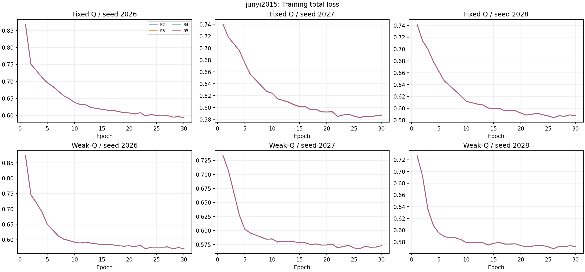
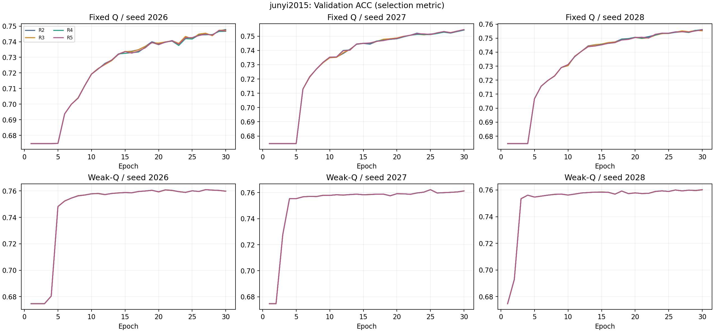
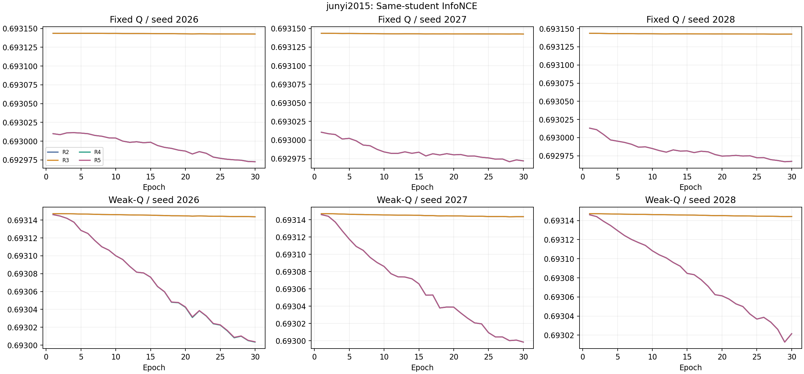
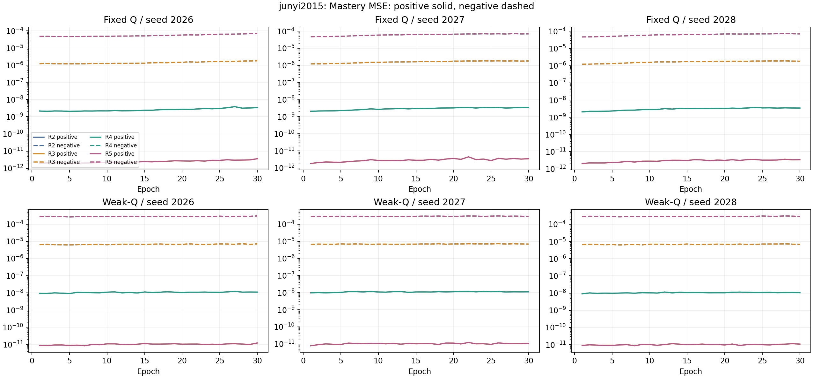
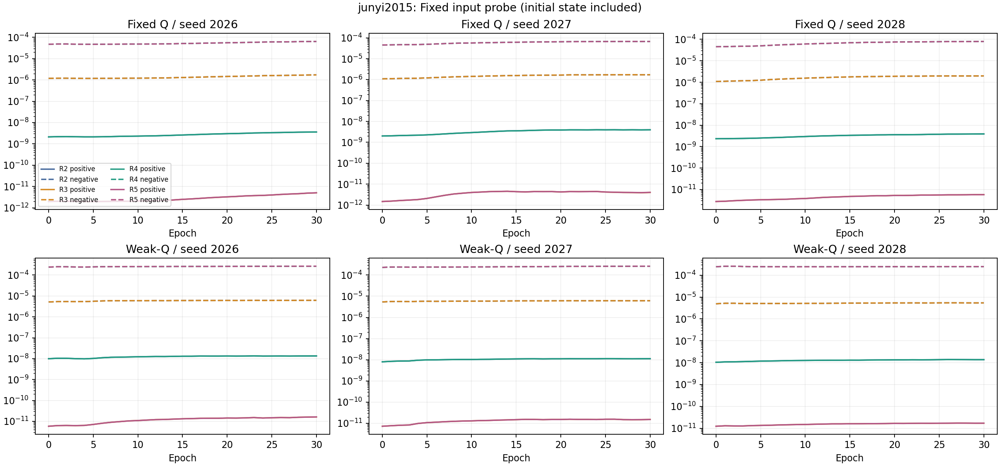
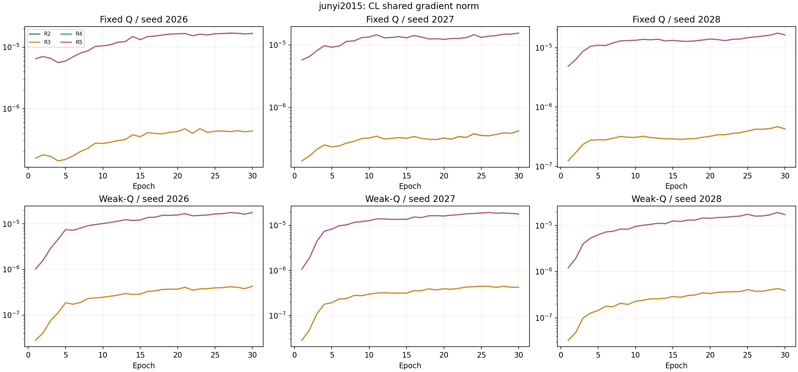
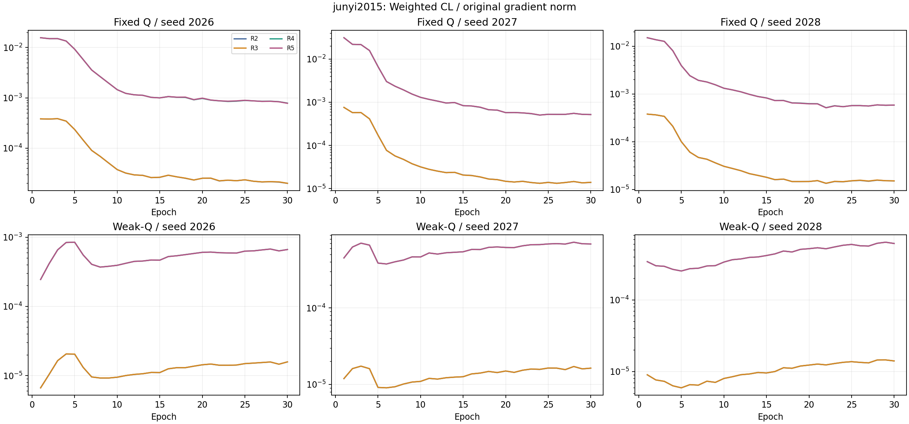
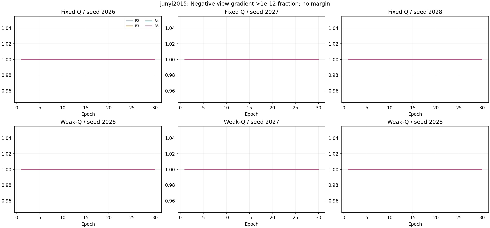
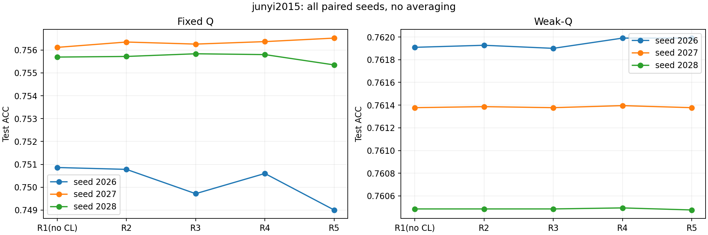

# junyi2015：R2–R5噪声敏感性实验

主表不是均值：每个Q/条件内按最高验证ACC选择种子，并列选较小种子；两个test指标来自同一checkpoint。严禁把不同种子的单次结果直接相减解释模块收益，收益看全部配对种子。A0=固定参考Q，A1=Weak-Q。

| Q设置 | 条件 | CL系数 | 验证选优种子 | 最佳轮 | valid ACC | test ACC | test AUC |
| --- | --- | --- | --- | --- | --- | --- | --- |
| A0 | R1 | 0 | 2028 | 30 | 0.755624043 | 0.755692108 | 0.800400878 |
| A0 | R2 | 0.1 | 2028 | 30 | 0.756154058 | 0.755719138 | 0.800371685 |
| A0 | R3 | 0.1 | 2028 | 29 | 0.755584783 | 0.755836269 | 0.799819457 |
| A0 | R4 | 0.1 | 2028 | 30 | 0.755820345 | 0.755800229 | 0.800274878 |
| A0 | R5 | 0.1 | 2028 | 30 | 0.755938126 | 0.755349726 | 0.800288241 |
| A1 | R1 | 0 | 2027 | 25 | 0.762200149 | 0.761377459 | 0.807338721 |
| A1 | R2 | 0.1 | 2027 | 25 | 0.76225904 | 0.761386469 | 0.807333294 |
| A1 | R3 | 0.1 | 2027 | 25 | 0.76223941 | 0.761377459 | 0.807338174 |
| A1 | R4 | 0.1 | 2027 | 25 | 0.762219779 | 0.761395479 | 0.807339198 |
| A1 | R5 | 0.1 | 2027 | 25 | 0.76223941 | 0.761377459 | 0.807343495 |

## 数据与固定协议

数据集：junyi2015；学生=5000，题目=500，概念=39；train/valid/test交互=[370038, 50942, 110987]。

使用data目录现有训练/验证/测试文件；没有重新划分。Q-F1表示与参考Q一致性，不能自动解释为认知诊断真实性。

R0参考原循环（统一验证ACC选模），R1新增入口λ=0并完全跳过CL训练分支，R2 λ=0.1。R2同时用于受控与敏感性实验，没有重复训练一份R2。模型、原始损失、α=0.8、Adam及学习率、128学生batch、30轮上限、patience=8均不变。验证ACC严格提升才更新checkpoint，平分保留最早轮。种子2026/2027/2028；每个数据集36次训练。

| 条件 | 正比例 | 正幅度 | 负比例 | 负幅度 |
| --- | --- | --- | --- | --- |
| R2 | 0.1 | 0.01 | 0.5 | 0.1 |
| R3 | 0.01 | 0.001 | 0.5 | 0.1 |
| R4 | 0.1 | 0.01 | 0.7 | 0.5 |
| R5 | 0.01 | 0.001 | 0.7 | 0.5 |

两输入不拼接。只对学生support的非零±1位置施加均匀连续噪声并裁剪到[-1,1]；0缺失、ID、标签、query和原数组不变。负噪声不翻转正误，只降低输入证据绝对值；因此极端响应不能直接当成诊断能力改善。验证/测试不增强。

损失沿用同学生一正一负InfoNCE，温度0.2，无margin。L=−正logit+logsumexp(正logit,负logit)。联合归一化项并不是独立负样本损失；负约束非零比例指负视图梯度范数>1e−12，不是margin激活率。

## 配置、代码和核验依据

以下完整配置/哈希和核验结果作为最终文档保留；用户要求清理新实验的checkpoint、原始日志及JSON/CSV副本。实际清理状态：自动审批以blocked by policy拒绝递归删除，原始产物仍暂存在Git忽略的scratch/student_cl_all_20261123。最终报告目录只包含Markdown和配图。若后续手工清理，便不能直接重放checkpoint，需按记录重跑。

<details><summary>完整配置、版本及数据/源码哈希</summary>

```json
{
  "experiment_id": "student_cl_all_junyi2015_20261123",
  "dataset": "junyi2015",
  "args": {
    "experiment_id": "student_cl_control_math1_20261123",
    "seeds": [
      2026,
      2027,
      2028
    ],
    "lambda_cl": 0.1,
    "positive_noise_ratio": 0.1,
    "positive_noise_scale": 0.01,
    "negative_noise_ratio": 0.5,
    "negative_noise_scale": 0.1,
    "noise_distribution": "uniform",
    "contrastive_seed": 1123,
    "temperature": 0.2,
    "dataset": "junyi2015",
    "data_dir": "E:\\Desktop\\Gen-CD\\Q_GNCDM\\data\\junyi2015",
    "alpha": 0.8,
    "embedding_dim": 32,
    "epochs": 30,
    "patience": 8,
    "batch_students": 128,
    "query_fraction": 0.25,
    "lr": 0.001,
    "q_lr": 0.005,
    "lambda_q": 0.01,
    "lambda_coverage": 0.01,
    "q_init_high": 0.55,
    "q_init_low": 0.45,
    "device": "cpu"
  },
  "noise_configs": {
    "R2": [
      0.1,
      0.01,
      0.5,
      0.1
    ],
    "R3": [
      0.01,
      0.001,
      0.5,
      0.1
    ],
    "R4": [
      0.1,
      0.01,
      0.7,
      0.5
    ],
    "R5": [
      0.01,
      0.001,
      0.7,
      0.5
    ]
  },
  "source_sha256": {
    "Q_GNCDM\\experiments\\run_controlled_student_cl.py": "9447f3fc2e79391b043148ae28717bee2f9f6a53dbe44352e5dddca3b6212a46",
    "Q_GNCDM\\experiments\\reference_student_cl_acc.py": "a974a5dbb0e36daf5ed49031be1838d69200e070f935d8f8f9dc31c0d9fa3dfc",
    "Q_GNCDM\\experiments\\controlled_student_cl.py": "4329530390f079ae00f6fa0d00af659e7e7be0f09134f8bc642b5a8caa0cb041",
    "Q_GNCDM\\experiments\\run_simple_contrastive.py": "196cbac42d9e7664eb4c24a4328bc852dca9265d7a88149adda0be924564a023",
    "Q_GNCDM\\models\\weak_q_gncdm.py": "5970f43820db2736bcf5f4e48039af50bf4203a5f391baa2046b8046c21517f5",
    "Q_GNCDM\\simple_contrastive.py": "30f0126846ab0e0d8802306ee183374a17730ed63f5bdd3ff6d76949b5252d97",
    "Q_GNCDM\\experiments\\run_weak_q_synthetic.py": "266d36d84cf1095189700a0b1f524f678accfd79feb94402ef6562f004f6b9b6",
    "Q_GNCDM\\experiments\\run_student_cl_all_datasets.py": "5c04daaf9a3ba1478c9d763e66348251162132ed385935c67e6d806635ec76bf",
    "Q_GNCDM\\experiments\\run_student_cl_noise_sensitivity.py": "b4c2c3850c4f49b26f60099c8d593128393ec8de80dcb3205d04fb27507f440f",
    "Q_GNCDM\\experiments\\run_prepared_dataset.py": "02b0fe433fcf75bea693b745149ac1654d866f044c81d9b2fc637b6f35d40c4d"
  },
  "data_sha256": {
    "train.csv": "47c6181d16a51c8bfdfd0a0495db01c7046f7ad3e1e699093f695681ee4a69a1",
    "valid.csv": "c1e6c126a694e37666b95a456e34f78abdfc5f3790d5bdd26e4d3da38f89d8ed",
    "test.csv": "9079ca054af3a73d993758a8fc3b0911d295f286a4acba9595d7fef8f3ff22bd",
    "Q_matrix.npy": "ebb26f466e6db2cf5262d1c6084396ab1ec7932ed00685f5313aec0c9af82104",
    "Q_true.npy": "ebb26f466e6db2cf5262d1c6084396ab1ec7932ed00685f5313aec0c9af82104",
    "manifest.json": "f9472b4f6524421051af04bcf50266e55e47002f48dde0cb5fb6cefbe9500865"
  },
  "train_shape": [
    5000,
    500
  ],
  "concepts": 39,
  "split_lengths": [
    370038,
    50942,
    110987
  ],
  "seeds": [
    2026,
    2027,
    2028
  ],
  "selection": "highest validation ACC, earliest epoch; display seed chosen by validation ACC, lowest seed tie",
  "retention": "user requests final Markdown reports and figures only; temporary originals removed after verification",
  "command": "E:\\Desktop\\Gen-CD\\.venv-contrastive\\Scripts\\python.exe -m Q_GNCDM.experiments.run_student_cl_all_datasets --dataset junyi2015",
  "python": "3.13.9 (tags/v3.13.9:8183fa5, Oct 14 2025, 14:09:13) [MSC v.1944 64 bit (AMD64)]",
  "torch": "2.14.0+cpu",
  "numpy": "2.4.3",
  "git_head": "89290e14293fe00b1e4eb55ba87ed068c5eccfdc",
  "protocol": "R0 reference ACC selector; R1 CL off; R2 shared by control and noise studies; R3-R5 change noise only",
  "scheduling_records": [
    {
      "mode": "A0",
      "seed": 2028,
      "source_sha256": "f768bea86bd13315b1a465ba1a441eee5f55b2ce675818a872c80356c46ce63f",
      "source": "Q_GNCDM\\experiments\\run_student_cl_seed2028.py",
      "changes": "seed scheduling only, same frozen worker logic",
      "status": "published_complete_verified_group"
    },
    {
      "mode": "A1",
      "seed": 2028,
      "source_sha256": "f768bea86bd13315b1a465ba1a441eee5f55b2ce675818a872c80356c46ce63f",
      "source": "Q_GNCDM\\experiments\\run_student_cl_seed2028.py",
      "changes": "seed scheduling only, same frozen worker logic",
      "status": "primary_already_started; no overwrite"
    },
    [
      {
        "mode": "A1",
        "seed": 2028,
        "condition": "R3",
        "status": "copied_verified_run_without_overwrite",
        "publisher_sha256": "6def6caa12c7e04d041cc9fbb3f8b92a0c5032c05e2078e61336759667d77b22"
      },
      {
        "mode": "A1",
        "seed": 2028,
        "condition": "R4",
        "status": "copied_verified_run_without_overwrite",
        "publisher_sha256": "6def6caa12c7e04d041cc9fbb3f8b92a0c5032c05e2078e61336759667d77b22"
      },
      {
        "mode": "A1",
        "seed": 2028,
        "condition": "R5",
        "status": "copied_verified_run_without_overwrite",
        "publisher_sha256": "6def6caa12c7e04d041cc9fbb3f8b92a0c5032c05e2078e61336759667d77b22"
      }
    ]
  ],
  "scheduling_duplicate_state_checks": [
    {
      "mode": "A1",
      "seed": 2028,
      "condition": "R0",
      "checkpoint_exact": true
    },
    {
      "mode": "A1",
      "seed": 2028,
      "condition": "R1",
      "checkpoint_exact": true
    },
    {
      "mode": "A1",
      "seed": 2028,
      "condition": "R2",
      "checkpoint_exact": true
    },
    {
      "mode": "A1",
      "seed": 2028,
      "condition": "R3",
      "checkpoint_exact": true
    },
    {
      "mode": "A1",
      "seed": 2028,
      "condition": "R4",
      "checkpoint_exact": true
    },
    {
      "mode": "A1",
      "seed": 2028,
      "condition": "R5",
      "checkpoint_exact": true
    }
  ]
}
```
</details>

8种Q/噪声设置预检全部通过；同初始化固定batch的CL梯度、一步更新测试通过；新诊断的损失/梯度与原实现精确一致。6组R0/R1的逐轮日志与checkpoint精确一致；36个checkpoint的全部测试指标已重放核验。

```json
{
  "runs": 36,
  "preflight_settings": 8,
  "baseline_exact_pairs": 6,
  "checkpoint_replays": 36,
  "protected_code_and_data_unchanged": true,
  "status": "passed"
}
```

<details><summary>全部预检真实输出（含逐层梯度和单步参数更新差异）</summary>

```json
{
  "A0_R2": {
    "positive": {
      "selected_fraction": 0.1007375,
      "changed_fraction": 0.050225,
      "clipped_fraction_selected": 0.5014269760516193,
      "input_mae_observed": 0.00025183867546729743,
      "input_mae_all": 0.00020147094619460404,
      "input_max_change": 0.009997665882110596
    },
    "negative": {
      "selected_fraction": 0.5008875,
      "changed_fraction": 0.2517625,
      "clipped_fraction_selected": 0.4973671732674503,
      "input_mae_observed": 0.012591703794896603,
      "input_mae_all": 0.010073362849652767,
      "input_max_change": 0.09999817609786987
    },
    "gradient": {
      "original_shared_grad_norm": 0.00011485157357545692,
      "cl_shared_grad_norm": 1.4130236274417993e-07,
      "cl_to_original_grad_ratio": 0.0012303041076868221,
      "weighted_cl_to_original_grad_ratio": 0.00012303041076868222
    },
    "per_layer": {
      "f_nn.f_layer_1.weight": {
        "original_grad_norm": 2.4457627660012804e-05,
        "cl_grad_norm": 6.273534580714113e-08,
        "cl_finite": true
      },
      "f_nn.f_layer_1.bias": {
        "original_grad_norm": 1.1079643627454061e-05,
        "cl_grad_norm": 1.5538692110794727e-08,
        "cl_finite": true
      },
      "f_nn.f_layer_2.weight": {
        "original_grad_norm": 0.00010801650932990015,
        "cl_grad_norm": 1.1889486728478005e-07,
        "cl_finite": true
      },
      "f_nn.f_layer_2.bias": {
        "original_grad_norm": 2.8326339815976098e-05,
        "cl_grad_norm": 4.065948644438322e-08,
        "cl_finite": true
      }
    },
    "batch_diagnostics": {
      "ap_mse": 2.1945463224426476e-09,
      "an_mse": 1.244132363353856e-06,
      "ap_cos_distance": -2.3283064365386963e-09,
      "an_cos_distance": 1.4640390872955322e-06,
      "negative_softmax_probability": 0.49999815225601196,
      "negative_not_farther_fraction": 0.0,
      "positive_selected_fraction": 0.10733277357962497,
      "positive_changed_fraction": 0.05289672544080604,
      "positive_clipped_fraction_selected": 0.5071707953063885,
      "positive_input_mae_observed": 0.00026339993928559124,
      "positive_input_mae_all": 2.9410250135697424e-05,
      "positive_input_max_change": 0.009946465492248535,
      "negative_selected_fraction": 0.5071368597816961,
      "negative_changed_fraction": 0.24853064651553317,
      "negative_clipped_fraction_selected": 0.5099337748344371,
      "negative_input_mae_observed": 0.012384336441755295,
      "negative_input_mae_all": 0.0013827885268256068,
      "negative_input_max_change": 0.0999498963356018
    },
    "loss_original": 1.1139953136444092,
    "loss_cl": 0.6931434869766235,
    "loss_total": 1.1833096742630005,
    "single_step_parameter_changes": {
      "f_nn.f_layer_1.weight": {
        "gradient_difference_l2": 6.270163770487706e-09,
        "update_difference_l2": 6.781528912598131e-05,
        "baseline_update_l2": 0.11070765878329303,
        "cl_update_l2": 0.11071088824669788
      },
      "f_nn.f_layer_1.bias": {
        "gradient_difference_l2": 1.5494713146415605e-09,
        "update_difference_l2": 7.812847260182033e-09,
        "baseline_update_l2": 0.006207025923413136,
        "cl_update_l2": 0.00620703017022452
      },
      "f_nn.f_layer_2.weight": {
        "gradient_difference_l2": 1.1878110662711965e-08,
        "update_difference_l2": 2.6290495088887863e-05,
        "baseline_update_l2": 0.03421791835832143,
        "cl_update_l2": 0.034217504480030074
      },
      "f_nn.f_layer_2.bias": {
        "gradient_difference_l2": 4.062939100993039e-09,
        "update_difference_l2": 1.918752528143338e-05,
        "baseline_update_l2": 0.005673346227865588,
        "cl_update_l2": 0.005673704861099694
      }
    },
    "zero_single_step_exact_parity": true,
    "status": "passed",
    "observed_branch_loss_and_gradient_exact": true,
    "observation_state_and_rng_unchanged": true,
    "extra_diagnostics": {
      "ap_mse": 2.0521497834380398e-09,
      "an_mse": 1.2404506151142414e-06,
      "ap_cos_distance": 9.313225746154785e-09,
      "an_cos_distance": 1.469627022743225e-06,
      "negative_softmax_probability": 0.49999815225601196,
      "negative_not_farther_fraction": 0.0,
      "positive_energy": -5.0,
      "joint_log_partition": 5.693142890930176,
      "negative_relative_penalty": 0.6931434869766235,
      "positive_view_grad_norm_mean": 3.131973473749269e-07,
      "negative_view_grad_norm_mean": 8.30525617148852e-06,
      "negative_view_grad_nonzero_fraction": 1.0,
      "negative_view_grad_above_1e_12_fraction": 1.0,
      "positive_shared_partial_grad_norm": 7.115777898804468e-10,
      "negative_shared_partial_grad_norm": 1.3784978178336906e-07,
      "positive_selected_fraction": 0.10425412818359922,
      "positive_changed_fraction": 0.052616848586621884,
      "positive_clipped_fraction_selected": 0.49530201342281877,
      "positive_input_mae_observed": 0.00025681493571028113,
      "positive_input_mae_all": 2.8674992790911347e-05,
      "positive_input_max_change": 0.00995028018951416,
      "positive_input_mse_observed": 1.7183225509143085e-06,
      "positive_clipped_fraction_observed": 0.05163727959697733,
      "positive_input_mae_changed": 0.004880850203335285,
      "positive_unchanged_student_fraction": 0.1015625,
      "negative_selected_fraction": 0.5027987685418416,
      "negative_changed_fraction": 0.2462916316820599,
      "negative_clipped_fraction_selected": 0.5101586418035068,
      "negative_input_mae_observed": 0.012363877147436142,
      "negative_input_mae_all": 0.0013805041089653969,
      "negative_input_max_change": 0.0999498963356018,
      "negative_input_mse_observed": 0.0008244988275691867,
      "negative_clipped_fraction_observed": 0.25650713685978166,
      "negative_input_mae_changed": 0.05020014941692352,
      "negative_unchanged_student_fraction": 0.0
    }
  },
  "A0_R3": {
    "positive": {
      "selected_fraction": 0.01045,
      "changed_fraction": 0.005025,
      "clipped_fraction_selected": 0.5179425837320574,
      "input_mae_observed": 2.512869286874775e-06,
      "input_mae_all": 2.010295474974555e-06,
      "input_max_change": 0.0009962916374206543
    },
    "negative": {
      "selected_fraction": 0.5008875,
      "changed_fraction": 0.2517625,
      "clipped_fraction_selected": 0.4973671732674503,
      "input_mae_observed": 0.012591703794896603,
      "input_mae_all": 0.010073362849652767,
      "input_max_change": 0.09999817609786987
    },
    "gradient": {
      "original_shared_grad_norm": 0.00011485157357545692,
      "cl_shared_grad_norm": 1.4139607640391342e-07,
      "cl_to_original_grad_ratio": 0.001231120062199382,
      "weighted_cl_to_original_grad_ratio": 0.0001231120062199382
    },
    "per_layer": {
      "f_nn.f_layer_1.weight": {
        "original_grad_norm": 2.4457627660012804e-05,
        "cl_grad_norm": 6.264606611239287e-08,
        "cl_finite": true
      },
      "f_nn.f_layer_1.bias": {
        "original_grad_norm": 1.1079643627454061e-05,
        "cl_grad_norm": 1.5581145262899554e-08,
        "cl_finite": true
      },
      "f_nn.f_layer_2.weight": {
        "original_grad_norm": 0.00010801650932990015,
        "cl_grad_norm": 1.190291101238472e-07,
        "cl_finite": true
      },
      "f_nn.f_layer_2.bias": {
        "original_grad_norm": 2.8326339815976098e-05,
        "cl_grad_norm": 4.071388559623301e-08,
        "cl_finite": true
      }
    },
    "batch_diagnostics": {
      "ap_mse": 1.898314838655324e-12,
      "an_mse": 1.244132363353856e-06,
      "ap_cos_distance": 1.862645149230957e-09,
      "an_cos_distance": 1.4640390872955322e-06,
      "negative_softmax_probability": 0.49999815225601196,
      "negative_not_farther_fraction": 0.0,
      "positive_selected_fraction": 0.010215505177721802,
      "positive_changed_fraction": 0.0054575986565911,
      "positive_clipped_fraction_selected": 0.4657534246575342,
      "positive_input_mae_observed": 2.479990371284657e-06,
      "positive_input_mae_all": 2.769064053609327e-07,
      "positive_input_max_change": 0.0009744167327880859,
      "negative_selected_fraction": 0.5071368597816961,
      "negative_changed_fraction": 0.24853064651553317,
      "negative_clipped_fraction_selected": 0.5099337748344371,
      "negative_input_mae_observed": 0.012384336441755295,
      "negative_input_mae_all": 0.0013827885268256068,
      "negative_input_max_change": 0.0999498963356018
    },
    "loss_original": 1.1139953136444092,
    "loss_cl": 0.6931434869766235,
    "loss_total": 1.1833096742630005,
    "single_step_parameter_changes": {
      "f_nn.f_layer_1.weight": {
        "gradient_difference_l2": 6.246007762979587e-09,
        "update_difference_l2": 6.75001076206742e-05,
        "baseline_update_l2": 0.11070765878329303,
        "cl_update_l2": 0.11071085375229255
      },
      "f_nn.f_layer_1.bias": {
        "gradient_difference_l2": 1.550390309963233e-09,
        "update_difference_l2": 6.9303792277989984e-09,
        "baseline_update_l2": 0.006207025923413136,
        "cl_update_l2": 0.006207029725041972
      },
      "f_nn.f_layer_2.weight": {
        "gradient_difference_l2": 1.1881468825156451e-08,
        "update_difference_l2": 2.633355966269258e-05,
        "baseline_update_l2": 0.03421791835832143,
        "cl_update_l2": 0.03421750305609709
      },
      "f_nn.f_layer_2.bias": {
        "gradient_difference_l2": 4.065800782097404e-09,
        "update_difference_l2": 1.922639833505e-05,
        "baseline_update_l2": 0.005673346227865588,
        "cl_update_l2": 0.005673707300830473
      }
    },
    "zero_single_step_exact_parity": true,
    "status": "passed",
    "observed_branch_loss_and_gradient_exact": true,
    "observation_state_and_rng_unchanged": true,
    "extra_diagnostics": {
      "ap_mse": 1.598867089072642e-12,
      "an_mse": 1.2404506151142414e-06,
      "ap_cos_distance": 1.5832483768463135e-08,
      "an_cos_distance": 1.469627022743225e-06,
      "negative_softmax_probability": 0.49999818205833435,
      "negative_not_farther_fraction": 0.0,
      "positive_energy": -5.0,
      "joint_log_partition": 5.693142890930176,
      "negative_relative_penalty": 0.6931435465812683,
      "positive_view_grad_norm_mean": 4.483833652638436e-09,
      "negative_view_grad_norm_mean": 8.305256835699417e-06,
      "negative_view_grad_nonzero_fraction": 1.0,
      "negative_view_grad_above_1e_12_fraction": 1.0,
      "positive_shared_partial_grad_norm": 1.0229434785611745e-09,
      "negative_shared_partial_grad_norm": 1.3793287237370647e-07,
      "positive_selected_fraction": 0.009655751469353484,
      "positive_changed_fraction": 0.004897844948222782,
      "positive_clipped_fraction_selected": 0.4927536231884058,
      "positive_input_mae_observed": 2.325665491298423e-06,
      "positive_input_mae_all": 2.5967509031943337e-07,
      "positive_input_max_change": 0.0009754300117492676,
      "positive_input_mse_observed": 1.5605052805511832e-09,
      "positive_clipped_fraction_observed": 0.004757906521130702,
      "positive_input_mae_changed": 0.0004748344363179058,
      "positive_unchanged_student_fraction": 0.7578125,
      "negative_selected_fraction": 0.5027987685418416,
      "negative_changed_fraction": 0.2462916316820599,
      "negative_clipped_fraction_selected": 0.5101586418035068,
      "negative_input_mae_observed": 0.012363877147436142,
      "negative_input_mae_all": 0.0013805041089653969,
      "negative_input_max_change": 0.0999498963356018,
      "negative_input_mse_observed": 0.0008244988275691867,
      "negative_clipped_fraction_observed": 0.25650713685978166,
      "negative_input_mae_changed": 0.05020014941692352,
      "negative_unchanged_student_fraction": 0.0
    }
  },
  "A0_R4": {
    "positive": {
      "selected_fraction": 0.1007375,
      "changed_fraction": 0.050225,
      "clipped_fraction_selected": 0.5014269760516193,
      "input_mae_observed": 0.00025183867546729743,
      "input_mae_all": 0.00020147094619460404,
      "input_max_change": 0.009997665882110596
    },
    "negative": {
      "selected_fraction": 0.7017125,
      "changed_fraction": 0.3529375,
      "clipped_fraction_selected": 0.4970340417193651,
      "input_mae_observed": 0.08849677443504333,
      "input_mae_all": 0.07079741358757019,
      "input_max_change": 0.4999908208847046
    },
    "gradient": {
      "original_shared_grad_norm": 0.00011485157357545692,
      "cl_shared_grad_norm": 6.187753373567721e-06,
      "cl_to_original_grad_ratio": 0.05387608703073099,
      "weighted_cl_to_original_grad_ratio": 0.005387608703073099
    },
    "per_layer": {
      "f_nn.f_layer_1.weight": {
        "original_grad_norm": 2.4457627660012804e-05,
        "cl_grad_norm": 2.7880385005119024e-06,
        "cl_finite": true
      },
      "f_nn.f_layer_1.bias": {
        "original_grad_norm": 1.1079643627454061e-05,
        "cl_grad_norm": 6.374879717441218e-07,
        "cl_finite": true
      },
      "f_nn.f_layer_2.weight": {
        "original_grad_norm": 0.00010801650932990015,
        "cl_grad_norm": 5.216798399487743e-06,
        "cl_finite": true
      },
      "f_nn.f_layer_2.bias": {
        "original_grad_norm": 2.8326339815976098e-05,
        "cl_grad_norm": 1.7011049067150452e-06,
        "cl_finite": true
      }
    },
    "batch_diagnostics": {
      "ap_mse": 2.1945463224426476e-09,
      "an_mse": 4.890005220659077e-05,
      "ap_cos_distance": -2.3283064365386963e-09,
      "an_cos_distance": 5.692150443792343e-05,
      "negative_softmax_probability": 0.4999288320541382,
      "negative_not_farther_fraction": 0.0,
      "positive_selected_fraction": 0.10733277357962497,
      "positive_changed_fraction": 0.05289672544080604,
      "positive_clipped_fraction_selected": 0.5071707953063885,
      "positive_input_mae_observed": 0.00026339993928559124,
      "positive_input_mae_all": 2.9410250135697424e-05,
      "positive_input_max_change": 0.009946465492248535,
      "negative_selected_fraction": 0.7073887489504618,
      "negative_changed_fraction": 0.34830674503218584,
      "negative_clipped_fraction_selected": 0.5076162215628091,
      "negative_input_mae_observed": 0.08643096685409546,
      "negative_input_mae_all": 0.009650557301938534,
      "negative_input_max_change": 0.49974942207336426
    },
    "loss_original": 1.1139953136444092,
    "loss_cl": 0.693004846572876,
    "loss_total": 1.1832958459854126,
    "single_step_parameter_changes": {
      "f_nn.f_layer_1.weight": {
        "gradient_difference_l2": 2.7879049594009796e-07,
        "update_difference_l2": 0.002620636741255065,
        "baseline_update_l2": 0.11070765878329303,
        "cl_update_l2": 0.11086023220984781
      },
      "f_nn.f_layer_1.bias": {
        "gradient_difference_l2": 6.374209303353868e-08,
        "update_difference_l2": 1.983293461823599e-07,
        "baseline_update_l2": 0.006207025923413136,
        "cl_update_l2": 0.006207219834920522
      },
      "f_nn.f_layer_2.weight": {
        "gradient_difference_l2": 5.216776158679028e-07,
        "update_difference_l2": 0.0010056635414586314,
        "baseline_update_l2": 0.03421791835832143,
        "cl_update_l2": 0.03418225559596679
      },
      "f_nn.f_layer_2.bias": {
        "gradient_difference_l2": 1.7010881454557034e-07,
        "update_difference_l2": 0.0005657145723600231,
        "baseline_update_l2": 0.005673346227865588,
        "cl_update_l2": 0.0056963011404587115
      }
    },
    "zero_single_step_exact_parity": true,
    "status": "passed",
    "observed_branch_loss_and_gradient_exact": true,
    "observation_state_and_rng_unchanged": true,
    "extra_diagnostics": {
      "ap_mse": 2.0521497834380398e-09,
      "an_mse": 4.8071051423903555e-05,
      "ap_cos_distance": 9.313225746154785e-09,
      "an_cos_distance": 5.533359944820404e-05,
      "negative_softmax_probability": 0.49993079900741577,
      "negative_not_farther_fraction": 0.0,
      "positive_energy": -5.0,
      "joint_log_partition": 5.6930084228515625,
      "negative_relative_penalty": 0.6930088996887207,
      "positive_view_grad_norm_mean": 3.1313219564862196e-07,
      "negative_view_grad_norm_mean": 5.145787068011631e-05,
      "negative_view_grad_nonzero_fraction": 1.0,
      "negative_view_grad_above_1e_12_fraction": 1.0,
      "positive_shared_partial_grad_norm": 6.107931043638636e-10,
      "negative_shared_partial_grad_norm": 5.986333477501843e-06,
      "positive_selected_fraction": 0.10425412818359922,
      "positive_changed_fraction": 0.052616848586621884,
      "positive_clipped_fraction_selected": 0.49530201342281877,
      "positive_input_mae_observed": 0.00025681493571028113,
      "positive_input_mae_all": 2.8674992790911347e-05,
      "positive_input_max_change": 0.00995028018951416,
      "positive_input_mse_observed": 1.7183225509143085e-06,
      "positive_clipped_fraction_observed": 0.05163727959697733,
      "positive_input_mae_changed": 0.004880850203335285,
      "positive_unchanged_student_fraction": 0.1015625,
      "negative_selected_fraction": 0.7038902882731598,
      "negative_changed_fraction": 0.34662748390708087,
      "negative_clipped_fraction_selected": 0.5075546719681908,
      "negative_input_mae_observed": 0.0866774395108223,
      "negative_input_mae_all": 0.009678077884018421,
      "negative_input_max_change": 0.49974942207336426,
      "negative_input_mse_observed": 0.028813324868679047,
      "negative_clipped_fraction_observed": 0.3572628043660789,
      "negative_input_mae_changed": 0.2500593364238739,
      "negative_unchanged_student_fraction": 0.0
    }
  },
  "A0_R5": {
    "positive": {
      "selected_fraction": 0.01045,
      "changed_fraction": 0.005025,
      "clipped_fraction_selected": 0.5179425837320574,
      "input_mae_observed": 2.512869286874775e-06,
      "input_mae_all": 2.010295474974555e-06,
      "input_max_change": 0.0009962916374206543
    },
    "negative": {
      "selected_fraction": 0.7017125,
      "changed_fraction": 0.3529375,
      "clipped_fraction_selected": 0.4970340417193651,
      "input_mae_observed": 0.08849677443504333,
      "input_mae_all": 0.07079741358757019,
      "input_max_change": 0.4999908208847046
    },
    "gradient": {
      "original_shared_grad_norm": 0.00011485157357545692,
      "cl_shared_grad_norm": 6.187847916703942e-06,
      "cl_to_original_grad_ratio": 0.05387691020740396,
      "weighted_cl_to_original_grad_ratio": 0.005387691020740396
    },
    "per_layer": {
      "f_nn.f_layer_1.weight": {
        "original_grad_norm": 2.4457627660012804e-05,
        "cl_grad_norm": 2.7877742923010373e-06,
        "cl_finite": true
      },
      "f_nn.f_layer_1.bias": {
        "original_grad_norm": 1.1079643627454061e-05,
        "cl_grad_norm": 6.375284442583506e-07,
        "cl_finite": true
      },
      "f_nn.f_layer_2.weight": {
        "original_grad_norm": 0.00010801650932990015,
        "cl_grad_norm": 5.217023954173783e-06,
        "cl_finite": true
      },
      "f_nn.f_layer_2.bias": {
        "original_grad_norm": 2.8326339815976098e-05,
        "cl_grad_norm": 1.7011733461913536e-06,
        "cl_finite": true
      }
    },
    "batch_diagnostics": {
      "ap_mse": 1.898314838655324e-12,
      "an_mse": 4.890005220659077e-05,
      "ap_cos_distance": 1.862645149230957e-09,
      "an_cos_distance": 5.692150443792343e-05,
      "negative_softmax_probability": 0.4999288320541382,
      "negative_not_farther_fraction": 0.0,
      "positive_selected_fraction": 0.010215505177721802,
      "positive_changed_fraction": 0.0054575986565911,
      "positive_clipped_fraction_selected": 0.4657534246575342,
      "positive_input_mae_observed": 2.479990371284657e-06,
      "positive_input_mae_all": 2.769064053609327e-07,
      "positive_input_max_change": 0.0009744167327880859,
      "negative_selected_fraction": 0.7073887489504618,
      "negative_changed_fraction": 0.34830674503218584,
      "negative_clipped_fraction_selected": 0.5076162215628091,
      "negative_input_mae_observed": 0.08643096685409546,
      "negative_input_mae_all": 0.009650557301938534,
      "negative_input_max_change": 0.49974942207336426
    },
    "loss_original": 1.1139953136444092,
    "loss_cl": 0.6930049061775208,
    "loss_total": 1.1832958459854126,
    "single_step_parameter_changes": {
      "f_nn.f_layer_1.weight": {
        "gradient_difference_l2": 2.78814187941404e-07,
        "update_difference_l2": 0.0026206422069911515,
        "baseline_update_l2": 0.11070765878329303,
        "cl_update_l2": 0.11086024747588297
      },
      "f_nn.f_layer_1.bias": {
        "gradient_difference_l2": 6.374874462227785e-08,
        "update_difference_l2": 1.983489227477245e-07,
        "baseline_update_l2": 0.006207025923413136,
        "cl_update_l2": 0.0062072198535766945
      },
      "f_nn.f_layer_2.weight": {
        "gradient_difference_l2": 5.216914990301711e-07,
        "update_difference_l2": 0.0010055246960235583,
        "baseline_update_l2": 0.03421791835832143,
        "cl_update_l2": 0.034182271316704364
      },
      "f_nn.f_layer_2.bias": {
        "gradient_difference_l2": 1.7011712342495885e-07,
        "update_difference_l2": 0.0005657436587122623,
        "baseline_update_l2": 0.005673346227865588,
        "cl_update_l2": 0.005696298731601018
      }
    },
    "zero_single_step_exact_parity": true,
    "status": "passed",
    "observed_branch_loss_and_gradient_exact": true,
    "observation_state_and_rng_unchanged": true,
    "extra_diagnostics": {
      "ap_mse": 1.598867089072642e-12,
      "an_mse": 4.8071051423903555e-05,
      "ap_cos_distance": 1.5832483768463135e-08,
      "an_cos_distance": 5.533359944820404e-05,
      "negative_softmax_probability": 0.49993082880973816,
      "negative_not_farther_fraction": 0.0,
      "positive_energy": -5.0,
      "joint_log_partition": 5.6930084228515625,
      "negative_relative_penalty": 0.6930088400840759,
      "positive_view_grad_norm_mean": 4.473655045835088e-09,
      "negative_view_grad_norm_mean": 5.145786960183386e-05,
      "negative_view_grad_nonzero_fraction": 1.0,
      "negative_view_grad_above_1e_12_fraction": 1.0,
      "positive_shared_partial_grad_norm": 9.463811997545019e-10,
      "negative_shared_partial_grad_norm": 5.986394345323985e-06,
      "positive_selected_fraction": 0.009655751469353484,
      "positive_changed_fraction": 0.004897844948222782,
      "positive_clipped_fraction_selected": 0.4927536231884058,
      "positive_input_mae_observed": 2.325665491298423e-06,
      "positive_input_mae_all": 2.5967509031943337e-07,
      "positive_input_max_change": 0.0009754300117492676,
      "positive_input_mse_observed": 1.5605052805511832e-09,
      "positive_clipped_fraction_observed": 0.004757906521130702,
      "positive_input_mae_changed": 0.0004748344363179058,
      "positive_unchanged_student_fraction": 0.7578125,
      "negative_selected_fraction": 0.7038902882731598,
      "negative_changed_fraction": 0.34662748390708087,
      "negative_clipped_fraction_selected": 0.5075546719681908,
      "negative_input_mae_observed": 0.0866774395108223,
      "negative_input_mae_all": 0.009678077884018421,
      "negative_input_max_change": 0.49974942207336426,
      "negative_input_mse_observed": 0.028813324868679047,
      "negative_clipped_fraction_observed": 0.3572628043660789,
      "negative_input_mae_changed": 0.2500593364238739,
      "negative_unchanged_student_fraction": 0.0
    }
  },
  "A1_R2": {
    "positive": {
      "selected_fraction": 0.1007375,
      "changed_fraction": 0.050225,
      "clipped_fraction_selected": 0.5014269760516193,
      "input_mae_observed": 0.00025183867546729743,
      "input_mae_all": 0.00020147094619460404,
      "input_max_change": 0.009997665882110596
    },
    "negative": {
      "selected_fraction": 0.5008875,
      "changed_fraction": 0.2517625,
      "clipped_fraction_selected": 0.4973671732674503,
      "input_mae_observed": 0.012591703794896603,
      "input_mae_all": 0.010073362849652767,
      "input_max_change": 0.09999817609786987
    },
    "gradient": {
      "original_shared_grad_norm": 0.0007183028533791733,
      "cl_shared_grad_norm": 2.6485427092412048e-08,
      "cl_to_original_grad_ratio": 3.687222870940077e-05,
      "weighted_cl_to_original_grad_ratio": 3.687222870940077e-06
    },
    "per_layer": {
      "q_logits": {
        "original_grad_norm": 0.0005986979231238365,
        "cl_grad_norm": 1.4069920339920827e-08,
        "cl_finite": true
      },
      "f_nn.f_layer_1.weight": {
        "original_grad_norm": 0.00020838207274209708,
        "cl_grad_norm": 1.3410267563074285e-08,
        "cl_finite": true
      },
      "f_nn.f_layer_1.bias": {
        "original_grad_norm": 8.110367343761027e-05,
        "cl_grad_norm": 1.1253589171644762e-09,
        "cl_finite": true
      },
      "f_nn.f_layer_2.weight": {
        "original_grad_norm": 0.00031548799597658217,
        "cl_grad_norm": 1.2958285111608348e-08,
        "cl_finite": true
      },
      "f_nn.f_layer_2.bias": {
        "original_grad_norm": 8.936442463891581e-05,
        "cl_grad_norm": 1.2429641316202833e-08,
        "cl_finite": true
      }
    },
    "batch_diagnostics": {
      "ap_mse": 8.813718643807533e-09,
      "an_mse": 6.825304353696993e-06,
      "ap_cos_distance": 9.313225746154785e-10,
      "an_cos_distance": 1.0710209608078003e-08,
      "negative_softmax_probability": 0.5,
      "negative_not_farther_fraction": 0.6484375,
      "positive_selected_fraction": 0.10733277357962497,
      "positive_changed_fraction": 0.05289672544080604,
      "positive_clipped_fraction_selected": 0.5071707953063885,
      "positive_input_mae_observed": 0.00026339993928559124,
      "positive_input_mae_all": 2.9410250135697424e-05,
      "positive_input_max_change": 0.009946465492248535,
      "negative_selected_fraction": 0.5071368597816961,
      "negative_changed_fraction": 0.24853064651553317,
      "negative_clipped_fraction_selected": 0.5099337748344371,
      "negative_input_mae_observed": 0.012384336441755295,
      "negative_input_mae_all": 0.0013827885268256068,
      "negative_input_max_change": 0.0999498963356018
    },
    "loss_original": 1.2160142660140991,
    "loss_cl": 0.6931471824645996,
    "loss_total": 1.285328984260559,
    "single_step_parameter_changes": {
      "q_logits": {
        "gradient_difference_l2": 1.4074552554226486e-09,
        "update_difference_l2": 1.9749239245628266e-05,
        "baseline_update_l2": 0.6690491194502862,
        "cl_update_l2": 0.6690490306125719
      },
      "f_nn.f_layer_1.weight": {
        "gradient_difference_l2": 1.3402315386457358e-09,
        "update_difference_l2": 2.594441277606194e-06,
        "baseline_update_l2": 0.13110679006852013,
        "cl_update_l2": 0.1311067956084629
      },
      "f_nn.f_layer_1.bias": {
        "gradient_difference_l2": 1.1331150633562372e-10,
        "update_difference_l2": 2.098707060483278e-09,
        "baseline_update_l2": 0.006240062954442952,
        "cl_update_l2": 0.006240063047686749
      },
      "f_nn.f_layer_2.weight": {
        "gradient_difference_l2": 1.2975256843867147e-09,
        "update_difference_l2": 1.0478025696251818e-08,
        "baseline_update_l2": 0.03893247195443414,
        "cl_update_l2": 0.03893247210054521
      },
      "f_nn.f_layer_2.bias": {
        "gradient_difference_l2": 1.246981603111052e-09,
        "update_difference_l2": 4.799926683327254e-10,
        "baseline_update_l2": 0.006239227385313833,
        "cl_update_l2": 0.006239227478517468
      }
    },
    "zero_single_step_exact_parity": true,
    "status": "passed",
    "observed_branch_loss_and_gradient_exact": true,
    "observation_state_and_rng_unchanged": true,
    "extra_diagnostics": {
      "ap_mse": 7.874132457175165e-09,
      "an_mse": 6.542528353747912e-06,
      "ap_cos_distance": 2.7939677238464355e-08,
      "an_cos_distance": 1.6298145055770874e-08,
      "negative_softmax_probability": 0.5,
      "negative_not_farther_fraction": 0.6875,
      "positive_energy": -5.0,
      "joint_log_partition": 5.693146705627441,
      "negative_relative_penalty": 0.6931471824645996,
      "positive_view_grad_norm_mean": 1.971119509151084e-08,
      "negative_view_grad_norm_mean": 5.560041934175605e-07,
      "negative_view_grad_nonzero_fraction": 1.0,
      "negative_view_grad_above_1e_12_fraction": 1.0,
      "positive_shared_partial_grad_norm": 1.6634844570519388e-09,
      "negative_shared_partial_grad_norm": 2.6712327233275818e-08,
      "positive_selected_fraction": 0.10425412818359922,
      "positive_changed_fraction": 0.052616848586621884,
      "positive_clipped_fraction_selected": 0.49530201342281877,
      "positive_input_mae_observed": 0.00025681493571028113,
      "positive_input_mae_all": 2.8674992790911347e-05,
      "positive_input_max_change": 0.00995028018951416,
      "positive_input_mse_observed": 1.7183225509143085e-06,
      "positive_clipped_fraction_observed": 0.05163727959697733,
      "positive_input_mae_changed": 0.004880850203335285,
      "positive_unchanged_student_fraction": 0.1015625,
      "negative_selected_fraction": 0.5027987685418416,
      "negative_changed_fraction": 0.2462916316820599,
      "negative_clipped_fraction_selected": 0.5101586418035068,
      "negative_input_mae_observed": 0.012363877147436142,
      "negative_input_mae_all": 0.0013805041089653969,
      "negative_input_max_change": 0.0999498963356018,
      "negative_input_mse_observed": 0.0008244988275691867,
      "negative_clipped_fraction_observed": 0.25650713685978166,
      "negative_input_mae_changed": 0.05020014941692352,
      "negative_unchanged_student_fraction": 0.0
    }
  },
  "A1_R3": {
    "positive": {
      "selected_fraction": 0.01045,
      "changed_fraction": 0.005025,
      "clipped_fraction_selected": 0.5179425837320574,
      "input_mae_observed": 2.512869286874775e-06,
      "input_mae_all": 2.010295474974555e-06,
      "input_max_change": 0.0009962916374206543
    },
    "negative": {
      "selected_fraction": 0.5008875,
      "changed_fraction": 0.2517625,
      "clipped_fraction_selected": 0.4973671732674503,
      "input_mae_observed": 0.012591703794896603,
      "input_mae_all": 0.010073362849652767,
      "input_max_change": 0.09999817609786987
    },
    "gradient": {
      "original_shared_grad_norm": 0.0007183028533791733,
      "cl_shared_grad_norm": 2.6554573606066372e-08,
      "cl_to_original_grad_ratio": 3.696849244179308e-05,
      "weighted_cl_to_original_grad_ratio": 3.6968492441793082e-06
    },
    "per_layer": {
      "q_logits": {
        "original_grad_norm": 0.0005986979231238365,
        "cl_grad_norm": 1.4076758425574099e-08,
        "cl_finite": true
      },
      "f_nn.f_layer_1.weight": {
        "original_grad_norm": 0.00020838207274209708,
        "cl_grad_norm": 1.3369779061633835e-08,
        "cl_finite": true
      },
      "f_nn.f_layer_1.bias": {
        "original_grad_norm": 8.110367343761027e-05,
        "cl_grad_norm": 1.135420868436654e-09,
        "cl_finite": true
      },
      "f_nn.f_layer_2.weight": {
        "original_grad_norm": 0.00031548799597658217,
        "cl_grad_norm": 1.3098940598865738e-08,
        "cl_finite": true
      },
      "f_nn.f_layer_2.bias": {
        "original_grad_norm": 8.936442463891581e-05,
        "cl_grad_norm": 1.2464648868615313e-08,
        "cl_finite": true
      }
    },
    "batch_diagnostics": {
      "ap_mse": 3.68516415300002e-12,
      "an_mse": 6.825304353696993e-06,
      "ap_cos_distance": -1.4901161193847656e-08,
      "an_cos_distance": 1.0710209608078003e-08,
      "negative_softmax_probability": 0.5,
      "negative_not_farther_fraction": 0.578125,
      "positive_selected_fraction": 0.010215505177721802,
      "positive_changed_fraction": 0.0054575986565911,
      "positive_clipped_fraction_selected": 0.4657534246575342,
      "positive_input_mae_observed": 2.479990371284657e-06,
      "positive_input_mae_all": 2.769064053609327e-07,
      "positive_input_max_change": 0.0009744167327880859,
      "negative_selected_fraction": 0.5071368597816961,
      "negative_changed_fraction": 0.24853064651553317,
      "negative_clipped_fraction_selected": 0.5099337748344371,
      "negative_input_mae_observed": 0.012384336441755295,
      "negative_input_mae_all": 0.0013827885268256068,
      "negative_input_max_change": 0.0999498963356018
    },
    "loss_original": 1.2160142660140991,
    "loss_cl": 0.6931471228599548,
    "loss_total": 1.285328984260559,
    "single_step_parameter_changes": {
      "q_logits": {
        "gradient_difference_l2": 1.4080107873280122e-09,
        "update_difference_l2": 1.9705460304173357e-05,
        "baseline_update_l2": 0.6690491194502862,
        "cl_update_l2": 0.6690490310595397
      },
      "f_nn.f_layer_1.weight": {
        "gradient_difference_l2": 1.3339409893351378e-09,
        "update_difference_l2": 2.4631665117325896e-06,
        "baseline_update_l2": 0.13110679006852013,
        "cl_update_l2": 0.13110679585052074
      },
      "f_nn.f_layer_1.bias": {
        "gradient_difference_l2": 1.1240265422193083e-10,
        "update_difference_l2": 2.2842335596620783e-09,
        "baseline_update_l2": 0.006240062954442952,
        "cl_update_l2": 0.006240063532343083
      },
      "f_nn.f_layer_2.weight": {
        "gradient_difference_l2": 1.3073199107077233e-09,
        "update_difference_l2": 1.0999861928650845e-08,
        "baseline_update_l2": 0.03893247195443414,
        "cl_update_l2": 0.038932472026041165
      },
      "f_nn.f_layer_2.bias": {
        "gradient_difference_l2": 1.2464152877323805e-09,
        "update_difference_l2": 4.799926683327254e-10,
        "baseline_update_l2": 0.006239227385313833,
        "cl_update_l2": 0.006239227478517468
      }
    },
    "zero_single_step_exact_parity": true,
    "status": "passed",
    "observed_branch_loss_and_gradient_exact": true,
    "observation_state_and_rng_unchanged": true,
    "extra_diagnostics": {
      "ap_mse": 5.100365442489707e-12,
      "an_mse": 6.542528353747912e-06,
      "ap_cos_distance": 1.5832483768463135e-08,
      "an_cos_distance": 1.6298145055770874e-08,
      "negative_softmax_probability": 0.5,
      "negative_not_farther_fraction": 0.625,
      "positive_energy": -5.0,
      "joint_log_partition": 5.693146705627441,
      "negative_relative_penalty": 0.6931471824645996,
      "positive_view_grad_norm_mean": 6.451244880134437e-10,
      "negative_view_grad_norm_mean": 5.560068987267252e-07,
      "negative_view_grad_nonzero_fraction": 1.0,
      "negative_view_grad_above_1e_12_fraction": 1.0,
      "positive_shared_partial_grad_norm": 1.8234271245295246e-09,
      "negative_shared_partial_grad_norm": 2.670579286253147e-08,
      "positive_selected_fraction": 0.009655751469353484,
      "positive_changed_fraction": 0.004897844948222782,
      "positive_clipped_fraction_selected": 0.4927536231884058,
      "positive_input_mae_observed": 2.325665491298423e-06,
      "positive_input_mae_all": 2.5967509031943337e-07,
      "positive_input_max_change": 0.0009754300117492676,
      "positive_input_mse_observed": 1.5605052805511832e-09,
      "positive_clipped_fraction_observed": 0.004757906521130702,
      "positive_input_mae_changed": 0.0004748344363179058,
      "positive_unchanged_student_fraction": 0.7578125,
      "negative_selected_fraction": 0.5027987685418416,
      "negative_changed_fraction": 0.2462916316820599,
      "negative_clipped_fraction_selected": 0.5101586418035068,
      "negative_input_mae_observed": 0.012363877147436142,
      "negative_input_mae_all": 0.0013805041089653969,
      "negative_input_max_change": 0.0999498963356018,
      "negative_input_mse_observed": 0.0008244988275691867,
      "negative_clipped_fraction_observed": 0.25650713685978166,
      "negative_input_mae_changed": 0.05020014941692352,
      "negative_unchanged_student_fraction": 0.0
    }
  },
  "A1_R4": {
    "positive": {
      "selected_fraction": 0.1007375,
      "changed_fraction": 0.050225,
      "clipped_fraction_selected": 0.5014269760516193,
      "input_mae_observed": 0.00025183867546729743,
      "input_mae_all": 0.00020147094619460404,
      "input_max_change": 0.009997665882110596
    },
    "negative": {
      "selected_fraction": 0.7017125,
      "changed_fraction": 0.3529375,
      "clipped_fraction_selected": 0.4970340417193651,
      "input_mae_observed": 0.08849677443504333,
      "input_mae_all": 0.07079741358757019,
      "input_max_change": 0.4999908208847046
    },
    "gradient": {
      "original_shared_grad_norm": 0.0007183028533791733,
      "cl_shared_grad_norm": 1.0290878099388536e-06,
      "cl_to_original_grad_ratio": 0.0014326656299604383,
      "weighted_cl_to_original_grad_ratio": 0.00014326656299604382
    },
    "per_layer": {
      "q_logits": {
        "original_grad_norm": 0.0005986979231238365,
        "cl_grad_norm": 5.181857432035031e-07,
        "cl_finite": true
      },
      "f_nn.f_layer_1.weight": {
        "original_grad_norm": 0.00020838207274209708,
        "cl_grad_norm": 5.405594265539548e-07,
        "cl_finite": true
      },
      "f_nn.f_layer_1.bias": {
        "original_grad_norm": 8.110367343761027e-05,
        "cl_grad_norm": 4.890640070698282e-08,
        "cl_finite": true
      },
      "f_nn.f_layer_2.weight": {
        "original_grad_norm": 0.00031548799597658217,
        "cl_grad_norm": 5.658077384396165e-07,
        "cl_finite": true
      },
      "f_nn.f_layer_2.bias": {
        "original_grad_norm": 8.936442463891581e-05,
        "cl_grad_norm": 4.192490052901121e-07,
        "cl_finite": true
      }
    },
    "batch_diagnostics": {
      "ap_mse": 8.813718643807533e-09,
      "an_mse": 0.0003073180268984288,
      "ap_cos_distance": 9.313225746154785e-10,
      "an_cos_distance": 3.175809979438782e-07,
      "negative_softmax_probability": 0.4999995827674866,
      "negative_not_farther_fraction": 0.234375,
      "positive_selected_fraction": 0.10733277357962497,
      "positive_changed_fraction": 0.05289672544080604,
      "positive_clipped_fraction_selected": 0.5071707953063885,
      "positive_input_mae_observed": 0.00026339993928559124,
      "positive_input_mae_all": 2.9410250135697424e-05,
      "positive_input_max_change": 0.009946465492248535,
      "negative_selected_fraction": 0.7073887489504618,
      "negative_changed_fraction": 0.34830674503218584,
      "negative_clipped_fraction_selected": 0.5076162215628091,
      "negative_input_mae_observed": 0.08643096685409546,
      "negative_input_mae_all": 0.009650557301938534,
      "negative_input_max_change": 0.49974942207336426
    },
    "loss_original": 1.2160142660140991,
    "loss_cl": 0.6931464076042175,
    "loss_total": 1.2853288650512695,
    "single_step_parameter_changes": {
      "q_logits": {
        "gradient_difference_l2": 5.1819082856352866e-08,
        "update_difference_l2": 0.0007421604909310642,
        "baseline_update_l2": 0.6690491194502862,
        "cl_update_l2": 0.6690453485565768
      },
      "f_nn.f_layer_1.weight": {
        "gradient_difference_l2": 5.406051827503404e-08,
        "update_difference_l2": 0.0001019949028188841,
        "baseline_update_l2": 0.13110679006852013,
        "cl_update_l2": 0.1311071284340226
      },
      "f_nn.f_layer_1.bias": {
        "gradient_difference_l2": 4.891119433659714e-09,
        "update_difference_l2": 4.425313744868201e-09,
        "baseline_update_l2": 0.006240062954442952,
        "cl_update_l2": 0.0062400642406594846
      },
      "f_nn.f_layer_2.weight": {
        "gradient_difference_l2": 5.658076381534365e-08,
        "update_difference_l2": 7.664231690261321e-08,
        "baseline_update_l2": 0.03893247195443414,
        "cl_update_l2": 0.038932466322717546
      },
      "f_nn.f_layer_2.bias": {
        "gradient_difference_l2": 4.19279129331514e-08,
        "update_difference_l2": 5.723325793296962e-09,
        "baseline_update_l2": 0.006239227385313833,
        "cl_update_l2": 0.006239226211342238
      }
    },
    "zero_single_step_exact_parity": true,
    "status": "passed",
    "observed_branch_loss_and_gradient_exact": true,
    "observation_state_and_rng_unchanged": true,
    "extra_diagnostics": {
      "ap_mse": 7.874132457175165e-09,
      "an_mse": 0.000307474285364151,
      "ap_cos_distance": 2.7939677238464355e-08,
      "an_cos_distance": 3.450550138950348e-07,
      "negative_softmax_probability": 0.49999961256980896,
      "negative_not_farther_fraction": 0.2421875,
      "positive_energy": -5.0,
      "joint_log_partition": 5.693146228790283,
      "negative_relative_penalty": 0.6931464672088623,
      "positive_view_grad_norm_mean": 1.9703060711867295e-08,
      "negative_view_grad_norm_mean": 3.3498513214779106e-06,
      "negative_view_grad_nonzero_fraction": 1.0,
      "negative_view_grad_above_1e_12_fraction": 1.0,
      "positive_shared_partial_grad_norm": 1.6523959579845376e-09,
      "negative_shared_partial_grad_norm": 1.0530088379098996e-06,
      "positive_selected_fraction": 0.10425412818359922,
      "positive_changed_fraction": 0.052616848586621884,
      "positive_clipped_fraction_selected": 0.49530201342281877,
      "positive_input_mae_observed": 0.00025681493571028113,
      "positive_input_mae_all": 2.8674992790911347e-05,
      "positive_input_max_change": 0.00995028018951416,
      "positive_input_mse_observed": 1.7183225509143085e-06,
      "positive_clipped_fraction_observed": 0.05163727959697733,
      "positive_input_mae_changed": 0.004880850203335285,
      "positive_unchanged_student_fraction": 0.1015625,
      "negative_selected_fraction": 0.7038902882731598,
      "negative_changed_fraction": 0.34662748390708087,
      "negative_clipped_fraction_selected": 0.5075546719681908,
      "negative_input_mae_observed": 0.0866774395108223,
      "negative_input_mae_all": 0.009678077884018421,
      "negative_input_max_change": 0.49974942207336426,
      "negative_input_mse_observed": 0.028813324868679047,
      "negative_clipped_fraction_observed": 0.3572628043660789,
      "negative_input_mae_changed": 0.2500593364238739,
      "negative_unchanged_student_fraction": 0.0
    }
  },
  "A1_R5": {
    "positive": {
      "selected_fraction": 0.01045,
      "changed_fraction": 0.005025,
      "clipped_fraction_selected": 0.5179425837320574,
      "input_mae_observed": 2.512869286874775e-06,
      "input_mae_all": 2.010295474974555e-06,
      "input_max_change": 0.0009962916374206543
    },
    "negative": {
      "selected_fraction": 0.7017125,
      "changed_fraction": 0.3529375,
      "clipped_fraction_selected": 0.4970340417193651,
      "input_mae_observed": 0.08849677443504333,
      "input_mae_all": 0.07079741358757019,
      "input_max_change": 0.4999908208847046
    },
    "gradient": {
      "original_shared_grad_norm": 0.0007183028533791733,
      "cl_shared_grad_norm": 1.0290442480078067e-06,
      "cl_to_original_grad_ratio": 0.0014326049843276915,
      "weighted_cl_to_original_grad_ratio": 0.00014326049843276916
    },
    "per_layer": {
      "q_logits": {
        "original_grad_norm": 0.0005986979231238365,
        "cl_grad_norm": 5.181924507269287e-07,
        "cl_finite": true
      },
      "f_nn.f_layer_1.weight": {
        "original_grad_norm": 0.00020838207274209708,
        "cl_grad_norm": 5.404866101343941e-07,
        "cl_finite": true
      },
      "f_nn.f_layer_1.bias": {
        "original_grad_norm": 8.110367343761027e-05,
        "cl_grad_norm": 4.886425131189753e-08,
        "cl_finite": true
      },
      "f_nn.f_layer_2.weight": {
        "original_grad_norm": 0.00031548799597658217,
        "cl_grad_norm": 5.657959150084935e-07,
        "cl_finite": true
      },
      "f_nn.f_layer_2.bias": {
        "original_grad_norm": 8.936442463891581e-05,
        "cl_grad_norm": 4.192488063381461e-07,
        "cl_finite": true
      }
    },
    "batch_diagnostics": {
      "ap_mse": 3.68516415300002e-12,
      "an_mse": 0.0003073180268984288,
      "ap_cos_distance": -1.4901161193847656e-08,
      "an_cos_distance": 3.175809979438782e-07,
      "negative_softmax_probability": 0.4999995827674866,
      "negative_not_farther_fraction": 0.171875,
      "positive_selected_fraction": 0.010215505177721802,
      "positive_changed_fraction": 0.0054575986565911,
      "positive_clipped_fraction_selected": 0.4657534246575342,
      "positive_input_mae_observed": 2.479990371284657e-06,
      "positive_input_mae_all": 2.769064053609327e-07,
      "positive_input_max_change": 0.0009744167327880859,
      "negative_selected_fraction": 0.7073887489504618,
      "negative_changed_fraction": 0.34830674503218584,
      "negative_clipped_fraction_selected": 0.5076162215628091,
      "negative_input_mae_observed": 0.08643096685409546,
      "negative_input_mae_all": 0.009650557301938534,
      "negative_input_max_change": 0.49974942207336426
    },
    "loss_original": 1.2160142660140991,
    "loss_cl": 0.6931463479995728,
    "loss_total": 1.2853288650512695,
    "single_step_parameter_changes": {
      "q_logits": {
        "gradient_difference_l2": 5.181911500712617e-08,
        "update_difference_l2": 0.0007420755789607331,
        "baseline_update_l2": 0.6690491194502862,
        "cl_update_l2": 0.6690453502740813
      },
      "f_nn.f_layer_1.weight": {
        "gradient_difference_l2": 5.404943194632779e-08,
        "update_difference_l2": 0.00010187983717894031,
        "baseline_update_l2": 0.13110679006852013,
        "cl_update_l2": 0.1311071300169195
      },
      "f_nn.f_layer_1.bias": {
        "gradient_difference_l2": 4.888504918112398e-09,
        "update_difference_l2": 2.57169851502107e-09,
        "baseline_update_l2": 0.006240062954442952,
        "cl_update_l2": 0.006240063476412808
      },
      "f_nn.f_layer_2.weight": {
        "gradient_difference_l2": 5.659083163691811e-08,
        "update_difference_l2": 7.704231956126787e-08,
        "baseline_update_l2": 0.03893247195443414,
        "cl_update_l2": 0.03893246660940243
      },
      "f_nn.f_layer_2.bias": {
        "gradient_difference_l2": 4.19278703235875e-08,
        "update_difference_l2": 5.723325793296962e-09,
        "baseline_update_l2": 0.006239227385313833,
        "cl_update_l2": 0.006239226211342238
      }
    },
    "zero_single_step_exact_parity": true,
    "status": "passed",
    "observed_branch_loss_and_gradient_exact": true,
    "observation_state_and_rng_unchanged": true,
    "extra_diagnostics": {
      "ap_mse": 5.100365442489707e-12,
      "an_mse": 0.000307474285364151,
      "ap_cos_distance": 1.5832483768463135e-08,
      "an_cos_distance": 3.450550138950348e-07,
      "negative_softmax_probability": 0.4999995827674866,
      "negative_not_farther_fraction": 0.2109375,
      "positive_energy": -5.0,
      "joint_log_partition": 5.693146228790283,
      "negative_relative_penalty": 0.6931463479995728,
      "positive_view_grad_norm_mean": 6.191194472403496e-10,
      "negative_view_grad_norm_mean": 3.3498527046235885e-06,
      "negative_view_grad_nonzero_fraction": 1.0,
      "negative_view_grad_above_1e_12_fraction": 1.0,
      "positive_shared_partial_grad_norm": 1.608250937030372e-09,
      "negative_shared_partial_grad_norm": 1.0530367687505678e-06,
      "positive_selected_fraction": 0.009655751469353484,
      "positive_changed_fraction": 0.004897844948222782,
      "positive_clipped_fraction_selected": 0.4927536231884058,
      "positive_input_mae_observed": 2.325665491298423e-06,
      "positive_input_mae_all": 2.5967509031943337e-07,
      "positive_input_max_change": 0.0009754300117492676,
      "positive_input_mse_observed": 1.5605052805511832e-09,
      "positive_clipped_fraction_observed": 0.004757906521130702,
      "positive_input_mae_changed": 0.0004748344363179058,
      "positive_unchanged_student_fraction": 0.7578125,
      "negative_selected_fraction": 0.7038902882731598,
      "negative_changed_fraction": 0.34662748390708087,
      "negative_clipped_fraction_selected": 0.5075546719681908,
      "negative_input_mae_observed": 0.0866774395108223,
      "negative_input_mae_all": 0.009678077884018421,
      "negative_input_max_change": 0.49974942207336426,
      "negative_input_mse_observed": 0.028813324868679047,
      "negative_clipped_fraction_observed": 0.3572628043660789,
      "negative_input_mae_changed": 0.2500593364238739,
      "negative_unchanged_student_fraction": 0.0
    }
  }
}
```
</details>

## 全部条件的初始固定batch敏感性

| Q | 条件 | CL损失 | 正MSE | 负MSE | CL共享梯度 | 加权CL/原梯度 |
| --- | --- | --- | --- | --- | --- | --- |
| A0 | R2 | 0.693143487 | 2.19454632e-09 | 1.24413236e-06 | 1.41302363e-07 | 0.000123030411 |
| A0 | R3 | 0.693143487 | 1.89831484e-12 | 1.24413236e-06 | 1.41396076e-07 | 0.000123112006 |
| A0 | R4 | 0.693004847 | 2.19454632e-09 | 4.89000522e-05 | 6.18775337e-06 | 0.0053876087 |
| A0 | R5 | 0.693004906 | 1.89831484e-12 | 4.89000522e-05 | 6.18784792e-06 | 0.00538769102 |
| A1 | R2 | 0.693147182 | 8.81371864e-09 | 6.82530435e-06 | 2.64854271e-08 | 3.68722287e-06 |
| A1 | R3 | 0.693147123 | 3.68516415e-12 | 6.82530435e-06 | 2.65545736e-08 | 3.69684924e-06 |
| A1 | R4 | 0.693146408 | 8.81371864e-09 | 0.000307318027 | 1.02908781e-06 | 0.000143266563 |
| A1 | R5 | 0.693146348 | 3.68516415e-12 | 0.000307318027 | 1.02904425e-06 | 0.000143260498 |

## 全部种子结果（相对R2配对差值）

| Q | seed | 条件 | 最佳轮 | 训练轮 | valid ACC | test ACC | test AUC | ΔACC | ΔAUC | RMSE | Brier | NLL | Q-F1 |
| --- | --- | --- | --- | --- | --- | --- | --- | --- | --- | --- | --- | --- | --- |
| A0 | 2026 | R2 | 30 | 30 | 0.747811236 | 0.750781623 | 0.792093454 | 0 | 0 | 0.410457514 | 0.168475371 | 0.508273317 | 1 |
| A0 | 2026 | R3 | 29 | 30 | 0.747379373 | 0.749718435 | 0.791413676 | -0.00106318758 | -0.000679778574 | 0.410998004 | 0.168919359 | 0.509275693 | 1 |
| A0 | 2026 | R4 | 30 | 30 | 0.746672687 | 0.750601422 | 0.791629431 | -0.000180201285 | -0.000464023537 | 0.410645787 | 0.168629962 | 0.5086735 | 1 |
| A0 | 2026 | R5 | 29 | 30 | 0.747183071 | 0.74900664 | 0.791637257 | -0.00177498266 | -0.000456197561 | 0.41091182 | 0.168848524 | 0.509052425 | 1 |
| A0 | 2027 | R2 | 30 | 30 | 0.754249931 | 0.756349843 | 0.799702567 | 0 | 0 | 0.406479622 | 0.165225683 | 0.500047985 | 1 |
| A0 | 2027 | R3 | 30 | 30 | 0.754308822 | 0.756259742 | 0.799479134 | -9.01006424e-05 | -0.000223433092 | 0.406552625 | 0.165285036 | 0.500285951 | 1 |
| A0 | 2027 | R4 | 30 | 30 | 0.754328452 | 0.756367863 | 0.799626902 | 1.80201285e-05 | -7.56656144e-05 | 0.40648697 | 0.165231656 | 0.500023019 | 1 |
| A0 | 2027 | R5 | 30 | 30 | 0.754662165 | 0.756521034 | 0.799595707 | 0.000171191221 | -0.0001068607 | 0.406521886 | 0.165260044 | 0.500110657 | 1 |
| A0 | 2028 | R2 | 30 | 30 | 0.756154058 | 0.755719138 | 0.800371685 | 0 | 0 | 0.405997393 | 0.164833883 | 0.498821742 | 1 |
| A0 | 2028 | R3 | 29 | 30 | 0.755584783 | 0.755836269 | 0.799819457 | 0.000117130835 | -0.000552227019 | 0.40629609 | 0.165076513 | 0.499579588 | 1 |
| A0 | 2028 | R4 | 30 | 30 | 0.755820345 | 0.755800229 | 0.800274878 | 8.10905782e-05 | -9.68068724e-05 | 0.406014174 | 0.164847509 | 0.498887729 | 1 |
| A0 | 2028 | R5 | 30 | 30 | 0.755938126 | 0.755349726 | 0.800288241 | -0.000369412634 | -8.3443452e-05 | 0.406055376 | 0.164880968 | 0.498914124 | 1 |
| A1 | 2026 | R2 | 27 | 30 | 0.760963449 | 0.761927073 | 0.80838312 | 0 | 0 | 0.401937705 | 0.161553919 | 0.490724413 | 0.0993337371 |
| A1 | 2026 | R3 | 27 | 30 | 0.760963449 | 0.761900042 | 0.808383113 | -2.70301927e-05 | -7.56204255e-09 | 0.401937822 | 0.161554013 | 0.490724553 | 0.0993487809 |
| A1 | 2026 | R4 | 27 | 30 | 0.760963449 | 0.761990143 | 0.808384322 | 6.30704497e-05 | 1.20125814e-06 | 0.40193764 | 0.161553866 | 0.490725606 | 0.0992736077 |
| A1 | 2026 | R5 | 27 | 30 | 0.760963449 | 0.761990143 | 0.808384525 | 6.30704497e-05 | 1.40414221e-06 | 0.401937593 | 0.161553829 | 0.490728863 | 0.0992135511 |
| A1 | 2027 | R2 | 25 | 30 | 0.76225904 | 0.761386469 | 0.807333294 | 0 | 0 | 0.402259128 | 0.161812406 | 0.491037451 | 0.112536714 |
| A1 | 2027 | R3 | 25 | 30 | 0.76223941 | 0.761377459 | 0.807338174 | -9.01006424e-06 | 4.88009968e-06 | 0.402257312 | 0.161810945 | 0.491035016 | 0.112536714 |
| A1 | 2027 | R4 | 25 | 30 | 0.762219779 | 0.761395479 | 0.807339198 | 9.01006424e-06 | 5.9035576e-06 | 0.402255265 | 0.161809299 | 0.491034213 | 0.112571517 |
| A1 | 2027 | R5 | 25 | 30 | 0.76223941 | 0.761377459 | 0.807343495 | -9.01006424e-06 | 1.02010111e-05 | 0.402253745 | 0.161808075 | 0.491030503 | 0.112571517 |
| A1 | 2028 | R2 | 30 | 30 | 0.760237132 | 0.760485462 | 0.808110716 | 0 | 0 | 0.401938579 | 0.161554621 | 0.490385125 | 0.128327164 |
| A1 | 2028 | R3 | 30 | 30 | 0.760256763 | 0.760485462 | 0.808110637 | 0 | -7.96781081e-08 | 0.40193855 | 0.161554598 | 0.490385031 | 0.128327164 |
| A1 | 2028 | R4 | 30 | 30 | 0.760099721 | 0.760494472 | 0.808101544 | 9.01006424e-06 | -9.17257331e-06 | 0.401937564 | 0.161553805 | 0.490384116 | 0.127704485 |
| A1 | 2028 | R5 | 30 | 30 | 0.760138982 | 0.760476452 | 0.808101608 | -9.01006424e-06 | -9.10820373e-06 | 0.401937256 | 0.161553558 | 0.490383527 | 0.127726953 |

## 补充统计：不替代主表

| Q | 条件 | ACC均值 | ACC样本SD | AUC均值 | AUC样本SD | 配对ΔACC均值 | 配对ΔAUC均值 | 配对ΔACC SD | 配对ΔAUC SD |
| --- | --- | --- | --- | --- | --- | --- | --- | --- | --- |
| A0 | R2 | 0.754283535 | 0.00304909591 | 0.797389235 | 0.00459846746 | 0 | 0 | 0 | 0 |
| A0 | R3 | 0.753938149 | 0.00366050794 | 0.796904089 | 0.00475788139 | -0.000345385796 | -0.000485146228 | 0.000630210895 | 0.000235452063 |
| A0 | R4 | 0.754256505 | 0.00317809289 | 0.79717707 | 0.0048153084 | -2.70301927e-05 | -0.000212165341 | 0.000136347013 | 0.00021837159 |
| A0 | R5 | 0.7536258 | 0.0040429528 | 0.797173735 | 0.00480721788 | -0.00065773469 | -0.000215500571 | 0.00100461206 | 0.000208778286 |
| A1 | R2 | 0.761266334 | 0.000728274822 | 0.807942377 | 0.000544781835 | 0 | 0 | 0 | 0 |
| A1 | R3 | 0.761254321 | 0.000715284102 | 0.807943975 | 0.000542038928 | -1.2013419e-05 | 1.59761984e-06 | 1.37631005e-05 | 2.8429396e-06 |
| A1 | R4 | 0.761293365 | 0.000753045912 | 0.807941688 | 0.000540588881 | 2.70301927e-05 | -6.89252523e-07 | 3.12117781e-05 | 7.71381577e-06 |
| A1 | R5 | 0.761281351 | 0.000761408183 | 0.807943209 | 0.000538287139 | 1.50167737e-05 | 8.32316533e-07 | 4.16157041e-05 | 9.66729967e-06 |

## 实际输入变化（有效位置加权；最大值为全程最大）

| Q | seed | 条件 | 视图 | 选中比例 | 实际变化比例 | MAE | MSE | 全程最大变化 | 裁剪/选中 |
| --- | --- | --- | --- | --- | --- | --- | --- | --- | --- |
| A0 | 2026 | R2 | positive | 0.100032909 | 0.0499672108 | 0.000249779318 | 1.66423564e-06 | 0.00999999046 | 0.500486274 |
| A0 | 2026 | R2 | negative | 0.500161784 | 0.250151335 | 0.0125032036 | 0.00083351665 | 0.100000024 | 0.49985868 |
| A0 | 2026 | R3 | positive | 0.0100387946 | 0.00500510455 | 2.4996884e-06 | 1.66575808e-09 | 0.000999927521 | 0.501399823 |
| A0 | 2026 | R3 | negative | 0.500161784 | 0.250151335 | 0.0125032036 | 0.00083351665 | 0.100000024 | 0.49985868 |
| A0 | 2026 | R4 | positive | 0.100032909 | 0.0499672108 | 0.000249779318 | 1.66423564e-06 | 0.00999999046 | 0.500486274 |
| A0 | 2026 | R4 | negative | 0.699992193 | 0.349972375 | 0.0874704692 | 0.0291558955 | 0.5 | 0.500033716 |
| A0 | 2026 | R5 | positive | 0.0100387946 | 0.00500510455 | 2.4996884e-06 | 1.66575808e-09 | 0.000999927521 | 0.501399823 |
| A0 | 2026 | R5 | negative | 0.699992193 | 0.349972375 | 0.0874704692 | 0.0291558955 | 0.5 | 0.500033716 |
| A0 | 2027 | R2 | positive | 0.100001802 | 0.0499781405 | 0.000249935739 | 1.66626214e-06 | 0.00999993086 | 0.500225197 |
| A0 | 2027 | R2 | negative | 0.500180161 | 0.250149894 | 0.0125106798 | 0.000834231076 | 0.0999999046 | 0.499880176 |
| A0 | 2027 | R3 | positive | 0.00994715286 | 0.00499117213 | 2.49751164e-06 | 1.66429548e-09 | 0.000999987125 | 0.498206933 |
| A0 | 2027 | R3 | negative | 0.500180161 | 0.250149894 | 0.0125106798 | 0.000834231076 | 0.0999999046 | 0.499880176 |
| A0 | 2027 | R4 | positive | 0.100001802 | 0.0499781405 | 0.000249935739 | 1.66626214e-06 | 0.00999993086 | 0.500225197 |
| A0 | 2027 | R4 | negative | 0.700181722 | 0.350196255 | 0.0875650342 | 0.029194618 | 0.499999762 | 0.499849476 |
| A0 | 2027 | R5 | positive | 0.00994715286 | 0.00499117213 | 2.49751164e-06 | 1.66429548e-09 | 0.000999987125 | 0.498206933 |
| A0 | 2027 | R5 | negative | 0.700181722 | 0.350196255 | 0.0875650342 | 0.029194618 | 0.499999762 | 0.499849476 |
| A0 | 2028 | R2 | positive | 0.100004444 | 0.0499973576 | 0.000249924091 | 1.66631075e-06 | 0.00999999046 | 0.500041435 |
| A0 | 2028 | R2 | negative | 0.500042998 | 0.249893345 | 0.012497498 | 0.000833086714 | 0.0999999642 | 0.500255566 |
| A0 | 2028 | R3 | positive | 0.0100266638 | 0.00503044716 | 2.51483078e-06 | 1.67313099e-09 | 0.000999987125 | 0.498269067 |
| A0 | 2028 | R3 | negative | 0.500042998 | 0.249893345 | 0.012497498 | 0.000833086714 | 0.0999999642 | 0.500255566 |
| A0 | 2028 | R4 | positive | 0.100004444 | 0.0499973576 | 0.000249924091 | 1.66631075e-06 | 0.00999999046 | 0.500041435 |
| A0 | 2028 | R4 | negative | 0.699945591 | 0.34998847 | 0.08749749 | 0.0291603916 | 0.499999702 | 0.499977435 |
| A0 | 2028 | R5 | positive | 0.0100266638 | 0.00503044716 | 2.51483078e-06 | 1.67313099e-09 | 0.000999987125 | 0.498269067 |
| A0 | 2028 | R5 | negative | 0.699945591 | 0.34998847 | 0.08749749 | 0.0291603916 | 0.499999702 | 0.499977435 |
| A1 | 2026 | R2 | positive | 0.100032909 | 0.0499672108 | 0.000249779318 | 1.66423564e-06 | 0.00999999046 | 0.500486274 |
| A1 | 2026 | R2 | negative | 0.500161784 | 0.250151335 | 0.0125032036 | 0.00083351665 | 0.100000024 | 0.49985868 |
| A1 | 2026 | R3 | positive | 0.0100387946 | 0.00500510455 | 2.4996884e-06 | 1.66575808e-09 | 0.000999927521 | 0.501399823 |
| A1 | 2026 | R3 | negative | 0.500161784 | 0.250151335 | 0.0125032036 | 0.00083351665 | 0.100000024 | 0.49985868 |
| A1 | 2026 | R4 | positive | 0.100032909 | 0.0499672108 | 0.000249779318 | 1.66423564e-06 | 0.00999999046 | 0.500486274 |
| A1 | 2026 | R4 | negative | 0.699992193 | 0.349972375 | 0.0874704692 | 0.0291558955 | 0.5 | 0.500033716 |
| A1 | 2026 | R5 | positive | 0.0100387946 | 0.00500510455 | 2.4996884e-06 | 1.66575808e-09 | 0.000999927521 | 0.501399823 |
| A1 | 2026 | R5 | negative | 0.699992193 | 0.349972375 | 0.0874704692 | 0.0291558955 | 0.5 | 0.500033716 |
| A1 | 2027 | R2 | positive | 0.100001802 | 0.0499781405 | 0.000249935739 | 1.66626214e-06 | 0.00999993086 | 0.500225197 |
| A1 | 2027 | R2 | negative | 0.500180161 | 0.250149894 | 0.0125106798 | 0.000834231076 | 0.0999999046 | 0.499880176 |
| A1 | 2027 | R3 | positive | 0.00994715286 | 0.00499117213 | 2.49751164e-06 | 1.66429548e-09 | 0.000999987125 | 0.498206933 |
| A1 | 2027 | R3 | negative | 0.500180161 | 0.250149894 | 0.0125106798 | 0.000834231076 | 0.0999999046 | 0.499880176 |
| A1 | 2027 | R4 | positive | 0.100001802 | 0.0499781405 | 0.000249935739 | 1.66626214e-06 | 0.00999993086 | 0.500225197 |
| A1 | 2027 | R4 | negative | 0.700181722 | 0.350196255 | 0.0875650342 | 0.029194618 | 0.499999762 | 0.499849476 |
| A1 | 2027 | R5 | positive | 0.00994715286 | 0.00499117213 | 2.49751164e-06 | 1.66429548e-09 | 0.000999987125 | 0.498206933 |
| A1 | 2027 | R5 | negative | 0.700181722 | 0.350196255 | 0.0875650342 | 0.029194618 | 0.499999762 | 0.499849476 |
| A1 | 2028 | R2 | positive | 0.100004444 | 0.0499973576 | 0.000249924091 | 1.66631075e-06 | 0.00999999046 | 0.500041435 |
| A1 | 2028 | R2 | negative | 0.500042998 | 0.249893345 | 0.012497498 | 0.000833086714 | 0.0999999642 | 0.500255566 |
| A1 | 2028 | R3 | positive | 0.0100266638 | 0.00503044716 | 2.51483078e-06 | 1.67313099e-09 | 0.000999987125 | 0.498269067 |
| A1 | 2028 | R3 | negative | 0.500042998 | 0.249893345 | 0.012497498 | 0.000833086714 | 0.0999999642 | 0.500255566 |
| A1 | 2028 | R4 | positive | 0.100004444 | 0.0499973576 | 0.000249924091 | 1.66631075e-06 | 0.00999999046 | 0.500041435 |
| A1 | 2028 | R4 | negative | 0.699945591 | 0.34998847 | 0.08749749 | 0.0291603916 | 0.499999702 | 0.499977435 |
| A1 | 2028 | R5 | positive | 0.0100266638 | 0.00503044716 | 2.51483078e-06 | 1.67313099e-09 | 0.000999987125 | 0.498269067 |
| A1 | 2028 | R5 | negative | 0.699945591 | 0.34998847 | 0.08749749 | 0.0291603916 | 0.499999702 | 0.499977435 |

## 训练平均诊断（先batch均值，再epoch均值）

| Q | seed | 条件 | 正MSE | 负MSE | CL损失 | CL梯度 | 加权CL/原梯度 | 负视图梯度非零比例 | 正输入未变学生比例 |
| --- | --- | --- | --- | --- | --- | --- | --- | --- | --- |
| A0 | 2026 | R2 | 2.56131188e-09 | 1.41308405e-06 | 0.693143134 | 3.30450179e-07 | 8.70406497e-05 | 1 | 0.111393229 |
| A0 | 2026 | R3 | 2.46527981e-12 | 1.41269784e-06 | 0.693143127 | 3.30618912e-07 | 8.717791e-05 | 1 | 0.764095052 |
| A0 | 2026 | R4 | 2.56395573e-09 | 5.42284753e-05 | 0.692993697 | 1.27261171e-05 | 0.00343577542 | 1 | 0.111393229 |
| A0 | 2026 | R5 | 2.46906412e-12 | 5.42382067e-05 | 0.69299366 | 1.27377389e-05 | 0.00343758488 | 1 | 0.764095052 |
| A0 | 2027 | R2 | 2.94104379e-09 | 1.60174461e-06 | 0.69314293 | 3.11006225e-07 | 0.000103019671 | 1 | 0.112454427 |
| A0 | 2027 | R3 | 2.94473673e-12 | 1.60180746e-06 | 0.693142924 | 3.10362909e-07 | 0.000103116406 | 1 | 0.766152344 |
| A0 | 2027 | R4 | 2.94239994e-09 | 6.16584114e-05 | 0.69298527 | 1.23307332e-05 | 0.00404230691 | 1 | 0.112454427 |
| A0 | 2027 | R5 | 2.94456707e-12 | 6.16600565e-05 | 0.692985254 | 1.23352993e-05 | 0.00404299858 | 1 | 0.766152344 |
| A0 | 2028 | R2 | 3.02919252e-09 | 1.64589598e-06 | 0.69314286 | 3.18984963e-07 | 6.49929087e-05 | 1 | 0.112356771 |
| A0 | 2028 | R3 | 2.97062785e-12 | 1.645509e-06 | 0.693142857 | 3.19805433e-07 | 6.50974968e-05 | 1 | 0.76405599 |
| A0 | 2028 | R4 | 3.02205301e-09 | 6.28023442e-05 | 0.692982737 | 1.29374372e-05 | 0.00254879987 | 1 | 0.112356771 |
| A0 | 2028 | R5 | 2.96403407e-12 | 6.27927445e-05 | 0.692982718 | 1.29519141e-05 | 0.00254793026 | 1 | 0.76405599 |
| A1 | 2026 | R2 | 1.067875e-08 | 6.74057078e-06 | 0.69314536 | 2.8683886e-07 | 1.30963952e-05 | 1 | 0.111393229 |
| A1 | 2026 | R3 | 1.00729565e-11 | 6.74054025e-06 | 0.693145358 | 2.87166948e-07 | 1.31110433e-05 | 1 | 0.764095052 |
| A1 | 2026 | R4 | 1.06790749e-08 | 0.000284038026 | 0.693071102 | 1.20618571e-05 | 0.000547292787 | 1 | 0.111393229 |
| A1 | 2026 | R5 | 1.00746087e-11 | 0.000284040681 | 0.693071281 | 1.20460012e-05 | 0.000547071919 | 1 | 0.764095052 |
| A1 | 2027 | R2 | 1.10266054e-08 | 6.90697103e-06 | 0.693145144 | 3.20808869e-07 | 1.37515123e-05 | 1 | 0.112454427 |
| A1 | 2027 | R3 | 1.03280613e-11 | 6.90711974e-06 | 0.693145143 | 3.21109691e-07 | 1.37690617e-05 | 1 | 0.766152344 |
| A1 | 2027 | R4 | 1.10295637e-08 | 0.000290928232 | 0.693062057 | 1.3653658e-05 | 0.000580770486 | 1 | 0.112454427 |
| A1 | 2027 | R5 | 1.03310198e-11 | 0.000290929759 | 0.693062057 | 1.36538019e-05 | 0.000580820759 | 1 | 0.766152344 |
| A1 | 2028 | R2 | 1.0492655e-08 | 6.76851356e-06 | 0.693145624 | 2.72490776e-07 | 1.0320344e-05 | 1 | 0.112356771 |
| A1 | 2028 | R3 | 1.00643488e-11 | 6.76847379e-06 | 0.693145623 | 2.72785462e-07 | 1.03321105e-05 | 1 | 0.76405599 |
| A1 | 2028 | R4 | 1.04943861e-08 | 0.000285624607 | 0.693082773 | 1.15270969e-05 | 0.000435378239 | 1 | 0.112356771 |
| A1 | 2028 | R5 | 1.00662171e-11 | 0.000285625852 | 0.693082776 | 1.15271906e-05 | 0.000435392085 | 1 | 0.76405599 |

正能量、联合归一化项及正负梯度通路：

| Q | seed | 条件 | 正能量 | 联合归一化项 | 正视图梯度 | 负视图梯度 | 正共享偏梯度 | 负共享偏梯度 |
| --- | --- | --- | --- | --- | --- | --- | --- | --- |
| A0 | 2026 | R2 | -5 | 5.69314294 | 4.73809029e-07 | 1.24974089e-05 | 1.37113385e-09 | 3.30812909e-07 |
| A0 | 2026 | R3 | -5 | 5.69314295 | 7.87904437e-09 | 1.24954458e-05 | 1.4173327e-09 | 3.30614031e-07 |
| A0 | 2026 | R4 | -5 | 5.69299361 | 4.74404123e-07 | 7.74322242e-05 | 1.38656864e-09 | 1.27264745e-05 |
| A0 | 2026 | R5 | -5 | 5.6929936 | 7.8745217e-09 | 7.74422492e-05 | 1.4034036e-09 | 1.27377426e-05 |
| A0 | 2027 | R2 | -5 | 5.69314273 | 5.00448267e-07 | 1.32912073e-05 | 1.6155826e-09 | 3.1134423e-07 |
| A0 | 2027 | R3 | -5 | 5.69314274 | 8.0680735e-09 | 1.32890972e-05 | 1.87410938e-09 | 3.10362996e-07 |
| A0 | 2027 | R4 | -5 | 5.6929852 | 5.01797884e-07 | 8.25774771e-05 | 1.61787603e-09 | 1.23311123e-05 |
| A0 | 2027 | R5 | -5 | 5.6929852 | 8.09236506e-09 | 8.25827857e-05 | 1.87258895e-09 | 1.23352885e-05 |
| A0 | 2028 | R2 | -5 | 5.69314265 | 5.25394279e-07 | 1.35551294e-05 | 1.70853217e-09 | 3.1938453e-07 |
| A0 | 2028 | R3 | -5 | 5.69314266 | 8.6818563e-09 | 1.35540551e-05 | 2.0010067e-09 | 3.19823391e-07 |
| A0 | 2028 | R4 | -5 | 5.69298265 | 5.27434044e-07 | 8.43390568e-05 | 1.71240889e-09 | 1.29378228e-05 |
| A0 | 2028 | R5 | -5 | 5.69298263 | 8.711229e-09 | 8.43352248e-05 | 1.99543122e-09 | 1.29518915e-05 |
| A1 | 2026 | R2 | -5 | 5.6931452 | 2.05005602e-07 | 6.20317542e-06 | 1.59845019e-09 | 2.87174692e-07 |
| A1 | 2026 | R3 | -5 | 5.69314522 | 3.68170264e-09 | 6.20310542e-06 | 1.87480084e-09 | 2.87168862e-07 |
| A1 | 2026 | R4 | -5 | 5.69307103 | 2.05741091e-07 | 4.07843695e-05 | 1.58565812e-09 | 1.20621993e-05 |
| A1 | 2026 | R5 | -5 | 5.69307123 | 3.69594346e-09 | 4.0710297e-05 | 1.88310763e-09 | 1.20460023e-05 |
| A1 | 2027 | R2 | -5 | 5.69314499 | 2.22855879e-07 | 6.69489019e-06 | 1.61506903e-09 | 3.21172598e-07 |
| A1 | 2027 | R3 | -5 | 5.69314499 | 3.69857563e-09 | 6.69373823e-06 | 1.93150529e-09 | 3.2111701e-07 |
| A1 | 2027 | R4 | -5 | 5.69306198 | 2.23290649e-07 | 4.43461622e-05 | 1.61939025e-09 | 1.36540341e-05 |
| A1 | 2027 | R5 | -5 | 5.69306198 | 3.70046985e-09 | 4.43465684e-05 | 1.90008863e-09 | 1.36538095e-05 |
| A1 | 2028 | R2 | -5 | 5.69314544 | 1.98949569e-07 | 5.93204793e-06 | 1.62483962e-09 | 2.72789354e-07 |
| A1 | 2028 | R3 | -5 | 5.69314544 | 3.37809854e-09 | 5.93202635e-06 | 1.95213218e-09 | 2.72795271e-07 |
| A1 | 2028 | R4 | -5 | 5.69308269 | 1.99957379e-07 | 3.81554204e-05 | 1.64466471e-09 | 1.15273973e-05 |
| A1 | 2028 | R5 | -5 | 5.69308269 | 3.40907584e-09 | 3.81557533e-05 | 1.94951363e-09 | 1.1527191e-05 |

## 固定视图轨迹

固定最多128名学生、support和噪声；从初始化到同Q同seed四配置共同末轮。不把较小输入噪声造成的初始距离小误判成学习收益。轨迹也包含原损失影响，本轮没有λ=0同probe训练轨迹。

| Q | seed | 条件 | 共同轮 | 初始正MSE | 末正MSE | 初始负MSE | 末负MSE | 正下降 | 负上升 |
| --- | --- | --- | --- | --- | --- | --- | --- | --- | --- |
| A0 | 2026 | R2 | 30 | 2.12318008e-09 | 3.58671803e-09 | 1.18728008e-06 | 1.72777482e-06 | False | True |
| A0 | 2026 | R3 | 30 | 1.96736941e-12 | 5.01030467e-12 | 1.18728008e-06 | 1.7276127e-06 | False | True |
| A0 | 2026 | R4 | 30 | 2.12318008e-09 | 3.58558294e-09 | 4.75240013e-05 | 6.42931409e-05 | False | True |
| A0 | 2026 | R5 | 30 | 1.96736941e-12 | 5.03090711e-12 | 4.75240013e-05 | 6.43174862e-05 | False | True |
| A0 | 2027 | R2 | 30 | 2.00714823e-09 | 3.97681266e-09 | 1.09161374e-06 | 1.72089472e-06 | False | True |
| A0 | 2027 | R3 | 30 | 1.46986644e-12 | 3.98140548e-12 | 1.09161374e-06 | 1.72071361e-06 | False | True |
| A0 | 2027 | R4 | 30 | 2.00714823e-09 | 3.97742417e-09 | 4.56282178e-05 | 6.7230234e-05 | False | True |
| A0 | 2027 | R5 | 30 | 1.46986644e-12 | 4.02885754e-12 | 4.56282178e-05 | 6.72459282e-05 | False | True |
| A0 | 2028 | R2 | 30 | 2.32040276e-09 | 3.8873611e-09 | 1.093744e-06 | 1.98150929e-06 | False | True |
| A0 | 2028 | R3 | 30 | 2.74691728e-12 | 5.72467898e-12 | 1.093744e-06 | 1.97877876e-06 | False | True |
| A0 | 2028 | R4 | 30 | 2.32040276e-09 | 3.89045329e-09 | 4.5280296e-05 | 7.97555549e-05 | False | True |
| A0 | 2028 | R5 | 30 | 2.74691728e-12 | 5.72403019e-12 | 4.5280296e-05 | 7.96788518e-05 | False | True |
| A1 | 2026 | R2 | 30 | 9.93561322e-09 | 1.3492051e-08 | 5.18764318e-06 | 6.20585251e-06 | False | True |
| A1 | 2026 | R3 | 30 | 5.80197565e-12 | 1.62164969e-11 | 5.18764318e-06 | 6.20547462e-06 | False | True |
| A1 | 2026 | R4 | 30 | 9.93561322e-09 | 1.34788705e-08 | 0.000241910806 | 0.000266587827 | False | True |
| A1 | 2026 | R5 | 30 | 5.80197565e-12 | 1.62045429e-11 | 0.000241910806 | 0.000266616698 | False | True |
| A1 | 2027 | R2 | 30 | 7.99269451e-09 | 1.12499423e-08 | 5.37989399e-06 | 6.14957571e-06 | False | True |
| A1 | 2027 | R3 | 30 | 7.24562944e-12 | 1.51232533e-11 | 5.37989399e-06 | 6.14872806e-06 | False | True |
| A1 | 2027 | R4 | 30 | 7.99269451e-09 | 1.12559047e-08 | 0.000229876518 | 0.00026184952 | False | True |
| A1 | 2027 | R5 | 30 | 7.24562944e-12 | 1.51224779e-11 | 0.000229876518 | 0.000261854584 | False | True |
| A1 | 2028 | R2 | 30 | 1.03831628e-08 | 1.36804879e-08 | 4.90436787e-06 | 5.39472967e-06 | False | True |
| A1 | 2028 | R3 | 30 | 1.2352579e-11 | 1.70856263e-11 | 4.90436787e-06 | 5.39497933e-06 | False | True |
| A1 | 2028 | R4 | 30 | 1.03831628e-08 | 1.36862424e-08 | 0.00024211772 | 0.000246674346 | False | True |
| A1 | 2028 | R5 | 30 | 1.2352579e-11 | 1.70717607e-11 | 0.00024211772 | 0.000246679905 | False | True |

## A–I分析与分层结论

### A0

A：负/正输入MAE比值范围50.01–3.506e+04，应结合实际未变化比例判断。

B：掌握度绝对距离见上表；输入分离不保证表征或认知语义分离。

C/D：共同末轮正距离下降0/12，负距离上升12/12；InfoNCE没有margin下界。

E：固定初始batch R4/R2 CL共享梯度范数比=43.7909；无margin饱和机制。

E：固定初始batch R5/R3 CL共享梯度范数比=43.7625；无margin饱和机制。

F：R3/R2正视图梯度范数比：0.016629, 0.016122, 0.016524。

F：R5/R4正视图梯度范数比：0.016599, 0.016127, 0.016516。

G/H/I：R3相对R2逐seed ΔACC：-0.001063188, -0.000090101, +0.000117131；ΔAUC：-0.000679779, -0.000223433, -0.000552227；ACC正/零/负=1/0/2。

G/H/I：R4相对R2逐seed ΔACC：-0.000180201, +0.000018020, +0.000081091；ΔAUC：-0.000464024, -0.000075666, -0.000096807；ACC正/零/负=2/0/1。

G/H/I：R5相对R2逐seed ΔACC：-0.001774983, +0.000171191, -0.000369413；ΔAUC：-0.000456198, -0.000106861, -0.000083443；ACC正/零/负=1/0/2。

### A1

A：负/正输入MAE比值范围50.01–3.506e+04，应结合实际未变化比例判断。

B：掌握度绝对距离见上表；输入分离不保证表征或认知语义分离。

C/D：共同末轮正距离下降0/12，负距离上升12/12；InfoNCE没有margin下界。

E：固定初始batch R4/R2 CL共享梯度范数比=38.8549；无margin饱和机制。

E：固定初始batch R5/R3 CL共享梯度范数比=38.7521；无margin饱和机制。

F：R3/R2正视图梯度范数比：0.017959, 0.016596, 0.01698。

F：R5/R4正视图梯度范数比：0.017964, 0.016572, 0.017049。

G/H/I：R3相对R2逐seed ΔACC：-0.000027030, -0.000009010, +0.000000000；ΔAUC：-0.000000008, +0.000004880, -0.000000080；ACC正/零/负=0/1/2。

G/H/I：R4相对R2逐seed ΔACC：+0.000063070, +0.000009010, +0.000009010；ΔAUC：+0.000001201, +0.000005904, -0.000009173；ACC正/零/负=3/0/0。

G/H/I：R5相对R2逐seed ΔACC：+0.000063070, -0.000009010, -0.000009010；ΔAUC：+0.000001404, +0.000010201, -0.000009108；ACC正/零/负=1/0/2。

实现核验通过、共享梯度生效，与预期拉近/推远是否同时出现、ACC是否可重复提高，是不同层次的结论。三种子不足以作强统计推断；不以单个最优运行代替全部结果。不支持仅凭强噪声的数值响应宣称诊断真实性提高。

## 图表

### Training total loss



### Validation ACC (selection metric)



### Same-student InfoNCE



### Mastery MSE: positive solid, negative dashed



### Fixed input probe (initial state included)



### CL shared gradient norm



### Weighted CL / original gradient norm



### Negative view gradient >1e-12 fraction; no margin





## 运行、文件用途及保留策略

运行脚本experiments/run_student_cl_all_datasets.py复用原训练；报告脚本report_student_cl_all_datasets.py生成本文及配图。全部独立进程使用CPU单线程以保留原数值协议，进程间不共享模型或RNG。run_student_cl_seed2028.py及run_student_cl_seed2027.py只拆分既定种子任务；完成六个条件及核验后才接入，未覆盖已开始的主进程任务。若主进程已开始其中部分条件，仅合并尚不存在的已核验条件；调度重复不算新增实验条件，也不根据指标挑选重复结果。接入状态及该调度脚本哈希在上面的scheduling_records中记录。

```powershell
E:\Desktop\Gen-CD\.venv-contrastive\Scripts\python.exe -m Q_GNCDM.experiments.run_student_cl_all_datasets --dataset junyi2015
```

本目录仅放最终Markdown和assets配图。原始checkpoint、逐轮日志的清理被自动审批拒绝（blocked by policy），仍暂存于scratch/student_cl_all_20261123，未绕过拒绝执行删除。已有Math1正式结果不删除。本文保存配置、哈希、逐种子指标、梯度/参数核验和结论。未提交Git。
