# 极端噪声与敏感性实验结果报告

## 主结果表：单个验证最优运行，不是均值

每个Q设置、噪声配置内，按验证ACC最大选择一个种子；并列选较小种子。表中两个test指标均来自同一运行的同一最佳验证ACC checkpoint。没有按测试ACC/AUC挑选运行，也不拼接各自最高的测试值。此表用于展示，配对效应以全部种子表判断。

| Q设置 | 配置 | CL系数 | 选中种子 | 最佳轮 | 验证ACC | 对应test ACC | 对应test AUC |
| --- | --- | --- | --- | --- | --- | --- | --- |
| A0 | R1(no CL) | 0 | 2027 | 29 | 0.746376812 | 0.740021383 | 0.830713004 |
| A0 | R2 | 0.1 | 2026 | 23 | 0.744832502 | 0.740793538 | 0.830228267 |
| A0 | R3 | 0.1 | 2028 | 17 | 0.746020432 | 0.740971727 | 0.828175116 |
| A0 | R4 | 0.1 | 2026 | 23 | 0.744832502 | 0.740021383 | 0.82982381 |
| A0 | R5 | 0.1 | 2026 | 23 | 0.744832502 | 0.740021383 | 0.829823983 |
| A1 | R1(no CL) | 0 | 2027 | 15 | 0.752672844 | 0.746495605 | 0.835539719 |
| A1 | R2 | 0.1 | 2027 | 15 | 0.752672844 | 0.746555001 | 0.835536418 |
| A1 | R3 | 0.1 | 2027 | 15 | 0.752672844 | 0.746495605 | 0.835536678 |
| A1 | R4 | 0.1 | 2027 | 11 | 0.752078879 | 0.746258019 | 0.833769504 |
| A1 | R5 | 0.1 | 2027 | 11 | 0.752197672 | 0.746258019 | 0.833769815 |

## 预先固定的协议

沿用任务二：Math1、种子2026/2027/2028、λ_cl=0.1、温度0.2、Adam及学习率、128学生batch、30轮上限、patience=8、最佳验证ACC（最早并列）。模型、数据划分、原始损失和Weak-Q系数均保持不变。两种Q设置、四种噪声、三种子，共24次训练。

| 配置 | 正比例 | 正幅度 | 负比例 | 负幅度 |
| --- | --- | --- | --- | --- |
| R2 | 0.1 | 0.01 | 0.5 | 0.1 |
| R3 | 0.01 | 0.001 | 0.5 | 0.1 |
| R4 | 0.1 | 0.01 | 0.7 | 0.5 |
| R5 | 0.01 | 0.001 | 0.7 | 0.5 |

R2沿用上一阶段普通配置，避免改变参照定义。实际输入为−1/0/1：仅非零训练support位置加均匀连续噪声，裁剪到[-1,1]；学生、题目输入不拼接。正小噪声和负极端噪声采用示例幅度0.001、0.5；后者相当于输入完整跨度2的25%，不会翻转符号，但会把±1推向零。因此它检验的是连续证据强度扰动，不是大比例作答正误翻转。0保持缺失，ID和标签不变。

损失沿用两候选InfoNCE，没有margin，故无margin饱和或距离下界保证。正能量 E+=−s+/τ，联合归一化项 Z=log(exp(s+/τ)+exp(s−/τ))，L=E++Z。Z同时含正负项，不能称为独立负样本损失。negative_relative_penalty=softplus((s−−s+)/τ)等于总InfoNCE。日志另存正/负logit通路的共享参数偏梯度范数和正/负视图梯度，分析时不虚构两个可独立相加的拉近/推远损失。

## 正确性与训练不变性

正式训练前8种Q/噪声组合的单batch预检全部通过。新增观测与原CL函数的损失、共享梯度逐位相等，模型状态和Torch RNG不变。R2的6个运行与任务二checkpoint和全部既有逐轮日志精确一致。24个checkpoint的测试指标重放全部精确一致。原文件和数据哈希未变化；失败时会保留failure.log。本轮未修改损失、未调参、未选择性删除运行。

[预检](../../../results/student_cl_noise_math1_20261123/preflight.json) · [R2一致性](../../../results/student_cl_noise_math1_20261123/R2_parity.json) · [重放核验](../../../results/student_cl_noise_math1_20261123/replay_verification.json)

## 全部种子结果与配对差值

| Q | seed | 配置 | 最佳轮 | test ACC | test AUC | 相对R2 ΔACC | 相对R2 ΔAUC |
| --- | --- | --- | --- | --- | --- | --- | --- |
| A0 | 2026 | R2 | 23 | 0.740793538 | 0.830228267 | 0 | 0 |
| A0 | 2026 | R3 | 23 | 0.740852934 | 0.830222649 | 5.93965312e-05 | -5.61816837e-06 |
| A0 | 2026 | R4 | 23 | 0.740021383 | 0.82982381 | -0.000772154906 | -0.000404457573 |
| A0 | 2026 | R5 | 23 | 0.740021383 | 0.829823983 | -0.000772154906 | -0.000404284262 |
| A0 | 2027 | R2 | 19 | 0.739308624 | 0.826723722 | 0 | 0 |
| A0 | 2027 | R3 | 19 | 0.739308624 | 0.826723758 | 0 | 3.61064806e-08 |
| A0 | 2027 | R4 | 19 | 0.739665004 | 0.82774113 | 0.000356379187 | 0.00101740841 |
| A0 | 2027 | R5 | 19 | 0.739665004 | 0.827730082 | 0.000356379187 | 0.00100635982 |
| A0 | 2028 | R2 | 15 | 0.738714659 | 0.825820381 | 0 | 0 |
| A0 | 2028 | R3 | 17 | 0.740971727 | 0.828175116 | 0.00225706819 | 0.00235473467 |
| A0 | 2028 | R4 | 17 | 0.738892849 | 0.828218039 | 0.000178189594 | 0.00239765806 |
| A0 | 2028 | R5 | 15 | 0.73835828 | 0.827133198 | -0.000356379187 | 0.00131281719 |
| A1 | 2026 | R2 | 20 | 0.744119743 | 0.836560543 | 0 | 0 |
| A1 | 2026 | R3 | 20 | 0.744119743 | 0.836560117 | 0 | -4.2605647e-07 |
| A1 | 2026 | R4 | 20 | 0.74400095 | 0.836606817 | -0.000118793062 | 4.62740654e-05 |
| A1 | 2026 | R5 | 11 | 0.744891898 | 0.833940627 | 0.000772154906 | -0.00261991511 |
| A1 | 2027 | R2 | 15 | 0.746555001 | 0.835536418 | 0 | 0 |
| A1 | 2027 | R3 | 15 | 0.746495605 | 0.835536678 | -5.93965312e-05 | 2.5996666e-07 |
| A1 | 2027 | R4 | 11 | 0.746258019 | 0.833769504 | -0.000296982656 | -0.00176691395 |
| A1 | 2027 | R5 | 11 | 0.746258019 | 0.833769815 | -0.000296982656 | -0.00176660344 |
| A1 | 2028 | R2 | 7 | 0.74263483 | 0.832329686 | 0 | 0 |
| A1 | 2028 | R3 | 7 | 0.74263483 | 0.832329759 | 0 | 7.22129611e-08 |
| A1 | 2028 | R4 | 7 | 0.742931813 | 0.832207863 | 0.000296982656 | -0.000121823265 |
| A1 | 2028 | R5 | 7 | 0.742931813 | 0.832207524 | 0.000296982656 | -0.000122162666 |

### 补充统计（不替代上面的逐运行表）

| Q | 配置 | ACC均值 | ACC样本SD | AUC均值 | AUC样本SD | 配对ΔACC均值 | 配对ΔAUC均值 |
| --- | --- | --- | --- | --- | --- | --- | --- |
| A0 | R2 | 0.739605607 | 0.00107078619 | 0.82759079 | 0.00232835157 | 0 | 0 |
| A0 | R3 | 0.740377762 | 0.000927803478 | 0.828373841 | 0.00175789045 | 0.000772154906 | 0.000783050871 |
| A0 | R4 | 0.739526412 | 0.00057689088 | 0.828594326 | 0.00109113823 | -7.9195375e-05 | 0.0010035363 |
| A0 | R5 | 0.739348222 | 0.000875637301 | 0.828229088 | 0.00141309451 | -0.000257384969 | 0.000638297583 |
| A1 | R2 | 0.744436525 | 0.00197919129 | 0.834808882 | 0.00220726474 | 0 | 0 |
| A1 | R3 | 0.744416726 | 0.00194744551 | 0.834808851 | 0.002207098 | -1.97988437e-05 | -3.1292283e-08 |
| A1 | R4 | 0.744396927 | 0.00169808994 | 0.834194728 | 0.00223009183 | -3.95976875e-05 | -0.000614154384 |
| A1 | R5 | 0.74469391 | 0.00167191828 | 0.833305989 | 0.000955124771 | 0.000257384969 | -0.00150289374 |

仅3个训练种子，不声称统计显著或可推广的稳定提升。所有差值均为比例单位，乘100才是百分点。完整配对差值标准差见[aggregate.csv](../../../results/student_cl_noise_math1_20261123/aggregate.csv)，2×2主效应及交互见[factorial_effects.csv](../../../results/student_cl_noise_math1_20261123/factorial_effects.csv)。

## 实际输入扰动

以下按每次训练实际经历的全部有效位置加权统计；重新播放相同episode及独立噪声种子，仅重建输入，不训练。最大变化是真实全程最大值，不是各batch最大值的平均。选中比例与真正变化比例分别记录；约一半噪声因边界裁剪抵消。

| Q | seed | 配置 | 正实际变化比例 | 正MAE | 正最大变化 | 负实际变化比例 | 负MAE | 负最大变化 | 负裁剪/选中 | 正视图未变学生比例 |
| --- | --- | --- | --- | --- | --- | --- | --- | --- | --- | --- |
| A0 | 2026 | R2 | 0.0500768195 | 0.000250801252 | 0.00999999046 | 0.250255801 | 0.0125155456 | 0.0999996662 | 0.499794218 | 0.598787236 |
| A0 | 2026 | R3 | 0.00499089253 | 2.4944432e-06 | 0.000999629498 | 0.250255801 | 0.0125155456 | 0.0999996662 | 0.499794218 | 0.951182385 |
| A0 | 2026 | R4 | 0.0500768195 | 0.000250801252 | 0.00999999046 | 0.350281144 | 0.0875067973 | 0.499999583 | 0.499702514 | 0.598787236 |
| A0 | 2026 | R5 | 0.00499089253 | 2.4944432e-06 | 0.000999629498 | 0.350281144 | 0.0875067973 | 0.499999583 | 0.499702514 | 0.951182385 |
| A0 | 2027 | R2 | 0.0500373978 | 0.000251100547 | 0.00999987125 | 0.250217787 | 0.0124981314 | 0.0999999642 | 0.499359135 | 0.599555582 |
| A0 | 2027 | R3 | 0.00503330605 | 2.53617425e-06 | 0.000999748707 | 0.250217787 | 0.0124981314 | 0.0999999642 | 0.499359135 | 0.950848284 |
| A0 | 2027 | R4 | 0.0500373978 | 0.000251100547 | 0.00999987125 | 0.350628723 | 0.0875820863 | 0.499999821 | 0.499329029 | 0.599555582 |
| A0 | 2027 | R5 | 0.00503330605 | 2.53617425e-06 | 0.000999748707 | 0.350628723 | 0.0875820863 | 0.499999821 | 0.499329029 | 0.950848284 |
| A0 | 2028 | R2 | 0.0496400054 | 0.000248862964 | 0.00999993086 | 0.250035638 | 0.0125050152 | 0.099998951 | 0.499466488 | 0.601648489 |
| A0 | 2028 | R3 | 0.00498835828 | 2.47904551e-06 | 0.000999927521 | 0.250084105 | 0.0125070666 | 0.099998951 | 0.499548331 | 0.951240698 |
| A0 | 2028 | R4 | 0.0496849608 | 0.000249173697 | 0.00999993086 | 0.350006177 | 0.0875484671 | 0.499998748 | 0.499836354 | 0.601513978 |
| A0 | 2028 | R5 | 0.0050151332 | 2.48737798e-06 | 0.000999927521 | 0.34991168 | 0.0875390735 | 0.499998748 | 0.499740078 | 0.951019823 |
| A1 | 2026 | R2 | 0.0501001256 | 0.000251044214 | 0.00999999046 | 0.250196009 | 0.0125074552 | 0.0999996662 | 0.500061038 | 0.598771199 |
| A1 | 2026 | R3 | 0.00497318671 | 2.48793885e-06 | 0.000999629498 | 0.250196009 | 0.0125074552 | 0.0999996662 | 0.500061038 | 0.95132878 |
| A1 | 2026 | R4 | 0.0501001256 | 0.000251044214 | 0.00999999046 | 0.350182432 | 0.0874547068 | 0.499999583 | 0.499904876 | 0.598771199 |
| A1 | 2026 | R5 | 0.00502557177 | 2.52910853e-06 | 0.000999629498 | 0.350514562 | 0.0875907216 | 0.499999583 | 0.499300689 | 0.950785804 |
| A1 | 2027 | R2 | 0.0500449348 | 0.000250957896 | 0.00999987125 | 0.250245333 | 0.0125036507 | 0.0999999642 | 0.499269331 | 0.599156636 |
| A1 | 2027 | R3 | 0.00504715568 | 2.54611824e-06 | 0.000999748707 | 0.250245333 | 0.0125036507 | 0.0999999642 | 0.499269331 | 0.950778162 |
| A1 | 2027 | R4 | 0.0499581098 | 0.000250881621 | 0.00999987125 | 0.350469545 | 0.0874945268 | 0.499999285 | 0.499356945 | 0.599634929 |
| A1 | 2027 | R5 | 0.00503432494 | 2.54457737e-06 | 0.000999629498 | 0.350469545 | 0.0874945268 | 0.499999285 | 0.499356945 | 0.950949329 |
| A1 | 2028 | R2 | 0.0496159024 | 0.000248809269 | 0.00999993086 | 0.249794884 | 0.0125037082 | 0.099998951 | 0.500228166 | 0.601421712 |
| A1 | 2028 | R3 | 0.005068504 | 2.50095925e-06 | 0.000999867916 | 0.249794884 | 0.0125037082 | 0.099998951 | 0.500228166 | 0.950490106 |
| A1 | 2028 | R4 | 0.0496159024 | 0.000248809269 | 0.00999993086 | 0.34938782 | 0.0874488706 | 0.499998748 | 0.500663259 | 0.601421712 |
| A1 | 2028 | R5 | 0.005068504 | 2.50095925e-06 | 0.000999867916 | 0.34938782 | 0.0874488706 | 0.499998748 | 0.500663259 | 0.950490106 |

最后一列为训练日志的batch/epoch均值。极小正噪声可能令大多数学生的正视图与Anchor完全相同；这种情况下不能把接近零的正距离当成训练学会了更强一致性。

选中比例、正负MSE、变化位置条件MAE、裁剪/全部有效位置比例等完整字段见[input_diagnostics.csv](../../../results/student_cl_noise_math1_20261123/input_diagnostics.csv)。

## 掌握度、损失与梯度诊断

先给出相同初始化、相同batch、相同噪声随机流的预检结果，避免用不同训练轨迹解释纯噪声敏感性：

| Q | 配置 | 正MSE | 负MSE | CL损失 | CL梯度范数 | 加权CL/原梯度 |
| --- | --- | --- | --- | --- | --- | --- |
| A0 | R2 | 2.03232151e-08 | 8.68044754e-06 | 0.693119228 | 3.33912657e-06 | 0.00346349525 |
| A0 | R3 | 1.56733671e-11 | 8.68044754e-06 | 0.693119228 | 3.34632198e-06 | 0.00347095866 |
| A0 | R4 | 2.03232151e-08 | 0.000330280862 | 0.69209671 | 0.000128320007 | 0.133099397 |
| A0 | R5 | 1.56733671e-11 | 0.000330280862 | 0.69209671 | 0.000128326338 | 0.133105964 |
| A1 | R2 | 1.86121056e-08 | 8.83192934e-06 | 0.693146825 | 4.62292567e-07 | 9.72756583e-05 |
| A1 | R3 | 1.35629711e-11 | 8.83192934e-06 | 0.693146765 | 4.63088176e-07 | 9.74430705e-05 |
| A1 | R4 | 1.86121056e-08 | 0.000330269511 | 0.693131924 | 1.74659913e-05 | 0.00367519602 |
| A1 | R5 | 1.35629711e-11 | 0.000330269511 | 0.693131804 | 1.74667845e-05 | 0.00367536292 |

以下为逐batch均值再对epoch平均，与上面的输入加权统计口径不同。正负距离是按知识点维平均的MSE。负梯度比例指每名学生负视图的梯度范数>1e−12（另记录严格>0）；不是margin激活率，也不保证每名学生贡献的共享梯度方向一致。

| Q | seed | 配置 | 正MSE | 负MSE | CL损失 | CL梯度范数 | 加权CL/原梯度 | 负梯度非零比例 |
| --- | --- | --- | --- | --- | --- | --- | --- | --- |
| A0 | 2026 | R2 | 1.68761917e-08 | 8.28576843e-06 | 0.693122777 | 2.68876642e-06 | 0.000409048425 | 0.999689092 |
| A0 | 2026 | R3 | 1.67596702e-11 | 8.2858196e-06 | 0.693122732 | 2.69388924e-06 | 0.00040986509 | 0.999681201 |
| A0 | 2026 | R4 | 1.69297798e-08 | 0.000300511719 | 0.69225302 | 0.000102994446 | 0.0152043928 | 0.999896364 |
| A0 | 2026 | R5 | 1.68148994e-11 | 0.000300517876 | 0.692252968 | 0.000102999844 | 0.0152049659 | 0.999935821 |
| A0 | 2027 | R2 | 1.62008279e-08 | 7.95409091e-06 | 0.693124092 | 2.25765078e-06 | 0.000413066549 | 0.999709484 |
| A0 | 2027 | R3 | 1.64600189e-11 | 7.95429529e-06 | 0.693124052 | 2.26208949e-06 | 0.000413752501 | 0.999735789 |
| A0 | 2027 | R4 | 1.61889962e-08 | 0.000288492865 | 0.69230637 | 8.6156089e-05 | 0.0151569235 | 0.999947391 |
| A0 | 2027 | R5 | 1.64497372e-11 | 0.000288537993 | 0.692306317 | 8.61088802e-05 | 0.0151662624 | 0.999903549 |
| A0 | 2028 | R2 | 1.59556078e-08 | 7.98093645e-06 | 0.693123957 | 2.33511997e-06 | 0.000450010497 | 0.99963974 |
| A0 | 2028 | R3 | 1.57754414e-11 | 8.00793416e-06 | 0.69312379 | 2.38204071e-06 | 0.00042779658 | 0.999743061 |
| A0 | 2028 | R4 | 1.61343492e-08 | 0.000291000931 | 0.692295723 | 9.07754056e-05 | 0.0156759639 | 0.999914773 |
| A0 | 2028 | R5 | 1.57736757e-11 | 0.000289854501 | 0.692301016 | 8.88475708e-05 | 0.0164842521 | 0.999927948 |
| A1 | 2026 | R2 | 1.88026286e-08 | 9.73002032e-06 | 0.693142115 | 1.06121726e-06 | 1.9484132e-05 | 0.999607699 |
| A1 | 2026 | R3 | 1.84480111e-11 | 9.73001771e-06 | 0.693142107 | 1.0625331e-06 | 1.95097285e-05 | 0.999668007 |
| A1 | 2026 | R4 | 1.88112894e-08 | 0.000360558823 | 0.692952225 | 4.04657051e-05 | 0.000735444361 | 0.999895172 |
| A1 | 2026 | R5 | 1.78706388e-11 | 0.000343549044 | 0.692972361 | 3.67895973e-05 | 0.00085375194 | 0.999811444 |
| A1 | 2027 | R2 | 1.86837472e-08 | 9.77149572e-06 | 0.693141515 | 1.21888261e-06 | 1.99838029e-05 | 0.999667887 |
| A1 | 2027 | R3 | 1.87113169e-11 | 9.77152619e-06 | 0.693141507 | 1.22054341e-06 | 2.00115579e-05 | 0.999680912 |
| A1 | 2027 | R4 | 1.8116821e-08 | 0.000354598466 | 0.692942496 | 4.38905475e-05 | 0.000793906567 | 0.999937699 |
| A1 | 2027 | R5 | 1.81423511e-11 | 0.000354598419 | 0.692942485 | 4.38921196e-05 | 0.000793938187 | 0.999873745 |
| A1 | 2028 | R2 | 2.01751538e-08 | 1.02932087e-05 | 0.693144121 | 7.72255265e-07 | 2.17652709e-05 | 0.999506542 |
| A1 | 2028 | R3 | 1.99323131e-11 | 1.02932212e-05 | 0.693144113 | 7.73303136e-07 | 2.17963645e-05 | 0.999411845 |
| A1 | 2028 | R4 | 2.01379549e-08 | 0.000375930306 | 0.693027225 | 3.02524838e-05 | 0.00081672401 | 0.999873737 |
| A1 | 2028 | R5 | 1.98950738e-11 | 0.000375932636 | 0.693027229 | 3.02533485e-05 | 0.00081678751 | 0.999857955 |

正/负通路补充诊断：

| Q | seed | 配置 | 正能量 | 联合归一化项 | 正视图梯度 | 负视图梯度 | 正logit共享偏梯度 | 负logit共享偏梯度 |
| --- | --- | --- | --- | --- | --- | --- | --- | --- |
| A0 | 2026 | R2 | -5 | 5.69312264 | 1.24765102e-06 | 4.45316213e-05 | 5.79378935e-09 | 2.69381723e-06 |
| A0 | 2026 | R3 | -5 | 5.69312268 | 1.46288563e-08 | 4.45317502e-05 | 2.03282845e-09 | 2.69389467e-06 |
| A0 | 2026 | R4 | -5 | 5.69225286 | 1.26729652e-06 | 0.00027965862 | 6.0940647e-09 | 0.000102999821 |
| A0 | 2026 | R5 | -5 | 5.6922529 | 1.4852269e-08 | 0.000279660866 | 2.0435077e-09 | 0.000102999783 |
| A0 | 2027 | R2 | -5 | 5.69312394 | 1.18870182e-06 | 4.24962575e-05 | 4.81941842e-09 | 2.2618315e-06 |
| A0 | 2027 | R3 | -5 | 5.69312399 | 1.40366777e-08 | 4.24973996e-05 | 1.91798113e-09 | 2.26208535e-06 |
| A0 | 2027 | R4 | -5 | 5.69230622 | 1.19926119e-06 | 0.000265674824 | 5.06693189e-09 | 8.61605426e-05 |
| A0 | 2027 | R5 | -5 | 5.69230625 | 1.41538529e-08 | 0.000265677867 | 1.96713731e-09 | 8.61089403e-05 |
| A0 | 2028 | R2 | -5 | 5.6931238 | 1.17337485e-06 | 4.23075472e-05 | 4.90665249e-09 | 2.33942572e-06 |
| A0 | 2028 | R3 | -5 | 5.69312371 | 1.38231521e-08 | 4.24544306e-05 | 1.85264353e-09 | 2.38210132e-06 |
| A0 | 2028 | R4 | -5 | 5.69229556 | 1.19213424e-06 | 0.000266338873 | 5.21864227e-09 | 9.07800481e-05 |
| A0 | 2028 | R5 | -5 | 5.69230094 | 1.39328692e-08 | 0.000265255109 | 1.87973739e-09 | 8.8847579e-05 |
| A1 | 2026 | R2 | -5 | 5.69314201 | 4.72451938e-07 | 1.84713024e-05 | 3.09690692e-09 | 1.06254179e-06 |
| A1 | 2026 | R3 | -5 | 5.69314201 | 6.12994737e-09 | 1.84712316e-05 | 2.4805955e-09 | 1.06252633e-06 |
| A1 | 2026 | R4 | -5 | 5.69295215 | 4.7416102e-07 | 0.000118156483 | 3.10116055e-09 | 4.04670302e-05 |
| A1 | 2026 | R5 | -5 | 5.69297228 | 5.85437278e-09 | 0.000109682806 | 2.45236871e-09 | 3.67896351e-05 |
| A1 | 2027 | R2 | -5 | 5.69314139 | 5.25072384e-07 | 2.03665291e-05 | 3.25836151e-09 | 1.2205447e-06 |
| A1 | 2027 | R3 | -5 | 5.69314139 | 6.609466e-09 | 2.03664701e-05 | 2.48200972e-09 | 1.22053316e-06 |
| A1 | 2027 | R4 | -5 | 5.69294241 | 5.03197985e-07 | 0.000123615069 | 3.18312258e-09 | 4.38921164e-05 |
| A1 | 2027 | R5 | -5 | 5.69294241 | 6.30841667e-09 | 0.000123615059 | 2.41205444e-09 | 4.38921002e-05 |
| A1 | 2028 | R2 | -5 | 5.693144 | 3.55499301e-07 | 1.37973748e-05 | 2.67250728e-09 | 7.73290378e-07 |
| A1 | 2028 | R3 | -5 | 5.69314399 | 4.85124258e-09 | 1.37973801e-05 | 2.33838841e-09 | 7.73275934e-07 |
| A1 | 2028 | R4 | -5 | 5.69302715 | 3.58606175e-07 | 8.90953099e-05 | 2.64897165e-09 | 3.02535528e-05 |
| A1 | 2028 | R5 | -5 | 5.69302715 | 4.8914669e-09 | 8.90946653e-05 | 2.30881438e-09 | 3.02533302e-05 |

偏梯度可相互抵消，不能把两个偏梯度范数相加当作总梯度范数。

## 固定视图的训练轨迹

同一seed使用固定128名学生、固定support和固定增强随机数。包含初始化epoch0；为避免早停轮数不同造成混淆，下表使用同Q同seed四配置均有记录的共同末轮。末轮与最佳checkpoint不是同一概念。

| Q | seed | 配置 | 共同轮 | 初始正MSE | 共同轮正MSE | 正距离下降 | 初始负MSE | 共同轮负MSE | 负距离上升 |
| --- | --- | --- | --- | --- | --- | --- | --- | --- | --- |
| A0 | 2026 | R2 | 30 | 1.76906934e-08 | 1.89888603e-08 | False | 7.45996658e-06 | 7.87908357e-06 | True |
| A0 | 2026 | R3 | 30 | 1.0175508e-11 | 9.86429081e-12 | True | 7.45996658e-06 | 7.88006582e-06 | True |
| A0 | 2026 | R4 | 30 | 1.76906934e-08 | 1.89191738e-08 | False | 0.000253326638 | 0.000269471842 | True |
| A0 | 2026 | R5 | 30 | 1.0175508e-11 | 9.7927803e-12 | True | 0.000253326638 | 0.000269520126 | True |
| A0 | 2027 | R2 | 27 | 1.90756584e-08 | 2.02253947e-08 | False | 8.66093978e-06 | 9.01528165e-06 | True |
| A0 | 2027 | R3 | 27 | 2.91447214e-11 | 3.10244053e-11 | False | 8.66093978e-06 | 9.01655585e-06 | True |
| A0 | 2027 | R4 | 27 | 1.90756584e-08 | 2.00147561e-08 | False | 0.00030908364 | 0.000320396503 | True |
| A0 | 2027 | R5 | 27 | 2.91447214e-11 | 3.06909151e-11 | False | 0.00030908364 | 0.000320639287 | True |
| A0 | 2028 | R2 | 23 | 1.37725458e-08 | 1.37150717e-08 | True | 9.40528844e-06 | 9.30746864e-06 | False |
| A0 | 2028 | R3 | 23 | 5.89313971e-12 | 5.92994577e-12 | False | 9.40528844e-06 | 9.30714305e-06 | False |
| A0 | 2028 | R4 | 23 | 1.37725458e-08 | 1.37432972e-08 | True | 0.000334791112 | 0.000335663499 | True |
| A0 | 2028 | R5 | 23 | 5.89313971e-12 | 5.94181085e-12 | False | 0.000334791112 | 0.000335674587 | True |
| A1 | 2026 | R2 | 19 | 1.84430675e-08 | 2.34906743e-08 | False | 6.36635923e-06 | 8.51990808e-06 | True |
| A1 | 2026 | R3 | 19 | 9.90074776e-12 | 1.06898206e-11 | False | 6.36635923e-06 | 8.51983259e-06 | True |
| A1 | 2026 | R4 | 19 | 1.84430675e-08 | 2.35183784e-08 | False | 0.000206095952 | 0.000292542158 | True |
| A1 | 2026 | R5 | 19 | 9.90074776e-12 | 1.05639421e-11 | False | 0.000206095952 | 0.000292524841 | True |
| A1 | 2027 | R2 | 19 | 2.1812502e-08 | 2.82786843e-08 | False | 8.82884433e-06 | 1.19590868e-05 | True |
| A1 | 2027 | R3 | 19 | 2.85716398e-11 | 3.8022762e-11 | False | 8.82884433e-06 | 1.19592651e-05 | True |
| A1 | 2027 | R4 | 19 | 2.1812502e-08 | 2.83258661e-08 | False | 0.000312012184 | 0.000438738061 | True |
| A1 | 2027 | R5 | 19 | 2.85716398e-11 | 3.77517184e-11 | False | 0.000312012184 | 0.00043873812 | True |
| A1 | 2028 | R2 | 15 | 1.29664439e-08 | 2.08536832e-08 | False | 1.0106628e-05 | 1.25066726e-05 | True |
| A1 | 2028 | R3 | 15 | 7.14979638e-12 | 1.19423438e-11 | False | 1.0106628e-05 | 1.25066845e-05 | True |
| A1 | 2028 | R4 | 15 | 1.29664439e-08 | 2.07470503e-08 | False | 0.000358926947 | 0.000470685394 | True |
| A1 | 2028 | R5 | 15 | 7.14979638e-12 | 1.19070136e-11 | False | 0.000358926947 | 0.000470690895 | True |

## 图表（保留每个种子，不用均值曲线遮蔽差异）

### Training total loss

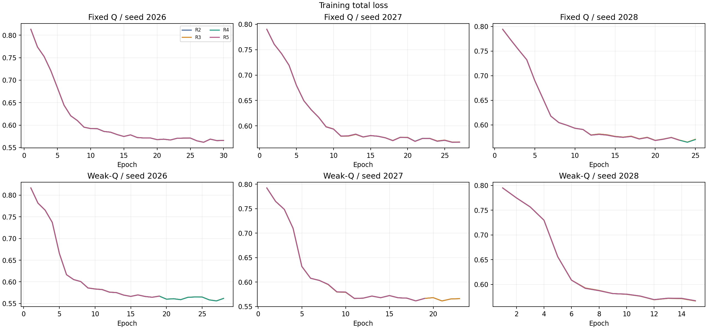

### Original loss including Q regularization

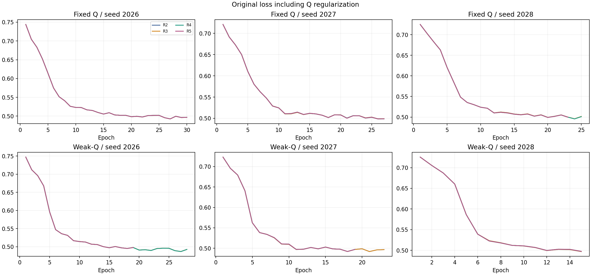

### Validation ACC; checkpoint rule unchanged

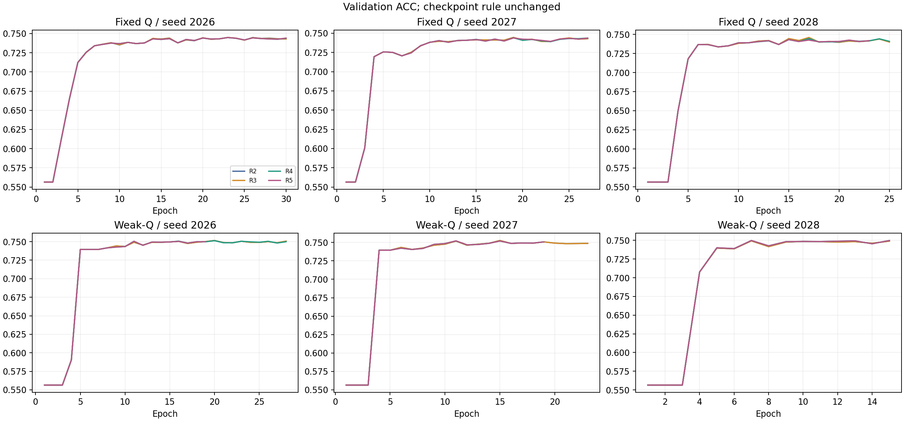

### Same-student InfoNCE

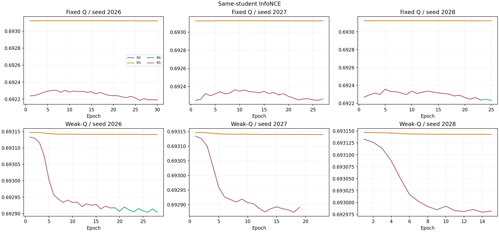

### Training mastery MSE: positive solid, negative dashed

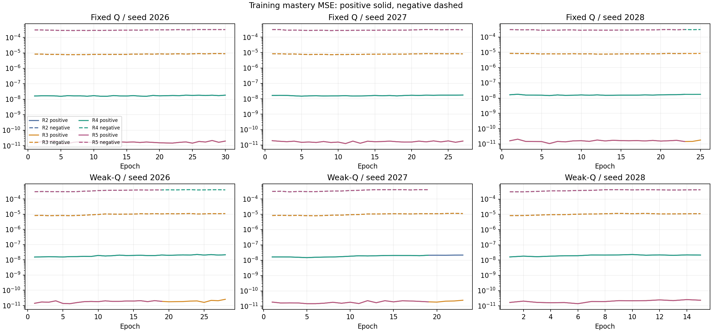

### Fixed-input probe mastery MSE (including initial state)

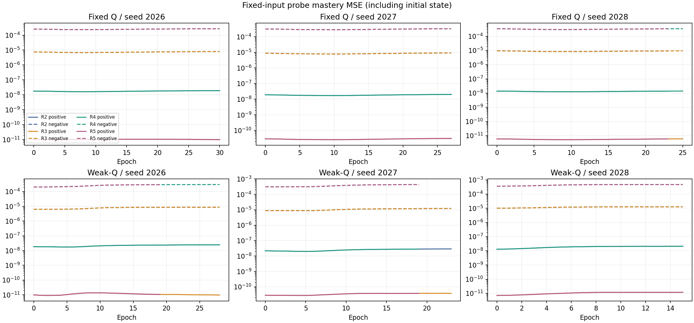

### Shared CL gradient norm (unweighted)

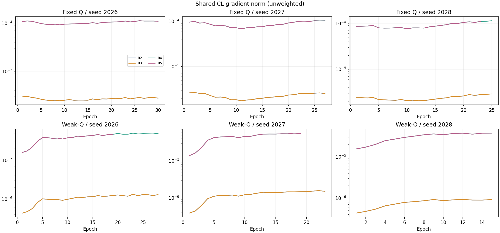

### Weighted CL / original shared gradient norm

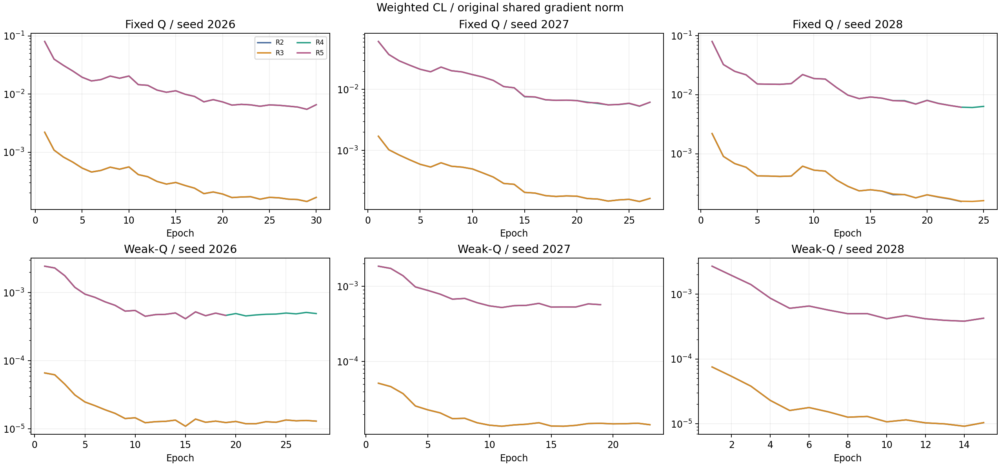

### Negative-view gradient nonzero fraction (>1e-12); NOT margin activation

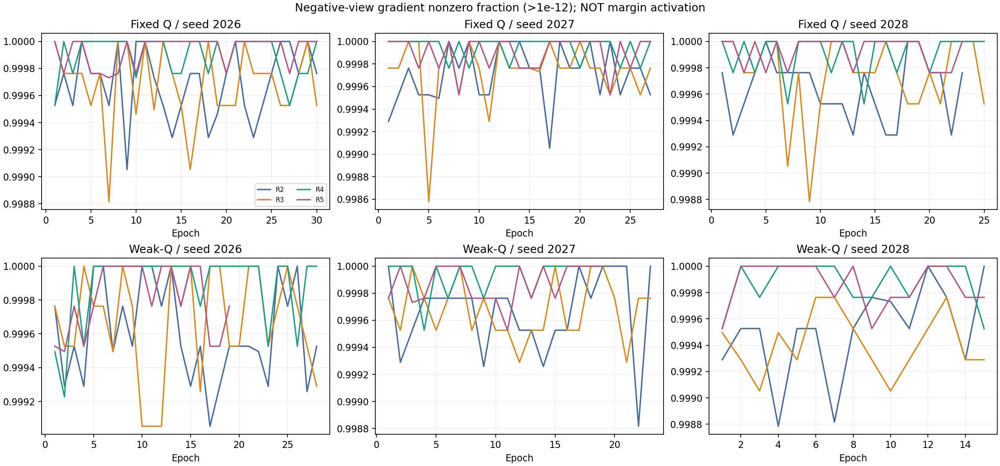

### Positive-view gradient norm

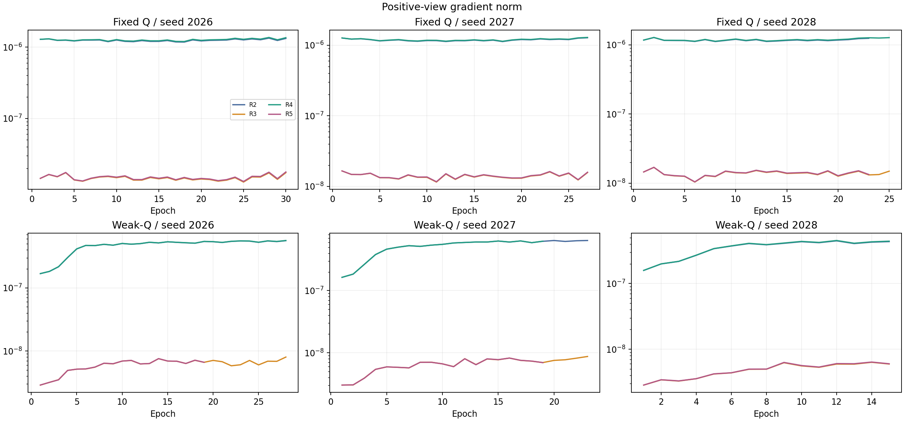

### 各配置ACC配对图

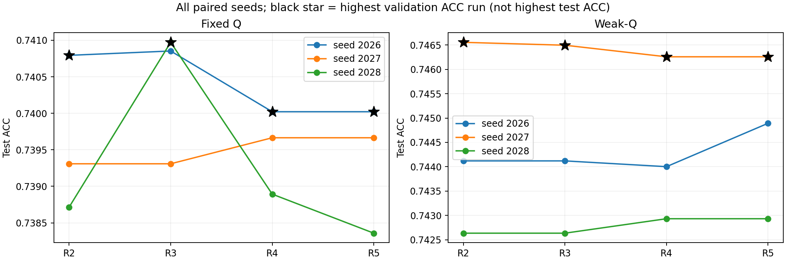

## A–I 逐项回答

### 固定Q

A. 输入空间负/正MAE比值范围 49.773–35193.314，幅度尺度明显分开；不能因此认为认知语义不同。

B. 训练掌握度负/正MSE比值范围 490.968–18375837.521。相对分离应同时看绝对距离和CL梯度，不能只看比值。

C. 固定视图到共同末轮，正MSE下降 4/12 个运行。并非预设全部下降。

D. 固定视图到共同末轮，负MSE上升 10/12 个运行。InfoNCE没有距离下界，不能宣称已达到margin。

E. R4/R2 的训练平均CL梯度范数比（2026/2027/2028）：38.305, 38.162, 38.874。不存在margin饱和；训练路径及早停不同，因果幅度另看预检固定batch。

E. R5/R3 的训练平均CL梯度范数比（2026/2027/2028）：38.235, 38.066, 37.299。不存在margin饱和；训练路径及早停不同，因果幅度另看预检固定batch。

G/H. R3 相对R2的逐seed ΔACC：+0.000059397, +0.000000000, +0.002257068；正/零/负方向数量=2/1/0。

G/H. R4 相对R2的逐seed ΔACC：-0.000772155, +0.000356379, +0.000178190；正/零/负方向数量=2/0/1。

G/H. R5 相对R2的逐seed ΔACC：-0.000772155, +0.000356379, -0.000356379；正/零/负方向数量=1/0/2。

F. R3/R2 正视图梯度范数比：0.0117, 0.0118, 0.0118。梯度变小不等于断图；检查非零值和精度限制。

F. R5/R4 正视图梯度范数比：0.0117, 0.0118, 0.0117。梯度变小不等于断图；检查非零值和精度限制。

I. 参数梯度与表征响应可测，但有 4/9 个相对R2比较的ACC未提高；生效不等于预测改善。

### Weak-Q

A. 输入空间负/正MAE比值范围 49.822–34966.132，幅度尺度明显分开；不能因此认为认知语义不同。

B. 训练掌握度负/正MSE比值范围 510.192–19545339.867。相对分离应同时看绝对距离和CL梯度，不能只看比值。

C. 固定视图到共同末轮，正MSE下降 0/12 个运行。并非预设全部下降。

D. 固定视图到共同末轮，负MSE上升 12/12 个运行。InfoNCE没有距离下界，不能宣称已达到margin。

E. R4/R2 的训练平均CL梯度范数比（2026/2027/2028）：38.131, 36.009, 39.174。不存在margin饱和；训练路径及早停不同，因果幅度另看预检固定batch。

E. R5/R3 的训练平均CL梯度范数比（2026/2027/2028）：34.624, 35.961, 39.122。不存在margin饱和；训练路径及早停不同，因果幅度另看预检固定batch。

G/H. R3 相对R2的逐seed ΔACC：+0.000000000, -0.000059397, +0.000000000；正/零/负方向数量=0/2/1。

G/H. R4 相对R2的逐seed ΔACC：-0.000118793, -0.000296983, +0.000296983；正/零/负方向数量=1/0/2。

G/H. R5 相对R2的逐seed ΔACC：+0.000772155, -0.000296983, +0.000296983；正/零/负方向数量=2/0/1。

F. R3/R2 正视图梯度范数比：0.0130, 0.0126, 0.0136。梯度变小不等于断图；检查非零值和精度限制。

F. R5/R4 正视图梯度范数比：0.0123, 0.0125, 0.0136。梯度变小不等于断图；检查非零值和精度限制。

I. 参数梯度与表征响应可测，但有 6/9 个相对R2比较的ACC未提高；生效不等于预测改善。

## 分层结论与限制

1. 实现正确性：单batch观测不改损失/梯度、R2完整复现、数据与代码哈希、checkpoint重放均通过。
2. 训练影响：CL梯度、参数更新在任务二已证明，本轮记录了噪声响应；不是只有损失数值变化。
3. 表征约束：输入变化与掌握度变化有响应；正距离下降、负距离上升并非由InfoNCE无条件保证，须以固定视图轨迹计数为准。
4. ACC可重复性：以全部种子的配对方向和幅度判断，不以主表中选中的单次运行推断稳定收益。三种子不足以支持强统计结论。
5. 研究假设：可测量的数值响应支持“模块能影响模型”，不等于证实“强扰动同学生是合理语义负样本”或诊断能力提升。

极端负噪声仍是同符号的连续衰减，已偏离原有离散作答证据分布；对它的敏感性不能直接解释为更真实的认知诊断。梯度统计包含所有训练batch，但曲线按epoch聚合；批大小最后一批可能不同。固定probe仅128名学生，不代表全体。本轮没有重新训练λ=0的固定probe时间序列，因此距离随epoch变化同时包含原损失作用，不能全部归因于CL。训练预算/早停规则未变，实际停止轮数和选中轮次可随噪声改变。未探索更多负样本、损失或ACC调优。

## 文件与运行记录

- [配置及哈希](../../../results/student_cl_noise_math1_20261123/manifest.json)；[完整结果表](../../../results/student_cl_noise_math1_20261123/all_seed_results.csv)；[主表](../../../results/student_cl_noise_math1_20261123/selected_runs.csv)。
- [逐种子配对差值](../../../results/student_cl_noise_math1_20261123/paired_deltas.csv)；[补充统计](../../../results/student_cl_noise_math1_20261123/aggregate.csv)；[固定probe轨迹摘要](../../../results/student_cl_noise_math1_20261123/probe_trajectories.csv)。
- 每个 A0或A1/seed_*/R2–R5 目录：config.json、metrics.json、train_log.csv、console.log、best_model.pt、fixed_probe_curve.csv、best_checkpoint_probe.json。
- figures/：所有11张PNG图；没有为重复参数另存W副本，完整参数仍在checkpoint。
- experiments/run_student_cl_noise_sensitivity.py：调用上一轮训练循环，只补充观测；summarize_student_cl_noise_sensitivity.py：核验、输入重建、汇总与绘图。
- 本文为本轮唯一解释记录，README仅增加索引。原模型与旧实验文件未修改，未提交Git。

实际训练命令：

```powershell
E:\Desktop\Gen-CD\.venv-contrastive\Scripts\python.exe -m Q_GNCDM.experiments.run_student_cl_noise_sensitivity
```

汇总命令：

```powershell
.venv-contrastive/Scripts/python.exe -m Q_GNCDM.experiments.summarize_student_cl_noise_sensitivity
```
