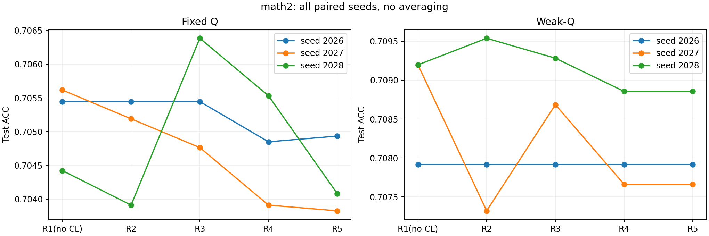

# math2：R0/R1/R2受控对比学习实验

主表不是均值：每个Q/条件内按最高验证ACC选择种子，并列选较小种子；两个test指标来自同一checkpoint。严禁把不同种子的单次结果直接相减解释模块收益，收益看全部配对种子。A0=固定参考Q，A1=Weak-Q。

| Q设置 | 条件 | CL系数 | 验证选优种子 | 最佳轮 | valid ACC | test ACC | test AUC |
| --- | --- | --- | --- | --- | --- | --- | --- |
| A0 | R0 | 0 | 2026 | 22 | 0.710687804 | 0.705446177 | 0.77724143 |
| A0 | R1 | 0 | 2026 | 22 | 0.710687804 | 0.705446177 | 0.77724143 |
| A0 | R2 | 0.1 | 2026 | 22 | 0.710687804 | 0.705446177 | 0.777238713 |
| A1 | R0 | 0 | 2026 | 17 | 0.713500384 | 0.707917839 | 0.786282583 |
| A1 | R1 | 0 | 2026 | 17 | 0.713500384 | 0.707917839 | 0.786282583 |
| A1 | R2 | 0.1 | 2026 | 17 | 0.713500384 | 0.707917839 | 0.786282467 |

## 数据与固定协议

数据集：math2；学生=3911，题目=16，概念=16；train/valid/test交互=[43021, 7822, 11733]。

使用data目录现有训练/验证/测试文件；没有重新划分。Q-F1表示与参考Q一致性，不能自动解释为认知诊断真实性。

R0参考原循环（统一验证ACC选模），R1新增入口λ=0并完全跳过CL训练分支，R2 λ=0.1。R2同时用于受控与敏感性实验，没有重复训练一份R2。模型、原始损失、α=0.8、Adam及学习率、128学生batch、30轮上限、patience=8均不变。验证ACC严格提升才更新checkpoint，平分保留最早轮。种子2026/2027/2028；每个数据集36次训练。

| 条件 | 正比例 | 正幅度 | 负比例 | 负幅度 |
| --- | --- | --- | --- | --- |
| R2 | 0.1 | 0.01 | 0.5 | 0.1 |
| R3 | 0.01 | 0.001 | 0.5 | 0.1 |
| R4 | 0.1 | 0.01 | 0.7 | 0.5 |
| R5 | 0.01 | 0.001 | 0.7 | 0.5 |

两输入不拼接。只对学生support的非零±1位置施加均匀连续噪声并裁剪到[-1,1]；0缺失、ID、标签、query和原数组不变。负噪声不翻转正误，只降低输入证据绝对值；因此极端响应不能直接当成诊断能力改善。验证/测试不增强。

损失沿用同学生一正一负InfoNCE，温度0.2，无margin。L=−正logit+logsumexp(正logit,负logit)。联合归一化项并不是独立负样本损失；负约束非零比例指负视图梯度范数>1e−12，不是margin激活率。

## 配置、代码和核验依据

以下完整配置/哈希和核验结果作为最终文档保留；用户要求清理新实验的checkpoint、原始日志及JSON/CSV副本。实际清理状态：自动审批以blocked by policy拒绝递归删除，原始产物仍暂存在Git忽略的scratch/student_cl_all_20261123。最终报告目录只包含Markdown和配图。若后续手工清理，便不能直接重放checkpoint，需按记录重跑。

<details><summary>完整配置、版本及数据/源码哈希</summary>

```json
{
  "experiment_id": "student_cl_all_math2_20261123",
  "dataset": "math2",
  "args": {
    "experiment_id": "student_cl_control_math1_20261123",
    "seeds": [
      2026,
      2027,
      2028
    ],
    "lambda_cl": 0.1,
    "positive_noise_ratio": 0.1,
    "positive_noise_scale": 0.01,
    "negative_noise_ratio": 0.5,
    "negative_noise_scale": 0.1,
    "noise_distribution": "uniform",
    "contrastive_seed": 1123,
    "temperature": 0.2,
    "dataset": "math2",
    "data_dir": "E:\\Desktop\\Gen-CD\\Q_GNCDM\\data\\math2",
    "alpha": 0.8,
    "embedding_dim": 32,
    "epochs": 30,
    "patience": 8,
    "batch_students": 128,
    "query_fraction": 0.25,
    "lr": 0.001,
    "q_lr": 0.005,
    "lambda_q": 0.01,
    "lambda_coverage": 0.01,
    "q_init_high": 0.55,
    "q_init_low": 0.45,
    "device": "cpu"
  },
  "noise_configs": {
    "R2": [
      0.1,
      0.01,
      0.5,
      0.1
    ],
    "R3": [
      0.01,
      0.001,
      0.5,
      0.1
    ],
    "R4": [
      0.1,
      0.01,
      0.7,
      0.5
    ],
    "R5": [
      0.01,
      0.001,
      0.7,
      0.5
    ]
  },
  "source_sha256": {
    "Q_GNCDM\\experiments\\run_controlled_student_cl.py": "9447f3fc2e79391b043148ae28717bee2f9f6a53dbe44352e5dddca3b6212a46",
    "Q_GNCDM\\experiments\\reference_student_cl_acc.py": "a974a5dbb0e36daf5ed49031be1838d69200e070f935d8f8f9dc31c0d9fa3dfc",
    "Q_GNCDM\\experiments\\controlled_student_cl.py": "4329530390f079ae00f6fa0d00af659e7e7be0f09134f8bc642b5a8caa0cb041",
    "Q_GNCDM\\experiments\\run_simple_contrastive.py": "196cbac42d9e7664eb4c24a4328bc852dca9265d7a88149adda0be924564a023",
    "Q_GNCDM\\models\\weak_q_gncdm.py": "5970f43820db2736bcf5f4e48039af50bf4203a5f391baa2046b8046c21517f5",
    "Q_GNCDM\\simple_contrastive.py": "30f0126846ab0e0d8802306ee183374a17730ed63f5bdd3ff6d76949b5252d97",
    "Q_GNCDM\\experiments\\run_weak_q_synthetic.py": "266d36d84cf1095189700a0b1f524f678accfd79feb94402ef6562f004f6b9b6",
    "Q_GNCDM\\experiments\\run_student_cl_all_datasets.py": "5c04daaf9a3ba1478c9d763e66348251162132ed385935c67e6d806635ec76bf",
    "Q_GNCDM\\experiments\\run_student_cl_noise_sensitivity.py": "b4c2c3850c4f49b26f60099c8d593128393ec8de80dcb3205d04fb27507f440f",
    "Q_GNCDM\\experiments\\run_prepared_dataset.py": "02b0fe433fcf75bea693b745149ac1654d866f044c81d9b2fc637b6f35d40c4d"
  },
  "data_sha256": {
    "train.csv": "f517e08c59202a501c3008a5767acb0da4094729b81c297d9df358607e7459cc",
    "valid.csv": "c360e4af513eaf829d93e1f26472960057ffc63856884af795e961018a4a762a",
    "test.csv": "31ac2a70bfe7ee8dbee50a3e31800852097872c940690716a63580e968d24f07",
    "Q_matrix.npy": "d60f7344c2a69b1920d1bd0806567b90743d02a60ae32b3e930f1ee7ffb2eeb4",
    "Q_true.npy": "d60f7344c2a69b1920d1bd0806567b90743d02a60ae32b3e930f1ee7ffb2eeb4",
    "manifest.json": "1bcac37dd1dfb672759e95671dabee9c7fd14973fe046f304f5b4bafc6584662"
  },
  "train_shape": [
    3911,
    16
  ],
  "concepts": 16,
  "split_lengths": [
    43021,
    7822,
    11733
  ],
  "seeds": [
    2026,
    2027,
    2028
  ],
  "selection": "highest validation ACC, earliest epoch; display seed chosen by validation ACC, lowest seed tie",
  "retention": "user requests final Markdown reports and figures only; temporary originals removed after verification",
  "command": "E:\\Desktop\\Gen-CD\\.venv-contrastive\\Scripts\\python.exe -m Q_GNCDM.experiments.run_student_cl_all_datasets --dataset math2",
  "python": "3.13.9 (tags/v3.13.9:8183fa5, Oct 14 2025, 14:09:13) [MSC v.1944 64 bit (AMD64)]",
  "torch": "2.14.0+cpu",
  "numpy": "2.4.3",
  "git_head": "89290e14293fe00b1e4eb55ba87ed068c5eccfdc",
  "protocol": "R0 reference ACC selector; R1 CL off; R2 shared by control and noise studies; R3-R5 change noise only",
  "scheduling_records": [],
  "scheduling_duplicate_state_checks": []
}
```
</details>

8种Q/噪声设置预检全部通过；同初始化固定batch的CL梯度、一步更新测试通过；新诊断的损失/梯度与原实现精确一致。6组R0/R1的逐轮日志与checkpoint精确一致；36个checkpoint的全部测试指标已重放核验。

```json
{
  "runs": 36,
  "preflight_settings": 8,
  "baseline_exact_pairs": 6,
  "checkpoint_replays": 36,
  "protected_code_and_data_unchanged": true,
  "status": "passed"
}
```

<details><summary>全部预检真实输出（含逐层梯度和单步参数更新差异）</summary>

```json
{
  "A0_R2": {
    "positive": {
      "selected_fraction": 0.1007375,
      "changed_fraction": 0.050225,
      "clipped_fraction_selected": 0.5014269760516193,
      "input_mae_observed": 0.00025183867546729743,
      "input_mae_all": 0.00020147094619460404,
      "input_max_change": 0.009997665882110596
    },
    "negative": {
      "selected_fraction": 0.5008875,
      "changed_fraction": 0.2517625,
      "clipped_fraction_selected": 0.4973671732674503,
      "input_mae_observed": 0.012591703794896603,
      "input_mae_all": 0.010073362849652767,
      "input_max_change": 0.09999817609786987
    },
    "gradient": {
      "original_shared_grad_norm": 0.00022708610929758817,
      "cl_shared_grad_norm": 8.640406829283586e-07,
      "cl_to_original_grad_ratio": 0.0038049032836088817,
      "weighted_cl_to_original_grad_ratio": 0.0003804903283608882
    },
    "per_layer": {
      "f_nn.f_layer_1.weight": {
        "original_grad_norm": 6.987901724642143e-05,
        "cl_grad_norm": 3.6395366009855934e-07,
        "cl_finite": true
      },
      "f_nn.f_layer_1.bias": {
        "original_grad_norm": 5.381450682762079e-05,
        "cl_grad_norm": 2.0076312523542583e-07,
        "cl_finite": true
      },
      "f_nn.f_layer_2.weight": {
        "original_grad_norm": 0.00017634278628975153,
        "cl_grad_norm": 6.017290843374212e-07,
        "cl_finite": true
      },
      "f_nn.f_layer_2.bias": {
        "original_grad_norm": 0.00011265985085628927,
        "cl_grad_norm": 4.6013079213480523e-07,
        "cl_finite": true
      }
    },
    "batch_diagnostics": {
      "ap_mse": 5.284700232977002e-09,
      "an_mse": 3.681649786813068e-06,
      "ap_cos_distance": 6.05359673500061e-09,
      "an_cos_distance": 3.8244761526584625e-06,
      "negative_softmax_probability": 0.49999523162841797,
      "negative_not_farther_fraction": 0.1015625,
      "positive_selected_fraction": 0.0908203125,
      "positive_changed_fraction": 0.0419921875,
      "positive_clipped_fraction_selected": 0.5376344086021505,
      "positive_input_mae_observed": 0.00018807011656463146,
      "positive_input_mae_all": 9.403505828231573e-05,
      "positive_input_max_change": 0.009640693664550781,
      "negative_selected_fraction": 0.5009765625,
      "negative_changed_fraction": 0.2529296875,
      "negative_clipped_fraction_selected": 0.4951267056530214,
      "negative_input_mae_observed": 0.012145964428782463,
      "negative_input_mae_all": 0.0060729822143912315,
      "negative_input_max_change": 0.09928125143051147
    },
    "loss_original": 0.8949627876281738,
    "loss_cl": 0.6931376457214355,
    "loss_total": 0.9642765522003174,
    "single_step_parameter_changes": {
      "f_nn.f_layer_1.weight": {
        "gradient_difference_l2": 3.639347464885881e-08,
        "update_difference_l2": 0.00012733477976399054,
        "baseline_update_l2": 0.015780189239659542,
        "cl_update_l2": 0.01578279356408195
      },
      "f_nn.f_layer_1.bias": {
        "gradient_difference_l2": 2.005779499103769e-08,
        "update_difference_l2": 9.599853366654507e-10,
        "baseline_update_l2": 0.0039965753954924865,
        "cl_update_l2": 0.003996575686587441
      },
      "f_nn.f_layer_2.weight": {
        "gradient_difference_l2": 6.013826080918231e-08,
        "update_difference_l2": 1.1933214338616723e-05,
        "baseline_update_l2": 0.015914783719492304,
        "cl_update_l2": 0.015914204861121484
      },
      "f_nn.f_layer_2.bias": {
        "gradient_difference_l2": 4.5990894932930595e-08,
        "update_difference_l2": 1.5472292644750466e-08,
        "baseline_update_l2": 0.003995140970204408,
        "cl_update_l2": 0.0039951377420999684
      }
    },
    "zero_single_step_exact_parity": true,
    "status": "passed",
    "observed_branch_loss_and_gradient_exact": true,
    "observation_state_and_rng_unchanged": true,
    "extra_diagnostics": {
      "ap_mse": 5.907297317975235e-09,
      "an_mse": 3.6248106880520936e-06,
      "ap_cos_distance": 1.30385160446167e-08,
      "an_cos_distance": 3.72203066945076e-06,
      "negative_softmax_probability": 0.4999953508377075,
      "negative_not_farther_fraction": 0.09375,
      "positive_energy": -5.0,
      "joint_log_partition": 5.693138122558594,
      "negative_relative_penalty": 0.6931379437446594,
      "positive_view_grad_norm_mean": 4.910313893999145e-07,
      "negative_view_grad_norm_mean": 2.0698210986567146e-05,
      "negative_view_grad_nonzero_fraction": 1.0,
      "negative_view_grad_above_1e_12_fraction": 1.0,
      "positive_shared_partial_grad_norm": 1.6215628729454767e-09,
      "negative_shared_partial_grad_norm": 8.765422160574015e-07,
      "positive_selected_fraction": 0.09375,
      "positive_changed_fraction": 0.044921875,
      "positive_clipped_fraction_selected": 0.5208333333333334,
      "positive_input_mae_observed": 0.00021284946706146002,
      "positive_input_mae_all": 0.00010642473353073001,
      "positive_input_max_change": 0.009850561618804932,
      "positive_input_mse_observed": 1.3966637197881937e-06,
      "positive_clipped_fraction_observed": 0.048828125,
      "positive_input_mae_changed": 0.004738214425742626,
      "positive_unchanged_student_fraction": 0.671875,
      "negative_selected_fraction": 0.4921875,
      "negative_changed_fraction": 0.234375,
      "negative_clipped_fraction_selected": 0.5238095238095238,
      "negative_input_mae_observed": 0.011595068499445915,
      "negative_input_mae_all": 0.005797534249722958,
      "negative_input_max_change": 0.09965395927429199,
      "negative_input_mse_observed": 0.000784933683462441,
      "negative_clipped_fraction_observed": 0.2578125,
      "negative_input_mae_changed": 0.04947229102253914,
      "negative_unchanged_student_fraction": 0.078125
    }
  },
  "A0_R3": {
    "positive": {
      "selected_fraction": 0.01045,
      "changed_fraction": 0.005025,
      "clipped_fraction_selected": 0.5179425837320574,
      "input_mae_observed": 2.512869286874775e-06,
      "input_mae_all": 2.010295474974555e-06,
      "input_max_change": 0.0009962916374206543
    },
    "negative": {
      "selected_fraction": 0.5008875,
      "changed_fraction": 0.2517625,
      "clipped_fraction_selected": 0.4973671732674503,
      "input_mae_observed": 0.012591703794896603,
      "input_mae_all": 0.010073362849652767,
      "input_max_change": 0.09999817609786987
    },
    "gradient": {
      "original_shared_grad_norm": 0.00022708610929758817,
      "cl_shared_grad_norm": 8.655553207945231e-07,
      "cl_to_original_grad_ratio": 0.0038115731669885805,
      "weighted_cl_to_original_grad_ratio": 0.00038115731669885813
    },
    "per_layer": {
      "f_nn.f_layer_1.weight": {
        "original_grad_norm": 6.987901724642143e-05,
        "cl_grad_norm": 3.6458334307098994e-07,
        "cl_finite": true
      },
      "f_nn.f_layer_1.bias": {
        "original_grad_norm": 5.381450682762079e-05,
        "cl_grad_norm": 2.012735791367959e-07,
        "cl_finite": true
      },
      "f_nn.f_layer_2.weight": {
        "original_grad_norm": 0.00017634278628975153,
        "cl_grad_norm": 6.028084271747502e-07,
        "cl_finite": true
      },
      "f_nn.f_layer_2.bias": {
        "original_grad_norm": 0.00011265985085628927,
        "cl_grad_norm": 4.608426138474897e-07,
        "cl_finite": true
      }
    },
    "batch_diagnostics": {
      "ap_mse": 1.403616806117114e-12,
      "an_mse": 3.681649786813068e-06,
      "ap_cos_distance": -2.7939677238464355e-09,
      "an_cos_distance": 3.8244761526584625e-06,
      "negative_softmax_probability": 0.49999523162841797,
      "negative_not_farther_fraction": 0.1015625,
      "positive_selected_fraction": 0.0068359375,
      "positive_changed_fraction": 0.0009765625,
      "positive_clipped_fraction_selected": 0.8571428571428571,
      "positive_input_mae_observed": 5.236361175775528e-07,
      "positive_input_mae_all": 2.618180587887764e-07,
      "positive_input_max_change": 0.0005362033843994141,
      "negative_selected_fraction": 0.5009765625,
      "negative_changed_fraction": 0.2529296875,
      "negative_clipped_fraction_selected": 0.4951267056530214,
      "negative_input_mae_observed": 0.012145964428782463,
      "negative_input_mae_all": 0.0060729822143912315,
      "negative_input_max_change": 0.09928125143051147
    },
    "loss_original": 0.8949627876281738,
    "loss_cl": 0.6931375861167908,
    "loss_total": 0.9642765522003174,
    "single_step_parameter_changes": {
      "f_nn.f_layer_1.weight": {
        "gradient_difference_l2": 3.646179160790777e-08,
        "update_difference_l2": 0.00012733775010870482,
        "baseline_update_l2": 0.015780189239659542,
        "cl_update_l2": 0.015782794242176247
      },
      "f_nn.f_layer_1.bias": {
        "gradient_difference_l2": 2.0125312185614793e-08,
        "update_difference_l2": 9.599853366654507e-10,
        "baseline_update_l2": 0.0039965753954924865,
        "cl_update_l2": 0.003996575686587441
      },
      "f_nn.f_layer_2.weight": {
        "gradient_difference_l2": 6.02838462282093e-08,
        "update_difference_l2": 1.2024589262324227e-05,
        "baseline_update_l2": 0.015914783719492304,
        "cl_update_l2": 0.015914201978160174
      },
      "f_nn.f_layer_2.bias": {
        "gradient_difference_l2": 4.6080252391522816e-08,
        "update_difference_l2": 2.148107177516594e-08,
        "baseline_update_l2": 0.003995140970204408,
        "cl_update_l2": 0.003995141470345935
      }
    },
    "zero_single_step_exact_parity": true,
    "status": "passed",
    "observed_branch_loss_and_gradient_exact": true,
    "observation_state_and_rng_unchanged": true,
    "extra_diagnostics": {
      "ap_mse": 8.185331752674774e-13,
      "an_mse": 3.6248106880520936e-06,
      "ap_cos_distance": 4.656612873077393e-10,
      "an_cos_distance": 3.72203066945076e-06,
      "negative_softmax_probability": 0.4999953508377075,
      "negative_not_farther_fraction": 0.09375,
      "positive_energy": -5.0,
      "joint_log_partition": 5.693138122558594,
      "negative_relative_penalty": 0.6931377649307251,
      "positive_view_grad_norm_mean": 2.0061761793075896e-09,
      "negative_view_grad_norm_mean": 2.0698205506655632e-05,
      "negative_view_grad_nonzero_fraction": 1.0,
      "negative_view_grad_above_1e_12_fraction": 1.0,
      "positive_shared_partial_grad_norm": 2.7145320310956353e-09,
      "negative_shared_partial_grad_norm": 8.766006381746749e-07,
      "positive_selected_fraction": 0.009765625,
      "positive_changed_fraction": 0.001953125,
      "positive_clipped_fraction_selected": 0.8,
      "positive_input_mae_observed": 6.048358045518398e-07,
      "positive_input_mae_all": 3.024179022759199e-07,
      "positive_input_max_change": 0.0003975033760070801,
      "positive_input_mse_observed": 2.0236883002677786e-10,
      "positive_clipped_fraction_observed": 0.0078125,
      "positive_input_mae_changed": 0.000309675931930542,
      "positive_unchanged_student_fraction": 0.984375,
      "negative_selected_fraction": 0.4921875,
      "negative_changed_fraction": 0.234375,
      "negative_clipped_fraction_selected": 0.5238095238095238,
      "negative_input_mae_observed": 0.011595068499445915,
      "negative_input_mae_all": 0.005797534249722958,
      "negative_input_max_change": 0.09965395927429199,
      "negative_input_mse_observed": 0.000784933683462441,
      "negative_clipped_fraction_observed": 0.2578125,
      "negative_input_mae_changed": 0.04947229102253914,
      "negative_unchanged_student_fraction": 0.078125
    }
  },
  "A0_R4": {
    "positive": {
      "selected_fraction": 0.1007375,
      "changed_fraction": 0.050225,
      "clipped_fraction_selected": 0.5014269760516193,
      "input_mae_observed": 0.00025183867546729743,
      "input_mae_all": 0.00020147094619460404,
      "input_max_change": 0.009997665882110596
    },
    "negative": {
      "selected_fraction": 0.7017125,
      "changed_fraction": 0.3529375,
      "clipped_fraction_selected": 0.4970340417193651,
      "input_mae_observed": 0.08849677443504333,
      "input_mae_all": 0.07079741358757019,
      "input_max_change": 0.4999908208847046
    },
    "gradient": {
      "original_shared_grad_norm": 0.00022708610929758817,
      "cl_shared_grad_norm": 3.0829046781721284e-05,
      "cl_to_original_grad_ratio": 0.1357592803764185,
      "weighted_cl_to_original_grad_ratio": 0.013575928037641849
    },
    "per_layer": {
      "f_nn.f_layer_1.weight": {
        "original_grad_norm": 6.987901724642143e-05,
        "cl_grad_norm": 1.251952926395461e-05,
        "cl_finite": true
      },
      "f_nn.f_layer_1.bias": {
        "original_grad_norm": 5.381450682762079e-05,
        "cl_grad_norm": 7.422516773658572e-06,
        "cl_finite": true
      },
      "f_nn.f_layer_2.weight": {
        "original_grad_norm": 0.00017634278628975153,
        "cl_grad_norm": 2.2033482309780084e-05,
        "cl_finite": true
      },
      "f_nn.f_layer_2.bias": {
        "original_grad_norm": 0.00011265985085628927,
        "cl_grad_norm": 1.5909852663753554e-05,
        "cl_finite": true
      }
    },
    "batch_diagnostics": {
      "ap_mse": 5.284700232977002e-09,
      "an_mse": 0.00013748063065577298,
      "ap_cos_distance": 6.05359673500061e-09,
      "an_cos_distance": 0.00014243647456169128,
      "negative_softmax_probability": 0.4998219609260559,
      "negative_not_farther_fraction": 0.0234375,
      "positive_selected_fraction": 0.0908203125,
      "positive_changed_fraction": 0.0419921875,
      "positive_clipped_fraction_selected": 0.5376344086021505,
      "positive_input_mae_observed": 0.00018807011656463146,
      "positive_input_mae_all": 9.403505828231573e-05,
      "positive_input_max_change": 0.009640693664550781,
      "negative_selected_fraction": 0.7177734375,
      "negative_changed_fraction": 0.3583984375,
      "negative_clipped_fraction_selected": 0.5006802721088436,
      "negative_input_mae_observed": 0.08697512745857239,
      "negative_input_mae_all": 0.043487563729286194,
      "negative_input_max_change": 0.4984334111213684
    },
    "loss_original": 0.8949627876281738,
    "loss_cl": 0.6927911639213562,
    "loss_total": 0.9642419219017029,
    "single_step_parameter_changes": {
      "f_nn.f_layer_1.weight": {
        "gradient_difference_l2": 1.251956140878155e-06,
        "update_difference_l2": 0.0017481705142573438,
        "baseline_update_l2": 0.015780189239659542,
        "cl_update_l2": 0.015809701569124656
      },
      "f_nn.f_layer_1.bias": {
        "gradient_difference_l2": 7.42250423664432e-07,
        "update_difference_l2": 6.538562698830275e-08,
        "baseline_update_l2": 0.0039965753954924865,
        "cl_update_l2": 0.0039966347021757114
      },
      "f_nn.f_layer_2.weight": {
        "gradient_difference_l2": 2.203359005060517e-06,
        "update_difference_l2": 0.0021279427421234454,
        "baseline_update_l2": 0.015914783719492304,
        "cl_update_l2": 0.015901946625264615
      },
      "f_nn.f_layer_2.bias": {
        "gradient_difference_l2": 1.5909896569878984e-06,
        "update_difference_l2": 2.116787835010418e-07,
        "baseline_update_l2": 0.003995140970204408,
        "cl_update_l2": 0.003995085034638955
      }
    },
    "zero_single_step_exact_parity": true,
    "status": "passed",
    "observed_branch_loss_and_gradient_exact": true,
    "observation_state_and_rng_unchanged": true,
    "extra_diagnostics": {
      "ap_mse": 5.907297317975235e-09,
      "an_mse": 0.000146753853186965,
      "ap_cos_distance": 1.30385160446167e-08,
      "an_cos_distance": 0.000146462582051754,
      "negative_softmax_probability": 0.4998169243335724,
      "negative_not_farther_fraction": 0.015625,
      "positive_energy": -5.0,
      "joint_log_partition": 5.692780494689941,
      "negative_relative_penalty": 0.6927810907363892,
      "positive_view_grad_norm_mean": 4.908515064520033e-07,
      "negative_view_grad_norm_mean": 0.0001372745558172927,
      "negative_view_grad_nonzero_fraction": 1.0,
      "negative_view_grad_above_1e_12_fraction": 1.0,
      "positive_shared_partial_grad_norm": 1.6378045205133236e-09,
      "negative_shared_partial_grad_norm": 3.453760578269313e-05,
      "positive_selected_fraction": 0.09375,
      "positive_changed_fraction": 0.044921875,
      "positive_clipped_fraction_selected": 0.5208333333333334,
      "positive_input_mae_observed": 0.00021284946706146002,
      "positive_input_mae_all": 0.00010642473353073001,
      "positive_input_max_change": 0.009850561618804932,
      "positive_input_mse_observed": 1.3966637197881937e-06,
      "positive_clipped_fraction_observed": 0.048828125,
      "positive_input_mae_changed": 0.004738214425742626,
      "positive_unchanged_student_fraction": 0.671875,
      "negative_selected_fraction": 0.712890625,
      "negative_changed_fraction": 0.34765625,
      "negative_clipped_fraction_selected": 0.5123287671232877,
      "negative_input_mae_observed": 0.08575744926929474,
      "negative_input_mae_all": 0.04287872463464737,
      "negative_input_max_change": 0.4984334111213684,
      "negative_input_mse_observed": 0.029058260843157768,
      "negative_clipped_fraction_observed": 0.365234375,
      "negative_input_mae_changed": 0.2466731071472168,
      "negative_unchanged_student_fraction": 0.015625
    }
  },
  "A0_R5": {
    "positive": {
      "selected_fraction": 0.01045,
      "changed_fraction": 0.005025,
      "clipped_fraction_selected": 0.5179425837320574,
      "input_mae_observed": 2.512869286874775e-06,
      "input_mae_all": 2.010295474974555e-06,
      "input_max_change": 0.0009962916374206543
    },
    "negative": {
      "selected_fraction": 0.7017125,
      "changed_fraction": 0.3529375,
      "clipped_fraction_selected": 0.4970340417193651,
      "input_mae_observed": 0.08849677443504333,
      "input_mae_all": 0.07079741358757019,
      "input_max_change": 0.4999908208847046
    },
    "gradient": {
      "original_shared_grad_norm": 0.00022708610929758817,
      "cl_shared_grad_norm": 3.083090583745812e-05,
      "cl_to_original_grad_ratio": 0.1357674669438073,
      "weighted_cl_to_original_grad_ratio": 0.013576746694380734
    },
    "per_layer": {
      "f_nn.f_layer_1.weight": {
        "original_grad_norm": 6.987901724642143e-05,
        "cl_grad_norm": 1.2520260497694835e-05,
        "cl_finite": true
      },
      "f_nn.f_layer_1.bias": {
        "original_grad_norm": 5.381450682762079e-05,
        "cl_grad_norm": 7.423103852488566e-06,
        "cl_finite": true
      },
      "f_nn.f_layer_2.weight": {
        "original_grad_norm": 0.00017634278628975153,
        "cl_grad_norm": 2.2034853827790357e-05,
        "cl_finite": true
      },
      "f_nn.f_layer_2.bias": {
        "original_grad_norm": 0.00011265985085628927,
        "cl_grad_norm": 1.591070758877322e-05,
        "cl_finite": true
      }
    },
    "batch_diagnostics": {
      "ap_mse": 1.403616806117114e-12,
      "an_mse": 0.00013748063065577298,
      "ap_cos_distance": -2.7939677238464355e-09,
      "an_cos_distance": 0.00014243647456169128,
      "negative_softmax_probability": 0.4998219609260559,
      "negative_not_farther_fraction": 0.0234375,
      "positive_selected_fraction": 0.0068359375,
      "positive_changed_fraction": 0.0009765625,
      "positive_clipped_fraction_selected": 0.8571428571428571,
      "positive_input_mae_observed": 5.236361175775528e-07,
      "positive_input_mae_all": 2.618180587887764e-07,
      "positive_input_max_change": 0.0005362033843994141,
      "negative_selected_fraction": 0.7177734375,
      "negative_changed_fraction": 0.3583984375,
      "negative_clipped_fraction_selected": 0.5006802721088436,
      "negative_input_mae_observed": 0.08697512745857239,
      "negative_input_mae_all": 0.043487563729286194,
      "negative_input_max_change": 0.4984334111213684
    },
    "loss_original": 0.8949627876281738,
    "loss_cl": 0.6927911639213562,
    "loss_total": 0.9642419219017029,
    "single_step_parameter_changes": {
      "f_nn.f_layer_1.weight": {
        "gradient_difference_l2": 1.2520307717524039e-06,
        "update_difference_l2": 0.0017481996294044244,
        "baseline_update_l2": 0.015780189239659542,
        "cl_update_l2": 0.01580970121382584
      },
      "f_nn.f_layer_1.bias": {
        "gradient_difference_l2": 7.423065625725378e-07,
        "update_difference_l2": 6.514641351667706e-08,
        "baseline_update_l2": 0.0039965753954924865,
        "cl_update_l2": 0.003996634236409123
      },
      "f_nn.f_layer_2.weight": {
        "gradient_difference_l2": 2.203481570289637e-06,
        "update_difference_l2": 0.0021280537038396627,
        "baseline_update_l2": 0.015914783719492304,
        "cl_update_l2": 0.015901951175897672
      },
      "f_nn.f_layer_2.bias": {
        "gradient_difference_l2": 1.5910778091998703e-06,
        "update_difference_l2": 2.116787835010418e-07,
        "baseline_update_l2": 0.003995140970204408,
        "cl_update_l2": 0.003995085034638955
      }
    },
    "zero_single_step_exact_parity": true,
    "status": "passed",
    "observed_branch_loss_and_gradient_exact": true,
    "observation_state_and_rng_unchanged": true,
    "extra_diagnostics": {
      "ap_mse": 8.185331752674774e-13,
      "an_mse": 0.000146753853186965,
      "ap_cos_distance": 4.656612873077393e-10,
      "an_cos_distance": 0.000146462582051754,
      "negative_softmax_probability": 0.4998169243335724,
      "negative_not_farther_fraction": 0.015625,
      "positive_energy": -5.0,
      "joint_log_partition": 5.692780494689941,
      "negative_relative_penalty": 0.6927810907363892,
      "positive_view_grad_norm_mean": 1.9681912406491653e-09,
      "negative_view_grad_norm_mean": 0.00013727455715223418,
      "negative_view_grad_nonzero_fraction": 1.0,
      "negative_view_grad_above_1e_12_fraction": 1.0,
      "positive_shared_partial_grad_norm": 1.3513941467724596e-09,
      "negative_shared_partial_grad_norm": 3.453759598229301e-05,
      "positive_selected_fraction": 0.009765625,
      "positive_changed_fraction": 0.001953125,
      "positive_clipped_fraction_selected": 0.8,
      "positive_input_mae_observed": 6.048358045518398e-07,
      "positive_input_mae_all": 3.024179022759199e-07,
      "positive_input_max_change": 0.0003975033760070801,
      "positive_input_mse_observed": 2.0236883002677786e-10,
      "positive_clipped_fraction_observed": 0.0078125,
      "positive_input_mae_changed": 0.000309675931930542,
      "positive_unchanged_student_fraction": 0.984375,
      "negative_selected_fraction": 0.712890625,
      "negative_changed_fraction": 0.34765625,
      "negative_clipped_fraction_selected": 0.5123287671232877,
      "negative_input_mae_observed": 0.08575744926929474,
      "negative_input_mae_all": 0.04287872463464737,
      "negative_input_max_change": 0.4984334111213684,
      "negative_input_mse_observed": 0.029058260843157768,
      "negative_clipped_fraction_observed": 0.365234375,
      "negative_input_mae_changed": 0.2466731071472168,
      "negative_unchanged_student_fraction": 0.015625
    }
  },
  "A1_R2": {
    "positive": {
      "selected_fraction": 0.1007375,
      "changed_fraction": 0.050225,
      "clipped_fraction_selected": 0.5014269760516193,
      "input_mae_observed": 0.00025183867546729743,
      "input_mae_all": 0.00020147094619460404,
      "input_max_change": 0.009997665882110596
    },
    "negative": {
      "selected_fraction": 0.5008875,
      "changed_fraction": 0.2517625,
      "clipped_fraction_selected": 0.4973671732674503,
      "input_mae_observed": 0.012591703794896603,
      "input_mae_all": 0.010073362849652767,
      "input_max_change": 0.09999817609786987
    },
    "gradient": {
      "original_shared_grad_norm": 0.0009199771442278754,
      "cl_shared_grad_norm": 1.288886849075689e-07,
      "cl_to_original_grad_ratio": 0.0001400998771722133,
      "weighted_cl_to_original_grad_ratio": 1.4009987717221332e-05
    },
    "per_layer": {
      "q_logits": {
        "original_grad_norm": 0.0008628871291875839,
        "cl_grad_norm": 9.753428997782976e-08,
        "cl_finite": true
      },
      "f_nn.f_layer_1.weight": {
        "original_grad_norm": 0.00010151247261092067,
        "cl_grad_norm": 3.4376569146843394e-08,
        "cl_finite": true
      },
      "f_nn.f_layer_1.bias": {
        "original_grad_norm": 7.322490273509175e-05,
        "cl_grad_norm": 8.036964871394048e-09,
        "cl_finite": true
      },
      "f_nn.f_layer_2.weight": {
        "original_grad_norm": 0.00024704961106181145,
        "cl_grad_norm": 4.734534897465892e-08,
        "cl_finite": true
      },
      "f_nn.f_layer_2.bias": {
        "original_grad_norm": 0.0001583780103828758,
        "cl_grad_norm": 6.00952034801594e-08,
        "cl_finite": true
      }
    },
    "batch_diagnostics": {
      "ap_mse": 6.056811496790715e-09,
      "an_mse": 4.792091203853488e-06,
      "ap_cos_distance": 4.190951585769653e-09,
      "an_cos_distance": 4.190951585769653e-08,
      "negative_softmax_probability": 0.5,
      "negative_not_farther_fraction": 0.5625,
      "positive_selected_fraction": 0.0908203125,
      "positive_changed_fraction": 0.0419921875,
      "positive_clipped_fraction_selected": 0.5376344086021505,
      "positive_input_mae_observed": 0.00018807011656463146,
      "positive_input_mae_all": 9.403505828231573e-05,
      "positive_input_max_change": 0.009640693664550781,
      "negative_selected_fraction": 0.5009765625,
      "negative_changed_fraction": 0.2529296875,
      "negative_clipped_fraction_selected": 0.4951267056530214,
      "negative_input_mae_observed": 0.012145964428782463,
      "negative_input_mae_all": 0.0060729822143912315,
      "negative_input_max_change": 0.09928125143051147
    },
    "loss_original": 0.8951173424720764,
    "loss_cl": 0.6931471228599548,
    "loss_total": 0.9644320607185364,
    "single_step_parameter_changes": {
      "q_logits": {
        "gradient_difference_l2": 9.751819484719184e-09,
        "update_difference_l2": 2.1219787212556177e-05,
        "baseline_update_l2": 0.0798446720464955,
        "cl_update_l2": 0.07984380494170715
      },
      "f_nn.f_layer_1.weight": {
        "gradient_difference_l2": 3.4341594451239397e-09,
        "update_difference_l2": 9.793009965613591e-06,
        "baseline_update_l2": 0.015784343382811414,
        "cl_update_l2": 0.015784231446392214
      },
      "f_nn.f_layer_1.bias": {
        "gradient_difference_l2": 8.019629086114612e-10,
        "update_difference_l2": 0.0,
        "baseline_update_l2": 0.003997440026430518,
        "cl_update_l2": 0.003997440026430518
      },
      "f_nn.f_layer_2.weight": {
        "gradient_difference_l2": 4.729303109706561e-09,
        "update_difference_l2": 7.61134662995092e-07,
        "baseline_update_l2": 0.015940946141673087,
        "cl_update_l2": 0.015940900596530146
      },
      "f_nn.f_layer_2.bias": {
        "gradient_difference_l2": 6.014964646212763e-09,
        "update_difference_l2": 0.0,
        "baseline_update_l2": 0.003997884888866361,
        "cl_update_l2": 0.003997884888866361
      }
    },
    "zero_single_step_exact_parity": true,
    "status": "passed",
    "observed_branch_loss_and_gradient_exact": true,
    "observation_state_and_rng_unchanged": true,
    "extra_diagnostics": {
      "ap_mse": 6.502798299834467e-09,
      "an_mse": 5.094292191643035e-06,
      "ap_cos_distance": 8.847564458847046e-09,
      "an_cos_distance": 4.7031790018081665e-08,
      "negative_softmax_probability": 0.4999999701976776,
      "negative_not_farther_fraction": 0.5625,
      "positive_energy": -5.0,
      "joint_log_partition": 5.693146705627441,
      "negative_relative_penalty": 0.6931471824645996,
      "positive_view_grad_norm_mean": 5.761467830275456e-08,
      "negative_view_grad_norm_mean": 2.3990771649888256e-06,
      "negative_view_grad_nonzero_fraction": 1.0,
      "negative_view_grad_above_1e_12_fraction": 1.0,
      "positive_shared_partial_grad_norm": 2.134595101415928e-09,
      "negative_shared_partial_grad_norm": 1.2445903908890505e-07,
      "positive_selected_fraction": 0.09375,
      "positive_changed_fraction": 0.044921875,
      "positive_clipped_fraction_selected": 0.5208333333333334,
      "positive_input_mae_observed": 0.00021284946706146002,
      "positive_input_mae_all": 0.00010642473353073001,
      "positive_input_max_change": 0.009850561618804932,
      "positive_input_mse_observed": 1.3966637197881937e-06,
      "positive_clipped_fraction_observed": 0.048828125,
      "positive_input_mae_changed": 0.004738214425742626,
      "positive_unchanged_student_fraction": 0.671875,
      "negative_selected_fraction": 0.4921875,
      "negative_changed_fraction": 0.234375,
      "negative_clipped_fraction_selected": 0.5238095238095238,
      "negative_input_mae_observed": 0.011595068499445915,
      "negative_input_mae_all": 0.005797534249722958,
      "negative_input_max_change": 0.09965395927429199,
      "negative_input_mse_observed": 0.000784933683462441,
      "negative_clipped_fraction_observed": 0.2578125,
      "negative_input_mae_changed": 0.04947229102253914,
      "negative_unchanged_student_fraction": 0.078125
    }
  },
  "A1_R3": {
    "positive": {
      "selected_fraction": 0.01045,
      "changed_fraction": 0.005025,
      "clipped_fraction_selected": 0.5179425837320574,
      "input_mae_observed": 2.512869286874775e-06,
      "input_mae_all": 2.010295474974555e-06,
      "input_max_change": 0.0009962916374206543
    },
    "negative": {
      "selected_fraction": 0.5008875,
      "changed_fraction": 0.2517625,
      "clipped_fraction_selected": 0.4973671732674503,
      "input_mae_observed": 0.012591703794896603,
      "input_mae_all": 0.010073362849652767,
      "input_max_change": 0.09999817609786987
    },
    "gradient": {
      "original_shared_grad_norm": 0.0009199771442278754,
      "cl_shared_grad_norm": 1.2900892110930523e-07,
      "cl_to_original_grad_ratio": 0.00014023057194272005,
      "weighted_cl_to_original_grad_ratio": 1.4023057194272006e-05
    },
    "per_layer": {
      "q_logits": {
        "original_grad_norm": 0.0008628871291875839,
        "cl_grad_norm": 9.765573594222587e-08,
        "cl_finite": true
      },
      "f_nn.f_layer_1.weight": {
        "original_grad_norm": 0.00010151247261092067,
        "cl_grad_norm": 3.4383049296593526e-08,
        "cl_finite": true
      },
      "f_nn.f_layer_1.bias": {
        "original_grad_norm": 7.322490273509175e-05,
        "cl_grad_norm": 7.98020938219679e-09,
        "cl_finite": true
      },
      "f_nn.f_layer_2.weight": {
        "original_grad_norm": 0.00024704961106181145,
        "cl_grad_norm": 4.735761294227814e-08,
        "cl_finite": true
      },
      "f_nn.f_layer_2.bias": {
        "original_grad_norm": 0.0001583780103828758,
        "cl_grad_norm": 6.01501213282063e-08,
        "cl_finite": true
      }
    },
    "batch_diagnostics": {
      "ap_mse": 1.521484327415834e-12,
      "an_mse": 4.792091203853488e-06,
      "ap_cos_distance": 5.122274160385132e-09,
      "an_cos_distance": 4.190951585769653e-08,
      "negative_softmax_probability": 0.5,
      "negative_not_farther_fraction": 0.578125,
      "positive_selected_fraction": 0.0068359375,
      "positive_changed_fraction": 0.0009765625,
      "positive_clipped_fraction_selected": 0.8571428571428571,
      "positive_input_mae_observed": 5.236361175775528e-07,
      "positive_input_mae_all": 2.618180587887764e-07,
      "positive_input_max_change": 0.0005362033843994141,
      "negative_selected_fraction": 0.5009765625,
      "negative_changed_fraction": 0.2529296875,
      "negative_clipped_fraction_selected": 0.4951267056530214,
      "negative_input_mae_observed": 0.012145964428782463,
      "negative_input_mae_all": 0.0060729822143912315,
      "negative_input_max_change": 0.09928125143051147
    },
    "loss_original": 0.8951173424720764,
    "loss_cl": 0.6931471228599548,
    "loss_total": 0.9644320607185364,
    "single_step_parameter_changes": {
      "q_logits": {
        "gradient_difference_l2": 9.763969895515147e-09,
        "update_difference_l2": 2.1383690703006463e-05,
        "baseline_update_l2": 0.0798446720464955,
        "cl_update_l2": 0.07984379917069394
      },
      "f_nn.f_layer_1.weight": {
        "gradient_difference_l2": 3.4310559683750554e-09,
        "update_difference_l2": 9.566360208402015e-06,
        "baseline_update_l2": 0.015784343382811414,
        "cl_update_l2": 0.01578423134757836
      },
      "f_nn.f_layer_1.bias": {
        "gradient_difference_l2": 7.938539495938627e-10,
        "update_difference_l2": 0.0,
        "baseline_update_l2": 0.003997440026430518,
        "cl_update_l2": 0.003997440026430518
      },
      "f_nn.f_layer_2.weight": {
        "gradient_difference_l2": 4.728493509139346e-09,
        "update_difference_l2": 7.851360101218196e-07,
        "baseline_update_l2": 0.015940946141673087,
        "cl_update_l2": 0.01594089914533907
      },
      "f_nn.f_layer_2.bias": {
        "gradient_difference_l2": 6.010938505092979e-09,
        "update_difference_l2": 0.0,
        "baseline_update_l2": 0.003997884888866361,
        "cl_update_l2": 0.003997884888866361
      }
    },
    "zero_single_step_exact_parity": true,
    "status": "passed",
    "observed_branch_loss_and_gradient_exact": true,
    "observation_state_and_rng_unchanged": true,
    "extra_diagnostics": {
      "ap_mse": 1.0396024319181407e-12,
      "an_mse": 5.094292191643035e-06,
      "ap_cos_distance": 7.916241884231567e-09,
      "an_cos_distance": 4.7031790018081665e-08,
      "negative_softmax_probability": 0.4999999403953552,
      "negative_not_farther_fraction": 0.59375,
      "positive_energy": -5.0,
      "joint_log_partition": 5.693146705627441,
      "negative_relative_penalty": 0.6931471824645996,
      "positive_view_grad_norm_mean": 9.43630541029329e-10,
      "negative_view_grad_norm_mean": 2.3990834625937235e-06,
      "negative_view_grad_nonzero_fraction": 1.0,
      "negative_view_grad_above_1e_12_fraction": 1.0,
      "positive_shared_partial_grad_norm": 1.7325863813281573e-09,
      "negative_shared_partial_grad_norm": 1.2448075669362824e-07,
      "positive_selected_fraction": 0.009765625,
      "positive_changed_fraction": 0.001953125,
      "positive_clipped_fraction_selected": 0.8,
      "positive_input_mae_observed": 6.048358045518398e-07,
      "positive_input_mae_all": 3.024179022759199e-07,
      "positive_input_max_change": 0.0003975033760070801,
      "positive_input_mse_observed": 2.0236883002677786e-10,
      "positive_clipped_fraction_observed": 0.0078125,
      "positive_input_mae_changed": 0.000309675931930542,
      "positive_unchanged_student_fraction": 0.984375,
      "negative_selected_fraction": 0.4921875,
      "negative_changed_fraction": 0.234375,
      "negative_clipped_fraction_selected": 0.5238095238095238,
      "negative_input_mae_observed": 0.011595068499445915,
      "negative_input_mae_all": 0.005797534249722958,
      "negative_input_max_change": 0.09965395927429199,
      "negative_input_mse_observed": 0.000784933683462441,
      "negative_clipped_fraction_observed": 0.2578125,
      "negative_input_mae_changed": 0.04947229102253914,
      "negative_unchanged_student_fraction": 0.078125
    }
  },
  "A1_R4": {
    "positive": {
      "selected_fraction": 0.1007375,
      "changed_fraction": 0.050225,
      "clipped_fraction_selected": 0.5014269760516193,
      "input_mae_observed": 0.00025183867546729743,
      "input_mae_all": 0.00020147094619460404,
      "input_max_change": 0.009997665882110596
    },
    "negative": {
      "selected_fraction": 0.7017125,
      "changed_fraction": 0.3529375,
      "clipped_fraction_selected": 0.4970340417193651,
      "input_mae_observed": 0.08849677443504333,
      "input_mae_all": 0.07079741358757019,
      "input_max_change": 0.4999908208847046
    },
    "gradient": {
      "original_shared_grad_norm": 0.0009199771442278754,
      "cl_shared_grad_norm": 4.321738340234186e-06,
      "cl_to_original_grad_ratio": 0.0046976583791778475,
      "weighted_cl_to_original_grad_ratio": 0.00046976583791778477
    },
    "per_layer": {
      "q_logits": {
        "original_grad_norm": 0.0008628871291875839,
        "cl_grad_norm": 3.358819412824232e-06,
        "cl_finite": true
      },
      "f_nn.f_layer_1.weight": {
        "original_grad_norm": 0.00010151247261092067,
        "cl_grad_norm": 1.103775275623775e-06,
        "cl_finite": true
      },
      "f_nn.f_layer_1.bias": {
        "original_grad_norm": 7.322490273509175e-05,
        "cl_grad_norm": 2.5542303205838834e-07,
        "cl_finite": true
      },
      "f_nn.f_layer_2.weight": {
        "original_grad_norm": 0.00024704961106181145,
        "cl_grad_norm": 1.570035351505794e-06,
        "cl_finite": true
      },
      "f_nn.f_layer_2.bias": {
        "original_grad_norm": 0.0001583780103828758,
        "cl_grad_norm": 1.9097599306405755e-06,
        "cl_finite": true
      }
    },
    "batch_diagnostics": {
      "ap_mse": 6.056811496790715e-09,
      "an_mse": 0.00018713281315285712,
      "ap_cos_distance": 4.190951585769653e-09,
      "an_cos_distance": 1.6712583601474762e-06,
      "negative_softmax_probability": 0.49999791383743286,
      "negative_not_farther_fraction": 0.0390625,
      "positive_selected_fraction": 0.0908203125,
      "positive_changed_fraction": 0.0419921875,
      "positive_clipped_fraction_selected": 0.5376344086021505,
      "positive_input_mae_observed": 0.00018807011656463146,
      "positive_input_mae_all": 9.403505828231573e-05,
      "positive_input_max_change": 0.009640693664550781,
      "negative_selected_fraction": 0.7177734375,
      "negative_changed_fraction": 0.3583984375,
      "negative_clipped_fraction_selected": 0.5006802721088436,
      "negative_input_mae_observed": 0.08697512745857239,
      "negative_input_mae_all": 0.043487563729286194,
      "negative_input_max_change": 0.4984334111213684
    },
    "loss_original": 0.8951173424720764,
    "loss_cl": 0.6931430101394653,
    "loss_total": 0.964431643486023,
    "single_step_parameter_changes": {
      "q_logits": {
        "gradient_difference_l2": 3.358766482534729e-07,
        "update_difference_l2": 0.00030054278976973333,
        "baseline_update_l2": 0.0798446720464955,
        "cl_update_l2": 0.07983312125849386
      },
      "f_nn.f_layer_1.weight": {
        "gradient_difference_l2": 1.1039904889518108e-07,
        "update_difference_l2": 0.0007292110905116267,
        "baseline_update_l2": 0.015784343382811414,
        "cl_update_l2": 0.015790005939775517
      },
      "f_nn.f_layer_1.bias": {
        "gradient_difference_l2": 2.5582981610658817e-08,
        "update_difference_l2": 2.3283064365386963e-10,
        "baseline_update_l2": 0.003997440026430518,
        "cl_update_l2": 0.003997440084652567
      },
      "f_nn.f_layer_2.weight": {
        "gradient_difference_l2": 1.5703853458402256e-07,
        "update_difference_l2": 3.869079333942106e-05,
        "baseline_update_l2": 0.015940946141673087,
        "cl_update_l2": 0.01593862837068447
      },
      "f_nn.f_layer_2.bias": {
        "gradient_difference_l2": 1.9099237137072376e-07,
        "update_difference_l2": 3.026440145312235e-08,
        "baseline_update_l2": 0.003997884888866361,
        "cl_update_l2": 0.003997877453205733
      }
    },
    "zero_single_step_exact_parity": true,
    "status": "passed",
    "observed_branch_loss_and_gradient_exact": true,
    "observation_state_and_rng_unchanged": true,
    "extra_diagnostics": {
      "ap_mse": 6.502798299834467e-09,
      "an_mse": 0.00022202215041033924,
      "ap_cos_distance": 8.847564458847046e-09,
      "an_cos_distance": 1.816079020500183e-06,
      "negative_softmax_probability": 0.49999773502349854,
      "negative_not_farther_fraction": 0.0390625,
      "positive_energy": -5.0,
      "joint_log_partition": 5.693142414093018,
      "negative_relative_penalty": 0.6931426525115967,
      "positive_view_grad_norm_mean": 5.762492836605126e-08,
      "negative_view_grad_norm_mean": 1.5834863619382867e-05,
      "negative_view_grad_nonzero_fraction": 1.0,
      "negative_view_grad_above_1e_12_fraction": 1.0,
      "positive_shared_partial_grad_norm": 1.769669838122902e-09,
      "negative_shared_partial_grad_norm": 5.0554149116307985e-06,
      "positive_selected_fraction": 0.09375,
      "positive_changed_fraction": 0.044921875,
      "positive_clipped_fraction_selected": 0.5208333333333334,
      "positive_input_mae_observed": 0.00021284946706146002,
      "positive_input_mae_all": 0.00010642473353073001,
      "positive_input_max_change": 0.009850561618804932,
      "positive_input_mse_observed": 1.3966637197881937e-06,
      "positive_clipped_fraction_observed": 0.048828125,
      "positive_input_mae_changed": 0.004738214425742626,
      "positive_unchanged_student_fraction": 0.671875,
      "negative_selected_fraction": 0.712890625,
      "negative_changed_fraction": 0.34765625,
      "negative_clipped_fraction_selected": 0.5123287671232877,
      "negative_input_mae_observed": 0.08575744926929474,
      "negative_input_mae_all": 0.04287872463464737,
      "negative_input_max_change": 0.4984334111213684,
      "negative_input_mse_observed": 0.029058260843157768,
      "negative_clipped_fraction_observed": 0.365234375,
      "negative_input_mae_changed": 0.2466731071472168,
      "negative_unchanged_student_fraction": 0.015625
    }
  },
  "A1_R5": {
    "positive": {
      "selected_fraction": 0.01045,
      "changed_fraction": 0.005025,
      "clipped_fraction_selected": 0.5179425837320574,
      "input_mae_observed": 2.512869286874775e-06,
      "input_mae_all": 2.010295474974555e-06,
      "input_max_change": 0.0009962916374206543
    },
    "negative": {
      "selected_fraction": 0.7017125,
      "changed_fraction": 0.3529375,
      "clipped_fraction_selected": 0.4970340417193651,
      "input_mae_observed": 0.08849677443504333,
      "input_mae_all": 0.07079741358757019,
      "input_max_change": 0.4999908208847046
    },
    "gradient": {
      "original_shared_grad_norm": 0.0009199771442278754,
      "cl_shared_grad_norm": 4.321838318568355e-06,
      "cl_to_original_grad_ratio": 0.004697767053980039,
      "weighted_cl_to_original_grad_ratio": 0.0004697767053980039
    },
    "per_layer": {
      "q_logits": {
        "original_grad_norm": 0.0008628871291875839,
        "cl_grad_norm": 3.358941967235296e-06,
        "cl_finite": true
      },
      "f_nn.f_layer_1.weight": {
        "original_grad_norm": 0.00010151247261092067,
        "cl_grad_norm": 1.1037595868401695e-06,
        "cl_finite": true
      },
      "f_nn.f_layer_1.bias": {
        "original_grad_norm": 7.322490273509175e-05,
        "cl_grad_norm": 2.5534833980600524e-07,
        "cl_finite": true
      },
      "f_nn.f_layer_2.weight": {
        "original_grad_norm": 0.00024704961106181145,
        "cl_grad_norm": 1.5700575204391498e-06,
        "cl_finite": true
      },
      "f_nn.f_layer_2.bias": {
        "original_grad_norm": 0.0001583780103828758,
        "cl_grad_norm": 1.909771526698023e-06,
        "cl_finite": true
      }
    },
    "batch_diagnostics": {
      "ap_mse": 1.521484327415834e-12,
      "an_mse": 0.00018713281315285712,
      "ap_cos_distance": 5.122274160385132e-09,
      "an_cos_distance": 1.6712583601474762e-06,
      "negative_softmax_probability": 0.49999791383743286,
      "negative_not_farther_fraction": 0.0546875,
      "positive_selected_fraction": 0.0068359375,
      "positive_changed_fraction": 0.0009765625,
      "positive_clipped_fraction_selected": 0.8571428571428571,
      "positive_input_mae_observed": 5.236361175775528e-07,
      "positive_input_mae_all": 2.618180587887764e-07,
      "positive_input_max_change": 0.0005362033843994141,
      "negative_selected_fraction": 0.7177734375,
      "negative_changed_fraction": 0.3583984375,
      "negative_clipped_fraction_selected": 0.5006802721088436,
      "negative_input_mae_observed": 0.08697512745857239,
      "negative_input_mae_all": 0.043487563729286194,
      "negative_input_max_change": 0.4984334111213684
    },
    "loss_original": 0.8951173424720764,
    "loss_cl": 0.6931430101394653,
    "loss_total": 0.964431643486023,
    "single_step_parameter_changes": {
      "q_logits": {
        "gradient_difference_l2": 3.3589212458812145e-07,
        "update_difference_l2": 0.0003009748810450979,
        "baseline_update_l2": 0.0798446720464955,
        "cl_update_l2": 0.07983310695970312
      },
      "f_nn.f_layer_1.weight": {
        "gradient_difference_l2": 1.1038358051658071e-07,
        "update_difference_l2": 0.0007287928480124029,
        "baseline_update_l2": 0.015784343382811414,
        "cl_update_l2": 0.0157899983785144
      },
      "f_nn.f_layer_1.bias": {
        "gradient_difference_l2": 2.5552664849851687e-08,
        "update_difference_l2": 1.1641532182693481e-10,
        "baseline_update_l2": 0.003997440026430518,
        "cl_update_l2": 0.003997440055541541
      },
      "f_nn.f_layer_2.weight": {
        "gradient_difference_l2": 1.5702675167447668e-07,
        "update_difference_l2": 3.8721320322452344e-05,
        "baseline_update_l2": 0.015940946141673087,
        "cl_update_l2": 0.015938625849712736
      },
      "f_nn.f_layer_2.bias": {
        "gradient_difference_l2": 1.909883498037715e-07,
        "update_difference_l2": 3.026440145312235e-08,
        "baseline_update_l2": 0.003997884888866361,
        "cl_update_l2": 0.003997877453205733
      }
    },
    "zero_single_step_exact_parity": true,
    "status": "passed",
    "observed_branch_loss_and_gradient_exact": true,
    "observation_state_and_rng_unchanged": true,
    "extra_diagnostics": {
      "ap_mse": 1.0396024319181407e-12,
      "an_mse": 0.00022202215041033924,
      "ap_cos_distance": 7.916241884231567e-09,
      "an_cos_distance": 1.816079020500183e-06,
      "negative_softmax_probability": 0.49999770522117615,
      "negative_not_farther_fraction": 0.03125,
      "positive_energy": -5.0,
      "joint_log_partition": 5.693142414093018,
      "negative_relative_penalty": 0.6931426525115967,
      "positive_view_grad_norm_mean": 9.863837463813109e-10,
      "negative_view_grad_norm_mean": 1.5834870334381846e-05,
      "negative_view_grad_nonzero_fraction": 1.0,
      "negative_view_grad_above_1e_12_fraction": 1.0,
      "positive_shared_partial_grad_norm": 1.5585474277543336e-09,
      "negative_shared_partial_grad_norm": 5.055413295498866e-06,
      "positive_selected_fraction": 0.009765625,
      "positive_changed_fraction": 0.001953125,
      "positive_clipped_fraction_selected": 0.8,
      "positive_input_mae_observed": 6.048358045518398e-07,
      "positive_input_mae_all": 3.024179022759199e-07,
      "positive_input_max_change": 0.0003975033760070801,
      "positive_input_mse_observed": 2.0236883002677786e-10,
      "positive_clipped_fraction_observed": 0.0078125,
      "positive_input_mae_changed": 0.000309675931930542,
      "positive_unchanged_student_fraction": 0.984375,
      "negative_selected_fraction": 0.712890625,
      "negative_changed_fraction": 0.34765625,
      "negative_clipped_fraction_selected": 0.5123287671232877,
      "negative_input_mae_observed": 0.08575744926929474,
      "negative_input_mae_all": 0.04287872463464737,
      "negative_input_max_change": 0.4984334111213684,
      "negative_input_mse_observed": 0.029058260843157768,
      "negative_clipped_fraction_observed": 0.365234375,
      "negative_input_mae_changed": 0.2466731071472168,
      "negative_unchanged_student_fraction": 0.015625
    }
  }
}
```
</details>

## 全部条件的初始固定batch敏感性

| Q | 条件 | CL损失 | 正MSE | 负MSE | CL共享梯度 | 加权CL/原梯度 |
| --- | --- | --- | --- | --- | --- | --- |
| A0 | R2 | 0.693137646 | 5.28470023e-09 | 3.68164979e-06 | 8.64040683e-07 | 0.000380490328 |
| A0 | R3 | 0.693137586 | 1.40361681e-12 | 3.68164979e-06 | 8.65555321e-07 | 0.000381157317 |
| A0 | R4 | 0.692791164 | 5.28470023e-09 | 0.000137480631 | 3.08290468e-05 | 0.013575928 |
| A0 | R5 | 0.692791164 | 1.40361681e-12 | 0.000137480631 | 3.08309058e-05 | 0.0135767467 |
| A1 | R2 | 0.693147123 | 6.0568115e-09 | 4.7920912e-06 | 1.28888685e-07 | 1.40099877e-05 |
| A1 | R3 | 0.693147123 | 1.52148433e-12 | 4.7920912e-06 | 1.29008921e-07 | 1.40230572e-05 |
| A1 | R4 | 0.69314301 | 6.0568115e-09 | 0.000187132813 | 4.32173834e-06 | 0.000469765838 |
| A1 | R5 | 0.69314301 | 1.52148433e-12 | 0.000187132813 | 4.32183832e-06 | 0.000469776705 |

## 全部逐种子结果（相对R1配对差值）

| Q | seed | 条件 | 最佳轮 | 训练轮 | valid ACC | test ACC | test AUC | ΔACC | ΔAUC | RMSE | Brier | NLL | Q-F1 |
| --- | --- | --- | --- | --- | --- | --- | --- | --- | --- | --- | --- | --- | --- |
| A0 | 2026 | R0 | 22 | 30 | 0.710687804 | 0.705446177 | 0.77724143 | 0 | 0 | 0.439320412 | 0.193002425 | 0.568723914 | 1 |
| A0 | 2026 | R1 | 22 | 30 | 0.710687804 | 0.705446177 | 0.77724143 | 0 | 0 | 0.439320412 | 0.193002425 | 0.568723914 | 1 |
| A0 | 2026 | R2 | 22 | 30 | 0.710687804 | 0.705446177 | 0.777238713 | 0 | -2.71784549e-06 | 0.439321697 | 0.193003554 | 0.56872739 | 1 |
| A0 | 2027 | R0 | 25 | 30 | 0.710687804 | 0.705616637 | 0.778089209 | 0 | 0 | 0.438508996 | 0.19229014 | 0.566760594 | 1 |
| A0 | 2027 | R1 | 25 | 30 | 0.710687804 | 0.705616637 | 0.778089209 | 0 | 0 | 0.438508996 | 0.19229014 | 0.566760594 | 1 |
| A0 | 2027 | R2 | 25 | 30 | 0.710176425 | 0.705190488 | 0.77801465 | -0.00042614847 | -7.45590768e-05 | 0.438578193 | 0.192350832 | 0.566892255 | 1 |
| A0 | 2028 | R0 | 23 | 30 | 0.710048581 | 0.704423421 | 0.778391704 | 0 | 0 | 0.438397582 | 0.19219244 | 0.567006561 | 1 |
| A0 | 2028 | R1 | 23 | 30 | 0.710048581 | 0.704423421 | 0.778391704 | 0 | 0 | 0.438397582 | 0.19219244 | 0.567006561 | 1 |
| A0 | 2028 | R2 | 28 | 30 | 0.710559959 | 0.703912043 | 0.780177532 | -0.000511378164 | 0.00178582796 | 0.437834673 | 0.191699201 | 0.56520882 | 1 |
| A1 | 2026 | R0 | 17 | 25 | 0.713500384 | 0.707917839 | 0.786282583 | 0 | 0 | 0.434724241 | 0.188985165 | 0.558661611 | 0.371040724 |
| A1 | 2026 | R1 | 17 | 25 | 0.713500384 | 0.707917839 | 0.786282583 | 0 | 0 | 0.434724241 | 0.188985165 | 0.558661611 | 0.371040724 |
| A1 | 2026 | R2 | 17 | 25 | 0.713500384 | 0.707917839 | 0.786282467 | 0 | -1.16271465e-07 | 0.434724325 | 0.188985239 | 0.558661781 | 0.371040724 |
| A1 | 2027 | R0 | 22 | 30 | 0.711327026 | 0.709196284 | 0.786613405 | 0 | 0 | 0.434285244 | 0.188603673 | 0.557370858 | 0.369369369 |
| A1 | 2027 | R1 | 22 | 30 | 0.711327026 | 0.709196284 | 0.786613405 | 0 | 0 | 0.434285244 | 0.188603673 | 0.557370858 | 0.369369369 |
| A1 | 2027 | R2 | 24 | 30 | 0.711327026 | 0.707321231 | 0.786592825 | -0.00187505327 | -2.05800493e-05 | 0.433825423 | 0.188204498 | 0.556242747 | 0.364444444 |
| A1 | 2028 | R0 | 18 | 26 | 0.712605472 | 0.709196284 | 0.78563998 | 0 | 0 | 0.435571377 | 0.189722424 | 0.560769797 | 0.404145078 |
| A1 | 2028 | R1 | 18 | 26 | 0.712605472 | 0.709196284 | 0.78563998 | 0 | 0 | 0.435571377 | 0.189722424 | 0.560769797 | 0.404145078 |
| A1 | 2028 | R2 | 18 | 26 | 0.712477627 | 0.709537203 | 0.785656752 | 0.000340918776 | 1.67721588e-05 | 0.435603754 | 0.18975063 | 0.56086955 | 0.408376963 |

## 补充统计：不替代主表

| Q | 条件 | ACC均值 | ACC样本SD | AUC均值 | AUC样本SD | 配对ΔACC均值 | 配对ΔAUC均值 | 配对ΔACC SD | 配对ΔAUC SD |
| --- | --- | --- | --- | --- | --- | --- | --- | --- | --- |
| A0 | R0 | 0.705162078 | 0.000645348828 | 0.777907448 | 0.000596288718 | 0 | 0 | 0 | 0 |
| A0 | R1 | 0.705162078 | 0.000645348828 | 0.777907448 | 0.000596288718 | 0 | 0 | 0 | 0 |
| A0 | R2 | 0.70484957 | 0.000821925404 | 0.778476965 | 0.00152297934 | -0.000312508878 | 0.000569517013 | 0.000273975135 | 0.00105396847 |
| A1 | R0 | 0.708770136 | 0.000738110802 | 0.786178656 | 0.000494964219 | 0 | 0 | 0 | 0 |
| A1 | R1 | 0.708770136 | 0.000738110802 | 0.786178656 | 0.000494964219 | 0 | 0 | 0 | 0 |
| A1 | R2 | 0.708258757 | 0.00114664826 | 0.786177348 | 0.000476807558 | -0.000511378164 | -1.30805398e-06 | 0.00119321572 | 1.87046016e-05 |

## 训练损失与诊断

| Q | seed | 条件 | 原损失(含Q) | CL损失 | 加权CL | 总损失 |
| --- | --- | --- | --- | --- | --- | --- |
| A0 | 2026 | R0 | 0.622243035 | 0 | 0 | 0.622243035 |
| A0 | 2026 | R1 | 0.622243035 | 0 | 0 | 0.622243035 |
| A0 | 2026 | R2 | 0.622243501 | 0.69313663 | 0.069313663 | 0.691557165 |
| A0 | 2027 | R0 | 0.615083046 | 0 | 0 | 0.615083046 |
| A0 | 2027 | R1 | 0.615083046 | 0 | 0 | 0.615083046 |
| A0 | 2027 | R2 | 0.615095384 | 0.693136604 | 0.0693136604 | 0.684409045 |
| A0 | 2028 | R0 | 0.622241235 | 0 | 0 | 0.622241235 |
| A0 | 2028 | R1 | 0.622241235 | 0 | 0 | 0.622241235 |
| A0 | 2028 | R2 | 0.622205889 | 0.693137007 | 0.0693137007 | 0.691519588 |
| A1 | 2026 | R0 | 0.614536889 | 0 | 0 | 0.614536889 |
| A1 | 2026 | R1 | 0.614536889 | 0 | 0 | 0.614536889 |
| A1 | 2026 | R2 | 0.614536887 | 0.693145171 | 0.0693145171 | 0.683851406 |
| A1 | 2027 | R0 | 0.603968397 | 0 | 0 | 0.603968397 |
| A1 | 2027 | R1 | 0.603968397 | 0 | 0 | 0.603968397 |
| A1 | 2027 | R2 | 0.604006378 | 0.693145312 | 0.0693145312 | 0.67332091 |
| A1 | 2028 | R0 | 0.623677747 | 0 | 0 | 0.623677747 |
| A1 | 2028 | R1 | 0.623677747 | 0 | 0 | 0.623677747 |
| A1 | 2028 | R2 | 0.623754781 | 0.693146323 | 0.0693146323 | 0.693069417 |

## W参数差异

以下比较每个运行按验证ACC选出的最终参数；可能含不同最佳轮的影响。CL参与更新的因果证据来自上述同batch单步测试。有效PosLinear权重为|W|。

| Q | seed | 参数 | 形状 | 原W均值 | CL W均值 | 差L2 | 最大差 | \|W\|差L2 |
| --- | --- | --- | --- | --- | --- | --- | --- | --- |
| A0 | 2026 | q_logits | [16, 16] | -8.20563698 | -8.20563698 | 0 | 0 | 0 |
| A0 | 2026 | f_nn.f_layer_1.weight | [16, 16] | -0.0276958477 | -0.0276771113 | 0.0273869463 | 0.0205884948 | 0.00738964918 |
| A0 | 2026 | f_nn.f_layer_1.bias | [16] | -0.298865527 | -0.298877299 | 0.000989188916 | 0.000508725643 | 0.000989188916 |
| A0 | 2026 | f_nn.f_layer_2.weight | [16, 16] | 0.0157300588 | 0.0137896976 | 0.424075045 | 0.416247308 | 0.0085627023 |
| A0 | 2026 | f_nn.f_layer_2.bias | [16] | -0.229278281 | -0.229297042 | 0.000697741075 | 0.000356152654 | 0.000697741075 |
| A0 | 2026 | g_nn.g_layer_1.weight | [16, 3911] | -0.00067796337 | -0.000746028032 | 0.558852938 | 0.0153726265 | 0.539936687 |
| A0 | 2026 | g_nn.g_layer_1.bias | [16] | 0.0015128809 | 0.000771776657 | 0.0110852504 | 0.0110411737 | 0.0110852504 |
| A0 | 2026 | g_nn.g_layer_2.weight | [16, 16] | 0.0161047187 | 0.01608143 | 0.00285493166 | 0.00108784437 | 0.00285493166 |
| A0 | 2026 | g_nn.g_layer_2.bias | [16] | 0.0242058188 | 0.0241945162 | 0.000270404554 | 0.000151574612 | 0.000270404554 |
| A0 | 2026 | g_nn.g_layer_3.weight | [16, 16] | 0.0521078408 | 0.0521224067 | 0.000829782064 | 0.000214338303 | 0.000829782064 |
| A0 | 2026 | g_nn.g_layer_3.bias | [16] | -0.0435994565 | -0.043592941 | 0.000140184063 | 0.000119883567 | 0.000140184063 |
| A0 | 2026 | theta_agg_mat.weight | [32, 16] | 0.00297492952 | 0.00347443298 | 0.251422837 | 0.249907717 | 0.010694906 |
| A0 | 2026 | theta_agg_mat.bias | [32] | -0.0113380356 | -0.0113377674 | 3.96738658e-05 | 2.27093697e-05 | 3.96738658e-05 |
| A0 | 2026 | psi_agg_mat.weight | [32, 16] | -0.00232488895 | -0.00232081511 | 0.000885259838 | 0.000176176429 | 0.000885259838 |
| A0 | 2026 | psi_agg_mat.bias | [32] | 0.00341854431 | 0.00341829378 | 3.98454627e-05 | 2.28136778e-05 | 3.98454627e-05 |
| A0 | 2026 | ncd.pred_layer_1.weight | [64, 32] | -0.0136668924 | -0.0136668682 | 0.00134056093 | 0.000343859196 | 0.00134056093 |
| A0 | 2026 | ncd.pred_layer_1.bias | [64] | -0.00651792111 | -0.00651445985 | 6.49651735e-05 | 1.88276172e-05 | 6.49651735e-05 |
| A0 | 2026 | ncd.pred_layer_2.weight | [32, 64] | -0.0505097359 | -0.0505118966 | 0.000961898245 | 0.000242216513 | 0.000961896792 |
| A0 | 2026 | ncd.pred_layer_2.bias | [32] | -0.0668658018 | -0.0668684244 | 4.10649367e-05 | 2.21431255e-05 | 4.10649367e-05 |
| A0 | 2026 | ncd.pred_layer_3.weight | [1, 32] | 0.017759027 | 0.0177541971 | 4.88542994e-05 | 2.53412873e-05 | 4.88542994e-05 |
| A0 | 2026 | ncd.pred_layer_3.bias | [1] | -0.138431698 | -0.138439953 | 8.2552433e-06 | 8.2552433e-06 | 8.2552433e-06 |
| A1 | 2026 | q_logits | [16, 16] | 0.212290972 | 0.21230115 | 0.000903611184 | 0.000291109085 | 0.000903611184 |
| A1 | 2026 | f_nn.f_layer_1.weight | [16, 16] | -0.0305559486 | -0.0305775106 | 0.00501654121 | 0.00443366822 | 0.00483919648 |
| A1 | 2026 | f_nn.f_layer_1.bias | [16] | -0.228641957 | -0.228616193 | 0.000190054915 | 0.000154048204 | 0.000190054915 |
| A1 | 2026 | f_nn.f_layer_2.weight | [16, 16] | 0.00191017729 | 0.00186899095 | 0.0151784694 | 0.0143276062 | 0.00577985097 |
| A1 | 2026 | f_nn.f_layer_2.bias | [16] | -0.284320533 | -0.284324616 | 0.000126100227 | 5.453825e-05 | 0.000126100227 |
| A1 | 2026 | g_nn.g_layer_1.weight | [16, 3911] | -0.00147213368 | -0.00147879263 | 0.0515328362 | 0.00244069193 | 0.0513220053 |
| A1 | 2026 | g_nn.g_layer_1.bias | [16] | -0.00901194848 | -0.00903272629 | 0.00060962473 | 0.000540778041 | 0.00060962473 |
| A1 | 2026 | g_nn.g_layer_2.weight | [16, 16] | 0.0241853036 | 0.0241857767 | 0.000338655844 | 6.30021095e-05 | 0.000338655844 |
| A1 | 2026 | g_nn.g_layer_2.bias | [16] | -0.00270001125 | -0.00269977748 | 2.42221678e-05 | 9.70810652e-06 | 2.42221678e-05 |
| A1 | 2026 | g_nn.g_layer_3.weight | [16, 16] | 0.079079546 | 0.0790770948 | 0.00010189732 | 2.20835209e-05 | 0.00010189732 |
| A1 | 2026 | g_nn.g_layer_3.bias | [16] | 0.0341412127 | 0.03413748 | 1.86072646e-05 | 8.38935375e-06 | 1.86072646e-05 |
| A1 | 2026 | theta_agg_mat.weight | [32, 16] | -0.0104450872 | -0.0104352683 | 0.00380152891 | 0.00297159306 | 0.00380152891 |
| A1 | 2026 | theta_agg_mat.bias | [32] | -0.0109059857 | -0.0109054688 | 1.55670867e-05 | 8.92952085e-06 | 1.55670867e-05 |
| A1 | 2026 | psi_agg_mat.weight | [32, 16] | 0.0283627305 | 0.028362371 | 8.64999524e-05 | 2.16364861e-05 | 8.64999524e-05 |
| A1 | 2026 | psi_agg_mat.bias | [32] | 0.00298652845 | 0.00298600737 | 1.58209346e-05 | 9.03755426e-06 | 1.58209346e-05 |
| A1 | 2026 | ncd.pred_layer_1.weight | [64, 32] | -0.0118176648 | -0.0118179889 | 0.000185247007 | 2.29328871e-05 | 0.000185247007 |
| A1 | 2026 | ncd.pred_layer_1.bias | [64] | 0.00736071542 | 0.00736010168 | 2.24242579e-05 | 7.45803118e-06 | 2.24242579e-05 |
| A1 | 2026 | ncd.pred_layer_2.weight | [32, 64] | -0.0476614684 | -0.0476613082 | 0.00013483707 | 1.55568123e-05 | 0.00013483707 |
| A1 | 2026 | ncd.pred_layer_2.bias | [32] | -0.0642251223 | -0.0642245039 | 6.46434379e-06 | 3.52412462e-06 | 6.46434379e-06 |
| A1 | 2026 | ncd.pred_layer_3.weight | [1, 32] | 0.0206229091 | 0.0206227936 | 6.06427489e-06 | 3.60608101e-06 | 6.06427489e-06 |
| A1 | 2026 | ncd.pred_layer_3.bias | [1] | -0.132089406 | -0.132088065 | 1.34110451e-06 | 1.34110451e-06 | 1.34110451e-06 |
| A0 | 2027 | q_logits | [16, 16] | -8.20563698 | -8.20563698 | 0 | 0 | 0 |
| A0 | 2027 | f_nn.f_layer_1.weight | [16, 16] | 0.0339454636 | 0.0324274376 | 0.901486007 | 0.822565913 | 0.0474077569 |
| A0 | 2027 | f_nn.f_layer_1.bias | [16] | -0.345395446 | -0.344270617 | 0.00592189267 | 0.0023650527 | 0.00592189267 |
| A0 | 2027 | f_nn.f_layer_2.weight | [16, 16] | 0.0123700881 | 0.0128500666 | 0.12579358 | 0.0403181091 | 0.105773832 |
| A0 | 2027 | f_nn.f_layer_2.bias | [16] | -0.22816506 | -0.232857019 | 0.0909916877 | 0.0874232203 | 0.0891815138 |
| A0 | 2027 | g_nn.g_layer_1.weight | [16, 3911] | -0.000516799453 | -0.000175460867 | 2.09221407 | 0.0668132454 | 1.8814531 |
| A0 | 2027 | g_nn.g_layer_1.bias | [16] | -0.000738883391 | 0.000276503153 | 0.0340843733 | 0.0306025036 | 0.0340843733 |
| A0 | 2027 | g_nn.g_layer_2.weight | [16, 16] | 0.0170835238 | 0.0171716735 | 0.241122019 | 0.0467905998 | 0.239887711 |
| A0 | 2027 | g_nn.g_layer_2.bias | [16] | 0.0217004828 | 0.0205944814 | 0.0322312523 | 0.0161385834 | 0.031976397 |
| A0 | 2027 | g_nn.g_layer_3.weight | [16, 16] | 0.057792183 | 0.0560977496 | 0.234428609 | 0.0731821954 | 0.217062367 |
| A0 | 2027 | g_nn.g_layer_3.bias | [16] | 0.0922746435 | 0.0904496163 | 0.054069416 | 0.0509590805 | 0.0532893867 |
| A0 | 2027 | theta_agg_mat.weight | [32, 16] | 0.014480317 | 0.0149501003 | 0.40627308 | 0.11137937 | 0.331336461 |
| A0 | 2027 | theta_agg_mat.bias | [32] | 0.00147713907 | 0.00162571482 | 0.00253157907 | 0.00122720562 | 0.00253157907 |
| A0 | 2027 | psi_agg_mat.weight | [32, 16] | 0.00334046129 | 0.00256058201 | 0.353912799 | 0.0716646314 | 0.344131614 |
| A0 | 2027 | psi_agg_mat.bias | [32] | 0.00167517806 | 0.00152655831 | 0.00253157553 | 0.00122723728 | 0.00253157553 |
| A0 | 2027 | ncd.pred_layer_1.weight | [64, 32] | -0.00542721665 | -0.00535118813 | 0.142983684 | 0.013799727 | 0.142503203 |
| A0 | 2027 | ncd.pred_layer_1.bias | [64] | -0.0146509744 | -0.0144799221 | 0.00656438142 | 0.00251151621 | 0.00656438142 |
| A0 | 2027 | ncd.pred_layer_2.weight | [32, 64] | -0.0584760457 | -0.0586822815 | 0.0279252283 | 0.00260752439 | 0.0279052051 |
| A0 | 2027 | ncd.pred_layer_2.bias | [32] | -0.0772490874 | -0.077342622 | 0.00156589743 | 0.000613961369 | 0.00156589743 |
| A0 | 2027 | ncd.pred_layer_3.weight | [1, 32] | 0.0236472767 | 0.0241050646 | 0.00304028536 | 0.0011331141 | 0.00304028536 |
| A0 | 2027 | ncd.pred_layer_3.bias | [1] | 0.046262607 | 0.0461624116 | 0.000100195408 | 0.000100195408 | 0.000100195408 |
| A1 | 2027 | q_logits | [16, 16] | 0.238274246 | 0.240586147 | 0.692099394 | 0.150226116 | 0.670133695 |
| A1 | 2027 | f_nn.f_layer_1.weight | [16, 16] | 0.0249440558 | 0.0257066246 | 0.147899356 | 0.0268197209 | 0.147475647 |
| A1 | 2027 | f_nn.f_layer_1.bias | [16] | -0.302389562 | -0.313142747 | 0.0435526053 | 0.0126212984 | 0.0435526053 |
| A1 | 2027 | f_nn.f_layer_2.weight | [16, 16] | -0.000187460217 | -0.000529423822 | 0.142259276 | 0.131264567 | 0.0520262627 |
| A1 | 2027 | f_nn.f_layer_2.bias | [16] | -0.291134477 | -0.29923752 | 0.0364428504 | 0.0142185539 | 0.0364428504 |
| A1 | 2027 | g_nn.g_layer_1.weight | [16, 3911] | -0.000829111144 | -0.000684568309 | 1.1162426 | 0.0412021317 | 1.05036522 |
| A1 | 2027 | g_nn.g_layer_1.bias | [16] | -0.0013682961 | -0.00157407206 | 0.0124176474 | 0.00963710621 | 0.0124176474 |
| A1 | 2027 | g_nn.g_layer_2.weight | [16, 16] | -0.00664098049 | -0.00624997634 | 0.108788302 | 0.0236124154 | 0.108342755 |
| A1 | 2027 | g_nn.g_layer_2.bias | [16] | -0.0253008083 | -0.0250874832 | 0.00561851275 | 0.00331298448 | 0.00561851275 |
| A1 | 2027 | g_nn.g_layer_3.weight | [16, 16] | 0.038486965 | 0.0397752039 | 0.0406315321 | 0.00747311115 | 0.0403691172 |
| A1 | 2027 | g_nn.g_layer_3.bias | [16] | 0.0859548375 | 0.0873826146 | 0.0091439014 | 0.00437572598 | 0.0091439014 |
| A1 | 2027 | theta_agg_mat.weight | [32, 16] | 0.0137009593 | 0.0137063451 | 0.109813876 | 0.0133957127 | 0.105086048 |
| A1 | 2027 | theta_agg_mat.bias | [32] | -0.016821932 | -0.014654709 | 0.0265570534 | 0.009470772 | 0.0252223701 |
| A1 | 2027 | psi_agg_mat.weight | [32, 16] | 0.04221268 | 0.0406875014 | 0.0983539733 | 0.0126150846 | 0.0982843525 |
| A1 | 2027 | psi_agg_mat.bias | [32] | 0.0199742019 | 0.017807018 | 0.0265568997 | 0.00947093219 | 0.0265568997 |
| A1 | 2027 | ncd.pred_layer_1.weight | [64, 32] | -0.00821086857 | -0.00806480274 | 0.337037242 | 0.0395799279 | 0.334811404 |
| A1 | 2027 | ncd.pred_layer_1.bias | [64] | 0.0151390322 | 0.0166773498 | 0.0525651333 | 0.0178958178 | 0.0516949535 |
| A1 | 2027 | ncd.pred_layer_2.weight | [32, 64] | -0.0571426116 | -0.0605354756 | 0.345376817 | 0.0285674185 | 0.342752472 |
| A1 | 2027 | ncd.pred_layer_2.bias | [32] | -0.0775489733 | -0.0811515301 | 0.0413037132 | 0.0174621977 | 0.0413037132 |
| A1 | 2027 | ncd.pred_layer_3.weight | [1, 32] | 0.0183115602 | 0.021149572 | 0.0283114341 | 0.013062194 | 0.0283114341 |
| A1 | 2027 | ncd.pred_layer_3.bias | [1] | 0.0518172979 | 0.0498060957 | 0.00201120228 | 0.00201120228 | 0.00201120228 |
| A0 | 2028 | q_logits | [16, 16] | -8.20563698 | -8.20563698 | 0 | 0 | 0 |
| A0 | 2028 | f_nn.f_layer_1.weight | [16, 16] | -0.0461826138 | -0.0560023338 | 1.73458361 | 1.12402916 | 0.531489979 |
| A0 | 2028 | f_nn.f_layer_1.bias | [16] | -0.310032785 | -0.357548237 | 0.191533778 | 0.0584437251 | 0.191533778 |
| A0 | 2028 | f_nn.f_layer_2.weight | [16, 16] | 0.00032485975 | 0.00412391033 | 0.408456393 | 0.0865708292 | 0.406585855 |
| A0 | 2028 | f_nn.f_layer_2.bias | [16] | -0.223909482 | -0.275185049 | 0.315605714 | 0.196281388 | 0.31371873 |
| A0 | 2028 | g_nn.g_layer_1.weight | [16, 3911] | 0.00025416672 | -0.000387484033 | 3.86480885 | 0.0670451522 | 3.29950205 |
| A0 | 2028 | g_nn.g_layer_1.bias | [16] | 0.0110768154 | 0.0121968519 | 0.0617427239 | 0.0365862586 | 0.0468264213 |
| A0 | 2028 | g_nn.g_layer_2.weight | [16, 16] | 0.018547412 | 0.0216884166 | 0.564727535 | 0.129772633 | 0.546940924 |
| A0 | 2028 | g_nn.g_layer_2.bias | [16] | -0.0390537828 | -0.0292692594 | 0.0920415535 | 0.0411380976 | 0.0920415535 |
| A0 | 2028 | g_nn.g_layer_3.weight | [16, 16] | 0.0520835184 | 0.0542156249 | 0.294817385 | 0.0511638522 | 0.290245425 |
| A0 | 2028 | g_nn.g_layer_3.bias | [16] | 0.094137907 | 0.0966188237 | 0.0643794573 | 0.0292843208 | 0.0643794573 |
| A0 | 2028 | theta_agg_mat.weight | [32, 16] | -0.00688964594 | -0.00728265615 | 0.493747035 | 0.111852892 | 0.447034056 |
| A0 | 2028 | theta_agg_mat.bias | [32] | -0.0164084509 | -0.0191816092 | 0.0545111294 | 0.0138698677 | 0.0528418931 |
| A0 | 2028 | psi_agg_mat.weight | [32, 16] | -0.0200672485 | -0.0230560116 | 0.467790041 | 0.0642091483 | 0.457692877 |
| A0 | 2028 | psi_agg_mat.bias | [32] | 0.00702627469 | 0.00979944784 | 0.0545114459 | 0.0138698872 | 0.0532106948 |
| A0 | 2028 | ncd.pred_layer_1.weight | [64, 32] | -0.0336452983 | -0.0371606015 | 0.843967524 | 0.0742127672 | 0.835352715 |
| A0 | 2028 | ncd.pred_layer_1.bias | [64] | -0.0194712449 | -0.0198521484 | 0.0795077277 | 0.0251221731 | 0.0795077277 |
| A0 | 2028 | ncd.pred_layer_2.weight | [32, 64] | -0.0464173146 | -0.0519143492 | 0.597645589 | 0.0570958778 | 0.588533504 |
| A0 | 2028 | ncd.pred_layer_2.bias | [32] | -0.0726177767 | -0.0801185742 | 0.061744292 | 0.0258201957 | 0.061744292 |
| A0 | 2028 | ncd.pred_layer_3.weight | [1, 32] | 0.0484876409 | 0.0481254421 | 0.051953523 | 0.0199816301 | 0.051953523 |
| A0 | 2028 | ncd.pred_layer_3.bias | [1] | -0.0833025128 | -0.0929007754 | 0.00959826261 | 0.00959826261 | 0.00959826261 |
| A1 | 2028 | q_logits | [16, 16] | 0.119340397 | 0.11740873 | 0.438399458 | 0.182283297 | 0.437893727 |
| A1 | 2028 | f_nn.f_layer_1.weight | [16, 16] | -0.0201305244 | -0.022532491 | 0.622332353 | 0.622094274 | 0.017219637 |
| A1 | 2028 | f_nn.f_layer_1.bias | [16] | -0.18553701 | -0.186585277 | 0.0042529413 | 0.00143563747 | 0.0042529413 |
| A1 | 2028 | f_nn.f_layer_2.weight | [16, 16] | 0.00080214534 | 0.000851490069 | 0.0257683907 | 0.0172421765 | 0.0123186591 |
| A1 | 2028 | f_nn.f_layer_2.bias | [16] | -0.198926687 | -0.200833261 | 0.00864517122 | 0.00334693491 | 0.00864517122 |
| A1 | 2028 | g_nn.g_layer_1.weight | [16, 3911] | -0.000982281985 | -0.00058954116 | 1.38748198 | 0.0626899078 | 1.21915088 |
| A1 | 2028 | g_nn.g_layer_1.bias | [16] | -0.000397111056 | 0.00133637991 | 0.0291440833 | 0.0291233342 | 0.0291440833 |
| A1 | 2028 | g_nn.g_layer_2.weight | [16, 16] | -0.00262507051 | -0.00286343414 | 0.11529722 | 0.0363749713 | 0.11529722 |
| A1 | 2028 | g_nn.g_layer_2.bias | [16] | -0.0066161463 | -0.00725185219 | 0.0163201718 | 0.00629520044 | 0.0163201718 |
| A1 | 2028 | g_nn.g_layer_3.weight | [16, 16] | 0.0837287679 | 0.0837508887 | 0.0529819367 | 0.00891193748 | 0.0529819367 |
| A1 | 2028 | g_nn.g_layer_3.bias | [16] | 0.100521281 | 0.101590134 | 0.0081509096 | 0.00422562286 | 0.0081509096 |
| A1 | 2028 | theta_agg_mat.weight | [32, 16] | -0.000508784666 | -0.000632909359 | 0.0334867641 | 0.00935046561 | 0.0216090637 |
| A1 | 2028 | theta_agg_mat.bias | [32] | -0.0573710687 | -0.0573699065 | 0.00832560597 | 0.00264294073 | 0.00832560597 |
| A1 | 2028 | psi_agg_mat.weight | [32, 16] | -0.0394471213 | -0.0394661725 | 0.0172613661 | 0.00201804563 | 0.0171998496 |
| A1 | 2028 | psi_agg_mat.bias | [32] | 0.0479889661 | 0.0479877628 | 0.00832532945 | 0.00264315307 | 0.00832532945 |
| A1 | 2028 | ncd.pred_layer_1.weight | [64, 32] | -0.0154534895 | -0.0154548613 | 0.0279162442 | 0.00239387155 | 0.0279159308 |
| A1 | 2028 | ncd.pred_layer_1.bias | [64] | -0.0250325687 | -0.0245911032 | 0.00656219987 | 0.00164800882 | 0.00656219987 |
| A1 | 2028 | ncd.pred_layer_2.weight | [32, 64] | -0.0390678346 | -0.0390599407 | 0.0152267835 | 0.00145256519 | 0.0152011302 |
| A1 | 2028 | ncd.pred_layer_2.bias | [32] | -0.0612180978 | -0.0612193681 | 0.00177144998 | 0.000536546111 | 0.00177144998 |
| A1 | 2028 | ncd.pred_layer_3.weight | [1, 32] | 0.0423101932 | 0.0420789495 | 0.00147128252 | 0.000466324389 | 0.00147128252 |
| A1 | 2028 | ncd.pred_layer_3.bias | [1] | -0.0827689245 | -0.0830575377 | 0.000288613141 | 0.000288613141 | 0.000288613141 |

### 学生网络W数值示例

为避免大数据集数十万权重淹没报告，只展示seed2026各学生层左上最多8×8子矩阵，明确不是完整矩阵。全部层、全部种子的变化范数已列在上表；用户要求清理完整checkpoint，但当前清理被自动审批拒绝，实际仍暂存scratch。

A0 f_nn.f_layer_1.weight R1：

```text
[[-0.010567348450422287  0.6391538381576538   -0.990934431552887     0.4802483916282654   -0.8585482835769653    0.6579625010490417    0.5496119856834412   -0.2928723394870758  ]
 [ 0.00830898154526949   0.37228062748908997  -0.5853913426399231   -0.5235302448272705   -0.7908247113227844   -0.47355347871780396   0.44505545496940613  -0.47583869099617004 ]
 [ 0.010084064677357674  0.44434723258018494  -0.7497153878211975    0.5256832242012024   -0.6217800974845886   -0.38018932938575745   0.44709697365760803  -0.3008703291416168  ]
 [-0.02819877862930298   0.5276423096656799   -0.8155537247657776   -0.5109036564826965    0.5756821036338806   -0.3701538145542145    0.4474828243255615   -0.4811728596687317  ]
 [ 0.003252620343118906  0.3494986593723297    0.6129282712936401   -0.552728533744812     0.6669027209281921   -0.3628803491592407    0.46878841519355774   0.3135891854763031  ]
 [ 0.11825043708086014   0.48418816924095154   0.6817953586578369   -0.5425194501876831    0.8585836291313171   -0.5236294865608215    0.5708420872688293    0.2918621301651001  ]
 [-0.002016081241890788 -0.7214084267616272   -0.7532534599304199    0.566765308380127    -0.7099176645278931   -0.7055250406265259    0.5757375955581665    0.3865737020969391  ]
 [ 0.07735879719257355   0.5407461524009705    0.7379817962646484    0.5257951617240906   -0.8722417950630188    0.41428786516189575   0.6828688383102417   -0.6284526586532593  ]]
```

R2：

```text
[[-0.01060442440211773    0.6391278505325317    -0.990935206413269      0.48014917969703674   -0.858451783657074      0.6581520438194275     0.5497832894325256    -0.29299086332321167  ]
 [-0.012279513292014599   0.37270817160606384   -0.5861468315124512    -0.5236115455627441    -0.7916432023048401    -0.4735390543937683     0.445702463388443     -0.47585830092430115  ]
 [ 0.010040477849543095   0.4442799985408783    -0.7496788501739502     0.5256492495536804    -0.6217184662818909    -0.38009294867515564    0.4470062553882599    -0.3008310794830322   ]
 [-0.02823038026690483    0.5276980996131897    -0.8152893781661987    -0.5108367204666138     0.5755597949028015    -0.3701600134372711     0.4474022686481476    -0.4811810553073883   ]
 [ 0.0019113703165203333  0.3489990532398224     0.6123673915863037    -0.5526171922683716     0.6661881804466248    -0.362811803817749      0.4683719277381897     0.31341269612312317  ]
 [ 0.11821182817220688    0.4840022325515747     0.6816391944885254    -0.5425072312355042     0.8585044741630554    -0.5236434936523438     0.5708640813827515     0.29163020849227905  ]
 [-0.002106589497998357  -0.721352756023407     -0.7534078359603882     0.566765546798706     -0.7098546624183655    -0.7054511308670044     0.5757021903991699     0.38642942905426025  ]
 [ 0.07733329385519028    0.540618896484375      0.7378912568092346     0.5257681608200073    -0.8721463084220886     0.4143035411834717     0.6829031109809875    -0.6286174654960632   ]]
```

A0 f_nn.f_layer_2.weight R1：

```text
[[ 0.5336745977401733   -0.24386148154735565  -0.41450241208076477   0.3655751049518585    0.3141344487667084    0.28549593687057495   0.2523147463798523   -0.23871423304080963 ]
 [-0.314776211977005     0.40131014585494995  -0.6762804985046387   -0.7903149127960205    0.253324031829834    -0.2436046004295349    0.4600013792514801    0.49566495418548584 ]
 [ 0.276599645614624     0.42401131987571716   0.34514257311820984  -0.16730046272277832   0.28172802925109863  -0.20574600994586945  -0.5422459840774536    0.2229887992143631  ]
 [ 0.41863349080085754   0.26774922013282776  -0.29407578706741333  -0.2270362824201584    0.30526310205459595   0.2186141163110733    0.2673569619655609    0.24044455587863922 ]
 [ 0.15898863971233368   0.05952667444944382  -0.11091282218694687   0.41718438267707825   0.07302021980285645   0.18848946690559387  -0.11108649522066116   0.1457592099905014  ]
 [-0.2388146072626114   -0.2152547985315323   -0.284502774477005    -0.26986971497535706   0.15150496363639832   0.2620082199573517   -0.3567778170108795    0.35335713624954224 ]
 [ 0.3468588888645172   -0.6067519783973694    0.5208977460861206    0.39170747995376587   0.39164358377456665   0.4965652823448181    0.5269647836685181   -0.38385653495788574 ]
 [ 0.05330947786569595  -0.12634137272834778  -0.2710593342781067    0.23602691292762756   0.27455955743789673   0.15205837786197662  -0.010027374140918255 -0.38732463121414185 ]]
```

R2：

```text
[[ 0.5336167216300964   -0.243824303150177    -0.41442781686782837   0.3654572665691376    0.3140648901462555    0.2854178845882416    0.25222206115722656  -0.23869864642620087 ]
 [-0.3148419260978699    0.401427298784256    -0.6763012409210205   -0.7903515100479126    0.25326085090637207  -0.2435990869998932    0.46006646752357483   0.4956362843513489  ]
 [ 0.27663445472717285   0.424236923456192     0.34505268931388855  -0.16750267148017883   0.281749963760376    -0.20553481578826904  -0.5420023202896118    0.2226724475622177  ]
 [ 0.4186786413192749    0.26771438121795654  -0.2940724790096283   -0.22704419493675232   0.3051082491874695    0.21845068037509918   0.26725372672080994   0.24023543298244476 ]
 [ 0.15986984968185425   0.05955246463418007  -0.11074616014957428   0.41696977615356445   0.07284923642873764   0.18832626938819885  -0.11092887818813324   0.14553196728229523 ]
 [-0.23878136277198792  -0.21538661420345306  -0.28446164727211     -0.26979774236679077   0.15135329961776733   0.26192596554756165  -0.3567999005317688    0.35325610637664795 ]
 [ 0.3468814194202423   -0.6067667603492737    0.5209440588951111    0.39178067445755005   0.39172181487083435   0.49659454822540283   0.5270137190818787   -0.383918821811676   ]
 [ 0.05297252908349037  -0.12614601850509644  -0.27077189087867737   0.23565466701984406   0.2743009626865387    0.15185444056987762  -0.009871354326605797 -0.3869497776031494  ]]
```

A1 f_nn.f_layer_1.weight R1：

```text
[[-1.3556862249970436e-03  4.0132075548171997e-01 -8.1326603889465332e-01  3.3341011404991150e-01 -6.9976329803466797e-01  6.0576605796813965e-01  3.9378941059112549e-01 -2.4467794597148895e-01]
 [-1.0551407467573881e-04  9.8387919366359711e-02 -3.4061703085899353e-01 -3.6703926324844360e-01 -6.5717244148254395e-01 -3.3773171901702881e-01  2.6957991719245911e-01 -3.8852840662002563e-01]
 [-1.4314379077404737e-03  1.9188368320465088e-01 -5.0202429294586182e-01  3.5709029436111450e-01 -4.9879944324493408e-01 -2.0778198540210724e-01  2.5583252310752869e-01 -2.3693516850471497e-01]
 [-2.9425779357552528e-03  3.2705125212669373e-01 -6.4220029115676880e-01 -3.6907669901847839e-01  4.7617167234420776e-01 -2.2915251553058624e-01  3.1379187107086182e-01 -4.2095905542373657e-01]
 [ 2.5534906890243292e-03  1.0345115512609482e-01  3.6993184685707092e-01 -3.9024803042411804e-01  5.8348530530929565e-01 -2.0376507937908173e-01  3.1502044200897217e-01 -1.9993965327739716e-01]
 [ 3.1819496303796768e-02  2.0799571275711060e-01  4.2741248011589050e-01 -3.8993445038795471e-01  7.7858823537826538e-01 -3.9858680963516235e-01  4.2136377096176147e-01  1.5937414765357971e-01]
 [ 1.1231016833335161e-03 -5.6517165899276733e-01 -5.3367918729782104e-01  4.2133221030235291e-01 -5.8632111549377441e-01 -6.0030984878540039e-01  4.2419040203094482e-01  2.7323633432388306e-01]
 [ 1.3385252095758915e-03  2.4520230293273926e-01  4.6966034173965454e-01  3.3306142687797546e-01 -6.3598561286926270e-01  2.4151045083999634e-01  4.6489423513412476e-01 -6.3117980957031250e-01]]
```

R2：

```text
[[-0.001343259704299271   0.401338130235672     -0.8132759928703308     0.3334181010723114    -0.6997979879379272     0.6057757139205933     0.3938366770744324    -0.24467775225639343  ]
 [-0.004539182409644127   0.09840718656778336   -0.3406144976615906    -0.36708003282546997   -0.6571726202964783    -0.3377569913864136     0.269633412361145     -0.38849085569381714  ]
 [-0.0014218651922419667  0.19188417494297028   -0.5020428895950317     0.3570839762687683    -0.498820424079895     -0.2077738344669342     0.255842924118042     -0.23694567382335663  ]
 [-0.0029642798472195864  0.32707762718200684   -0.6422116756439209    -0.3690853416919708     0.47619423270225525   -0.22915831208229065    0.3138120770454407    -0.420940637588501    ]
 [ 0.002576069440692663   0.10344532877206802    0.3699585199356079    -0.39024272561073303    0.5835230946540833    -0.20376338064670563    0.31504562497138977   -0.1999642252922058   ]
 [ 0.03182876482605934    0.2079920768737793     0.4274245500564575    -0.38993239402770996    0.7786208391189575    -0.39858385920524597    0.42138975858688354    0.15938544273376465  ]
 [ 0.0011214412515982985 -0.5651808381080627    -0.5337035059928894     0.42133185267448425   -0.5863246917724609    -0.6003130078315735     0.424195796251297      0.2732284963130951   ]
 [ 0.0013762132730334997  0.2452249974012375     0.4696747362613678     0.33307310938835144   -0.6359965205192566     0.2415194809436798     0.4649166464805603    -0.6311613321304321   ]]
```

A1 f_nn.f_layer_2.weight R1：

```text
[[ 0.4596194624900818    -0.10724182426929474   -0.22920797765254974    0.14240366220474243    0.07447484135627747    0.18405179679393768   -0.06337834149599075   -0.19321651756763458  ]
 [-0.2266308069229126     0.2336258888244629    -0.48219990730285645   -0.6160852313041687     0.04275350272655487   -0.10705223679542542    0.2610330879688263     0.34790852665901184  ]
 [ 0.3038681745529175     0.40847480297088623    0.2772965431213379    -0.1358533352613449     0.21137776970863342   -0.19705730676651      -0.4781884551048279     0.18081778287887573  ]
 [ 0.3330104947090149     0.15655988454818726   -0.19569611549377441   -0.13289238512516022    0.18832360208034515    0.13423679769039154    0.14267896115779877    0.12403364479541779  ]
 [ 0.1911798119544983     0.09651107341051102   -0.11534833908081055    0.4237023591995239     0.09278016537427902    0.26414135098457336   -0.12050527334213257    0.1480574756860733   ]
 [ 0.12926319241523743   -0.15905816853046417   -0.22233946621418      -0.185177281498909      0.11054042726755142    0.20422255992889404   -0.27491554617881775    0.2381921261548996   ]
 [-0.16139031946659088   -0.2722877562046051     0.16832587122917175    0.09429220110177994   -0.08235634118318558    0.21378859877586365    0.16433185338974      -0.15399442613124847  ]
 [ 0.16995300352573395   -0.12477753311395645   -0.24338817596435547    0.20671726763248444    0.20780570805072784    0.22181837260723114   -0.0043081725016236305 -0.44338712096214294  ]]
```

R2：

```text
[[ 0.4596407115459442   -0.10727820545434952  -0.22923381626605988   0.14240805804729462   0.07447396218776703   0.18404625356197357  -0.06338254362344742  -0.19326245784759521 ]
 [-0.22661365568637848   0.2336253970861435   -0.48219048976898193  -0.6160762906074524    0.04276106134057045  -0.10705222189426422   0.26104286313056946   0.34786275029182434 ]
 [ 0.30385690927505493   0.40848416090011597   0.2772831618785858   -0.1358496993780136    0.21139702200889587  -0.19706033170223236  -0.4781967103481293    0.18077349662780762 ]
 [ 0.33305448293685913   0.15659946203231812  -0.19573087990283966  -0.13292144238948822   0.18832997977733612   0.1342436969280243    0.1426803469657898    0.12407724559307098 ]
 [ 0.19115884602069855   0.09652096778154373  -0.11534011363983154   0.4236832857131958    0.09279169887304306   0.26413947343826294  -0.12049616128206253   0.1480148881673813  ]
 [ 0.1292877048254013   -0.15910154581069946  -0.2223670780658722   -0.18519264459609985   0.11054429411888123   0.2042212337255478   -0.2749106287956238    0.2382376790046692  ]
 [-0.16141779720783234  -0.27234673500061035   0.16836762428283691   0.09431370347738266  -0.08236971497535706   0.2137705385684967    0.16430184245109558  -0.15406620502471924 ]
 [ 0.16996417939662933  -0.12480675429105759  -0.24340111017227173   0.2067168802022934    0.20781873166561127   0.22183221578598022  -0.004313135053962469 -0.44339871406555176 ]]
```

## 逐种子方向与结论

A0，R2−R1（2026/2027/2028）ACC：+0.000000000, -0.000426148, -0.000511378；AUC：-0.000002718, -0.000074559, +0.001785828。

A1，R2−R1（2026/2027/2028）ACC：+0.000000000, -0.001875053, +0.000340919；AUC：-0.000000116, -0.000020580, +0.000016772。

实现和更新生效已核验；性能结论以配对方向和幅度为准。三种子不足以宣称统计显著，不能因权重不同就声称预测提高。



## 运行、文件用途及保留策略

运行脚本experiments/run_student_cl_all_datasets.py复用原训练；报告脚本report_student_cl_all_datasets.py生成本文及配图。全部独立进程使用CPU单线程以保留原数值协议，进程间不共享模型或RNG。run_student_cl_seed2028.py及run_student_cl_seed2027.py只拆分既定种子任务；完成六个条件及核验后才接入，未覆盖已开始的主进程任务。若主进程已开始其中部分条件，仅合并尚不存在的已核验条件；调度重复不算新增实验条件，也不根据指标挑选重复结果。接入状态及该调度脚本哈希在上面的scheduling_records中记录。

```powershell
E:\Desktop\Gen-CD\.venv-contrastive\Scripts\python.exe -m Q_GNCDM.experiments.run_student_cl_all_datasets --dataset math2
```

本目录仅放最终Markdown和assets配图。原始checkpoint、逐轮日志的清理被自动审批拒绝（blocked by policy），仍暂存于scratch/student_cl_all_20261123，未绕过拒绝执行删除。已有Math1正式结果不删除。本文保存配置、哈希、逐种子指标、梯度/参数核验和结论。未提交Git。
