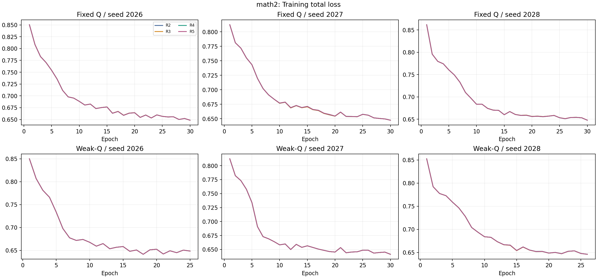
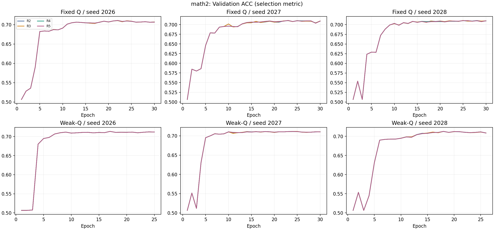
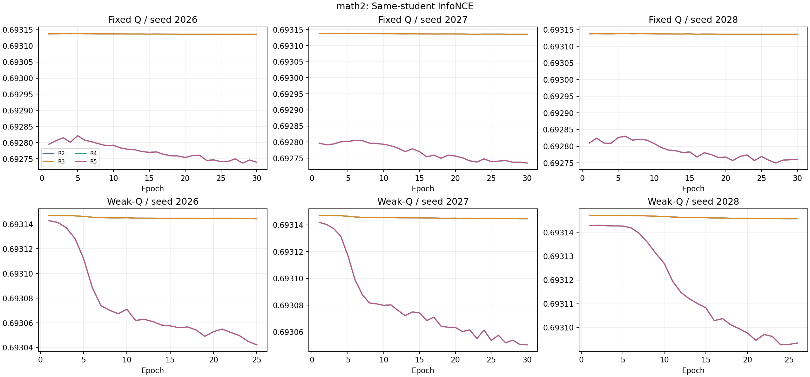
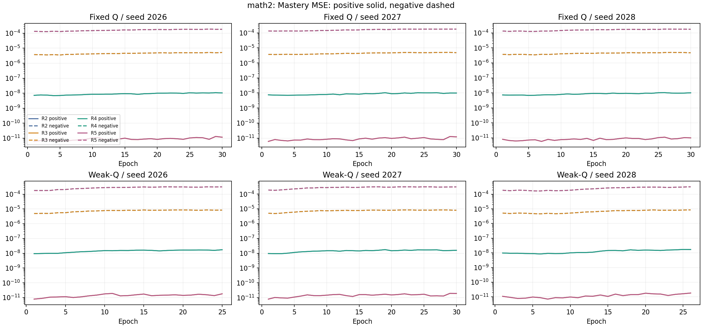
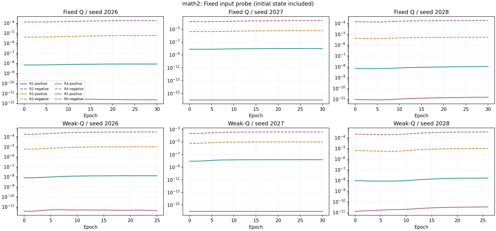
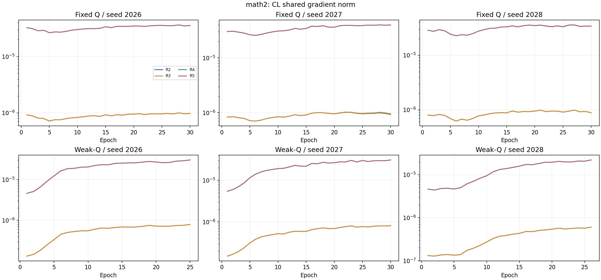
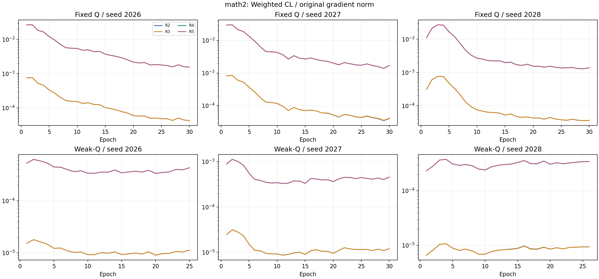
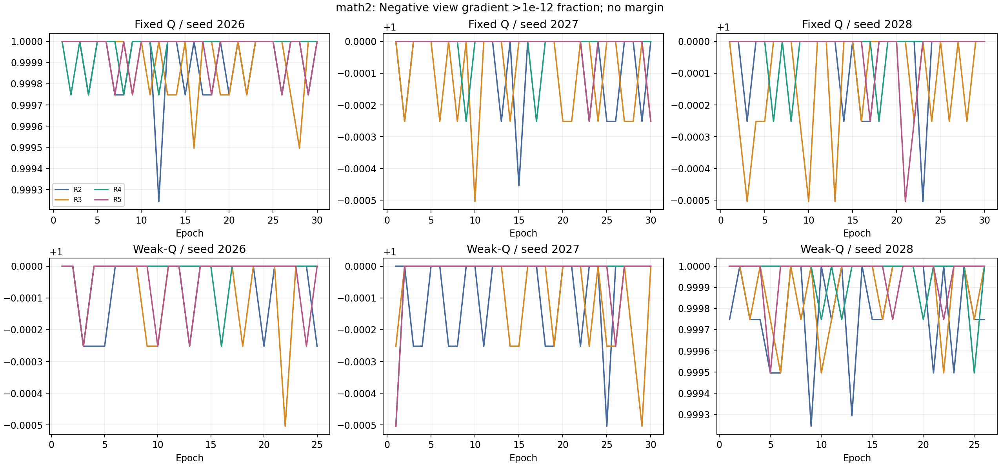
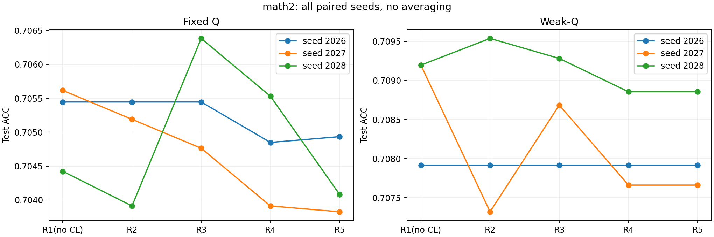

# math2：R2–R5噪声敏感性实验

主表不是均值：每个Q/条件内按最高验证ACC选择种子，并列选较小种子；两个test指标来自同一checkpoint。严禁把不同种子的单次结果直接相减解释模块收益，收益看全部配对种子。A0=固定参考Q，A1=Weak-Q。

| Q设置 | 条件 | CL系数 | 验证选优种子 | 最佳轮 | valid ACC | test ACC | test AUC |
| --- | --- | --- | --- | --- | --- | --- | --- |
| A0 | R1 | 0 | 2026 | 22 | 0.710687804 | 0.705446177 | 0.77724143 |
| A0 | R2 | 0.1 | 2026 | 22 | 0.710687804 | 0.705446177 | 0.777238713 |
| A0 | R3 | 0.1 | 2028 | 25 | 0.710815648 | 0.706383704 | 0.778697498 |
| A0 | R4 | 0.1 | 2026 | 22 | 0.711071337 | 0.70484957 | 0.777233219 |
| A0 | R5 | 0.1 | 2026 | 22 | 0.711071337 | 0.704934799 | 0.777232216 |
| A1 | R1 | 0 | 2026 | 17 | 0.713500384 | 0.707917839 | 0.786282583 |
| A1 | R2 | 0.1 | 2026 | 17 | 0.713500384 | 0.707917839 | 0.786282467 |
| A1 | R3 | 0.1 | 2026 | 17 | 0.713500384 | 0.707917839 | 0.786282394 |
| A1 | R4 | 0.1 | 2026 | 17 | 0.713372539 | 0.707917839 | 0.786286798 |
| A1 | R5 | 0.1 | 2026 | 17 | 0.713372539 | 0.707917839 | 0.786286798 |

## 数据与固定协议

数据集：math2；学生=3911，题目=16，概念=16；train/valid/test交互=[43021, 7822, 11733]。

使用data目录现有训练/验证/测试文件；没有重新划分。Q-F1表示与参考Q一致性，不能自动解释为认知诊断真实性。

R0参考原循环（统一验证ACC选模），R1新增入口λ=0并完全跳过CL训练分支，R2 λ=0.1。R2同时用于受控与敏感性实验，没有重复训练一份R2。模型、原始损失、α=0.8、Adam及学习率、128学生batch、30轮上限、patience=8均不变。验证ACC严格提升才更新checkpoint，平分保留最早轮。种子2026/2027/2028；每个数据集36次训练。

| 条件 | 正比例 | 正幅度 | 负比例 | 负幅度 |
| --- | --- | --- | --- | --- |
| R2 | 0.1 | 0.01 | 0.5 | 0.1 |
| R3 | 0.01 | 0.001 | 0.5 | 0.1 |
| R4 | 0.1 | 0.01 | 0.7 | 0.5 |
| R5 | 0.01 | 0.001 | 0.7 | 0.5 |

两输入不拼接。只对学生support的非零±1位置施加均匀连续噪声并裁剪到[-1,1]；0缺失、ID、标签、query和原数组不变。负噪声不翻转正误，只降低输入证据绝对值；因此极端响应不能直接当成诊断能力改善。验证/测试不增强。

损失沿用同学生一正一负InfoNCE，温度0.2，无margin。L=−正logit+logsumexp(正logit,负logit)。联合归一化项并不是独立负样本损失；负约束非零比例指负视图梯度范数>1e−12，不是margin激活率。

## 配置、代码和核验依据

以下完整配置/哈希和核验结果作为最终文档保留；用户要求清理新实验的checkpoint、原始日志及JSON/CSV副本。实际清理状态：自动审批以blocked by policy拒绝递归删除，原始产物仍暂存在Git忽略的scratch/student_cl_all_20261123。最终报告目录只包含Markdown和配图。若后续手工清理，便不能直接重放checkpoint，需按记录重跑。


## 全部条件的初始固定batch敏感性

| Q | 条件 | CL损失 | 正MSE | 负MSE | CL共享梯度 | 加权CL/原梯度 |
| --- | --- | --- | --- | --- | --- | --- |
| A0 | R2 | 0.693137646 | 5.28470023e-09 | 3.68164979e-06 | 8.64040683e-07 | 0.000380490328 |
| A0 | R3 | 0.693137586 | 1.40361681e-12 | 3.68164979e-06 | 8.65555321e-07 | 0.000381157317 |
| A0 | R4 | 0.692791164 | 5.28470023e-09 | 0.000137480631 | 3.08290468e-05 | 0.013575928 |
| A0 | R5 | 0.692791164 | 1.40361681e-12 | 0.000137480631 | 3.08309058e-05 | 0.0135767467 |
| A1 | R2 | 0.693147123 | 6.0568115e-09 | 4.7920912e-06 | 1.28888685e-07 | 1.40099877e-05 |
| A1 | R3 | 0.693147123 | 1.52148433e-12 | 4.7920912e-06 | 1.29008921e-07 | 1.40230572e-05 |
| A1 | R4 | 0.69314301 | 6.0568115e-09 | 0.000187132813 | 4.32173834e-06 | 0.000469765838 |
| A1 | R5 | 0.69314301 | 1.52148433e-12 | 0.000187132813 | 4.32183832e-06 | 0.000469776705 |

## 全部种子结果（相对R2配对差值）

| Q | seed | 条件 | 最佳轮 | 训练轮 | valid ACC | test ACC | test AUC | ΔACC | ΔAUC | RMSE | Brier | NLL | Q-F1 |
| --- | --- | --- | --- | --- | --- | --- | --- | --- | --- | --- | --- | --- | --- |
| A0 | 2026 | R2 | 22 | 30 | 0.710687804 | 0.705446177 | 0.777238713 | 0 | 0 | 0.439321697 | 0.193003554 | 0.56872739 | 1 |
| A0 | 2026 | R3 | 22 | 30 | 0.710687804 | 0.705446177 | 0.777237085 | 0 | -1.62780051e-06 | 0.439322839 | 0.193004557 | 0.568730131 | 1 |
| A0 | 2026 | R4 | 22 | 30 | 0.711071337 | 0.70484957 | 0.777233219 | -0.000596607858 | -5.49382671e-06 | 0.439287699 | 0.192973683 | 0.568629375 | 1 |
| A0 | 2026 | R5 | 22 | 30 | 0.711071337 | 0.704934799 | 0.777232216 | -0.000511378164 | -6.4966681e-06 | 0.439287127 | 0.19297318 | 0.568628122 | 1 |
| A0 | 2027 | R2 | 25 | 30 | 0.710176425 | 0.705190488 | 0.77801465 | 0 | 0 | 0.438578193 | 0.192350832 | 0.566892255 | 1 |
| A0 | 2027 | R3 | 23 | 30 | 0.710176425 | 0.70476434 | 0.777595172 | -0.00042614847 | -0.000419478377 | 0.439097394 | 0.192806521 | 0.56801018 | 1 |
| A0 | 2027 | R4 | 23 | 30 | 0.710559959 | 0.703912043 | 0.777543344 | -0.00127844541 | -0.000471306383 | 0.439107008 | 0.192814964 | 0.568131699 | 1 |
| A0 | 2027 | R5 | 23 | 30 | 0.710559959 | 0.703826813 | 0.777550204 | -0.0013636751 | -0.000464446366 | 0.43909909 | 0.192808011 | 0.568112067 | 1 |
| A0 | 2028 | R2 | 28 | 30 | 0.710559959 | 0.703912043 | 0.780177532 | 0 | 0 | 0.437834673 | 0.191699201 | 0.56520882 | 1 |
| A0 | 2028 | R3 | 25 | 30 | 0.710815648 | 0.706383704 | 0.778697498 | 0.00247166113 | -0.00148003401 | 0.438089603 | 0.1919225 | 0.566093063 | 1 |
| A0 | 2028 | R4 | 25 | 30 | 0.71030427 | 0.705531407 | 0.778830004 | 0.00161936419 | -0.00134752814 | 0.438077896 | 0.191912243 | 0.566015094 | 1 |
| A0 | 2028 | R5 | 26 | 30 | 0.710432115 | 0.704082502 | 0.778958876 | 0.000170459388 | -0.00121865576 | 0.437996025 | 0.191840518 | 0.565830935 | 1 |
| A1 | 2026 | R2 | 17 | 25 | 0.713500384 | 0.707917839 | 0.786282467 | 0 | 0 | 0.434724325 | 0.188985239 | 0.558661781 | 0.371040724 |
| A1 | 2026 | R3 | 17 | 25 | 0.713500384 | 0.707917839 | 0.786282394 | 0 | -7.26696654e-08 | 0.434724321 | 0.188985236 | 0.558661766 | 0.371040724 |
| A1 | 2026 | R4 | 17 | 25 | 0.713372539 | 0.707917839 | 0.786286798 | 0 | 4.33111206e-06 | 0.434722701 | 0.188983827 | 0.558655744 | 0.371040724 |
| A1 | 2026 | R5 | 17 | 25 | 0.713372539 | 0.707917839 | 0.786286798 | 0 | 4.33111206e-06 | 0.434722704 | 0.18898383 | 0.558655754 | 0.371040724 |
| A1 | 2027 | R2 | 24 | 30 | 0.711327026 | 0.707321231 | 0.786592825 | 0 | 0 | 0.433825423 | 0.188204498 | 0.556242747 | 0.364444444 |
| A1 | 2027 | R3 | 25 | 30 | 0.711582715 | 0.708684906 | 0.78660092 | 0.0013636751 | 8.09540074e-06 | 0.433968003 | 0.188328228 | 0.556559535 | 0.371681416 |
| A1 | 2027 | R4 | 24 | 30 | 0.711199182 | 0.707662149 | 0.786578233 | 0.000340918776 | -1.45920688e-05 | 0.43383741 | 0.188214898 | 0.556268336 | 0.377192982 |
| A1 | 2027 | R5 | 24 | 30 | 0.711199182 | 0.707662149 | 0.786577375 | 0.000340918776 | -1.54495709e-05 | 0.433837443 | 0.188214927 | 0.556268403 | 0.377192982 |
| A1 | 2028 | R2 | 18 | 26 | 0.712477627 | 0.709537203 | 0.785656752 | 0 | 0 | 0.435603754 | 0.18975063 | 0.56086955 | 0.408376963 |
| A1 | 2028 | R3 | 18 | 26 | 0.712733316 | 0.709281514 | 0.785819721 | -0.000255689082 | 0.000162968992 | 0.435494843 | 0.189655758 | 0.560599689 | 0.404145078 |
| A1 | 2028 | R4 | 18 | 26 | 0.712733316 | 0.708855365 | 0.785678059 | -0.000681837552 | 2.13067459e-05 | 0.435594397 | 0.189742479 | 0.560843257 | 0.408376963 |
| A1 | 2028 | R5 | 18 | 26 | 0.712733316 | 0.708855365 | 0.785677739 | -0.000681837552 | 2.09869994e-05 | 0.435594626 | 0.189742679 | 0.560843698 | 0.408376963 |

## 补充统计：不替代主表

| Q | 条件 | ACC均值 | ACC样本SD | AUC均值 | AUC样本SD | 配对ΔACC均值 | 配对ΔAUC均值 | 配对ΔACC SD | 配对ΔAUC SD |
| --- | --- | --- | --- | --- | --- | --- | --- | --- | --- |
| A0 | R2 | 0.70484957 | 0.000821925404 | 0.778476965 | 0.00152297934 | 0 | 0 | 0 | 0 |
| A0 | R3 | 0.705531407 | 0.000813039463 | 0.777843252 | 0.000761156576 | 0.000681837552 | -0.000633713396 | 0.0015646092 | 0.000762131033 |
| A0 | R4 | 0.70476434 | 0.000813039463 | 0.777868855 | 0.000846698906 | -8.5229694e-05 | -0.00060810945 | 0.00151507618 | 0.000681395872 |
| A0 | R5 | 0.704281372 | 0.000580146534 | 0.777913765 | 0.000918951405 | -0.00056819796 | -0.000563199597 | 0.000768643953 | 0.000612083789 |
| A1 | R2 | 0.708258757 | 0.00114664826 | 0.786177348 | 0.000476807558 | 0 | 0 | 0 | 0 |
| A1 | R3 | 0.708628086 | 0.000683610865 | 0.786234345 | 0.000392809718 | 0.000369328674 | 5.6997241e-05 | 0.000870567541 | 9.1865055e-05 |
| A1 | R4 | 0.708145118 | 0.000628237859 | 0.78618103 | 0.000459312922 | -0.000113639592 | 3.68192972e-06 | 0.000520762032 | 1.79582099e-05 |
| A1 | R5 | 0.708145118 | 0.000628237859 | 0.786180637 | 0.00045911738 | -0.000113639592 | 3.28951353e-06 | 0.000520762032 | 1.82406033e-05 |

## 实际输入变化（有效位置加权；最大值为全程最大）

| Q | seed | 条件 | 视图 | 选中比例 | 实际变化比例 | MAE | MSE | 全程最大变化 | 裁剪/选中 |
| --- | --- | --- | --- | --- | --- | --- | --- | --- | --- |
| A0 | 2026 | R2 | positive | 0.0999019859 | 0.0501630018 | 0.000249980893 | 1.66681728e-06 | 0.00999993086 | 0.497867167 |
| A0 | 2026 | R2 | negative | 0.500455979 | 0.250330265 | 0.0125171073 | 0.000834452385 | 0.0999996662 | 0.499795635 |
| A0 | 2026 | R3 | positive | 0.00994523992 | 0.00494651837 | 2.4489379e-06 | 1.63033449e-09 | 0.000999569893 | 0.502517408 |
| A0 | 2026 | R3 | negative | 0.500455979 | 0.250330265 | 0.0125171073 | 0.000834452385 | 0.0999996662 | 0.499795635 |
| A0 | 2026 | R4 | positive | 0.0999019859 | 0.0501630018 | 0.000249980893 | 1.66681728e-06 | 0.00999993086 | 0.497867167 |
| A0 | 2026 | R4 | negative | 0.6996708 | 0.350073511 | 0.0874882947 | 0.0291597726 | 0.49999845 | 0.499659682 |
| A0 | 2026 | R5 | positive | 0.00994523992 | 0.00494651837 | 2.4489379e-06 | 1.63033449e-09 | 0.000999569893 | 0.502517408 |
| A0 | 2026 | R5 | negative | 0.6996708 | 0.350073511 | 0.0874882947 | 0.0291597726 | 0.49999845 | 0.499659682 |
| A0 | 2027 | R2 | positive | 0.0994246996 | 0.0497198074 | 0.000247798312 | 1.64827464e-06 | 0.00999933481 | 0.499924992 |
| A0 | 2027 | R2 | negative | 0.500406972 | 0.250134237 | 0.012501899 | 0.000833699635 | 0.0999999642 | 0.500138386 |
| A0 | 2027 | R3 | positive | 0.009956959 | 0.00503494417 | 2.5124163e-06 | 1.67158026e-09 | 0.000999927521 | 0.494222127 |
| A0 | 2027 | R3 | negative | 0.500406972 | 0.250134237 | 0.012501899 | 0.000833699635 | 0.0999999642 | 0.500138386 |
| A0 | 2027 | R4 | positive | 0.0994246996 | 0.0497198074 | 0.000247798312 | 1.64827464e-06 | 0.00999933481 | 0.499924992 |
| A0 | 2027 | R4 | negative | 0.700404841 | 0.350291912 | 0.0875654666 | 0.0292009814 | 0.499999821 | 0.499872229 |
| A0 | 2027 | R5 | positive | 0.009956959 | 0.00503494417 | 2.5124163e-06 | 1.67158026e-09 | 0.000999927521 | 0.494222127 |
| A0 | 2027 | R5 | negative | 0.700404841 | 0.350291912 | 0.0875654666 | 0.0292009814 | 0.499999821 | 0.499872229 |
| A0 | 2028 | R2 | positive | 0.0993884769 | 0.0500223728 | 0.000249930361 | 1.66827899e-06 | 0.00999999046 | 0.496698467 |
| A0 | 2028 | R2 | negative | 0.5 | 0.250083099 | 0.0124990092 | 0.000833328081 | 0.099999249 | 0.499833802 |
| A0 | 2028 | R3 | positive | 0.00984189892 | 0.00489964204 | 2.41267593e-06 | 1.60256799e-09 | 0.000999748707 | 0.502164971 |
| A0 | 2028 | R3 | negative | 0.5 | 0.250083099 | 0.0124990092 | 0.000833328081 | 0.099999249 | 0.499833802 |
| A0 | 2028 | R4 | positive | 0.0993884769 | 0.0500223728 | 0.000249930361 | 1.66827899e-06 | 0.00999999046 | 0.496698467 |
| A0 | 2028 | R4 | negative | 0.69990092 | 0.350245035 | 0.0876136917 | 0.0292267482 | 0.49999696 | 0.499579119 |
| A0 | 2028 | R5 | positive | 0.00984189892 | 0.00489964204 | 2.41267593e-06 | 1.60256799e-09 | 0.000999748707 | 0.502164971 |
| A0 | 2028 | R5 | negative | 0.69990092 | 0.350245035 | 0.0876136917 | 0.0292267482 | 0.49999696 | 0.499579119 |
| A1 | 2026 | R2 | positive | 0.0998440297 | 0.0502045513 | 0.000250156439 | 1.6682021e-06 | 0.00999993086 | 0.497157418 |
| A1 | 2026 | R2 | negative | 0.500563794 | 0.250512657 | 0.0125285935 | 0.000835436402 | 0.0999996662 | 0.499539001 |
| A1 | 2026 | R3 | positive | 0.00993096395 | 0.00492585017 | 2.44650473e-06 | 1.62878788e-09 | 0.000999569893 | 0.503861998 |
| A1 | 2026 | R3 | negative | 0.500563794 | 0.250512657 | 0.0125285935 | 0.000835436402 | 0.0999996662 | 0.499539001 |
| A1 | 2026 | R4 | positive | 0.0998440297 | 0.0502045513 | 0.000250156439 | 1.6682021e-06 | 0.00999993086 | 0.497157418 |
| A1 | 2026 | R4 | negative | 0.699659934 | 0.350177704 | 0.0875302632 | 0.0291774438 | 0.49999845 | 0.499502991 |
| A1 | 2026 | R5 | positive | 0.00993096395 | 0.00492585017 | 2.44650473e-06 | 1.62878788e-09 | 0.000999569893 | 0.503861998 |
| A1 | 2026 | R5 | negative | 0.699659934 | 0.350177704 | 0.0875302632 | 0.0291774438 | 0.49999845 | 0.499502991 |
| A1 | 2027 | R2 | positive | 0.0994246996 | 0.0497198074 | 0.000247798312 | 1.64827464e-06 | 0.00999933481 | 0.499924992 |
| A1 | 2027 | R2 | negative | 0.500406972 | 0.250134237 | 0.012501899 | 0.000833699635 | 0.0999999642 | 0.500138386 |
| A1 | 2027 | R3 | positive | 0.009956959 | 0.00503494417 | 2.5124163e-06 | 1.67158026e-09 | 0.000999927521 | 0.494222127 |
| A1 | 2027 | R3 | negative | 0.500406972 | 0.250134237 | 0.012501899 | 0.000833699635 | 0.0999999642 | 0.500138386 |
| A1 | 2027 | R4 | positive | 0.0994246996 | 0.0497198074 | 0.000247798312 | 1.64827464e-06 | 0.00999933481 | 0.499924992 |
| A1 | 2027 | R4 | negative | 0.700404841 | 0.350291912 | 0.0875654666 | 0.0292009814 | 0.499999821 | 0.499872229 |
| A1 | 2027 | R5 | positive | 0.009956959 | 0.00503494417 | 2.5124163e-06 | 1.67158026e-09 | 0.000999927521 | 0.494222127 |
| A1 | 2027 | R5 | negative | 0.700404841 | 0.350291912 | 0.0875654666 | 0.0292009814 | 0.499999821 | 0.499872229 |
| A1 | 2028 | R2 | positive | 0.0993561061 | 0.0499614008 | 0.00024976235 | 1.66890988e-06 | 0.00999999046 | 0.49714816 |
| A1 | 2028 | R2 | negative | 0.500038108 | 0.250191767 | 0.0124980006 | 0.000833261297 | 0.099999249 | 0.4996546 |
| A1 | 2028 | R3 | positive | 0.00984771748 | 0.0048802195 | 2.40897956e-06 | 1.60093217e-09 | 0.000999748707 | 0.504431407 |
| A1 | 2028 | R3 | negative | 0.500038108 | 0.250191767 | 0.0124980006 | 0.000833261297 | 0.099999249 | 0.4996546 |
| A1 | 2028 | R4 | positive | 0.0993561061 | 0.0499614008 | 0.00024976235 | 1.66890988e-06 | 0.00999999046 | 0.49714816 |
| A1 | 2028 | R4 | negative | 0.699891086 | 0.350338296 | 0.0875890209 | 0.029218439 | 0.49999696 | 0.499438837 |
| A1 | 2028 | R5 | positive | 0.00984771748 | 0.0048802195 | 2.40897956e-06 | 1.60093217e-09 | 0.000999748707 | 0.504431407 |
| A1 | 2028 | R5 | negative | 0.699891086 | 0.350338296 | 0.0875890209 | 0.029218439 | 0.49999696 | 0.499438837 |

## 训练平均诊断（先batch均值，再epoch均值）

| Q | seed | 条件 | 正MSE | 负MSE | CL损失 | CL梯度 | 加权CL/原梯度 | 负视图梯度非零比例 | 正输入未变学生比例 |
| --- | --- | --- | --- | --- | --- | --- | --- | --- | --- |
| A0 | 2026 | R2 | 8.97910916e-09 | 4.46832682e-06 | 0.69313663 | 8.94346431e-07 | 0.000176461782 | 0.999890793 | 0.662396117 |
| A0 | 2026 | R3 | 8.86433007e-12 | 4.46831847e-06 | 0.693136613 | 8.95930377e-07 | 0.000176776948 | 0.999899194 | 0.961142189 |
| A0 | 2026 | R4 | 8.99167099e-09 | 0.000160787471 | 0.692772774 | 3.22532353e-05 | 0.00628148649 | 0.999966398 | 0.662396117 |
| A0 | 2026 | R5 | 8.87567414e-12 | 0.000160788018 | 0.692772754 | 3.22546009e-05 | 0.00628178349 | 0.999957997 | 0.961142189 |
| A0 | 2027 | R2 | 8.75411486e-09 | 4.37232769e-06 | 0.693136604 | 9.00632937e-07 | 0.00017136114 | 0.999934452 | 0.665602046 |
| A0 | 2027 | R3 | 8.88728582e-12 | 4.37236803e-06 | 0.693136577 | 9.06872214e-07 | 0.000171882979 | 0.999899194 | 0.960496886 |
| A0 | 2027 | R4 | 8.76362225e-09 | 0.000158158201 | 0.692768463 | 3.43530694e-05 | 0.00629417666 | 0.999983199 | 0.665602046 |
| A0 | 2027 | R5 | 8.89600281e-12 | 0.000158153644 | 0.692768459 | 3.43458899e-05 | 0.00629381226 | 0.999983199 | 0.960496886 |
| A0 | 2028 | R2 | 8.64532506e-09 | 4.31304309e-06 | 0.693137007 | 8.55468732e-07 | 0.000156591645 | 0.999949597 | 0.661263583 |
| A0 | 2028 | R3 | 8.33844563e-12 | 4.3131603e-06 | 0.693136991 | 8.56809426e-07 | 0.000156903434 | 0.999873992 | 0.961542457 |
| A0 | 2028 | R4 | 8.64376403e-09 | 0.000155468412 | 0.692785856 | 3.12091702e-05 | 0.00557225863 | 0.999974798 | 0.661263583 |
| A0 | 2028 | R5 | 8.33761693e-12 | 0.000155485733 | 0.692785908 | 3.11477209e-05 | 0.00556984267 | 0.999966398 | 0.961542457 |
| A1 | 2026 | R2 | 1.41917085e-08 | 7.38179791e-06 | 0.693145171 | 5.66427301e-07 | 1.11354397e-05 | 0.999939516 | 0.66179975 |
| A1 | 2026 | R3 | 1.38082492e-11 | 7.3818078e-06 | 0.693145171 | 5.67253795e-07 | 1.11516555e-05 | 0.999939516 | 0.96129444 |
| A1 | 2026 | R4 | 1.41950907e-08 | 0.000268778222 | 0.693073907 | 2.09127711e-05 | 0.000407048053 | 0.999979839 | 0.66179975 |
| A1 | 2026 | R5 | 1.38114131e-11 | 0.00026877814 | 0.693073902 | 2.09136206e-05 | 0.000407064303 | 0.999959677 | 0.96129444 |
| A1 | 2027 | R2 | 1.43128423e-08 | 7.4228847e-06 | 0.693145312 | 5.82671577e-07 | 1.29238331e-05 | 0.999915995 | 0.665602046 |
| A1 | 2027 | R3 | 1.44077978e-11 | 7.42461496e-06 | 0.693145311 | 5.83307863e-07 | 1.29516821e-05 | 0.999915995 | 0.960496886 |
| A1 | 2027 | R4 | 1.43345168e-08 | 0.000272951707 | 0.693078724 | 2.1728442e-05 | 0.000478942442 | 0.999983199 | 0.665602046 |
| A1 | 2027 | R5 | 1.442503e-11 | 0.000272951681 | 0.693078718 | 2.17295691e-05 | 0.000478966112 | 0.999974798 | 0.960496886 |
| A1 | 2028 | R2 | 1.23681615e-08 | 6.48178595e-06 | 0.693146323 | 3.68300969e-07 | 8.64937818e-06 | 0.999788667 | 0.661537561 |
| A1 | 2028 | R3 | 1.19559201e-11 | 6.47981962e-06 | 0.693146325 | 3.69100628e-07 | 8.63485008e-06 | 0.999883685 | 0.961589111 |
| A1 | 2028 | R4 | 1.23778659e-08 | 0.00023815451 | 0.693116357 | 1.3293922e-05 | 0.00031060482 | 0.999951535 | 0.661537561 |
| A1 | 2028 | R5 | 1.19707573e-11 | 0.000238154209 | 0.693116354 | 1.32944721e-05 | 0.000310615982 | 0.999961228 | 0.961589111 |

正能量、联合归一化项及正负梯度通路：

| Q | seed | 条件 | 正能量 | 联合归一化项 | 正视图梯度 | 负视图梯度 | 正共享偏梯度 | 负共享偏梯度 |
| --- | --- | --- | --- | --- | --- | --- | --- | --- |
| A0 | 2026 | R2 | -5 | 5.69313653 | 5.97476594e-07 | 2.25673745e-05 | 2.47859661e-09 | 8.95906246e-07 |
| A0 | 2026 | R3 | -5 | 5.69313655 | 7.10000752e-09 | 2.25673712e-05 | 1.56819136e-09 | 8.95919917e-07 |
| A0 | 2026 | R4 | -5 | 5.69277268 | 5.98602127e-07 | 0.000141526552 | 2.49943695e-09 | 3.22548413e-05 |
| A0 | 2026 | R5 | -5 | 5.69277271 | 7.10733346e-09 | 0.000141526733 | 1.55641922e-09 | 3.22546242e-05 |
| A0 | 2027 | R2 | -5 | 5.69313649 | 5.92272717e-07 | 2.24797118e-05 | 2.53804778e-09 | 9.02277738e-07 |
| A0 | 2027 | R3 | -5 | 5.69313651 | 7.22393755e-09 | 2.24904381e-05 | 1.5615831e-09 | 9.06872637e-07 |
| A0 | 2027 | R4 | -5 | 5.69276837 | 5.95041524e-07 | 0.000141892472 | 2.6142282e-09 | 3.43548429e-05 |
| A0 | 2027 | R5 | -5 | 5.69276841 | 7.25070685e-09 | 0.000141888875 | 1.57295598e-09 | 3.43458938e-05 |
| A0 | 2028 | R2 | -5 | 5.69313689 | 5.82527863e-07 | 2.20185805e-05 | 2.36500004e-09 | 8.56989691e-07 |
| A0 | 2028 | R3 | -5 | 5.69313691 | 6.74131132e-09 | 2.20190341e-05 | 1.5183046e-09 | 8.56784858e-07 |
| A0 | 2028 | R4 | -5 | 5.69278576 | 5.83316278e-07 | 0.00013807241 | 2.3941358e-09 | 3.12107133e-05 |
| A0 | 2028 | R5 | -5 | 5.69278587 | 6.74683653e-09 | 0.000138057978 | 1.53746905e-09 | 3.11477105e-05 |
| A1 | 2026 | R2 | -5 | 5.69314509 | 2.25870215e-07 | 9.0395328e-06 | 2.134074e-09 | 5.67261491e-07 |
| A1 | 2026 | R3 | -5 | 5.6931451 | 3.17103127e-09 | 9.03954857e-06 | 1.93931396e-09 | 5.67258687e-07 |
| A1 | 2026 | R4 | -5 | 5.69307383 | 2.26348302e-07 | 5.72381865e-05 | 2.14336599e-09 | 2.09136271e-05 |
| A1 | 2026 | R5 | -5 | 5.69307386 | 3.17601825e-09 | 5.72382016e-05 | 1.9252844e-09 | 2.09136188e-05 |
| A1 | 2027 | R2 | -5 | 5.69314524 | 2.22311037e-07 | 8.85346456e-06 | 2.13899215e-09 | 5.83577094e-07 |
| A1 | 2027 | R3 | -5 | 5.69314525 | 3.1796493e-09 | 8.84537471e-06 | 1.87718303e-09 | 5.8331298e-07 |
| A1 | 2027 | R4 | -5 | 5.69307866 | 2.2270388e-07 | 5.62458256e-05 | 2.11204178e-09 | 2.17293641e-05 |
| A1 | 2027 | R5 | -5 | 5.69307866 | 3.18188316e-09 | 5.62458342e-05 | 1.90057375e-09 | 2.17295739e-05 |
| A1 | 2028 | R2 | -5 | 5.69314606 | 1.64062968e-07 | 6.22558999e-06 | 1.9167776e-09 | 3.68917876e-07 |
| A1 | 2028 | R3 | -5 | 5.69314606 | 2.48036781e-09 | 6.21898477e-06 | 1.82484456e-09 | 3.69112316e-07 |
| A1 | 2028 | R4 | -5 | 5.69311628 | 1.64760121e-07 | 3.8895877e-05 | 1.89272734e-09 | 1.32945484e-05 |
| A1 | 2028 | R5 | -5 | 5.69311628 | 2.49011102e-09 | 3.88957609e-05 | 1.83064437e-09 | 1.32944806e-05 |

## 固定视图轨迹

固定最多128名学生、support和噪声；从初始化到同Q同seed四配置共同末轮。不把较小输入噪声造成的初始距离小误判成学习收益。轨迹也包含原损失影响，本轮没有λ=0同probe训练轨迹。

| Q | seed | 条件 | 共同轮 | 初始正MSE | 末正MSE | 初始负MSE | 末负MSE | 正下降 | 负上升 |
| --- | --- | --- | --- | --- | --- | --- | --- | --- | --- |
| A0 | 2026 | R2 | 30 | 6.71944278e-09 | 8.28799696e-09 | 4.02947853e-06 | 5.81352015e-06 | False | True |
| A0 | 2026 | R3 | 30 | 2.31552624e-12 | 2.25225437e-12 | 4.02947853e-06 | 5.81368522e-06 | True | True |
| A0 | 2026 | R4 | 30 | 6.71944278e-09 | 8.28907254e-09 | 0.000126845014 | 0.000177364273 | False | True |
| A0 | 2026 | R5 | 30 | 2.31552624e-12 | 2.24938687e-12 | 0.000126845014 | 0.0001773603 | True | True |
| A0 | 2027 | R2 | 30 | 7.77816833e-09 | 1.00781277e-08 | 4.44243869e-06 | 6.13352086e-06 | False | True |
| A0 | 2027 | R3 | 30 | 0 | 0 | 4.44243869e-06 | 6.13147904e-06 | False | True |
| A0 | 2027 | R4 | 30 | 7.77816833e-09 | 1.00744693e-08 | 0.000155080634 | 0.000226073535 | False | True |
| A0 | 2027 | R5 | 30 | 0 | 0 | 0.000155080634 | 0.000226064658 | False | True |
| A0 | 2028 | R2 | 30 | 6.93023683e-09 | 1.04768807e-08 | 4.091964e-06 | 5.23291919e-06 | False | True |
| A0 | 2028 | R3 | 30 | 9.57240797e-12 | 1.55178891e-11 | 4.091964e-06 | 5.23587187e-06 | False | True |
| A0 | 2028 | R4 | 30 | 6.93023683e-09 | 1.04404716e-08 | 0.000141250872 | 0.000180171701 | False | True |
| A0 | 2028 | R5 | 30 | 9.57240797e-12 | 1.5435847e-11 | 0.000141250872 | 0.000180291885 | False | True |
| A1 | 2026 | R2 | 25 | 8.11905743e-09 | 1.28034339e-08 | 5.85598127e-06 | 9.89098226e-06 | False | True |
| A1 | 2026 | R3 | 25 | 3.83546406e-12 | 4.46623641e-12 | 5.85598127e-06 | 9.89124601e-06 | False | True |
| A1 | 2026 | R4 | 25 | 8.11905743e-09 | 1.28136257e-08 | 0.000178176822 | 0.000300517713 | False | True |
| A1 | 2026 | R5 | 25 | 3.83546406e-12 | 4.46598704e-12 | 0.000178176822 | 0.000300517626 | False | True |
| A1 | 2027 | R2 | 30 | 9.04348418e-09 | 1.51464459e-08 | 6.13708789e-06 | 9.79839297e-06 | False | True |
| A1 | 2027 | R3 | 30 | 0 | 0 | 6.13708789e-06 | 9.80464665e-06 | False | True |
| A1 | 2027 | R4 | 30 | 9.04348418e-09 | 1.51810386e-08 | 0.000228155011 | 0.000376596581 | False | True |
| A1 | 2027 | R5 | 30 | 0 | 0 | 0.000228155011 | 0.00037659728 | False | True |
| A1 | 2028 | R2 | 26 | 9.28515576e-09 | 1.65041474e-08 | 6.22903326e-06 | 9.62270042e-06 | False | True |
| A1 | 2028 | R3 | 26 | 1.28187339e-11 | 3.29342456e-11 | 6.22903326e-06 | 9.61196929e-06 | False | True |
| A1 | 2028 | R4 | 26 | 9.28515576e-09 | 1.65009961e-08 | 0.000213849096 | 0.000342110026 | False | True |
| A1 | 2028 | R5 | 26 | 1.28187339e-11 | 3.30281982e-11 | 0.000213849096 | 0.000342109648 | False | True |

## A–I分析与分层结论

### A0

A：负/正输入MAE比值范围50.01–3.631e+04，应结合实际未变化比例判断。

B：掌握度绝对距离见上表；输入分离不保证表征或认知语义分离。

C/D：共同末轮正距离下降2/12，负距离上升12/12；InfoNCE没有margin下界。

E：固定初始batch R4/R2 CL共享梯度范数比=35.6801；无margin饱和机制。

E：固定初始batch R5/R3 CL共享梯度范数比=35.6198；无margin饱和机制。

F：R3/R2正视图梯度范数比：0.011883, 0.012197, 0.011573。

F：R5/R4正视图梯度范数比：0.011873, 0.012185, 0.011566。

G/H/I：R3相对R2逐seed ΔACC：+0.000000000, -0.000426148, +0.002471661；ΔAUC：-0.000001628, -0.000419478, -0.001480034；ACC正/零/负=1/1/1。

G/H/I：R4相对R2逐seed ΔACC：-0.000596608, -0.001278445, +0.001619364；ΔAUC：-0.000005494, -0.000471306, -0.001347528；ACC正/零/负=1/0/2。

G/H/I：R5相对R2逐seed ΔACC：-0.000511378, -0.001363675, +0.000170459；ΔAUC：-0.000006497, -0.000464446, -0.001218656；ACC正/零/负=1/0/2。

### A1

A：负/正输入MAE比值范围50.04–3.636e+04，应结合实际未变化比例判断。

B：掌握度绝对距离见上表；输入分离不保证表征或认知语义分离。

C/D：共同末轮正距离下降0/12，负距离上升12/12；InfoNCE没有margin下界。

E：固定初始batch R4/R2 CL共享梯度范数比=33.5308；无margin饱和机制。

E：固定初始batch R5/R3 CL共享梯度范数比=33.5003；无margin饱和机制。

F：R3/R2正视图梯度范数比：0.014039, 0.014303, 0.015118。

F：R5/R4正视图梯度范数比：0.014032, 0.014288, 0.015114。

G/H/I：R3相对R2逐seed ΔACC：+0.000000000, +0.001363675, -0.000255689；ΔAUC：-0.000000073, +0.000008095, +0.000162969；ACC正/零/负=1/1/1。

G/H/I：R4相对R2逐seed ΔACC：+0.000000000, +0.000340919, -0.000681838；ΔAUC：+0.000004331, -0.000014592, +0.000021307；ACC正/零/负=1/1/1。

G/H/I：R5相对R2逐seed ΔACC：+0.000000000, +0.000340919, -0.000681838；ΔAUC：+0.000004331, -0.000015450, +0.000020987；ACC正/零/负=1/1/1。

实现核验通过、共享梯度生效，与预期拉近/推远是否同时出现、ACC是否可重复提高，是不同层次的结论。三种子不足以作强统计推断；不以单个最优运行代替全部结果。不支持仅凭强噪声的数值响应宣称诊断真实性提高。

## 图表

### Training total loss



### Validation ACC (selection metric)



### Same-student InfoNCE



### Mastery MSE: positive solid, negative dashed



### Fixed input probe (initial state included)



### CL shared gradient norm



### Weighted CL / original gradient norm



### Negative view gradient >1e-12 fraction; no margin





## 运行、文件用途及保留策略

运行脚本experiments/run_student_cl_all_datasets.py复用原训练；报告脚本report_student_cl_all_datasets.py生成本文及配图。全部独立进程使用CPU单线程以保留原数值协议，进程间不共享模型或RNG。run_student_cl_seed2028.py及run_student_cl_seed2027.py只拆分既定种子任务；完成六个条件及核验后才接入，未覆盖已开始的主进程任务。若主进程已开始其中部分条件，仅合并尚不存在的已核验条件；调度重复不算新增实验条件，也不根据指标挑选重复结果。接入状态及该调度脚本哈希在上面的scheduling_records中记录。

```powershell
E:\Desktop\Gen-CD\.venv-contrastive\Scripts\python.exe -m Q_GNCDM.experiments.run_student_cl_all_datasets --dataset math2
```

本目录仅放最终Markdown和assets配图。原始checkpoint、逐轮日志的清理被自动审批拒绝（blocked by policy），仍暂存于scratch/student_cl_all_20261123，未绕过拒绝执行删除。已有Math1正式结果不删除。本文保存配置、哈希、逐种子指标、梯度/参数核验和结论。未提交Git。
