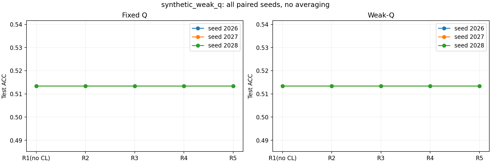

# synthetic_weak_q：R0/R1/R2受控对比学习实验

主表不是均值：每个Q/条件内按最高验证ACC选择种子，并列选较小种子；两个test指标来自同一checkpoint。严禁把不同种子的单次结果直接相减解释模块收益，收益看全部配对种子。A0=固定参考Q，A1=Weak-Q。

| Q设置 | 条件 | CL系数 | 验证选优种子 | 最佳轮 | valid ACC | test ACC | test AUC |
| --- | --- | --- | --- | --- | --- | --- | --- |
| A0 | R0 | 0 | 2026 | 6 | 0.533333333 | 0.513333333 | 0.556034291 |
| A0 | R1 | 0 | 2026 | 6 | 0.533333333 | 0.513333333 | 0.556034291 |
| A0 | R2 | 0.1 | 2026 | 6 | 0.533333333 | 0.513333333 | 0.556035681 |
| A1 | R0 | 0 | 2026 | 6 | 0.533333333 | 0.513333333 | 0.478138621 |
| A1 | R1 | 0 | 2026 | 6 | 0.533333333 | 0.513333333 | 0.478138621 |
| A1 | R2 | 0.1 | 2026 | 6 | 0.533333333 | 0.513333333 | 0.47814279 |

## 数据与固定协议

数据集：synthetic_weak_q；学生=200，题目=30，概念=8；train/valid/test交互=[4200, 600, 1200]。

本项为合成数据，不是真实教育数据。使用既有seed_2026生成数据，Q_noise_0.20，划分seed=2026，交互70/10/20；Q-F1对应生成真Q，另报告真实掌握度指标。

R0参考原循环（统一验证ACC选模），R1新增入口λ=0并完全跳过CL训练分支，R2 λ=0.1。R2同时用于受控与敏感性实验，没有重复训练一份R2。模型、原始损失、α=0.8、Adam及学习率、128学生batch、30轮上限、patience=8均不变。验证ACC严格提升才更新checkpoint，平分保留最早轮。种子2026/2027/2028；每个数据集36次训练。

| 条件 | 正比例 | 正幅度 | 负比例 | 负幅度 |
| --- | --- | --- | --- | --- |
| R2 | 0.1 | 0.01 | 0.5 | 0.1 |
| R3 | 0.01 | 0.001 | 0.5 | 0.1 |
| R4 | 0.1 | 0.01 | 0.7 | 0.5 |
| R5 | 0.01 | 0.001 | 0.7 | 0.5 |

两输入不拼接。只对学生support的非零±1位置施加均匀连续噪声并裁剪到[-1,1]；0缺失、ID、标签、query和原数组不变。负噪声不翻转正误，只降低输入证据绝对值；因此极端响应不能直接当成诊断能力改善。验证/测试不增强。

损失沿用同学生一正一负InfoNCE，温度0.2，无margin。L=−正logit+logsumexp(正logit,负logit)。联合归一化项并不是独立负样本损失；负约束非零比例指负视图梯度范数>1e−12，不是margin激活率。

## 配置、代码和核验依据

以下完整配置/哈希和核验结果作为最终文档保留；用户要求清理新实验的checkpoint、原始日志及JSON/CSV副本。实际清理状态：自动审批以blocked by policy拒绝递归删除，原始产物仍暂存在Git忽略的scratch/student_cl_all_20261123。最终报告目录只包含Markdown和配图。若后续手工清理，便不能直接重放checkpoint，需按记录重跑。

<details><summary>完整配置、版本及数据/源码哈希</summary>

```json
{
  "experiment_id": "student_cl_all_synthetic_weak_q_20261123",
  "dataset": "synthetic_weak_q",
  "args": {
    "experiment_id": "student_cl_control_math1_20261123",
    "seeds": [
      2026,
      2027,
      2028
    ],
    "lambda_cl": 0.1,
    "positive_noise_ratio": 0.1,
    "positive_noise_scale": 0.01,
    "negative_noise_ratio": 0.5,
    "negative_noise_scale": 0.1,
    "noise_distribution": "uniform",
    "contrastive_seed": 1123,
    "temperature": 0.2,
    "dataset": "synthetic",
    "data_dir": "E:\\Desktop\\Gen-CD\\Q_GNCDM\\data\\synthetic_weak_q\\seed_2026",
    "alpha": 0.8,
    "embedding_dim": 32,
    "epochs": 30,
    "patience": 8,
    "batch_students": 128,
    "query_fraction": 0.25,
    "lr": 0.001,
    "q_lr": 0.005,
    "lambda_q": 0.01,
    "lambda_coverage": 0.01,
    "q_init_high": 0.55,
    "q_init_low": 0.45,
    "device": "cpu",
    "q_noise": 0.2,
    "split_seed": 2026
  },
  "noise_configs": {
    "R2": [
      0.1,
      0.01,
      0.5,
      0.1
    ],
    "R3": [
      0.01,
      0.001,
      0.5,
      0.1
    ],
    "R4": [
      0.1,
      0.01,
      0.7,
      0.5
    ],
    "R5": [
      0.01,
      0.001,
      0.7,
      0.5
    ]
  },
  "source_sha256": {
    "Q_GNCDM\\experiments\\run_controlled_student_cl.py": "9447f3fc2e79391b043148ae28717bee2f9f6a53dbe44352e5dddca3b6212a46",
    "Q_GNCDM\\experiments\\reference_student_cl_acc.py": "a974a5dbb0e36daf5ed49031be1838d69200e070f935d8f8f9dc31c0d9fa3dfc",
    "Q_GNCDM\\experiments\\controlled_student_cl.py": "4329530390f079ae00f6fa0d00af659e7e7be0f09134f8bc642b5a8caa0cb041",
    "Q_GNCDM\\experiments\\run_simple_contrastive.py": "196cbac42d9e7664eb4c24a4328bc852dca9265d7a88149adda0be924564a023",
    "Q_GNCDM\\models\\weak_q_gncdm.py": "5970f43820db2736bcf5f4e48039af50bf4203a5f391baa2046b8046c21517f5",
    "Q_GNCDM\\simple_contrastive.py": "30f0126846ab0e0d8802306ee183374a17730ed63f5bdd3ff6d76949b5252d97",
    "Q_GNCDM\\experiments\\run_weak_q_synthetic.py": "266d36d84cf1095189700a0b1f524f678accfd79feb94402ef6562f004f6b9b6",
    "Q_GNCDM\\experiments\\run_student_cl_all_datasets.py": "5c04daaf9a3ba1478c9d763e66348251162132ed385935c67e6d806635ec76bf",
    "Q_GNCDM\\experiments\\run_student_cl_noise_sensitivity.py": "b4c2c3850c4f49b26f60099c8d593128393ec8de80dcb3205d04fb27507f440f",
    "Q_GNCDM\\experiments\\run_prepared_dataset.py": "02b0fe433fcf75bea693b745149ac1654d866f044c81d9b2fc637b6f35d40c4d"
  },
  "data_sha256": {
    "E:\\Desktop\\Gen-CD\\Q_GNCDM\\data\\synthetic_weak_q\\seed_2026\\response.csv": "b7312a080519ad36d09bd9a90082b8656feb99b379ea8eb669797ece05fe9281",
    "E:\\Desktop\\Gen-CD\\Q_GNCDM\\data\\synthetic_weak_q\\seed_2026\\Q_noise_0.20.npy": "1ac0f8ff4c48011b0a28b468e7308568962cd6e35c912083a56ea3ce91b3af93"
  },
  "train_shape": [
    200,
    30
  ],
  "concepts": 8,
  "split_lengths": [
    4200,
    600,
    1200
  ],
  "seeds": [
    2026,
    2027,
    2028
  ],
  "selection": "highest validation ACC, earliest epoch; display seed chosen by validation ACC, lowest seed tie",
  "retention": "user requests final Markdown reports and figures only; temporary originals removed after verification",
  "command": "E:\\Desktop\\Gen-CD\\.venv-contrastive\\Scripts\\python.exe -m Q_GNCDM.experiments.run_student_cl_all_datasets --dataset synthetic_weak_q",
  "python": "3.13.9 (tags/v3.13.9:8183fa5, Oct 14 2025, 14:09:13) [MSC v.1944 64 bit (AMD64)]",
  "torch": "2.14.0+cpu",
  "numpy": "2.4.3",
  "git_head": "89290e14293fe00b1e4eb55ba87ed068c5eccfdc",
  "protocol": "R0 reference ACC selector; R1 CL off; R2 shared by control and noise studies; R3-R5 change noise only",
  "scheduling_records": [],
  "scheduling_duplicate_state_checks": []
}
```
</details>

8种Q/噪声设置预检全部通过；同初始化固定batch的CL梯度、一步更新测试通过；新诊断的损失/梯度与原实现精确一致。6组R0/R1的逐轮日志与checkpoint精确一致；36个checkpoint的全部测试指标已重放核验。

```json
{
  "runs": 36,
  "preflight_settings": 8,
  "baseline_exact_pairs": 6,
  "checkpoint_replays": 36,
  "protected_code_and_data_unchanged": true,
  "status": "passed"
}
```

<details><summary>全部预检真实输出（含逐层梯度和单步参数更新差异）</summary>

```json
{
  "A0_R2": {
    "positive": {
      "selected_fraction": 0.1007375,
      "changed_fraction": 0.050225,
      "clipped_fraction_selected": 0.5014269760516193,
      "input_mae_observed": 0.00025183867546729743,
      "input_mae_all": 0.00020147094619460404,
      "input_max_change": 0.009997665882110596
    },
    "negative": {
      "selected_fraction": 0.5008875,
      "changed_fraction": 0.2517625,
      "clipped_fraction_selected": 0.4973671732674503,
      "input_mae_observed": 0.012591703794896603,
      "input_mae_all": 0.010073362849652767,
      "input_max_change": 0.09999817609786987
    },
    "gradient": {
      "original_shared_grad_norm": 9.050214266345112e-05,
      "cl_shared_grad_norm": 3.666781825497098e-06,
      "cl_to_original_grad_ratio": 0.04051596699906544,
      "weighted_cl_to_original_grad_ratio": 0.004051596699906544
    },
    "per_layer": {
      "f_nn.f_layer_1.weight": {
        "original_grad_norm": 3.308382292743772e-05,
        "cl_grad_norm": 1.5213961432891665e-06,
        "cl_finite": true
      },
      "f_nn.f_layer_1.bias": {
        "original_grad_norm": 1.79642483999487e-05,
        "cl_grad_norm": 8.617344064987265e-07,
        "cl_finite": true
      },
      "f_nn.f_layer_2.weight": {
        "original_grad_norm": 5.970749771222472e-05,
        "cl_grad_norm": 2.3685352061875165e-06,
        "cl_finite": true
      },
      "f_nn.f_layer_2.bias": {
        "original_grad_norm": 5.664273339789361e-05,
        "cl_grad_norm": 2.1858857053302927e-06,
        "cl_finite": true
      }
    },
    "batch_diagnostics": {
      "ap_mse": 2.005770127766482e-08,
      "an_mse": 1.2832676475227345e-05,
      "ap_cos_distance": 2.9802322387695312e-08,
      "an_cos_distance": 1.51023268699646e-05,
      "negative_softmax_probability": 0.499981164932251,
      "negative_not_farther_fraction": 0.0078125,
      "positive_selected_fraction": 0.085785536159601,
      "positive_changed_fraction": 0.032418952618453865,
      "positive_clipped_fraction_selected": 0.622093023255814,
      "positive_input_mae_observed": 0.00017364250379614532,
      "positive_input_mae_all": 9.066490747500211e-05,
      "positive_input_max_change": 0.009647905826568604,
      "negative_selected_fraction": 0.514713216957606,
      "negative_changed_fraction": 0.257356608478803,
      "negative_clipped_fraction_selected": 0.5,
      "negative_input_mae_observed": 0.012838195078074932,
      "negative_input_mae_all": 0.00670327665284276,
      "negative_input_max_change": 0.09973663091659546
    },
    "loss_original": 0.7550396919250488,
    "loss_cl": 0.6931095123291016,
    "loss_total": 0.8243506550788879,
    "single_step_parameter_changes": {
      "f_nn.f_layer_1.weight": {
        "gradient_difference_l2": 1.5213782520209543e-07,
        "update_difference_l2": 0.00027124159776403567,
        "baseline_update_l2": 0.015206427857468901,
        "cl_update_l2": 0.015203691433029716
      },
      "f_nn.f_layer_1.bias": {
        "gradient_difference_l2": 8.617962832610364e-08,
        "update_difference_l2": 4.5012853941301153e-08,
        "baseline_update_l2": 0.0028226595411451195,
        "cl_update_l2": 0.0028226200421823883
      },
      "f_nn.f_layer_2.weight": {
        "gradient_difference_l2": 2.3690841035649404e-07,
        "update_difference_l2": 6.936128416487851e-06,
        "baseline_update_l2": 0.007966346753272445,
        "cl_update_l2": 0.007966827058861748
      },
      "f_nn.f_layer_2.bias": {
        "gradient_difference_l2": 2.186156697106523e-07,
        "update_difference_l2": 1.4320822190917743e-06,
        "baseline_update_l2": 0.0028215801391826955,
        "cl_update_l2": 0.002821103944449328
      }
    },
    "zero_single_step_exact_parity": true,
    "status": "passed",
    "observed_branch_loss_and_gradient_exact": true,
    "observation_state_and_rng_unchanged": true,
    "extra_diagnostics": {
      "ap_mse": 2.0016786450582913e-08,
      "an_mse": 1.254900053027086e-05,
      "ap_cos_distance": 2.7008354663848877e-08,
      "an_cos_distance": 1.441827043890953e-05,
      "negative_softmax_probability": 0.49998199939727783,
      "negative_not_farther_fraction": 0.0078125,
      "positive_energy": -5.0,
      "joint_log_partition": 5.693110942840576,
      "negative_relative_penalty": 0.6931111812591553,
      "positive_view_grad_norm_mean": 1.9137844197463425e-06,
      "negative_view_grad_norm_mean": 6.424484900430158e-05,
      "negative_view_grad_nonzero_fraction": 1.0,
      "negative_view_grad_above_1e_12_fraction": 1.0,
      "positive_shared_partial_grad_norm": 6.395598600063177e-09,
      "negative_shared_partial_grad_norm": 3.61749997243028e-06,
      "positive_selected_fraction": 0.08977556109725686,
      "positive_changed_fraction": 0.03890274314214464,
      "positive_clipped_fraction_selected": 0.5666666666666667,
      "positive_input_mae_observed": 0.00020740691979881376,
      "positive_input_mae_all": 0.00010829450184246525,
      "positive_input_max_change": 0.009961605072021484,
      "positive_input_mse_observed": 1.4281010862760013e-06,
      "positive_clipped_fraction_observed": 0.05087281795511222,
      "positive_input_mae_changed": 0.005331421736627817,
      "positive_unchanged_student_fraction": 0.515625,
      "negative_selected_fraction": 0.5097256857855361,
      "negative_changed_fraction": 0.2518703241895262,
      "negative_clipped_fraction_selected": 0.5058708414872799,
      "negative_input_mae_observed": 0.012638756074011326,
      "negative_input_mae_all": 0.006599142216145992,
      "negative_input_max_change": 0.09973663091659546,
      "negative_input_mse_observed": 0.0008482842240482569,
      "negative_clipped_fraction_observed": 0.25785536159600997,
      "negative_input_mae_changed": 0.0501796156167984,
      "negative_unchanged_student_fraction": 0.0
    }
  },
  "A0_R3": {
    "positive": {
      "selected_fraction": 0.01045,
      "changed_fraction": 0.005025,
      "clipped_fraction_selected": 0.5179425837320574,
      "input_mae_observed": 2.512869286874775e-06,
      "input_mae_all": 2.010295474974555e-06,
      "input_max_change": 0.0009962916374206543
    },
    "negative": {
      "selected_fraction": 0.5008875,
      "changed_fraction": 0.2517625,
      "clipped_fraction_selected": 0.4973671732674503,
      "input_mae_observed": 0.012591703794896603,
      "input_mae_all": 0.010073362849652767,
      "input_max_change": 0.09999817609786987
    },
    "gradient": {
      "original_shared_grad_norm": 9.050214266345112e-05,
      "cl_shared_grad_norm": 3.6734473401544353e-06,
      "cl_to_original_grad_ratio": 0.040589617350992736,
      "weighted_cl_to_original_grad_ratio": 0.004058961735099274
    },
    "per_layer": {
      "f_nn.f_layer_1.weight": {
        "original_grad_norm": 3.308382292743772e-05,
        "cl_grad_norm": 1.5238980495269061e-06,
        "cl_finite": true
      },
      "f_nn.f_layer_1.bias": {
        "original_grad_norm": 1.79642483999487e-05,
        "cl_grad_norm": 8.633516586087353e-07,
        "cl_finite": true
      },
      "f_nn.f_layer_2.weight": {
        "original_grad_norm": 5.970749771222472e-05,
        "cl_grad_norm": 2.3728218820906477e-06,
        "cl_finite": true
      },
      "f_nn.f_layer_2.bias": {
        "original_grad_norm": 5.664273339789361e-05,
        "cl_grad_norm": 2.190043687733123e-06,
        "cl_finite": true
      }
    },
    "batch_diagnostics": {
      "ap_mse": 2.038630028677879e-11,
      "an_mse": 1.2832676475227345e-05,
      "ap_cos_distance": 6.05359673500061e-09,
      "an_cos_distance": 1.51023268699646e-05,
      "negative_softmax_probability": 0.4999811053276062,
      "negative_not_farther_fraction": 0.0078125,
      "positive_selected_fraction": 0.006483790523690773,
      "positive_changed_fraction": 0.0029925187032418953,
      "positive_clipped_fraction_selected": 0.5384615384615384,
      "positive_input_mae_observed": 1.6751134808146162e-06,
      "positive_input_mae_all": 8.746361004341452e-07,
      "positive_input_max_change": 0.0009163022041320801,
      "negative_selected_fraction": 0.514713216957606,
      "negative_changed_fraction": 0.257356608478803,
      "negative_clipped_fraction_selected": 0.5,
      "negative_input_mae_observed": 0.012838195078074932,
      "negative_input_mae_all": 0.00670327665284276,
      "negative_input_max_change": 0.09973663091659546
    },
    "loss_original": 0.7550396919250488,
    "loss_cl": 0.6931094527244568,
    "loss_total": 0.8243506550788879,
    "single_step_parameter_changes": {
      "f_nn.f_layer_1.weight": {
        "gradient_difference_l2": 1.5240714249879137e-07,
        "update_difference_l2": 0.00027178218570237967,
        "baseline_update_l2": 0.015206427857468901,
        "cl_update_l2": 0.015203650499693473
      },
      "f_nn.f_layer_1.bias": {
        "gradient_difference_l2": 8.63579028982866e-08,
        "update_difference_l2": 5.188728972220465e-08,
        "baseline_update_l2": 0.0028226595411451195,
        "cl_update_l2": 0.0028226147778791615
      },
      "f_nn.f_layer_2.weight": {
        "gradient_difference_l2": 2.3735721943822838e-07,
        "update_difference_l2": 6.949381276699992e-06,
        "baseline_update_l2": 0.007966346753272445,
        "cl_update_l2": 0.007966826707201072
      },
      "f_nn.f_layer_2.bias": {
        "gradient_difference_l2": 2.190644282092061e-07,
        "update_difference_l2": 1.4320822190917743e-06,
        "baseline_update_l2": 0.0028215801391826955,
        "cl_update_l2": 0.002821103944449328
      }
    },
    "zero_single_step_exact_parity": true,
    "status": "passed",
    "observed_branch_loss_and_gradient_exact": true,
    "observation_state_and_rng_unchanged": true,
    "extra_diagnostics": {
      "ap_mse": 2.2300692542609468e-11,
      "an_mse": 1.254900053027086e-05,
      "ap_cos_distance": 1.3969838619232178e-09,
      "an_cos_distance": 1.441827043890953e-05,
      "negative_softmax_probability": 0.49998193979263306,
      "negative_not_farther_fraction": 0.0078125,
      "positive_energy": -5.0,
      "joint_log_partition": 5.693111419677734,
      "negative_relative_penalty": 0.6931111216545105,
      "positive_view_grad_norm_mean": 2.4352978382033742e-08,
      "negative_view_grad_norm_mean": 6.424483351159436e-05,
      "negative_view_grad_nonzero_fraction": 1.0,
      "negative_view_grad_above_1e_12_fraction": 1.0,
      "positive_shared_partial_grad_norm": 2.1300538147013115e-09,
      "negative_shared_partial_grad_norm": 3.617171794610138e-06,
      "positive_selected_fraction": 0.009476309226932668,
      "positive_changed_fraction": 0.004987531172069825,
      "positive_clipped_fraction_selected": 0.47368421052631576,
      "positive_input_mae_observed": 2.3245218017109437e-06,
      "positive_input_mae_all": 1.2137151088609244e-06,
      "positive_input_max_change": 0.0009163022041320801,
      "positive_input_mse_observed": 1.444100172776075e-09,
      "positive_clipped_fraction_observed": 0.004488778054862842,
      "positive_input_mae_changed": 0.00046606658725067973,
      "positive_unchanged_student_fraction": 0.921875,
      "negative_selected_fraction": 0.5097256857855361,
      "negative_changed_fraction": 0.2518703241895262,
      "negative_clipped_fraction_selected": 0.5058708414872799,
      "negative_input_mae_observed": 0.012638756074011326,
      "negative_input_mae_all": 0.006599142216145992,
      "negative_input_max_change": 0.09973663091659546,
      "negative_input_mse_observed": 0.0008482842240482569,
      "negative_clipped_fraction_observed": 0.25785536159600997,
      "negative_input_mae_changed": 0.0501796156167984,
      "negative_unchanged_student_fraction": 0.0
    }
  },
  "A0_R4": {
    "positive": {
      "selected_fraction": 0.1007375,
      "changed_fraction": 0.050225,
      "clipped_fraction_selected": 0.5014269760516193,
      "input_mae_observed": 0.00025183867546729743,
      "input_mae_all": 0.00020147094619460404,
      "input_max_change": 0.009997665882110596
    },
    "negative": {
      "selected_fraction": 0.7017125,
      "changed_fraction": 0.3529375,
      "clipped_fraction_selected": 0.4970340417193651,
      "input_mae_observed": 0.08849677443504333,
      "input_mae_all": 0.07079741358757019,
      "input_max_change": 0.4999908208847046
    },
    "gradient": {
      "original_shared_grad_norm": 9.050214266345112e-05,
      "cl_shared_grad_norm": 0.00014111048618671568,
      "cl_to_original_grad_ratio": 1.5591949763163178,
      "weighted_cl_to_original_grad_ratio": 0.1559194976316318
    },
    "per_layer": {
      "f_nn.f_layer_1.weight": {
        "original_grad_norm": 3.308382292743772e-05,
        "cl_grad_norm": 6.008388299960643e-05,
        "cl_finite": true
      },
      "f_nn.f_layer_1.bias": {
        "original_grad_norm": 1.79642483999487e-05,
        "cl_grad_norm": 3.20818398904521e-05,
        "cl_finite": true
      },
      "f_nn.f_layer_2.weight": {
        "original_grad_norm": 5.970749771222472e-05,
        "cl_grad_norm": 8.943194552557543e-05,
        "cl_finite": true
      },
      "f_nn.f_layer_2.bias": {
        "original_grad_norm": 5.664273339789361e-05,
        "cl_grad_norm": 8.529231854481623e-05,
        "cl_finite": true
      }
    },
    "batch_diagnostics": {
      "ap_mse": 2.005770127766482e-08,
      "an_mse": 0.0005022388068027794,
      "ap_cos_distance": 2.9802322387695312e-08,
      "an_cos_distance": 0.0005749715492129326,
      "negative_softmax_probability": 0.49928128719329834,
      "negative_not_farther_fraction": 0.0,
      "positive_selected_fraction": 0.085785536159601,
      "positive_changed_fraction": 0.032418952618453865,
      "positive_clipped_fraction_selected": 0.622093023255814,
      "positive_input_mae_observed": 0.00017364250379614532,
      "positive_input_mae_all": 9.066490747500211e-05,
      "positive_input_max_change": 0.009647905826568604,
      "negative_selected_fraction": 0.7296758104738155,
      "negative_changed_fraction": 0.37855361596009973,
      "negative_clipped_fraction_selected": 0.48120300751879697,
      "negative_input_mae_observed": 0.09373591840267181,
      "negative_input_mae_all": 0.048942845314741135,
      "negative_input_max_change": 0.49868321418762207
    },
    "loss_original": 0.7550396919250488,
    "loss_cl": 0.6917113661766052,
    "loss_total": 0.8242108225822449,
    "single_step_parameter_changes": {
      "f_nn.f_layer_1.weight": {
        "gradient_difference_l2": 6.00840474801034e-06,
        "update_difference_l2": 0.005958936437405999,
        "baseline_update_l2": 0.015206427857468901,
        "cl_update_l2": 0.015275367780268044
      },
      "f_nn.f_layer_1.bias": {
        "gradient_difference_l2": 3.2082322159680063e-06,
        "update_difference_l2": 2.243605373375244e-06,
        "baseline_update_l2": 0.0028226595411451195,
        "cl_update_l2": 0.002820752209460551
      },
      "f_nn.f_layer_2.weight": {
        "gradient_difference_l2": 8.943324733270914e-06,
        "update_difference_l2": 0.0019548121915358217,
        "baseline_update_l2": 0.007966346753272445,
        "cl_update_l2": 0.007980975394875562
      },
      "f_nn.f_layer_2.bias": {
        "gradient_difference_l2": 8.529333340453941e-06,
        "update_difference_l2": 0.001982451099857494,
        "baseline_update_l2": 0.0028215801391826955,
        "cl_update_l2": 0.002825186952092377
      }
    },
    "zero_single_step_exact_parity": true,
    "status": "passed",
    "observed_branch_loss_and_gradient_exact": true,
    "observation_state_and_rng_unchanged": true,
    "extra_diagnostics": {
      "ap_mse": 2.0016786450582913e-08,
      "an_mse": 0.0004846645169891417,
      "ap_cos_distance": 2.7008354663848877e-08,
      "an_cos_distance": 0.0005531823262572289,
      "negative_softmax_probability": 0.4993085265159607,
      "negative_not_farther_fraction": 0.0,
      "positive_energy": -5.0,
      "joint_log_partition": 5.691765785217285,
      "negative_relative_penalty": 0.6917656660079956,
      "positive_view_grad_norm_mean": 1.910711678726028e-06,
      "negative_view_grad_norm_mean": 0.00040313471903806263,
      "negative_view_grad_nonzero_fraction": 1.0,
      "negative_view_grad_above_1e_12_fraction": 1.0,
      "positive_shared_partial_grad_norm": 6.258542035710543e-09,
      "negative_shared_partial_grad_norm": 0.00013789647145620487,
      "positive_selected_fraction": 0.08977556109725686,
      "positive_changed_fraction": 0.03890274314214464,
      "positive_clipped_fraction_selected": 0.5666666666666667,
      "positive_input_mae_observed": 0.00020740691979881376,
      "positive_input_mae_all": 0.00010829450184246525,
      "positive_input_max_change": 0.009961605072021484,
      "positive_input_mse_observed": 1.4281010862760013e-06,
      "positive_clipped_fraction_observed": 0.05087281795511222,
      "positive_input_mae_changed": 0.005331421736627817,
      "positive_unchanged_student_fraction": 0.515625,
      "negative_selected_fraction": 0.7301745635910224,
      "negative_changed_fraction": 0.37306733167082295,
      "negative_clipped_fraction_selected": 0.4890710382513661,
      "negative_input_mae_observed": 0.09159382432699203,
      "negative_input_mae_all": 0.04782437905669212,
      "negative_input_max_change": 0.49868321418762207,
      "negative_input_mse_observed": 0.030422449111938477,
      "negative_clipped_fraction_observed": 0.35710723192019944,
      "negative_input_mae_changed": 0.24551552534103394,
      "negative_unchanged_student_fraction": 0.0
    }
  },
  "A0_R5": {
    "positive": {
      "selected_fraction": 0.01045,
      "changed_fraction": 0.005025,
      "clipped_fraction_selected": 0.5179425837320574,
      "input_mae_observed": 2.512869286874775e-06,
      "input_mae_all": 2.010295474974555e-06,
      "input_max_change": 0.0009962916374206543
    },
    "negative": {
      "selected_fraction": 0.7017125,
      "changed_fraction": 0.3529375,
      "clipped_fraction_selected": 0.4970340417193651,
      "input_mae_observed": 0.08849677443504333,
      "input_mae_all": 0.07079741358757019,
      "input_max_change": 0.4999908208847046
    },
    "gradient": {
      "original_shared_grad_norm": 9.050214266345112e-05,
      "cl_shared_grad_norm": 0.00014111862613735255,
      "cl_to_original_grad_ratio": 1.559284918392796,
      "weighted_cl_to_original_grad_ratio": 0.15592849183927962
    },
    "per_layer": {
      "f_nn.f_layer_1.weight": {
        "original_grad_norm": 3.308382292743772e-05,
        "cl_grad_norm": 6.008693526382558e-05,
        "cl_finite": true
      },
      "f_nn.f_layer_1.bias": {
        "original_grad_norm": 1.79642483999487e-05,
        "cl_grad_norm": 3.2083848054753616e-05,
        "cl_finite": true
      },
      "f_nn.f_layer_2.weight": {
        "original_grad_norm": 5.970749771222472e-05,
        "cl_grad_norm": 8.943708962760866e-05,
        "cl_finite": true
      },
      "f_nn.f_layer_2.bias": {
        "original_grad_norm": 5.664273339789361e-05,
        "cl_grad_norm": 8.52974844747223e-05,
        "cl_finite": true
      }
    },
    "batch_diagnostics": {
      "ap_mse": 2.038630028677879e-11,
      "an_mse": 0.0005022388068027794,
      "ap_cos_distance": 6.05359673500061e-09,
      "an_cos_distance": 0.0005749715492129326,
      "negative_softmax_probability": 0.49928128719329834,
      "negative_not_farther_fraction": 0.0,
      "positive_selected_fraction": 0.006483790523690773,
      "positive_changed_fraction": 0.0029925187032418953,
      "positive_clipped_fraction_selected": 0.5384615384615384,
      "positive_input_mae_observed": 1.6751134808146162e-06,
      "positive_input_mae_all": 8.746361004341452e-07,
      "positive_input_max_change": 0.0009163022041320801,
      "negative_selected_fraction": 0.7296758104738155,
      "negative_changed_fraction": 0.37855361596009973,
      "negative_clipped_fraction_selected": 0.48120300751879697,
      "negative_input_mae_observed": 0.09373591840267181,
      "negative_input_mae_all": 0.048942845314741135,
      "negative_input_max_change": 0.49868321418762207
    },
    "loss_original": 0.7550396919250488,
    "loss_cl": 0.6917113661766052,
    "loss_total": 0.8242108225822449,
    "single_step_parameter_changes": {
      "f_nn.f_layer_1.weight": {
        "gradient_difference_l2": 6.0086939227587886e-06,
        "update_difference_l2": 0.0059589953131602875,
        "baseline_update_l2": 0.015206427857468901,
        "cl_update_l2": 0.015275369047432088
      },
      "f_nn.f_layer_1.bias": {
        "gradient_difference_l2": 3.2084159032996356e-06,
        "update_difference_l2": 2.243605373375244e-06,
        "baseline_update_l2": 0.0028226595411451195,
        "cl_update_l2": 0.002820752209460551
      },
      "f_nn.f_layer_2.weight": {
        "gradient_difference_l2": 8.94379613787085e-06,
        "update_difference_l2": 0.0019548121915358217,
        "baseline_update_l2": 0.007966346753272445,
        "cl_update_l2": 0.007980975394875562
      },
      "f_nn.f_layer_2.bias": {
        "gradient_difference_l2": 8.529807245888942e-06,
        "update_difference_l2": 0.001982451099857494,
        "baseline_update_l2": 0.0028215801391826955,
        "cl_update_l2": 0.002825186952092377
      }
    },
    "zero_single_step_exact_parity": true,
    "status": "passed",
    "observed_branch_loss_and_gradient_exact": true,
    "observation_state_and_rng_unchanged": true,
    "extra_diagnostics": {
      "ap_mse": 2.2300692542609468e-11,
      "an_mse": 0.0004846645169891417,
      "ap_cos_distance": 1.3969838619232178e-09,
      "an_cos_distance": 0.0005531823262572289,
      "negative_softmax_probability": 0.4993085265159607,
      "negative_not_farther_fraction": 0.0,
      "positive_energy": -5.0,
      "joint_log_partition": 5.691765785217285,
      "negative_relative_penalty": 0.6917656660079956,
      "positive_view_grad_norm_mean": 2.436464215460518e-08,
      "negative_view_grad_norm_mean": 0.00040313469575919893,
      "negative_view_grad_nonzero_fraction": 1.0,
      "negative_view_grad_above_1e_12_fraction": 1.0,
      "positive_shared_partial_grad_norm": 2.1934539112168e-09,
      "negative_shared_partial_grad_norm": 0.00013789592492077476,
      "positive_selected_fraction": 0.009476309226932668,
      "positive_changed_fraction": 0.004987531172069825,
      "positive_clipped_fraction_selected": 0.47368421052631576,
      "positive_input_mae_observed": 2.3245218017109437e-06,
      "positive_input_mae_all": 1.2137151088609244e-06,
      "positive_input_max_change": 0.0009163022041320801,
      "positive_input_mse_observed": 1.444100172776075e-09,
      "positive_clipped_fraction_observed": 0.004488778054862842,
      "positive_input_mae_changed": 0.00046606658725067973,
      "positive_unchanged_student_fraction": 0.921875,
      "negative_selected_fraction": 0.7301745635910224,
      "negative_changed_fraction": 0.37306733167082295,
      "negative_clipped_fraction_selected": 0.4890710382513661,
      "negative_input_mae_observed": 0.09159382432699203,
      "negative_input_mae_all": 0.04782437905669212,
      "negative_input_max_change": 0.49868321418762207,
      "negative_input_mse_observed": 0.030422449111938477,
      "negative_clipped_fraction_observed": 0.35710723192019944,
      "negative_input_mae_changed": 0.24551552534103394,
      "negative_unchanged_student_fraction": 0.0
    }
  },
  "A1_R2": {
    "positive": {
      "selected_fraction": 0.1007375,
      "changed_fraction": 0.050225,
      "clipped_fraction_selected": 0.5014269760516193,
      "input_mae_observed": 0.00025183867546729743,
      "input_mae_all": 0.00020147094619460404,
      "input_max_change": 0.009997665882110596
    },
    "negative": {
      "selected_fraction": 0.5008875,
      "changed_fraction": 0.2517625,
      "clipped_fraction_selected": 0.4973671732674503,
      "input_mae_observed": 0.012591703794896603,
      "input_mae_all": 0.010073362849652767,
      "input_max_change": 0.09999817609786987
    },
    "gradient": {
      "original_shared_grad_norm": 0.00040864396987135736,
      "cl_shared_grad_norm": 6.369248987935096e-07,
      "cl_to_original_grad_ratio": 0.0015586303622540077,
      "weighted_cl_to_original_grad_ratio": 0.00015586303622540078
    },
    "per_layer": {
      "q_logits": {
        "original_grad_norm": 0.0003707298601511866,
        "cl_grad_norm": 4.84054055505112e-07,
        "cl_finite": true
      },
      "f_nn.f_layer_1.weight": {
        "original_grad_norm": 6.162773934192955e-05,
        "cl_grad_norm": 1.8098552345691132e-07,
        "cl_finite": true
      },
      "f_nn.f_layer_1.bias": {
        "original_grad_norm": 3.7511559639824554e-05,
        "cl_grad_norm": 2.3763906398244217e-08,
        "cl_finite": true
      },
      "f_nn.f_layer_2.weight": {
        "original_grad_norm": 0.00011555368837434798,
        "cl_grad_norm": 1.1405870736780344e-07,
        "cl_finite": true
      },
      "f_nn.f_layer_2.bias": {
        "original_grad_norm": 0.00010484036465641111,
        "cl_grad_norm": 3.5360307037990424e-07,
        "cl_finite": true
      }
    },
    "batch_diagnostics": {
      "ap_mse": 2.220606454272911e-08,
      "an_mse": 1.5005191926320549e-05,
      "ap_cos_distance": 4.190951585769653e-09,
      "an_cos_distance": 2.561137080192566e-07,
      "negative_softmax_probability": 0.4999997019767761,
      "negative_not_farther_fraction": 0.1640625,
      "positive_selected_fraction": 0.085785536159601,
      "positive_changed_fraction": 0.032418952618453865,
      "positive_clipped_fraction_selected": 0.622093023255814,
      "positive_input_mae_observed": 0.00017364250379614532,
      "positive_input_mae_all": 9.066490747500211e-05,
      "positive_input_max_change": 0.009647905826568604,
      "negative_selected_fraction": 0.514713216957606,
      "negative_changed_fraction": 0.257356608478803,
      "negative_clipped_fraction_selected": 0.5,
      "negative_input_mae_observed": 0.012838195078074932,
      "negative_input_mae_all": 0.00670327665284276,
      "negative_input_max_change": 0.09973663091659546
    },
    "loss_original": 0.7548984289169312,
    "loss_cl": 0.6931465864181519,
    "loss_total": 0.8242130875587463,
    "single_step_parameter_changes": {
      "q_logits": {
        "gradient_difference_l2": 4.8396303853675975e-08,
        "update_difference_l2": 1.5117571363526713e-05,
        "baseline_update_l2": 0.07720183794833098,
        "cl_update_l2": 0.07720136548917969
      },
      "f_nn.f_layer_1.weight": {
        "gradient_difference_l2": 1.8098485230890815e-08,
        "update_difference_l2": 3.455647631527915e-06,
        "baseline_update_l2": 0.015392876479987692,
        "cl_update_l2": 0.015392727008079343
      },
      "f_nn.f_layer_1.bias": {
        "gradient_difference_l2": 2.4004303157536695e-09,
        "update_difference_l2": 0.0,
        "baseline_update_l2": 0.002826084552506844,
        "cl_update_l2": 0.002826084552506844
      },
      "f_nn.f_layer_2.weight": {
        "gradient_difference_l2": 1.1439388077344523e-08,
        "update_difference_l2": 9.13358699197428e-06,
        "baseline_update_l2": 0.007953130243675109,
        "cl_update_l2": 0.007952211293071833
      },
      "f_nn.f_layer_2.bias": {
        "gradient_difference_l2": 3.536060527454305e-08,
        "update_difference_l2": 7.450580596923828e-09,
        "baseline_update_l2": 0.0028269474445942813,
        "cl_update_l2": 0.0028269448128894607
      }
    },
    "zero_single_step_exact_parity": true,
    "status": "passed",
    "observed_branch_loss_and_gradient_exact": true,
    "observation_state_and_rng_unchanged": true,
    "extra_diagnostics": {
      "ap_mse": 2.583069580452957e-08,
      "an_mse": 1.4260163879953325e-05,
      "ap_cos_distance": 3.725290298461914e-09,
      "an_cos_distance": 2.2584572434425354e-07,
      "negative_softmax_probability": 0.4999997317790985,
      "negative_not_farther_fraction": 0.2109375,
      "positive_energy": -5.0,
      "joint_log_partition": 5.693146705627441,
      "negative_relative_penalty": 0.6931466460227966,
      "positive_view_grad_norm_mean": 2.746674489258154e-07,
      "negative_view_grad_norm_mean": 8.673176347052797e-06,
      "negative_view_grad_nonzero_fraction": 1.0,
      "negative_view_grad_above_1e_12_fraction": 1.0,
      "positive_shared_partial_grad_norm": 2.281731182146401e-09,
      "negative_shared_partial_grad_norm": 5.706062884539307e-07,
      "positive_selected_fraction": 0.08977556109725686,
      "positive_changed_fraction": 0.03890274314214464,
      "positive_clipped_fraction_selected": 0.5666666666666667,
      "positive_input_mae_observed": 0.00020740691979881376,
      "positive_input_mae_all": 0.00010829450184246525,
      "positive_input_max_change": 0.009961605072021484,
      "positive_input_mse_observed": 1.4281010862760013e-06,
      "positive_clipped_fraction_observed": 0.05087281795511222,
      "positive_input_mae_changed": 0.005331421736627817,
      "positive_unchanged_student_fraction": 0.515625,
      "negative_selected_fraction": 0.5097256857855361,
      "negative_changed_fraction": 0.2518703241895262,
      "negative_clipped_fraction_selected": 0.5058708414872799,
      "negative_input_mae_observed": 0.012638756074011326,
      "negative_input_mae_all": 0.006599142216145992,
      "negative_input_max_change": 0.09973663091659546,
      "negative_input_mse_observed": 0.0008482842240482569,
      "negative_clipped_fraction_observed": 0.25785536159600997,
      "negative_input_mae_changed": 0.0501796156167984,
      "negative_unchanged_student_fraction": 0.0
    }
  },
  "A1_R3": {
    "positive": {
      "selected_fraction": 0.01045,
      "changed_fraction": 0.005025,
      "clipped_fraction_selected": 0.5179425837320574,
      "input_mae_observed": 2.512869286874775e-06,
      "input_mae_all": 2.010295474974555e-06,
      "input_max_change": 0.0009962916374206543
    },
    "negative": {
      "selected_fraction": 0.5008875,
      "changed_fraction": 0.2517625,
      "clipped_fraction_selected": 0.4973671732674503,
      "input_mae_observed": 0.012591703794896603,
      "input_mae_all": 0.010073362849652767,
      "input_max_change": 0.09999817609786987
    },
    "gradient": {
      "original_shared_grad_norm": 0.00040864396987135736,
      "cl_shared_grad_norm": 6.378003286284174e-07,
      "cl_to_original_grad_ratio": 0.0015607726423301912,
      "weighted_cl_to_original_grad_ratio": 0.0001560772642330191
    },
    "per_layer": {
      "q_logits": {
        "original_grad_norm": 0.0003707298601511866,
        "cl_grad_norm": 4.845774128625635e-07,
        "cl_finite": true
      },
      "f_nn.f_layer_1.weight": {
        "original_grad_norm": 6.162773934192955e-05,
        "cl_grad_norm": 1.8136388746370358e-07,
        "cl_finite": true
      },
      "f_nn.f_layer_1.bias": {
        "original_grad_norm": 3.7511559639824554e-05,
        "cl_grad_norm": 2.4112436491918743e-08,
        "cl_finite": true
      },
      "f_nn.f_layer_2.weight": {
        "original_grad_norm": 0.00011555368837434798,
        "cl_grad_norm": 1.146009012131799e-07,
        "cl_finite": true
      },
      "f_nn.f_layer_2.bias": {
        "original_grad_norm": 0.00010484036465641111,
        "cl_grad_norm": 3.5407111909080413e-07,
        "cl_finite": true
      }
    },
    "batch_diagnostics": {
      "ap_mse": 2.1147424089651423e-11,
      "an_mse": 1.5005191926320549e-05,
      "ap_cos_distance": 5.122274160385132e-09,
      "an_cos_distance": 2.561137080192566e-07,
      "negative_softmax_probability": 0.4999997019767761,
      "negative_not_farther_fraction": 0.1796875,
      "positive_selected_fraction": 0.006483790523690773,
      "positive_changed_fraction": 0.0029925187032418953,
      "positive_clipped_fraction_selected": 0.5384615384615384,
      "positive_input_mae_observed": 1.6751134808146162e-06,
      "positive_input_mae_all": 8.746361004341452e-07,
      "positive_input_max_change": 0.0009163022041320801,
      "negative_selected_fraction": 0.514713216957606,
      "negative_changed_fraction": 0.257356608478803,
      "negative_clipped_fraction_selected": 0.5,
      "negative_input_mae_observed": 0.012838195078074932,
      "negative_input_mae_all": 0.00670327665284276,
      "negative_input_max_change": 0.09973663091659546
    },
    "loss_original": 0.7548984289169312,
    "loss_cl": 0.6931465864181519,
    "loss_total": 0.8242130875587463,
    "single_step_parameter_changes": {
      "q_logits": {
        "gradient_difference_l2": 4.8450743606239105e-08,
        "update_difference_l2": 1.5103530603514902e-05,
        "baseline_update_l2": 0.07720183794833098,
        "cl_update_l2": 0.07720136634373286
      },
      "f_nn.f_layer_1.weight": {
        "gradient_difference_l2": 1.8114789685592216e-08,
        "update_difference_l2": 3.4491465716518827e-06,
        "baseline_update_l2": 0.015392876479987692,
        "cl_update_l2": 0.015392727404395715
      },
      "f_nn.f_layer_1.bias": {
        "gradient_difference_l2": 2.4018127846244826e-09,
        "update_difference_l2": 0.0,
        "baseline_update_l2": 0.002826084552506844,
        "cl_update_l2": 0.002826084552506844
      },
      "f_nn.f_layer_2.weight": {
        "gradient_difference_l2": 1.1459310826155671e-08,
        "update_difference_l2": 9.133586042334468e-06,
        "baseline_update_l2": 0.007953130243675109,
        "cl_update_l2": 0.007952211060302862
      },
      "f_nn.f_layer_2.bias": {
        "gradient_difference_l2": 3.539648919359682e-08,
        "update_difference_l2": 7.450580596923828e-09,
        "baseline_update_l2": 0.0028269474445942813,
        "cl_update_l2": 0.0028269448128894607
      }
    },
    "zero_single_step_exact_parity": true,
    "status": "passed",
    "observed_branch_loss_and_gradient_exact": true,
    "observation_state_and_rng_unchanged": true,
    "extra_diagnostics": {
      "ap_mse": 2.25122594177396e-11,
      "an_mse": 1.4260163879953325e-05,
      "ap_cos_distance": 2.7939677238464355e-09,
      "an_cos_distance": 2.2584572434425354e-07,
      "negative_softmax_probability": 0.4999997317790985,
      "negative_not_farther_fraction": 0.2109375,
      "positive_energy": -5.0,
      "joint_log_partition": 5.693146705627441,
      "negative_relative_penalty": 0.6931466460227966,
      "positive_view_grad_norm_mean": 3.957822107822132e-09,
      "negative_view_grad_norm_mean": 8.673187201239949e-06,
      "negative_view_grad_nonzero_fraction": 1.0,
      "negative_view_grad_above_1e_12_fraction": 1.0,
      "positive_shared_partial_grad_norm": 3.021052499131681e-09,
      "negative_shared_partial_grad_norm": 5.704960160451798e-07,
      "positive_selected_fraction": 0.009476309226932668,
      "positive_changed_fraction": 0.004987531172069825,
      "positive_clipped_fraction_selected": 0.47368421052631576,
      "positive_input_mae_observed": 2.3245218017109437e-06,
      "positive_input_mae_all": 1.2137151088609244e-06,
      "positive_input_max_change": 0.0009163022041320801,
      "positive_input_mse_observed": 1.444100172776075e-09,
      "positive_clipped_fraction_observed": 0.004488778054862842,
      "positive_input_mae_changed": 0.00046606658725067973,
      "positive_unchanged_student_fraction": 0.921875,
      "negative_selected_fraction": 0.5097256857855361,
      "negative_changed_fraction": 0.2518703241895262,
      "negative_clipped_fraction_selected": 0.5058708414872799,
      "negative_input_mae_observed": 0.012638756074011326,
      "negative_input_mae_all": 0.006599142216145992,
      "negative_input_max_change": 0.09973663091659546,
      "negative_input_mse_observed": 0.0008482842240482569,
      "negative_clipped_fraction_observed": 0.25785536159600997,
      "negative_input_mae_changed": 0.0501796156167984,
      "negative_unchanged_student_fraction": 0.0
    }
  },
  "A1_R4": {
    "positive": {
      "selected_fraction": 0.1007375,
      "changed_fraction": 0.050225,
      "clipped_fraction_selected": 0.5014269760516193,
      "input_mae_observed": 0.00025183867546729743,
      "input_mae_all": 0.00020147094619460404,
      "input_max_change": 0.009997665882110596
    },
    "negative": {
      "selected_fraction": 0.7017125,
      "changed_fraction": 0.3529375,
      "clipped_fraction_selected": 0.4970340417193651,
      "input_mae_observed": 0.08849677443504333,
      "input_mae_all": 0.07079741358757019,
      "input_max_change": 0.4999908208847046
    },
    "gradient": {
      "original_shared_grad_norm": 0.00040864396987135736,
      "cl_shared_grad_norm": 2.4147978060099935e-05,
      "cl_to_original_grad_ratio": 0.05909295093159409,
      "weighted_cl_to_original_grad_ratio": 0.00590929509315941
    },
    "per_layer": {
      "q_logits": {
        "original_grad_norm": 0.0003707298601511866,
        "cl_grad_norm": 1.819706267269794e-05,
        "cl_finite": true
      },
      "f_nn.f_layer_1.weight": {
        "original_grad_norm": 6.162773934192955e-05,
        "cl_grad_norm": 6.720239525748184e-06,
        "cl_finite": true
      },
      "f_nn.f_layer_1.bias": {
        "original_grad_norm": 3.7511559639824554e-05,
        "cl_grad_norm": 9.152126949629746e-07,
        "cl_finite": true
      },
      "f_nn.f_layer_2.weight": {
        "original_grad_norm": 0.00011555368837434798,
        "cl_grad_norm": 4.425640327099245e-06,
        "cl_finite": true
      },
      "f_nn.f_layer_2.bias": {
        "original_grad_norm": 0.00010484036465641111,
        "cl_grad_norm": 1.3653066162078176e-05,
        "cl_finite": true
      }
    },
    "batch_diagnostics": {
      "ap_mse": 2.220606454272911e-08,
      "an_mse": 0.0005586995393969119,
      "ap_cos_distance": 4.190951585769653e-09,
      "an_cos_distance": 9.564682841300964e-06,
      "negative_softmax_probability": 0.49998804926872253,
      "negative_not_farther_fraction": 0.0,
      "positive_selected_fraction": 0.085785536159601,
      "positive_changed_fraction": 0.032418952618453865,
      "positive_clipped_fraction_selected": 0.622093023255814,
      "positive_input_mae_observed": 0.00017364250379614532,
      "positive_input_mae_all": 9.066490747500211e-05,
      "positive_input_max_change": 0.009647905826568604,
      "negative_selected_fraction": 0.7296758104738155,
      "negative_changed_fraction": 0.37855361596009973,
      "negative_clipped_fraction_selected": 0.48120300751879697,
      "negative_input_mae_observed": 0.09373591840267181,
      "negative_input_mae_all": 0.048942845314741135,
      "negative_input_max_change": 0.49868321418762207
    },
    "loss_original": 0.7548984289169312,
    "loss_cl": 0.6931233406066895,
    "loss_total": 0.8242107629776001,
    "single_step_parameter_changes": {
      "q_logits": {
        "gradient_difference_l2": 1.8197044746520591e-06,
        "update_difference_l2": 0.007770067335816659,
        "baseline_update_l2": 0.07720183794833098,
        "cl_update_l2": 0.0771436204951597
      },
      "f_nn.f_layer_1.weight": {
        "gradient_difference_l2": 6.720160973841888e-07,
        "update_difference_l2": 0.00019038318915073235,
        "baseline_update_l2": 0.015392876479987692,
        "cl_update_l2": 0.015384235498154522
      },
      "f_nn.f_layer_1.bias": {
        "gradient_difference_l2": 9.150375778958465e-08,
        "update_difference_l2": 3.725290298461914e-09,
        "baseline_update_l2": 0.002826084552506844,
        "cl_update_l2": 0.002826083235484459
      },
      "f_nn.f_layer_2.weight": {
        "gradient_difference_l2": 4.4256903319086486e-07,
        "update_difference_l2": 0.001467334394066976,
        "baseline_update_l2": 0.007953130243675109,
        "cl_update_l2": 0.007946208561494708
      },
      "f_nn.f_layer_2.bias": {
        "gradient_difference_l2": 1.3652552801618247e-06,
        "update_difference_l2": 1.1151007970493857e-07,
        "baseline_update_l2": 0.0028269474445942813,
        "cl_update_l2": 0.0028269474670583553
      }
    },
    "zero_single_step_exact_parity": true,
    "status": "passed",
    "observed_branch_loss_and_gradient_exact": true,
    "observation_state_and_rng_unchanged": true,
    "extra_diagnostics": {
      "ap_mse": 2.583069580452957e-08,
      "an_mse": 0.0005142553709447384,
      "ap_cos_distance": 3.725290298461914e-09,
      "an_cos_distance": 8.620321750640869e-06,
      "negative_softmax_probability": 0.49998924136161804,
      "negative_not_farther_fraction": 0.0,
      "positive_energy": -5.0,
      "joint_log_partition": 5.6931257247924805,
      "negative_relative_penalty": 0.6931256651878357,
      "positive_view_grad_norm_mean": 2.74646848136153e-07,
      "negative_view_grad_norm_mean": 5.3074565406728815e-05,
      "negative_view_grad_nonzero_fraction": 1.0,
      "negative_view_grad_above_1e_12_fraction": 1.0,
      "positive_shared_partial_grad_norm": 2.650202148659539e-09,
      "negative_shared_partial_grad_norm": 2.1609198746189183e-05,
      "positive_selected_fraction": 0.08977556109725686,
      "positive_changed_fraction": 0.03890274314214464,
      "positive_clipped_fraction_selected": 0.5666666666666667,
      "positive_input_mae_observed": 0.00020740691979881376,
      "positive_input_mae_all": 0.00010829450184246525,
      "positive_input_max_change": 0.009961605072021484,
      "positive_input_mse_observed": 1.4281010862760013e-06,
      "positive_clipped_fraction_observed": 0.05087281795511222,
      "positive_input_mae_changed": 0.005331421736627817,
      "positive_unchanged_student_fraction": 0.515625,
      "negative_selected_fraction": 0.7301745635910224,
      "negative_changed_fraction": 0.37306733167082295,
      "negative_clipped_fraction_selected": 0.4890710382513661,
      "negative_input_mae_observed": 0.09159382432699203,
      "negative_input_mae_all": 0.04782437905669212,
      "negative_input_max_change": 0.49868321418762207,
      "negative_input_mse_observed": 0.030422449111938477,
      "negative_clipped_fraction_observed": 0.35710723192019944,
      "negative_input_mae_changed": 0.24551552534103394,
      "negative_unchanged_student_fraction": 0.0
    }
  },
  "A1_R5": {
    "positive": {
      "selected_fraction": 0.01045,
      "changed_fraction": 0.005025,
      "clipped_fraction_selected": 0.5179425837320574,
      "input_mae_observed": 2.512869286874775e-06,
      "input_mae_all": 2.010295474974555e-06,
      "input_max_change": 0.0009962916374206543
    },
    "negative": {
      "selected_fraction": 0.7017125,
      "changed_fraction": 0.3529375,
      "clipped_fraction_selected": 0.4970340417193651,
      "input_mae_observed": 0.08849677443504333,
      "input_mae_all": 0.07079741358757019,
      "input_max_change": 0.4999908208847046
    },
    "gradient": {
      "original_shared_grad_norm": 0.00040864396987135736,
      "cl_shared_grad_norm": 2.4148799116489838e-05,
      "cl_to_original_grad_ratio": 0.05909496015343618,
      "weighted_cl_to_original_grad_ratio": 0.005909496015343618
    },
    "per_layer": {
      "q_logits": {
        "original_grad_norm": 0.0003707298601511866,
        "cl_grad_norm": 1.8197584722656757e-05,
        "cl_finite": true
      },
      "f_nn.f_layer_1.weight": {
        "original_grad_norm": 6.162773934192955e-05,
        "cl_grad_norm": 6.720491455780575e-06,
        "cl_finite": true
      },
      "f_nn.f_layer_1.bias": {
        "original_grad_norm": 3.7511559639824554e-05,
        "cl_grad_norm": 9.154089184448821e-07,
        "cl_finite": true
      },
      "f_nn.f_layer_2.weight": {
        "original_grad_norm": 0.00011555368837434798,
        "cl_grad_norm": 4.425974111654796e-06,
        "cl_finite": true
      },
      "f_nn.f_layer_2.bias": {
        "original_grad_norm": 0.00010484036465641111,
        "cl_grad_norm": 1.3653577298100572e-05,
        "cl_finite": true
      }
    },
    "batch_diagnostics": {
      "ap_mse": 2.1147424089651423e-11,
      "an_mse": 0.0005586995393969119,
      "ap_cos_distance": 5.122274160385132e-09,
      "an_cos_distance": 9.564682841300964e-06,
      "negative_softmax_probability": 0.49998804926872253,
      "negative_not_farther_fraction": 0.0,
      "positive_selected_fraction": 0.006483790523690773,
      "positive_changed_fraction": 0.0029925187032418953,
      "positive_clipped_fraction_selected": 0.5384615384615384,
      "positive_input_mae_observed": 1.6751134808146162e-06,
      "positive_input_mae_all": 8.746361004341452e-07,
      "positive_input_max_change": 0.0009163022041320801,
      "negative_selected_fraction": 0.7296758104738155,
      "negative_changed_fraction": 0.37855361596009973,
      "negative_clipped_fraction_selected": 0.48120300751879697,
      "negative_input_mae_observed": 0.09373591840267181,
      "negative_input_mae_all": 0.048942845314741135,
      "negative_input_max_change": 0.49868321418762207
    },
    "loss_original": 0.7548984289169312,
    "loss_cl": 0.6931232213973999,
    "loss_total": 0.8242107629776001,
    "single_step_parameter_changes": {
      "q_logits": {
        "gradient_difference_l2": 1.8197612985894252e-06,
        "update_difference_l2": 0.007769932864919801,
        "baseline_update_l2": 0.07720183794833098,
        "cl_update_l2": 0.07714361553264083
      },
      "f_nn.f_layer_1.weight": {
        "gradient_difference_l2": 6.720303591775789e-07,
        "update_difference_l2": 0.0001902650161662054,
        "baseline_update_l2": 0.015392876479987692,
        "cl_update_l2": 0.015384240181470695
      },
      "f_nn.f_layer_1.bias": {
        "gradient_difference_l2": 9.150802209219668e-08,
        "update_difference_l2": 3.725290298461914e-09,
        "baseline_update_l2": 0.002826084552506844,
        "cl_update_l2": 0.002826083235484459
      },
      "f_nn.f_layer_2.weight": {
        "gradient_difference_l2": 4.4256431811542736e-07,
        "update_difference_l2": 0.0014673338719989398,
        "baseline_update_l2": 0.007953130243675109,
        "cl_update_l2": 0.00794621191234673
      },
      "f_nn.f_layer_2.bias": {
        "gradient_difference_l2": 1.3653124880121135e-06,
        "update_difference_l2": 1.1151007970493857e-07,
        "baseline_update_l2": 0.0028269474445942813,
        "cl_update_l2": 0.0028269474670583553
      }
    },
    "zero_single_step_exact_parity": true,
    "status": "passed",
    "observed_branch_loss_and_gradient_exact": true,
    "observation_state_and_rng_unchanged": true,
    "extra_diagnostics": {
      "ap_mse": 2.25122594177396e-11,
      "an_mse": 0.0005142553709447384,
      "ap_cos_distance": 2.7939677238464355e-09,
      "an_cos_distance": 8.620321750640869e-06,
      "negative_softmax_probability": 0.49998921155929565,
      "negative_not_farther_fraction": 0.0,
      "positive_energy": -5.0,
      "joint_log_partition": 5.693126201629639,
      "negative_relative_penalty": 0.6931256651878357,
      "positive_view_grad_norm_mean": 3.92945714364105e-09,
      "negative_view_grad_norm_mean": 5.307455267214629e-05,
      "negative_view_grad_nonzero_fraction": 1.0,
      "negative_view_grad_above_1e_12_fraction": 1.0,
      "positive_shared_partial_grad_norm": 2.6967251103243363e-09,
      "negative_shared_partial_grad_norm": 2.160924675403268e-05,
      "positive_selected_fraction": 0.009476309226932668,
      "positive_changed_fraction": 0.004987531172069825,
      "positive_clipped_fraction_selected": 0.47368421052631576,
      "positive_input_mae_observed": 2.3245218017109437e-06,
      "positive_input_mae_all": 1.2137151088609244e-06,
      "positive_input_max_change": 0.0009163022041320801,
      "positive_input_mse_observed": 1.444100172776075e-09,
      "positive_clipped_fraction_observed": 0.004488778054862842,
      "positive_input_mae_changed": 0.00046606658725067973,
      "positive_unchanged_student_fraction": 0.921875,
      "negative_selected_fraction": 0.7301745635910224,
      "negative_changed_fraction": 0.37306733167082295,
      "negative_clipped_fraction_selected": 0.4890710382513661,
      "negative_input_mae_observed": 0.09159382432699203,
      "negative_input_mae_all": 0.04782437905669212,
      "negative_input_max_change": 0.49868321418762207,
      "negative_input_mse_observed": 0.030422449111938477,
      "negative_clipped_fraction_observed": 0.35710723192019944,
      "negative_input_mae_changed": 0.24551552534103394,
      "negative_unchanged_student_fraction": 0.0
    }
  }
}
```
</details>

## 全部条件的初始固定batch敏感性

| Q | 条件 | CL损失 | 正MSE | 负MSE | CL共享梯度 | 加权CL/原梯度 |
| --- | --- | --- | --- | --- | --- | --- |
| A0 | R2 | 0.693109512 | 2.00577013e-08 | 1.28326765e-05 | 3.66678183e-06 | 0.0040515967 |
| A0 | R3 | 0.693109453 | 2.03863003e-11 | 1.28326765e-05 | 3.67344734e-06 | 0.00405896174 |
| A0 | R4 | 0.691711366 | 2.00577013e-08 | 0.000502238807 | 0.000141110486 | 0.155919498 |
| A0 | R5 | 0.691711366 | 2.03863003e-11 | 0.000502238807 | 0.000141118626 | 0.155928492 |
| A1 | R2 | 0.693146586 | 2.22060645e-08 | 1.50051919e-05 | 6.36924899e-07 | 0.000155863036 |
| A1 | R3 | 0.693146586 | 2.11474241e-11 | 1.50051919e-05 | 6.37800329e-07 | 0.000156077264 |
| A1 | R4 | 0.693123341 | 2.22060645e-08 | 0.000558699539 | 2.41479781e-05 | 0.00590929509 |
| A1 | R5 | 0.693123221 | 2.11474241e-11 | 0.000558699539 | 2.41487991e-05 | 0.00590949602 |

## 全部逐种子结果（相对R1配对差值）

| Q | seed | 条件 | 最佳轮 | 训练轮 | valid ACC | test ACC | test AUC | ΔACC | ΔAUC | RMSE | Brier | NLL | Q-F1 |
| --- | --- | --- | --- | --- | --- | --- | --- | --- | --- | --- | --- | --- | --- |
| A0 | 2026 | R0 | 6 | 14 | 0.533333333 | 0.513333333 | 0.556034291 | 0 | 0 | 0.499381797 | 0.249382179 | 0.691910873 | 0.902654867 |
| A0 | 2026 | R1 | 6 | 14 | 0.533333333 | 0.513333333 | 0.556034291 | 0 | 0 | 0.499381797 | 0.249382179 | 0.691910873 | 0.902654867 |
| A0 | 2026 | R2 | 6 | 14 | 0.533333333 | 0.513333333 | 0.556035681 | 0 | 1.38987725e-06 | 0.499381792 | 0.249382174 | 0.691910863 | 0.902654867 |
| A0 | 2027 | R0 | 1 | 9 | 0.533333333 | 0.513333333 | 0.418767234 | 0 | 0 | 0.517646631 | 0.267958035 | 0.7308621 | 0.902654867 |
| A0 | 2027 | R1 | 1 | 9 | 0.533333333 | 0.513333333 | 0.418767234 | 0 | 0 | 0.517646631 | 0.267958035 | 0.7308621 | 0.902654867 |
| A0 | 2027 | R2 | 1 | 9 | 0.533333333 | 0.513333333 | 0.418767234 | 0 | 0 | 0.517646631 | 0.267958034 | 0.730862099 | 0.902654867 |
| A0 | 2028 | R0 | 1 | 9 | 0.533333333 | 0.513333333 | 0.478304016 | 0 | 0 | 0.500333672 | 0.250333783 | 0.693818333 | 0.902654867 |
| A0 | 2028 | R1 | 1 | 9 | 0.533333333 | 0.513333333 | 0.478304016 | 0 | 0 | 0.500333672 | 0.250333783 | 0.693818333 | 0.902654867 |
| A0 | 2028 | R2 | 1 | 9 | 0.533333333 | 0.513333333 | 0.478301236 | 0 | -2.77975449e-06 | 0.500333672 | 0.250333783 | 0.693818333 | 0.902654867 |
| A1 | 2026 | R0 | 6 | 14 | 0.533333333 | 0.513333333 | 0.478138621 | 0 | 0 | 0.499872903 | 0.249872919 | 0.692893045 | 0.902654867 |
| A1 | 2026 | R1 | 6 | 14 | 0.533333333 | 0.513333333 | 0.478138621 | 0 | 0 | 0.499872903 | 0.249872919 | 0.692893045 | 0.902654867 |
| A1 | 2026 | R2 | 6 | 14 | 0.533333333 | 0.513333333 | 0.47814279 | 0 | 4.16963174e-06 | 0.499872901 | 0.249872918 | 0.692893042 | 0.902654867 |
| A1 | 2027 | R0 | 1 | 9 | 0.533333333 | 0.513333333 | 0.427497053 | 0 | 0 | 0.51814643 | 0.268475723 | 0.731997374 | 0.902654867 |
| A1 | 2027 | R1 | 1 | 9 | 0.533333333 | 0.513333333 | 0.427497053 | 0 | 0 | 0.51814643 | 0.268475723 | 0.731997374 | 0.902654867 |
| A1 | 2027 | R2 | 1 | 9 | 0.533333333 | 0.513333333 | 0.427498443 | 0 | 1.38987725e-06 | 0.51814643 | 0.268475723 | 0.731997375 | 0.902654867 |
| A1 | 2028 | R0 | 1 | 9 | 0.533333333 | 0.513333333 | 0.549036259 | 0 | 0 | 0.50022422 | 0.25022427 | 0.693598042 | 0.902654867 |
| A1 | 2028 | R1 | 1 | 9 | 0.533333333 | 0.513333333 | 0.549036259 | 0 | 0 | 0.50022422 | 0.25022427 | 0.693598042 | 0.902654867 |
| A1 | 2028 | R2 | 1 | 9 | 0.533333333 | 0.513333333 | 0.549037649 | 0 | 1.38987725e-06 | 0.500224221 | 0.250224271 | 0.693598044 | 0.902654867 |

## 补充统计：不替代主表

| Q | 条件 | ACC均值 | ACC样本SD | AUC均值 | AUC样本SD | 配对ΔACC均值 | 配对ΔAUC均值 | 配对ΔACC SD | 配对ΔAUC SD |
| --- | --- | --- | --- | --- | --- | --- | --- | --- | --- |
| A0 | R0 | 0.513333333 | 0 | 0.484368514 | 0.0688341834 | 0 | 0 | 0 | 0 |
| A0 | R1 | 0.513333333 | 0 | 0.484368514 | 0.0688341834 | 0 | 0 | 0 | 0 |
| A0 | R2 | 0.513333333 | 0 | 0.484368051 | 0.0688350294 | 0 | -4.63292415e-07 | 0 | 2.12307256e-06 |
| A1 | R0 | 0.513333333 | 0 | 0.484890644 | 0.0610502825 | 0 | 0 | 0 | 0 |
| A1 | R1 | 0.513333333 | 0 | 0.484890644 | 0.0610502825 | 0 | 0 | 0 | 0 |
| A1 | R2 | 0.513333333 | 0 | 0.484892961 | 0.0610501288 | 0 | 2.31646208e-06 | 0 | 1.604892e-06 |

## 训练损失与诊断

| Q | seed | 条件 | 原损失(含Q) | CL损失 | 加权CL | 总损失 |
| --- | --- | --- | --- | --- | --- | --- |
| A0 | 2026 | R0 | 0.729601164 | 0 | 0 | 0.729601164 |
| A0 | 2026 | R1 | 0.729601164 | 0 | 0 | 0.729601164 |
| A0 | 2026 | R2 | 0.729601177 | 0.693108216 | 0.0693108216 | 0.798911997 |
| A0 | 2027 | R0 | 0.763856255 | 0 | 0 | 0.763856255 |
| A0 | 2027 | R1 | 0.763856255 | 0 | 0 | 0.763856255 |
| A0 | 2027 | R2 | 0.763856262 | 0.693109896 | 0.0693109896 | 0.833167252 |
| A0 | 2028 | R0 | 0.759802487 | 0 | 0 | 0.759802487 |
| A0 | 2028 | R1 | 0.759802487 | 0 | 0 | 0.759802487 |
| A0 | 2028 | R2 | 0.759802517 | 0.693108622 | 0.0693108622 | 0.829113384 |
| A1 | 2026 | R0 | 0.729078587 | 0 | 0 | 0.729078587 |
| A1 | 2026 | R1 | 0.729078587 | 0 | 0 | 0.729078587 |
| A1 | 2026 | R2 | 0.729078578 | 0.693146529 | 0.0693146529 | 0.798393235 |
| A1 | 2027 | R0 | 0.764487647 | 0 | 0 | 0.764487647 |
| A1 | 2027 | R1 | 0.764487647 | 0 | 0 | 0.764487647 |
| A1 | 2027 | R2 | 0.764487651 | 0.693146646 | 0.0693146646 | 0.833802309 |
| A1 | 2028 | R0 | 0.75818637 | 0 | 0 | 0.75818637 |
| A1 | 2028 | R1 | 0.75818637 | 0 | 0 | 0.75818637 |
| A1 | 2028 | R2 | 0.758186364 | 0.693146596 | 0.0693146596 | 0.827501022 |

## W参数差异

以下比较每个运行按验证ACC选出的最终参数；可能含不同最佳轮的影响。CL参与更新的因果证据来自上述同batch单步测试。有效PosLinear权重为|W|。

| Q | seed | 参数 | 形状 | 原W均值 | CL W均值 | 差L2 | 最大差 | \|W\|差L2 |
| --- | --- | --- | --- | --- | --- | --- | --- | --- |
| A0 | 2026 | q_logits | [30, 8] | -7.25627565 | -7.25627565 | 0 | 0 | 0 |
| A0 | 2026 | f_nn.f_layer_1.weight | [8, 30] | -0.00192814018 | -0.00193006149 | 0.00120747661 | 0.000947192311 | 0.00120747661 |
| A0 | 2026 | f_nn.f_layer_1.bias | [8] | 0.00895038899 | 0.00893536862 | 6.82702141e-05 | 5.95450401e-05 | 6.82702141e-05 |
| A0 | 2026 | f_nn.f_layer_2.weight | [8, 8] | -0.000446759164 | -0.000438631512 | 0.000360930622 | 0.000119149685 | 0.000360930622 |
| A0 | 2026 | f_nn.f_layer_2.bias | [8] | -0.023562666 | -0.0235887468 | 9.39274703e-05 | 7.41258264e-05 | 9.39274703e-05 |
| A0 | 2026 | g_nn.g_layer_1.weight | [8, 200] | -0.00139787013 | -0.00139786978 | 1.55283498e-07 | 2.98023224e-08 | 1.55283498e-07 |
| A0 | 2026 | g_nn.g_layer_1.bias | [8] | 0.00371214142 | 0.00371214235 | 7.98782185e-09 | 7.4505806e-09 | 7.98782185e-09 |
| A0 | 2026 | g_nn.g_layer_2.weight | [8, 8] | -0.0192703195 | -0.0192703195 | 4.71515108e-08 | 2.98023224e-08 | 4.71515108e-08 |
| A0 | 2026 | g_nn.g_layer_2.bias | [8] | 0.0582852624 | 0.0582852699 | 3.00919533e-08 | 2.98023224e-08 | 3.00919533e-08 |
| A0 | 2026 | g_nn.g_layer_3.weight | [8, 8] | -0.0519371182 | -0.0519371256 | 1.72985491e-08 | 1.49011612e-08 | 1.72985491e-08 |
| A0 | 2026 | g_nn.g_layer_3.bias | [8] | 0.0882288218 | 0.0882288367 | 2.98023224e-08 | 2.98023224e-08 | 2.98023224e-08 |
| A0 | 2026 | theta_agg_mat.weight | [32, 8] | -0.00717464462 | -0.00717464415 | 3.57477543e-07 | 9.59262252e-08 | 3.57477543e-07 |
| A0 | 2026 | theta_agg_mat.bias | [32] | 0.00555923209 | 0.00555923209 | 3.75889914e-08 | 2.98023224e-08 | 3.75889914e-08 |
| A0 | 2026 | psi_agg_mat.weight | [32, 8] | 0.0107173976 | 0.0107173957 | 8.10478086e-08 | 2.98023224e-08 | 8.10478086e-08 |
| A0 | 2026 | psi_agg_mat.bias | [32] | -0.000895695761 | -0.000895695761 | 1.58050682e-08 | 7.4505806e-09 | 1.58050682e-08 |
| A0 | 2026 | ncd.pred_layer_1.weight | [64, 32] | -0.0024452745 | -0.00244527403 | 1.4293257e-06 | 3.57627869e-07 | 1.4293257e-06 |
| A0 | 2026 | ncd.pred_layer_1.bias | [64] | 0.000642251805 | 0.000642251456 | 2.73434785e-08 | 1.49011612e-08 | 2.73434785e-08 |
| A0 | 2026 | ncd.pred_layer_2.weight | [32, 64] | -0.00467778975 | -0.00467778882 | 2.29879991e-07 | 2.98023224e-08 | 2.29879991e-07 |
| A0 | 2026 | ncd.pred_layer_2.bias | [32] | -0.0177616123 | -0.0177616123 | 1.83671689e-08 | 7.4505806e-09 | 1.83671689e-08 |
| A0 | 2026 | ncd.pred_layer_3.weight | [1, 32] | 0.00224621221 | 0.00224620476 | 6.85460889e-08 | 5.96046448e-08 | 6.85460889e-08 |
| A0 | 2026 | ncd.pred_layer_3.bias | [1] | -0.00643093279 | -0.00643093372 | 9.31322575e-10 | 9.31322575e-10 | 9.31322575e-10 |
| A1 | 2026 | q_logits | [30, 8] | -0.102685481 | -0.102685496 | 0.000118414521 | 4.25726175e-05 | 0.000118414521 |
| A1 | 2026 | f_nn.f_layer_1.weight | [8, 30] | -0.00195166864 | -0.00195171533 | 4.61068558e-05 | 1.14440918e-05 | 4.61068558e-05 |
| A1 | 2026 | f_nn.f_layer_1.bias | [8] | 0.00926949177 | 0.00926933903 | 8.71449238e-07 | 8.34465027e-07 | 8.71449238e-07 |
| A1 | 2026 | f_nn.f_layer_2.weight | [8, 8] | -0.0008878191 | -0.000887439586 | 9.27885407e-06 | 5.06639481e-06 | 9.27885407e-06 |
| A1 | 2026 | f_nn.f_layer_2.bias | [8] | -0.0214440897 | -0.0214454234 | 7.69217512e-06 | 5.7220459e-06 | 7.69217512e-06 |
| A1 | 2026 | g_nn.g_layer_1.weight | [8, 200] | -0.00199084776 | -0.00199084799 | 3.35772567e-07 | 5.96046448e-08 | 3.35772567e-07 |
| A1 | 2026 | g_nn.g_layer_1.bias | [8] | 0.00432921667 | 0.0043292148 | 2.00234354e-08 | 1.11758709e-08 | 2.00234354e-08 |
| A1 | 2026 | g_nn.g_layer_2.weight | [8, 8] | -0.018001467 | -0.018001467 | 5.96210134e-08 | 2.98023224e-08 | 5.96210134e-08 |
| A1 | 2026 | g_nn.g_layer_2.bias | [8] | 0.059553612 | 0.059553612 | 1.53597654e-08 | 1.49011612e-08 | 1.53597654e-08 |
| A1 | 2026 | g_nn.g_layer_3.weight | [8, 8] | -0.0532496721 | -0.0532496721 | 6.81140069e-08 | 2.98023224e-08 | 6.81140069e-08 |
| A1 | 2026 | g_nn.g_layer_3.bias | [8] | 0.0868678242 | 0.0868678242 | 0 | 0 | 0 |
| A1 | 2026 | theta_agg_mat.weight | [32, 8] | -0.00723691843 | -0.00723691843 | 1.57379738e-07 | 5.96046448e-08 | 1.57379738e-07 |
| A1 | 2026 | theta_agg_mat.bias | [32] | 0.00548794121 | 0.00548794121 | 2.18017025e-08 | 1.49011612e-08 | 2.18017025e-08 |
| A1 | 2026 | psi_agg_mat.weight | [32, 8] | 0.00987944566 | 0.00987944473 | 1.45709018e-07 | 5.96046448e-08 | 1.45709018e-07 |
| A1 | 2026 | psi_agg_mat.bias | [32] | -0.000824407209 | -0.000824405346 | 1.66600047e-08 | 1.49011612e-08 | 1.66600047e-08 |
| A1 | 2026 | ncd.pred_layer_1.weight | [64, 32] | -0.00275444938 | -0.00275444891 | 2.8574624e-07 | 5.96046448e-08 | 2.8574624e-07 |
| A1 | 2026 | ncd.pred_layer_1.bias | [64] | 0.000649404479 | 0.000649404945 | 2.27364816e-08 | 1.49011612e-08 | 2.27364816e-08 |
| A1 | 2026 | ncd.pred_layer_2.weight | [32, 64] | -0.00467745075 | -0.00467745075 | 1.27244969e-07 | 5.96046448e-08 | 1.27244969e-07 |
| A1 | 2026 | ncd.pred_layer_2.bias | [32] | -0.0177996196 | -0.0177996196 | 6.6387362e-09 | 3.7252903e-09 | 6.6387362e-09 |
| A1 | 2026 | ncd.pred_layer_3.weight | [1, 32] | 0.00241829641 | 0.00241830014 | 4.22451297e-08 | 2.98023224e-08 | 4.22451297e-08 |
| A1 | 2026 | ncd.pred_layer_3.bias | [1] | -0.00629925448 | -0.00629925448 | 0 | 0 | 0 |
| A0 | 2027 | q_logits | [30, 8] | -7.25627565 | -7.25627565 | 0 | 0 | 0 |
| A0 | 2027 | f_nn.f_layer_1.weight | [8, 30] | 0.046842549 | 0.0468426384 | 6.72691735e-05 | 3.72976065e-05 | 6.72691735e-05 |
| A0 | 2027 | f_nn.f_layer_1.bias | [8] | 0.0161325578 | 0.0161325373 | 9.31322575e-08 | 7.4505806e-08 | 9.31322575e-08 |
| A0 | 2027 | f_nn.f_layer_2.weight | [8, 8] | 0.00405510701 | 0.00405528955 | 1.55369445e-05 | 8.16583633e-06 | 1.55369445e-05 |
| A0 | 2027 | f_nn.f_layer_2.bias | [8] | 0.0521626249 | 0.0521618053 | 3.83821344e-06 | 3.11434269e-06 | 3.83821344e-06 |
| A0 | 2027 | g_nn.g_layer_1.weight | [8, 200] | -0.00421434501 | -0.00421434501 | 2.77053791e-08 | 1.49011612e-08 | 2.77053791e-08 |
| A0 | 2027 | g_nn.g_layer_1.bias | [8] | -0.00486157928 | -0.00486157928 | 0 | 0 | 0 |
| A0 | 2027 | g_nn.g_layer_2.weight | [8, 8] | 0.0377252102 | 0.0377252102 | 4.79992668e-10 | 4.65661287e-10 | 4.79992668e-10 |
| A0 | 2027 | g_nn.g_layer_2.bias | [8] | 0.000355669297 | 0.000355669297 | 0 | 0 | 0 |
| A0 | 2027 | g_nn.g_layer_3.weight | [8, 8] | 0.0326133333 | 0.0326133333 | 0 | 0 | 0 |
| A0 | 2027 | g_nn.g_layer_3.bias | [8] | 0.0551562794 | 0.0551562794 | 0 | 0 | 0 |
| A0 | 2027 | theta_agg_mat.weight | [32, 8] | -0.00718048122 | -0.00718048122 | 7.67988269e-09 | 7.4505806e-09 | 7.67988269e-09 |
| A0 | 2027 | theta_agg_mat.bias | [32] | 0.0124418363 | 0.0124418363 | 0 | 0 | 0 |
| A0 | 2027 | psi_agg_mat.weight | [32, 8] | 0.012461192 | 0.0124611929 | 7.69750925e-09 | 7.4505806e-09 | 7.69750925e-09 |
| A0 | 2027 | psi_agg_mat.bias | [32] | 0.0851119012 | 0.0851119012 | 0 | 0 | 0 |
| A0 | 2027 | ncd.pred_layer_1.weight | [64, 32] | -0.00223766151 | -0.00223766151 | 1.82405573e-08 | 7.4505806e-09 | 1.82405573e-08 |
| A0 | 2027 | ncd.pred_layer_1.bias | [64] | -0.00967348926 | -0.00967348926 | 0 | 0 | 0 |
| A0 | 2027 | ncd.pred_layer_2.weight | [32, 64] | -0.00629518926 | -0.00629518926 | 2.27844147e-08 | 1.49011612e-08 | 2.27844147e-08 |
| A0 | 2027 | ncd.pred_layer_2.bias | [32] | -0.00617034873 | -0.00617034873 | 2.32830644e-10 | 2.32830644e-10 | 2.32830644e-10 |
| A0 | 2027 | ncd.pred_layer_3.weight | [1, 32] | -0.0545115136 | -0.0545115136 | 4.65661287e-10 | 4.65661287e-10 | 4.65661287e-10 |
| A0 | 2027 | ncd.pred_layer_3.bias | [1] | 0.0181210544 | 0.0181210544 | 0 | 0 | 0 |
| A1 | 2027 | q_logits | [30, 8] | -0.1086137 | -0.108613484 | 3.2673646e-05 | 2.44528055e-05 | 3.2673646e-05 |
| A1 | 2027 | f_nn.f_layer_1.weight | [8, 30] | 0.0467906408 | 0.0467905626 | 1.59826217e-05 | 1.57058239e-05 | 1.59826217e-05 |
| A1 | 2027 | f_nn.f_layer_1.bias | [8] | 0.0161412749 | 0.0161412749 | 7.4505806e-09 | 7.4505806e-09 | 7.4505806e-09 |
| A1 | 2027 | f_nn.f_layer_2.weight | [8, 8] | 0.00405680016 | 0.00405679829 | 6.70084206e-08 | 2.98023224e-08 | 6.70084206e-08 |
| A1 | 2027 | f_nn.f_layer_2.bias | [8] | 0.0513877906 | 0.0513877943 | 4.86075444e-08 | 4.47034836e-08 | 4.86075444e-08 |
| A1 | 2027 | g_nn.g_layer_1.weight | [8, 200] | -0.00432188855 | -0.00432188855 | 4.04668852e-08 | 1.49011612e-08 | 4.04668852e-08 |
| A1 | 2027 | g_nn.g_layer_1.bias | [8] | -0.00493415212 | -0.00493415212 | 0 | 0 | 0 |
| A1 | 2027 | g_nn.g_layer_2.weight | [8, 8] | 0.0377349965 | 0.0377349965 | 2.32830644e-10 | 2.32830644e-10 | 2.32830644e-10 |
| A1 | 2027 | g_nn.g_layer_2.bias | [8] | 0.000227772631 | 0.000227772631 | 0 | 0 | 0 |
| A1 | 2027 | g_nn.g_layer_3.weight | [8, 8] | 0.0321199 | 0.0321199 | 0 | 0 | 0 |
| A1 | 2027 | g_nn.g_layer_3.bias | [8] | 0.0546569005 | 0.0546569005 | 0 | 0 | 0 |
| A1 | 2027 | theta_agg_mat.weight | [32, 8] | -0.00720762135 | -0.00720762135 | 7.50856264e-09 | 7.4505806e-09 | 7.50856264e-09 |
| A1 | 2027 | theta_agg_mat.bias | [32] | 0.0124445371 | 0.0124445371 | 0 | 0 | 0 |
| A1 | 2027 | psi_agg_mat.weight | [32, 8] | 0.0124158878 | 0.0124158878 | 1.39698386e-09 | 9.31322575e-10 | 1.39698386e-09 |
| A1 | 2027 | psi_agg_mat.bias | [32] | 0.0851092115 | 0.0851092115 | 1.86264515e-09 | 1.86264515e-09 | 1.86264515e-09 |
| A1 | 2027 | ncd.pred_layer_1.weight | [64, 32] | -0.00220562378 | -0.00220562378 | 6.53496815e-08 | 4.47034836e-08 | 6.53496815e-08 |
| A1 | 2027 | ncd.pred_layer_1.bias | [64] | -0.00963513739 | -0.00963513739 | 7.4505806e-09 | 7.4505806e-09 | 7.4505806e-09 |
| A1 | 2027 | ncd.pred_layer_2.weight | [32, 64] | -0.00629381184 | -0.00629381184 | 1.97254418e-08 | 1.49011612e-08 | 1.97254418e-08 |
| A1 | 2027 | ncd.pred_layer_2.bias | [32] | -0.00617033802 | -0.00617033802 | 0 | 0 | 0 |
| A1 | 2027 | ncd.pred_layer_3.weight | [1, 32] | -0.0545112044 | -0.0545112044 | 0 | 0 | 0 |
| A1 | 2027 | ncd.pred_layer_3.bias | [1] | 0.0181211159 | 0.0181211159 | 0 | 0 | 0 |
| A0 | 2028 | q_logits | [30, 8] | -7.25627565 | -7.25627565 | 0 | 0 | 0 |
| A0 | 2028 | f_nn.f_layer_1.weight | [8, 30] | 0.00411988655 | 0.00411947211 | 0.000215844999 | 0.000161826611 | 0.000215844999 |
| A0 | 2028 | f_nn.f_layer_1.bias | [8] | 0.0351310484 | 0.0351187177 | 4.33676468e-05 | 3.39597464e-05 | 4.33676468e-05 |
| A0 | 2028 | f_nn.f_layer_2.weight | [8, 8] | -0.0430064835 | -0.0430049859 | 7.08270604e-05 | 3.901124e-05 | 7.08270604e-05 |
| A0 | 2028 | f_nn.f_layer_2.bias | [8] | -0.00428825244 | -0.00429792888 | 3.9940689e-05 | 3.39746475e-05 | 3.9940689e-05 |
| A0 | 2028 | g_nn.g_layer_1.weight | [8, 200] | 0.00127151539 | 0.00127151539 | 3.27595901e-08 | 1.49011612e-08 | 3.27595901e-08 |
| A0 | 2028 | g_nn.g_layer_1.bias | [8] | -0.0112222116 | -0.0112222116 | 0 | 0 | 0 |
| A0 | 2028 | g_nn.g_layer_2.weight | [8, 8] | -0.0748259053 | -0.0748259053 | 0 | 0 | 0 |
| A0 | 2028 | g_nn.g_layer_2.bias | [8] | -0.101609334 | -0.101609334 | 0 | 0 | 0 |
| A0 | 2028 | g_nn.g_layer_3.weight | [8, 8] | -0.0196593963 | -0.0196593963 | 3.7252903e-09 | 3.7252903e-09 | 3.7252903e-09 |
| A0 | 2028 | g_nn.g_layer_3.bias | [8] | -0.0654669255 | -0.0654669255 | 0 | 0 | 0 |
| A0 | 2028 | theta_agg_mat.weight | [32, 8] | 0.0159253944 | 0.0159253944 | 2.85093969e-08 | 1.49011612e-08 | 2.85093969e-08 |
| A0 | 2028 | theta_agg_mat.bias | [32] | 0.0262542404 | 0.0262542404 | 0 | 0 | 0 |
| A0 | 2028 | psi_agg_mat.weight | [32, 8] | 0.00903217215 | 0.00903217215 | 2.1339281e-09 | 1.86264515e-09 | 2.1339281e-09 |
| A0 | 2028 | psi_agg_mat.bias | [32] | -0.0269445013 | -0.0269445013 | 1.16415322e-10 | 1.16415322e-10 | 1.16415322e-10 |
| A0 | 2028 | ncd.pred_layer_1.weight | [64, 32] | -0.00281872833 | -0.00281872833 | 9.73277869e-08 | 2.98023224e-08 | 9.73277869e-08 |
| A0 | 2028 | ncd.pred_layer_1.bias | [64] | -0.00222665351 | -0.00222665351 | 0 | 0 | 0 |
| A0 | 2028 | ncd.pred_layer_2.weight | [32, 64] | 0.0079085324 | 0.0079085324 | 3.89509297e-08 | 1.49011612e-08 | 3.89509297e-08 |
| A0 | 2028 | ncd.pred_layer_2.bias | [32] | 0.0157673042 | 0.0157673042 | 5.20625146e-10 | 4.65661287e-10 | 5.20625146e-10 |
| A0 | 2028 | ncd.pred_layer_3.weight | [1, 32] | -0.00740217092 | -0.00740217092 | 9.31322575e-10 | 9.31322575e-10 | 9.31322575e-10 |
| A0 | 2028 | ncd.pred_layer_3.bias | [1] | -0.00180987385 | -0.00180987362 | 2.32830644e-10 | 2.32830644e-10 | 2.32830644e-10 |
| A1 | 2028 | q_logits | [30, 8] | -0.105794437 | -0.105794385 | 2.40507742e-05 | 1.53779984e-05 | 2.40507742e-05 |
| A1 | 2028 | f_nn.f_layer_1.weight | [8, 30] | 0.00402691402 | 0.0040264721 | 7.42666991e-05 | 6.29276037e-05 | 7.42666991e-05 |
| A1 | 2028 | f_nn.f_layer_1.bias | [8] | 0.0365472063 | 0.0365471207 | 4.22980426e-07 | 2.5331974e-07 | 4.22980426e-07 |
| A1 | 2028 | f_nn.f_layer_2.weight | [8, 8] | -0.0432298183 | -0.0432297662 | 2.21599747e-06 | 1.49011612e-06 | 2.21599747e-06 |
| A1 | 2028 | f_nn.f_layer_2.bias | [8] | -0.00394513831 | -0.00394521933 | 2.20457095e-06 | 1.63912773e-06 | 2.20457095e-06 |
| A1 | 2028 | g_nn.g_layer_1.weight | [8, 200] | 0.00115893979 | 0.00115893944 | 7.08871335e-08 | 2.60770321e-08 | 7.08871335e-08 |
| A1 | 2028 | g_nn.g_layer_1.bias | [8] | -0.0112615339 | -0.0112615339 | 3.7252903e-09 | 3.7252903e-09 | 3.7252903e-09 |
| A1 | 2028 | g_nn.g_layer_2.weight | [8, 8] | -0.0747259408 | -0.0747259408 | 1.49302367e-08 | 1.49011612e-08 | 1.49302367e-08 |
| A1 | 2028 | g_nn.g_layer_2.bias | [8] | -0.101453841 | -0.101453841 | 0 | 0 | 0 |
| A1 | 2028 | g_nn.g_layer_3.weight | [8, 8] | -0.0193867795 | -0.0193867795 | 9.31322575e-10 | 9.31322575e-10 | 9.31322575e-10 |
| A1 | 2028 | g_nn.g_layer_3.bias | [8] | -0.0651844814 | -0.0651844814 | 0 | 0 | 0 |
| A1 | 2028 | theta_agg_mat.weight | [32, 8] | 0.0160253607 | 0.0160253607 | 2.10981695e-08 | 1.49011612e-08 | 2.10981695e-08 |
| A1 | 2028 | theta_agg_mat.bias | [32] | 0.02625883 | 0.02625883 | 1.16415322e-10 | 1.16415322e-10 | 1.16415322e-10 |
| A1 | 2028 | psi_agg_mat.weight | [32, 8] | 0.00902053155 | 0.00902053155 | 7.56610036e-09 | 7.4505806e-09 | 7.56610036e-09 |
| A1 | 2028 | psi_agg_mat.bias | [32] | -0.0269490927 | -0.0269490927 | 4.65661287e-10 | 4.65661287e-10 | 4.65661287e-10 |
| A1 | 2028 | ncd.pred_layer_1.weight | [64, 32] | -0.00285005337 | -0.00285005337 | 5.01234547e-08 | 1.49011612e-08 | 5.01234547e-08 |
| A1 | 2028 | ncd.pred_layer_1.bias | [64] | -0.0022494772 | -0.0022494772 | 0 | 0 | 0 |
| A1 | 2028 | ncd.pred_layer_2.weight | [32, 64] | 0.00795740727 | 0.00795740727 | 3.37404913e-08 | 1.49011612e-08 | 3.37404913e-08 |
| A1 | 2028 | ncd.pred_layer_2.bias | [32] | 0.0158947036 | 0.0158947036 | 4.65661287e-10 | 4.65661287e-10 | 4.65661287e-10 |
| A1 | 2028 | ncd.pred_layer_3.weight | [1, 32] | -0.00738239149 | -0.00738239149 | 0 | 0 | 0 |
| A1 | 2028 | ncd.pred_layer_3.bias | [1] | -0.00180930458 | -0.00180930458 | 0 | 0 | 0 |

### 学生网络W数值示例

为避免大数据集数十万权重淹没报告，只展示seed2026各学生层左上最多8×8子矩阵，明确不是完整矩阵。全部层、全部种子的变化范数已列在上表；用户要求清理完整checkpoint，但当前清理被自动审批拒绝，实际仍暂存scratch。

A0 f_nn.f_layer_1.weight R1：

```text
[[-0.25720855593681335  -0.32332557439804077  -0.171895831823349    -0.015622885897755623 -0.1979794055223465    0.31416425108909607  -0.1307094544172287    0.15643148124217987 ]
 [ 0.05837596207857132   0.2631226181983948    0.22706860303878784   0.020361199975013733 -0.016330787912011147 -0.3406608998775482   -0.004034748300909996 -0.1269107609987259  ]
 [ 0.4378697872161865    0.5258477330207825   -0.4064253866672516   -0.49454861879348755   0.08091314136981964   0.003639229340478778 -0.13308116793632507   0.12322822213172913 ]
 [-0.23266421258449554   0.1814388781785965    0.3089412450790405    0.04955079033970833  -0.13478444516658783  -0.09767109155654907   0.08057322353124619  -0.1651425063610077  ]
 [-0.14705948531627655   0.29836076498031616   0.15630871057510376   0.1682264357805252    0.1453208029270172   -0.2783406972885132    0.15654835104942322  -0.24547336995601654 ]
 [ 0.2626112401485443   -0.4543305039405823   -0.08187087625265121   0.21043889224529266   0.09827124327421188  -0.04294570907950401  -0.1637779176235199    0.11715199798345566 ]
 [-0.2000579684972763    0.07510679215192795  -0.19693449139595032   0.09064927697181702   0.02882564067840576   0.4035438001155853    0.027738578617572784 -0.10055427253246307 ]
 [ 0.09996018558740616   0.07894081622362137   0.00839894451200962  -0.12971524894237518   0.07806476205587387   0.14883609116077423   0.00988901499658823   0.33689603209495544 ]]
```

R2：

```text
[[-0.2572128176689148   -0.3233153820037842   -0.17188279330730438  -0.01563822478055954  -0.19800697267055511   0.31417644023895264  -0.1307026445865631    0.15644994378089905 ]
 [ 0.058378636837005615  0.263110488653183     0.22709554433822632   0.02035163715481758  -0.016347602009773254 -0.34067103266716003  -0.00404489366337657  -0.12695270776748657 ]
 [ 0.43785321712493896   0.5258409976959229   -0.40633752942085266  -0.4946598708629608    0.08092015981674194   0.003649703459814191 -0.13305479288101196   0.12330570071935654 ]
 [-0.23263953626155853   0.18142348527908325   0.3089423179626465    0.050497982650995255 -0.13482379913330078  -0.09769139438867569   0.08056621998548508  -0.16517844796180725 ]
 [-0.14703209698200226   0.29833298921585083   0.15623478591442108   0.16833624243736267   0.14535042643547058  -0.27834850549697876   0.1565181463956833   -0.24552656710147858 ]
 [ 0.26261386275291443  -0.45430997014045715  -0.08187073469161987   0.2104623168706894    0.09828005731105804  -0.04295460879802704  -0.16376850008964539   0.11718828976154327 ]
 [-0.20005302131175995   0.07509178668260574  -0.1969224512577057    0.0906507819890976    0.02882428653538227   0.40355297923088074   0.027734680101275444 -0.10057833045721054 ]
 [ 0.09996391087770462   0.07895929366350174   0.008353854529559612 -0.12972387671470642   0.07805663347244263   0.14884869754314423   0.009861978702247143  0.33692702651023865 ]]
```

A0 f_nn.f_layer_2.weight R1：

```text
[[-0.5516184568405151    0.2926180958747864    0.4030240476131439   -0.0360722579061985   -0.43745604157447815  -0.4680493474006653   -0.632131814956665    -0.7031639218330383  ]
 [-0.13581092655658722  -0.6517926454544067   -0.11602026969194412   0.13726115226745605   0.1229793131351471    0.12067247182130814   0.03310837596654892  -0.017238253727555275]
 [ 0.2514764964580536   -0.15306536853313446   0.7565363049507141    0.4135465621948242    0.7617259621620178   -0.22529533505439758   0.01922675222158432  -0.34200283885002136 ]
 [-0.2752514183521271    0.24416834115982056  -0.15066930651664734  -0.1420750766992569   -0.13491852581501007   0.30759939551353455  -0.3235341012477875    0.48995086550712585 ]
 [ 0.037765782326459885 -0.33426395058631897   0.24512051045894623   0.2852243185043335   -0.3466140627861023   -0.3813641667366028    0.8729316592216492    0.49905261397361755 ]
 [-0.3248790502548218    0.17982369661331177  -0.0703529641032219   -0.11842751502990723  -0.34381067752838135  -0.1477450579404831    0.32386675477027893   0.5470077395439148  ]
 [-0.3628588914871216    0.3881584703922272    0.13907752931118011   0.33938267827033997   0.04405985027551651   0.3272615373134613    0.5770348310470581   -0.14597421884536743 ]
 [-0.0882204920053482   -0.04713720455765724   0.14446213841438293  -0.3032609820365906   -0.35583823919296265  -0.21802011132240295  -0.2929277718067169    0.04514447599649429 ]]
```

R2：

```text
[[-0.551615834236145     0.2926087975502014    0.4030102789402008   -0.036066196858882904 -0.43744370341300964  -0.46804553270339966  -0.6321229934692383   -0.7031577825546265  ]
 [-0.13578224182128906  -0.6517567038536072   -0.11599162966012955   0.13723737001419067   0.12295104563236237   0.12064801901578903   0.03306986764073372  -0.01720835082232952 ]
 [ 0.2514323890209198   -0.15303631126880646   0.7564911842346191    0.4135107696056366    0.7617030739784241   -0.2252531349658966    0.019190067425370216 -0.3419763445854187  ]
 [-0.27524200081825256   0.24415938556194305  -0.15066476166248322  -0.14206761121749878  -0.13490940630435944   0.3075943887233734   -0.32353001832962036   0.48994430899620056 ]
 [ 0.03775898367166519  -0.334258109331131     0.24511457979679108   0.28522002696990967  -0.3466092348098755   -0.3813600540161133    0.8729281425476074    0.49904751777648926 ]
 [-0.32482004165649414   0.17977018654346466  -0.07028105854988098  -0.11834853142499924  -0.3437314033508301   -0.14766816794872284   0.3238539695739746    0.5469527840614319  ]
 [-0.3628356158733368    0.38813793659210205   0.13905633985996246   0.33936211466789246   0.04403582215309143   0.32723984122276306   0.577010989189148    -0.14594824612140656 ]
 [-0.08813273161649704  -0.04704027995467186   0.14440502226352692  -0.30314183235168457  -0.35574859380722046  -0.21792511641979218  -0.2928294539451599    0.045031484216451645]]
```

A1 f_nn.f_layer_1.weight R1：

```text
[[-0.25926473736763     -0.32552945613861084  -0.17209762334823608  -0.016336429864168167 -0.19737139344215393   0.31430521607398987  -0.1298254281282425    0.1555865854024887  ]
 [ 0.05736884847283363   0.2634701430797577    0.23001296818256378   0.02042384445667267  -0.018545247614383698 -0.33992764353752136  -0.003773324890062213 -0.1271395981311798  ]
 [ 0.44136008620262146   0.5260202884674072   -0.40971845388412476  -0.4999012351036072    0.0770728662610054    0.005760133266448975 -0.12925580143928528   0.12866872549057007 ]
 [-0.23193508386611938   0.18325082957744598   0.3104619085788727    0.05300205200910568  -0.13335555791854858  -0.09697267413139343   0.07976529747247696  -0.16960498690605164 ]
 [-0.1491907387971878    0.3002631664276123    0.1565304398536682    0.1697162687778473    0.14308016002178192  -0.27844080328941345   0.15321923792362213  -0.24784459173679352 ]
 [ 0.2625195384025574   -0.4570408761501312   -0.08163850754499435   0.21265366673469543   0.09782051295042038  -0.043095361441373825 -0.16209012269973755   0.1172586977481842  ]
 [-0.2004527598619461    0.07594027370214462  -0.19715946912765503   0.09229244291782379   0.028919221833348274  0.40406668186187744   0.023656141012907028 -0.10176443308591843 ]
 [ 0.1015358492732048    0.08352573215961456   0.008724028244614601 -0.1301528811454773    0.07667369395494461   0.14935927093029022   0.005406869575381279  0.3356972336769104  ]]
```

R2：

```text
[[-0.2592654824256897   -0.325531542301178    -0.17209585011005402  -0.016335489228367805 -0.1973712146282196    0.3143055737018585   -0.12982654571533203   0.15558157861232758 ]
 [ 0.05736894533038139   0.2634708881378174    0.23001538217067719   0.020420588552951813 -0.01854824274778366  -0.3399278521537781   -0.003772855969145894 -0.12713764607906342 ]
 [ 0.441360205411911     0.5260258913040161   -0.40971264243125916  -0.4999120235443115    0.07707168161869049   0.005760423839092255 -0.1292562484741211    0.12867428362369537 ]
 [-0.23193414509296417   0.18325118720531464   0.3104627728462219    0.05300760641694069  -0.13335667550563812  -0.09697256237268448   0.07976607978343964  -0.16960857808589935 ]
 [-0.14919085800647736   0.3002634346485138    0.1565273553133011    0.1697264462709427    0.14308175444602966  -0.27844032645225525   0.1532166749238968   -0.24784834682941437 ]
 [ 0.26252010464668274  -0.45704185962677     -0.08163738995790482   0.21265347301959991   0.0978202074766159   -0.04309551417827606  -0.162089541554451     0.11725980788469315 ]
 [-0.20045290887355804   0.07593634724617004  -0.19715753197669983   0.09228888154029846   0.028918156400322914  0.4040670692920685    0.023654071614146233 -0.10176429897546768 ]
 [ 0.10153695195913315   0.08353037387132645   0.008719038218259811 -0.13015320897102356   0.07667288929224014   0.14936032891273499   0.005404875613749027  0.3356989622116089  ]]
```

A1 f_nn.f_layer_2.weight R1：

```text
[[-0.551507830619812     0.2927190959453583    0.40350618958473206  -0.03596027195453644  -0.4377177357673645   -0.4682604968547821   -0.6321061849594116   -0.7032934427261353  ]
 [-0.138596773147583    -0.654922604560852    -0.1188187524676323    0.1404561698436737    0.12627531588077545   0.12362458556890488   0.0357857346534729   -0.019688142463564873]
 [ 0.2543850541114807   -0.1580311506986618    0.7592243552207947    0.4167579710483551    0.7646775245666504   -0.22659577429294586   0.02260417304933071  -0.3468175232410431  ]
 [-0.2762870192527771    0.24525058269500732  -0.151605024933815    -0.14303958415985107  -0.13612990081310272   0.30870574712753296  -0.32428959012031555   0.4908963441848755  ]
 [ 0.038298942148685455 -0.33470794558525085   0.2453051656484604    0.2855626344680786   -0.3472142815589905   -0.38190433382987976   0.8732624650001526    0.4997386634349823  ]
 [-0.3315599262714386    0.18681621551513672  -0.07676935195922852  -0.12318889796733856  -0.3511861562728882   -0.1540723741054535    0.33030271530151367   0.5547902584075928  ]
 [-0.36534759402275085   0.39113762974739075   0.14228381216526031   0.34233781695365906   0.04732115566730499   0.33010736107826233   0.5799157023429871   -0.1491253674030304  ]
 [-0.09559985250234604  -0.05647687241435051   0.1512933224439621   -0.31128230690956116  -0.3678804039955139   -0.22062861919403076  -0.3010995090007782    0.05154843628406525 ]]
```

R2：

```text
[[-0.5515078902244568    0.2927190661430359    0.403506338596344    -0.035960130393505096 -0.4377179443836212   -0.4682605266571045   -0.6321058869361877   -0.7032934427261353  ]
 [-0.13859671354293823  -0.6549224257469177   -0.11881858855485916   0.1404561549425125    0.12627530097961426   0.12362455576658249   0.03578555956482887  -0.019688019528985023]
 [ 0.2543826401233673   -0.15803024172782898   0.7592251896858215    0.4167576730251312    0.7646803259849548   -0.22659504413604736   0.022601474076509476 -0.346815824508667   ]
 [-0.2762868404388428    0.24525056779384613  -0.151605024933815    -0.1430395096540451   -0.13612975180149078   0.30870574712753296  -0.3242896497249603    0.4908963143825531  ]
 [ 0.0382988378405571   -0.334708034992218     0.24530468881130219   0.28556275367736816  -0.34721410274505615  -0.38190436363220215   0.8732631206512451    0.49973875284194946 ]
 [-0.3315585255622864    0.1868169754743576   -0.07676734030246735  -0.12318558990955353  -0.3511837422847748   -0.15406976640224457   0.3303077816963196    0.5547910928726196  ]
 [-0.36534789204597473   0.3911378085613251    0.14228375256061554   0.342337965965271     0.04732098430395126   0.3301072418689728    0.5799160003662109   -0.14912539720535278 ]
 [-0.0955997034907341   -0.056476183235645294  0.15129336714744568  -0.3112819492816925   -0.3678796887397766   -0.22062815725803375  -0.3010985851287842    0.0515483133494854  ]]
```

## 逐种子方向与结论

A0，R2−R1（2026/2027/2028）ACC：+0.000000000, +0.000000000, +0.000000000；AUC：+0.000001390, +0.000000000, -0.000002780。

A1，R2−R1（2026/2027/2028）ACC：+0.000000000, +0.000000000, +0.000000000；AUC：+0.000004170, +0.000001390, +0.000001390。

实现和更新生效已核验；性能结论以配对方向和幅度为准。三种子不足以宣称统计显著，不能因权重不同就声称预测提高。



## 合成真实掌握度指标

| Q | seed | 条件 | mastery_mse | mastery_pearson | mastery_spearman |
| --- | --- | --- | --- | --- | --- |
| A0 | 2026 | R0 | 0.0349914728 | 0.564381483 | 0.557393497 |
| A0 | 2026 | R1 | 0.0349914728 | 0.564381483 | 0.557393497 |
| A0 | 2026 | R2 | 0.0349909781 | 0.564381283 | 0.557368559 |
| A0 | 2026 | R3 | 0.0349909774 | 0.564381281 | 0.557368559 |
| A0 | 2026 | R4 | 0.0349696388 | 0.56438537 | 0.557293745 |
| A0 | 2026 | R5 | 0.0349696372 | 0.564385376 | 0.557293745 |
| A0 | 2027 | R0 | 0.0352028191 | 0.563552605 | 0.555844146 |
| A0 | 2027 | R1 | 0.0352028191 | 0.563552605 | 0.555844146 |
| A0 | 2027 | R2 | 0.0352028181 | 0.56355258 | 0.555844146 |
| A0 | 2027 | R3 | 0.0352028181 | 0.563552579 | 0.555844146 |
| A0 | 2027 | R4 | 0.0352026301 | 0.563549349 | 0.555856521 |
| A0 | 2027 | R5 | 0.0352026303 | 0.563549347 | 0.555856521 |
| A0 | 2028 | R0 | 0.0352638508 | 0.562961667 | 0.557325808 |
| A0 | 2028 | R1 | 0.0352638508 | 0.562961667 | 0.557325808 |
| A0 | 2028 | R2 | 0.0352637378 | 0.562961545 | 0.557329933 |
| A0 | 2028 | R3 | 0.0352637375 | 0.562961547 | 0.557329933 |
| A0 | 2028 | R4 | 0.0352581289 | 0.562960067 | 0.557277244 |
| A0 | 2028 | R5 | 0.0352581286 | 0.562960069 | 0.557277244 |
| A1 | 2026 | R0 | 0.0572579419 | 0.317546057 | 0.314449111 |
| A1 | 2026 | R1 | 0.0572579419 | 0.317546057 | 0.314449111 |
| A1 | 2026 | R2 | 0.0572578432 | 0.317547367 | 0.314449111 |
| A1 | 2026 | R3 | 0.0572578427 | 0.317547371 | 0.314449111 |
| A1 | 2026 | R4 | 0.0572545123 | 0.317593331 | 0.314553739 |
| A1 | 2026 | R5 | 0.0572545114 | 0.317593337 | 0.314553739 |
| A1 | 2027 | R0 | 0.0572090191 | 0.317328482 | 0.314163354 |
| A1 | 2027 | R1 | 0.0572090191 | 0.317328482 | 0.314163354 |
| A1 | 2027 | R2 | 0.0572090136 | 0.317328571 | 0.314163354 |
| A1 | 2027 | R3 | 0.0572090134 | 0.317328572 | 0.314163354 |
| A1 | 2027 | R4 | 0.0572087426 | 0.31733871 | 0.314181355 |
| A1 | 2027 | R5 | 0.0572087426 | 0.317338709 | 0.314181355 |
| A1 | 2028 | R0 | 0.0571889014 | 0.315702537 | 0.312552126 |
| A1 | 2028 | R1 | 0.0571889014 | 0.315702537 | 0.312552126 |
| A1 | 2028 | R2 | 0.0571888929 | 0.31570277 | 0.312552126 |
| A1 | 2028 | R3 | 0.0571888929 | 0.315702772 | 0.312552126 |
| A1 | 2028 | R4 | 0.0571884304 | 0.315723586 | 0.312606503 |
| A1 | 2028 | R5 | 0.0571884305 | 0.315723589 | 0.312606503 |

### 基线分类行为核查

| Q | seed | 最佳轮 | 测试答对比例 | 预测为答对比例 | 最小预测概率 | 最大预测概率 |
| --- | --- | --- | --- | --- | --- | --- |
| A0 | 2026 | 6 | 0.486666667 | 0 | 0.476628095 | 0.494771421 |
| A0 | 2027 | 1 | 0.486666667 | 0 | 0.343429804 | 0.359034061 |
| A0 | 2028 | 1 | 0.486666667 | 0 | 0.458028466 | 0.471155763 |
| A1 | 2026 | 6 | 0.486666667 | 0 | 0.483338714 | 0.490532905 |
| A1 | 2027 | 1 | 0.486666667 | 0 | 0.345303714 | 0.356697828 |
| A1 | 2028 | 1 | 0.486666667 | 0 | 0.463746876 | 0.466880113 |

若预测为答对比例为0或1，ACC恒定是单类预测/阈值行为，不能解释为CL对全部表征完全无作用。本轮仍保留预定的验证ACC选模与早停；未改用AUC优化这个现象。

## 报告生成修复记录

首次合成数据报告生成在写核验标记时出现NameError（prior未定义）；已改为run.prior并重新生成、核验报告。该错误发生在训练完成后的报告阶段，不涉及模型、噪声、损失、实验指标或选模规则变更。

## 运行、文件用途及保留策略

运行脚本experiments/run_student_cl_all_datasets.py复用原训练；报告脚本report_student_cl_all_datasets.py生成本文及配图。全部独立进程使用CPU单线程以保留原数值协议，进程间不共享模型或RNG。run_student_cl_seed2028.py及run_student_cl_seed2027.py只拆分既定种子任务；完成六个条件及核验后才接入，未覆盖已开始的主进程任务。若主进程已开始其中部分条件，仅合并尚不存在的已核验条件；调度重复不算新增实验条件，也不根据指标挑选重复结果。接入状态及该调度脚本哈希在上面的scheduling_records中记录。

```powershell
E:\Desktop\Gen-CD\.venv-contrastive\Scripts\python.exe -m Q_GNCDM.experiments.run_student_cl_all_datasets --dataset synthetic_weak_q
```

本目录仅放最终Markdown和assets配图。原始checkpoint、逐轮日志的清理被自动审批拒绝（blocked by policy），仍暂存于scratch/student_cl_all_20261123，未绕过拒绝执行删除。已有Math1正式结果不删除。本文保存配置、哈希、逐种子指标、梯度/参数核验和结论。未提交Git。
