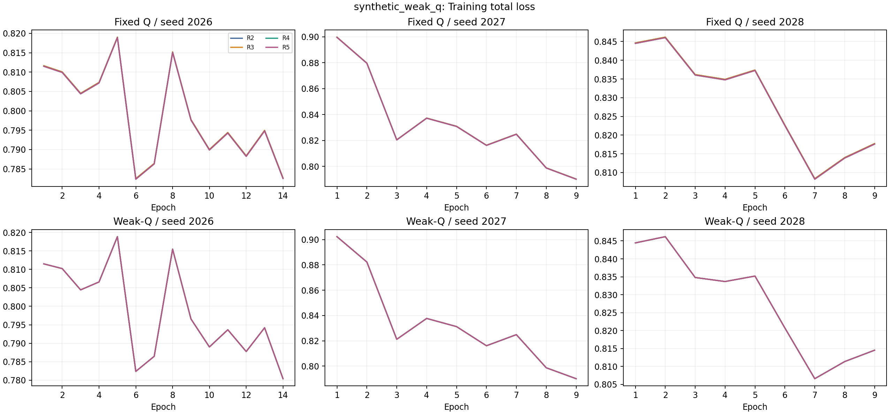
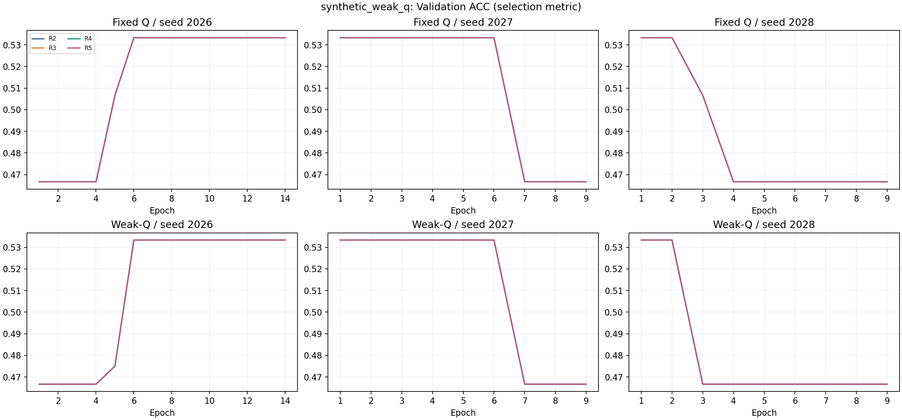
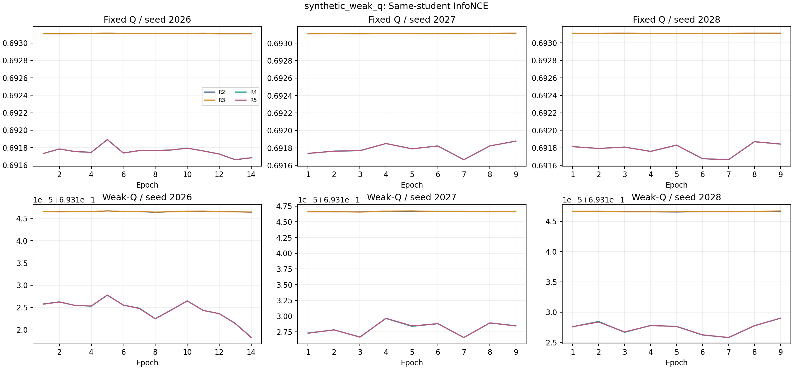
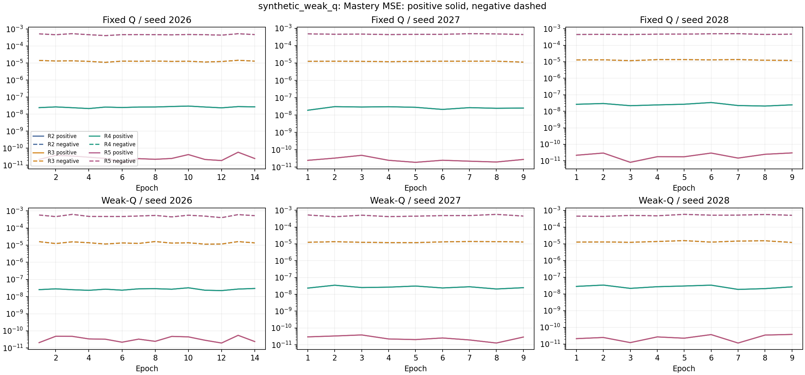
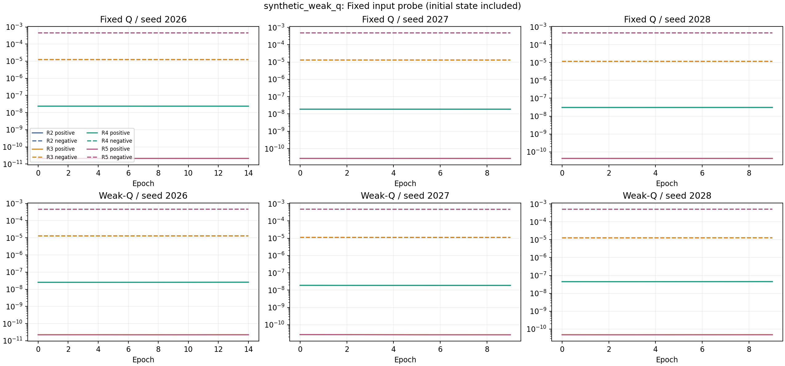
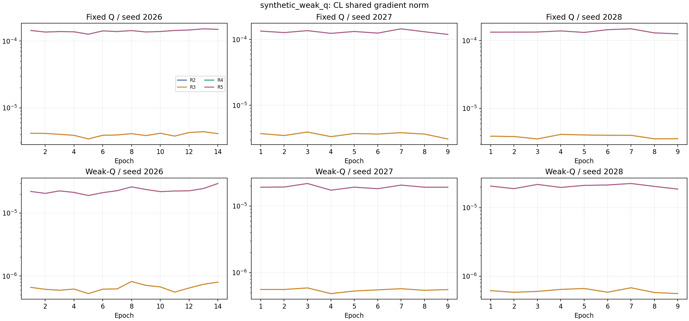
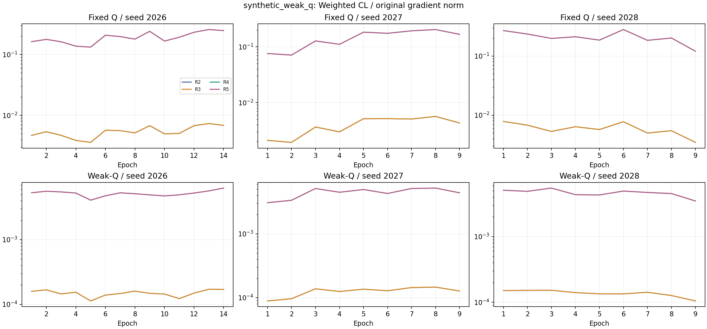
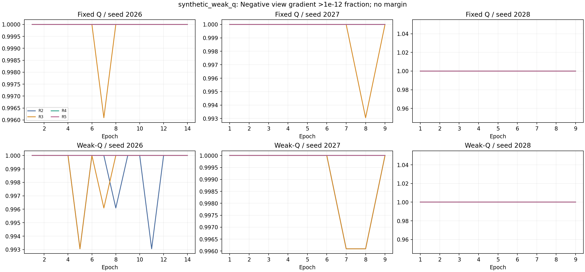
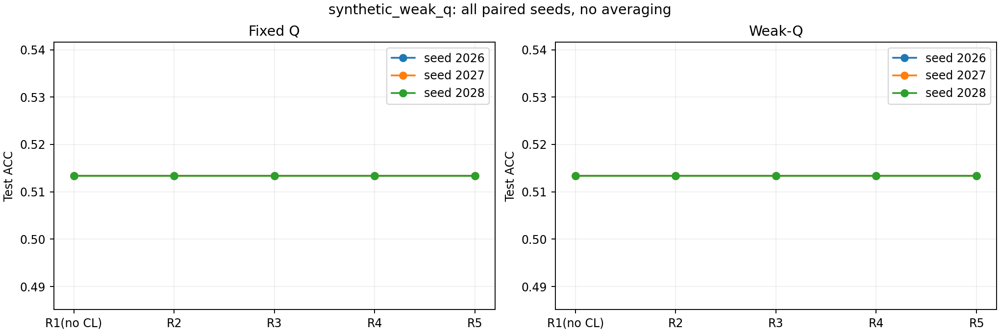

# synthetic_weak_q：R2–R5噪声敏感性实验

主表不是均值：每个Q/条件内按最高验证ACC选择种子，并列选较小种子；两个test指标来自同一checkpoint。严禁把不同种子的单次结果直接相减解释模块收益，收益看全部配对种子。A0=固定参考Q，A1=Weak-Q。

| Q设置 | 条件 | CL系数 | 验证选优种子 | 最佳轮 | valid ACC | test ACC | test AUC |
| --- | --- | --- | --- | --- | --- | --- | --- |
| A0 | R1 | 0 | 2026 | 6 | 0.533333333 | 0.513333333 | 0.556034291 |
| A0 | R2 | 0.1 | 2026 | 6 | 0.533333333 | 0.513333333 | 0.556035681 |
| A0 | R3 | 0.1 | 2026 | 6 | 0.533333333 | 0.513333333 | 0.556037071 |
| A0 | R4 | 0.1 | 2026 | 6 | 0.533333333 | 0.513333333 | 0.556063478 |
| A0 | R5 | 0.1 | 2026 | 6 | 0.533333333 | 0.513333333 | 0.556063478 |
| A1 | R1 | 0 | 2026 | 6 | 0.533333333 | 0.513333333 | 0.478138621 |
| A1 | R2 | 0.1 | 2026 | 6 | 0.533333333 | 0.513333333 | 0.47814279 |
| A1 | R3 | 0.1 | 2026 | 6 | 0.533333333 | 0.513333333 | 0.47814279 |
| A1 | R4 | 0.1 | 2026 | 6 | 0.533333333 | 0.513333333 | 0.478177537 |
| A1 | R5 | 0.1 | 2026 | 6 | 0.533333333 | 0.513333333 | 0.478173368 |

## 数据与固定协议

数据集：synthetic_weak_q；学生=200，题目=30，概念=8；train/valid/test交互=[4200, 600, 1200]。

本项为合成数据，不是真实教育数据。使用既有seed_2026生成数据，Q_noise_0.20，划分seed=2026，交互70/10/20；Q-F1对应生成真Q，另报告真实掌握度指标。

R0参考原循环（统一验证ACC选模），R1新增入口λ=0并完全跳过CL训练分支，R2 λ=0.1。R2同时用于受控与敏感性实验，没有重复训练一份R2。模型、原始损失、α=0.8、Adam及学习率、128学生batch、30轮上限、patience=8均不变。验证ACC严格提升才更新checkpoint，平分保留最早轮。种子2026/2027/2028；每个数据集36次训练。

| 条件 | 正比例 | 正幅度 | 负比例 | 负幅度 |
| --- | --- | --- | --- | --- |
| R2 | 0.1 | 0.01 | 0.5 | 0.1 |
| R3 | 0.01 | 0.001 | 0.5 | 0.1 |
| R4 | 0.1 | 0.01 | 0.7 | 0.5 |
| R5 | 0.01 | 0.001 | 0.7 | 0.5 |

两输入不拼接。只对学生support的非零±1位置施加均匀连续噪声并裁剪到[-1,1]；0缺失、ID、标签、query和原数组不变。负噪声不翻转正误，只降低输入证据绝对值；因此极端响应不能直接当成诊断能力改善。验证/测试不增强。

损失沿用同学生一正一负InfoNCE，温度0.2，无margin。L=−正logit+logsumexp(正logit,负logit)。联合归一化项并不是独立负样本损失；负约束非零比例指负视图梯度范数>1e−12，不是margin激活率。

## 配置、代码和核验依据

以下完整配置/哈希和核验结果作为最终文档保留；用户要求清理新实验的checkpoint、原始日志及JSON/CSV副本。实际清理状态：自动审批以blocked by policy拒绝递归删除，原始产物仍暂存在Git忽略的scratch/student_cl_all_20261123。最终报告目录只包含Markdown和配图。若后续手工清理，便不能直接重放checkpoint，需按记录重跑。

<details><summary>完整配置、版本及数据/源码哈希</summary>

```json
{
  "experiment_id": "student_cl_all_synthetic_weak_q_20261123",
  "dataset": "synthetic_weak_q",
  "args": {
    "experiment_id": "student_cl_control_math1_20261123",
    "seeds": [
      2026,
      2027,
      2028
    ],
    "lambda_cl": 0.1,
    "positive_noise_ratio": 0.1,
    "positive_noise_scale": 0.01,
    "negative_noise_ratio": 0.5,
    "negative_noise_scale": 0.1,
    "noise_distribution": "uniform",
    "contrastive_seed": 1123,
    "temperature": 0.2,
    "dataset": "synthetic",
    "data_dir": "E:\\Desktop\\Gen-CD\\Q_GNCDM\\data\\synthetic_weak_q\\seed_2026",
    "alpha": 0.8,
    "embedding_dim": 32,
    "epochs": 30,
    "patience": 8,
    "batch_students": 128,
    "query_fraction": 0.25,
    "lr": 0.001,
    "q_lr": 0.005,
    "lambda_q": 0.01,
    "lambda_coverage": 0.01,
    "q_init_high": 0.55,
    "q_init_low": 0.45,
    "device": "cpu",
    "q_noise": 0.2,
    "split_seed": 2026
  },
  "noise_configs": {
    "R2": [
      0.1,
      0.01,
      0.5,
      0.1
    ],
    "R3": [
      0.01,
      0.001,
      0.5,
      0.1
    ],
    "R4": [
      0.1,
      0.01,
      0.7,
      0.5
    ],
    "R5": [
      0.01,
      0.001,
      0.7,
      0.5
    ]
  },
  "source_sha256": {
    "Q_GNCDM\\experiments\\run_controlled_student_cl.py": "9447f3fc2e79391b043148ae28717bee2f9f6a53dbe44352e5dddca3b6212a46",
    "Q_GNCDM\\experiments\\reference_student_cl_acc.py": "a974a5dbb0e36daf5ed49031be1838d69200e070f935d8f8f9dc31c0d9fa3dfc",
    "Q_GNCDM\\experiments\\controlled_student_cl.py": "4329530390f079ae00f6fa0d00af659e7e7be0f09134f8bc642b5a8caa0cb041",
    "Q_GNCDM\\experiments\\run_simple_contrastive.py": "196cbac42d9e7664eb4c24a4328bc852dca9265d7a88149adda0be924564a023",
    "Q_GNCDM\\models\\weak_q_gncdm.py": "5970f43820db2736bcf5f4e48039af50bf4203a5f391baa2046b8046c21517f5",
    "Q_GNCDM\\simple_contrastive.py": "30f0126846ab0e0d8802306ee183374a17730ed63f5bdd3ff6d76949b5252d97",
    "Q_GNCDM\\experiments\\run_weak_q_synthetic.py": "266d36d84cf1095189700a0b1f524f678accfd79feb94402ef6562f004f6b9b6",
    "Q_GNCDM\\experiments\\run_student_cl_all_datasets.py": "5c04daaf9a3ba1478c9d763e66348251162132ed385935c67e6d806635ec76bf",
    "Q_GNCDM\\experiments\\run_student_cl_noise_sensitivity.py": "b4c2c3850c4f49b26f60099c8d593128393ec8de80dcb3205d04fb27507f440f",
    "Q_GNCDM\\experiments\\run_prepared_dataset.py": "02b0fe433fcf75bea693b745149ac1654d866f044c81d9b2fc637b6f35d40c4d"
  },
  "data_sha256": {
    "E:\\Desktop\\Gen-CD\\Q_GNCDM\\data\\synthetic_weak_q\\seed_2026\\response.csv": "b7312a080519ad36d09bd9a90082b8656feb99b379ea8eb669797ece05fe9281",
    "E:\\Desktop\\Gen-CD\\Q_GNCDM\\data\\synthetic_weak_q\\seed_2026\\Q_noise_0.20.npy": "1ac0f8ff4c48011b0a28b468e7308568962cd6e35c912083a56ea3ce91b3af93"
  },
  "train_shape": [
    200,
    30
  ],
  "concepts": 8,
  "split_lengths": [
    4200,
    600,
    1200
  ],
  "seeds": [
    2026,
    2027,
    2028
  ],
  "selection": "highest validation ACC, earliest epoch; display seed chosen by validation ACC, lowest seed tie",
  "retention": "user requests final Markdown reports and figures only; temporary originals removed after verification",
  "command": "E:\\Desktop\\Gen-CD\\.venv-contrastive\\Scripts\\python.exe -m Q_GNCDM.experiments.run_student_cl_all_datasets --dataset synthetic_weak_q",
  "python": "3.13.9 (tags/v3.13.9:8183fa5, Oct 14 2025, 14:09:13) [MSC v.1944 64 bit (AMD64)]",
  "torch": "2.14.0+cpu",
  "numpy": "2.4.3",
  "git_head": "89290e14293fe00b1e4eb55ba87ed068c5eccfdc",
  "protocol": "R0 reference ACC selector; R1 CL off; R2 shared by control and noise studies; R3-R5 change noise only",
  "scheduling_records": [],
  "scheduling_duplicate_state_checks": []
}
```
</details>

8种Q/噪声设置预检全部通过；同初始化固定batch的CL梯度、一步更新测试通过；新诊断的损失/梯度与原实现精确一致。6组R0/R1的逐轮日志与checkpoint精确一致；36个checkpoint的全部测试指标已重放核验。

```json
{
  "runs": 36,
  "preflight_settings": 8,
  "baseline_exact_pairs": 6,
  "checkpoint_replays": 36,
  "protected_code_and_data_unchanged": true,
  "status": "passed"
}
```

<details><summary>全部预检真实输出（含逐层梯度和单步参数更新差异）</summary>

```json
{
  "A0_R2": {
    "positive": {
      "selected_fraction": 0.1007375,
      "changed_fraction": 0.050225,
      "clipped_fraction_selected": 0.5014269760516193,
      "input_mae_observed": 0.00025183867546729743,
      "input_mae_all": 0.00020147094619460404,
      "input_max_change": 0.009997665882110596
    },
    "negative": {
      "selected_fraction": 0.5008875,
      "changed_fraction": 0.2517625,
      "clipped_fraction_selected": 0.4973671732674503,
      "input_mae_observed": 0.012591703794896603,
      "input_mae_all": 0.010073362849652767,
      "input_max_change": 0.09999817609786987
    },
    "gradient": {
      "original_shared_grad_norm": 9.050214266345112e-05,
      "cl_shared_grad_norm": 3.666781825497098e-06,
      "cl_to_original_grad_ratio": 0.04051596699906544,
      "weighted_cl_to_original_grad_ratio": 0.004051596699906544
    },
    "per_layer": {
      "f_nn.f_layer_1.weight": {
        "original_grad_norm": 3.308382292743772e-05,
        "cl_grad_norm": 1.5213961432891665e-06,
        "cl_finite": true
      },
      "f_nn.f_layer_1.bias": {
        "original_grad_norm": 1.79642483999487e-05,
        "cl_grad_norm": 8.617344064987265e-07,
        "cl_finite": true
      },
      "f_nn.f_layer_2.weight": {
        "original_grad_norm": 5.970749771222472e-05,
        "cl_grad_norm": 2.3685352061875165e-06,
        "cl_finite": true
      },
      "f_nn.f_layer_2.bias": {
        "original_grad_norm": 5.664273339789361e-05,
        "cl_grad_norm": 2.1858857053302927e-06,
        "cl_finite": true
      }
    },
    "batch_diagnostics": {
      "ap_mse": 2.005770127766482e-08,
      "an_mse": 1.2832676475227345e-05,
      "ap_cos_distance": 2.9802322387695312e-08,
      "an_cos_distance": 1.51023268699646e-05,
      "negative_softmax_probability": 0.499981164932251,
      "negative_not_farther_fraction": 0.0078125,
      "positive_selected_fraction": 0.085785536159601,
      "positive_changed_fraction": 0.032418952618453865,
      "positive_clipped_fraction_selected": 0.622093023255814,
      "positive_input_mae_observed": 0.00017364250379614532,
      "positive_input_mae_all": 9.066490747500211e-05,
      "positive_input_max_change": 0.009647905826568604,
      "negative_selected_fraction": 0.514713216957606,
      "negative_changed_fraction": 0.257356608478803,
      "negative_clipped_fraction_selected": 0.5,
      "negative_input_mae_observed": 0.012838195078074932,
      "negative_input_mae_all": 0.00670327665284276,
      "negative_input_max_change": 0.09973663091659546
    },
    "loss_original": 0.7550396919250488,
    "loss_cl": 0.6931095123291016,
    "loss_total": 0.8243506550788879,
    "single_step_parameter_changes": {
      "f_nn.f_layer_1.weight": {
        "gradient_difference_l2": 1.5213782520209543e-07,
        "update_difference_l2": 0.00027124159776403567,
        "baseline_update_l2": 0.015206427857468901,
        "cl_update_l2": 0.015203691433029716
      },
      "f_nn.f_layer_1.bias": {
        "gradient_difference_l2": 8.617962832610364e-08,
        "update_difference_l2": 4.5012853941301153e-08,
        "baseline_update_l2": 0.0028226595411451195,
        "cl_update_l2": 0.0028226200421823883
      },
      "f_nn.f_layer_2.weight": {
        "gradient_difference_l2": 2.3690841035649404e-07,
        "update_difference_l2": 6.936128416487851e-06,
        "baseline_update_l2": 0.007966346753272445,
        "cl_update_l2": 0.007966827058861748
      },
      "f_nn.f_layer_2.bias": {
        "gradient_difference_l2": 2.186156697106523e-07,
        "update_difference_l2": 1.4320822190917743e-06,
        "baseline_update_l2": 0.0028215801391826955,
        "cl_update_l2": 0.002821103944449328
      }
    },
    "zero_single_step_exact_parity": true,
    "status": "passed",
    "observed_branch_loss_and_gradient_exact": true,
    "observation_state_and_rng_unchanged": true,
    "extra_diagnostics": {
      "ap_mse": 2.0016786450582913e-08,
      "an_mse": 1.254900053027086e-05,
      "ap_cos_distance": 2.7008354663848877e-08,
      "an_cos_distance": 1.441827043890953e-05,
      "negative_softmax_probability": 0.49998199939727783,
      "negative_not_farther_fraction": 0.0078125,
      "positive_energy": -5.0,
      "joint_log_partition": 5.693110942840576,
      "negative_relative_penalty": 0.6931111812591553,
      "positive_view_grad_norm_mean": 1.9137844197463425e-06,
      "negative_view_grad_norm_mean": 6.424484900430158e-05,
      "negative_view_grad_nonzero_fraction": 1.0,
      "negative_view_grad_above_1e_12_fraction": 1.0,
      "positive_shared_partial_grad_norm": 6.395598600063177e-09,
      "negative_shared_partial_grad_norm": 3.61749997243028e-06,
      "positive_selected_fraction": 0.08977556109725686,
      "positive_changed_fraction": 0.03890274314214464,
      "positive_clipped_fraction_selected": 0.5666666666666667,
      "positive_input_mae_observed": 0.00020740691979881376,
      "positive_input_mae_all": 0.00010829450184246525,
      "positive_input_max_change": 0.009961605072021484,
      "positive_input_mse_observed": 1.4281010862760013e-06,
      "positive_clipped_fraction_observed": 0.05087281795511222,
      "positive_input_mae_changed": 0.005331421736627817,
      "positive_unchanged_student_fraction": 0.515625,
      "negative_selected_fraction": 0.5097256857855361,
      "negative_changed_fraction": 0.2518703241895262,
      "negative_clipped_fraction_selected": 0.5058708414872799,
      "negative_input_mae_observed": 0.012638756074011326,
      "negative_input_mae_all": 0.006599142216145992,
      "negative_input_max_change": 0.09973663091659546,
      "negative_input_mse_observed": 0.0008482842240482569,
      "negative_clipped_fraction_observed": 0.25785536159600997,
      "negative_input_mae_changed": 0.0501796156167984,
      "negative_unchanged_student_fraction": 0.0
    }
  },
  "A0_R3": {
    "positive": {
      "selected_fraction": 0.01045,
      "changed_fraction": 0.005025,
      "clipped_fraction_selected": 0.5179425837320574,
      "input_mae_observed": 2.512869286874775e-06,
      "input_mae_all": 2.010295474974555e-06,
      "input_max_change": 0.0009962916374206543
    },
    "negative": {
      "selected_fraction": 0.5008875,
      "changed_fraction": 0.2517625,
      "clipped_fraction_selected": 0.4973671732674503,
      "input_mae_observed": 0.012591703794896603,
      "input_mae_all": 0.010073362849652767,
      "input_max_change": 0.09999817609786987
    },
    "gradient": {
      "original_shared_grad_norm": 9.050214266345112e-05,
      "cl_shared_grad_norm": 3.6734473401544353e-06,
      "cl_to_original_grad_ratio": 0.040589617350992736,
      "weighted_cl_to_original_grad_ratio": 0.004058961735099274
    },
    "per_layer": {
      "f_nn.f_layer_1.weight": {
        "original_grad_norm": 3.308382292743772e-05,
        "cl_grad_norm": 1.5238980495269061e-06,
        "cl_finite": true
      },
      "f_nn.f_layer_1.bias": {
        "original_grad_norm": 1.79642483999487e-05,
        "cl_grad_norm": 8.633516586087353e-07,
        "cl_finite": true
      },
      "f_nn.f_layer_2.weight": {
        "original_grad_norm": 5.970749771222472e-05,
        "cl_grad_norm": 2.3728218820906477e-06,
        "cl_finite": true
      },
      "f_nn.f_layer_2.bias": {
        "original_grad_norm": 5.664273339789361e-05,
        "cl_grad_norm": 2.190043687733123e-06,
        "cl_finite": true
      }
    },
    "batch_diagnostics": {
      "ap_mse": 2.038630028677879e-11,
      "an_mse": 1.2832676475227345e-05,
      "ap_cos_distance": 6.05359673500061e-09,
      "an_cos_distance": 1.51023268699646e-05,
      "negative_softmax_probability": 0.4999811053276062,
      "negative_not_farther_fraction": 0.0078125,
      "positive_selected_fraction": 0.006483790523690773,
      "positive_changed_fraction": 0.0029925187032418953,
      "positive_clipped_fraction_selected": 0.5384615384615384,
      "positive_input_mae_observed": 1.6751134808146162e-06,
      "positive_input_mae_all": 8.746361004341452e-07,
      "positive_input_max_change": 0.0009163022041320801,
      "negative_selected_fraction": 0.514713216957606,
      "negative_changed_fraction": 0.257356608478803,
      "negative_clipped_fraction_selected": 0.5,
      "negative_input_mae_observed": 0.012838195078074932,
      "negative_input_mae_all": 0.00670327665284276,
      "negative_input_max_change": 0.09973663091659546
    },
    "loss_original": 0.7550396919250488,
    "loss_cl": 0.6931094527244568,
    "loss_total": 0.8243506550788879,
    "single_step_parameter_changes": {
      "f_nn.f_layer_1.weight": {
        "gradient_difference_l2": 1.5240714249879137e-07,
        "update_difference_l2": 0.00027178218570237967,
        "baseline_update_l2": 0.015206427857468901,
        "cl_update_l2": 0.015203650499693473
      },
      "f_nn.f_layer_1.bias": {
        "gradient_difference_l2": 8.63579028982866e-08,
        "update_difference_l2": 5.188728972220465e-08,
        "baseline_update_l2": 0.0028226595411451195,
        "cl_update_l2": 0.0028226147778791615
      },
      "f_nn.f_layer_2.weight": {
        "gradient_difference_l2": 2.3735721943822838e-07,
        "update_difference_l2": 6.949381276699992e-06,
        "baseline_update_l2": 0.007966346753272445,
        "cl_update_l2": 0.007966826707201072
      },
      "f_nn.f_layer_2.bias": {
        "gradient_difference_l2": 2.190644282092061e-07,
        "update_difference_l2": 1.4320822190917743e-06,
        "baseline_update_l2": 0.0028215801391826955,
        "cl_update_l2": 0.002821103944449328
      }
    },
    "zero_single_step_exact_parity": true,
    "status": "passed",
    "observed_branch_loss_and_gradient_exact": true,
    "observation_state_and_rng_unchanged": true,
    "extra_diagnostics": {
      "ap_mse": 2.2300692542609468e-11,
      "an_mse": 1.254900053027086e-05,
      "ap_cos_distance": 1.3969838619232178e-09,
      "an_cos_distance": 1.441827043890953e-05,
      "negative_softmax_probability": 0.49998193979263306,
      "negative_not_farther_fraction": 0.0078125,
      "positive_energy": -5.0,
      "joint_log_partition": 5.693111419677734,
      "negative_relative_penalty": 0.6931111216545105,
      "positive_view_grad_norm_mean": 2.4352978382033742e-08,
      "negative_view_grad_norm_mean": 6.424483351159436e-05,
      "negative_view_grad_nonzero_fraction": 1.0,
      "negative_view_grad_above_1e_12_fraction": 1.0,
      "positive_shared_partial_grad_norm": 2.1300538147013115e-09,
      "negative_shared_partial_grad_norm": 3.617171794610138e-06,
      "positive_selected_fraction": 0.009476309226932668,
      "positive_changed_fraction": 0.004987531172069825,
      "positive_clipped_fraction_selected": 0.47368421052631576,
      "positive_input_mae_observed": 2.3245218017109437e-06,
      "positive_input_mae_all": 1.2137151088609244e-06,
      "positive_input_max_change": 0.0009163022041320801,
      "positive_input_mse_observed": 1.444100172776075e-09,
      "positive_clipped_fraction_observed": 0.004488778054862842,
      "positive_input_mae_changed": 0.00046606658725067973,
      "positive_unchanged_student_fraction": 0.921875,
      "negative_selected_fraction": 0.5097256857855361,
      "negative_changed_fraction": 0.2518703241895262,
      "negative_clipped_fraction_selected": 0.5058708414872799,
      "negative_input_mae_observed": 0.012638756074011326,
      "negative_input_mae_all": 0.006599142216145992,
      "negative_input_max_change": 0.09973663091659546,
      "negative_input_mse_observed": 0.0008482842240482569,
      "negative_clipped_fraction_observed": 0.25785536159600997,
      "negative_input_mae_changed": 0.0501796156167984,
      "negative_unchanged_student_fraction": 0.0
    }
  },
  "A0_R4": {
    "positive": {
      "selected_fraction": 0.1007375,
      "changed_fraction": 0.050225,
      "clipped_fraction_selected": 0.5014269760516193,
      "input_mae_observed": 0.00025183867546729743,
      "input_mae_all": 0.00020147094619460404,
      "input_max_change": 0.009997665882110596
    },
    "negative": {
      "selected_fraction": 0.7017125,
      "changed_fraction": 0.3529375,
      "clipped_fraction_selected": 0.4970340417193651,
      "input_mae_observed": 0.08849677443504333,
      "input_mae_all": 0.07079741358757019,
      "input_max_change": 0.4999908208847046
    },
    "gradient": {
      "original_shared_grad_norm": 9.050214266345112e-05,
      "cl_shared_grad_norm": 0.00014111048618671568,
      "cl_to_original_grad_ratio": 1.5591949763163178,
      "weighted_cl_to_original_grad_ratio": 0.1559194976316318
    },
    "per_layer": {
      "f_nn.f_layer_1.weight": {
        "original_grad_norm": 3.308382292743772e-05,
        "cl_grad_norm": 6.008388299960643e-05,
        "cl_finite": true
      },
      "f_nn.f_layer_1.bias": {
        "original_grad_norm": 1.79642483999487e-05,
        "cl_grad_norm": 3.20818398904521e-05,
        "cl_finite": true
      },
      "f_nn.f_layer_2.weight": {
        "original_grad_norm": 5.970749771222472e-05,
        "cl_grad_norm": 8.943194552557543e-05,
        "cl_finite": true
      },
      "f_nn.f_layer_2.bias": {
        "original_grad_norm": 5.664273339789361e-05,
        "cl_grad_norm": 8.529231854481623e-05,
        "cl_finite": true
      }
    },
    "batch_diagnostics": {
      "ap_mse": 2.005770127766482e-08,
      "an_mse": 0.0005022388068027794,
      "ap_cos_distance": 2.9802322387695312e-08,
      "an_cos_distance": 0.0005749715492129326,
      "negative_softmax_probability": 0.49928128719329834,
      "negative_not_farther_fraction": 0.0,
      "positive_selected_fraction": 0.085785536159601,
      "positive_changed_fraction": 0.032418952618453865,
      "positive_clipped_fraction_selected": 0.622093023255814,
      "positive_input_mae_observed": 0.00017364250379614532,
      "positive_input_mae_all": 9.066490747500211e-05,
      "positive_input_max_change": 0.009647905826568604,
      "negative_selected_fraction": 0.7296758104738155,
      "negative_changed_fraction": 0.37855361596009973,
      "negative_clipped_fraction_selected": 0.48120300751879697,
      "negative_input_mae_observed": 0.09373591840267181,
      "negative_input_mae_all": 0.048942845314741135,
      "negative_input_max_change": 0.49868321418762207
    },
    "loss_original": 0.7550396919250488,
    "loss_cl": 0.6917113661766052,
    "loss_total": 0.8242108225822449,
    "single_step_parameter_changes": {
      "f_nn.f_layer_1.weight": {
        "gradient_difference_l2": 6.00840474801034e-06,
        "update_difference_l2": 0.005958936437405999,
        "baseline_update_l2": 0.015206427857468901,
        "cl_update_l2": 0.015275367780268044
      },
      "f_nn.f_layer_1.bias": {
        "gradient_difference_l2": 3.2082322159680063e-06,
        "update_difference_l2": 2.243605373375244e-06,
        "baseline_update_l2": 0.0028226595411451195,
        "cl_update_l2": 0.002820752209460551
      },
      "f_nn.f_layer_2.weight": {
        "gradient_difference_l2": 8.943324733270914e-06,
        "update_difference_l2": 0.0019548121915358217,
        "baseline_update_l2": 0.007966346753272445,
        "cl_update_l2": 0.007980975394875562
      },
      "f_nn.f_layer_2.bias": {
        "gradient_difference_l2": 8.529333340453941e-06,
        "update_difference_l2": 0.001982451099857494,
        "baseline_update_l2": 0.0028215801391826955,
        "cl_update_l2": 0.002825186952092377
      }
    },
    "zero_single_step_exact_parity": true,
    "status": "passed",
    "observed_branch_loss_and_gradient_exact": true,
    "observation_state_and_rng_unchanged": true,
    "extra_diagnostics": {
      "ap_mse": 2.0016786450582913e-08,
      "an_mse": 0.0004846645169891417,
      "ap_cos_distance": 2.7008354663848877e-08,
      "an_cos_distance": 0.0005531823262572289,
      "negative_softmax_probability": 0.4993085265159607,
      "negative_not_farther_fraction": 0.0,
      "positive_energy": -5.0,
      "joint_log_partition": 5.691765785217285,
      "negative_relative_penalty": 0.6917656660079956,
      "positive_view_grad_norm_mean": 1.910711678726028e-06,
      "negative_view_grad_norm_mean": 0.00040313471903806263,
      "negative_view_grad_nonzero_fraction": 1.0,
      "negative_view_grad_above_1e_12_fraction": 1.0,
      "positive_shared_partial_grad_norm": 6.258542035710543e-09,
      "negative_shared_partial_grad_norm": 0.00013789647145620487,
      "positive_selected_fraction": 0.08977556109725686,
      "positive_changed_fraction": 0.03890274314214464,
      "positive_clipped_fraction_selected": 0.5666666666666667,
      "positive_input_mae_observed": 0.00020740691979881376,
      "positive_input_mae_all": 0.00010829450184246525,
      "positive_input_max_change": 0.009961605072021484,
      "positive_input_mse_observed": 1.4281010862760013e-06,
      "positive_clipped_fraction_observed": 0.05087281795511222,
      "positive_input_mae_changed": 0.005331421736627817,
      "positive_unchanged_student_fraction": 0.515625,
      "negative_selected_fraction": 0.7301745635910224,
      "negative_changed_fraction": 0.37306733167082295,
      "negative_clipped_fraction_selected": 0.4890710382513661,
      "negative_input_mae_observed": 0.09159382432699203,
      "negative_input_mae_all": 0.04782437905669212,
      "negative_input_max_change": 0.49868321418762207,
      "negative_input_mse_observed": 0.030422449111938477,
      "negative_clipped_fraction_observed": 0.35710723192019944,
      "negative_input_mae_changed": 0.24551552534103394,
      "negative_unchanged_student_fraction": 0.0
    }
  },
  "A0_R5": {
    "positive": {
      "selected_fraction": 0.01045,
      "changed_fraction": 0.005025,
      "clipped_fraction_selected": 0.5179425837320574,
      "input_mae_observed": 2.512869286874775e-06,
      "input_mae_all": 2.010295474974555e-06,
      "input_max_change": 0.0009962916374206543
    },
    "negative": {
      "selected_fraction": 0.7017125,
      "changed_fraction": 0.3529375,
      "clipped_fraction_selected": 0.4970340417193651,
      "input_mae_observed": 0.08849677443504333,
      "input_mae_all": 0.07079741358757019,
      "input_max_change": 0.4999908208847046
    },
    "gradient": {
      "original_shared_grad_norm": 9.050214266345112e-05,
      "cl_shared_grad_norm": 0.00014111862613735255,
      "cl_to_original_grad_ratio": 1.559284918392796,
      "weighted_cl_to_original_grad_ratio": 0.15592849183927962
    },
    "per_layer": {
      "f_nn.f_layer_1.weight": {
        "original_grad_norm": 3.308382292743772e-05,
        "cl_grad_norm": 6.008693526382558e-05,
        "cl_finite": true
      },
      "f_nn.f_layer_1.bias": {
        "original_grad_norm": 1.79642483999487e-05,
        "cl_grad_norm": 3.2083848054753616e-05,
        "cl_finite": true
      },
      "f_nn.f_layer_2.weight": {
        "original_grad_norm": 5.970749771222472e-05,
        "cl_grad_norm": 8.943708962760866e-05,
        "cl_finite": true
      },
      "f_nn.f_layer_2.bias": {
        "original_grad_norm": 5.664273339789361e-05,
        "cl_grad_norm": 8.52974844747223e-05,
        "cl_finite": true
      }
    },
    "batch_diagnostics": {
      "ap_mse": 2.038630028677879e-11,
      "an_mse": 0.0005022388068027794,
      "ap_cos_distance": 6.05359673500061e-09,
      "an_cos_distance": 0.0005749715492129326,
      "negative_softmax_probability": 0.49928128719329834,
      "negative_not_farther_fraction": 0.0,
      "positive_selected_fraction": 0.006483790523690773,
      "positive_changed_fraction": 0.0029925187032418953,
      "positive_clipped_fraction_selected": 0.5384615384615384,
      "positive_input_mae_observed": 1.6751134808146162e-06,
      "positive_input_mae_all": 8.746361004341452e-07,
      "positive_input_max_change": 0.0009163022041320801,
      "negative_selected_fraction": 0.7296758104738155,
      "negative_changed_fraction": 0.37855361596009973,
      "negative_clipped_fraction_selected": 0.48120300751879697,
      "negative_input_mae_observed": 0.09373591840267181,
      "negative_input_mae_all": 0.048942845314741135,
      "negative_input_max_change": 0.49868321418762207
    },
    "loss_original": 0.7550396919250488,
    "loss_cl": 0.6917113661766052,
    "loss_total": 0.8242108225822449,
    "single_step_parameter_changes": {
      "f_nn.f_layer_1.weight": {
        "gradient_difference_l2": 6.0086939227587886e-06,
        "update_difference_l2": 0.0059589953131602875,
        "baseline_update_l2": 0.015206427857468901,
        "cl_update_l2": 0.015275369047432088
      },
      "f_nn.f_layer_1.bias": {
        "gradient_difference_l2": 3.2084159032996356e-06,
        "update_difference_l2": 2.243605373375244e-06,
        "baseline_update_l2": 0.0028226595411451195,
        "cl_update_l2": 0.002820752209460551
      },
      "f_nn.f_layer_2.weight": {
        "gradient_difference_l2": 8.94379613787085e-06,
        "update_difference_l2": 0.0019548121915358217,
        "baseline_update_l2": 0.007966346753272445,
        "cl_update_l2": 0.007980975394875562
      },
      "f_nn.f_layer_2.bias": {
        "gradient_difference_l2": 8.529807245888942e-06,
        "update_difference_l2": 0.001982451099857494,
        "baseline_update_l2": 0.0028215801391826955,
        "cl_update_l2": 0.002825186952092377
      }
    },
    "zero_single_step_exact_parity": true,
    "status": "passed",
    "observed_branch_loss_and_gradient_exact": true,
    "observation_state_and_rng_unchanged": true,
    "extra_diagnostics": {
      "ap_mse": 2.2300692542609468e-11,
      "an_mse": 0.0004846645169891417,
      "ap_cos_distance": 1.3969838619232178e-09,
      "an_cos_distance": 0.0005531823262572289,
      "negative_softmax_probability": 0.4993085265159607,
      "negative_not_farther_fraction": 0.0,
      "positive_energy": -5.0,
      "joint_log_partition": 5.691765785217285,
      "negative_relative_penalty": 0.6917656660079956,
      "positive_view_grad_norm_mean": 2.436464215460518e-08,
      "negative_view_grad_norm_mean": 0.00040313469575919893,
      "negative_view_grad_nonzero_fraction": 1.0,
      "negative_view_grad_above_1e_12_fraction": 1.0,
      "positive_shared_partial_grad_norm": 2.1934539112168e-09,
      "negative_shared_partial_grad_norm": 0.00013789592492077476,
      "positive_selected_fraction": 0.009476309226932668,
      "positive_changed_fraction": 0.004987531172069825,
      "positive_clipped_fraction_selected": 0.47368421052631576,
      "positive_input_mae_observed": 2.3245218017109437e-06,
      "positive_input_mae_all": 1.2137151088609244e-06,
      "positive_input_max_change": 0.0009163022041320801,
      "positive_input_mse_observed": 1.444100172776075e-09,
      "positive_clipped_fraction_observed": 0.004488778054862842,
      "positive_input_mae_changed": 0.00046606658725067973,
      "positive_unchanged_student_fraction": 0.921875,
      "negative_selected_fraction": 0.7301745635910224,
      "negative_changed_fraction": 0.37306733167082295,
      "negative_clipped_fraction_selected": 0.4890710382513661,
      "negative_input_mae_observed": 0.09159382432699203,
      "negative_input_mae_all": 0.04782437905669212,
      "negative_input_max_change": 0.49868321418762207,
      "negative_input_mse_observed": 0.030422449111938477,
      "negative_clipped_fraction_observed": 0.35710723192019944,
      "negative_input_mae_changed": 0.24551552534103394,
      "negative_unchanged_student_fraction": 0.0
    }
  },
  "A1_R2": {
    "positive": {
      "selected_fraction": 0.1007375,
      "changed_fraction": 0.050225,
      "clipped_fraction_selected": 0.5014269760516193,
      "input_mae_observed": 0.00025183867546729743,
      "input_mae_all": 0.00020147094619460404,
      "input_max_change": 0.009997665882110596
    },
    "negative": {
      "selected_fraction": 0.5008875,
      "changed_fraction": 0.2517625,
      "clipped_fraction_selected": 0.4973671732674503,
      "input_mae_observed": 0.012591703794896603,
      "input_mae_all": 0.010073362849652767,
      "input_max_change": 0.09999817609786987
    },
    "gradient": {
      "original_shared_grad_norm": 0.00040864396987135736,
      "cl_shared_grad_norm": 6.369248987935096e-07,
      "cl_to_original_grad_ratio": 0.0015586303622540077,
      "weighted_cl_to_original_grad_ratio": 0.00015586303622540078
    },
    "per_layer": {
      "q_logits": {
        "original_grad_norm": 0.0003707298601511866,
        "cl_grad_norm": 4.84054055505112e-07,
        "cl_finite": true
      },
      "f_nn.f_layer_1.weight": {
        "original_grad_norm": 6.162773934192955e-05,
        "cl_grad_norm": 1.8098552345691132e-07,
        "cl_finite": true
      },
      "f_nn.f_layer_1.bias": {
        "original_grad_norm": 3.7511559639824554e-05,
        "cl_grad_norm": 2.3763906398244217e-08,
        "cl_finite": true
      },
      "f_nn.f_layer_2.weight": {
        "original_grad_norm": 0.00011555368837434798,
        "cl_grad_norm": 1.1405870736780344e-07,
        "cl_finite": true
      },
      "f_nn.f_layer_2.bias": {
        "original_grad_norm": 0.00010484036465641111,
        "cl_grad_norm": 3.5360307037990424e-07,
        "cl_finite": true
      }
    },
    "batch_diagnostics": {
      "ap_mse": 2.220606454272911e-08,
      "an_mse": 1.5005191926320549e-05,
      "ap_cos_distance": 4.190951585769653e-09,
      "an_cos_distance": 2.561137080192566e-07,
      "negative_softmax_probability": 0.4999997019767761,
      "negative_not_farther_fraction": 0.1640625,
      "positive_selected_fraction": 0.085785536159601,
      "positive_changed_fraction": 0.032418952618453865,
      "positive_clipped_fraction_selected": 0.622093023255814,
      "positive_input_mae_observed": 0.00017364250379614532,
      "positive_input_mae_all": 9.066490747500211e-05,
      "positive_input_max_change": 0.009647905826568604,
      "negative_selected_fraction": 0.514713216957606,
      "negative_changed_fraction": 0.257356608478803,
      "negative_clipped_fraction_selected": 0.5,
      "negative_input_mae_observed": 0.012838195078074932,
      "negative_input_mae_all": 0.00670327665284276,
      "negative_input_max_change": 0.09973663091659546
    },
    "loss_original": 0.7548984289169312,
    "loss_cl": 0.6931465864181519,
    "loss_total": 0.8242130875587463,
    "single_step_parameter_changes": {
      "q_logits": {
        "gradient_difference_l2": 4.8396303853675975e-08,
        "update_difference_l2": 1.5117571363526713e-05,
        "baseline_update_l2": 0.07720183794833098,
        "cl_update_l2": 0.07720136548917969
      },
      "f_nn.f_layer_1.weight": {
        "gradient_difference_l2": 1.8098485230890815e-08,
        "update_difference_l2": 3.455647631527915e-06,
        "baseline_update_l2": 0.015392876479987692,
        "cl_update_l2": 0.015392727008079343
      },
      "f_nn.f_layer_1.bias": {
        "gradient_difference_l2": 2.4004303157536695e-09,
        "update_difference_l2": 0.0,
        "baseline_update_l2": 0.002826084552506844,
        "cl_update_l2": 0.002826084552506844
      },
      "f_nn.f_layer_2.weight": {
        "gradient_difference_l2": 1.1439388077344523e-08,
        "update_difference_l2": 9.13358699197428e-06,
        "baseline_update_l2": 0.007953130243675109,
        "cl_update_l2": 0.007952211293071833
      },
      "f_nn.f_layer_2.bias": {
        "gradient_difference_l2": 3.536060527454305e-08,
        "update_difference_l2": 7.450580596923828e-09,
        "baseline_update_l2": 0.0028269474445942813,
        "cl_update_l2": 0.0028269448128894607
      }
    },
    "zero_single_step_exact_parity": true,
    "status": "passed",
    "observed_branch_loss_and_gradient_exact": true,
    "observation_state_and_rng_unchanged": true,
    "extra_diagnostics": {
      "ap_mse": 2.583069580452957e-08,
      "an_mse": 1.4260163879953325e-05,
      "ap_cos_distance": 3.725290298461914e-09,
      "an_cos_distance": 2.2584572434425354e-07,
      "negative_softmax_probability": 0.4999997317790985,
      "negative_not_farther_fraction": 0.2109375,
      "positive_energy": -5.0,
      "joint_log_partition": 5.693146705627441,
      "negative_relative_penalty": 0.6931466460227966,
      "positive_view_grad_norm_mean": 2.746674489258154e-07,
      "negative_view_grad_norm_mean": 8.673176347052797e-06,
      "negative_view_grad_nonzero_fraction": 1.0,
      "negative_view_grad_above_1e_12_fraction": 1.0,
      "positive_shared_partial_grad_norm": 2.281731182146401e-09,
      "negative_shared_partial_grad_norm": 5.706062884539307e-07,
      "positive_selected_fraction": 0.08977556109725686,
      "positive_changed_fraction": 0.03890274314214464,
      "positive_clipped_fraction_selected": 0.5666666666666667,
      "positive_input_mae_observed": 0.00020740691979881376,
      "positive_input_mae_all": 0.00010829450184246525,
      "positive_input_max_change": 0.009961605072021484,
      "positive_input_mse_observed": 1.4281010862760013e-06,
      "positive_clipped_fraction_observed": 0.05087281795511222,
      "positive_input_mae_changed": 0.005331421736627817,
      "positive_unchanged_student_fraction": 0.515625,
      "negative_selected_fraction": 0.5097256857855361,
      "negative_changed_fraction": 0.2518703241895262,
      "negative_clipped_fraction_selected": 0.5058708414872799,
      "negative_input_mae_observed": 0.012638756074011326,
      "negative_input_mae_all": 0.006599142216145992,
      "negative_input_max_change": 0.09973663091659546,
      "negative_input_mse_observed": 0.0008482842240482569,
      "negative_clipped_fraction_observed": 0.25785536159600997,
      "negative_input_mae_changed": 0.0501796156167984,
      "negative_unchanged_student_fraction": 0.0
    }
  },
  "A1_R3": {
    "positive": {
      "selected_fraction": 0.01045,
      "changed_fraction": 0.005025,
      "clipped_fraction_selected": 0.5179425837320574,
      "input_mae_observed": 2.512869286874775e-06,
      "input_mae_all": 2.010295474974555e-06,
      "input_max_change": 0.0009962916374206543
    },
    "negative": {
      "selected_fraction": 0.5008875,
      "changed_fraction": 0.2517625,
      "clipped_fraction_selected": 0.4973671732674503,
      "input_mae_observed": 0.012591703794896603,
      "input_mae_all": 0.010073362849652767,
      "input_max_change": 0.09999817609786987
    },
    "gradient": {
      "original_shared_grad_norm": 0.00040864396987135736,
      "cl_shared_grad_norm": 6.378003286284174e-07,
      "cl_to_original_grad_ratio": 0.0015607726423301912,
      "weighted_cl_to_original_grad_ratio": 0.0001560772642330191
    },
    "per_layer": {
      "q_logits": {
        "original_grad_norm": 0.0003707298601511866,
        "cl_grad_norm": 4.845774128625635e-07,
        "cl_finite": true
      },
      "f_nn.f_layer_1.weight": {
        "original_grad_norm": 6.162773934192955e-05,
        "cl_grad_norm": 1.8136388746370358e-07,
        "cl_finite": true
      },
      "f_nn.f_layer_1.bias": {
        "original_grad_norm": 3.7511559639824554e-05,
        "cl_grad_norm": 2.4112436491918743e-08,
        "cl_finite": true
      },
      "f_nn.f_layer_2.weight": {
        "original_grad_norm": 0.00011555368837434798,
        "cl_grad_norm": 1.146009012131799e-07,
        "cl_finite": true
      },
      "f_nn.f_layer_2.bias": {
        "original_grad_norm": 0.00010484036465641111,
        "cl_grad_norm": 3.5407111909080413e-07,
        "cl_finite": true
      }
    },
    "batch_diagnostics": {
      "ap_mse": 2.1147424089651423e-11,
      "an_mse": 1.5005191926320549e-05,
      "ap_cos_distance": 5.122274160385132e-09,
      "an_cos_distance": 2.561137080192566e-07,
      "negative_softmax_probability": 0.4999997019767761,
      "negative_not_farther_fraction": 0.1796875,
      "positive_selected_fraction": 0.006483790523690773,
      "positive_changed_fraction": 0.0029925187032418953,
      "positive_clipped_fraction_selected": 0.5384615384615384,
      "positive_input_mae_observed": 1.6751134808146162e-06,
      "positive_input_mae_all": 8.746361004341452e-07,
      "positive_input_max_change": 0.0009163022041320801,
      "negative_selected_fraction": 0.514713216957606,
      "negative_changed_fraction": 0.257356608478803,
      "negative_clipped_fraction_selected": 0.5,
      "negative_input_mae_observed": 0.012838195078074932,
      "negative_input_mae_all": 0.00670327665284276,
      "negative_input_max_change": 0.09973663091659546
    },
    "loss_original": 0.7548984289169312,
    "loss_cl": 0.6931465864181519,
    "loss_total": 0.8242130875587463,
    "single_step_parameter_changes": {
      "q_logits": {
        "gradient_difference_l2": 4.8450743606239105e-08,
        "update_difference_l2": 1.5103530603514902e-05,
        "baseline_update_l2": 0.07720183794833098,
        "cl_update_l2": 0.07720136634373286
      },
      "f_nn.f_layer_1.weight": {
        "gradient_difference_l2": 1.8114789685592216e-08,
        "update_difference_l2": 3.4491465716518827e-06,
        "baseline_update_l2": 0.015392876479987692,
        "cl_update_l2": 0.015392727404395715
      },
      "f_nn.f_layer_1.bias": {
        "gradient_difference_l2": 2.4018127846244826e-09,
        "update_difference_l2": 0.0,
        "baseline_update_l2": 0.002826084552506844,
        "cl_update_l2": 0.002826084552506844
      },
      "f_nn.f_layer_2.weight": {
        "gradient_difference_l2": 1.1459310826155671e-08,
        "update_difference_l2": 9.133586042334468e-06,
        "baseline_update_l2": 0.007953130243675109,
        "cl_update_l2": 0.007952211060302862
      },
      "f_nn.f_layer_2.bias": {
        "gradient_difference_l2": 3.539648919359682e-08,
        "update_difference_l2": 7.450580596923828e-09,
        "baseline_update_l2": 0.0028269474445942813,
        "cl_update_l2": 0.0028269448128894607
      }
    },
    "zero_single_step_exact_parity": true,
    "status": "passed",
    "observed_branch_loss_and_gradient_exact": true,
    "observation_state_and_rng_unchanged": true,
    "extra_diagnostics": {
      "ap_mse": 2.25122594177396e-11,
      "an_mse": 1.4260163879953325e-05,
      "ap_cos_distance": 2.7939677238464355e-09,
      "an_cos_distance": 2.2584572434425354e-07,
      "negative_softmax_probability": 0.4999997317790985,
      "negative_not_farther_fraction": 0.2109375,
      "positive_energy": -5.0,
      "joint_log_partition": 5.693146705627441,
      "negative_relative_penalty": 0.6931466460227966,
      "positive_view_grad_norm_mean": 3.957822107822132e-09,
      "negative_view_grad_norm_mean": 8.673187201239949e-06,
      "negative_view_grad_nonzero_fraction": 1.0,
      "negative_view_grad_above_1e_12_fraction": 1.0,
      "positive_shared_partial_grad_norm": 3.021052499131681e-09,
      "negative_shared_partial_grad_norm": 5.704960160451798e-07,
      "positive_selected_fraction": 0.009476309226932668,
      "positive_changed_fraction": 0.004987531172069825,
      "positive_clipped_fraction_selected": 0.47368421052631576,
      "positive_input_mae_observed": 2.3245218017109437e-06,
      "positive_input_mae_all": 1.2137151088609244e-06,
      "positive_input_max_change": 0.0009163022041320801,
      "positive_input_mse_observed": 1.444100172776075e-09,
      "positive_clipped_fraction_observed": 0.004488778054862842,
      "positive_input_mae_changed": 0.00046606658725067973,
      "positive_unchanged_student_fraction": 0.921875,
      "negative_selected_fraction": 0.5097256857855361,
      "negative_changed_fraction": 0.2518703241895262,
      "negative_clipped_fraction_selected": 0.5058708414872799,
      "negative_input_mae_observed": 0.012638756074011326,
      "negative_input_mae_all": 0.006599142216145992,
      "negative_input_max_change": 0.09973663091659546,
      "negative_input_mse_observed": 0.0008482842240482569,
      "negative_clipped_fraction_observed": 0.25785536159600997,
      "negative_input_mae_changed": 0.0501796156167984,
      "negative_unchanged_student_fraction": 0.0
    }
  },
  "A1_R4": {
    "positive": {
      "selected_fraction": 0.1007375,
      "changed_fraction": 0.050225,
      "clipped_fraction_selected": 0.5014269760516193,
      "input_mae_observed": 0.00025183867546729743,
      "input_mae_all": 0.00020147094619460404,
      "input_max_change": 0.009997665882110596
    },
    "negative": {
      "selected_fraction": 0.7017125,
      "changed_fraction": 0.3529375,
      "clipped_fraction_selected": 0.4970340417193651,
      "input_mae_observed": 0.08849677443504333,
      "input_mae_all": 0.07079741358757019,
      "input_max_change": 0.4999908208847046
    },
    "gradient": {
      "original_shared_grad_norm": 0.00040864396987135736,
      "cl_shared_grad_norm": 2.4147978060099935e-05,
      "cl_to_original_grad_ratio": 0.05909295093159409,
      "weighted_cl_to_original_grad_ratio": 0.00590929509315941
    },
    "per_layer": {
      "q_logits": {
        "original_grad_norm": 0.0003707298601511866,
        "cl_grad_norm": 1.819706267269794e-05,
        "cl_finite": true
      },
      "f_nn.f_layer_1.weight": {
        "original_grad_norm": 6.162773934192955e-05,
        "cl_grad_norm": 6.720239525748184e-06,
        "cl_finite": true
      },
      "f_nn.f_layer_1.bias": {
        "original_grad_norm": 3.7511559639824554e-05,
        "cl_grad_norm": 9.152126949629746e-07,
        "cl_finite": true
      },
      "f_nn.f_layer_2.weight": {
        "original_grad_norm": 0.00011555368837434798,
        "cl_grad_norm": 4.425640327099245e-06,
        "cl_finite": true
      },
      "f_nn.f_layer_2.bias": {
        "original_grad_norm": 0.00010484036465641111,
        "cl_grad_norm": 1.3653066162078176e-05,
        "cl_finite": true
      }
    },
    "batch_diagnostics": {
      "ap_mse": 2.220606454272911e-08,
      "an_mse": 0.0005586995393969119,
      "ap_cos_distance": 4.190951585769653e-09,
      "an_cos_distance": 9.564682841300964e-06,
      "negative_softmax_probability": 0.49998804926872253,
      "negative_not_farther_fraction": 0.0,
      "positive_selected_fraction": 0.085785536159601,
      "positive_changed_fraction": 0.032418952618453865,
      "positive_clipped_fraction_selected": 0.622093023255814,
      "positive_input_mae_observed": 0.00017364250379614532,
      "positive_input_mae_all": 9.066490747500211e-05,
      "positive_input_max_change": 0.009647905826568604,
      "negative_selected_fraction": 0.7296758104738155,
      "negative_changed_fraction": 0.37855361596009973,
      "negative_clipped_fraction_selected": 0.48120300751879697,
      "negative_input_mae_observed": 0.09373591840267181,
      "negative_input_mae_all": 0.048942845314741135,
      "negative_input_max_change": 0.49868321418762207
    },
    "loss_original": 0.7548984289169312,
    "loss_cl": 0.6931233406066895,
    "loss_total": 0.8242107629776001,
    "single_step_parameter_changes": {
      "q_logits": {
        "gradient_difference_l2": 1.8197044746520591e-06,
        "update_difference_l2": 0.007770067335816659,
        "baseline_update_l2": 0.07720183794833098,
        "cl_update_l2": 0.0771436204951597
      },
      "f_nn.f_layer_1.weight": {
        "gradient_difference_l2": 6.720160973841888e-07,
        "update_difference_l2": 0.00019038318915073235,
        "baseline_update_l2": 0.015392876479987692,
        "cl_update_l2": 0.015384235498154522
      },
      "f_nn.f_layer_1.bias": {
        "gradient_difference_l2": 9.150375778958465e-08,
        "update_difference_l2": 3.725290298461914e-09,
        "baseline_update_l2": 0.002826084552506844,
        "cl_update_l2": 0.002826083235484459
      },
      "f_nn.f_layer_2.weight": {
        "gradient_difference_l2": 4.4256903319086486e-07,
        "update_difference_l2": 0.001467334394066976,
        "baseline_update_l2": 0.007953130243675109,
        "cl_update_l2": 0.007946208561494708
      },
      "f_nn.f_layer_2.bias": {
        "gradient_difference_l2": 1.3652552801618247e-06,
        "update_difference_l2": 1.1151007970493857e-07,
        "baseline_update_l2": 0.0028269474445942813,
        "cl_update_l2": 0.0028269474670583553
      }
    },
    "zero_single_step_exact_parity": true,
    "status": "passed",
    "observed_branch_loss_and_gradient_exact": true,
    "observation_state_and_rng_unchanged": true,
    "extra_diagnostics": {
      "ap_mse": 2.583069580452957e-08,
      "an_mse": 0.0005142553709447384,
      "ap_cos_distance": 3.725290298461914e-09,
      "an_cos_distance": 8.620321750640869e-06,
      "negative_softmax_probability": 0.49998924136161804,
      "negative_not_farther_fraction": 0.0,
      "positive_energy": -5.0,
      "joint_log_partition": 5.6931257247924805,
      "negative_relative_penalty": 0.6931256651878357,
      "positive_view_grad_norm_mean": 2.74646848136153e-07,
      "negative_view_grad_norm_mean": 5.3074565406728815e-05,
      "negative_view_grad_nonzero_fraction": 1.0,
      "negative_view_grad_above_1e_12_fraction": 1.0,
      "positive_shared_partial_grad_norm": 2.650202148659539e-09,
      "negative_shared_partial_grad_norm": 2.1609198746189183e-05,
      "positive_selected_fraction": 0.08977556109725686,
      "positive_changed_fraction": 0.03890274314214464,
      "positive_clipped_fraction_selected": 0.5666666666666667,
      "positive_input_mae_observed": 0.00020740691979881376,
      "positive_input_mae_all": 0.00010829450184246525,
      "positive_input_max_change": 0.009961605072021484,
      "positive_input_mse_observed": 1.4281010862760013e-06,
      "positive_clipped_fraction_observed": 0.05087281795511222,
      "positive_input_mae_changed": 0.005331421736627817,
      "positive_unchanged_student_fraction": 0.515625,
      "negative_selected_fraction": 0.7301745635910224,
      "negative_changed_fraction": 0.37306733167082295,
      "negative_clipped_fraction_selected": 0.4890710382513661,
      "negative_input_mae_observed": 0.09159382432699203,
      "negative_input_mae_all": 0.04782437905669212,
      "negative_input_max_change": 0.49868321418762207,
      "negative_input_mse_observed": 0.030422449111938477,
      "negative_clipped_fraction_observed": 0.35710723192019944,
      "negative_input_mae_changed": 0.24551552534103394,
      "negative_unchanged_student_fraction": 0.0
    }
  },
  "A1_R5": {
    "positive": {
      "selected_fraction": 0.01045,
      "changed_fraction": 0.005025,
      "clipped_fraction_selected": 0.5179425837320574,
      "input_mae_observed": 2.512869286874775e-06,
      "input_mae_all": 2.010295474974555e-06,
      "input_max_change": 0.0009962916374206543
    },
    "negative": {
      "selected_fraction": 0.7017125,
      "changed_fraction": 0.3529375,
      "clipped_fraction_selected": 0.4970340417193651,
      "input_mae_observed": 0.08849677443504333,
      "input_mae_all": 0.07079741358757019,
      "input_max_change": 0.4999908208847046
    },
    "gradient": {
      "original_shared_grad_norm": 0.00040864396987135736,
      "cl_shared_grad_norm": 2.4148799116489838e-05,
      "cl_to_original_grad_ratio": 0.05909496015343618,
      "weighted_cl_to_original_grad_ratio": 0.005909496015343618
    },
    "per_layer": {
      "q_logits": {
        "original_grad_norm": 0.0003707298601511866,
        "cl_grad_norm": 1.8197584722656757e-05,
        "cl_finite": true
      },
      "f_nn.f_layer_1.weight": {
        "original_grad_norm": 6.162773934192955e-05,
        "cl_grad_norm": 6.720491455780575e-06,
        "cl_finite": true
      },
      "f_nn.f_layer_1.bias": {
        "original_grad_norm": 3.7511559639824554e-05,
        "cl_grad_norm": 9.154089184448821e-07,
        "cl_finite": true
      },
      "f_nn.f_layer_2.weight": {
        "original_grad_norm": 0.00011555368837434798,
        "cl_grad_norm": 4.425974111654796e-06,
        "cl_finite": true
      },
      "f_nn.f_layer_2.bias": {
        "original_grad_norm": 0.00010484036465641111,
        "cl_grad_norm": 1.3653577298100572e-05,
        "cl_finite": true
      }
    },
    "batch_diagnostics": {
      "ap_mse": 2.1147424089651423e-11,
      "an_mse": 0.0005586995393969119,
      "ap_cos_distance": 5.122274160385132e-09,
      "an_cos_distance": 9.564682841300964e-06,
      "negative_softmax_probability": 0.49998804926872253,
      "negative_not_farther_fraction": 0.0,
      "positive_selected_fraction": 0.006483790523690773,
      "positive_changed_fraction": 0.0029925187032418953,
      "positive_clipped_fraction_selected": 0.5384615384615384,
      "positive_input_mae_observed": 1.6751134808146162e-06,
      "positive_input_mae_all": 8.746361004341452e-07,
      "positive_input_max_change": 0.0009163022041320801,
      "negative_selected_fraction": 0.7296758104738155,
      "negative_changed_fraction": 0.37855361596009973,
      "negative_clipped_fraction_selected": 0.48120300751879697,
      "negative_input_mae_observed": 0.09373591840267181,
      "negative_input_mae_all": 0.048942845314741135,
      "negative_input_max_change": 0.49868321418762207
    },
    "loss_original": 0.7548984289169312,
    "loss_cl": 0.6931232213973999,
    "loss_total": 0.8242107629776001,
    "single_step_parameter_changes": {
      "q_logits": {
        "gradient_difference_l2": 1.8197612985894252e-06,
        "update_difference_l2": 0.007769932864919801,
        "baseline_update_l2": 0.07720183794833098,
        "cl_update_l2": 0.07714361553264083
      },
      "f_nn.f_layer_1.weight": {
        "gradient_difference_l2": 6.720303591775789e-07,
        "update_difference_l2": 0.0001902650161662054,
        "baseline_update_l2": 0.015392876479987692,
        "cl_update_l2": 0.015384240181470695
      },
      "f_nn.f_layer_1.bias": {
        "gradient_difference_l2": 9.150802209219668e-08,
        "update_difference_l2": 3.725290298461914e-09,
        "baseline_update_l2": 0.002826084552506844,
        "cl_update_l2": 0.002826083235484459
      },
      "f_nn.f_layer_2.weight": {
        "gradient_difference_l2": 4.4256431811542736e-07,
        "update_difference_l2": 0.0014673338719989398,
        "baseline_update_l2": 0.007953130243675109,
        "cl_update_l2": 0.00794621191234673
      },
      "f_nn.f_layer_2.bias": {
        "gradient_difference_l2": 1.3653124880121135e-06,
        "update_difference_l2": 1.1151007970493857e-07,
        "baseline_update_l2": 0.0028269474445942813,
        "cl_update_l2": 0.0028269474670583553
      }
    },
    "zero_single_step_exact_parity": true,
    "status": "passed",
    "observed_branch_loss_and_gradient_exact": true,
    "observation_state_and_rng_unchanged": true,
    "extra_diagnostics": {
      "ap_mse": 2.25122594177396e-11,
      "an_mse": 0.0005142553709447384,
      "ap_cos_distance": 2.7939677238464355e-09,
      "an_cos_distance": 8.620321750640869e-06,
      "negative_softmax_probability": 0.49998921155929565,
      "negative_not_farther_fraction": 0.0,
      "positive_energy": -5.0,
      "joint_log_partition": 5.693126201629639,
      "negative_relative_penalty": 0.6931256651878357,
      "positive_view_grad_norm_mean": 3.92945714364105e-09,
      "negative_view_grad_norm_mean": 5.307455267214629e-05,
      "negative_view_grad_nonzero_fraction": 1.0,
      "negative_view_grad_above_1e_12_fraction": 1.0,
      "positive_shared_partial_grad_norm": 2.6967251103243363e-09,
      "negative_shared_partial_grad_norm": 2.160924675403268e-05,
      "positive_selected_fraction": 0.009476309226932668,
      "positive_changed_fraction": 0.004987531172069825,
      "positive_clipped_fraction_selected": 0.47368421052631576,
      "positive_input_mae_observed": 2.3245218017109437e-06,
      "positive_input_mae_all": 1.2137151088609244e-06,
      "positive_input_max_change": 0.0009163022041320801,
      "positive_input_mse_observed": 1.444100172776075e-09,
      "positive_clipped_fraction_observed": 0.004488778054862842,
      "positive_input_mae_changed": 0.00046606658725067973,
      "positive_unchanged_student_fraction": 0.921875,
      "negative_selected_fraction": 0.7301745635910224,
      "negative_changed_fraction": 0.37306733167082295,
      "negative_clipped_fraction_selected": 0.4890710382513661,
      "negative_input_mae_observed": 0.09159382432699203,
      "negative_input_mae_all": 0.04782437905669212,
      "negative_input_max_change": 0.49868321418762207,
      "negative_input_mse_observed": 0.030422449111938477,
      "negative_clipped_fraction_observed": 0.35710723192019944,
      "negative_input_mae_changed": 0.24551552534103394,
      "negative_unchanged_student_fraction": 0.0
    }
  }
}
```
</details>

## 全部条件的初始固定batch敏感性

| Q | 条件 | CL损失 | 正MSE | 负MSE | CL共享梯度 | 加权CL/原梯度 |
| --- | --- | --- | --- | --- | --- | --- |
| A0 | R2 | 0.693109512 | 2.00577013e-08 | 1.28326765e-05 | 3.66678183e-06 | 0.0040515967 |
| A0 | R3 | 0.693109453 | 2.03863003e-11 | 1.28326765e-05 | 3.67344734e-06 | 0.00405896174 |
| A0 | R4 | 0.691711366 | 2.00577013e-08 | 0.000502238807 | 0.000141110486 | 0.155919498 |
| A0 | R5 | 0.691711366 | 2.03863003e-11 | 0.000502238807 | 0.000141118626 | 0.155928492 |
| A1 | R2 | 0.693146586 | 2.22060645e-08 | 1.50051919e-05 | 6.36924899e-07 | 0.000155863036 |
| A1 | R3 | 0.693146586 | 2.11474241e-11 | 1.50051919e-05 | 6.37800329e-07 | 0.000156077264 |
| A1 | R4 | 0.693123341 | 2.22060645e-08 | 0.000558699539 | 2.41479781e-05 | 0.00590929509 |
| A1 | R5 | 0.693123221 | 2.11474241e-11 | 0.000558699539 | 2.41487991e-05 | 0.00590949602 |

## 全部种子结果（相对R2配对差值）

| Q | seed | 条件 | 最佳轮 | 训练轮 | valid ACC | test ACC | test AUC | ΔACC | ΔAUC | RMSE | Brier | NLL | Q-F1 |
| --- | --- | --- | --- | --- | --- | --- | --- | --- | --- | --- | --- | --- | --- |
| A0 | 2026 | R2 | 6 | 14 | 0.533333333 | 0.513333333 | 0.556035681 | 0 | 0 | 0.499381792 | 0.249382174 | 0.691910863 | 0.902654867 |
| A0 | 2026 | R3 | 6 | 14 | 0.533333333 | 0.513333333 | 0.556037071 | 0 | 1.38987725e-06 | 0.499381792 | 0.249382174 | 0.691910862 | 0.902654867 |
| A0 | 2026 | R4 | 6 | 14 | 0.533333333 | 0.513333333 | 0.556063478 | 0 | 2.77975449e-05 | 0.499381608 | 0.249381991 | 0.691910495 | 0.902654867 |
| A0 | 2026 | R5 | 6 | 14 | 0.533333333 | 0.513333333 | 0.556063478 | 0 | 2.77975449e-05 | 0.499381608 | 0.24938199 | 0.691910494 | 0.902654867 |
| A0 | 2027 | R2 | 1 | 9 | 0.533333333 | 0.513333333 | 0.418767234 | 0 | 0 | 0.517646631 | 0.267958034 | 0.730862099 | 0.902654867 |
| A0 | 2027 | R3 | 1 | 9 | 0.533333333 | 0.513333333 | 0.418767234 | 0 | 0 | 0.51764663 | 0.267958034 | 0.730862098 | 0.902654867 |
| A0 | 2027 | R4 | 1 | 9 | 0.533333333 | 0.513333333 | 0.418772794 | 0 | 5.55950898e-06 | 0.517646616 | 0.267958019 | 0.730862066 | 0.902654867 |
| A0 | 2027 | R5 | 1 | 9 | 0.533333333 | 0.513333333 | 0.418772794 | 0 | 5.55950898e-06 | 0.517646616 | 0.267958019 | 0.730862066 | 0.902654867 |
| A0 | 2028 | R2 | 1 | 9 | 0.533333333 | 0.513333333 | 0.478301236 | 0 | 0 | 0.500333672 | 0.250333783 | 0.693818333 | 0.902654867 |
| A0 | 2028 | R3 | 1 | 9 | 0.533333333 | 0.513333333 | 0.478301236 | 0 | 0 | 0.500333672 | 0.250333783 | 0.693818334 | 0.902654867 |
| A0 | 2028 | R4 | 1 | 9 | 0.533333333 | 0.513333333 | 0.478302626 | 0 | 1.38987725e-06 | 0.500333645 | 0.250333756 | 0.69381828 | 0.902654867 |
| A0 | 2028 | R5 | 1 | 9 | 0.533333333 | 0.513333333 | 0.478302626 | 0 | 1.38987725e-06 | 0.500333645 | 0.250333756 | 0.693818279 | 0.902654867 |
| A1 | 2026 | R2 | 6 | 14 | 0.533333333 | 0.513333333 | 0.47814279 | 0 | 0 | 0.499872901 | 0.249872918 | 0.692893042 | 0.902654867 |
| A1 | 2026 | R3 | 6 | 14 | 0.533333333 | 0.513333333 | 0.47814279 | 0 | 0 | 0.499872901 | 0.249872917 | 0.692893042 | 0.902654867 |
| A1 | 2026 | R4 | 6 | 14 | 0.533333333 | 0.513333333 | 0.478177537 | 0 | 3.47469312e-05 | 0.499872878 | 0.249872894 | 0.692892996 | 0.902654867 |
| A1 | 2026 | R5 | 6 | 14 | 0.533333333 | 0.513333333 | 0.478173368 | 0 | 3.05772994e-05 | 0.499872878 | 0.249872894 | 0.692892996 | 0.902654867 |
| A1 | 2027 | R2 | 1 | 9 | 0.533333333 | 0.513333333 | 0.427498443 | 0 | 0 | 0.51814643 | 0.268475723 | 0.731997375 | 0.902654867 |
| A1 | 2027 | R3 | 1 | 9 | 0.533333333 | 0.513333333 | 0.427498443 | 0 | 0 | 0.51814643 | 0.268475723 | 0.731997375 | 0.902654867 |
| A1 | 2027 | R4 | 1 | 9 | 0.533333333 | 0.513333333 | 0.427506783 | 0 | 8.33926348e-06 | 0.518146435 | 0.268475728 | 0.731997386 | 0.902654867 |
| A1 | 2027 | R5 | 1 | 9 | 0.533333333 | 0.513333333 | 0.427506783 | 0 | 8.33926348e-06 | 0.518146435 | 0.268475728 | 0.731997387 | 0.902654867 |
| A1 | 2028 | R2 | 1 | 9 | 0.533333333 | 0.513333333 | 0.549037649 | 0 | 0 | 0.500224221 | 0.250224271 | 0.693598044 | 0.902654867 |
| A1 | 2028 | R3 | 1 | 9 | 0.533333333 | 0.513333333 | 0.549036259 | 0 | -1.38987725e-06 | 0.500224221 | 0.250224272 | 0.693598045 | 0.902654867 |
| A1 | 2028 | R4 | 1 | 9 | 0.533333333 | 0.513333333 | 0.549004292 | 0 | -3.33570539e-05 | 0.500224263 | 0.250224313 | 0.693598129 | 0.902654867 |
| A1 | 2028 | R5 | 1 | 9 | 0.533333333 | 0.513333333 | 0.549005682 | 0 | -3.19671767e-05 | 0.500224263 | 0.250224314 | 0.693598129 | 0.902654867 |

## 补充统计：不替代主表

| Q | 条件 | ACC均值 | ACC样本SD | AUC均值 | AUC样本SD | 配对ΔACC均值 | 配对ΔAUC均值 | 配对ΔACC SD | 配对ΔAUC SD |
| --- | --- | --- | --- | --- | --- | --- | --- | --- | --- |
| A0 | R2 | 0.513333333 | 0 | 0.484368051 | 0.0688350294 | 0 | 0 | 0 | 0 |
| A0 | R3 | 0.513333333 | 0 | 0.484368514 | 0.0688357529 | 0 | 4.63292415e-07 | 0 | 8.02446002e-07 |
| A0 | R4 | 0.513333333 | 0 | 0.484379633 | 0.0688467902 | 0 | 1.15823104e-05 | 0 | 1.4196719e-05 |
| A0 | R5 | 0.513333333 | 0 | 0.484379633 | 0.0688467902 | 0 | 1.15823104e-05 | 0 | 1.4196719e-05 |
| A1 | R2 | 0.513333333 | 0 | 0.484892961 | 0.0610501288 | 0 | 0 | 0 | 0 |
| A1 | R3 | 0.513333333 | 0 | 0.484892498 | 0.0610493987 | 0 | -4.63292415e-07 | 0 | 8.02446002e-07 |
| A1 | R4 | 0.513333333 | 0 | 0.484896204 | 0.0610267692 | 0 | 3.24304691e-06 | 0 | 3.43368135e-05 |
| A1 | R5 | 0.513333333 | 0 | 0.484895277 | 0.0610277288 | 0 | 2.31646208e-06 | 0 | 3.17042343e-05 |

## 实际输入变化（有效位置加权；最大值为全程最大）

| Q | seed | 条件 | 视图 | 选中比例 | 实际变化比例 | MAE | MSE | 全程最大变化 | 裁剪/选中 |
| --- | --- | --- | --- | --- | --- | --- | --- | --- | --- |
| A0 | 2026 | R2 | positive | 0.10178742 | 0.0500295629 | 0.000253483511 | 1.7017632e-06 | 0.00999611616 | 0.508489723 |
| A0 | 2026 | R2 | negative | 0.500591258 | 0.251057443 | 0.0124973005 | 0.000833758681 | 0.099994421 | 0.498478172 |
| A0 | 2026 | R3 | positive | 0.0105744303 | 0.00536680766 | 2.7872525e-06 | 1.91140677e-09 | 0.000998079777 | 0.492473118 |
| A0 | 2026 | R3 | negative | 0.500591258 | 0.251057443 | 0.0124973005 | 0.000833758681 | 0.099994421 | 0.498478172 |
| A0 | 2026 | R4 | positive | 0.10178742 | 0.0500295629 | 0.000253483511 | 1.7017632e-06 | 0.00999611616 | 0.508489723 |
| A0 | 2026 | R4 | negative | 0.70102788 | 0.34954746 | 0.0870748433 | 0.029039227 | 0.499987721 | 0.501378662 |
| A0 | 2026 | R5 | positive | 0.0105744303 | 0.00536680766 | 2.7872525e-06 | 1.91140677e-09 | 0.000998079777 | 0.492473118 |
| A0 | 2026 | R5 | negative | 0.70102788 | 0.34954746 | 0.0870748433 | 0.029039227 | 0.499987721 | 0.501378662 |
| A0 | 2027 | R2 | positive | 0.0980225689 | 0.0497364604 | 0.000251742298 | 1.68448793e-06 | 0.00999075174 | 0.492601949 |
| A0 | 2027 | R2 | negative | 0.499204075 | 0.249531289 | 0.0124560366 | 0.000828908552 | 0.0999796987 | 0.500141723 |
| A0 | 2027 | R3 | positive | 0.0103647105 | 0.00481092363 | 2.38721569e-06 | 1.57852837e-09 | 0.000980913639 | 0.535836177 |
| A0 | 2027 | R3 | negative | 0.499204075 | 0.249531289 | 0.0124560366 | 0.000828908552 | 0.0999796987 | 0.500141723 |
| A0 | 2027 | R4 | positive | 0.0980225689 | 0.0497364604 | 0.000251742298 | 1.68448793e-06 | 0.00999075174 | 0.492601949 |
| A0 | 2027 | R4 | negative | 0.699883264 | 0.349711698 | 0.0876524039 | 0.0291989872 | 0.499898612 | 0.500328532 |
| A0 | 2027 | R5 | positive | 0.0103647105 | 0.00481092363 | 2.38721569e-06 | 1.57852837e-09 | 0.000980913639 | 0.535836177 |
| A0 | 2027 | R5 | negative | 0.699883264 | 0.349711698 | 0.0876524039 | 0.0291989872 | 0.499898612 | 0.500328532 |
| A0 | 2028 | R2 | positive | 0.0995436697 | 0.0493473416 | 0.000241284406 | 1.59791855e-06 | 0.00998538733 | 0.504264392 |
| A0 | 2028 | R2 | negative | 0.499345573 | 0.247302699 | 0.0124858687 | 0.000838330355 | 0.0999887586 | 0.504746387 |
| A0 | 2028 | R3 | positive | 0.0100463405 | 0.00509391913 | 2.337154e-06 | 1.54538769e-09 | 0.000992238522 | 0.492957746 |
| A0 | 2028 | R3 | negative | 0.499345573 | 0.247302699 | 0.0124858687 | 0.000838330355 | 0.0999887586 | 0.504746387 |
| A0 | 2028 | R4 | positive | 0.0995436697 | 0.0493473416 | 0.000241284406 | 1.59791855e-06 | 0.00998538733 | 0.504264392 |
| A0 | 2028 | R4 | negative | 0.69514309 | 0.345077647 | 0.0873551112 | 0.0293651612 | 0.499973714 | 0.503587604 |
| A0 | 2028 | R5 | positive | 0.0100463405 | 0.00509391913 | 2.337154e-06 | 1.54538769e-09 | 0.000992238522 | 0.492957746 |
| A0 | 2028 | R5 | negative | 0.69514309 | 0.345077647 | 0.0873551112 | 0.0293651612 | 0.499973714 | 0.503587604 |
| A1 | 2026 | R2 | positive | 0.10178742 | 0.0500295629 | 0.000253483511 | 1.7017632e-06 | 0.00999611616 | 0.508489723 |
| A1 | 2026 | R2 | negative | 0.500591258 | 0.251057443 | 0.0124973005 | 0.000833758681 | 0.099994421 | 0.498478172 |
| A1 | 2026 | R3 | positive | 0.0105744303 | 0.00536680766 | 2.7872525e-06 | 1.91140677e-09 | 0.000998079777 | 0.492473118 |
| A1 | 2026 | R3 | negative | 0.500591258 | 0.251057443 | 0.0124973005 | 0.000833758681 | 0.099994421 | 0.498478172 |
| A1 | 2026 | R4 | positive | 0.10178742 | 0.0500295629 | 0.000253483511 | 1.7017632e-06 | 0.00999611616 | 0.508489723 |
| A1 | 2026 | R4 | negative | 0.70102788 | 0.34954746 | 0.0870748433 | 0.029039227 | 0.499987721 | 0.501378662 |
| A1 | 2026 | R5 | positive | 0.0105744303 | 0.00536680766 | 2.7872525e-06 | 1.91140677e-09 | 0.000998079777 | 0.492473118 |
| A1 | 2026 | R5 | negative | 0.70102788 | 0.34954746 | 0.0870748433 | 0.029039227 | 0.499987721 | 0.501378662 |
| A1 | 2027 | R2 | positive | 0.0980225689 | 0.0497364604 | 0.000251742298 | 1.68448793e-06 | 0.00999075174 | 0.492601949 |
| A1 | 2027 | R2 | negative | 0.499204075 | 0.249531289 | 0.0124560366 | 0.000828908552 | 0.0999796987 | 0.500141723 |
| A1 | 2027 | R3 | positive | 0.0103647105 | 0.00481092363 | 2.38721569e-06 | 1.57852837e-09 | 0.000980913639 | 0.535836177 |
| A1 | 2027 | R3 | negative | 0.499204075 | 0.249531289 | 0.0124560366 | 0.000828908552 | 0.0999796987 | 0.500141723 |
| A1 | 2027 | R4 | positive | 0.0980225689 | 0.0497364604 | 0.000251742298 | 1.68448793e-06 | 0.00999075174 | 0.492601949 |
| A1 | 2027 | R4 | negative | 0.699883264 | 0.349711698 | 0.0876524039 | 0.0291989872 | 0.499898612 | 0.500328532 |
| A1 | 2027 | R5 | positive | 0.0103647105 | 0.00481092363 | 2.38721569e-06 | 1.57852837e-09 | 0.000980913639 | 0.535836177 |
| A1 | 2027 | R5 | negative | 0.699883264 | 0.349711698 | 0.0876524039 | 0.0291989872 | 0.499898612 | 0.500328532 |
| A1 | 2028 | R2 | positive | 0.0995436697 | 0.0493473416 | 0.000241284406 | 1.59791855e-06 | 0.00998538733 | 0.504264392 |
| A1 | 2028 | R2 | negative | 0.499345573 | 0.247302699 | 0.0124858687 | 0.000838330355 | 0.0999887586 | 0.504746387 |
| A1 | 2028 | R3 | positive | 0.0100463405 | 0.00509391913 | 2.337154e-06 | 1.54538769e-09 | 0.000992238522 | 0.492957746 |
| A1 | 2028 | R3 | negative | 0.499345573 | 0.247302699 | 0.0124858687 | 0.000838330355 | 0.0999887586 | 0.504746387 |
| A1 | 2028 | R4 | positive | 0.0995436697 | 0.0493473416 | 0.000241284406 | 1.59791855e-06 | 0.00998538733 | 0.504264392 |
| A1 | 2028 | R4 | negative | 0.69514309 | 0.345077647 | 0.0873551112 | 0.0293651612 | 0.499973714 | 0.503587604 |
| A1 | 2028 | R5 | positive | 0.0100463405 | 0.00509391913 | 2.337154e-06 | 1.54538769e-09 | 0.000992238522 | 0.492957746 |
| A1 | 2028 | R5 | negative | 0.69514309 | 0.345077647 | 0.0873551112 | 0.0293651612 | 0.499973714 | 0.503587604 |

## 训练平均诊断（先batch均值，再epoch均值）

| Q | seed | 条件 | 正MSE | 负MSE | CL损失 | CL梯度 | 加权CL/原梯度 | 负视图梯度非零比例 | 正输入未变学生比例 |
| --- | --- | --- | --- | --- | --- | --- | --- | --- | --- |
| A0 | 2026 | R2 | 2.60880607e-08 | 1.30695169e-05 | 0.693108216 | 4.00232608e-06 | 0.005444218 | 1 | 0.451388889 |
| A0 | 2026 | R3 | 2.88871957e-11 | 1.3069517e-05 | 0.693108139 | 4.00946342e-06 | 0.00545423177 | 0.999720982 | 0.920014881 |
| A0 | 2026 | R4 | 2.61002023e-08 | 0.000481249691 | 0.691756459 | 0.000140939727 | 0.191963149 | 1 | 0.451388889 |
| A0 | 2026 | R5 | 2.8899032e-11 | 0.000481249689 | 0.691756383 | 0.000140946903 | 0.191973005 | 1 | 0.920014881 |
| A0 | 2027 | R2 | 2.61183647e-08 | 1.23683058e-05 | 0.693109896 | 3.5899381e-06 | 0.00399488494 | 1 | 0.454378858 |
| A0 | 2027 | R3 | 2.71078551e-11 | 1.23683065e-05 | 0.693109817 | 3.59722124e-06 | 0.00400268717 | 0.999228395 | 0.924334491 |
| A0 | 2027 | R4 | 2.61270946e-08 | 0.000459345012 | 0.69178875 | 0.000130462087 | 0.145189122 | 1 | 0.454378858 |
| A0 | 2027 | R5 | 2.71219955e-11 | 0.000459345009 | 0.69178867 | 0.000130468967 | 0.145196695 | 1 | 0.924334491 |
| A0 | 2028 | R2 | 2.56387721e-08 | 1.28197095e-05 | 0.693108622 | 3.85710247e-06 | 0.00596279507 | 1 | 0.462962963 |
| A0 | 2028 | R3 | 2.15862999e-11 | 1.28197072e-05 | 0.693108562 | 3.86366304e-06 | 0.00597272665 | 1 | 0.923707562 |
| A0 | 2028 | R4 | 2.56492508e-08 | 0.000466589111 | 0.691784693 | 0.000135047962 | 0.209628755 | 1 | 0.462962963 |
| A0 | 2028 | R5 | 2.1598481e-11 | 0.000466589092 | 0.691784607 | 0.000135055229 | 0.209639989 | 1 | 0.923707562 |
| A1 | 2026 | R2 | 2.66402811e-08 | 1.37690466e-05 | 0.693146529 | 6.55171508e-07 | 0.000149051209 | 0.998728919 | 0.451388889 |
| A1 | 2026 | R3 | 3.42650196e-11 | 1.37690478e-05 | 0.693146537 | 6.56013456e-07 | 0.000149246271 | 0.99922495 | 0.920014881 |
| A1 | 2026 | R4 | 2.66413649e-08 | 0.000515810163 | 0.69312445 | 2.28428377e-05 | 0.00520280875 | 1 | 0.451388889 |
| A1 | 2026 | R5 | 3.4271275e-11 | 0.000515810158 | 0.693124435 | 2.28436946e-05 | 0.00520300705 | 1 | 0.920014881 |
| A1 | 2027 | R2 | 2.65895447e-08 | 1.28557625e-05 | 0.693146646 | 5.49687268e-07 | 0.000125359084 | 0.999131944 | 0.454378858 |
| A1 | 2027 | R3 | 2.56192112e-11 | 1.28557641e-05 | 0.693146646 | 5.50439264e-07 | 0.000125537441 | 0.999131944 | 0.924334491 |
| A1 | 2027 | R4 | 2.65909005e-08 | 0.000475667731 | 0.693128063 | 1.93177726e-05 | 0.00443356431 | 1 | 0.454378858 |
| A1 | 2027 | R5 | 2.5624386e-11 | 0.000475667724 | 0.693128063 | 1.93185829e-05 | 0.00443375229 | 1 | 0.924334491 |
| A1 | 2028 | R2 | 2.69300581e-08 | 1.36753162e-05 | 0.693146596 | 6.08732982e-07 | 0.000137082687 | 1 | 0.462962963 |
| A1 | 2028 | R3 | 2.55201165e-11 | 1.36753172e-05 | 0.69314661 | 6.09557452e-07 | 0.00013727036 | 1 | 0.923707562 |
| A1 | 2028 | R4 | 2.6931723e-08 | 0.000513596176 | 0.693127447 | 2.05455393e-05 | 0.00464500394 | 1 | 0.462962963 |
| A1 | 2028 | R5 | 2.55240945e-11 | 0.000513596208 | 0.693127443 | 2.05462781e-05 | 0.00464517387 | 1 | 0.923707562 |

正能量、联合归一化项及正负梯度通路：

| Q | seed | 条件 | 正能量 | 联合归一化项 | 正视图梯度 | 负视图梯度 | 正共享偏梯度 | 负共享偏梯度 |
| --- | --- | --- | --- | --- | --- | --- | --- | --- |
| A0 | 2026 | R2 | -5 | 5.69310805 | 2.9281384e-06 | 9.30653474e-05 | 8.32826386e-09 | 4.00970881e-06 |
| A0 | 2026 | R3 | -5 | 5.69310808 | 4.00751617e-08 | 9.30653485e-05 | 2.69341423e-09 | 4.00971174e-06 |
| A0 | 2026 | R4 | -5 | 5.69175628 | 2.92896189e-06 | 0.000564615727 | 8.39943066e-09 | 0.000140946995 |
| A0 | 2026 | R5 | -5 | 5.6917564 | 4.00862937e-08 | 0.000564615739 | 2.73916697e-09 | 0.000140946684 |
| A0 | 2027 | R2 | -5 | 5.69310972 | 2.88811621e-06 | 8.94142828e-05 | 8.32915758e-09 | 3.59673509e-06 |
| A0 | 2027 | R3 | -5 | 5.6931098 | 3.75934837e-08 | 8.94142898e-05 | 2.89559093e-09 | 3.59689628e-06 |
| A0 | 2027 | R4 | -5 | 5.69178841 | 2.88510383e-06 | 0.00054655213 | 8.33281797e-09 | 0.000130469046 |
| A0 | 2027 | R5 | -5 | 5.69178854 | 3.75738878e-08 | 0.000546552099 | 2.67348893e-09 | 0.000130468609 |
| A0 | 2028 | R2 | -5 | 5.69310837 | 2.81462473e-06 | 9.26155098e-05 | 7.79688469e-09 | 3.86343409e-06 |
| A0 | 2028 | R3 | -5 | 5.69310851 | 2.89483007e-08 | 9.26155231e-05 | 2.9227575e-09 | 3.86359356e-06 |
| A0 | 2028 | R4 | -5 | 5.69178454 | 2.81562787e-06 | 0.000557671085 | 8.0286477e-09 | 0.000135054679 |
| A0 | 2028 | R5 | -5 | 5.69178457 | 2.89315648e-08 | 0.000557671104 | 3.12898335e-09 | 0.00013505455 |
| A1 | 2026 | R2 | -5 | 5.69314619 | 4.03043827e-07 | 1.31262107e-05 | 3.79912059e-09 | 6.56145622e-07 |
| A1 | 2026 | R3 | -5 | 5.6931463 | 6.94225849e-09 | 1.31262251e-05 | 4.01318514e-09 | 6.56112617e-07 |
| A1 | 2026 | R4 | -5 | 5.69312436 | 4.03641953e-07 | 7.80802036e-05 | 3.60537989e-09 | 2.28437154e-05 |
| A1 | 2026 | R5 | -5 | 5.69312436 | 6.96892554e-09 | 7.80802271e-05 | 3.9011522e-09 | 2.28437267e-05 |
| A1 | 2027 | R2 | -5 | 5.69314623 | 3.76261113e-07 | 1.17236372e-05 | 3.39924399e-09 | 5.50427621e-07 |
| A1 | 2027 | R3 | -5 | 5.69314623 | 6.29196632e-09 | 1.17236413e-05 | 3.81531739e-09 | 5.50454867e-07 |
| A1 | 2027 | R4 | -5 | 5.69312806 | 3.76699487e-07 | 7.02198611e-05 | 3.14449021e-09 | 1.93185182e-05 |
| A1 | 2027 | R5 | -5 | 5.69312806 | 6.33944001e-09 | 7.02198636e-05 | 3.45601058e-09 | 1.93185476e-05 |
| A1 | 2028 | R2 | -5 | 5.69314626 | 3.62676379e-07 | 1.23177213e-05 | 3.50737567e-09 | 6.09444042e-07 |
| A1 | 2028 | R3 | -5 | 5.69314626 | 5.1630623e-09 | 1.23177225e-05 | 3.91868195e-09 | 6.09473934e-07 |
| A1 | 2028 | R4 | -5 | 5.69312737 | 3.63129579e-07 | 7.26723231e-05 | 3.84118114e-09 | 2.05462664e-05 |
| A1 | 2028 | R5 | -5 | 5.69312745 | 5.1624793e-09 | 7.2672341e-05 | 3.77965374e-09 | 2.05463004e-05 |

## 固定视图轨迹

固定最多128名学生、support和噪声；从初始化到同Q同seed四配置共同末轮。不把较小输入噪声造成的初始距离小误判成学习收益。轨迹也包含原损失影响，本轮没有λ=0同probe训练轨迹。

| Q | seed | 条件 | 共同轮 | 初始正MSE | 末正MSE | 初始负MSE | 末负MSE | 正下降 | 负上升 |
| --- | --- | --- | --- | --- | --- | --- | --- | --- | --- |
| A0 | 2026 | R2 | 14 | 2.36580426e-08 | 2.36158755e-08 | 1.24835469e-05 | 1.24605103e-05 | True | False |
| A0 | 2026 | R3 | 14 | 2.1217493e-11 | 2.11998821e-11 | 1.24835469e-05 | 1.24605212e-05 | True | False |
| A0 | 2026 | R4 | 14 | 2.36580426e-08 | 2.36521771e-08 | 0.000450607331 | 0.00044997182 | True | False |
| A0 | 2026 | R5 | 14 | 2.1217493e-11 | 2.12254051e-11 | 0.000450607331 | 0.000449971703 | False | False |
| A0 | 2027 | R2 | 9 | 1.88790992e-08 | 1.88534202e-08 | 1.2949934e-05 | 1.29297096e-05 | True | False |
| A0 | 2027 | R3 | 9 | 2.7129474e-11 | 2.69508374e-11 | 1.2949934e-05 | 1.29297114e-05 | True | False |
| A0 | 2027 | R4 | 9 | 1.88790992e-08 | 1.88632274e-08 | 0.000482411648 | 0.000481841242 | True | False |
| A0 | 2027 | R5 | 9 | 2.7129474e-11 | 2.69672444e-11 | 0.000482411648 | 0.000481841271 | True | False |
| A0 | 2028 | R2 | 9 | 3.05150891e-08 | 3.05470422e-08 | 1.1586324e-05 | 1.15979738e-05 | False | True |
| A0 | 2028 | R3 | 9 | 4.31059147e-11 | 4.31719729e-11 | 1.1586324e-05 | 1.15979701e-05 | False | True |
| A0 | 2028 | R4 | 9 | 3.05150891e-08 | 3.05738297e-08 | 0.000455430039 | 0.000456276757 | False | True |
| A0 | 2028 | R5 | 9 | 4.31059147e-11 | 4.32139602e-11 | 0.000455430039 | 0.000456276728 | False | True |
| A1 | 2026 | R2 | 14 | 2.56428123e-08 | 2.59285962e-08 | 1.28550528e-05 | 1.29757764e-05 | False | True |
| A1 | 2026 | R3 | 14 | 2.23592846e-11 | 2.24153543e-11 | 1.28550528e-05 | 1.297577e-05 | False | True |
| A1 | 2026 | R4 | 14 | 2.56428123e-08 | 2.59307935e-08 | 0.000460118375 | 0.000464825134 | False | True |
| A1 | 2026 | R5 | 14 | 2.23592846e-11 | 2.23853054e-11 | 0.000460118375 | 0.000464825134 | False | True |
| A1 | 2027 | R2 | 9 | 1.90140064e-08 | 1.87865226e-08 | 1.12646012e-05 | 1.11091476e-05 | True | False |
| A1 | 2027 | R3 | 9 | 2.69860315e-11 | 2.62659443e-11 | 1.12646012e-05 | 1.11091513e-05 | True | False |
| A1 | 2027 | R4 | 9 | 1.90140064e-08 | 1.87861051e-08 | 0.000475565583 | 0.000468936079 | True | False |
| A1 | 2027 | R5 | 9 | 2.69860315e-11 | 2.62469647e-11 | 0.000475565583 | 0.000468936079 | True | False |
| A1 | 2028 | R2 | 9 | 4.50129853e-08 | 4.52524773e-08 | 1.26016585e-05 | 1.26759933e-05 | False | True |
| A1 | 2028 | R3 | 9 | 4.7919356e-11 | 4.80350655e-11 | 1.26016585e-05 | 1.26760051e-05 | False | True |
| A1 | 2028 | R4 | 9 | 4.50129853e-08 | 4.52532696e-08 | 0.000502068666 | 0.000505658274 | False | True |
| A1 | 2028 | R5 | 9 | 4.7919356e-11 | 4.80202961e-11 | 0.000502068666 | 0.000505658332 | False | True |

## A–I分析与分层结论

### A0

A：负/正输入MAE比值范围49.3–3.738e+04，应结合实际未变化比例判断。

B：掌握度绝对距离见上表；输入分离不保证表征或认知语义分离。

C/D：共同末轮正距离下降7/12，负距离上升4/12；InfoNCE没有margin下界。

E：固定初始batch R4/R2 CL共享梯度范数比=38.4835；无margin饱和机制。

E：固定初始batch R5/R3 CL共享梯度范数比=38.4159；无margin饱和机制。

F：R3/R2正视图梯度范数比：0.013686, 0.013017, 0.010285。

F：R5/R4正视图梯度范数比：0.013686, 0.013023, 0.010275。

G/H/I：R3相对R2逐seed ΔACC：+0.000000000, +0.000000000, +0.000000000；ΔAUC：+0.000001390, +0.000000000, +0.000000000；ACC正/零/负=0/3/0。

G/H/I：R4相对R2逐seed ΔACC：+0.000000000, +0.000000000, +0.000000000；ΔAUC：+0.000027798, +0.000005560, +0.000001390；ACC正/零/负=0/3/0。

G/H/I：R5相对R2逐seed ΔACC：+0.000000000, +0.000000000, +0.000000000；ΔAUC：+0.000027798, +0.000005560, +0.000001390；ACC正/零/负=0/3/0。

### A1

A：负/正输入MAE比值范围49.3–3.738e+04，应结合实际未变化比例判断。

B：掌握度绝对距离见上表；输入分离不保证表征或认知语义分离。

C/D：共同末轮正距离下降4/12，负距离上升8/12；InfoNCE没有margin下界。

E：固定初始batch R4/R2 CL共享梯度范数比=37.9134；无margin饱和机制。

E：固定初始batch R5/R3 CL共享梯度范数比=37.8626；无margin饱和机制。

F：R3/R2正视图梯度范数比：0.017225, 0.016722, 0.014236。

F：R5/R4正视图梯度范数比：0.017265, 0.016829, 0.014217。

G/H/I：R3相对R2逐seed ΔACC：+0.000000000, +0.000000000, +0.000000000；ΔAUC：+0.000000000, +0.000000000, -0.000001390；ACC正/零/负=0/3/0。

G/H/I：R4相对R2逐seed ΔACC：+0.000000000, +0.000000000, +0.000000000；ΔAUC：+0.000034747, +0.000008339, -0.000033357；ACC正/零/负=0/3/0。

G/H/I：R5相对R2逐seed ΔACC：+0.000000000, +0.000000000, +0.000000000；ΔAUC：+0.000030577, +0.000008339, -0.000031967；ACC正/零/负=0/3/0。

实现核验通过、共享梯度生效，与预期拉近/推远是否同时出现、ACC是否可重复提高，是不同层次的结论。三种子不足以作强统计推断；不以单个最优运行代替全部结果。不支持仅凭强噪声的数值响应宣称诊断真实性提高。

## 图表

### Training total loss



### Validation ACC (selection metric)



### Same-student InfoNCE



### Mastery MSE: positive solid, negative dashed



### Fixed input probe (initial state included)



### CL shared gradient norm



### Weighted CL / original gradient norm



### Negative view gradient >1e-12 fraction; no margin





## 合成真实掌握度指标

| Q | seed | 条件 | mastery_mse | mastery_pearson | mastery_spearman |
| --- | --- | --- | --- | --- | --- |
| A0 | 2026 | R0 | 0.0349914728 | 0.564381483 | 0.557393497 |
| A0 | 2026 | R1 | 0.0349914728 | 0.564381483 | 0.557393497 |
| A0 | 2026 | R2 | 0.0349909781 | 0.564381283 | 0.557368559 |
| A0 | 2026 | R3 | 0.0349909774 | 0.564381281 | 0.557368559 |
| A0 | 2026 | R4 | 0.0349696388 | 0.56438537 | 0.557293745 |
| A0 | 2026 | R5 | 0.0349696372 | 0.564385376 | 0.557293745 |
| A0 | 2027 | R0 | 0.0352028191 | 0.563552605 | 0.555844146 |
| A0 | 2027 | R1 | 0.0352028191 | 0.563552605 | 0.555844146 |
| A0 | 2027 | R2 | 0.0352028181 | 0.56355258 | 0.555844146 |
| A0 | 2027 | R3 | 0.0352028181 | 0.563552579 | 0.555844146 |
| A0 | 2027 | R4 | 0.0352026301 | 0.563549349 | 0.555856521 |
| A0 | 2027 | R5 | 0.0352026303 | 0.563549347 | 0.555856521 |
| A0 | 2028 | R0 | 0.0352638508 | 0.562961667 | 0.557325808 |
| A0 | 2028 | R1 | 0.0352638508 | 0.562961667 | 0.557325808 |
| A0 | 2028 | R2 | 0.0352637378 | 0.562961545 | 0.557329933 |
| A0 | 2028 | R3 | 0.0352637375 | 0.562961547 | 0.557329933 |
| A0 | 2028 | R4 | 0.0352581289 | 0.562960067 | 0.557277244 |
| A0 | 2028 | R5 | 0.0352581286 | 0.562960069 | 0.557277244 |
| A1 | 2026 | R0 | 0.0572579419 | 0.317546057 | 0.314449111 |
| A1 | 2026 | R1 | 0.0572579419 | 0.317546057 | 0.314449111 |
| A1 | 2026 | R2 | 0.0572578432 | 0.317547367 | 0.314449111 |
| A1 | 2026 | R3 | 0.0572578427 | 0.317547371 | 0.314449111 |
| A1 | 2026 | R4 | 0.0572545123 | 0.317593331 | 0.314553739 |
| A1 | 2026 | R5 | 0.0572545114 | 0.317593337 | 0.314553739 |
| A1 | 2027 | R0 | 0.0572090191 | 0.317328482 | 0.314163354 |
| A1 | 2027 | R1 | 0.0572090191 | 0.317328482 | 0.314163354 |
| A1 | 2027 | R2 | 0.0572090136 | 0.317328571 | 0.314163354 |
| A1 | 2027 | R3 | 0.0572090134 | 0.317328572 | 0.314163354 |
| A1 | 2027 | R4 | 0.0572087426 | 0.31733871 | 0.314181355 |
| A1 | 2027 | R5 | 0.0572087426 | 0.317338709 | 0.314181355 |
| A1 | 2028 | R0 | 0.0571889014 | 0.315702537 | 0.312552126 |
| A1 | 2028 | R1 | 0.0571889014 | 0.315702537 | 0.312552126 |
| A1 | 2028 | R2 | 0.0571888929 | 0.31570277 | 0.312552126 |
| A1 | 2028 | R3 | 0.0571888929 | 0.315702772 | 0.312552126 |
| A1 | 2028 | R4 | 0.0571884304 | 0.315723586 | 0.312606503 |
| A1 | 2028 | R5 | 0.0571884305 | 0.315723589 | 0.312606503 |

### 基线分类行为核查

| Q | seed | 最佳轮 | 测试答对比例 | 预测为答对比例 | 最小预测概率 | 最大预测概率 |
| --- | --- | --- | --- | --- | --- | --- |
| A0 | 2026 | 6 | 0.486666667 | 0 | 0.476628095 | 0.494771421 |
| A0 | 2027 | 1 | 0.486666667 | 0 | 0.343429804 | 0.359034061 |
| A0 | 2028 | 1 | 0.486666667 | 0 | 0.458028466 | 0.471155763 |
| A1 | 2026 | 6 | 0.486666667 | 0 | 0.483338714 | 0.490532905 |
| A1 | 2027 | 1 | 0.486666667 | 0 | 0.345303714 | 0.356697828 |
| A1 | 2028 | 1 | 0.486666667 | 0 | 0.463746876 | 0.466880113 |

若预测为答对比例为0或1，ACC恒定是单类预测/阈值行为，不能解释为CL对全部表征完全无作用。本轮仍保留预定的验证ACC选模与早停；未改用AUC优化这个现象。

## 报告生成修复记录

首次合成数据报告生成在写核验标记时出现NameError（prior未定义）；已改为run.prior并重新生成、核验报告。该错误发生在训练完成后的报告阶段，不涉及模型、噪声、损失、实验指标或选模规则变更。

## 运行、文件用途及保留策略

运行脚本experiments/run_student_cl_all_datasets.py复用原训练；报告脚本report_student_cl_all_datasets.py生成本文及配图。全部独立进程使用CPU单线程以保留原数值协议，进程间不共享模型或RNG。run_student_cl_seed2028.py及run_student_cl_seed2027.py只拆分既定种子任务；完成六个条件及核验后才接入，未覆盖已开始的主进程任务。若主进程已开始其中部分条件，仅合并尚不存在的已核验条件；调度重复不算新增实验条件，也不根据指标挑选重复结果。接入状态及该调度脚本哈希在上面的scheduling_records中记录。

```powershell
E:\Desktop\Gen-CD\.venv-contrastive\Scripts\python.exe -m Q_GNCDM.experiments.run_student_cl_all_datasets --dataset synthetic_weak_q
```

本目录仅放最终Markdown和assets配图。原始checkpoint、逐轮日志的清理被自动审批拒绝（blocked by policy），仍暂存于scratch/student_cl_all_20261123，未绕过拒绝执行删除。已有Math1正式结果不删除。本文保存配置、哈希、逐种子指标、梯度/参数核验和结论。未提交Git。
