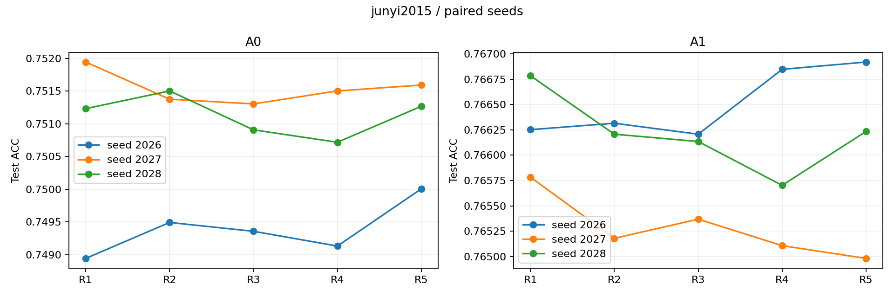
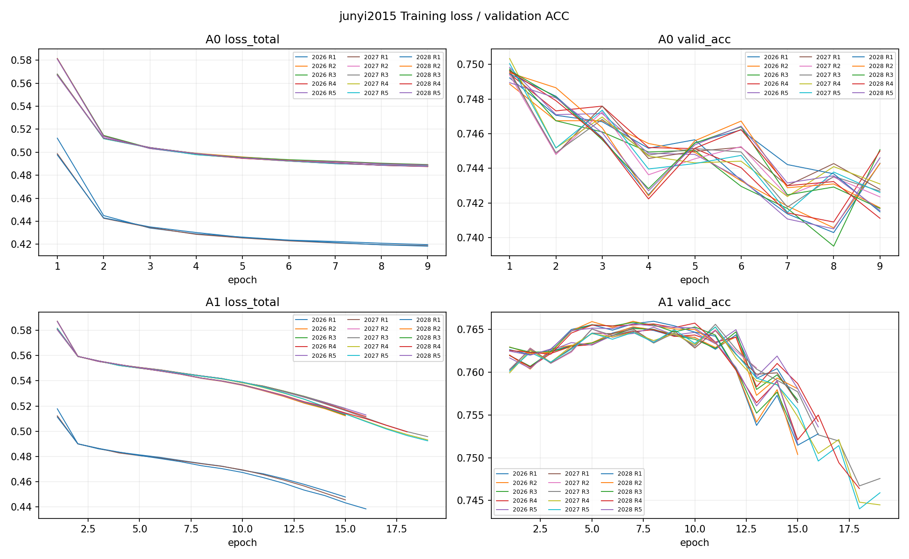
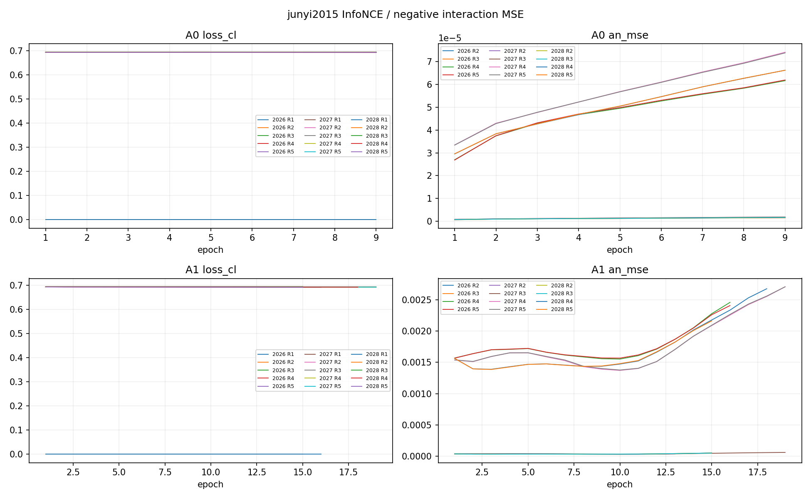
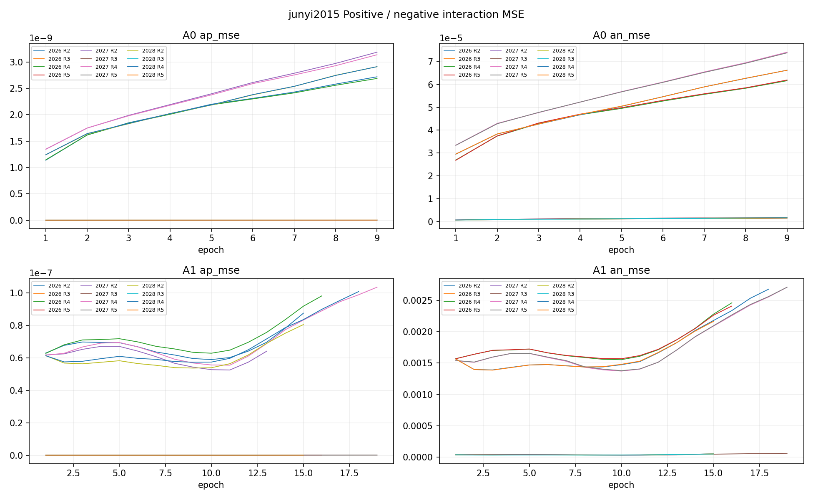
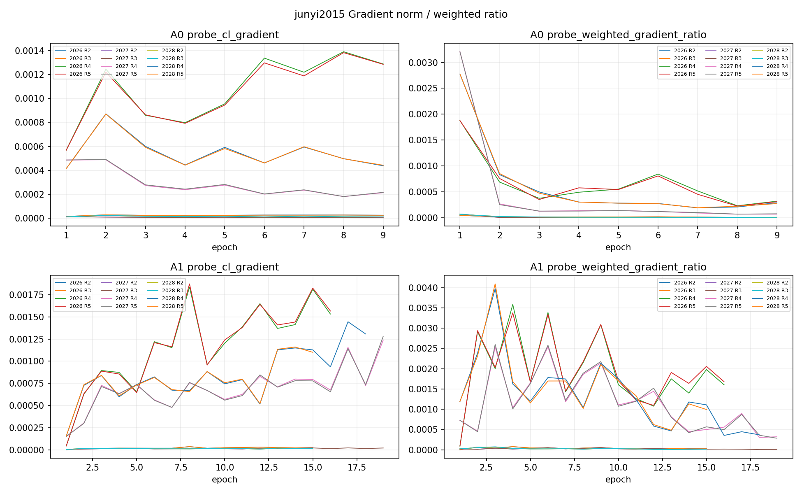

# junyi2015：无 Support/Query 的双输入交互对比实验

实验ID：student_cl_no_support_query_20261124_junyi2015。已完成 36/36 组；全部完成。

## 实验设置

按作答记录训练，每批128条；输入为完整训练矩阵对应的学生行和题目列，不隐藏当前训练目标。验证/测试只使用训练作答作为证据。两个输入不拼接，同一坐标的加噪保持一致，缺失0不变，连续均匀噪声裁剪至[-1,1]。

对比对象是预测网络输入 h=Aθ(θ⊙Q)−Aψ(ψ⊙Q)，不是纯学生掌握度。原始干净输入计算预测损失；正负视图只计算交互InfoNCE（余弦、温度0.2），不额外计算带噪预测损失。

A0=固定参考Q；A1=原Weak-Q设置。R0=按原IDCDataset取完整行列的无CL参考路径；R1=新入口CL关闭；R2–R5的λ=0.1。R0不是原仓库所有默认配置的完整复刻。

α=0.8，隐藏维度32，Adam学习率0.001、Q学习率0.005；Weak-Q与coverage系数均为0.01。最多30轮，验证ACC选模，平分保留最早轮，patience=8。种子2026/2027/2028。

| 条件 | 正比例 | 正幅度 | 负比例 | 负幅度 |
| --- | --- | --- | --- | --- |
| R2 | 0.1 | 0.01 | 0.5 | 0.1 |
| R3 | 0.01 | 0.001 | 0.5 | 0.1 |
| R4 | 0.1 | 0.01 | 0.7 | 0.5 |
| R5 | 0.01 | 0.001 | 0.7 | 0.5 |

与旧实验相比同时改变了输入遮蔽、训练取样和对比对象，且每轮更新次数增加，不能用新旧结果差直接归因某一项改变。

## 逐种子结果

所有ACC/AUC来自最佳验证ACC的同一checkpoint。每个种子单独列出，不按测试集选种子；Δ为同Q同种子相对R1的差值（比例单位）。

| Q | seed | 条件 | λ | 最佳轮 | valid ACC | test ACC | test AUC | ΔACC | ΔAUC |
| --- | --- | --- | --- | --- | --- | --- | --- | --- | --- |
| A0 | 2026 | R1 | 0 | 1 | 0.749224608 | 0.74894357 | 0.787372621 | 0 | 0 |
| A0 | 2026 | R2 | 0.1 | 1 | 0.748871265 | 0.749493184 | 0.787315982 | 0.000549613919 | -5.66389618e-05 |
| A0 | 2026 | R3 | 0.1 | 1 | 0.749734993 | 0.749358033 | 0.786910443 | 0.000414462955 | -0.000462177661 |
| A0 | 2026 | R4 | 0.1 | 1 | 0.74946017 | 0.749132781 | 0.786943837 | 0.000189211349 | -0.000428783496 |
| A0 | 2026 | R5 | 0.1 | 1 | 0.749833144 | 0.750006758 | 0.787720365 | 0.00106318758 | 0.000347744405 |
| A0 | 2027 | R1 | 0 | 1 | 0.749636842 | 0.751943921 | 0.788508367 | 0 | 0 |
| A0 | 2027 | R2 | 0.1 | 1 | 0.74940128 | 0.751376287 | 0.788178001 | -0.000567634047 | -0.000330366278 |
| A0 | 2027 | R3 | 0.1 | 1 | 0.749538691 | 0.751304207 | 0.788047533 | -0.000639714561 | -0.000460834384 |
| A0 | 2027 | R4 | 0.1 | 1 | 0.750343528 | 0.751502428 | 0.788843066 | -0.000441493148 | 0.000334698406 |
| A0 | 2027 | R5 | 0.1 | 1 | 0.750049075 | 0.751592529 | 0.788980961 | -0.000351392505 | 0.000472593545 |
| A0 | 2028 | R1 | 0 | 1 | 0.74946017 | 0.751232126 | 0.791826418 | 0 | 0 |
| A0 | 2028 | R2 | 0.1 | 1 | 0.749519061 | 0.751502428 | 0.791387856 | 0.000270301927 | -0.00043856214 |
| A0 | 2028 | R3 | 0.1 | 1 | 0.749656472 | 0.750907764 | 0.791465748 | -0.000324362313 | -0.000360670887 |
| A0 | 2028 | R4 | 0.1 | 1 | 0.749617212 | 0.750718553 | 0.791375089 | -0.000513573662 | -0.00045132945 |
| A0 | 2028 | R5 | 0.1 | 1 | 0.748949786 | 0.751268167 | 0.791769957 | 3.6040257e-05 | -5.64611616e-05 |
| A1 | 2026 | R1 | 0 | 7 | 0.765223195 | 0.766251903 | 0.813490339 | 0 | 0 |
| A1 | 2026 | R2 | 0.1 | 7 | 0.765301716 | 0.766314974 | 0.813525521 | 6.30704497e-05 | 3.51823113e-05 |
| A1 | 2026 | R3 | 0.1 | 7 | 0.765105414 | 0.766206853 | 0.813560311 | -4.50503212e-05 | 6.99723185e-05 |
| A1 | 2026 | R4 | 0.1 | 8 | 0.764968003 | 0.766846568 | 0.813799885 | 0.00059466424 | 0.000309545577 |
| A1 | 2026 | R5 | 0.1 | 8 | 0.765242825 | 0.766918648 | 0.813861885 | 0.000666744754 | 0.000371545658 |
| A1 | 2027 | R1 | 0 | 7 | 0.765046523 | 0.76578338 | 0.813617177 | 0 | 0 |
| A1 | 2027 | R2 | 0.1 | 5 | 0.765046523 | 0.765179706 | 0.812303097 | -0.000603674304 | -0.00131408013 |
| A1 | 2027 | R3 | 0.1 | 11 | 0.765596168 | 0.765368917 | 0.81299885 | -0.000414462955 | -0.000618327387 |
| A1 | 2027 | R4 | 0.1 | 11 | 0.765282086 | 0.765107625 | 0.813120237 | -0.000675754818 | -0.000496940371 |
| A1 | 2027 | R5 | 0.1 | 11 | 0.765282086 | 0.764981484 | 0.813126997 | -0.000801895718 | -0.000490179905 |
| A1 | 2028 | R1 | 0 | 8 | 0.765949511 | 0.766783497 | 0.813662604 | 0 | 0 |
| A1 | 2028 | R2 | 0.1 | 7 | 0.765949511 | 0.766206853 | 0.813841788 | -0.000576644111 | 0.00017918463 |
| A1 | 2028 | R3 | 0.1 | 7 | 0.7658121 | 0.766134773 | 0.813731739 | -0.000648724625 | 6.91356984e-05 |
| A1 | 2028 | R4 | 0.1 | 10 | 0.765733579 | 0.765702289 | 0.813571062 | -0.00108120771 | -9.15416619e-05 |
| A1 | 2028 | R5 | 0.1 | 7 | 0.765635429 | 0.766233883 | 0.81375818 | -0.000549613919 | 9.55766572e-05 |

## 核验与模型响应

两种Q、四种噪声预检通过：零系数预测/损失/单步更新/RNG一致；双输入缺失值保护、连续扰动、同坐标一致性、两侧网络梯度和单步更新差异均已检查。固定Q还在参数对齐后核对了原GNCDM前向输出。

已完成checkpoint回放 36 组；完整训练R0/R1精确一致性已通过 6/6 对。梯度范数以下取每轮第一个batch的诊断均值，并非全程所有batch统计。

| Q | seed | 条件 | CL损失 | 正h MSE | 负h MSE | CL梯度 | 加权CL/原梯度 | 正学生MAE | 负学生MAE | 正题目MAE | 负题目MAE |
| --- | --- | --- | --- | --- | --- | --- | --- | --- | --- | --- | --- |
| A0 | 2026 | R2 | 0.693132366 | 2.0947526e-09 | 1.2130647e-06 | 2.22993096e-05 | 1.44514972e-05 | 0.000249819344 | 0.0124991855 | 0.000250011009 | 0.012500027 |
| A0 | 2026 | R3 | 0.693132557 | 1.99785319e-12 | 1.2065534e-06 | 2.19416036e-05 | 1.4187439e-05 | 2.49564461e-06 | 0.0124991855 | 2.49994076e-06 | 0.012500027 |
| A0 | 2026 | R4 | 0.692417638 | 2.08346302e-09 | 4.79952223e-05 | 0.00107457605 | 0.000653291538 | 0.000249819344 | 0.0874952345 | 0.000250011009 | 0.0874987617 |
| A0 | 2026 | R5 | 0.69241622 | 2.0050199e-12 | 4.8193298e-05 | 0.00106138809 | 0.000654082605 | 2.49564461e-06 | 0.0874952345 | 2.49994076e-06 | 0.0874987617 |
| A0 | 2027 | R2 | 0.693141233 | 2.35764929e-09 | 1.39616566e-06 | 5.91456863e-06 | 9.86492281e-06 | 0.000250058986 | 0.0124990033 | 0.000249984909 | 0.0124996865 |
| A0 | 2027 | R3 | 0.693141187 | 2.23997648e-12 | 1.39113424e-06 | 5.97192202e-06 | 9.85768929e-06 | 2.50009206e-06 | 0.0124990033 | 2.49864059e-06 | 0.0124996865 |
| A0 | 2027 | R4 | 0.692883278 | 2.33712533e-09 | 5.59213772e-05 | 0.000286941815 | 0.000467291733 | 0.000250058986 | 0.0874989963 | 0.000249984909 | 0.0875009888 |
| A0 | 2027 | R5 | 0.69288115 | 2.22276147e-12 | 5.5801616e-05 | 0.000289756255 | 0.000466987891 | 2.50009206e-06 | 0.0874989963 | 2.49864059e-06 | 0.0875009888 |
| A0 | 2028 | R2 | 0.693137656 | 2.16417595e-09 | 1.25544939e-06 | 1.26333385e-05 | 1.43869247e-05 | 0.000249920787 | 0.0125002282 | 0.000249971915 | 0.012499616 |
| A0 | 2028 | R3 | 0.693137634 | 2.12482658e-12 | 1.26207347e-06 | 1.26660783e-05 | 1.46454483e-05 | 2.49771939e-06 | 0.0125002282 | 2.49912464e-06 | 0.012499616 |
| A0 | 2028 | R4 | 0.692745606 | 2.16620541e-09 | 5.00084001e-05 | 0.000545664391 | 0.000626247792 | 0.000249920787 | 0.087509577 | 0.000249971915 | 0.087499526 |
| A0 | 2028 | R5 | 0.692746309 | 2.11575064e-12 | 5.00514352e-05 | 0.000543983488 | 0.00062573794 | 2.49771939e-06 | 0.087509577 | 2.49912464e-06 | 0.087499526 |
| A1 | 2026 | R2 | 0.693120707 | 6.72657294e-08 | 3.93550528e-05 | 2.05903157e-05 | 3.78778348e-05 | 0.000249943281 | 0.012499224 | 0.000249976697 | 0.0124998247 |
| A1 | 2026 | R3 | 0.693120783 | 6.44058447e-11 | 3.90552666e-05 | 2.05686492e-05 | 3.78878006e-05 | 2.49830493e-06 | 0.012499224 | 2.49972462e-06 | 0.0124998247 |
| A1 | 2026 | R4 | 0.691649095 | 7.22742372e-08 | 0.00176854231 | 0.00116422791 | 0.00193738322 | 0.000249945256 | 0.0874931871 | 0.000249980383 | 0.0874958223 |
| A1 | 2026 | R5 | 0.691646075 | 6.97867656e-11 | 0.00176837279 | 0.00117299153 | 0.00196733738 | 2.49929533e-06 | 0.0874931871 | 2.49960024e-06 | 0.0874958223 |
| A1 | 2027 | R2 | 0.69312946 | 6.04371731e-08 | 3.54399251e-05 | 1.22290638e-05 | 2.97994439e-05 | 0.000249976832 | 0.0124987101 | 0.000250002897 | 0.0124993755 |
| A1 | 2027 | R3 | 0.693126628 | 6.59047553e-11 | 4.06003554e-05 | 1.40086529e-05 | 2.43710725e-05 | 2.5011177e-06 | 0.012500328 | 2.49940339e-06 | 0.0124997394 |
| A1 | 2027 | R4 | 0.692087223 | 7.17032708e-08 | 0.00178060204 | 0.000691284355 | 0.00114462426 | 0.000249979844 | 0.087503578 | 0.000249994484 | 0.0874998884 |
| A1 | 2027 | R5 | 0.692088302 | 6.92149255e-11 | 0.00178512925 | 0.000689103073 | 0.00115153757 | 2.5011177e-06 | 0.087503578 | 2.49940339e-06 | 0.0874998884 |
| A1 | 2028 | R2 | 0.693129027 | 6.03751269e-08 | 3.60483246e-05 | 1.30842925e-05 | 2.69017905e-05 | 0.00024997237 | 0.0124998519 | 0.000249984494 | 0.0124997598 |
| A1 | 2028 | R3 | 0.693128986 | 5.85874341e-11 | 3.6423566e-05 | 1.29208317e-05 | 2.72467279e-05 | 2.49804063e-06 | 0.0124998519 | 2.49987843e-06 | 0.0124997598 |
| A1 | 2028 | R4 | 0.692048582 | 6.84554974e-08 | 0.00173788351 | 0.000846939978 | 0.00136633588 | 0.000250001099 | 0.0875020845 | 0.000249981741 | 0.0875008636 |
| A1 | 2028 | R5 | 0.692134894 | 6.06432801e-11 | 0.00158169035 | 0.000771766122 | 0.00154829122 | 2.49804063e-06 | 0.0875048529 | 2.49987843e-06 | 0.0874997707 |

参数相对L2差异=‖W条件−W基线‖/‖W基线‖，比较各自选中的checkpoint；若最佳轮不同，差异也包含训练轮次效应，不能全部解释为直接对比梯度。

| Q | seed | 条件 | 学生网络 | 题目网络 | 学生聚合层 | 题目聚合层 |
| --- | --- | --- | --- | --- | --- | --- |
| A0 | 2026 | R2 | 0.25038055 | 0.737633109 | 0.157314044 | 0.0234412751 |
| A0 | 2026 | R3 | 0.252592401 | 0.737912523 | 0.176998732 | 0.0335374997 |
| A0 | 2026 | R4 | 0.310078284 | 0.761496939 | 0.353165416 | 0.0304528963 |
| A0 | 2026 | R5 | 0.310442113 | 0.76460768 | 0.357625703 | 0.0280778997 |
| A0 | 2027 | R2 | 0.259064339 | 0.745739044 | 0.210626074 | 0.028114999 |
| A0 | 2027 | R3 | 0.259815818 | 0.755823009 | 0.210801359 | 0.0312188623 |
| A0 | 2027 | R4 | 0.313240893 | 0.805468146 | 0.398049055 | 0.0513368714 |
| A0 | 2027 | R5 | 0.317901971 | 0.781385647 | 0.394207975 | 0.039765705 |
| A0 | 2028 | R2 | 0.252977373 | 0.695882357 | 0.0884868546 | 0.0244327412 |
| A0 | 2028 | R3 | 0.259239578 | 0.711167572 | 0.107362869 | 0.0287985348 |
| A0 | 2028 | R4 | 0.291752785 | 0.75056795 | 0.272486237 | 0.0206228925 |
| A0 | 2028 | R5 | 0.290703181 | 0.747033162 | 0.276537008 | 0.0283140748 |
| A1 | 2026 | R2 | 0.203877697 | 0.715404483 | 0.161317986 | 0.025148976 |
| A1 | 2026 | R3 | 0.191206897 | 0.715006665 | 0.221692398 | 0.0195260977 |
| A1 | 2026 | R4 | 0.260558005 | 0.851747162 | 0.27462584 | 0.113549758 |
| A1 | 2026 | R5 | 0.274446806 | 0.868989644 | 0.268296769 | 0.113146784 |
| A1 | 2027 | R2 | 0.270039192 | 0.739394644 | 0.265573986 | 0.147122689 |
| A1 | 2027 | R3 | 0.436805283 | 0.923517458 | 0.559756157 | 0.258080355 |
| A1 | 2027 | R4 | 0.462592857 | 0.961440531 | 0.60970385 | 0.293226898 |
| A1 | 2027 | R5 | 0.455009877 | 0.978173588 | 0.590228339 | 0.287580342 |
| A1 | 2028 | R2 | 0.238608473 | 0.715712021 | 0.257341651 | 0.0895593641 |
| A1 | 2028 | R3 | 0.245816631 | 0.721604082 | 0.254622323 | 0.0902481135 |
| A1 | 2028 | R4 | 0.352748073 | 0.885931734 | 0.405040979 | 0.216709342 |
| A1 | 2028 | R5 | 0.277511332 | 0.793963113 | 0.258874672 | 0.123222609 |

## 图表

## 结果解读

A0 R2：3个配对种子，ACC提高/不变/降低=2/0/1；逐种子差值为 +0.000549614, -0.000567634, +0.000270302。

A0 R3：3个配对种子，ACC提高/不变/降低=1/0/2；逐种子差值为 +0.000414463, -0.000639715, -0.000324362。

A0 R4：3个配对种子，ACC提高/不变/降低=1/0/2；逐种子差值为 +0.000189211, -0.000441493, -0.000513574。

A0 R5：3个配对种子，ACC提高/不变/降低=2/0/1；逐种子差值为 +0.001063188, -0.000351393, +0.000036040。

A1 R2：3个配对种子，ACC提高/不变/降低=1/0/2；逐种子差值为 +0.000063070, -0.000603674, -0.000576644。

A1 R3：3个配对种子，ACC提高/不变/降低=0/0/3；逐种子差值为 -0.000045050, -0.000414463, -0.000648725。

A1 R4：3个配对种子，ACC提高/不变/降低=1/0/2；逐种子差值为 +0.000594664, -0.000675755, -0.001081208。

A1 R5：3个配对种子，ACC提高/不变/降低=1/0/2；逐种子差值为 +0.000666745, -0.000801896, -0.000549614。

参数与梯度非零仅证明参与优化；预测收益应同时看ACC/AUC和全部配对种子。负视图仍是同一作答的连续证据扰动，不保证其语义上应被推远。InfoNCE无margin，不报告虚构的margin激活率。
