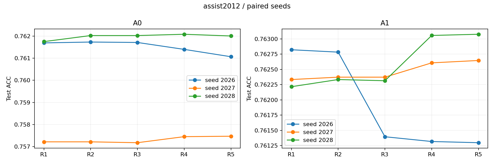
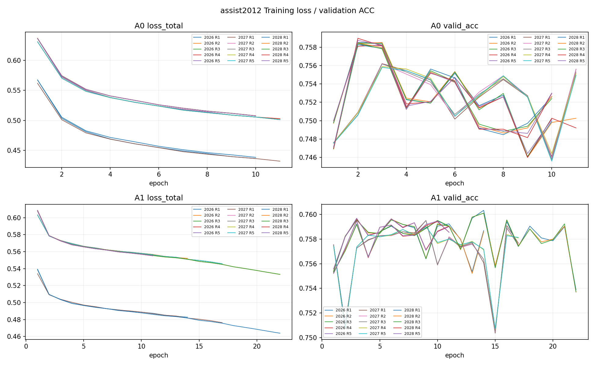
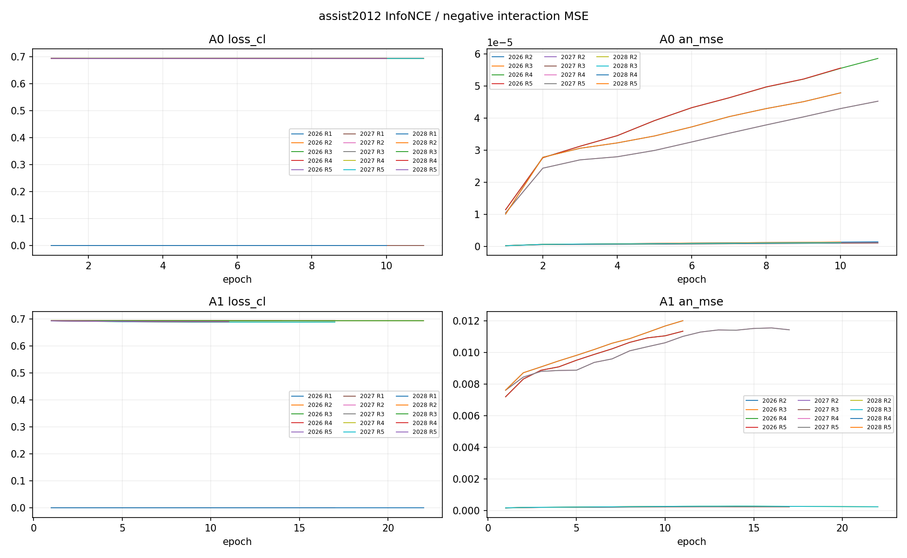
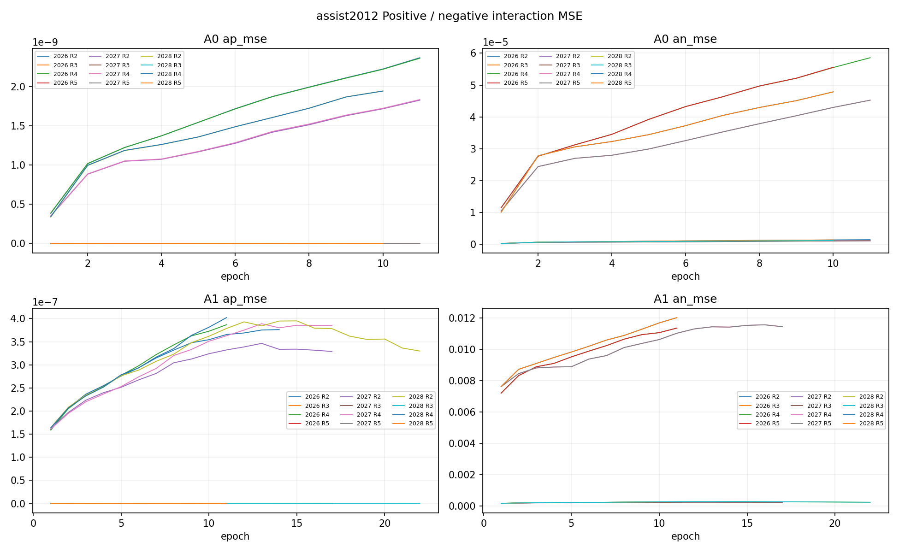
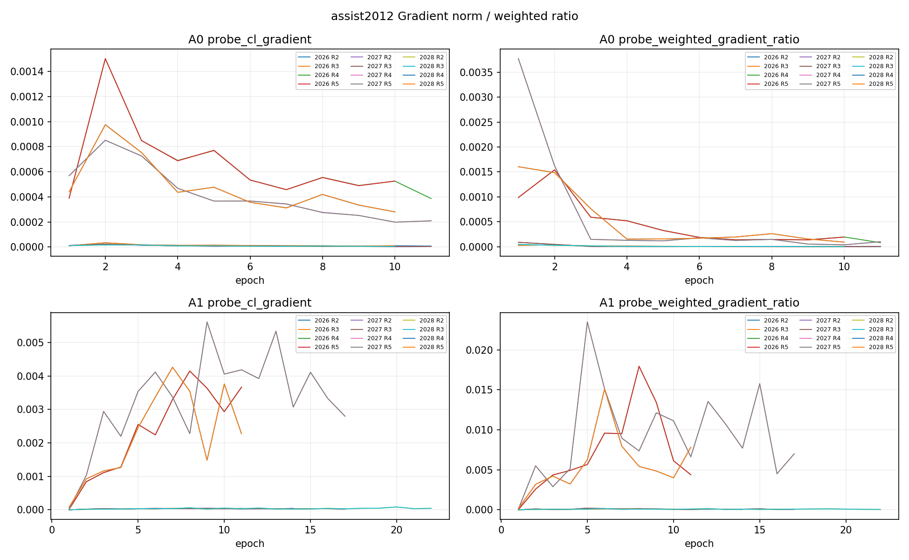

# assist2012：无 Support/Query 的双输入交互对比实验

实验ID：student_cl_no_support_query_20261124_assist2012。已完成 36/36 组；全部完成。

## 实验设置

按作答记录训练，每批128条；输入为完整训练矩阵对应的学生行和题目列，不隐藏当前训练目标。验证/测试只使用训练作答作为证据。两个输入不拼接，同一坐标的加噪保持一致，缺失0不变，连续均匀噪声裁剪至[-1,1]。

对比对象是预测网络输入 h=Aθ(θ⊙Q)−Aψ(ψ⊙Q)，不是纯学生掌握度。原始干净输入计算预测损失；正负视图只计算交互InfoNCE（余弦、温度0.2），不额外计算带噪预测损失。

A0=固定参考Q；A1=原Weak-Q设置。R0=按原IDCDataset取完整行列的无CL参考路径；R1=新入口CL关闭；R2–R5的λ=0.1。R0不是原仓库所有默认配置的完整复刻。

α=0.8，隐藏维度32，Adam学习率0.001、Q学习率0.005；Weak-Q与coverage系数均为0.01。最多30轮，验证ACC选模，平分保留最早轮，patience=8。种子2026/2027/2028。

| 条件 | 正比例 | 正幅度 | 负比例 | 负幅度 |
| --- | --- | --- | --- | --- |
| R2 | 0.1 | 0.01 | 0.5 | 0.1 |
| R3 | 0.01 | 0.001 | 0.5 | 0.1 |
| R4 | 0.1 | 0.01 | 0.7 | 0.5 |
| R5 | 0.01 | 0.001 | 0.7 | 0.5 |

与旧实验相比同时改变了输入遮蔽、训练取样和对比对象，且每轮更新次数增加，不能用新旧结果差直接归因某一项改变。

## 逐种子结果

所有ACC/AUC来自最佳验证ACC的同一checkpoint。每个种子单独列出，不按测试集选种子；Δ为同Q同种子相对R1的差值（比例单位）。

| Q | seed | 条件 | λ | 最佳轮 | valid ACC | test ACC | test AUC | ΔACC | ΔAUC |
| --- | --- | --- | --- | --- | --- | --- | --- | --- | --- |
| A0 | 2026 | R1 | 0 | 2 | 0.758508543 | 0.761689085 | 0.692862889 | 0 | 0 |
| A0 | 2026 | R2 | 0.1 | 3 | 0.758508543 | 0.76172813 | 0.696675482 | 3.90449603e-05 | 0.00381259371 |
| A0 | 2026 | R3 | 0.1 | 2 | 0.758462736 | 0.761708607 | 0.692811972 | 1.95224801e-05 | -5.09163659e-05 |
| A0 | 2026 | R4 | 0.1 | 3 | 0.758233704 | 0.761396248 | 0.696832859 | -0.000292837202 | 0.00396997067 |
| A0 | 2026 | R5 | 0.1 | 2 | 0.758279511 | 0.761064366 | 0.693114055 | -0.000624719364 | 0.000251165817 |
| A0 | 2027 | R1 | 0 | 3 | 0.756218222 | 0.757218437 | 0.699017336 | 0 | 0 |
| A0 | 2027 | R2 | 0.1 | 3 | 0.756218222 | 0.757218437 | 0.698966213 | 0 | -5.11229755e-05 |
| A0 | 2027 | R3 | 0.1 | 3 | 0.756172415 | 0.757179392 | 0.69898506 | -3.90449603e-05 | -3.22758047e-05 |
| A0 | 2027 | R4 | 0.1 | 3 | 0.755897577 | 0.757452707 | 0.698736076 | 0.000234269762 | -0.0002812603 |
| A0 | 2027 | R5 | 0.1 | 3 | 0.755805964 | 0.757472229 | 0.698750262 | 0.000253792242 | -0.00026707476 |
| A0 | 2028 | R1 | 0 | 2 | 0.758279511 | 0.761747652 | 0.693730041 | 0 | 0 |
| A0 | 2028 | R2 | 0.1 | 2 | 0.758462736 | 0.762020967 | 0.693719848 | 0.000273314722 | -1.0193405e-05 |
| A0 | 2028 | R3 | 0.1 | 2 | 0.75841693 | 0.762020967 | 0.693726492 | 0.000273314722 | -3.54911674e-06 |
| A0 | 2028 | R4 | 0.1 | 2 | 0.758966607 | 0.762079535 | 0.693441056 | 0.000331882162 | -0.000288985316 |
| A0 | 2028 | R5 | 0.1 | 2 | 0.758737575 | 0.762001445 | 0.693464194 | 0.000253792242 | -0.000265847022 |
| A1 | 2026 | R1 | 0 | 6 | 0.759607897 | 0.762821389 | 0.714202345 | 0 | 0 |
| A1 | 2026 | R2 | 0.1 | 6 | 0.759607897 | 0.762782344 | 0.714209167 | -3.90449603e-05 | 6.82209174e-06 |
| A1 | 2026 | R3 | 0.1 | 3 | 0.759562091 | 0.761396248 | 0.712431982 | -0.00142514105 | -0.00177036261 |
| A1 | 2026 | R4 | 0.1 | 3 | 0.759653703 | 0.761318158 | 0.712409096 | -0.00150323097 | -0.0017932486 |
| A1 | 2026 | R5 | 0.1 | 3 | 0.75969951 | 0.761298635 | 0.712407557 | -0.00152275345 | -0.00179478824 |
| A1 | 2027 | R1 | 0 | 9 | 0.759516284 | 0.762333327 | 0.71517823 | 0 | 0 |
| A1 | 2027 | R2 | 0.1 | 9 | 0.759516284 | 0.762372372 | 0.715169705 | 3.90449603e-05 | -8.52463473e-06 |
| A1 | 2027 | R3 | 0.1 | 9 | 0.759516284 | 0.762372372 | 0.715167476 | 3.90449603e-05 | -1.0753635e-05 |
| A1 | 2027 | R4 | 0.1 | 9 | 0.75905822 | 0.762606642 | 0.714904682 | 0.000273314722 | -0.000273548198 |
| A1 | 2027 | R5 | 0.1 | 9 | 0.759012414 | 0.762645687 | 0.714894649 | 0.000312359682 | -0.000283580686 |
| A1 | 2028 | R1 | 0 | 14 | 0.7603408 | 0.762216192 | 0.715208522 | 0 | 0 |
| A1 | 2028 | R2 | 0.1 | 14 | 0.760111768 | 0.762333327 | 0.715208712 | 0.000117134881 | 1.89723285e-07 |
| A1 | 2028 | R3 | 0.1 | 14 | 0.760111768 | 0.762313804 | 0.715207807 | 9.76124007e-05 | -7.15187253e-07 |
| A1 | 2028 | R4 | 0.1 | 3 | 0.759516284 | 0.763055659 | 0.71239333 | 0.000839466646 | -0.00281519258 |
| A1 | 2028 | R5 | 0.1 | 3 | 0.759470478 | 0.763075181 | 0.712392646 | 0.000858989126 | -0.00281587598 |

## 核验与模型响应

两种Q、四种噪声预检通过：零系数预测/损失/单步更新/RNG一致；双输入缺失值保护、连续扰动、同坐标一致性、两侧网络梯度和单步更新差异均已检查。固定Q还在参数对齐后核对了原GNCDM前向输出。

已完成checkpoint回放 36 组；完整训练R0/R1精确一致性已通过 6/6 对。梯度范数以下取每轮第一个batch的诊断均值，并非全程所有batch统计。

| Q | seed | 条件 | CL损失 | 正h MSE | 负h MSE | CL梯度 | 加权CL/原梯度 | 正学生MAE | 负学生MAE | 正题目MAE | 负题目MAE |
| --- | --- | --- | --- | --- | --- | --- | --- | --- | --- | --- | --- |
| A0 | 2026 | R2 | 0.69313929 | 1.6210265e-09 | 9.93058154e-07 | 1.39180494e-05 | 9.97766742e-06 | 0.000250145966 | 0.0124975206 | 0.000249896156 | 0.0125025624 |
| A0 | 2026 | R3 | 0.693139177 | 1.47815238e-12 | 9.49437199e-07 | 1.45354207e-05 | 1.08346511e-05 | 2.50003309e-06 | 0.0124974154 | 2.49703968e-06 | 0.0125020015 |
| A0 | 2026 | R4 | 0.692782376 | 1.6195728e-09 | 4.08541961e-05 | 0.000650313557 | 0.000440224522 | 0.000250145966 | 0.0874819101 | 0.000249896156 | 0.0875093521 |
| A0 | 2026 | R5 | 0.692777902 | 1.47738752e-12 | 3.91064926e-05 | 0.00067643482 | 0.000475305819 | 2.50003309e-06 | 0.087482645 | 2.49703968e-06 | 0.0875049539 |
| A0 | 2027 | R2 | 0.693141925 | 1.26399828e-09 | 7.76568128e-07 | 9.50474916e-06 | 1.39783518e-05 | 0.000249982729 | 0.0125019117 | 0.000250008412 | 0.0124984509 |
| A0 | 2027 | R3 | 0.693141915 | 1.20565779e-12 | 7.76745206e-07 | 9.52111584e-06 | 1.39744827e-05 | 2.49830469e-06 | 0.0125019117 | 2.50200167e-06 | 0.0124984509 |
| A0 | 2027 | R4 | 0.692918415 | 1.27048144e-09 | 3.2180312e-05 | 0.000421110576 | 0.000583663246 | 0.000249982729 | 0.0875024615 | 0.000250008412 | 0.0874910322 |
| A0 | 2027 | R5 | 0.692918424 | 1.21038757e-12 | 3.21702321e-05 | 0.000420936665 | 0.00058329568 | 2.49830469e-06 | 0.0875024615 | 2.50200167e-06 | 0.0874910322 |
| A0 | 2028 | R2 | 0.693140465 | 1.37625649e-09 | 8.4446158e-07 | 9.99148056e-06 | 1.1177756e-05 | 0.000249955938 | 0.0125033083 | 0.000249886132 | 0.0124995685 |
| A0 | 2028 | R3 | 0.693140454 | 1.30753402e-12 | 8.44272351e-07 | 1.00036675e-05 | 1.1190992e-05 | 2.49340851e-06 | 0.0125033083 | 2.49905316e-06 | 0.0124995685 |
| A0 | 2028 | R4 | 0.692850228 | 1.37756437e-09 | 3.48717153e-05 | 0.000478967872 | 0.000502359501 | 0.000249955938 | 0.0875307797 | 0.000249886132 | 0.0875001868 |
| A0 | 2028 | R5 | 0.692850347 | 1.3093597e-12 | 3.48694289e-05 | 0.000478887861 | 0.000501949238 | 2.49340851e-06 | 0.0875307797 | 2.49905316e-06 | 0.0875001868 |
| A1 | 2026 | R2 | 0.693107627 | 3.04459112e-07 | 0.000219831577 | 2.90212703e-05 | 8.0986201e-05 | 0.000250056525 | 0.0124962501 | 0.00024991069 | 0.0125022457 |
| A1 | 2026 | R3 | 0.693110329 | 2.60156638e-10 | 0.000211627541 | 2.7374295e-05 | 8.51766046e-05 | 2.50054714e-06 | 0.0124975206 | 2.49731214e-06 | 0.0125025624 |
| A1 | 2026 | R4 | 0.690556569 | 2.92180822e-07 | 0.00972970018 | 0.00233841409 | 0.00714188892 | 0.000250145966 | 0.0874819101 | 0.000249896156 | 0.0875093521 |
| A1 | 2026 | R5 | 0.690556478 | 2.65615728e-10 | 0.00972920917 | 0.00233840118 | 0.00714237833 | 2.50054714e-06 | 0.0874819101 | 2.49731214e-06 | 0.0875093521 |
| A1 | 2027 | R2 | 0.693099988 | 2.88754468e-07 | 0.000209051728 | 3.06116199e-05 | 8.92083223e-05 | 0.000250038258 | 0.0125002118 | 0.000250006 | 0.0124995088 |
| A1 | 2027 | R3 | 0.693099911 | 2.61853378e-10 | 0.000209050921 | 3.06571943e-05 | 8.93218755e-05 | 2.49783517e-06 | 0.0125002118 | 2.50168868e-06 | 0.0124995088 |
| A1 | 2027 | R4 | 0.688879494 | 3.11779485e-07 | 0.0101320726 | 0.00329139385 | 0.00928199679 | 0.000250038258 | 0.0874997431 | 0.000250006 | 0.0874980797 |
| A1 | 2027 | R5 | 0.688879471 | 2.81935596e-10 | 0.0101316052 | 0.00329146644 | 0.00928075436 | 2.49783517e-06 | 0.0874997431 | 2.50168868e-06 | 0.0874980797 |
| A1 | 2028 | R2 | 0.693100101 | 3.27601306e-07 | 0.000234428951 | 3.59352534e-05 | 7.88589294e-05 | 0.000250053847 | 0.012501659 | 0.000249980178 | 0.0125005921 |
| A1 | 2028 | R3 | 0.693100019 | 2.99366455e-10 | 0.000234476437 | 3.60125498e-05 | 7.88110236e-05 | 2.49773575e-06 | 0.012501659 | 2.49902897e-06 | 0.0125005921 |
| A1 | 2028 | R4 | 0.69051553 | 2.93298445e-07 | 0.0101159764 | 0.00223488512 | 0.00565340107 | 0.000250005873 | 0.0875291704 | 0.000249903021 | 0.087497206 |
| A1 | 2028 | R5 | 0.690515474 | 2.6128801e-10 | 0.0101161043 | 0.00223548584 | 0.0056551744 | 2.49470332e-06 | 0.0875291704 | 2.49944462e-06 | 0.087497206 |

参数相对L2差异=‖W条件−W基线‖/‖W基线‖，比较各自选中的checkpoint；若最佳轮不同，差异也包含训练轮次效应，不能全部解释为直接对比梯度。

| Q | seed | 条件 | 学生网络 | 题目网络 | 学生聚合层 | 题目聚合层 |
| --- | --- | --- | --- | --- | --- | --- |
| A0 | 2026 | R2 | 0.319397537 | 0.309288066 | 0.260472045 | 0.201883636 |
| A0 | 2026 | R3 | 0.239379019 | 0.0481186996 | 0.0659086627 | 0.00179467964 |
| A0 | 2026 | R4 | 0.373606207 | 0.448213162 | 0.374831049 | 0.199481262 |
| A0 | 2026 | R5 | 0.303374625 | 0.31324887 | 0.234492594 | 0.0197144609 |
| A0 | 2027 | R2 | 0.26044628 | 0.146158065 | 0.153954267 | 0.00230990331 |
| A0 | 2027 | R3 | 0.261354199 | 0.145022594 | 0.157824812 | 0.00228932647 |
| A0 | 2027 | R4 | 0.318084805 | 0.35777448 | 0.382516261 | 0.0131589898 |
| A0 | 2027 | R5 | 0.32002117 | 0.35737447 | 0.383257154 | 0.0132029185 |
| A0 | 2028 | R2 | 0.245635545 | 0.0848205734 | 0.0470427248 | 0.00204214319 |
| A0 | 2028 | R3 | 0.244204083 | 0.0832927029 | 0.0472327501 | 0.00207968123 |
| A0 | 2028 | R4 | 0.302049155 | 0.333078685 | 0.246993815 | 0.0232757133 |
| A0 | 2028 | R5 | 0.30174923 | 0.331074335 | 0.248947657 | 0.0228058353 |
| A1 | 2026 | R2 | 0.110413011 | 0.0141992001 | 0.0852129812 | 0.00184860069 |
| A1 | 2026 | R3 | 0.26759577 | 0.355351546 | 0.28518366 | 0.263484821 |
| A1 | 2026 | R4 | 0.284475141 | 0.361319874 | 0.290682389 | 0.265861696 |
| A1 | 2026 | R5 | 0.284489287 | 0.3613206 | 0.290489399 | 0.265855923 |
| A1 | 2027 | R2 | 0.129491783 | 0.0251270368 | 0.120326769 | 0.00260683685 |
| A1 | 2027 | R3 | 0.130445697 | 0.0255405501 | 0.116332864 | 0.0026442085 |
| A1 | 2027 | R4 | 0.165379009 | 0.170537627 | 0.238450507 | 0.133149062 |
| A1 | 2027 | R5 | 0.164689582 | 0.170447153 | 0.237028853 | 0.133135272 |
| A1 | 2028 | R2 | 0.160515791 | 0.0600581567 | 0.16484193 | 0.00325918035 |
| A1 | 2028 | R3 | 0.15938178 | 0.0605523844 | 0.168438295 | 0.00309835719 |
| A1 | 2028 | R4 | 0.49126527 | 0.644348051 | 0.592114817 | 0.432143223 |
| A1 | 2028 | R5 | 0.491355346 | 0.644348977 | 0.59219426 | 0.432149402 |

## 图表

## 结果解读

A0 R2：3个配对种子，ACC提高/不变/降低=2/1/0；逐种子差值为 +0.000039045, +0.000000000, +0.000273315。

A0 R3：3个配对种子，ACC提高/不变/降低=2/0/1；逐种子差值为 +0.000019522, -0.000039045, +0.000273315。

A0 R4：3个配对种子，ACC提高/不变/降低=2/0/1；逐种子差值为 -0.000292837, +0.000234270, +0.000331882。

A0 R5：3个配对种子，ACC提高/不变/降低=2/0/1；逐种子差值为 -0.000624719, +0.000253792, +0.000253792。

A1 R2：3个配对种子，ACC提高/不变/降低=2/0/1；逐种子差值为 -0.000039045, +0.000039045, +0.000117135。

A1 R3：3个配对种子，ACC提高/不变/降低=2/0/1；逐种子差值为 -0.001425141, +0.000039045, +0.000097612。

A1 R4：3个配对种子，ACC提高/不变/降低=2/0/1；逐种子差值为 -0.001503231, +0.000273315, +0.000839467。

A1 R5：3个配对种子，ACC提高/不变/降低=2/0/1；逐种子差值为 -0.001522753, +0.000312360, +0.000858989。

参数与梯度非零仅证明参与优化；预测收益应同时看ACC/AUC和全部配对种子。负视图仍是同一作答的连续证据扰动，不保证其语义上应被推远。InfoNCE无margin，不报告虚构的margin激活率。
