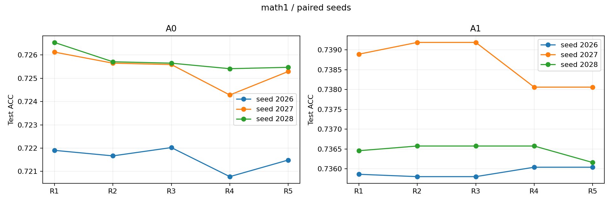
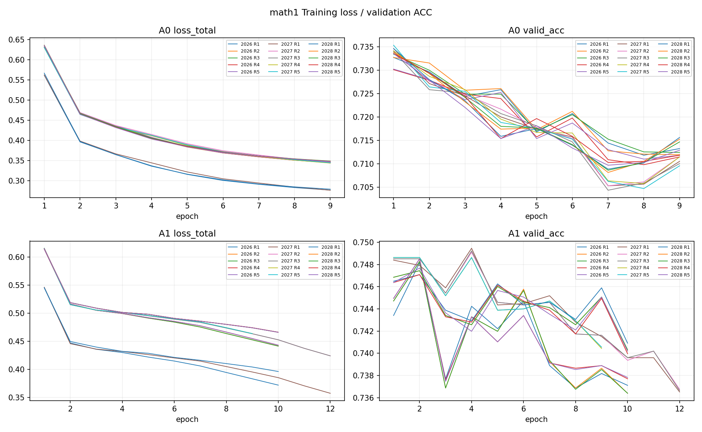
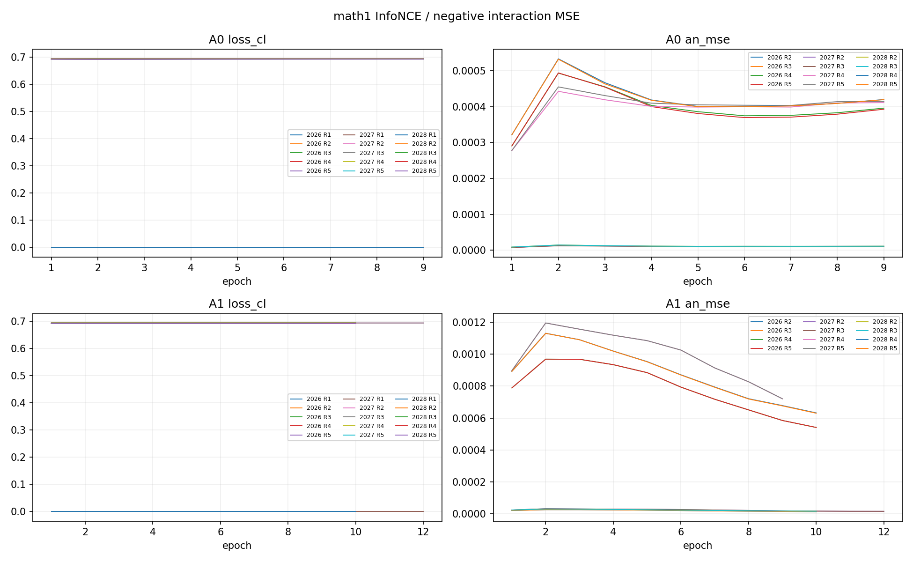
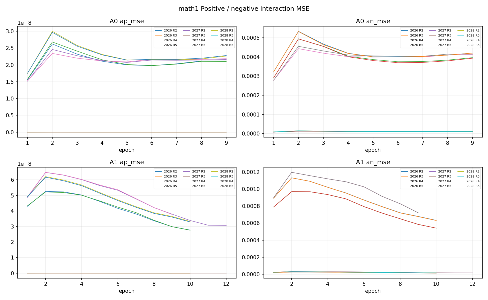
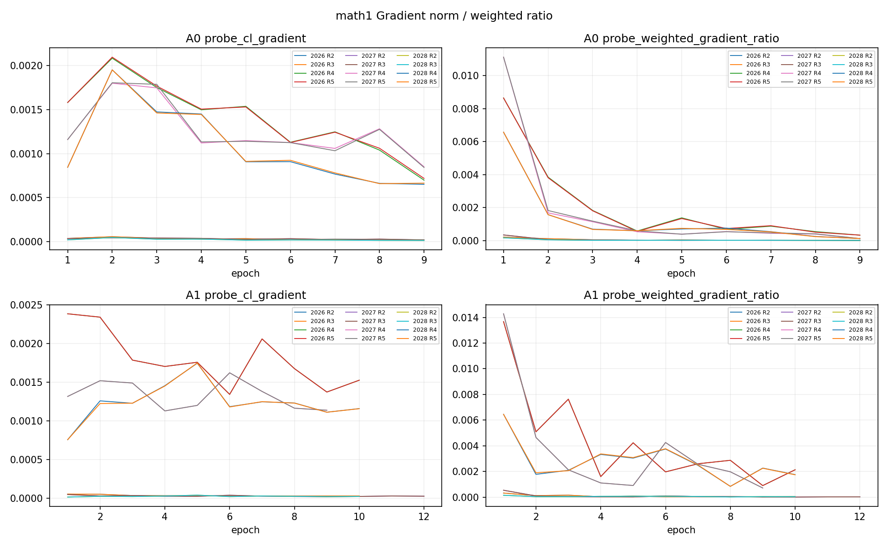

# math1：无 Support/Query 的双输入交互对比实验

实验ID：student_cl_no_support_query_20261124_math1。已完成 36/36 组；全部完成。

## 实验设置

按作答记录训练，每批128条；输入为完整训练矩阵对应的学生行和题目列，不隐藏当前训练目标。验证/测试只使用训练作答作为证据。两个输入不拼接，同一坐标的加噪保持一致，缺失0不变，连续均匀噪声裁剪至[-1,1]。

对比对象是预测网络输入 h=Aθ(θ⊙Q)−Aψ(ψ⊙Q)，不是纯学生掌握度。原始干净输入计算预测损失；正负视图只计算交互InfoNCE（余弦、温度0.2），不额外计算带噪预测损失。

A0=固定参考Q；A1=原Weak-Q设置。R0=按原IDCDataset取完整行列的无CL参考路径；R1=新入口CL关闭；R2–R5的λ=0.1。R0不是原仓库所有默认配置的完整复刻。

α=0.8，隐藏维度32，Adam学习率0.001、Q学习率0.005；Weak-Q与coverage系数均为0.01。最多30轮，验证ACC选模，平分保留最早轮，patience=8。种子2026/2027/2028。

| 条件 | 正比例 | 正幅度 | 负比例 | 负幅度 |
| --- | --- | --- | --- | --- |
| R2 | 0.1 | 0.01 | 0.5 | 0.1 |
| R3 | 0.01 | 0.001 | 0.5 | 0.1 |
| R4 | 0.1 | 0.01 | 0.7 | 0.5 |
| R5 | 0.01 | 0.001 | 0.7 | 0.5 |

与旧实验相比同时改变了输入遮蔽、训练取样和对比对象，且每轮更新次数增加，不能用新旧结果差直接归因某一项改变。

## 逐种子结果

所有ACC/AUC来自最佳验证ACC的同一checkpoint。每个种子单独列出，不按测试集选种子；Δ为同Q同种子相对R1的差值（比例单位）。

| Q | seed | 条件 | λ | 最佳轮 | valid ACC | test ACC | test AUC | ΔACC | ΔAUC |
| --- | --- | --- | --- | --- | --- | --- | --- | --- | --- |
| A0 | 2026 | R1 | 0 | 1 | 0.732715609 | 0.721905441 | 0.811382179 | 0 | 0 |
| A0 | 2026 | R2 | 0.1 | 1 | 0.732715609 | 0.721667855 | 0.811112211 | -0.000237586125 | -0.000269968155 |
| A0 | 2026 | R3 | 0.1 | 1 | 0.733428368 | 0.722024234 | 0.811084055 | 0.000118793062 | -0.000298123988 |
| A0 | 2026 | R4 | 0.1 | 1 | 0.730102162 | 0.720776907 | 0.810384081 | -0.00112853409 | -0.000998098662 |
| A0 | 2026 | R5 | 0.1 | 1 | 0.730220955 | 0.721489665 | 0.81014684 | -0.000415775719 | -0.0012353399 |
| A0 | 2027 | R1 | 0 | 1 | 0.734616298 | 0.726122594 | 0.813933969 | 0 | 0 |
| A0 | 2027 | R2 | 0.1 | 1 | 0.734141126 | 0.725647422 | 0.813464975 | -0.00047517225 | -0.000468994296 |
| A0 | 2027 | R3 | 0.1 | 1 | 0.734022333 | 0.725588026 | 0.813466744 | -0.000534568781 | -0.000467225079 |
| A0 | 2027 | R4 | 0.1 | 1 | 0.734141126 | 0.724281302 | 0.813634097 | -0.00184129247 | -0.000299871542 |
| A0 | 2027 | R5 | 0.1 | 1 | 0.735329057 | 0.725291043 | 0.813890641 | -0.000831551437 | -4.33277766e-05 |
| A0 | 2028 | R1 | 0 | 1 | 0.734616298 | 0.72653837 | 0.809710298 | 0 | 0 |
| A0 | 2028 | R2 | 0.1 | 1 | 0.733784747 | 0.725706819 | 0.809880063 | -0.000831551437 | 0.00016976545 |
| A0 | 2028 | R3 | 0.1 | 1 | 0.733547161 | 0.725647422 | 0.809873629 | -0.000890947969 | 0.000163331275 |
| A0 | 2028 | R4 | 0.1 | 1 | 0.733547161 | 0.725409836 | 0.809954197 | -0.00112853409 | 0.000243899276 |
| A0 | 2028 | R5 | 0.1 | 1 | 0.733547161 | 0.725469233 | 0.809954298 | -0.00106913756 | 0.000244000374 |
| A1 | 2026 | R1 | 0 | 2 | 0.748158708 | 0.735863626 | 0.826319878 | 0 | 0 |
| A1 | 2026 | R2 | 0.1 | 2 | 0.748277501 | 0.735804229 | 0.826183908 | -5.93965312e-05 | -0.000135969784 |
| A1 | 2026 | R3 | 0.1 | 2 | 0.748277501 | 0.735804229 | 0.826183908 | -5.93965312e-05 | -0.000135969784 |
| A1 | 2026 | R4 | 0.1 | 2 | 0.748515087 | 0.736041815 | 0.826303544 | 0.000178189594 | -1.63345718e-05 |
| A1 | 2026 | R5 | 0.1 | 2 | 0.748515087 | 0.736041815 | 0.826303529 | 0.000178189594 | -1.63490144e-05 |
| A1 | 2027 | R1 | 0 | 4 | 0.749465431 | 0.738892849 | 0.829805576 | 0 | 0 |
| A1 | 2027 | R2 | 0.1 | 4 | 0.749109052 | 0.739189831 | 0.82979091 | 0.000296982656 | -1.46664524e-05 |
| A1 | 2027 | R3 | 0.1 | 4 | 0.749227845 | 0.739189831 | 0.829791004 | 0.000296982656 | -1.45725755e-05 |
| A1 | 2027 | R4 | 0.1 | 1 | 0.74863388 | 0.738061297 | 0.826304851 | -0.000831551437 | -0.00350072548 |
| A1 | 2027 | R5 | 0.1 | 1 | 0.74863388 | 0.738061297 | 0.826304648 | -0.000831551437 | -0.00350092768 |
| A1 | 2028 | R1 | 0 | 2 | 0.74708957 | 0.736457591 | 0.826318354 | 0 | 0 |
| A1 | 2028 | R2 | 0.1 | 2 | 0.747445949 | 0.736576384 | 0.826289202 | 0.000118793062 | -2.91523724e-05 |
| A1 | 2028 | R3 | 0.1 | 2 | 0.747445949 | 0.736576384 | 0.826288783 | 0.000118793062 | -2.95712075e-05 |
| A1 | 2028 | R4 | 0.1 | 2 | 0.74708957 | 0.736576384 | 0.826233511 | 0.000118793062 | -8.48430079e-05 |
| A1 | 2028 | R5 | 0.1 | 2 | 0.747683535 | 0.736160608 | 0.826165703 | -0.000296982656 | -0.000152650978 |

## 核验与模型响应

两种Q、四种噪声预检通过：零系数预测/损失/单步更新/RNG一致；双输入缺失值保护、连续扰动、同坐标一致性、两侧网络梯度和单步更新差异均已检查。固定Q还在参数对齐后核对了原GNCDM前向输出。

已完成checkpoint回放 36 组；完整训练R0/R1精确一致性已通过 6/6 对。梯度范数以下取每轮第一个batch的诊断均值，并非全程所有batch统计。

| Q | seed | 条件 | CL损失 | 正h MSE | 负h MSE | CL梯度 | 加权CL/原梯度 | 正学生MAE | 负学生MAE | 正题目MAE | 负题目MAE |
| --- | --- | --- | --- | --- | --- | --- | --- | --- | --- | --- | --- |
| A0 | 2026 | R2 | 0.693117663 | 2.0943335e-08 | 1.04809107e-05 | 3.29318787e-05 | 5.07015589e-05 | 0.00025011169 | 0.0124841519 | 0.000250135658 | 0.012498347 |
| A0 | 2026 | R3 | 0.693117891 | 2.09880671e-11 | 1.04146882e-05 | 3.25767521e-05 | 5.01504432e-05 | 2.49514336e-06 | 0.0124841519 | 2.50320507e-06 | 0.012498347 |
| A0 | 2026 | R4 | 0.691899447 | 2.11474387e-08 | 0.000395497834 | 0.00139660134 | 0.00207290976 | 0.00025011169 | 0.0873672912 | 0.000250135658 | 0.0874910528 |
| A0 | 2026 | R5 | 0.691895949 | 2.11702652e-11 | 0.000392632031 | 0.00140339282 | 0.00206421789 | 2.49514336e-06 | 0.0873672912 | 2.50320507e-06 | 0.0874910528 |
| A0 | 2027 | R2 | 0.693117412 | 2.11466605e-08 | 1.07200704e-05 | 3.24441303e-05 | 5.31037154e-05 | 0.000249073691 | 0.0125132141 | 0.000250044943 | 0.0125014921 |
| A0 | 2027 | R3 | 0.693117264 | 2.09659552e-11 | 1.05502318e-05 | 3.27805951e-05 | 5.29087346e-05 | 2.50119722e-06 | 0.0125132141 | 2.49697104e-06 | 0.0125014921 |
| A0 | 2027 | R4 | 0.691990112 | 2.1041401e-08 | 0.000395638331 | 0.00125514791 | 0.00181323328 | 0.000249073691 | 0.0875789196 | 0.000250044943 | 0.0874968346 |
| A0 | 2027 | R5 | 0.691987846 | 2.15058863e-11 | 0.000401724021 | 0.00125612148 | 0.00184368391 | 2.50119722e-06 | 0.0875789196 | 2.49697104e-06 | 0.0874968346 |
| A0 | 2028 | R2 | 0.693124394 | 2.28025284e-08 | 1.12891558e-05 | 2.38774444e-05 | 3.09653575e-05 | 0.000250477784 | 0.0125114352 | 0.000249819424 | 0.0124997419 |
| A0 | 2028 | R3 | 0.693124562 | 2.22200834e-11 | 1.12860317e-05 | 2.36518004e-05 | 3.1098632e-05 | 2.48443009e-06 | 0.0125114352 | 2.49982016e-06 | 0.0124997419 |
| A0 | 2028 | R4 | 0.692224709 | 2.2796535e-08 | 0.000419441304 | 0.00106904688 | 0.00130610633 | 0.000250477784 | 0.0875377438 | 0.000249819424 | 0.08749141 |
| A0 | 2028 | R5 | 0.692224015 | 2.21639706e-11 | 0.000418493204 | 0.0010718567 | 0.00129796509 | 2.48443009e-06 | 0.0875377438 | 2.49982016e-06 | 0.08749141 |
| A1 | 2026 | R2 | 0.693110268 | 4.15303408e-08 | 2.1041661e-05 | 3.7221245e-05 | 9.1557702e-05 | 0.000249973759 | 0.0124825671 | 0.000250090162 | 0.0124972048 |
| A1 | 2026 | R3 | 0.693110197 | 4.20080051e-11 | 2.10413283e-05 | 3.72968286e-05 | 9.17433914e-05 | 2.50293531e-06 | 0.0124825671 | 2.50349011e-06 | 0.0124972048 |
| A1 | 2026 | R4 | 0.691353684 | 4.16813338e-08 | 0.000783302341 | 0.00179515888 | 0.00427235981 | 0.000249973759 | 0.0873556473 | 0.000250090162 | 0.0874878297 |
| A1 | 2026 | R5 | 0.691353559 | 4.21572833e-11 | 0.000783311942 | 0.00179518409 | 0.00427245265 | 2.50293531e-06 | 0.0873556473 | 2.50349011e-06 | 0.0874878297 |
| A1 | 2027 | R2 | 0.693111741 | 4.74611649e-08 | 2.41793526e-05 | 3.16981606e-05 | 8.43115948e-05 | 0.000248963143 | 0.0125056136 | 0.000250000824 | 0.0125014551 |
| A1 | 2027 | R3 | 0.693111676 | 4.79591029e-11 | 2.41790483e-05 | 3.17624309e-05 | 8.44562564e-05 | 2.48875482e-06 | 0.0125056136 | 2.49632826e-06 | 0.0125014551 |
| A1 | 2027 | R4 | 0.691568229 | 5.28393579e-08 | 0.000993232867 | 0.00132949781 | 0.00362265812 | 0.000249073691 | 0.0875789196 | 0.000250044943 | 0.0874968346 |
| A1 | 2027 | R5 | 0.691568139 | 5.36095547e-11 | 0.00099323299 | 0.00132945339 | 0.00362297801 | 2.50119722e-06 | 0.0875789196 | 2.49697104e-06 | 0.0874968346 |
| A1 | 2028 | R2 | 0.693114943 | 4.78143592e-08 | 2.39334994e-05 | 2.73540548e-05 | 6.18310579e-05 | 0.00025040079 | 0.0125111398 | 0.000249866054 | 0.0124995857 |
| A1 | 2028 | R3 | 0.693114883 | 4.82153109e-11 | 2.39339546e-05 | 2.74100501e-05 | 6.1954792e-05 | 2.48581707e-06 | 0.0125111398 | 2.5011912e-06 | 0.0124995857 |
| A1 | 2028 | R4 | 0.691796996 | 4.74301709e-08 | 0.000878333835 | 0.0012385842 | 0.00278035861 | 0.00025040079 | 0.0875437418 | 0.000249866054 | 0.0874925972 |
| A1 | 2028 | R5 | 0.69179958 | 4.77901445e-11 | 0.000877111692 | 0.00123459316 | 0.00279959614 | 2.48581707e-06 | 0.0875437418 | 2.5011912e-06 | 0.0874925972 |

参数相对L2差异=‖W条件−W基线‖/‖W基线‖，比较各自选中的checkpoint；若最佳轮不同，差异也包含训练轮次效应，不能全部解释为直接对比梯度。

| Q | seed | 条件 | 学生网络 | 题目网络 | 学生聚合层 | 题目聚合层 |
| --- | --- | --- | --- | --- | --- | --- |
| A0 | 2026 | R2 | 0.053538157 | 0.417724517 | 0.0938098641 | 0.0370832039 |
| A0 | 2026 | R3 | 0.0543527527 | 0.418984836 | 0.0960078539 | 0.0413296476 |
| A0 | 2026 | R4 | 0.0991486025 | 0.543297884 | 0.201323887 | 0.0607999022 |
| A0 | 2026 | R5 | 0.0991106097 | 0.564793125 | 0.20245759 | 0.0631449779 |
| A0 | 2027 | R2 | 0.079548395 | 0.33043691 | 0.0857364081 | 0.0165374601 |
| A0 | 2027 | R3 | 0.079543678 | 0.335825676 | 0.0857003706 | 0.016540176 |
| A0 | 2027 | R4 | 0.181872008 | 0.552878259 | 0.178364291 | 0.101994018 |
| A0 | 2027 | R5 | 0.178719871 | 0.554354084 | 0.164638612 | 0.0692381256 |
| A0 | 2028 | R2 | 0.0399115682 | 0.333969886 | 0.0817457183 | 0.0437520952 |
| A0 | 2028 | R3 | 0.039926863 | 0.332948027 | 0.0817834266 | 0.0438042747 |
| A0 | 2028 | R4 | 0.0471289245 | 0.511910219 | 0.169191021 | 0.0470000841 |
| A0 | 2028 | R5 | 0.0471832894 | 0.512202047 | 0.16925701 | 0.0470034935 |
| A1 | 2026 | R2 | 0.00606157757 | 0.113147537 | 0.00884141076 | 0.00777026684 |
| A1 | 2026 | R3 | 0.00611785575 | 0.115687962 | 0.0104293173 | 0.00776750751 |
| A1 | 2026 | R4 | 0.0353537819 | 0.296103408 | 0.0833061695 | 0.0430402449 |
| A1 | 2026 | R5 | 0.0353539279 | 0.296344931 | 0.0833067585 | 0.0430431198 |
| A1 | 2027 | R2 | 0.0867275522 | 0.302713544 | 0.017306117 | 0.011216118 |
| A1 | 2027 | R3 | 0.0867044104 | 0.298097114 | 0.0174848685 | 0.0112162909 |
| A1 | 2027 | R4 | 0.362539329 | 0.455444103 | 0.171643335 | 0.127128006 |
| A1 | 2027 | R5 | 0.362536676 | 0.454802609 | 0.171639685 | 0.127124532 |
| A1 | 2028 | R2 | 0.0154296825 | 0.215712401 | 0.0182847113 | 0.00553118852 |
| A1 | 2028 | R3 | 0.0154303342 | 0.215602824 | 0.0182849422 | 0.00553230762 |
| A1 | 2028 | R4 | 0.0213287238 | 0.400053665 | 0.0508185368 | 0.0206571654 |
| A1 | 2028 | R5 | 0.0216484047 | 0.376608305 | 0.0508725564 | 0.0205700114 |

## 图表

## 结果解读

A0 R2：3个配对种子，ACC提高/不变/降低=0/0/3；逐种子差值为 -0.000237586, -0.000475172, -0.000831551。

A0 R3：3个配对种子，ACC提高/不变/降低=1/0/2；逐种子差值为 +0.000118793, -0.000534569, -0.000890948。

A0 R4：3个配对种子，ACC提高/不变/降低=0/0/3；逐种子差值为 -0.001128534, -0.001841292, -0.001128534。

A0 R5：3个配对种子，ACC提高/不变/降低=0/0/3；逐种子差值为 -0.000415776, -0.000831551, -0.001069138。

A1 R2：3个配对种子，ACC提高/不变/降低=2/0/1；逐种子差值为 -0.000059397, +0.000296983, +0.000118793。

A1 R3：3个配对种子，ACC提高/不变/降低=2/0/1；逐种子差值为 -0.000059397, +0.000296983, +0.000118793。

A1 R4：3个配对种子，ACC提高/不变/降低=2/0/1；逐种子差值为 +0.000178190, -0.000831551, +0.000118793。

A1 R5：3个配对种子，ACC提高/不变/降低=1/0/2；逐种子差值为 +0.000178190, -0.000831551, -0.000296983。

参数与梯度非零仅证明参与优化；预测收益应同时看ACC/AUC和全部配对种子。负视图仍是同一作答的连续证据扰动，不保证其语义上应被推远。InfoNCE无margin，不报告虚构的margin激活率。
