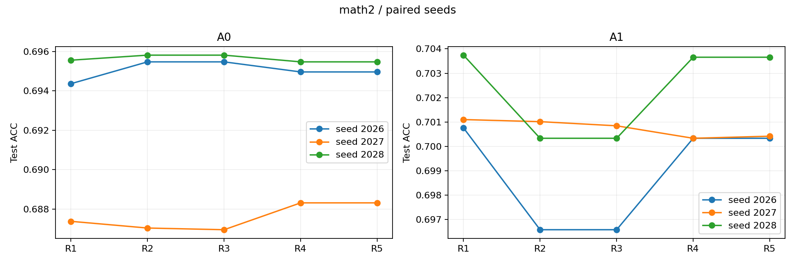
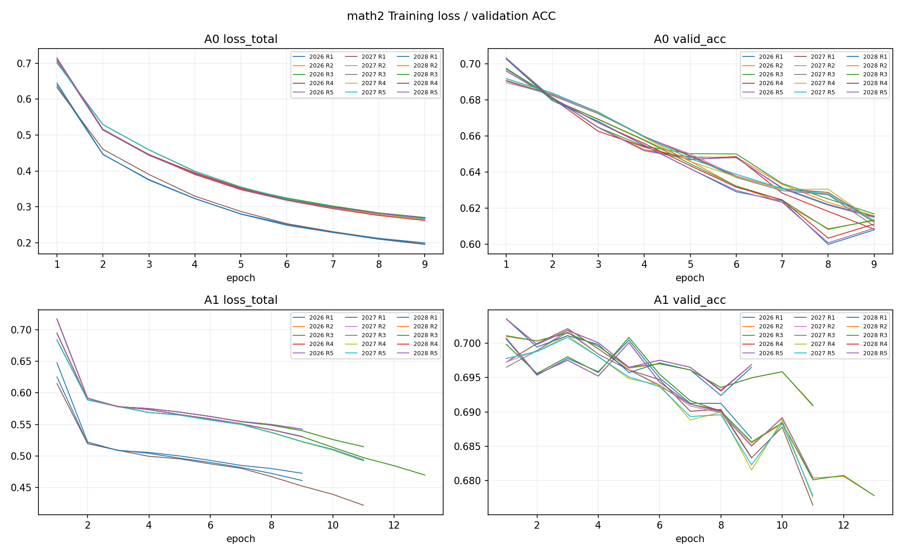
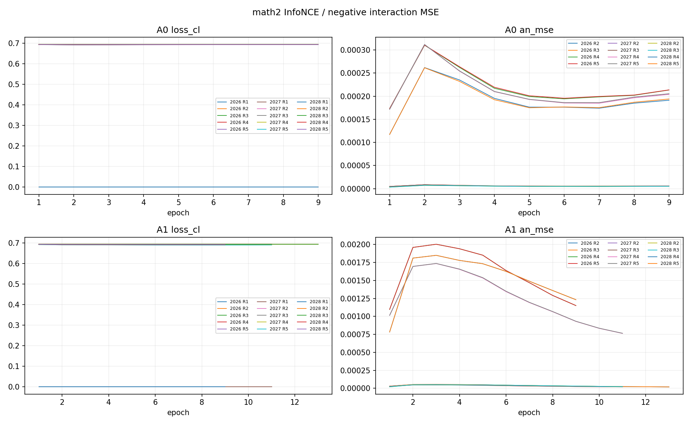
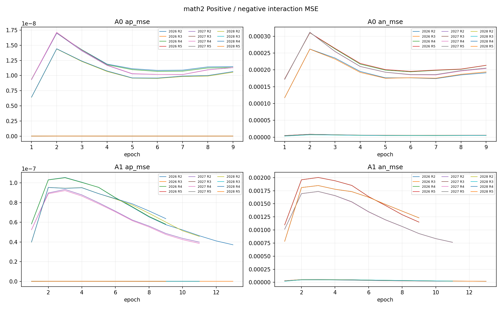
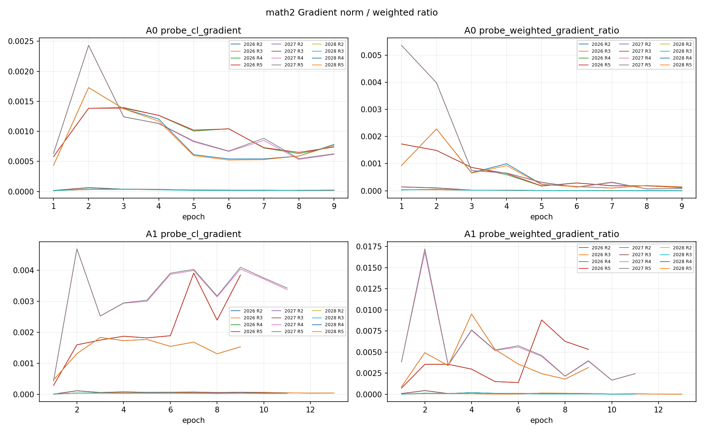

# math2：无 Support/Query 的双输入交互对比实验

实验ID：student_cl_no_support_query_20261124_math2。已完成 36/36 组；全部完成。

## 实验设置

按作答记录训练，每批128条；输入为完整训练矩阵对应的学生行和题目列，不隐藏当前训练目标。验证/测试只使用训练作答作为证据。两个输入不拼接，同一坐标的加噪保持一致，缺失0不变，连续均匀噪声裁剪至[-1,1]。

对比对象是预测网络输入 h=Aθ(θ⊙Q)−Aψ(ψ⊙Q)，不是纯学生掌握度。原始干净输入计算预测损失；正负视图只计算交互InfoNCE（余弦、温度0.2），不额外计算带噪预测损失。

A0=固定参考Q；A1=原Weak-Q设置。R0=按原IDCDataset取完整行列的无CL参考路径；R1=新入口CL关闭；R2–R5的λ=0.1。R0不是原仓库所有默认配置的完整复刻。

α=0.8，隐藏维度32，Adam学习率0.001、Q学习率0.005；Weak-Q与coverage系数均为0.01。最多30轮，验证ACC选模，平分保留最早轮，patience=8。种子2026/2027/2028。

| 条件 | 正比例 | 正幅度 | 负比例 | 负幅度 |
| --- | --- | --- | --- | --- |
| R2 | 0.1 | 0.01 | 0.5 | 0.1 |
| R3 | 0.01 | 0.001 | 0.5 | 0.1 |
| R4 | 0.1 | 0.01 | 0.7 | 0.5 |
| R5 | 0.01 | 0.001 | 0.7 | 0.5 |

与旧实验相比同时改变了输入遮蔽、训练取样和对比对象，且每轮更新次数增加，不能用新旧结果差直接归因某一项改变。

## 逐种子结果

所有ACC/AUC来自最佳验证ACC的同一checkpoint。每个种子单独列出，不按测试集选种子；Δ为同Q同种子相对R1的差值（比例单位）。

| Q | seed | 条件 | λ | 最佳轮 | valid ACC | test ACC | test AUC | ΔACC | ΔAUC |
| --- | --- | --- | --- | --- | --- | --- | --- | --- | --- |
| A0 | 2026 | R1 | 0 | 1 | 0.697008438 | 0.694366317 | 0.76789287 | 0 | 0 |
| A0 | 2026 | R2 | 0.1 | 1 | 0.697391971 | 0.695474303 | 0.767933188 | 0.00110798602 | 4.03171304e-05 |
| A0 | 2026 | R3 | 0.1 | 1 | 0.697391971 | 0.695474303 | 0.767933638 | 0.00110798602 | 4.07676823e-05 |
| A0 | 2026 | R4 | 0.1 | 1 | 0.695985681 | 0.694962925 | 0.766618259 | 0.000596607858 | -0.0012746114 |
| A0 | 2026 | R5 | 0.1 | 1 | 0.695985681 | 0.694962925 | 0.766618085 | 0.000596607858 | -0.00127478581 |
| A0 | 2027 | R1 | 0 | 1 | 0.690744055 | 0.687377482 | 0.761363152 | 0 | 0 |
| A0 | 2027 | R2 | 0.1 | 1 | 0.68946561 | 0.687036564 | 0.760981026 | -0.000340918776 | -0.000382126169 |
| A0 | 2027 | R3 | 0.1 | 1 | 0.690360522 | 0.686951334 | 0.760938718 | -0.00042614847 | -0.000424434448 |
| A0 | 2027 | R4 | 0.1 | 1 | 0.691638967 | 0.688315009 | 0.762181631 | 0.000937526634 | 0.000818478443 |
| A0 | 2027 | R5 | 0.1 | 1 | 0.691766812 | 0.688315009 | 0.762182604 | 0.000937526634 | 0.000819452216 |
| A0 | 2028 | R1 | 0 | 1 | 0.702633598 | 0.695559533 | 0.768625671 | 0 | 0 |
| A0 | 2028 | R2 | 0.1 | 1 | 0.703144976 | 0.695815222 | 0.768613652 | 0.000255689082 | -1.20195627e-05 |
| A0 | 2028 | R3 | 0.1 | 1 | 0.703144976 | 0.695815222 | 0.768614175 | 0.000255689082 | -1.14963411e-05 |
| A0 | 2028 | R4 | 0.1 | 1 | 0.703017131 | 0.695474303 | 0.768835294 | -8.5229694e-05 | 0.000209622917 |
| A0 | 2028 | R5 | 0.1 | 1 | 0.703017131 | 0.695474303 | 0.76883528 | -8.5229694e-05 | 0.000209608383 |
| A1 | 2026 | R1 | 0 | 1 | 0.700588085 | 0.700758544 | 0.77177891 | 0 | 0 |
| A1 | 2026 | R2 | 0.1 | 5 | 0.700843774 | 0.696582289 | 0.775681518 | -0.00417625501 | 0.00390260811 |
| A1 | 2026 | R3 | 0.1 | 5 | 0.700843774 | 0.696582289 | 0.775682085 | -0.00417625501 | 0.00390317494 |
| A1 | 2026 | R4 | 0.1 | 1 | 0.700715929 | 0.700332396 | 0.771686532 | -0.00042614847 | -9.23776788e-05 |
| A1 | 2026 | R5 | 0.1 | 1 | 0.700715929 | 0.700332396 | 0.771686343 | -0.00042614847 | -9.25666199e-05 |
| A1 | 2027 | R1 | 0 | 3 | 0.702122219 | 0.701099463 | 0.775481662 | 0 | 0 |
| A1 | 2027 | R2 | 0.1 | 3 | 0.70186653 | 0.701014233 | 0.775493943 | -8.5229694e-05 | 1.22811735e-05 |
| A1 | 2027 | R3 | 0.1 | 3 | 0.701610841 | 0.700843774 | 0.775495803 | -0.000255689082 | 1.41415169e-05 |
| A1 | 2027 | R4 | 0.1 | 3 | 0.701099463 | 0.700332396 | 0.775302487 | -0.000767067246 | -0.000179174327 |
| A1 | 2027 | R5 | 0.1 | 3 | 0.700843774 | 0.700417626 | 0.775256429 | -0.000681837552 | -0.000225232361 |
| A1 | 2028 | R1 | 0 | 1 | 0.703528509 | 0.703741584 | 0.773362687 | 0 | 0 |
| A1 | 2028 | R2 | 0.1 | 3 | 0.701482997 | 0.700332396 | 0.775353342 | -0.00340918776 | 0.00199065468 |
| A1 | 2028 | R3 | 0.1 | 3 | 0.701482997 | 0.700332396 | 0.775352441 | -0.00340918776 | 0.00198975358 |
| A1 | 2028 | R4 | 0.1 | 1 | 0.703528509 | 0.703656354 | 0.772616588 | -8.5229694e-05 | -0.000746099456 |
| A1 | 2028 | R5 | 0.1 | 1 | 0.703528509 | 0.703656354 | 0.772616035 | -8.5229694e-05 | -0.000746651745 |

## 核验与模型响应

两种Q、四种噪声预检通过：零系数预测/损失/单步更新/RNG一致；双输入缺失值保护、连续扰动、同坐标一致性、两侧网络梯度和单步更新差异均已检查。固定Q还在参数对齐后核对了原GNCDM前向输出。

已完成checkpoint回放 36 组；完整训练R0/R1精确一致性已通过 6/6 对。梯度范数以下取每轮第一个batch的诊断均值，并非全程所有batch统计。

| Q | seed | 条件 | CL损失 | 正h MSE | 负h MSE | CL梯度 | 加权CL/原梯度 | 正学生MAE | 负学生MAE | 正题目MAE | 负题目MAE |
| --- | --- | --- | --- | --- | --- | --- | --- | --- | --- | --- | --- |
| A0 | 2026 | R2 | 0.693125129 | 1.20334113e-08 | 6.06094632e-06 | 2.31179536e-05 | 1.45500134e-05 | 0.000250115617 | 0.0125105274 | 0.000249915208 | 0.0124984627 |
| A0 | 2026 | R3 | 0.693125236 | 1.18822341e-11 | 6.01595057e-06 | 2.30668711e-05 | 1.44318901e-05 | 2.49630849e-06 | 0.0125105274 | 2.5000465e-06 | 0.0124984627 |
| A0 | 2026 | R4 | 0.692316528 | 1.19337868e-08 | 0.000218880587 | 0.000975318321 | 0.000622426977 | 0.000250115617 | 0.0875196096 | 0.000249915208 | 0.0874927015 |
| A0 | 2026 | R5 | 0.692306741 | 1.19200798e-11 | 0.000219834793 | 0.000978043849 | 0.00062758838 | 2.49630849e-06 | 0.0875196096 | 2.5000465e-06 | 0.0874927015 |
| A0 | 2027 | R2 | 0.693126016 | 1.16654598e-08 | 5.80190309e-06 | 2.72631758e-05 | 3.42671715e-05 | 0.000249658605 | 0.0125098965 | 0.000249874159 | 0.0125007939 |
| A0 | 2027 | R3 | 0.693125906 | 1.169987e-11 | 5.80151262e-06 | 2.73681088e-05 | 3.41758001e-05 | 2.51003233e-06 | 0.0125098965 | 2.49938625e-06 | 0.0125007939 |
| A0 | 2027 | R4 | 0.692351096 | 1.17041812e-08 | 0.000212287319 | 0.000992436902 | 0.00128867478 | 0.000249658605 | 0.0875778344 | 0.000249874159 | 0.0874966525 |
| A0 | 2027 | R5 | 0.692342499 | 1.17747877e-11 | 0.000212997509 | 0.00100096213 | 0.0012944447 | 2.51003233e-06 | 0.0875778344 | 2.49938625e-06 | 0.0874966525 |
| A0 | 2028 | R2 | 0.693128849 | 1.03549897e-08 | 5.18624903e-06 | 2.34150829e-05 | 1.65122112e-05 | 0.000250105239 | 0.0124973308 | 0.000250167062 | 0.0124971197 |
| A0 | 2028 | R3 | 0.693128945 | 1.00575082e-11 | 5.18082217e-06 | 2.33234667e-05 | 1.64082197e-05 | 2.4718024e-06 | 0.0124973308 | 2.50705431e-06 | 0.0124971197 |
| A0 | 2028 | R4 | 0.692458816 | 1.04199321e-08 | 0.000190243843 | 0.000867940141 | 0.000632719335 | 0.000250105239 | 0.0875251279 | 0.000250167062 | 0.0874979292 |
| A0 | 2028 | R5 | 0.692469398 | 1.01180727e-11 | 0.00019008883 | 0.000857377606 | 0.000620074144 | 2.4718024e-06 | 0.0875251279 | 2.50705431e-06 | 0.0874979292 |
| A1 | 2026 | R2 | 0.693099176 | 7.0940564e-08 | 3.68992129e-05 | 4.6832659e-05 | 6.60419815e-05 | 0.000250396033 | 0.012506371 | 0.000250007043 | 0.0124980962 |
| A1 | 2026 | R3 | 0.693099089 | 6.97197521e-11 | 3.68984859e-05 | 4.69193096e-05 | 6.61718018e-05 | 2.50885117e-06 | 0.012506371 | 2.50250613e-06 | 0.0124980962 |
| A1 | 2026 | R4 | 0.690969073 | 8.29958587e-08 | 0.0015996039 | 0.00215070421 | 0.00379595989 | 0.000250115617 | 0.0875196096 | 0.000249915208 | 0.0874927015 |
| A1 | 2026 | R5 | 0.690968902 | 8.14996035e-11 | 0.00159960443 | 0.00215101851 | 0.00379462486 | 2.49630849e-06 | 0.0875196096 | 2.5000465e-06 | 0.0874927015 |
| A1 | 2027 | R2 | 0.693086912 | 6.58786039e-08 | 3.42640174e-05 | 6.26137182e-05 | 0.000115700977 | 0.000249618439 | 0.0125018801 | 0.000249959827 | 0.0124996125 |
| A1 | 2027 | R3 | 0.693086708 | 6.62531722e-11 | 3.42650001e-05 | 6.29123159e-05 | 0.000116956921 | 2.50137901e-06 | 0.0125018801 | 2.49910252e-06 | 0.0124996125 |
| A1 | 2027 | R4 | 0.689985422 | 6.49392111e-08 | 0.00125065173 | 0.0032447587 | 0.0051921813 | 0.000249618439 | 0.0875269118 | 0.000249959827 | 0.0874923521 |
| A1 | 2027 | R5 | 0.689962143 | 6.54287125e-11 | 0.00125327619 | 0.00327170555 | 0.00527931702 | 2.50137901e-06 | 0.0875269118 | 2.49910252e-06 | 0.0874923521 |
| A1 | 2028 | R2 | 0.693109714 | 7.2818771e-08 | 3.77000414e-05 | 3.39130757e-05 | 7.82395076e-05 | 0.000250003829 | 0.0124901255 | 0.000250193121 | 0.0124976418 |
| A1 | 2028 | R3 | 0.693109646 | 7.23850617e-11 | 3.76995351e-05 | 3.3975639e-05 | 7.83976778e-05 | 2.48819513e-06 | 0.0124901255 | 2.50637261e-06 | 0.0124976418 |
| A1 | 2028 | R4 | 0.691511212 | 7.90421905e-08 | 0.00151748695 | 0.00146477261 | 0.0038962777 | 0.000250105239 | 0.0875251279 | 0.000250167062 | 0.0874979292 |
| A1 | 2028 | R5 | 0.691511136 | 7.81847549e-11 | 0.00151750414 | 0.0014649023 | 0.00389620348 | 2.4718024e-06 | 0.0875251279 | 2.50705431e-06 | 0.0874979292 |

参数相对L2差异=‖W条件−W基线‖/‖W基线‖，比较各自选中的checkpoint；若最佳轮不同，差异也包含训练轮次效应，不能全部解释为直接对比梯度。

| Q | seed | 条件 | 学生网络 | 题目网络 | 学生聚合层 | 题目聚合层 |
| --- | --- | --- | --- | --- | --- | --- |
| A0 | 2026 | R2 | 0.0251519064 | 0.269580844 | 0.0319860125 | 0.00603282241 |
| A0 | 2026 | R3 | 0.0251530155 | 0.2692185 | 0.0319867333 | 0.00602698613 |
| A0 | 2026 | R4 | 0.0235337099 | 0.469861818 | 0.0851605795 | 0.0159497422 |
| A0 | 2026 | R5 | 0.023533554 | 0.469775116 | 0.0851604332 | 0.0159483395 |
| A0 | 2027 | R2 | 0.00887547578 | 0.286876511 | 0.017974964 | 0.0166139346 |
| A0 | 2027 | R3 | 0.00914400759 | 0.295631026 | 0.0181447303 | 0.0169811957 |
| A0 | 2027 | R4 | 0.0576034945 | 0.460265024 | 0.0701210044 | 0.0218252978 |
| A0 | 2027 | R5 | 0.0576073902 | 0.459875503 | 0.0701325597 | 0.0218465508 |
| A0 | 2028 | R2 | 0.000304130337 | 0.0439587219 | 0.0021611574 | 0.000637387097 |
| A0 | 2028 | R3 | 0.000305499853 | 0.0443615645 | 0.00216247059 | 0.00064245527 |
| A0 | 2028 | R4 | 0.121649513 | 0.302937662 | 0.0560794729 | 0.011783335 |
| A0 | 2028 | R5 | 0.121649549 | 0.303042339 | 0.0560794746 | 0.0117833475 |
| A1 | 2026 | R2 | 0.399236169 | 0.13615735 | 0.160639938 | 0.10076572 |
| A1 | 2026 | R3 | 0.399299397 | 0.13607488 | 0.160633751 | 0.100768473 |
| A1 | 2026 | R4 | 0.00685129837 | 0.357387355 | 0.0106364482 | 0.00591676005 |
| A1 | 2026 | R5 | 0.00685131066 | 0.357328743 | 0.0106365663 | 0.00591724742 |
| A1 | 2027 | R2 | 0.0540476383 | 0.239834238 | 0.0281427275 | 0.0076049845 |
| A1 | 2027 | R3 | 0.0540288748 | 0.244051087 | 0.0290774455 | 0.00749870859 |
| A1 | 2027 | R4 | 0.0546856767 | 0.411739333 | 0.045189316 | 0.0459946787 |
| A1 | 2027 | R5 | 0.0545760018 | 0.406586458 | 0.0458567983 | 0.047046722 |
| A1 | 2028 | R2 | 0.210968216 | 0.266304458 | 0.0981090797 | 0.100765894 |
| A1 | 2028 | R3 | 0.210944546 | 0.26671099 | 0.0980824441 | 0.100762852 |
| A1 | 2028 | R4 | 0.110444496 | 0.457774384 | 0.0588173202 | 0.00652317083 |
| A1 | 2028 | R5 | 0.110444368 | 0.457937339 | 0.0588173953 | 0.00652367506 |

## 图表

## 结果解读

A0 R2：3个配对种子，ACC提高/不变/降低=2/0/1；逐种子差值为 +0.001107986, -0.000340919, +0.000255689。

A0 R3：3个配对种子，ACC提高/不变/降低=2/0/1；逐种子差值为 +0.001107986, -0.000426148, +0.000255689。

A0 R4：3个配对种子，ACC提高/不变/降低=2/0/1；逐种子差值为 +0.000596608, +0.000937527, -0.000085230。

A0 R5：3个配对种子，ACC提高/不变/降低=2/0/1；逐种子差值为 +0.000596608, +0.000937527, -0.000085230。

A1 R2：3个配对种子，ACC提高/不变/降低=0/0/3；逐种子差值为 -0.004176255, -0.000085230, -0.003409188。

A1 R3：3个配对种子，ACC提高/不变/降低=0/0/3；逐种子差值为 -0.004176255, -0.000255689, -0.003409188。

A1 R4：3个配对种子，ACC提高/不变/降低=0/0/3；逐种子差值为 -0.000426148, -0.000767067, -0.000085230。

A1 R5：3个配对种子，ACC提高/不变/降低=0/0/3；逐种子差值为 -0.000426148, -0.000681838, -0.000085230。

参数与梯度非零仅证明参与优化；预测收益应同时看ACC/AUC和全部配对种子。负视图仍是同一作答的连续证据扰动，不保证其语义上应被推远。InfoNCE无margin，不报告虚构的margin激活率。
