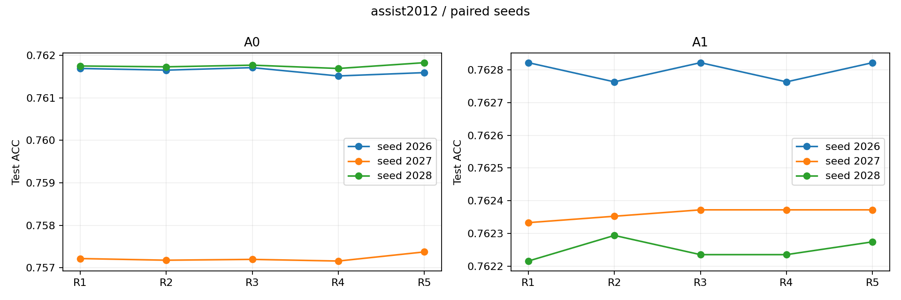
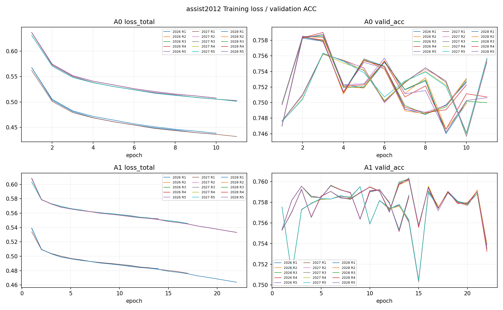
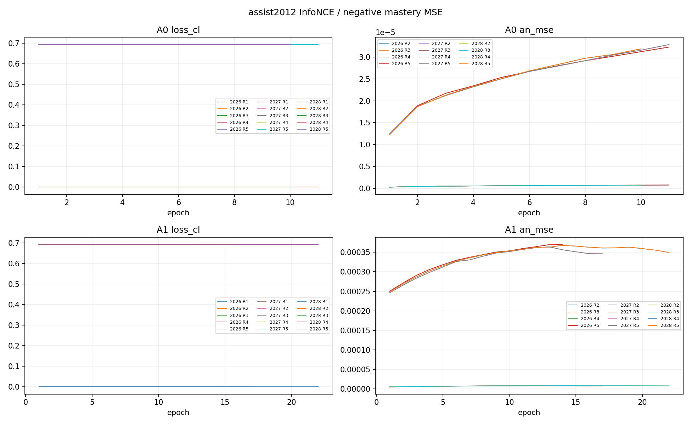
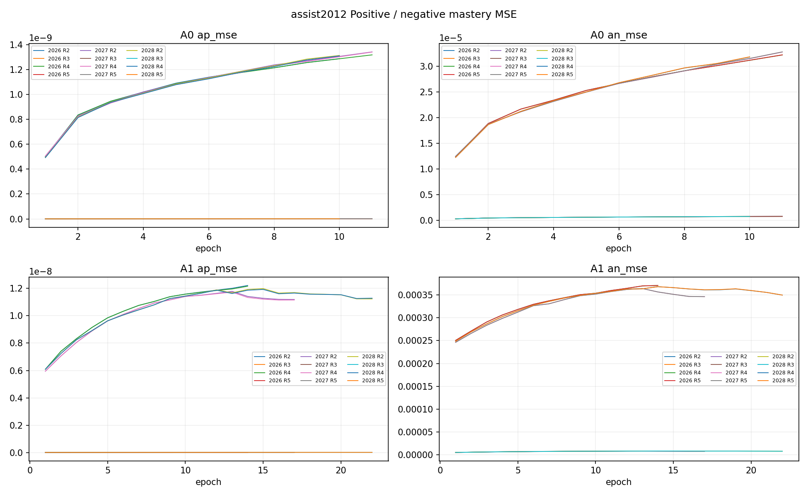
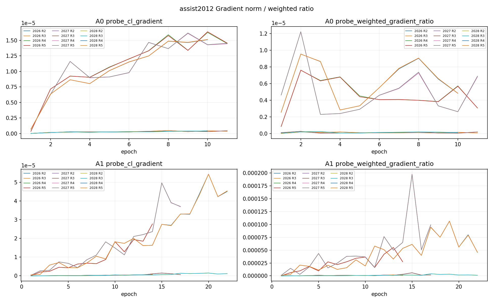

# assist2012：无 Support/Query 的学生掌握度对比实验

实验ID：student_cl_no_support_query_M_20261124_assist2012。已完成 36/36 组；全部完成。

## 实验设置

按作答记录训练，每批128条；输入为完整训练矩阵对应的学生行和题目列，不隐藏当前训练目标。验证/测试只使用训练作答作为证据。两个输入不拼接，仅增强学生输入；题目输入保持干净。缺失0不变，连续均匀噪声裁剪至[-1,1]。

对比对象为真实参与预测的学生掌握度 m=diagnose_theta(学生输入)。原始干净输入计算预测损失；学生正负视图计算掌握度InfoNCE（余弦、温度0.2）。题目输入不增强、不参与对比优化，但题目网络仍由原预测损失训练。

A0=固定参考Q；A1=原Weak-Q设置。R0=按原IDCDataset取完整行列的无CL参考路径；R1=新入口CL关闭；R2–R5的λ=0.1。R0不是原仓库所有默认配置的完整复刻。

α=0.8，隐藏维度32，Adam学习率0.001、Q学习率0.005；Weak-Q与coverage系数均为0.01。最多30轮，验证ACC选模，平分保留最早轮，patience=8。种子2026/2027/2028。

| 条件 | 正比例 | 正幅度 | 负比例 | 负幅度 |
| --- | --- | --- | --- | --- |
| R2 | 0.1 | 0.01 | 0.5 | 0.1 |
| R3 | 0.01 | 0.001 | 0.5 | 0.1 |
| R4 | 0.1 | 0.01 | 0.7 | 0.5 |
| R5 | 0.01 | 0.001 | 0.7 | 0.5 |

与旧实验相比同时改变了输入遮蔽、训练取样和对比对象，且每轮更新次数增加，不能用新旧结果差直接归因某一项改变。

## 逐种子结果

所有ACC/AUC来自最佳验证ACC的同一checkpoint。每个种子单独列出，不按测试集选种子；Δ为同Q同种子相对R1的差值（比例单位）。

| Q | seed | 条件 | λ | 最佳轮 | valid ACC | test ACC | test AUC | ΔACC | ΔAUC |
| --- | --- | --- | --- | --- | --- | --- | --- | --- | --- |
| A0 | 2026 | R1 | 0 | 2 | 0.758508543 | 0.761689085 | 0.692862889 | 0 | 0 |
| A0 | 2026 | R2 | 0.1 | 2 | 0.758462736 | 0.76165004 | 0.692883789 | -3.90449603e-05 | 2.09003542e-05 |
| A0 | 2026 | R3 | 0.1 | 3 | 0.758645962 | 0.761708607 | 0.696713886 | 1.95224801e-05 | 0.00385099728 |
| A0 | 2026 | R4 | 0.1 | 3 | 0.759012414 | 0.761513383 | 0.696611489 | -0.000175702321 | 0.00374860035 |
| A0 | 2026 | R5 | 0.1 | 3 | 0.758783381 | 0.761591473 | 0.696607838 | -9.76124007e-05 | 0.00374494892 |
| A0 | 2027 | R1 | 0 | 3 | 0.756218222 | 0.757218437 | 0.699017336 | 0 | 0 |
| A0 | 2027 | R2 | 0.1 | 3 | 0.756355641 | 0.757179392 | 0.699034313 | -3.90449603e-05 | 1.69767574e-05 |
| A0 | 2027 | R3 | 0.1 | 3 | 0.756309835 | 0.757198915 | 0.698975049 | -1.95224801e-05 | -4.2287433e-05 |
| A0 | 2027 | R4 | 0.1 | 3 | 0.756264028 | 0.75715987 | 0.698950051 | -5.85674404e-05 | -6.72852141e-05 |
| A0 | 2027 | R5 | 0.1 | 3 | 0.756355641 | 0.757374617 | 0.69895506 | 0.000156179841 | -6.22759234e-05 |
| A0 | 2028 | R1 | 0 | 2 | 0.758279511 | 0.761747652 | 0.693730041 | 0 | 0 |
| A0 | 2028 | R2 | 0.1 | 2 | 0.758462736 | 0.76172813 | 0.693700374 | -1.95224801e-05 | -2.96673579e-05 |
| A0 | 2028 | R3 | 0.1 | 2 | 0.75841693 | 0.761767175 | 0.693699749 | 1.95224801e-05 | -3.02921534e-05 |
| A0 | 2028 | R4 | 0.1 | 2 | 0.75841693 | 0.761689085 | 0.693644152 | -5.85674404e-05 | -8.58890225e-05 |
| A0 | 2028 | R5 | 0.1 | 2 | 0.758554349 | 0.761825742 | 0.693662034 | 7.80899205e-05 | -6.80073546e-05 |
| A1 | 2026 | R1 | 0 | 6 | 0.759607897 | 0.762821389 | 0.714202345 | 0 | 0 |
| A1 | 2026 | R2 | 0.1 | 6 | 0.759653703 | 0.762762821 | 0.714203185 | -5.85674404e-05 | 8.40345023e-07 |
| A1 | 2026 | R3 | 0.1 | 6 | 0.759653703 | 0.762821389 | 0.714203827 | 0 | 1.48202692e-06 |
| A1 | 2026 | R4 | 0.1 | 6 | 0.759607897 | 0.762762821 | 0.71421226 | -5.85674404e-05 | 9.91527661e-06 |
| A1 | 2026 | R5 | 0.1 | 6 | 0.759607897 | 0.762821389 | 0.714202025 | 0 | -3.19847633e-07 |
| A1 | 2027 | R1 | 0 | 9 | 0.759516284 | 0.762333327 | 0.71517823 | 0 | 0 |
| A1 | 2027 | R2 | 0.1 | 9 | 0.759516284 | 0.762352849 | 0.715180725 | 1.95224801e-05 | 2.49520886e-06 |
| A1 | 2027 | R3 | 0.1 | 9 | 0.759516284 | 0.762372372 | 0.715178267 | 3.90449603e-05 | 3.67526783e-08 |
| A1 | 2027 | R4 | 0.1 | 9 | 0.759516284 | 0.762372372 | 0.715180946 | 3.90449603e-05 | 2.71572493e-06 |
| A1 | 2027 | R5 | 0.1 | 9 | 0.759516284 | 0.762372372 | 0.715180656 | 3.90449603e-05 | 2.42567677e-06 |
| A1 | 2028 | R1 | 0 | 14 | 0.7603408 | 0.762216192 | 0.715208522 | 0 | 0 |
| A1 | 2028 | R2 | 0.1 | 14 | 0.760111768 | 0.762294282 | 0.71520488 | 7.80899205e-05 | -3.64248841e-06 |
| A1 | 2028 | R3 | 0.1 | 14 | 0.760249187 | 0.762235714 | 0.715204443 | 1.95224801e-05 | -4.07954729e-06 |
| A1 | 2028 | R4 | 0.1 | 14 | 0.760249187 | 0.762235714 | 0.715214443 | 1.95224801e-05 | 5.92115447e-06 |
| A1 | 2028 | R5 | 0.1 | 14 | 0.760157574 | 0.762274759 | 0.715213126 | 5.85674404e-05 | 4.60401794e-06 |

## 核验与模型响应

两种Q、四种噪声预检通过：零系数预测/损失/单步更新/RNG一致；学生增强与缺失值保护通过，学生网络对比梯度及更新差异非零，题目网络和聚合层无直接对比梯度。固定Q还在参数对齐后核对了原GNCDM前向输出。

已完成checkpoint回放 36 组；完整训练R0/R1精确一致性已通过 6/6 对。梯度范数以下取每轮第一个batch的诊断均值，并非全程所有batch统计。

| Q | seed | 条件 | CL损失 | 正m MSE | 负m MSE | CL梯度 | 加权CL/原梯度 | 正学生MAE | 负学生MAE | 正题目MAE | 负题目MAE |
| --- | --- | --- | --- | --- | --- | --- | --- | --- | --- | --- | --- |
| A0 | 2026 | R2 | 0.693145952 | 1.04735629e-09 | 6.04467592e-07 | 2.78188865e-07 | 1.23530697e-07 | 0.000250230809 | 0.0124974154 | 0 | 0 |
| A0 | 2026 | R3 | 0.693145919 | 1.04308448e-12 | 6.19813498e-07 | 2.8563548e-07 | 1.1911979e-07 | 2.50054714e-06 | 0.0124975206 | 0 | 0 |
| A0 | 2026 | R4 | 0.693097287 | 1.07061696e-09 | 2.53713923e-05 | 1.10786833e-05 | 4.63546892e-06 | 0.000250145966 | 0.0874819101 | 0 | 0 |
| A0 | 2026 | R5 | 0.693097273 | 1.04247857e-12 | 2.53734171e-05 | 1.1074667e-05 | 4.61792534e-06 | 2.50054714e-06 | 0.0874819101 | 0 | 0 |
| A0 | 2027 | R2 | 0.693145904 | 1.07819623e-09 | 6.23142332e-07 | 2.7042254e-07 | 1.2220827e-07 | 0.000249982729 | 0.0125019117 | 0 | 0 |
| A0 | 2027 | R3 | 0.693145901 | 1.0447247e-12 | 6.23199886e-07 | 2.7069811e-07 | 1.22202963e-07 | 2.49830469e-06 | 0.0125019117 | 0 | 0 |
| A0 | 2027 | R4 | 0.693096217 | 1.07290839e-09 | 2.53603098e-05 | 1.08687819e-05 | 4.95887365e-06 | 0.000249982729 | 0.0875024615 | 0 | 0 |
| A0 | 2027 | R5 | 0.693096194 | 1.04073691e-12 | 2.53777716e-05 | 1.08911462e-05 | 4.98268805e-06 | 2.49830469e-06 | 0.0875024615 | 0 | 0 |
| A0 | 2028 | R2 | 0.693145937 | 1.0493187e-09 | 6.07063937e-07 | 2.53170742e-07 | 1.4870227e-07 | 0.000249955938 | 0.0125033083 | 0 | 0 |
| A0 | 2028 | R3 | 0.693145935 | 1.01547368e-12 | 6.06478182e-07 | 2.54867561e-07 | 1.49455144e-07 | 2.49340851e-06 | 0.0125033083 | 0 | 0 |
| A0 | 2028 | R4 | 0.693097338 | 1.04505791e-09 | 2.47634811e-05 | 1.02402389e-05 | 6.06654536e-06 | 0.000249955938 | 0.0875307797 | 0 | 0 |
| A0 | 2028 | R5 | 0.69309733 | 1.0126722e-12 | 2.47746785e-05 | 1.02583007e-05 | 6.08529472e-06 | 2.49340851e-06 | 0.0875307797 | 0 | 0 |
| A1 | 2026 | R2 | 0.693145638 | 1.02696213e-08 | 7.47938166e-06 | 2.61770475e-07 | 6.18108523e-07 | 0.000250056525 | 0.0124962501 | 0 | 0 |
| A1 | 2026 | R3 | 0.693145635 | 9.30560821e-12 | 7.47939195e-06 | 2.62029924e-07 | 6.19384037e-07 | 2.49641475e-06 | 0.0124962501 | 0 | 0 |
| A1 | 2026 | R4 | 0.693086096 | 1.02586079e-08 | 0.000329551802 | 9.90107399e-06 | 2.36674988e-05 | 0.000250056525 | 0.0874799273 | 0 | 0 |
| A1 | 2026 | R5 | 0.693086096 | 9.29452862e-12 | 0.000329581151 | 9.89186112e-06 | 2.36767711e-05 | 2.49641475e-06 | 0.0874799273 | 0 | 0 |
| A1 | 2027 | R2 | 0.693144987 | 1.02211428e-08 | 7.45617033e-06 | 4.53315793e-07 | 1.26381039e-06 | 0.000250038258 | 0.0125002118 | 0 | 0 |
| A1 | 2027 | R3 | 0.693144982 | 9.18566404e-12 | 7.455488e-06 | 4.55267862e-07 | 1.27625114e-06 | 2.49783517e-06 | 0.0125002118 | 0 | 0 |
| A1 | 2027 | R4 | 0.693060693 | 1.02010651e-08 | 0.000328523339 | 1.65280274e-05 | 4.62753443e-05 | 0.000250038258 | 0.0874997431 | 0 | 0 |
| A1 | 2027 | R5 | 0.693060665 | 9.16727503e-12 | 0.000328519369 | 1.65331813e-05 | 4.62976177e-05 | 2.49783517e-06 | 0.0874997431 | 0 | 0 |
| A1 | 2028 | R2 | 0.693143953 | 1.06277367e-08 | 7.72597193e-06 | 5.68786783e-07 | 1.17232221e-06 | 0.000250053847 | 0.012501659 | 0 | 0 |
| A1 | 2028 | R3 | 0.693143946 | 9.65140984e-12 | 7.72768683e-06 | 5.68831789e-07 | 1.17342938e-06 | 2.49773575e-06 | 0.012501659 | 0 | 0 |
| A1 | 2028 | R4 | 0.693019804 | 1.06164701e-08 | 0.000339047096 | 2.01459521e-05 | 4.12293343e-05 | 0.000250053847 | 0.087521611 | 0 | 0 |
| A1 | 2028 | R5 | 0.693019771 | 9.64067382e-12 | 0.000339115632 | 2.01405382e-05 | 4.11524582e-05 | 2.49773575e-06 | 0.087521611 | 0 | 0 |

参数相对L2差异=‖W条件−W基线‖/‖W基线‖，比较各自选中的checkpoint；若最佳轮不同，差异也包含训练轮次效应。题目侧后续更新可因学生参数改变而间接受影响，不能将最终差异误解为题目侧收到了直接对比梯度。

| Q | seed | 条件 | 学生网络 | 题目网络 | 学生聚合层 | 题目聚合层 |
| --- | --- | --- | --- | --- | --- | --- |
| A0 | 2026 | R2 | 0.220464362 | 0.0340799316 | 0.039402232 | 0.000939229556 |
| A0 | 2026 | R3 | 0.30676631 | 0.306757205 | 0.251081082 | 0.202367304 |
| A0 | 2026 | R4 | 0.342046817 | 0.342039477 | 0.273629027 | 0.204125575 |
| A0 | 2026 | R5 | 0.341898512 | 0.341430083 | 0.277697011 | 0.203936018 |
| A0 | 2027 | R2 | 0.245168063 | 0.034312197 | 0.0825357201 | 0.000631077352 |
| A0 | 2027 | R3 | 0.2415662 | 0.0595261087 | 0.0765743414 | 0.000953253245 |
| A0 | 2027 | R4 | 0.299371284 | 0.213262313 | 0.263213471 | 0.00619857072 |
| A0 | 2027 | R5 | 0.299676037 | 0.216062319 | 0.263801442 | 0.00645258257 |
| A0 | 2028 | R2 | 0.227456449 | 0.0229770365 | 0.0417995928 | 0.000276755911 |
| A0 | 2028 | R3 | 0.226977162 | 0.0155536214 | 0.0323405739 | 0.000250697442 |
| A0 | 2028 | R4 | 0.281010302 | 0.0347719448 | 0.148353493 | 0.000652029918 |
| A0 | 2028 | R5 | 0.280799682 | 0.0384484936 | 0.147776924 | 0.00084789196 |
| A1 | 2026 | R2 | 0.0984849804 | 0.000844731639 | 0.044987239 | 0.000212135469 |
| A1 | 2026 | R3 | 0.0999675943 | 0.000796826104 | 0.0358497457 | 0.000246030984 |
| A1 | 2026 | R4 | 0.127113558 | 0.00973306603 | 0.0401303884 | 0.000486398558 |
| A1 | 2026 | R5 | 0.127548497 | 0.00764623062 | 0.0389172719 | 0.000380844365 |
| A1 | 2027 | R2 | 0.123473604 | 0.00294839452 | 0.053810449 | 0.00042171589 |
| A1 | 2027 | R3 | 0.123375481 | 0.00338858032 | 0.0619940268 | 0.000361166176 |
| A1 | 2027 | R4 | 0.143609857 | 0.00554536887 | 0.0645118862 | 0.00056237178 |
| A1 | 2027 | R5 | 0.142347082 | 0.00398095759 | 0.0709985636 | 0.000551834017 |
| A1 | 2028 | R2 | 0.151916745 | 0.0478028277 | 0.113366437 | 0.00142847946 |
| A1 | 2028 | R3 | 0.15150177 | 0.0324886693 | 0.124592633 | 0.00127513347 |
| A1 | 2028 | R4 | 0.175808858 | 0.0426153515 | 0.122675921 | 0.00156331448 |
| A1 | 2028 | R5 | 0.170938925 | 0.034429758 | 0.13309064 | 0.00144678076 |

## 图表

## 结果解读

A0 R2：3个配对种子，ACC提高/不变/降低=0/0/3；逐种子差值为 -0.000039045, -0.000039045, -0.000019522。

A0 R3：3个配对种子，ACC提高/不变/降低=2/0/1；逐种子差值为 +0.000019522, -0.000019522, +0.000019522。

A0 R4：3个配对种子，ACC提高/不变/降低=0/0/3；逐种子差值为 -0.000175702, -0.000058567, -0.000058567。

A0 R5：3个配对种子，ACC提高/不变/降低=2/0/1；逐种子差值为 -0.000097612, +0.000156180, +0.000078090。

A1 R2：3个配对种子，ACC提高/不变/降低=2/0/1；逐种子差值为 -0.000058567, +0.000019522, +0.000078090。

A1 R3：3个配对种子，ACC提高/不变/降低=2/1/0；逐种子差值为 +0.000000000, +0.000039045, +0.000019522。

A1 R4：3个配对种子，ACC提高/不变/降低=2/0/1；逐种子差值为 -0.000058567, +0.000039045, +0.000019522。

A1 R5：3个配对种子，ACC提高/不变/降低=2/1/0；逐种子差值为 +0.000000000, +0.000039045, +0.000058567。

参数与梯度非零仅证明参与优化；预测收益应同时看ACC/AUC和全部配对种子。负视图仍是同一作答的连续证据扰动，不保证其语义上应被推远。InfoNCE无margin，不报告虚构的margin激活率。

核验修复说明：首次预检的诊断工具未处理整组梯度为空，修正范数统计后重测。题目分支无直接对比梯度是预期行为；未改变模型或损失，失败日志保留在临时核验目录。
