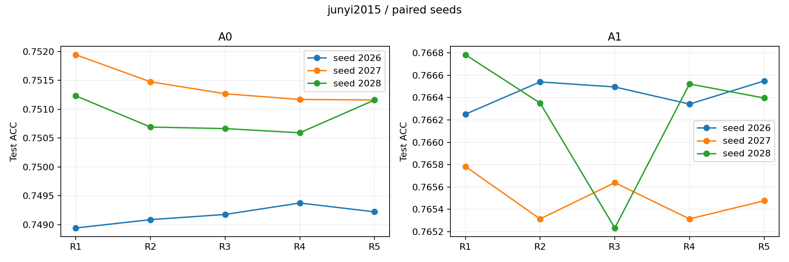
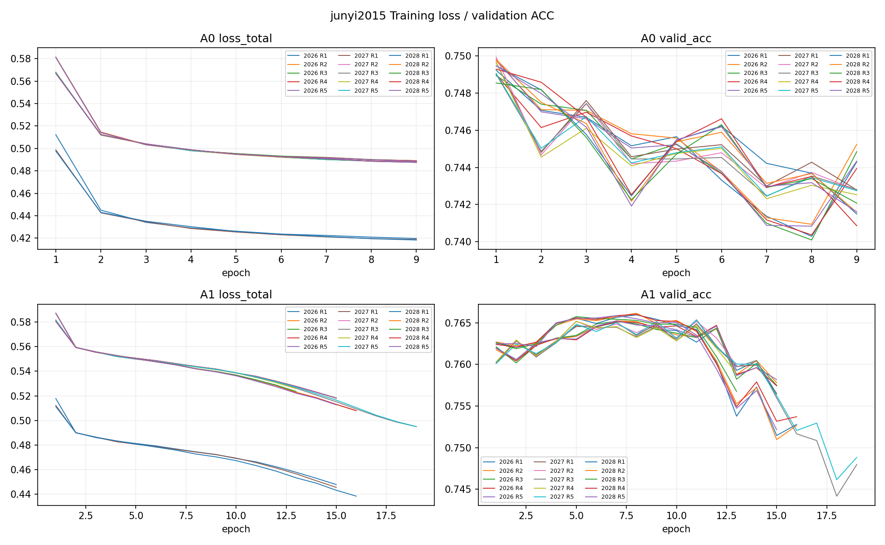
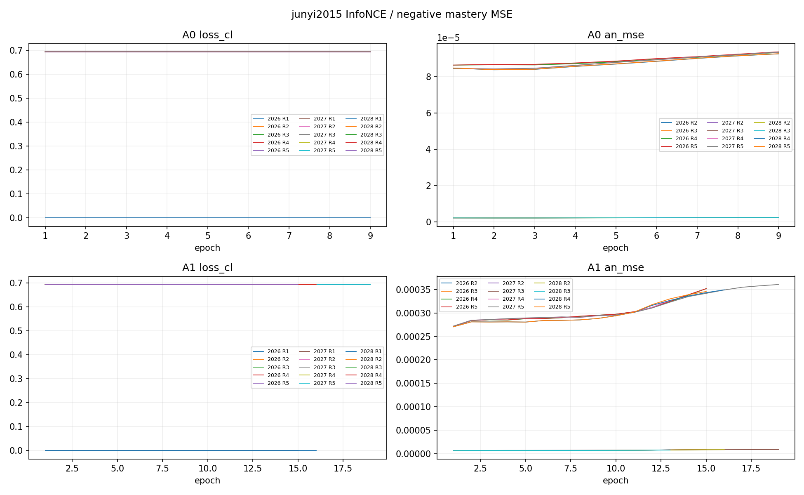
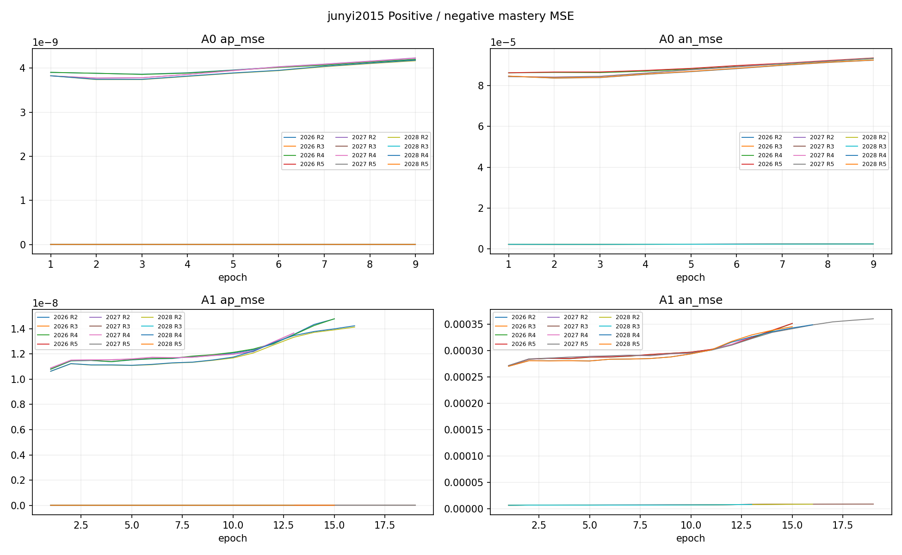
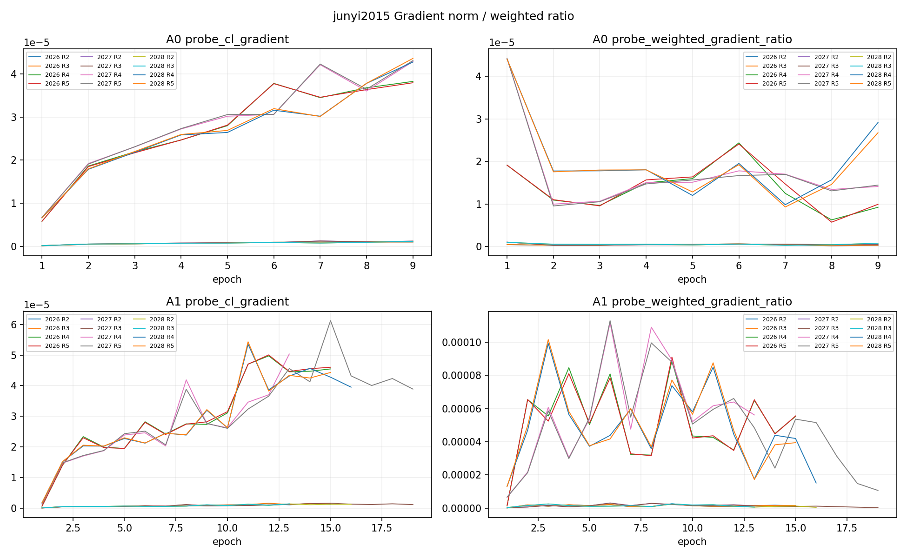

# junyi2015：无 Support/Query 的学生掌握度对比实验

实验ID：student_cl_no_support_query_M_20261124_junyi2015。已完成 36/36 组；全部完成。

## 实验设置

按作答记录训练，每批128条；输入为完整训练矩阵对应的学生行和题目列，不隐藏当前训练目标。验证/测试只使用训练作答作为证据。两个输入不拼接，仅增强学生输入；题目输入保持干净。缺失0不变，连续均匀噪声裁剪至[-1,1]。

对比对象为真实参与预测的学生掌握度 m=diagnose_theta(学生输入)。原始干净输入计算预测损失；学生正负视图计算掌握度InfoNCE（余弦、温度0.2）。题目输入不增强、不参与对比优化，但题目网络仍由原预测损失训练。

A0=固定参考Q；A1=原Weak-Q设置。R0=按原IDCDataset取完整行列的无CL参考路径；R1=新入口CL关闭；R2–R5的λ=0.1。R0不是原仓库所有默认配置的完整复刻。

α=0.8，隐藏维度32，Adam学习率0.001、Q学习率0.005；Weak-Q与coverage系数均为0.01。最多30轮，验证ACC选模，平分保留最早轮，patience=8。种子2026/2027/2028。

| 条件 | 正比例 | 正幅度 | 负比例 | 负幅度 |
| --- | --- | --- | --- | --- |
| R2 | 0.1 | 0.01 | 0.5 | 0.1 |
| R3 | 0.01 | 0.001 | 0.5 | 0.1 |
| R4 | 0.1 | 0.01 | 0.7 | 0.5 |
| R5 | 0.01 | 0.001 | 0.7 | 0.5 |

与旧实验相比同时改变了输入遮蔽、训练取样和对比对象，且每轮更新次数增加，不能用新旧结果差直接归因某一项改变。

## 逐种子结果

所有ACC/AUC来自最佳验证ACC的同一checkpoint。每个种子单独列出，不按测试集选种子；Δ为同Q同种子相对R1的差值（比例单位）。

| Q | seed | 条件 | λ | 最佳轮 | valid ACC | test ACC | test AUC | ΔACC | ΔAUC |
| --- | --- | --- | --- | --- | --- | --- | --- | --- | --- |
| A0 | 2026 | R1 | 0 | 1 | 0.749224608 | 0.74894357 | 0.787372621 | 0 | 0 |
| A0 | 2026 | R2 | 0.1 | 1 | 0.749734993 | 0.749087731 | 0.786291501 | 0.000144161028 | -0.0010811196 |
| A0 | 2026 | R3 | 0.1 | 1 | 0.748930156 | 0.749177832 | 0.786858062 | 0.00023426167 | -0.000514559377 |
| A0 | 2026 | R4 | 0.1 | 1 | 0.749008677 | 0.749376053 | 0.787465541 | 0.000432483084 | 9.29205358e-05 |
| A0 | 2026 | R5 | 0.1 | 1 | 0.749813513 | 0.749222882 | 0.787435559 | 0.000279311991 | 6.293759e-05 |
| A0 | 2027 | R1 | 0 | 1 | 0.749636842 | 0.751943921 | 0.788508367 | 0 | 0 |
| A0 | 2027 | R2 | 0.1 | 1 | 0.749931294 | 0.751475398 | 0.788386245 | -0.000468523341 | -0.000122122378 |
| A0 | 2027 | R3 | 0.1 | 1 | 0.749008677 | 0.751268167 | 0.78814454 | -0.000675754818 | -0.00036382721 |
| A0 | 2027 | R4 | 0.1 | 1 | 0.749636842 | 0.751169056 | 0.78873752 | -0.000774865525 | 0.000229153132 |
| A0 | 2027 | R5 | 0.1 | 1 | 0.749047937 | 0.751160046 | 0.788345469 | -0.000783875589 | -0.000162898019 |
| A0 | 2028 | R1 | 0 | 1 | 0.74946017 | 0.751232126 | 0.791826418 | 0 | 0 |
| A0 | 2028 | R2 | 0.1 | 1 | 0.749793883 | 0.750691522 | 0.791515382 | -0.000540603855 | -0.000311036774 |
| A0 | 2028 | R3 | 0.1 | 1 | 0.748537553 | 0.750664492 | 0.791161581 | -0.000567634047 | -0.000664837454 |
| A0 | 2028 | R4 | 0.1 | 1 | 0.749283499 | 0.750592412 | 0.79176502 | -0.000639714561 | -6.13986221e-05 |
| A0 | 2028 | R5 | 0.1 | 1 | 0.74946017 | 0.751160046 | 0.791632607 | -7.20805139e-05 | -0.000193811096 |
| A1 | 2026 | R1 | 0 | 7 | 0.765223195 | 0.766251903 | 0.813490339 | 0 | 0 |
| A1 | 2026 | R2 | 0.1 | 7 | 0.765242825 | 0.766540225 | 0.813552667 | 0.000288322056 | 6.23276467e-05 |
| A1 | 2026 | R3 | 0.1 | 7 | 0.765164305 | 0.766495175 | 0.813482086 | 0.000243271735 | -8.25313959e-06 |
| A1 | 2026 | R4 | 0.1 | 7 | 0.765105414 | 0.766342004 | 0.813493836 | 9.01006424e-05 | 3.49679919e-06 |
| A1 | 2026 | R5 | 0.1 | 7 | 0.765223195 | 0.766549235 | 0.813493612 | 0.00029733212 | 3.27288895e-06 |
| A1 | 2027 | R1 | 0 | 7 | 0.765046523 | 0.76578338 | 0.813617177 | 0 | 0 |
| A1 | 2027 | R2 | 0.1 | 5 | 0.765183935 | 0.765314857 | 0.812188528 | -0.000468523341 | -0.00142864895 |
| A1 | 2027 | R3 | 0.1 | 11 | 0.765360606 | 0.765639219 | 0.813096412 | -0.000144161028 | -0.000520765417 |
| A1 | 2027 | R4 | 0.1 | 5 | 0.765164305 | 0.765314857 | 0.812193136 | -0.000468523341 | -0.00142404127 |
| A1 | 2027 | R5 | 0.1 | 11 | 0.765321346 | 0.765477038 | 0.813288255 | -0.000306342184 | -0.000328921559 |
| A1 | 2028 | R1 | 0 | 8 | 0.765949511 | 0.766783497 | 0.813662604 | 0 | 0 |
| A1 | 2028 | R2 | 0.1 | 8 | 0.766145813 | 0.766351014 | 0.813664283 | -0.000432483084 | 1.67932679e-06 |
| A1 | 2028 | R3 | 0.1 | 5 | 0.765733579 | 0.765233766 | 0.812888207 | -0.00154973105 | -0.000774397065 |
| A1 | 2028 | R4 | 0.1 | 8 | 0.766008402 | 0.766522205 | 0.813748527 | -0.000261291863 | 8.59232487e-05 |
| A1 | 2028 | R5 | 0.1 | 7 | 0.76585136 | 0.766396064 | 0.813758365 | -0.000387432762 | 9.57607284e-05 |

## 核验与模型响应

两种Q、四种噪声预检通过：零系数预测/损失/单步更新/RNG一致；学生增强与缺失值保护通过，学生网络对比梯度及更新差异非零，题目网络和聚合层无直接对比梯度。固定Q还在参数对齐后核对了原GNCDM前向输出。

已完成checkpoint回放 36 组；完整训练R0/R1精确一致性已通过 6/6 对。梯度范数以下取每轮第一个batch的诊断均值，并非全程所有batch统计。

| Q | seed | 条件 | CL损失 | 正m MSE | 负m MSE | CL梯度 | 加权CL/原梯度 | 正学生MAE | 负学生MAE | 正题目MAE | 负题目MAE |
| --- | --- | --- | --- | --- | --- | --- | --- | --- | --- | --- | --- |
| A0 | 2026 | R2 | 0.693140236 | 3.99234502e-09 | 2.26289494e-06 | 7.30343104e-07 | 3.55826662e-07 | 0.000249819344 | 0.0124991855 | 0 | 0 |
| A0 | 2026 | R3 | 0.693140222 | 3.87601295e-12 | 2.26396911e-06 | 7.28476857e-07 | 3.56221018e-07 | 2.49564461e-06 | 0.0124991855 | 0 | 0 |
| A0 | 2026 | R4 | 0.692882432 | 3.98865596e-09 | 8.88712625e-05 | 2.73678042e-05 | 1.3650449e-05 | 0.000249819344 | 0.0874952345 | 0 | 0 |
| A0 | 2026 | R5 | 0.692881173 | 3.88451485e-12 | 8.91876205e-05 | 2.72639028e-05 | 1.40073207e-05 | 2.49564461e-06 | 0.0874952345 | 0 | 0 |
| A0 | 2027 | R2 | 0.693140339 | 3.96641072e-09 | 2.243689e-06 | 8.00978253e-07 | 4.62898557e-07 | 0.000250058986 | 0.0124990033 | 0 | 0 |
| A0 | 2027 | R3 | 0.693140327 | 3.85560683e-12 | 2.24260098e-06 | 7.9644944e-07 | 4.55904066e-07 | 2.50009206e-06 | 0.0124990033 | 0 | 0 |
| A0 | 2027 | R4 | 0.692886095 | 3.96388901e-09 | 8.81100112e-05 | 2.8666498e-05 | 1.74703663e-05 | 0.000250058986 | 0.0874989963 | 0 | 0 |
| A0 | 2027 | R5 | 0.692886078 | 3.85485834e-12 | 8.80766093e-05 | 2.87968961e-05 | 1.73041063e-05 | 2.50009206e-06 | 0.0874989963 | 0 | 0 |
| A0 | 2028 | R2 | 0.693140379 | 3.91681913e-09 | 2.22139843e-06 | 7.11296724e-07 | 5.17694674e-07 | 0.000249920787 | 0.0125002282 | 0 | 0 |
| A0 | 2028 | R3 | 0.693140357 | 3.81806957e-12 | 2.22397759e-06 | 7.10007439e-07 | 5.24078836e-07 | 2.49771939e-06 | 0.0125002282 | 0 | 0 |
| A0 | 2028 | R4 | 0.692887086 | 3.92378489e-09 | 8.74599137e-05 | 2.67560222e-05 | 2.04259096e-05 | 0.000249920787 | 0.087509577 | 0 | 0 |
| A0 | 2028 | R5 | 0.692886778 | 3.82462986e-12 | 8.75441926e-05 | 2.69801903e-05 | 2.0036946e-05 | 2.49771939e-06 | 0.087509577 | 0 | 0 |
| A1 | 2026 | R2 | 0.693135384 | 1.222692e-08 | 7.24570318e-06 | 8.14614415e-07 | 1.39420482e-06 | 0.000249943281 | 0.012499224 | 0 | 0 |
| A1 | 2026 | R3 | 0.693135349 | 1.17641939e-11 | 7.24681701e-06 | 8.30359218e-07 | 1.40311746e-06 | 2.49830493e-06 | 0.012499224 | 0 | 0 |
| A1 | 2026 | R4 | 0.692665144 | 1.22417772e-08 | 0.000300191636 | 2.98089747e-05 | 5.18427207e-05 | 0.000249943281 | 0.0874925277 | 0 | 0 |
| A1 | 2026 | R5 | 0.692666721 | 1.17806226e-11 | 0.000300521286 | 2.99536597e-05 | 5.14360564e-05 | 2.49830493e-06 | 0.0874925277 | 0 | 0 |
| A1 | 2027 | R2 | 0.693136088 | 1.19078645e-08 | 7.09343686e-06 | 6.87018164e-07 | 1.57330124e-06 | 0.000249976832 | 0.0124987101 | 0 | 0 |
| A1 | 2027 | R3 | 0.693133804 | 1.22562978e-11 | 7.5560614e-06 | 8.84889493e-07 | 1.29019047e-06 | 2.5011177e-06 | 0.012500328 | 0 | 0 |
| A1 | 2027 | R4 | 0.692689356 | 1.19223935e-08 | 0.000293883755 | 2.60147693e-05 | 5.8827943e-05 | 0.000249976832 | 0.0874982715 | 0 | 0 |
| A1 | 2027 | R5 | 0.692603429 | 1.22643767e-11 | 0.000311380647 | 3.13762413e-05 | 4.93160045e-05 | 2.5011177e-06 | 0.087503578 | 0 | 0 |
| A1 | 2028 | R2 | 0.693135597 | 1.19956812e-08 | 7.19144357e-06 | 7.9825843e-07 | 1.30089336e-06 | 0.000249972366 | 0.0125001062 | 0 | 0 |
| A1 | 2028 | R3 | 0.693136689 | 1.10800855e-11 | 6.94348939e-06 | 7.13635591e-07 | 1.41123213e-06 | 2.4967081e-06 | 0.012500077 | 0 | 0 |
| A1 | 2028 | R4 | 0.692677758 | 1.20535831e-08 | 0.00030017275 | 2.94385164e-05 | 4.8259304e-05 | 0.000249972366 | 0.0875044141 | 0 | 0 |
| A1 | 2028 | R5 | 0.692690274 | 1.14543214e-11 | 0.000297553193 | 2.87599138e-05 | 5.07883512e-05 | 2.49804063e-06 | 0.0875048529 | 0 | 0 |

参数相对L2差异=‖W条件−W基线‖/‖W基线‖，比较各自选中的checkpoint；若最佳轮不同，差异也包含训练轮次效应。题目侧后续更新可因学生参数改变而间接受影响，不能将最终差异误解为题目侧收到了直接对比梯度。

| Q | seed | 条件 | 学生网络 | 题目网络 | 学生聚合层 | 题目聚合层 |
| --- | --- | --- | --- | --- | --- | --- |
| A0 | 2026 | R2 | 0.250525646 | 0.734135703 | 0.184862886 | 0.0295083532 |
| A0 | 2026 | R3 | 0.24275238 | 0.718566663 | 0.179236713 | 0.0290737575 |
| A0 | 2026 | R4 | 0.306306726 | 0.742623376 | 0.242250641 | 0.0248925086 |
| A0 | 2026 | R5 | 0.30316049 | 0.73150893 | 0.235774575 | 0.0248362832 |
| A0 | 2027 | R2 | 0.2589206 | 0.726836401 | 0.191464177 | 0.0339524034 |
| A0 | 2027 | R3 | 0.2667843 | 0.743137588 | 0.149186776 | 0.0362936249 |
| A0 | 2027 | R4 | 0.329820997 | 0.75588138 | 0.300890731 | 0.0314283787 |
| A0 | 2027 | R5 | 0.331403145 | 0.742995715 | 0.303290272 | 0.0312842687 |
| A0 | 2028 | R2 | 0.246696223 | 0.648114164 | 0.125709125 | 0.0696603166 |
| A0 | 2028 | R3 | 0.253257905 | 0.656199981 | 0.0948382863 | 0.0789970226 |
| A0 | 2028 | R4 | 0.306709501 | 0.672628731 | 0.198190387 | 0.0509712896 |
| A0 | 2028 | R5 | 0.30184267 | 0.635052859 | 0.202713284 | 0.0260544448 |
| A1 | 2026 | R2 | 0.184102147 | 0.701409016 | 0.214368197 | 0.027257229 |
| A1 | 2026 | R3 | 0.19458285 | 0.718307553 | 0.187305881 | 0.0320895234 |
| A1 | 2026 | R4 | 0.184509803 | 0.720631 | 0.213289323 | 0.0294353191 |
| A1 | 2026 | R5 | 0.196912829 | 0.705911118 | 0.172303729 | 0.0251628781 |
| A1 | 2027 | R2 | 0.251474359 | 0.667230743 | 0.252625116 | 0.145163417 |
| A1 | 2027 | R3 | 0.430313587 | 0.847542633 | 0.54973965 | 0.262146488 |
| A1 | 2027 | R4 | 0.274413089 | 0.714625422 | 0.264926789 | 0.144171018 |
| A1 | 2027 | R5 | 0.446156807 | 0.900913343 | 0.553874893 | 0.26120277 |
| A1 | 2028 | R2 | 0.211161463 | 0.692203668 | 0.212590745 | 0.0272083668 |
| A1 | 2028 | R3 | 0.333487928 | 0.642762626 | 0.386490712 | 0.212378986 |
| A1 | 2028 | R4 | 0.230791435 | 0.706014277 | 0.224174969 | 0.0276555815 |
| A1 | 2028 | R5 | 0.24090866 | 0.698646158 | 0.238600029 | 0.0866982732 |

## 图表

## 结果解读

A0 R2：3个配对种子，ACC提高/不变/降低=1/0/2；逐种子差值为 +0.000144161, -0.000468523, -0.000540604。

A0 R3：3个配对种子，ACC提高/不变/降低=1/0/2；逐种子差值为 +0.000234262, -0.000675755, -0.000567634。

A0 R4：3个配对种子，ACC提高/不变/降低=1/0/2；逐种子差值为 +0.000432483, -0.000774866, -0.000639715。

A0 R5：3个配对种子，ACC提高/不变/降低=1/0/2；逐种子差值为 +0.000279312, -0.000783876, -0.000072081。

A1 R2：3个配对种子，ACC提高/不变/降低=1/0/2；逐种子差值为 +0.000288322, -0.000468523, -0.000432483。

A1 R3：3个配对种子，ACC提高/不变/降低=1/0/2；逐种子差值为 +0.000243272, -0.000144161, -0.001549731。

A1 R4：3个配对种子，ACC提高/不变/降低=1/0/2；逐种子差值为 +0.000090101, -0.000468523, -0.000261292。

A1 R5：3个配对种子，ACC提高/不变/降低=1/0/2；逐种子差值为 +0.000297332, -0.000306342, -0.000387433。

参数与梯度非零仅证明参与优化；预测收益应同时看ACC/AUC和全部配对种子。负视图仍是同一作答的连续证据扰动，不保证其语义上应被推远。InfoNCE无margin，不报告虚构的margin激活率。

核验修复说明：首次预检的诊断工具未处理整组梯度为空，修正范数统计后重测。题目分支无直接对比梯度是预期行为；未改变模型或损失，失败日志保留在临时核验目录。
