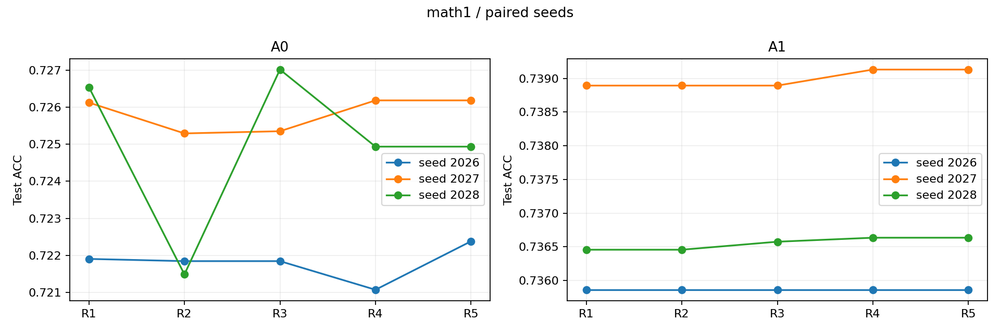
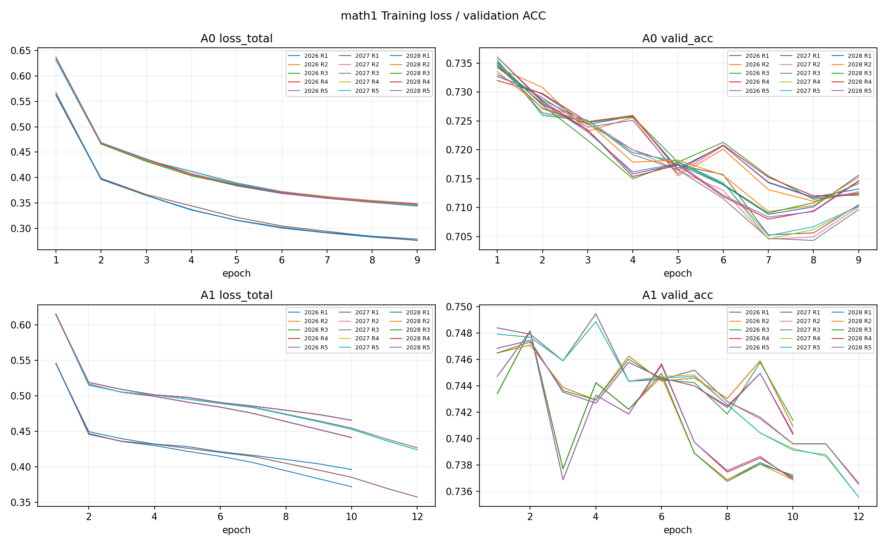
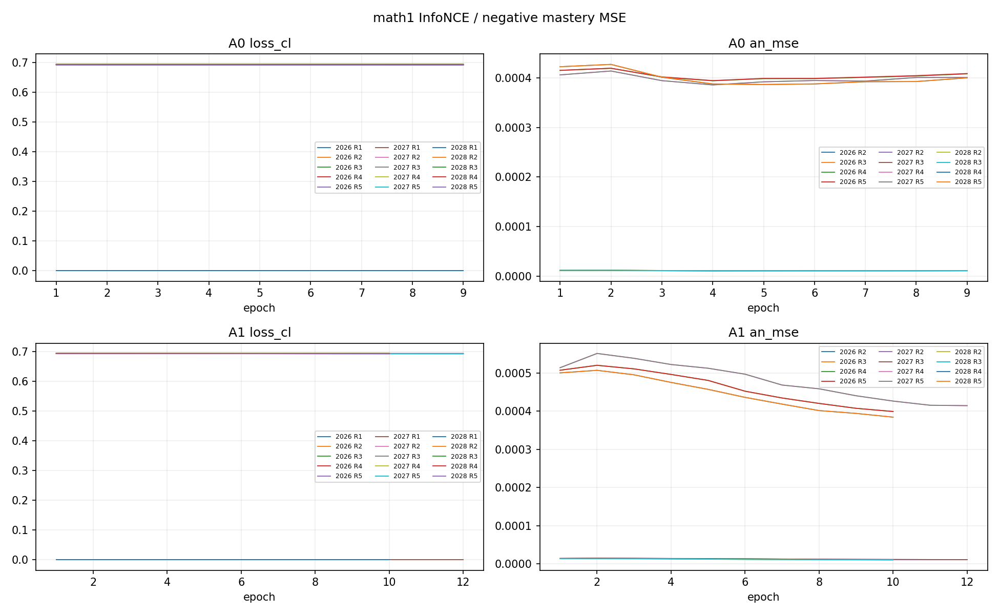
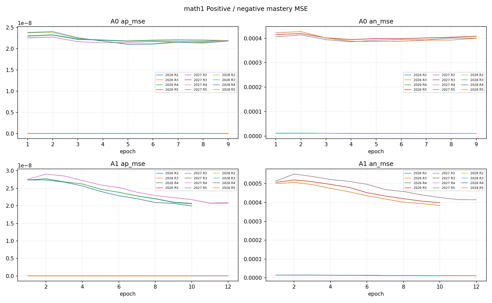
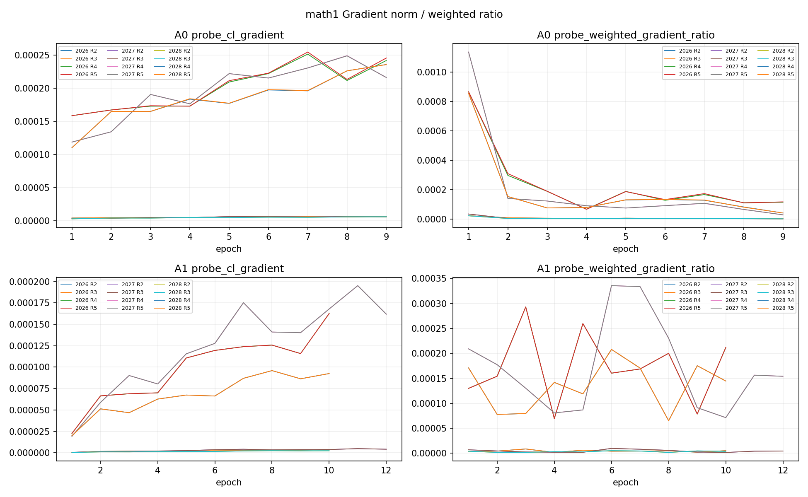

# math1：无 Support/Query 的学生掌握度对比实验

实验ID：student_cl_no_support_query_M_20261124_math1。已完成 36/36 组；全部完成。

## 实验设置

按作答记录训练，每批128条；输入为完整训练矩阵对应的学生行和题目列，不隐藏当前训练目标。验证/测试只使用训练作答作为证据。两个输入不拼接，仅增强学生输入；题目输入保持干净。缺失0不变，连续均匀噪声裁剪至[-1,1]。

对比对象为真实参与预测的学生掌握度 m=diagnose_theta(学生输入)。原始干净输入计算预测损失；学生正负视图计算掌握度InfoNCE（余弦、温度0.2）。题目输入不增强、不参与对比优化，但题目网络仍由原预测损失训练。

A0=固定参考Q；A1=原Weak-Q设置。R0=按原IDCDataset取完整行列的无CL参考路径；R1=新入口CL关闭；R2–R5的λ=0.1。R0不是原仓库所有默认配置的完整复刻。

α=0.8，隐藏维度32，Adam学习率0.001、Q学习率0.005；Weak-Q与coverage系数均为0.01。最多30轮，验证ACC选模，平分保留最早轮，patience=8。种子2026/2027/2028。

| 条件 | 正比例 | 正幅度 | 负比例 | 负幅度 |
| --- | --- | --- | --- | --- |
| R2 | 0.1 | 0.01 | 0.5 | 0.1 |
| R3 | 0.01 | 0.001 | 0.5 | 0.1 |
| R4 | 0.1 | 0.01 | 0.7 | 0.5 |
| R5 | 0.01 | 0.001 | 0.7 | 0.5 |

与旧实验相比同时改变了输入遮蔽、训练取样和对比对象，且每轮更新次数增加，不能用新旧结果差直接归因某一项改变。

## 逐种子结果

所有ACC/AUC来自最佳验证ACC的同一checkpoint。每个种子单独列出，不按测试集选种子；Δ为同Q同种子相对R1的差值（比例单位）。

| Q | seed | 条件 | λ | 最佳轮 | valid ACC | test ACC | test AUC | ΔACC | ΔAUC |
| --- | --- | --- | --- | --- | --- | --- | --- | --- | --- |
| A0 | 2026 | R1 | 0 | 1 | 0.732715609 | 0.721905441 | 0.811382179 | 0 | 0 |
| A0 | 2026 | R2 | 0.1 | 1 | 0.734259919 | 0.721846044 | 0.811279052 | -5.93965312e-05 | -0.00010312733 |
| A0 | 2026 | R3 | 0.1 | 1 | 0.734259919 | 0.721846044 | 0.811276243 | -5.93965312e-05 | -0.000105936414 |
| A0 | 2026 | R4 | 0.1 | 1 | 0.732002851 | 0.721073889 | 0.810711762 | -0.000831551437 | -0.000670417909 |
| A0 | 2026 | R5 | 0.1 | 1 | 0.733071989 | 0.722380613 | 0.811155135 | 0.00047517225 | -0.000227044771 |
| A0 | 2027 | R1 | 0 | 1 | 0.734616298 | 0.726122594 | 0.813933969 | 0 | 0 |
| A0 | 2027 | R2 | 0.1 | 1 | 0.735091471 | 0.725291043 | 0.81376819 | -0.000831551437 | -0.000165779295 |
| A0 | 2027 | R3 | 0.1 | 1 | 0.734972678 | 0.72535044 | 0.813780487 | -0.000772154906 | -0.000153481427 |
| A0 | 2027 | R4 | 0.1 | 1 | 0.735566643 | 0.726181991 | 0.813916905 | 5.93965312e-05 | -1.70639227e-05 |
| A0 | 2027 | R5 | 0.1 | 1 | 0.735566643 | 0.726181991 | 0.813916898 | 5.93965312e-05 | -1.7071144e-05 |
| A0 | 2028 | R1 | 0 | 1 | 0.734616298 | 0.72653837 | 0.809710298 | 0 | 0 |
| A0 | 2028 | R2 | 0.1 | 1 | 0.733547161 | 0.721489665 | 0.806416405 | -0.00504870516 | -0.00329389312 |
| A0 | 2028 | R3 | 0.1 | 1 | 0.735210264 | 0.727013542 | 0.809823369 | 0.00047517225 | 0.000113071054 |
| A0 | 2028 | R4 | 0.1 | 1 | 0.736041815 | 0.724934664 | 0.809965433 | -0.00160370634 | 0.000255135612 |
| A0 | 2028 | R5 | 0.1 | 1 | 0.736041815 | 0.724934664 | 0.809967759 | -0.00160370634 | 0.00025746087 |
| A1 | 2026 | R1 | 0 | 2 | 0.748158708 | 0.735863626 | 0.826319878 | 0 | 0 |
| A1 | 2026 | R2 | 0.1 | 2 | 0.748158708 | 0.735863626 | 0.826319994 | 0 | 1.15540738e-07 |
| A1 | 2026 | R3 | 0.1 | 2 | 0.748158708 | 0.735863626 | 0.826319423 | 0 | -4.54941654e-07 |
| A1 | 2026 | R4 | 0.1 | 2 | 0.748158708 | 0.735863626 | 0.826191332 | 0 | -0.000128546292 |
| A1 | 2026 | R5 | 0.1 | 2 | 0.748158708 | 0.735863626 | 0.826191209 | 0 | -0.000128669054 |
| A1 | 2027 | R1 | 0 | 4 | 0.749465431 | 0.738892849 | 0.829805576 | 0 | 0 |
| A1 | 2027 | R2 | 0.1 | 4 | 0.749465431 | 0.738892849 | 0.829806695 | 0 | 1.1193009e-06 |
| A1 | 2027 | R3 | 0.1 | 4 | 0.749465431 | 0.738892849 | 0.829807735 | 0 | 2.15916753e-06 |
| A1 | 2027 | R4 | 0.1 | 4 | 0.748871466 | 0.739130435 | 0.829862942 | 0.000237586125 | 5.73659762e-05 |
| A1 | 2027 | R5 | 0.1 | 4 | 0.748871466 | 0.739130435 | 0.829862964 | 0.000237586125 | 5.73876401e-05 |
| A1 | 2028 | R1 | 0 | 2 | 0.74708957 | 0.736457591 | 0.826318354 | 0 | 0 |
| A1 | 2028 | R2 | 0.1 | 2 | 0.74708957 | 0.736457591 | 0.826318434 | 0 | 7.94342569e-08 |
| A1 | 2028 | R3 | 0.1 | 2 | 0.747327156 | 0.736576384 | 0.826338625 | 0.000118793062 | 2.02701781e-05 |
| A1 | 2028 | R4 | 0.1 | 2 | 0.747445949 | 0.73663578 | 0.826292546 | 0.000178189594 | -2.58089123e-05 |
| A1 | 2028 | R5 | 0.1 | 2 | 0.747445949 | 0.73663578 | 0.826292574 | 0.000178189594 | -2.57800271e-05 |

## 核验与模型响应

两种Q、四种噪声预检通过：零系数预测/损失/单步更新/RNG一致；学生增强与缺失值保护通过，学生网络对比梯度及更新差异非零，题目网络和聚合层无直接对比梯度。固定Q还在参数对齐后核对了原GNCDM前向输出。

已完成checkpoint回放 36 组；完整训练R0/R1精确一致性已通过 6/6 对。梯度范数以下取每轮第一个batch的诊断均值，并非全程所有batch统计。

| Q | seed | 条件 | CL损失 | 正m MSE | 负m MSE | CL梯度 | 加权CL/原梯度 | 正学生MAE | 负学生MAE | 正题目MAE | 负题目MAE |
| --- | --- | --- | --- | --- | --- | --- | --- | --- | --- | --- | --- |
| A0 | 2026 | R2 | 0.693108184 | 2.22464895e-08 | 1.09577039e-05 | 5.42221643e-06 | 6.22479173e-06 | 0.00025011169 | 0.0124841519 | 0 | 0 |
| A0 | 2026 | R3 | 0.693107921 | 2.24915275e-11 | 1.09779657e-05 | 5.47763532e-06 | 6.37458172e-06 | 2.49514336e-06 | 0.0124841519 | 0 | 0 |
| A0 | 2026 | R4 | 0.691698128 | 2.23129187e-08 | 0.000404484848 | 0.000200771608 | 0.000235968289 | 0.00025011169 | 0.0873672912 | 0 | 0 |
| A0 | 2026 | R5 | 0.691691038 | 2.25489653e-11 | 0.000404846401 | 0.000202077693 | 0.000238580444 | 2.49514336e-06 | 0.0873672912 | 0 | 0 |
| A0 | 2027 | R2 | 0.693107718 | 2.18478384e-08 | 1.08309827e-05 | 5.22251969e-06 | 5.8344886e-06 | 0.000249073691 | 0.0125132141 | 0 | 0 |
| A0 | 2027 | R3 | 0.693107546 | 2.20632106e-11 | 1.08306876e-05 | 5.24038759e-06 | 5.86212517e-06 | 2.50119722e-06 | 0.0125132141 | 0 | 0 |
| A0 | 2027 | R4 | 0.691694632 | 2.19192612e-08 | 0.000398029585 | 0.000194697294 | 0.000205921724 | 0.000249073691 | 0.0875789196 | 0 | 0 |
| A0 | 2027 | R5 | 0.691694906 | 2.21282886e-11 | 0.000397967426 | 0.000194666584 | 0.000206066672 | 2.50119722e-06 | 0.0875789196 | 0 | 0 |
| A0 | 2028 | R2 | 0.693108039 | 2.21477042e-08 | 1.08738433e-05 | 4.72005763e-06 | 4.78164029e-06 | 0.000250477784 | 0.0125114352 | 0 | 0 |
| A0 | 2028 | R3 | 0.693107966 | 2.19513689e-11 | 1.08505235e-05 | 4.71644328e-06 | 4.83785003e-06 | 2.48443009e-06 | 0.0125114352 | 0 | 0 |
| A0 | 2028 | R4 | 0.691673062 | 2.21316079e-08 | 0.000399716107 | 0.000183898039 | 0.000186117789 | 0.000250477784 | 0.0875377438 | 0 | 0 |
| A0 | 2028 | R5 | 0.691672659 | 2.20007896e-11 | 0.000399920363 | 0.000184106516 | 0.000186113825 | 2.48443009e-06 | 0.0875377438 | 0 | 0 |
| A1 | 2026 | R2 | 0.693132006 | 2.4310639e-08 | 1.24290024e-05 | 2.53764577e-06 | 4.4805264e-06 | 0.000249973759 | 0.0124825671 | 0 | 0 |
| A1 | 2026 | R3 | 0.69313198 | 2.4416977e-11 | 1.24290809e-05 | 2.54209963e-06 | 4.48737964e-06 | 2.50293531e-06 | 0.0124825671 | 0 | 0 |
| A1 | 2026 | R4 | 0.692554213 | 2.43508643e-08 | 0.000462902794 | 9.86576474e-05 | 0.000172622721 | 0.000249973759 | 0.0873556473 | 0 | 0 |
| A1 | 2026 | R5 | 0.692554213 | 2.44626583e-11 | 0.000462905607 | 9.8658086e-05 | 0.000172671789 | 2.50293531e-06 | 0.0873556473 | 0 | 0 |
| A1 | 2027 | R2 | 0.693127579 | 2.46565673e-08 | 1.27484999e-05 | 3.08684161e-06 | 4.57417163e-06 | 0.000248963143 | 0.0125056136 | 0 | 0 |
| A1 | 2027 | R3 | 0.693127547 | 2.45134163e-11 | 1.27485108e-05 | 3.09139808e-06 | 4.57822551e-06 | 2.48875482e-06 | 0.0125056136 | 0 | 0 |
| A1 | 2027 | R4 | 0.692373778 | 2.46980648e-08 | 0.000479942181 | 0.000122772268 | 0.000171441551 | 0.000248963143 | 0.0875450557 | 0 | 0 |
| A1 | 2027 | R5 | 0.692373751 | 2.45552889e-11 | 0.000479941383 | 0.000122785713 | 0.000171460226 | 2.48875482e-06 | 0.0875450557 | 0 | 0 |
| A1 | 2028 | R2 | 0.693136449 | 2.37590241e-08 | 1.20051322e-05 | 1.69653027e-06 | 3.38787256e-06 | 0.00025040079 | 0.0125111398 | 0 | 0 |
| A1 | 2028 | R3 | 0.693136417 | 2.36259147e-11 | 1.20033552e-05 | 1.69989843e-06 | 3.38641018e-06 | 2.48581707e-06 | 0.0125111398 | 0 | 0 |
| A1 | 2028 | R4 | 0.692727457 | 2.37961762e-08 | 0.00044698514 | 6.7674595e-05 | 0.000135297318 | 0.00025040079 | 0.0875437418 | 0 | 0 |
| A1 | 2028 | R5 | 0.692727444 | 2.36676872e-11 | 0.000446984109 | 6.76802953e-05 | 0.000135315192 | 2.48581707e-06 | 0.0875437418 | 0 | 0 |

参数相对L2差异=‖W条件−W基线‖/‖W基线‖，比较各自选中的checkpoint；若最佳轮不同，差异也包含训练轮次效应。题目侧后续更新可因学生参数改变而间接受影响，不能将最终差异误解为题目侧收到了直接对比梯度。

| Q | seed | 条件 | 学生网络 | 题目网络 | 学生聚合层 | 题目聚合层 |
| --- | --- | --- | --- | --- | --- | --- |
| A0 | 2026 | R2 | 0.0539940035 | 0.398828255 | 0.0343602212 | 0.03130773 |
| A0 | 2026 | R3 | 0.0415143361 | 0.398445285 | 0.034144115 | 0.0313047602 |
| A0 | 2026 | R4 | 0.146430942 | 0.399569749 | 0.161928301 | 0.0460479103 |
| A0 | 2026 | R5 | 0.146538788 | 0.370923283 | 0.160556557 | 0.0453176989 |
| A0 | 2027 | R2 | 0.0779463201 | 0.223878367 | 0.0485558451 | 0.0313763982 |
| A0 | 2027 | R3 | 0.077917134 | 0.229849114 | 0.0484413171 | 0.0314189943 |
| A0 | 2027 | R4 | 0.179440388 | 0.198015207 | 0.132124716 | 0.0311752193 |
| A0 | 2027 | R5 | 0.179440638 | 0.198030732 | 0.132124724 | 0.0311752635 |
| A0 | 2028 | R2 | 0.0435662589 | 0.255935218 | 0.0244173268 | 0.0230163196 |
| A0 | 2028 | R3 | 0.0417391569 | 0.134239693 | 0.0148715385 | 0.00462060423 |
| A0 | 2028 | R4 | 0.0625612572 | 0.285078236 | 0.134795946 | 0.0470665483 |
| A0 | 2028 | R5 | 0.0625649941 | 0.284672809 | 0.134797164 | 0.0470712449 |
| A1 | 2026 | R2 | 0.00223052374 | 0.0858128058 | 0.000240496402 | 3.00243945e-05 |
| A1 | 2026 | R3 | 0.0021972767 | 0.0767905186 | 2.23615291e-05 | 3.03824884e-05 |
| A1 | 2026 | R4 | 0.00786770144 | 0.123261635 | 0.0257394229 | 0.00845593498 |
| A1 | 2026 | R5 | 0.00786837852 | 0.12608694 | 0.0256711291 | 0.00845489039 |
| A1 | 2027 | R2 | 0.00228827546 | 0.0215838844 | 0.00403696479 | 4.6262584e-05 |
| A1 | 2027 | R3 | 0.00273278667 | 0.0215530718 | 0.00403692231 | 4.6577877e-05 |
| A1 | 2027 | R4 | 0.0503194313 | 0.268759242 | 0.0165029703 | 0.00837931141 |
| A1 | 2027 | R5 | 0.0504044042 | 0.267476924 | 0.0162701874 | 0.00838496158 |
| A1 | 2028 | R2 | 0.0149213519 | 0.0554558108 | 1.12520002e-05 | 1.75114131e-05 |
| A1 | 2028 | R3 | 0.0150549715 | 0.259247245 | 0.00278152908 | 0.00310748876 |
| A1 | 2028 | R4 | 0.0817422648 | 0.207603499 | 0.0391874332 | 0.0052356057 |
| A1 | 2028 | R5 | 0.081742604 | 0.20758205 | 0.0391875433 | 0.00523597586 |

## 图表

## 结果解读

A0 R2：3个配对种子，ACC提高/不变/降低=0/0/3；逐种子差值为 -0.000059397, -0.000831551, -0.005048705。

A0 R3：3个配对种子，ACC提高/不变/降低=1/0/2；逐种子差值为 -0.000059397, -0.000772155, +0.000475172。

A0 R4：3个配对种子，ACC提高/不变/降低=1/0/2；逐种子差值为 -0.000831551, +0.000059397, -0.001603706。

A0 R5：3个配对种子，ACC提高/不变/降低=2/0/1；逐种子差值为 +0.000475172, +0.000059397, -0.001603706。

A1 R2：3个配对种子，ACC提高/不变/降低=0/3/0；逐种子差值为 +0.000000000, +0.000000000, +0.000000000。

A1 R3：3个配对种子，ACC提高/不变/降低=1/2/0；逐种子差值为 +0.000000000, +0.000000000, +0.000118793。

A1 R4：3个配对种子，ACC提高/不变/降低=2/1/0；逐种子差值为 +0.000000000, +0.000237586, +0.000178190。

A1 R5：3个配对种子，ACC提高/不变/降低=2/1/0；逐种子差值为 +0.000000000, +0.000237586, +0.000178190。

参数与梯度非零仅证明参与优化；预测收益应同时看ACC/AUC和全部配对种子。负视图仍是同一作答的连续证据扰动，不保证其语义上应被推远。InfoNCE无margin，不报告虚构的margin激活率。

核验修复说明：首次预检的诊断工具未处理整组梯度为空，修正范数统计后重测。题目分支无直接对比梯度是预期行为；未改变模型或损失，失败日志保留在临时核验目录。
