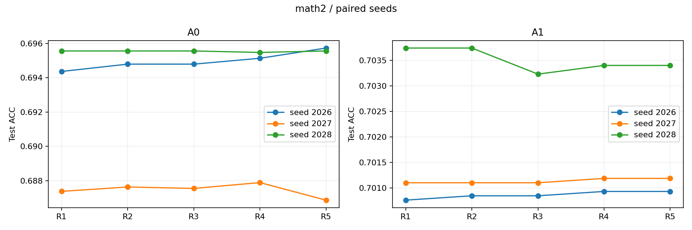
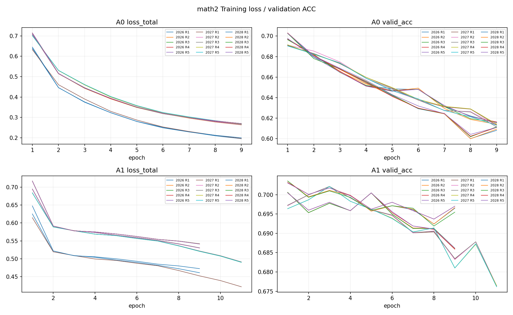
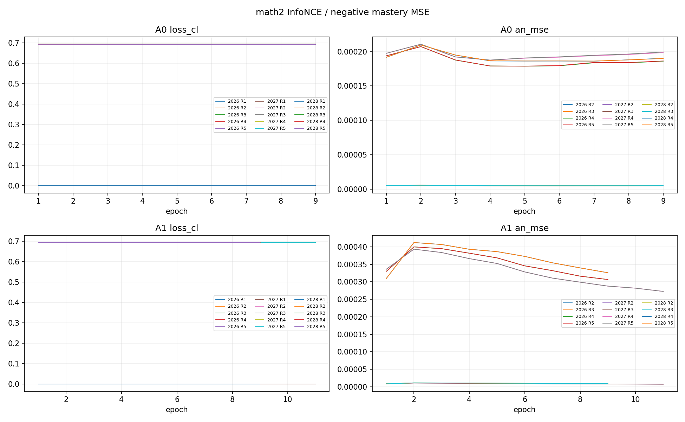
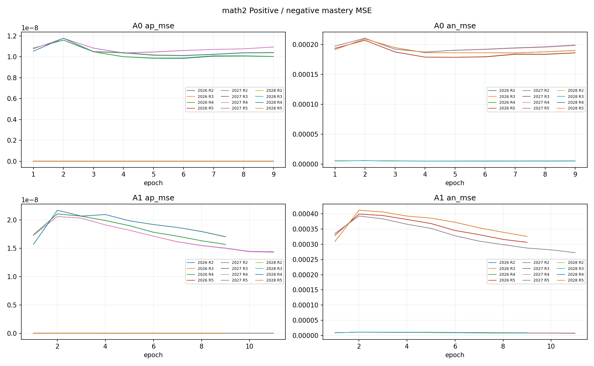
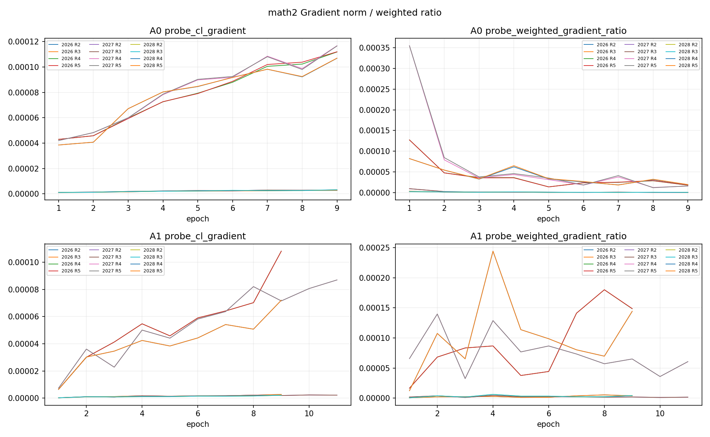

# math2：无 Support/Query 的学生掌握度对比实验

实验ID：student_cl_no_support_query_M_20261124_math2。已完成 36/36 组；全部完成。

## 实验设置

按作答记录训练，每批128条；输入为完整训练矩阵对应的学生行和题目列，不隐藏当前训练目标。验证/测试只使用训练作答作为证据。两个输入不拼接，仅增强学生输入；题目输入保持干净。缺失0不变，连续均匀噪声裁剪至[-1,1]。

对比对象为真实参与预测的学生掌握度 m=diagnose_theta(学生输入)。原始干净输入计算预测损失；学生正负视图计算掌握度InfoNCE（余弦、温度0.2）。题目输入不增强、不参与对比优化，但题目网络仍由原预测损失训练。

A0=固定参考Q；A1=原Weak-Q设置。R0=按原IDCDataset取完整行列的无CL参考路径；R1=新入口CL关闭；R2–R5的λ=0.1。R0不是原仓库所有默认配置的完整复刻。

α=0.8，隐藏维度32，Adam学习率0.001、Q学习率0.005；Weak-Q与coverage系数均为0.01。最多30轮，验证ACC选模，平分保留最早轮，patience=8。种子2026/2027/2028。

| 条件 | 正比例 | 正幅度 | 负比例 | 负幅度 |
| --- | --- | --- | --- | --- |
| R2 | 0.1 | 0.01 | 0.5 | 0.1 |
| R3 | 0.01 | 0.001 | 0.5 | 0.1 |
| R4 | 0.1 | 0.01 | 0.7 | 0.5 |
| R5 | 0.01 | 0.001 | 0.7 | 0.5 |

与旧实验相比同时改变了输入遮蔽、训练取样和对比对象，且每轮更新次数增加，不能用新旧结果差直接归因某一项改变。

## 逐种子结果

所有ACC/AUC来自最佳验证ACC的同一checkpoint。每个种子单独列出，不按测试集选种子；Δ为同Q同种子相对R1的差值（比例单位）。

| Q | seed | 条件 | λ | 最佳轮 | valid ACC | test ACC | test AUC | ΔACC | ΔAUC |
| --- | --- | --- | --- | --- | --- | --- | --- | --- | --- |
| A0 | 2026 | R1 | 0 | 1 | 0.697008438 | 0.694366317 | 0.76789287 | 0 | 0 |
| A0 | 2026 | R2 | 0.1 | 1 | 0.69649706 | 0.694792466 | 0.76792297 | 0.00042614847 | 3.00997755e-05 |
| A0 | 2026 | R3 | 0.1 | 1 | 0.69649706 | 0.694792466 | 0.767922709 | 0.00042614847 | 2.98381647e-05 |
| A0 | 2026 | R4 | 0.1 | 1 | 0.697264127 | 0.695133384 | 0.767847888 | 0.000767067246 | -4.49825229e-05 |
| A0 | 2026 | R5 | 0.1 | 1 | 0.69764766 | 0.695729992 | 0.768222049 | 0.0013636751 | 0.000329179051 |
| A0 | 2027 | R1 | 0 | 1 | 0.690744055 | 0.687377482 | 0.761363152 | 0 | 0 |
| A0 | 2027 | R2 | 0.1 | 1 | 0.691255433 | 0.687633171 | 0.761438903 | 0.000255689082 | 7.57508593e-05 |
| A0 | 2027 | R3 | 0.1 | 1 | 0.691255433 | 0.687547942 | 0.761169357 | 0.000170459388 | -0.000193795464 |
| A0 | 2027 | R4 | 0.1 | 1 | 0.691511122 | 0.68788886 | 0.7620117 | 0.000511378164 | 0.000648547697 |
| A0 | 2027 | R5 | 0.1 | 1 | 0.690360522 | 0.686866104 | 0.760938049 | -0.000511378164 | -0.000425103009 |
| A0 | 2028 | R1 | 0 | 1 | 0.702633598 | 0.695559533 | 0.768625671 | 0 | 0 |
| A0 | 2028 | R2 | 0.1 | 1 | 0.702633598 | 0.695559533 | 0.768624043 | 0 | -1.62780051e-06 |
| A0 | 2028 | R3 | 0.1 | 1 | 0.702633598 | 0.695559533 | 0.768624814 | 0 | -8.57502053e-07 |
| A0 | 2028 | R4 | 0.1 | 1 | 0.703017131 | 0.695474303 | 0.768581779 | -8.5229694e-05 | -4.3892478e-05 |
| A0 | 2028 | R5 | 0.1 | 1 | 0.702761442 | 0.695559533 | 0.768610367 | 0 | -1.53042316e-05 |
| A1 | 2026 | R1 | 0 | 1 | 0.700588085 | 0.700758544 | 0.77177891 | 0 | 0 |
| A1 | 2026 | R2 | 0.1 | 1 | 0.700588085 | 0.700843774 | 0.771778895 | 8.5229694e-05 | -1.45339332e-08 |
| A1 | 2026 | R3 | 0.1 | 1 | 0.700588085 | 0.700843774 | 0.771779026 | 8.5229694e-05 | 1.16271465e-07 |
| A1 | 2026 | R4 | 0.1 | 1 | 0.70046024 | 0.700929004 | 0.771773605 | 0.000170459388 | -5.30488558e-06 |
| A1 | 2026 | R5 | 0.1 | 1 | 0.70046024 | 0.700929004 | 0.771774143 | 0.000170459388 | -4.76713006e-06 |
| A1 | 2027 | R1 | 0 | 3 | 0.702122219 | 0.701099463 | 0.775481662 | 0 | 0 |
| A1 | 2027 | R2 | 0.1 | 3 | 0.702122219 | 0.701099463 | 0.775481851 | 0 | 1.8894113e-07 |
| A1 | 2027 | R3 | 0.1 | 3 | 0.702122219 | 0.701099463 | 0.775480339 | 0 | -1.32258791e-06 |
| A1 | 2027 | R4 | 0.1 | 3 | 0.702122219 | 0.701184693 | 0.775545655 | 8.5229694e-05 | 6.39929074e-05 |
| A1 | 2027 | R5 | 0.1 | 3 | 0.702122219 | 0.701184693 | 0.775545829 | 8.5229694e-05 | 6.41673146e-05 |
| A1 | 2028 | R1 | 0 | 1 | 0.703528509 | 0.703741584 | 0.773362687 | 0 | 0 |
| A1 | 2028 | R2 | 0.1 | 1 | 0.703528509 | 0.703741584 | 0.773363341 | 0 | 6.5402699e-07 |
| A1 | 2028 | R3 | 0.1 | 1 | 0.703528509 | 0.703230205 | 0.773302182 | -0.000511378164 | -6.05047635e-05 |
| A1 | 2028 | R4 | 0.1 | 1 | 0.703144976 | 0.703400665 | 0.772979602 | -0.000340918776 | -0.000383085409 |
| A1 | 2028 | R5 | 0.1 | 1 | 0.703017131 | 0.703400665 | 0.772975532 | -0.000340918776 | -0.00038715491 |

## 核验与模型响应

两种Q、四种噪声预检通过：零系数预测/损失/单步更新/RNG一致；学生增强与缺失值保护通过，学生网络对比梯度及更新差异非零，题目网络和聚合层无直接对比梯度。固定Q还在参数对齐后核对了原GNCDM前向输出。

已完成checkpoint回放 36 组；完整训练R0/R1精确一致性已通过 6/6 对。梯度范数以下取每轮第一个batch的诊断均值，并非全程所有batch统计。

| Q | seed | 条件 | CL损失 | 正m MSE | 负m MSE | CL梯度 | 加权CL/原梯度 | 正学生MAE | 负学生MAE | 正题目MAE | 负题目MAE |
| --- | --- | --- | --- | --- | --- | --- | --- | --- | --- | --- | --- |
| A0 | 2026 | R2 | 0.693129722 | 1.03222561e-08 | 5.13403975e-06 | 2.03431781e-06 | 1.016099e-06 | 0.000250115617 | 0.0125105274 | 0 | 0 |
| A0 | 2026 | R3 | 0.69312967 | 1.03226171e-11 | 5.13226413e-06 | 2.03653e-06 | 1.02114399e-06 | 2.49630849e-06 | 0.0125105274 | 0 | 0 |
| A0 | 2026 | R4 | 0.692515685 | 1.0303252e-08 | 0.000186567018 | 7.80887624e-05 | 3.95533491e-05 | 0.000250115617 | 0.0875196096 | 0 | 0 |
| A0 | 2026 | R5 | 0.692515066 | 1.03115649e-11 | 0.000186771586 | 7.8441361e-05 | 3.95183615e-05 | 2.49630849e-06 | 0.0875196096 | 0 | 0 |
| A0 | 2027 | R2 | 0.693129363 | 1.07926089e-08 | 5.36285808e-06 | 2.26651699e-06 | 1.94604606e-06 | 0.000249658605 | 0.0125098965 | 0 | 0 |
| A0 | 2027 | R3 | 0.69312932 | 1.09117697e-11 | 5.36804685e-06 | 2.27289744e-06 | 1.9438932e-06 | 2.51003233e-06 | 0.0125098965 | 0 | 0 |
| A0 | 2027 | R4 | 0.692504931 | 1.08054208e-08 | 0.00019532656 | 8.15102936e-05 | 6.98212959e-05 | 0.000249658605 | 0.0875778344 | 0 | 0 |
| A0 | 2027 | R5 | 0.692503051 | 1.09418861e-11 | 0.00019572547 | 8.15662994e-05 | 7.17324779e-05 | 2.51003233e-06 | 0.0875778344 | 0 | 0 |
| A0 | 2028 | R2 | 0.693130021 | 1.04752354e-08 | 5.22268927e-06 | 2.14982223e-06 | 1.09664008e-06 | 0.000250105239 | 0.0124973308 | 0 | 0 |
| A0 | 2028 | R3 | 0.693129966 | 1.03758046e-11 | 5.23235838e-06 | 2.16093248e-06 | 1.11030479e-06 | 2.4718024e-06 | 0.0124973308 | 0 | 0 |
| A0 | 2028 | R4 | 0.692526581 | 1.05074448e-08 | 0.000191029633 | 7.7791341e-05 | 3.9860509e-05 | 0.000250105239 | 0.0875251279 | 0 | 0 |
| A0 | 2028 | R5 | 0.692525755 | 1.03948585e-11 | 0.00019107942 | 7.78515899e-05 | 4.05304117e-05 | 2.4718024e-06 | 0.0875251279 | 0 | 0 |
| A1 | 2026 | R2 | 0.693138848 | 1.83425812e-08 | 9.50254766e-06 | 1.46668121e-06 | 2.45865018e-06 | 0.000250115617 | 0.0125105274 | 0 | 0 |
| A1 | 2026 | R3 | 0.693138836 | 1.81118643e-11 | 9.5025539e-06 | 1.46927621e-06 | 2.46271584e-06 | 2.49630849e-06 | 0.0125105274 | 0 | 0 |
| A1 | 2026 | R4 | 0.692833873 | 1.83379864e-08 | 0.00035271944 | 5.33444731e-05 | 8.95900151e-05 | 0.000250115617 | 0.0875196096 | 0 | 0 |
| A1 | 2026 | R5 | 0.692833872 | 1.81063849e-11 | 0.000352722735 | 5.33478194e-05 | 8.9623364e-05 | 2.49630849e-06 | 0.0875196096 | 0 | 0 |
| A1 | 2027 | R2 | 0.693137752 | 1.71200127e-08 | 8.8915238e-06 | 1.50326632e-06 | 2.09671976e-06 | 0.000249618439 | 0.0125018801 | 0 | 0 |
| A1 | 2027 | R3 | 0.693137735 | 1.71200994e-11 | 8.89165497e-06 | 1.505997e-06 | 2.10051577e-06 | 2.50137901e-06 | 0.0125018801 | 0 | 0 |
| A1 | 2027 | R4 | 0.69279683 | 1.70912146e-08 | 0.000328286853 | 5.48871123e-05 | 7.47112428e-05 | 0.000249618439 | 0.0875269118 | 0 | 0 |
| A1 | 2027 | R5 | 0.692796794 | 1.70930584e-11 | 0.000328289235 | 5.48877906e-05 | 7.47197988e-05 | 2.50137901e-06 | 0.0875269118 | 0 | 0 |
| A1 | 2028 | R2 | 0.693140625 | 1.91076188e-08 | 9.90351461e-06 | 1.16879174e-06 | 2.93764826e-06 | 0.000250105239 | 0.0124973308 | 0 | 0 |
| A1 | 2028 | R3 | 0.693140615 | 1.87457818e-11 | 9.89942933e-06 | 1.16835487e-06 | 2.93503476e-06 | 2.4718024e-06 | 0.0124973308 | 0 | 0 |
| A1 | 2028 | R4 | 0.692905765 | 1.9087199e-08 | 0.000366664623 | 4.14748289e-05 | 0.00010400588 | 0.000250105239 | 0.0875251279 | 0 | 0 |
| A1 | 2028 | R5 | 0.692905737 | 1.87354683e-11 | 0.000366662581 | 4.14794676e-05 | 0.000104025556 | 2.4718024e-06 | 0.0875251279 | 0 | 0 |

参数相对L2差异=‖W条件−W基线‖/‖W基线‖，比较各自选中的checkpoint；若最佳轮不同，差异也包含训练轮次效应。题目侧后续更新可因学生参数改变而间接受影响，不能将最终差异误解为题目侧收到了直接对比梯度。

| Q | seed | 条件 | 学生网络 | 题目网络 | 学生聚合层 | 题目聚合层 |
| --- | --- | --- | --- | --- | --- | --- |
| A0 | 2026 | R2 | 0.0280281964 | 0.182068735 | 0.00297668379 | 0.00320208924 |
| A0 | 2026 | R3 | 0.0280273988 | 0.18807664 | 0.00309380531 | 0.00319761787 |
| A0 | 2026 | R4 | 0.0331898825 | 0.265060176 | 0.0536719892 | 0.00701018385 |
| A0 | 2026 | R5 | 0.0332086776 | 0.28785349 | 0.0536791805 | 0.0072503531 |
| A0 | 2027 | R2 | 0.0449774565 | 0.224556718 | 0.00827272673 | 0.00583275507 |
| A0 | 2027 | R3 | 0.0449498267 | 0.205450988 | 0.00814946104 | 0.00575248341 |
| A0 | 2027 | R4 | 0.0719699324 | 0.265329038 | 0.0330904615 | 0.0201893544 |
| A0 | 2027 | R5 | 0.0719075329 | 0.25725941 | 0.032266591 | 0.0195469286 |
| A0 | 2028 | R2 | 0.00294841267 | 0.000369193774 | 0.000101550428 | 1.66994298e-05 |
| A0 | 2028 | R3 | 0.00294833499 | 0.000649458414 | 0.000101736095 | 1.81181879e-05 |
| A0 | 2028 | R4 | 0.129036991 | 0.0452066076 | 0.00429849218 | 0.000399128456 |
| A0 | 2028 | R5 | 0.129042276 | 0.0249528853 | 0.00430497965 | 0.000243999927 |
| A1 | 2026 | R2 | 3.04094195e-05 | 0.00615413648 | 6.20800486e-06 | 1.67033939e-05 |
| A1 | 2026 | R3 | 3.65348667e-05 | 0.00716560046 | 7.28941402e-06 | 2.05547665e-05 |
| A1 | 2026 | R4 | 0.00116250495 | 0.0557349036 | 0.000283377244 | 0.000112282141 |
| A1 | 2026 | R5 | 0.00131544346 | 0.0558665588 | 0.000283253298 | 0.000110156916 |
| A1 | 2027 | R2 | 0.00180503642 | 0.0449176894 | 0.00228096008 | 2.64437032e-05 |
| A1 | 2027 | R3 | 0.00395765754 | 0.0371460167 | 0.00304927785 | 6.58023697e-05 |
| A1 | 2027 | R4 | 0.0101667343 | 0.226320968 | 0.0166995522 | 0.00728274191 |
| A1 | 2027 | R5 | 0.0102256377 | 0.226147012 | 0.0166995361 | 0.00728335016 |
| A1 | 2028 | R2 | 0.00245807762 | 0.00321646079 | 2.56203762e-05 | 1.19198786e-05 |
| A1 | 2028 | R3 | 0.00251302473 | 0.0821169444 | 0.000455218978 | 0.000559474309 |
| A1 | 2028 | R4 | 0.0069084702 | 0.234024513 | 0.00400033485 | 0.00280761886 |
| A1 | 2028 | R5 | 0.00691371616 | 0.233084331 | 0.00400076819 | 0.00280773124 |

## 图表

## 结果解读

A0 R2：3个配对种子，ACC提高/不变/降低=2/1/0；逐种子差值为 +0.000426148, +0.000255689, +0.000000000。

A0 R3：3个配对种子，ACC提高/不变/降低=2/1/0；逐种子差值为 +0.000426148, +0.000170459, +0.000000000。

A0 R4：3个配对种子，ACC提高/不变/降低=2/0/1；逐种子差值为 +0.000767067, +0.000511378, -0.000085230。

A0 R5：3个配对种子，ACC提高/不变/降低=1/1/1；逐种子差值为 +0.001363675, -0.000511378, +0.000000000。

A1 R2：3个配对种子，ACC提高/不变/降低=1/2/0；逐种子差值为 +0.000085230, +0.000000000, +0.000000000。

A1 R3：3个配对种子，ACC提高/不变/降低=1/1/1；逐种子差值为 +0.000085230, +0.000000000, -0.000511378。

A1 R4：3个配对种子，ACC提高/不变/降低=2/0/1；逐种子差值为 +0.000170459, +0.000085230, -0.000340919。

A1 R5：3个配对种子，ACC提高/不变/降低=2/0/1；逐种子差值为 +0.000170459, +0.000085230, -0.000340919。

参数与梯度非零仅证明参与优化；预测收益应同时看ACC/AUC和全部配对种子。负视图仍是同一作答的连续证据扰动，不保证其语义上应被推远。InfoNCE无margin，不报告虚构的margin激活率。

核验修复说明：首次预检的诊断工具未处理整组梯度为空，修正范数统计后重测。题目分支无直接对比梯度是预期行为；未改变模型或损失，失败日志保留在临时核验目录。
